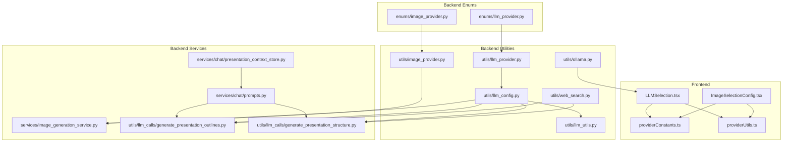
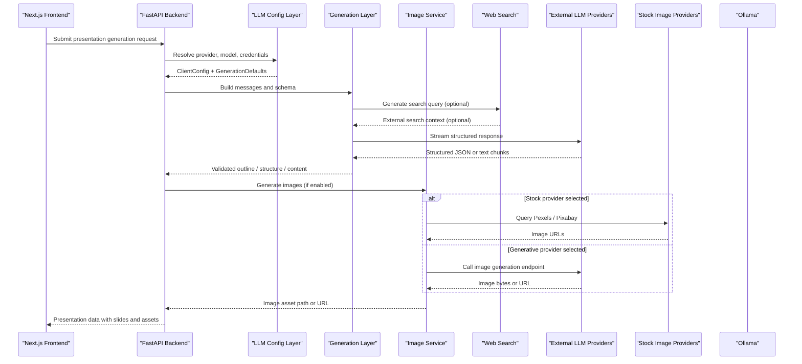
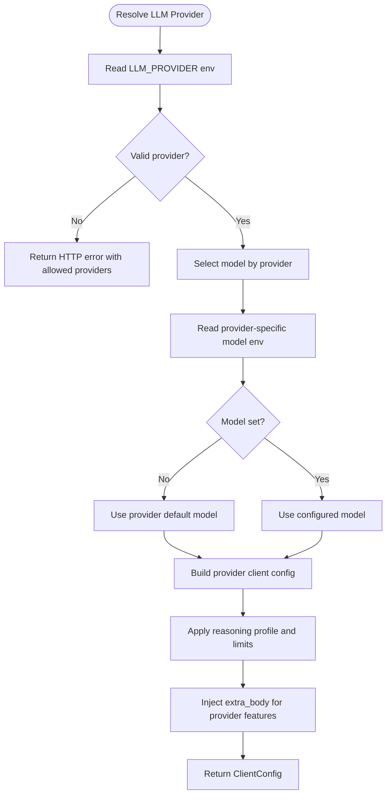
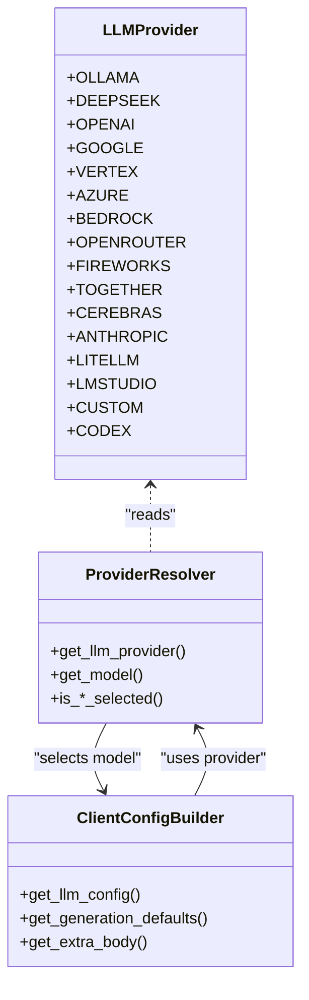
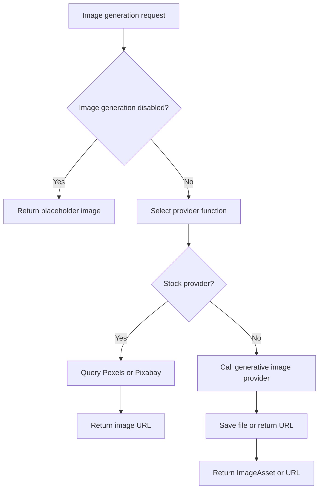
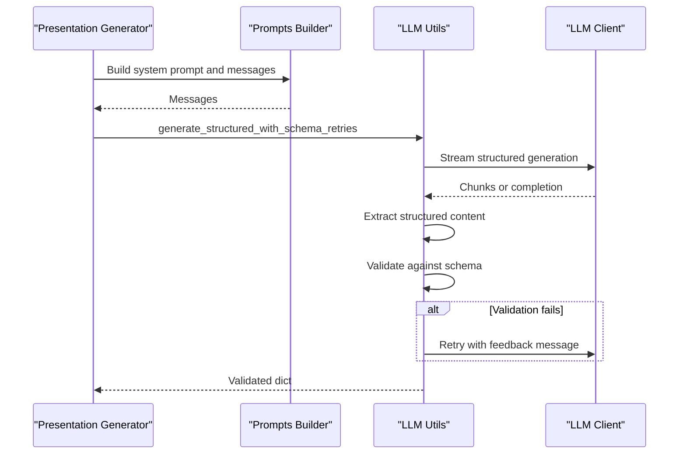
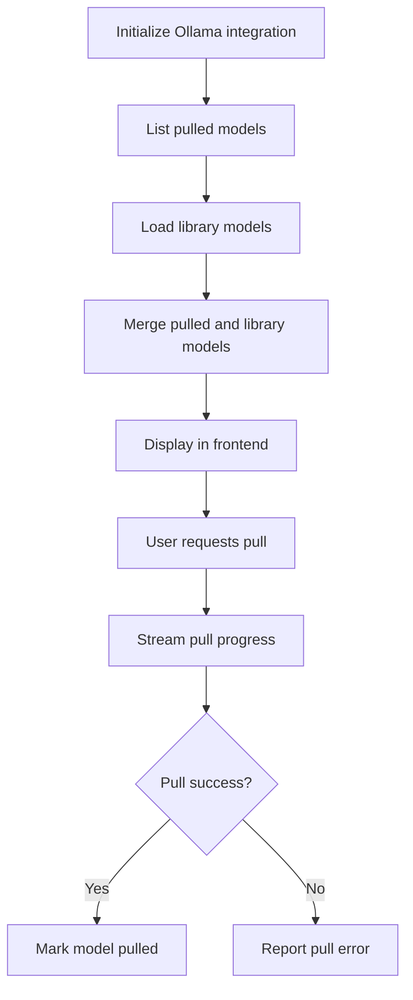
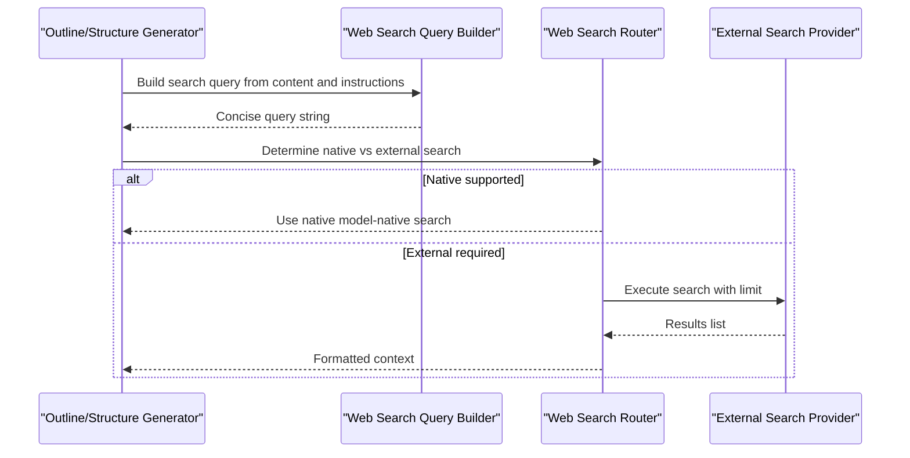
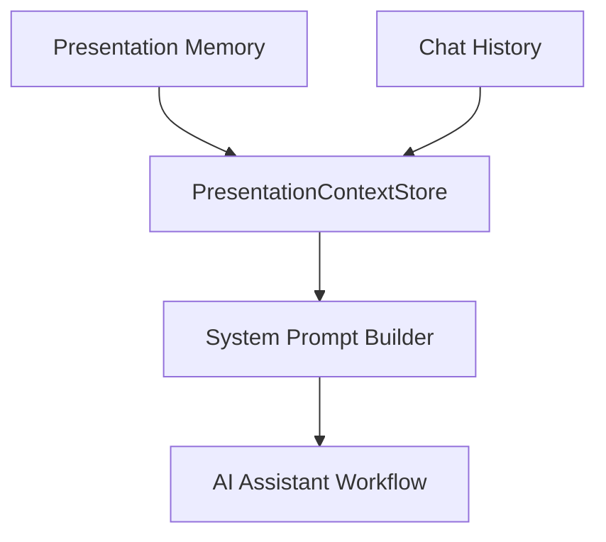
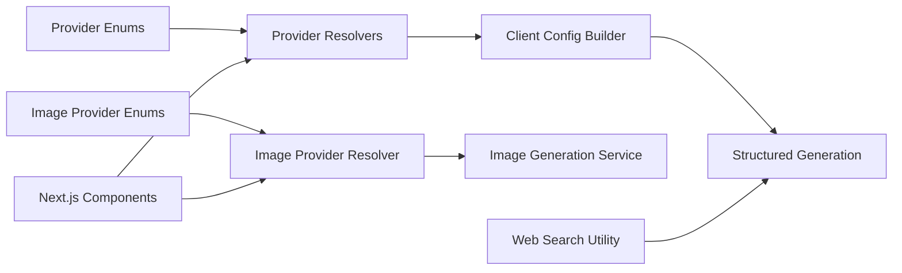

# AI Integration

<cite>
**Referenced Files in This Document**   
- [llm_provider.py](file://servers/fastapi/utils/llm_provider.py)
- [llm_config.py](file://servers/fastapi/utils/llm_config.py)
- [llm_utils.py](file://servers/fastapi/utils/llm_utils.py)
- [image_generation_service.py](file://servers/fastapi/services/image_generation_service.py)
- [web_search.py](file://servers/fastapi/utils/web_search.py)
- [ollama.py](file://servers/fastapi/utils/ollama.py)
- [supported_ollama_models.py](file://servers/fastapi/constants/supported_ollama_models.py)
- [generate_presentation_outlines.py](file://servers/fastapi/utils/llm_calls/generate_presentation_outlines.py)
- [generate_presentation_structure.py](file://servers/fastapi/utils/llm_calls/generate_presentation_structure.py)
- [prompts.py](file://servers/fastapi/services/chat/prompts.py)
- [presentation_context_store.py](file://servers/fastapi/services/chat/presentation_context_store.py)
- [llm_provider.py](file://servers/fastapi/enums/llm_provider.py)
- [image_provider.py](file://servers/fastapi/enums/image_provider.py)
- [image_provider.py](file://servers/fastapi/utils/image_provider.py)
- [LLMSelection.tsx](file://servers/nextjs/components/LLMSelection.tsx)
- [ImageSelectionConfig.tsx](file://servers/nextjs/components/ImageSelectionConfig.tsx)
- [providerConstants.ts](file://servers/nextjs/utils/providerConstants.ts)
- [providerUtils.ts](file://servers/nextjs/utils/providerUtils.ts)
</cite>

## Table of Contents
1. [Introduction](#introduction)
2. [Project Structure](#project-structure)
3. [Core Components](#core-components)
4. [Architecture Overview](#architecture-overview)
5. [Detailed Component Analysis](#detailed-component-analysis)
6. [Dependency Analysis](#dependency-analysis)
7. [Performance Considerations](#performance-considerations)
8. [Troubleshooting Guide](#troubleshooting-guide)
9. [Conclusion](#conclusion)

## Introduction
This document explains Presenton’s AI integration system: a unified provider abstraction for large language models, an image generation service with multiple providers, prompt engineering and response parsing pipelines, local model support through Ollama, web search grounding, and runtime configuration management. It is intended for developers and operators who need to understand how OpenAI, Google Gemini, Anthropic Claude, Azure OpenAI, Amazon Bedrock, OpenRouter, Together, Fireworks, Cerebras, DeepSeek, LiteLLM, LM Studio, Custom OpenAI-compatible endpoints, ChatGPT Codex, and local Ollama models are selected, authenticated, configured, and invoked during presentation generation.

## Project Structure
The AI integration spans the FastAPI backend and the Next.js frontend:

- Backend enums define supported LLM and image providers.
- Backend utilities resolve provider configuration, credentials, model names, and client construction.
- Backend services implement image generation, web search grounding, and structured content generation.
- Frontend components expose provider selection, API key entry, model selection, and image provider configuration.

**Diagram sources**   
- [LLMSelection.tsx:1-406](file://servers/nextjs/components/LLMSelection.tsx#L1-L406)
- [ImageSelectionConfig.tsx:1-394](file://servers/nextjs/components/ImageSelectionConfig.tsx#L1-L394)
- [providerConstants.ts:96-134](file://servers/nextjs/utils/providerConstants.ts#L96-L134)
- [providerUtils.ts:229-317](file://servers/nextjs/utils/providerUtils.ts#L229-L317)
- [llm_provider.py:1-21](file://servers/fastapi/enums/llm_provider.py#L1-L21)
- [image_provider.py:1-14](file://servers/fastapi/enums/image_provider.py#L1-L14)
- [llm_provider.py:1-194](file://servers/fastapi/utils/llm_provider.py#L1-L194)
- [llm_config.py:1-525](file://servers/fastapi/utils/llm_config.py#L1-L525)
- [llm_utils.py:1-536](file://servers/fastapi/utils/llm_utils.py#L1-L536)
- [image_generation_service.py:1-800](file://servers/fastapi/services/image_generation_service.py#L1-L800)
- [web_search.py:1-330](file://servers/fastapi/utils/web_search.py#L1-L330)
- [ollama.py:1-202](file://servers/fastapi/utils/ollama.py#L1-L202)
- [generate_presentation_outlines.py:1-74](file://servers/fastapi/utils/llm_calls/generate_presentation_outlines.py#L1-L74)
- [generate_presentation_structure.py:150-188](file://servers/fastapi/utils/llm_calls/generate_presentation_structure.py#L150-L188)
- [prompts.py:1-251](file://servers/fastapi/services/chat/prompts.py#L1-L251)
- [presentation_context_store.py:1-5](file://servers/fastapi/services/chat/presentation_context_store.py#L1-L5)

**Section sources**   
- [llm_provider.py:1-21](file://servers/fastapi/enums/llm_provider.py#L1-L21)
- [image_provider.py:1-14](file://servers/fastapi/enums/image_provider.py#L1-L14)
- [LLMSelection.tsx:1-406](file://servers/nextjs/components/LLMSelection.tsx#L1-L406)
- [ImageSelectionConfig.tsx:1-394](file://servers/nextjs/components/ImageSelectionConfig.tsx#L1-L394)

## Core Components
- Unified LLM provider abstraction: resolves provider, model name, credentials, and client configuration from environment variables and runtime settings.
- Image generation service: routes requests to stock photo providers or generative image providers, including OpenAI GPT Image models, Gemini Flash, ComfyUI, Open WebUI, and OpenAI-compatible endpoints.
- Web search grounding: generates concise search queries and integrates external search providers or native model-native search when available.
- Prompt engineering framework: builds system prompts, outlines, structure, and slide content with schema-driven validation and streaming.
- Local model support: discovers, pulls, and runs models via Ollama, with library metadata and parameter sizing.
- Frontend configuration UI: lets users select text LLM provider, image provider, API keys, models, and advanced options.

**Section sources**   
- [llm_provider.py:47-194](file://servers/fastapi/utils/llm_provider.py#L47-L194)
- [llm_config.py:100-244](file://servers/fastapi/utils/llm_config.py#L100-L244)
- [image_generation_service.py:132-235](file://servers/fastapi/services/image_generation_service.py#L132-L235)
- [web_search.py:39-188](file://servers/fastapi/utils/web_search.py#L39-L188)
- [ollama.py:45-146](file://servers/fastapi/utils/ollama.py#L45-L146)
- [LLMSelection.tsx:40-118](file://servers/nextjs/components/LLMSelection.tsx#L40-L118)

## Architecture Overview
Presenton uses a layered architecture:

- Configuration layer reads environment variables and validates provider-specific requirements.
- Client construction layer builds provider-specific clients through llmai and FastAPI helpers.
- Generation layer orchestrates outline, structure, and slide content generation using structured responses and streaming.
- Image layer selects stock or generative image providers based on runtime configuration.
- Search layer provides factual context through external search APIs or native model capabilities.
- Frontend layer exposes provider selection, credential input, model discovery, and image provider configuration.

**Diagram sources**   
- [llm_config.py:247-486](file://servers/fastapi/utils/llm_config.py#L247-L486)
- [generate_presentation_outlines.py:1-74](file://servers/fastapi/utils/llm_calls/generate_presentation_outlines.py#L1-L74)
- [generate_presentation_structure.py:150-188](file://servers/fastapi/utils/llm_calls/generate_presentation_structure.py#L150-L188)
- [image_generation_service.py:132-235](file://servers/fastapi/services/image_generation_service.py#L132-L235)
- [web_search.py:97-188](file://servers/fastapi/utils/web_search.py#L97-L188)

## Detailed Component Analysis

### Unified LLM Provider Abstraction
The unified interface abstracts multiple LLM providers behind consistent configuration and client construction:

- Provider enumeration defines supported providers.
- Provider resolution reads the active provider and validates it.
- Model resolution returns the correct model name per provider, with defaults and special handling for Codex.
- Client configuration maps each provider to its SDK client configuration, including authentication, base URLs, regions, projects, deployments, and reasoning settings.
- Extra body injection supports provider-specific behavior such as OpenRouter provider ordering and fallback policies.

**Diagram sources**   
- [llm_provider.py:47-174](file://servers/fastapi/utils/llm_provider.py#L47-L174)
- [llm_config.py:189-244](file://servers/fastapi/utils/llm_config.py#L189-L244)
- [llm_config.py:489-525](file://servers/fastapi/utils/llm_config.py#L489-L525)

**Section sources**   
- [llm_provider.py:1-21](file://servers/fastapi/enums/llm_provider.py#L1-L21)
- [llm_provider.py:47-194](file://servers/fastapi/utils/llm_provider.py#L47-L194)
- [llm_config.py:247-486](file://servers/fastapi/utils/llm_config.py#L247-L486)

### Credential Management and Runtime Switching
Credentials are managed through environment variables and validated at configuration time:

- Each provider requires specific keys, endpoints, regions, or project identifiers.
- Missing or invalid credentials raise explicit HTTP errors before any network call.
- Runtime switching is controlled by changing the active provider and model environment values; the frontend updates user-facing configuration and persists it through the application’s configuration store.
- Special flows include Azure OpenAI deployment and endpoint selection, Vertex project/location vs API key modes, Bedrock AWS credentials or API key, and ChatGPT Codex token refresh.

**Diagram sources**   
- [llm_provider.py:1-21](file://servers/fastapi/enums/llm_provider.py#L1-L21)
- [llm_provider.py:47-194](file://servers/fastapi/utils/llm_provider.py#L47-L194)
- [llm_config.py:189-525](file://servers/fastapi/utils/llm_config.py#L189-L525)

**Section sources**   
- [llm_config.py:108-166](file://servers/fastapi/utils/llm_config.py#L108-L166)
- [llm_config.py:247-486](file://servers/fastapi/utils/llm_config.py#L247-L486)
- [LLMSelection.tsx:40-118](file://servers/nextjs/components/LLMSelection.tsx#L40-L118)

### Image Generation Service Integration
The image generation service centralizes image sourcing:

- Stock providers: Pexels and Pixabay return curated image URLs.
- Generative providers: OpenAI GPT Image 2 and GPT Image 1.5, Gemini Flash, NanoBanana Pro, ComfyUI workflows, Open WebUI, and OpenAI-compatible image endpoints.
- Size and aspect ratio handling adapts to provider constraints.
- Parallel generation can be enabled; otherwise, a process-wide lock serializes requests.
- Errors are normalized and surfaced with actionable details.

**Diagram sources**   
- [image_generation_service.py:132-235](file://servers/fastapi/services/image_generation_service.py#L132-L235)
- [image_provider.py:1-62](file://servers/fastapi/utils/image_provider.py#L1-L62)

**Section sources**   
- [image_generation_service.py:1-800](file://servers/fastapi/services/image_generation_service.py#L1-L800)
- [image_provider.py:1-14](file://servers/fastapi/enums/image_provider.py#L1-L14)
- [image_provider.py:1-62](file://servers/fastapi/utils/image_provider.py#L1-L62)
- [ImageSelectionConfig.tsx:104-394](file://servers/nextjs/components/ImageSelectionConfig.tsx#L104-L394)

### Prompt Engineering Framework, Response Parsing, and Content Transformation
Prompt engineering and response parsing are implemented across several modules:

- System prompts define assistant behavior, tool usage rules, slide composition guidelines, and chart/table/vector constraints.
- Outline and structure generation build messages, apply schemas, and stream structured outputs.
- Response parsing extracts structured JSON from mixed content, retries failed generations, and applies schema validation feedback loops.
- Metrics capture token usage, throughput, thinking tokens, and duration.

**Diagram sources**   
- [prompts.py:10-166](file://servers/fastapi/services/chat/prompts.py#L10-L166)
- [llm_utils.py:310-389](file://servers/fastapi/utils/llm_utils.py#L310-L389)
- [llm_utils.py:414-446](file://servers/fastapi/utils/llm_utils.py#L414-L446)
- [generate_presentation_outlines.py:1-74](file://servers/fastapi/utils/llm_calls/generate_presentation_outlines.py#L1-L74)
- [generate_presentation_structure.py:150-188](file://servers/fastapi/utils/llm_calls/generate_presentation_structure.py#L150-L188)

**Section sources**   
- [prompts.py:1-251](file://servers/fastapi/services/chat/prompts.py#L1-L251)
- [llm_utils.py:68-107](file://servers/fastapi/utils/llm_utils.py#L68-L107)
- [llm_utils.py:310-389](file://servers/fastapi/utils/llm_utils.py#L310-L389)
- [llm_utils.py:414-446](file://servers/fastapi/utils/llm_utils.py#L414-L446)
- [generate_presentation_outlines.py:1-74](file://servers/fastapi/utils/llm_calls/generate_presentation_outlines.py#L1-L74)
- [generate_presentation_structure.py:150-188](file://servers/fastapi/utils/llm_calls/generate_presentation_structure.py#L150-L188)

### Local Model Support Through Ollama
Ollama integration supports local model discovery, pulling, and parameter inference:

- Library models provide known model names, labels, sizes, and parameter suffixes.
- Available models are fetched from the running Ollama instance.
- Pull progress is streamed as events.
- The frontend caches and displays reachable models and library suggestions.

**Diagram sources**   
- [ollama.py:27-42](file://servers/fastapi/utils/ollama.py#L27-L42)
- [ollama.py:90-146](file://servers/fastapi/utils/ollama.py#L90-L146)
- [ollama.py:149-202](file://servers/fastapi/utils/ollama.py#L149-L202)
- [providerUtils.ts:232-309](file://servers/nextjs/utils/providerUtils.ts#L232-L309)

**Section sources**   
- [ollama.py:1-202](file://servers/fastapi/utils/ollama.py#L1-L202)
- [supported_ollama_models.py:1-51](file://servers/fastapi/constants/supported_ollama_models.py#L1-L51)
- [providerUtils.ts:229-317](file://servers/nextjs/utils/providerUtils.ts#L229-L317)
- [LLMSelection.tsx:278-285](file://servers/nextjs/components/LLMSelection.tsx#L278-L285)

### Web Search Grounding and External Knowledge Integration
Web search grounding enhances factual accuracy:

- A dedicated prompt generates concise search queries tailored to presentation topics.
- External providers include SearXNG, Tavily, Exa, Brave, and Serper.
- Native model-native search is preferred when supported by the selected LLM provider.
- Results are formatted into safe context blocks for the LLM.

**Diagram sources**   
- [generate_web_search_query.py:1-41](file://servers/fastapi/utils/llm_calls/generate_web_search_query.py#L1-L41)
- [web_search.py:39-188](file://servers/fastapi/utils/web_search.py#L39-L188)

**Section sources**   
- [web_search.py:1-330](file://servers/fastapi/utils/web_search.py#L1-L330)
- [generate_presentation_outlines.py:1-74](file://servers/fastapi/utils/llm_calls/generate_presentation_outlines.py#L1-L74)

### Context Management for AI-Powered Presentation Generation
Context management combines presentation memory, chat history, and tool-driven state:

- Presentation context store aliases a memory layer that maintains deck-wide context.
- Prompts assemble system instructions with presentation memory and chat memory blocks.
- Tool protocols guide the assistant to inspect and mutate slide state safely.

**Diagram sources**   
- [presentation_context_store.py:1-5](file://servers/fastapi/services/chat/presentation_context_store.py#L1-L5)
- [prompts.py:227-251](file://servers/fastapi/services/chat/prompts.py#L227-L251)

**Section sources**   
- [presentation_context_store.py:1-5](file://servers/fastapi/services/chat/presentation_context_store.py#L1-L5)
- [prompts.py:1-251](file://servers/fastapi/services/chat/prompts.py#L1-L251)

## Dependency Analysis
Key dependencies and relationships:

- Enumerations define provider identity and are consumed by resolver utilities.
- Resolver utilities depend on environment accessors and constants.
- Client configuration depends on provider-specific SDK configurations and generation defaults.
- Image generation depends on image provider selection and optional parallel execution.
- Web search depends on provider selection and external API clients.
- Frontend components depend on provider constants and utility functions for model discovery.

**Diagram sources**   
- [llm_provider.py:1-21](file://servers/fastapi/enums/llm_provider.py#L1-L21)
- [image_provider.py:1-14](file://servers/fastapi/enums/image_provider.py#L1-L14)
- [llm_provider.py:47-194](file://servers/fastapi/utils/llm_provider.py#L47-L194)
- [llm_config.py:247-486](file://servers/fastapi/utils/llm_config.py#L247-L486)
- [image_provider.py:1-62](file://servers/fastapi/utils/image_provider.py#L1-L62)
- [image_generation_service.py:132-235](file://servers/fastapi/services/image_generation_service.py#L132-L235)
- [web_search.py:97-188](file://servers/fastapi/utils/web_search.py#L97-L188)
- [LLMSelection.tsx:1-406](file://servers/nextjs/components/LLMSelection.tsx#L1-L406)

**Section sources**   
- [llm_provider.py:47-194](file://servers/fastapi/utils/llm_provider.py#L47-L194)
- [llm_config.py:247-486](file://servers/fastapi/utils/llm_config.py#L247-L486)
- [image_provider.py:1-62](file://servers/fastapi/utils/image_provider.py#L1-L62)
- [image_generation_service.py:132-235](file://servers/fastapi/services/image_generation_service.py#L132-L235)
- [web_search.py:97-188](file://servers/fastapi/utils/web_search.py#L97-L188)

## Performance Considerations
- Streaming generation reduces latency and enables early content delivery.
- Structured generation always streams internally to avoid provider timeouts and long-running non-streaming calls.
- Token metrics estimate throughput even when providers omit usage fields.
- Image generation can run in parallel or be serialized via a shared lock depending on configuration.
- Web search results are limited and logged with timing information.
- Ollama pull operations stream progress without blocking indefinitely.

[No sources needed since this section provides general guidance]

## Troubleshooting Guide

### Provider Connectivity Issues
- Verify the selected LLM provider and ensure the corresponding API key or endpoint is configured.
- For Azure OpenAI, confirm API key, API version, and endpoint/base URL are set.
- For Vertex, configure either API key or project/location, not both ambiguously.
- For Bedrock, provide either API key or AWS access key and secret key.
- For OpenRouter, verify API key and optional base URL.
- For custom endpoints, ensure base URL and optional API key are set.

**Section sources**   
- [llm_config.py:247-486](file://servers/fastapi/utils/llm_config.py#L247-L486)

### Rate Limiting and Fallback Mechanisms
- Structured generation retries failed attempts and can apply schema validation feedback loops.
- OpenRouter supports provider ordering, fallback policies, and data collection controls through extra body configuration.
- Image generation normalizes provider errors and may retry size parameters for OpenAI image models.

**Section sources**   
- [llm_utils.py:310-389](file://servers/fastapi/utils/llm_utils.py#L310-L389)
- [llm_config.py:489-525](file://servers/fastapi/utils/llm_config.py#L489-L525)
- [image_generation_service.py:237-270](file://servers/fastapi/services/image_generation_service.py#L237-L270)

### Ollama Connection Problems
- Ensure Ollama is running and reachable from Presenton.
- In Docker environments, use host.docker.internal instead of localhost.
- Check Ollama URL validation and status codes returned by the Ollama API.

**Section sources**   
- [ollama.py:45-71](file://servers/fastapi/utils/ollama.py#L45-L71)
- [ollama.py:90-146](file://servers/fastapi/utils/ollama.py#L90-L146)

### Image Provider Failures
- Confirm API keys for Pexels, Pixabay, OpenAI, Gemini, Open WebUI, ComfyUI, or OpenAI-compatible image endpoints.
- For Open WebUI, ensure the URL points to the API root and includes `/api/v1` when necessary.
- For ComfyUI, validate workflow JSON and node naming conventions.

**Section sources**   
- [image_generation_service.py:300-389](file://servers/fastapi/services/image_generation_service.py#L300-L389)
- [image_generation_service.py:565-767](file://servers/fastapi/services/image_generation_service.py#L565-L767)

### Web Search Configuration
- Set the desired web search provider and required API keys.
- If native search is unavailable, external search must be explicitly selected.
- Review logs for provider selection, query sanitization, and result formatting.

**Section sources**   
- [web_search.py:39-188](file://servers/fastapi/utils/web_search.py#L39-L188)

## Conclusion
Presenton’s AI integration provides a robust, extensible foundation for multi-provider LLM and image generation workflows. The unified provider abstraction simplifies configuration and runtime switching, while structured generation, prompt engineering, and response parsing ensure reliable content transformation. Local model support through Ollama, web search grounding, and comprehensive troubleshooting guidance make the system adaptable to diverse deployment scenarios and performance requirements.