# Image Generation Services

<cite>
**Referenced Files in This Document**
- [image_generation_service.py](file://servers/fastapi/services/image_generation_service.py)
- [image_provider.py](file://servers/fastapi/utils/image_provider.py)
- [image_provider_enum.py](file://servers/fastapi/enums/image_provider.py)
- [image_prompt.py](file://servers/fastapi/models/image_prompt.py)
- [image_asset.py](file://servers/fastapi/models/sql/image_asset.py)
- [images_endpoint.py](file://servers/fastapi/api/v1/ppt/endpoints/images.py)
- [image_generation_error.py](file://servers/fastapi/utils/image_generation_error.py)
- [get_env.py](file://servers/fastapi/utils/get_env.py)
- [providerConstants.ts](file://servers/nextjs/utils/providerConstants.ts)
</cite>

## Table of Contents
1. [Introduction](#introduction)
2. [Project Structure](#project-structure)
3. [Core Components](#core-components)
4. [Architecture Overview](#architecture-overview)
5. [Detailed Component Analysis](#detailed-component-analysis)
6. [Dependency Analysis](#dependency-analysis)
7. [Performance Considerations](#performance-considerations)
8. [Troubleshooting Guide](#troubleshooting-guide)
9. [Conclusion](#conclusion)
10. [Appendices](#appendices)

## Introduction
This document explains Presenton’s image generation service integration. It covers the unified interface that supports multiple image providers, including stock libraries and AI image generators: Pexels, Pixabay, GPT Image API, Gemini Flash, NanoBanana Pro, ComfyUI, Open WebUI, and OpenAI-compatible image services. It documents how a prompt becomes an optimized presentation asset, how provider configuration and API keys are managed, how quality and size settings are applied, and how errors, fallbacks, and performance tuning work.

The system is centered around a FastAPI backend service that selects a configured provider, calls its API or stock search endpoint, saves generated images to an output directory, and returns either a local file path, a static asset URL, or a remote image URL. A Next.js frontend exposes provider selection UI and environment variable documentation for configuring these integrations.

## Project Structure
The image generation feature spans several layers:

- **API layer**: HTTP endpoints accept prompts, dimensions, and optional provider overrides.
- **Service layer**: `ImageGenerationService` implements the unified workflow and provider dispatch.
- **Provider utilities**: Environment-based selection and helper functions determine which provider is active.
- **Models**: Request models define prompts and target sizes; database models persist generated assets.
- **Error handling**: Provider-specific errors are normalized into consistent HTTP responses.
- **Frontend configuration**: The Next.js side defines provider labels, required API key fields, and help links.

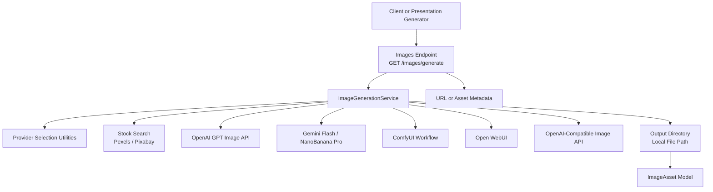

**Diagram sources**
- [images_endpoint.py:166-193](file://servers/fastapi/api/v1/ppt/endpoints/images.py#L166-L193)
- [image_generation_service.py:132-235](file://servers/fastapi/services/image_generation_service.py#L132-L235)
- [image_provider.py:49-61](file://servers/fastapi/utils/image_provider.py#L49-L61)
- [image_asset.py:12-28](file://servers/fastapi/models/sql/image_asset.py#L12-L28)

**Section sources**
- [images_endpoint.py:1-282](file://servers/fastapi/api/v1/ppt/endpoints/images.py#L1-L282)
- [image_generation_service.py:1-800](file://servers/fastapi/services/image_generation_service.py#L1-L800)
- [image_provider.py:1-62](file://servers/fastapi/utils/image_provider.py#L1-L62)
- [image_asset.py:1-29](file://servers/fastapi/models/sql/image_asset.py#L1-L29)

## Core Components
- **Unified service**: `ImageGenerationService` encapsulates provider selection, prompt formatting, size resolution, provider invocation, and result normalization.
- **Provider selection**: Functions read `IMAGE_PROVIDER`, `DISABLE_IMAGE_GENERATION`, and related environment variables to choose between stock and AI providers.
- **Request model**: `ImagePrompt` validates prompt text and paired width/height values, and composes theme-aware prompts when needed.
- **Asset model**: `ImageAsset` persists generated files with ownership, timestamps, upload status, and extras such as original prompt and target dimensions.
- **HTTP endpoints**: `/images/search`, `/images/generate`, `/images/upload`, `/images/generated`, and `/images/uploaded` expose search, generation, upload, listing, and deletion operations.
- **Error normalization**: Errors from providers are converted into structured HTTP exceptions with provider codes where available.

Key responsibilities:
- Selecting the correct provider based on runtime configuration.
- Formatting prompts with theme context for AI providers while using raw queries for stock providers.
- Resolving target sizes into provider-specific formats.
- Returning URLs or persisted asset metadata.
- Normalizing provider failures into user-friendly error responses.

**Section sources**
- [image_generation_service.py:132-235](file://servers/fastapi/services/image_generation_service.py#L132-L235)
- [image_provider.py:9-61](file://servers/fastapi/utils/image_provider.py#L9-L61)
- [image_prompt.py:5-25](file://servers/fastapi/models/image_prompt.py#L5-L25)
- [image_asset.py:12-28](file://servers/fastapi/models/sql/image_asset.py#L12-L28)
- [images_endpoint.py:116-193](file://servers/fastapi/api/v1/ppt/endpoints/images.py#L116-L193)
- [image_generation_error.py:9-87](file://servers/fastapi/utils/image_generation_error.py#L9-L87)

## Architecture Overview
The image generation flow starts at the `/images/generate` endpoint, constructs an `ImagePrompt`, delegates to `ImageGenerationService`, and then routes to the selected provider. Generated images are saved locally and returned as URLs or wrapped in `ImageAsset`. Stock providers return direct image URLs without local persistence unless explicitly handled by callers.

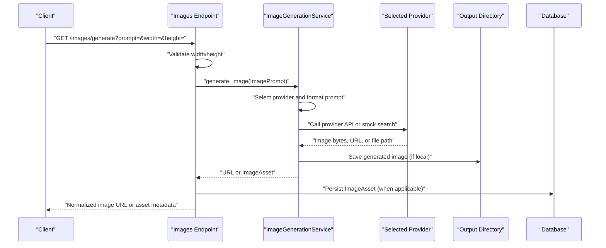

**Diagram sources**
- [images_endpoint.py:166-193](file://servers/fastapi/api/v1/ppt/endpoints/images.py#L166-L193)
- [image_generation_service.py:165-235](file://servers/fastapi/services/image_generation_service.py#L165-L235)
- [image_asset.py:12-28](file://servers/fastapi/models/sql/image_asset.py#L12-L28)

## Detailed Component Analysis

### Unified Image Generation Service
`ImageGenerationService` is the central orchestrator. Its constructor stores the output directory and determines whether image generation is disabled. It also resolves the active provider function through `get_image_gen_func`, which checks stock providers first, then AI providers in a fixed order.

Important behaviors:
- If image generation is disabled, it returns a placeholder asset URL.
- For stock providers, it uses the raw prompt without theme context.
- For AI providers, it includes the theme prompt when composing the final prompt.
- It optionally runs requests concurrently if parallel generation is enabled; otherwise, it serializes requests with a per-event-loop lock.
- It normalizes results into either a direct URL, a local file path, or a static asset URL.
- It wraps local paths into `ImageAsset` objects with prompt metadata.

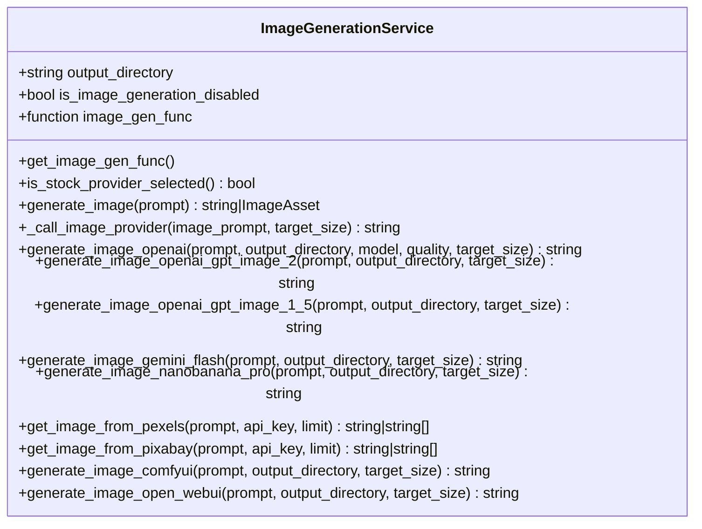

**Diagram sources**
- [image_generation_service.py:132-235](file://servers/fastapi/services/image_generation_service.py#L132-L235)
- [image_generation_service.py:237-398](file://servers/fastapi/services/image_generation_service.py#L237-L398)
- [image_generation_service.py:456-646](file://servers/fastapi/services/image_generation_service.py#L456-L646)

**Section sources**
- [image_generation_service.py:132-235](file://servers/fastapi/services/image_generation_service.py#L132-L235)

### Provider Selection and Configuration
Provider selection is driven by environment variables:
- `IMAGE_PROVIDER` selects the active provider.
- `DISABLE_IMAGE_GENERATION` disables generation entirely.
- `ENABLE_PARALLEL_IMAGE_GENERATION` controls concurrency behavior.

Supported providers include:
- Stock: `pexels`, `pixabay`
- AI: `gemini_flash`, `nanobanana_pro`, `gpt-image-2`, `gpt-image-1.5`, `comfyui`, `open_webui`, `openai_compatible`

The frontend maps provider names to user-facing labels, API key field names, and help links.

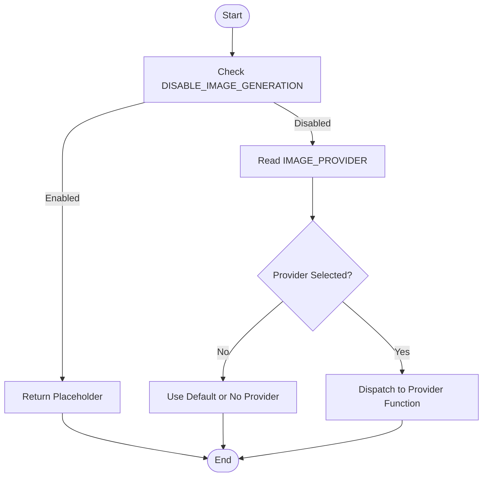

**Diagram sources**
- [image_provider.py:9-61](file://servers/fastapi/utils/image_provider.py#L9-L61)
- [image_provider_enum.py:4-13](file://servers/fastapi/enums/image_provider.py#L4-L13)
- [get_env.py:316-330](file://servers/fastapi/utils/get_env.py#L316-L330)
- [providerConstants.ts:96-134](file://servers/nextjs/utils/providerConstants.ts#L96-L134)

**Section sources**
- [image_provider.py:9-61](file://servers/fastapi/utils/image_provider.py#L9-L61)
- [image_provider_enum.py:4-13](file://servers/fastapi/enums/image_provider.py#L4-L13)
- [get_env.py:316-330](file://servers/fastapi/utils/get_env.py#L316-L330)
- [providerConstants.ts:96-134](file://servers/nextjs/utils/providerConstants.ts#L96-L134)

### Prompt Model and Target Size Handling
`ImagePrompt` ensures that width and height are provided together and converts them into a tuple used by providers. When generating images for AI providers, the service appends the theme prompt to improve relevance. For stock providers, the query remains unchanged.

Size handling:
- OpenAI GPT Image models use predefined sizes: `1024x1024`, `1536x1024`, `1024x1536`.
- Gemini models use aspect ratios like `1:1`, `16:9`, `9:16`, etc.
- ComfyUI workflows can inject target width and height into latent nodes.

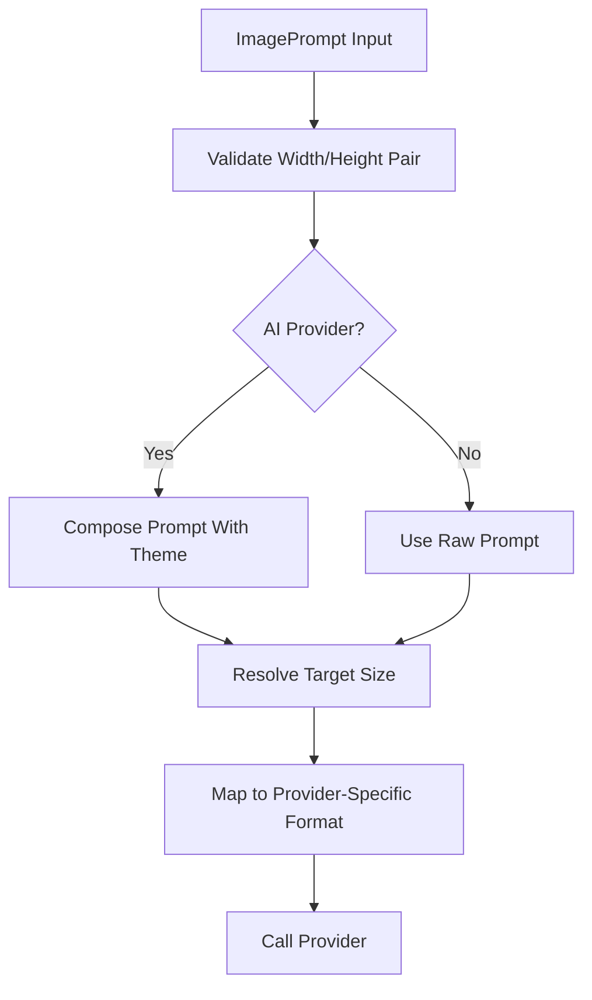

**Diagram sources**
- [image_prompt.py:5-25](file://servers/fastapi/models/image_prompt.py#L5-L25)
- [image_generation_service.py:61-105](file://servers/fastapi/services/image_generation_service.py#L61-L105)
- [image_generation_service.py:648-683](file://servers/fastapi/services/image_generation_service.py#L648-L683)

**Section sources**
- [image_prompt.py:5-25](file://servers/fastapi/models/image_prompt.py#L5-L25)
- [image_generation_service.py:61-105](file://servers/fastapi/services/image_generation_service.py#L61-L105)
- [image_generation_service.py:648-683](file://servers/fastapi/services/image_generation_service.py#L648-L683)

### Stock Providers: Pexels and Pixabay
Stock providers are used for free image search rather than generative synthesis. They return direct image URLs and do not write local files through the service.

- **Pexels**: Searches via `/v1/search`, requires an authorization header, and returns photo entries with large image URLs.
- **Pixabay**: Queries `/api/` with key, query, and pagination parameters, returning hits with large image URLs.

Both endpoints support optional per-request API keys and strict validation modes.

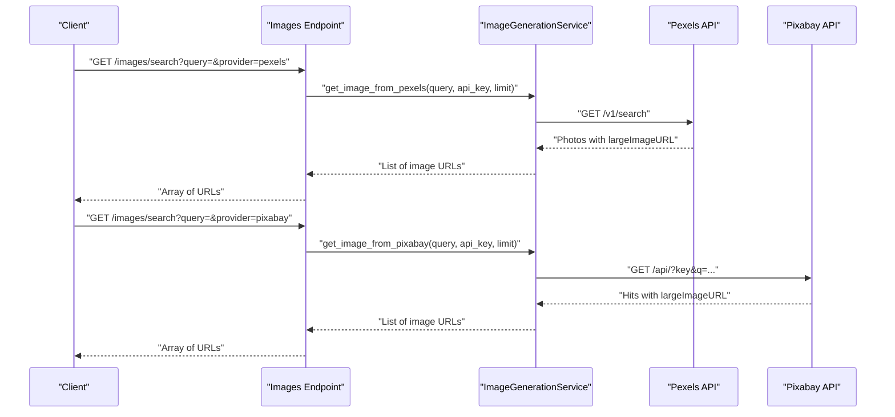

**Diagram sources**
- [images_endpoint.py:116-163](file://servers/fastapi/api/v1/ppt/endpoints/images.py#L116-L163)
- [image_generation_service.py:478-563](file://servers/fastapi/services/image_generation_service.py#L478-L563)

**Section sources**
- [images_endpoint.py:116-163](file://servers/fastapi/api/v1/ppt/endpoints/images.py#L116-L163)
- [image_generation_service.py:478-563](file://servers/fastapi/services/image_generation_service.py#L478-L563)

### OpenAI GPT Image API
The OpenAI integration supports both `gpt-image-2` and `gpt-image-1.5`. It:
- Uses `AsyncOpenAI` to call the image generation endpoint.
- Maps target sizes to supported OpenAI sizes.
- Falls back to a default size if the requested size is rejected.
- Saves base64-encoded images to the output directory.
- Reads quality from environment variables, defaulting to medium when unspecified.

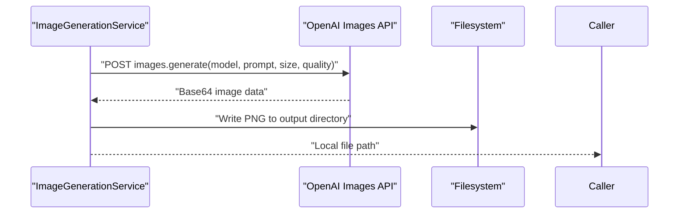

**Diagram sources**
- [image_generation_service.py:237-298](file://servers/fastapi/services/image_generation_service.py#L237-L298)
- [get_env.py:405-417](file://servers/fastapi/utils/get_env.py#L405-L417)

**Section sources**
- [image_generation_service.py:237-298](file://servers/fastapi/services/image_generation_service.py#L237-L298)
- [get_env.py:405-417](file://servers/fastapi/utils/get_env.py#L405-L417)

### Gemini Flash and NanoBanana Pro
Gemini-based generation uses the Google GenAI SDK. It:
- Creates a client and configures response modality to image.
- Maps target size to an allowed aspect ratio.
- Extracts inline image data from response parts.
- Saves images with appropriate extensions based on MIME type.

NanoBanana Pro uses the same base method but targets a different model identifier.

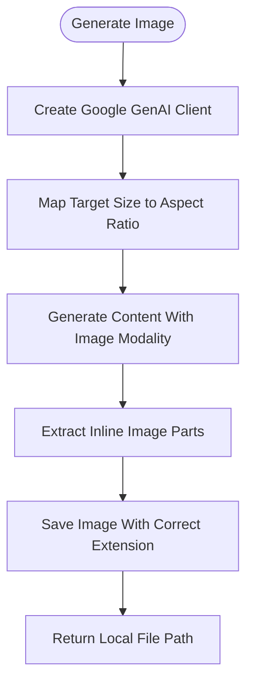

**Diagram sources**
- [image_generation_service.py:391-476](file://servers/fastapi/services/image_generation_service.py#L391-L476)

**Section sources**
- [image_generation_service.py:391-476](file://servers/fastapi/services/image_generation_service.py#L391-L476)

### ComfyUI Integration
ComfyUI integration is designed for custom workflows exported from ComfyUI. It:
- Requires `COMFYUI_URL` and `COMFYUI_WORKFLOW`.
- Injects the prompt into a node labeled “Input Prompt”.
- Optionally updates latent width/height inputs when target size is provided.
- Randomizes seed inputs to ensure varied outputs across regenerations.
- Submits the workflow, polls completion, and downloads the resulting image.

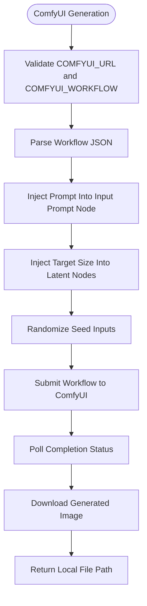

**Diagram sources**
- [image_generation_service.py:565-646](file://servers/fastapi/services/image_generation_service.py#L565-L646)
- [image_generation_service.py:648-800](file://servers/fastapi/services/image_generation_service.py#L648-L800)

**Section sources**
- [image_generation_service.py:565-646](file://servers/fastapi/services/image_generation_service.py#L565-L646)
- [image_generation_service.py:648-800](file://servers/fastapi/services/image_generation_service.py#L648-L800)

### Open WebUI Integration
Open WebUI integration connects to an external Open WebUI instance:
- Requires `OPEN_WEBUI_IMAGE_URL` and optionally `OPEN_WEBUI_IMAGE_API_KEY`.
- Normalizes the base URL to include the `/api/v1` prefix when necessary.
- Posts to `/api/v1/images/generations`.
- Handles both base64 image data and downloadable URLs.
- Returns a local file path after downloading the image.

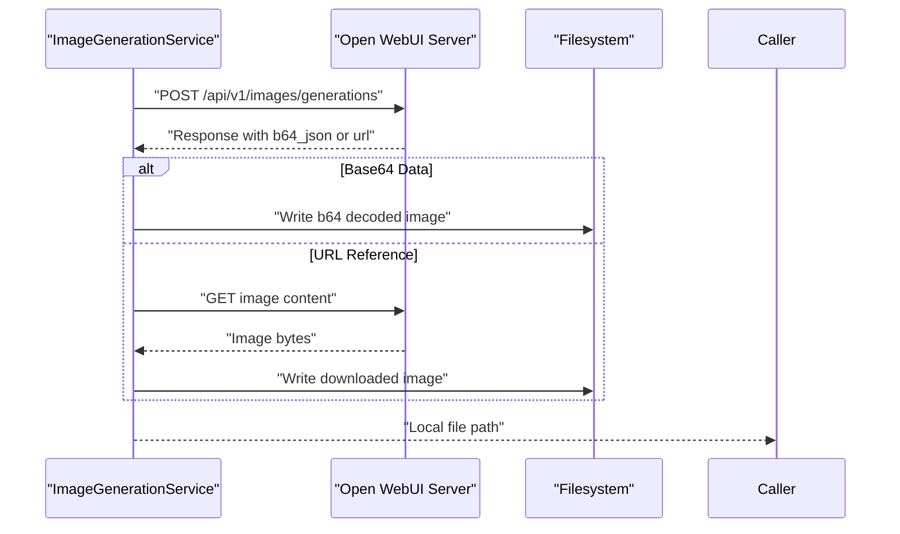

**Diagram sources**
- [image_generation_service.py:300-389](file://servers/fastapi/services/image_generation_service.py#L300-L389)

**Section sources**
- [image_generation_service.py:300-389](file://servers/fastapi/services/image_generation_service.py#L300-L389)

### OpenAI-Compatible Image Provider
The OpenAI-compatible provider allows connecting to third-party services implementing the OpenAI image API contract. Configuration is provided through:
- `OPENAI_COMPAT_IMAGE_BASE_URL`
- `OPENAI_COMPAT_IMAGE_API_KEY`
- `OPENAI_COMPAT_IMAGE_MODEL`

This enables flexible deployment scenarios where organizations proxy or replace OpenAI’s image generation endpoint.

**Section sources**
- [get_env.py:478-489](file://servers/fastapi/utils/get_env.py#L478-L489)

### Image Processing Pipeline
Presenton’s pipeline focuses on provider-specific formatting and safe persistence rather than heavy in-memory image manipulation:

- **Prompt composition**: Theme-aware prompts for AI providers; raw queries for stock providers.
- **Size mapping**:
  - OpenAI: select closest supported size.
  - Gemini: map to allowed aspect ratio.
  - ComfyUI: inject width/height into latent nodes.
- **Persistence**:
  - AI-generated images are written to the configured output directory.
  - Stock providers return direct URLs.
- **Metadata extraction**:
  - Gemini extracts MIME type to determine file extension.
  - Generated assets store original prompt, theme prompt, and target dimensions in `extras`.

There is no explicit format conversion or compression step in the service; output format depends on provider response and filesystem writes.

**Section sources**
- [image_generation_service.py:61-105](file://servers/fastapi/services/image_generation_service.py#L61-L105)
- [image_generation_service.py:424-447](file://servers/fastapi/services/image_generation_service.py#L424-L447)
- [image_generation_service.py:203-212](file://servers/fastapi/services/image_generation_service.py#L203-L212)

### Caching Mechanisms
The codebase does not implement application-level caching for generated images. Instead:
- Stock provider responses may be cached by the provider itself.
- Parallel generation can be enabled or disabled via environment configuration.
- A per-event-loop lock serializes requests when parallel generation is disabled.

If caching is required, it should be implemented at the service layer or through a reverse proxy/cache layer before calling providers.

**Section sources**
- [image_generation_service.py:189-198](file://servers/fastapi/services/image_generation_service.py#L189-L198)
- [get_env.py:320-326](file://servers/fastapi/utils/get_env.py#L320-L326)

### Error Handling and Fallback Strategies
Errors are normalized into structured HTTP exceptions:
- OpenAI errors are mapped to detailed messages with provider codes.
- Generic failures receive a standardized message encouraging retry or prompt changes.
- Stock provider authentication errors return clear 401 responses.
- Invalid provider configurations raise descriptive errors.

Fallback strategies:
- If image generation is disabled, a placeholder image URL is returned.
- OpenAI size rejection triggers a retry with a default size.
- Missing provider configuration prevents generation and returns a placeholder.

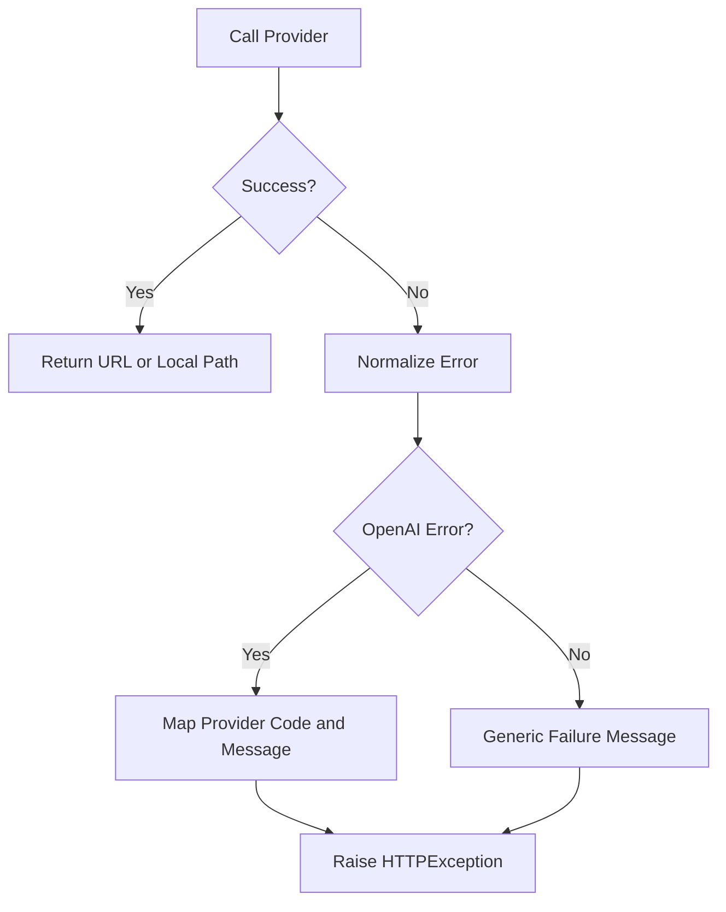

**Diagram sources**
- [image_generation_service.py:219-224](file://servers/fastapi/services/image_generation_service.py#L219-L224)
- [image_generation_error.py:58-87](file://servers/fastapi/utils/image_generation_error.py#L58-L87)

**Section sources**
- [image_generation_service.py:219-224](file://servers/fastapi/services/image_generation_service.py#L219-L224)
- [image_generation_error.py:58-87](file://servers/fastapi/utils/image_generation_error.py#L58-L87)

## Dependency Analysis
The image generation subsystem has clear boundaries:

- **Endpoints depend on the service**: `/images/*` endpoints construct requests and delegate to `ImageGenerationService`.
- **Service depends on provider utilities**: Provider selection and environment helpers determine behavior.
- **Models are independent**: `ImagePrompt` and `ImageAsset` provide typed contracts for requests and persistence.
- **Frontend configuration is separate**: Next.js constants describe provider UI and API key fields.

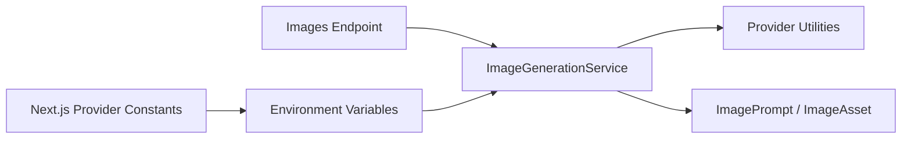

**Diagram sources**
- [images_endpoint.py:1-282](file://servers/fastapi/api/v1/ppt/endpoints/images.py#L1-L282)
- [image_generation_service.py:1-800](file://servers/fastapi/services/image_generation_service.py#L1-L800)
- [image_provider.py:1-62](file://servers/fastapi/utils/image_provider.py#L1-L62)
- [image_prompt.py:1-26](file://servers/fastapi/models/image_prompt.py#L1-L26)
- [image_asset.py:1-29](file://servers/fastapi/models/sql/image_asset.py#L1-L29)
- [providerConstants.ts:96-134](file://servers/nextjs/utils/providerConstants.ts#L96-L134)

**Section sources**
- [images_endpoint.py:1-282](file://servers/fastapi/api/v1/ppt/endpoints/images.py#L1-L282)
- [image_generation_service.py:1-800](file://servers/fastapi/services/image_generation_service.py#L1-L800)
- [image_provider.py:1-62](file://servers/fastapi/utils/image_provider.py#L1-L62)
- [image_prompt.py:1-26](file://servers/fastapi/models/image_prompt.py#L1-L26)
- [image_asset.py:1-29](file://servers/fastapi/models/sql/image_asset.py#L1-L29)
- [providerConstants.ts:96-134](file://servers/nextjs/utils/providerConstants.ts#L96-L134)

## Performance Considerations
- **Parallel generation**: Controlled by `ENABLE_PARALLEL_IMAGE_GENERATION`. When enabled, multiple image requests can run concurrently. When disabled, a shared lock serializes requests to avoid provider overload.
- **Provider rate limits**: Stock APIs and AI providers may enforce rate limits. Use conservative batch sizes and consider adding application-level throttling or queueing.
- **Cost optimization**:
  - Prefer stock providers for free imagery when suitable.
  - Tune OpenAI quality (`GPT_IMAGE_2_QUALITY`, `GPT_IMAGE_1_5_QUALITY`) to balance cost and output quality.
  - Avoid unnecessary retries by validating prompts and sizes before calling providers.
- **I/O efficiency**: Generated images are written directly to disk. Ensure sufficient storage capacity and fast I/O for high-throughput environments.
- **Network timeouts**: Provider calls use explicit timeouts. Adjust environment or wrapper logic if providers respond slowly.

[No sources needed since this section provides general guidance]

## Troubleshooting Guide
Common issues and resolutions:

- **Image generation disabled**:
  - Symptom: Placeholder image returned.
  - Cause: `DISABLE_IMAGE_GENERATION` is enabled.
  - Resolution: Disable the flag or configure a valid provider.

- **Invalid provider configuration**:
  - Symptom: No image generation function found.
  - Cause: `IMAGE_PROVIDER` is unset or unsupported.
  - Resolution: Set `IMAGE_PROVIDER` to a supported value.

- **OpenAI size rejection**:
  - Symptom: Request fails due to unsupported size.
  - Behavior: Service retries with default size.
  - Resolution: Use supported sizes or allow fallback.

- **Pexels/Pixabay authentication failure**:
  - Symptom: 401 or 403 responses.
  - Cause: Missing or invalid API key.
  - Resolution: Configure `PEXELS_API_KEY` or `PIXABAY_API_KEY`, or pass `X-Provider-Api-Key`.

- **ComfyUI workflow errors**:
  - Symptom: Missing prompt node, invalid workflow JSON, or missing URL/workflow env vars.
  - Resolution: Provide `COMFYUI_URL` and `COMFYUI_WORKFLOW`; ensure workflow contains an “Input Prompt” node and editable latent dimensions.

- **Open WebUI connection errors**:
  - Symptom: 404 or 405 responses.
  - Cause: Incorrect base URL or missing API prefix.
  - Resolution: Point `OPEN_WEBUI_IMAGE_URL` to the API root with `/api/v1`.

- **Error visibility**:
  - Errors are normalized into HTTP exceptions with provider codes where possible.
  - Use logs and error details to identify provider-specific failures.

**Section sources**
- [image_generation_service.py:173-224](file://servers/fastapi/services/image_generation_service.py#L173-L224)
- [image_generation_service.py:254-266](file://servers/fastapi/services/image_generation_service.py#L254-L266)
- [image_generation_service.py:492-553](file://servers/fastapi/services/image_generation_service.py#L492-L553)
- [image_generation_service.py:591-606](file://servers/fastapi/services/image_generation_service.py#L591-L606)
- [image_generation_service.py:306-346](file://servers/fastapi/services/image_generation_service.py#L306-L346)
- [image_generation_error.py:58-87](file://servers/fastapi/utils/image_generation_error.py#L58-L87)

## Conclusion
Presenton’s image generation service provides a unified interface over multiple providers, enabling flexible integration for presentations. It supports stock imagery and AI generation, handles prompt composition and size mapping, persists generated assets, and normalizes errors. Operators can tune performance and cost through environment variables, choose providers based on requirements, and extend the system with additional providers following the established patterns.

[No sources needed since this section summarizes without analyzing specific files]

## Appendices

### Provider Configuration Summary
- **Pexels**: `PEXELS_API_KEY`
- **Pixabay**: `PIXABAY_API_KEY`
- **OpenAI GPT Image**: `OPENAI_API_KEY`, `GPT_IMAGE_2_QUALITY`, `GPT_IMAGE_1_5_QUALITY`
- **Gemini/NanoBanana**: Google GenAI credentials configured externally
- **ComfyUI**: `COMFYUI_URL`, `COMFYUI_WORKFLOW`
- **Open WebUI**: `OPEN_WEBUI_IMAGE_URL`, `OPEN_WEBUI_IMAGE_API_KEY`
- **OpenAI-Compatible**: `OPENAI_COMPAT_IMAGE_BASE_URL`, `OPENAI_COMPAT_IMAGE_API_KEY`, `OPENAI_COMPAT_IMAGE_MODEL`
- **Global Controls**: `IMAGE_PROVIDER`, `DISABLE_IMAGE_GENERATION`, `ENABLE_PARALLEL_IMAGE_GENERATION`

**Section sources**
- [get_env.py:312-334](file://servers/fastapi/utils/get_env.py#L312-L334)
- [get_env.py:397-417](file://servers/fastapi/utils/get_env.py#L397-L417)
- [get_env.py:469-489](file://servers/fastapi/utils/get_env.py#L469-L489)
- [providerConstants.ts:96-134](file://servers/nextjs/utils/providerConstants.ts#L96-L134)