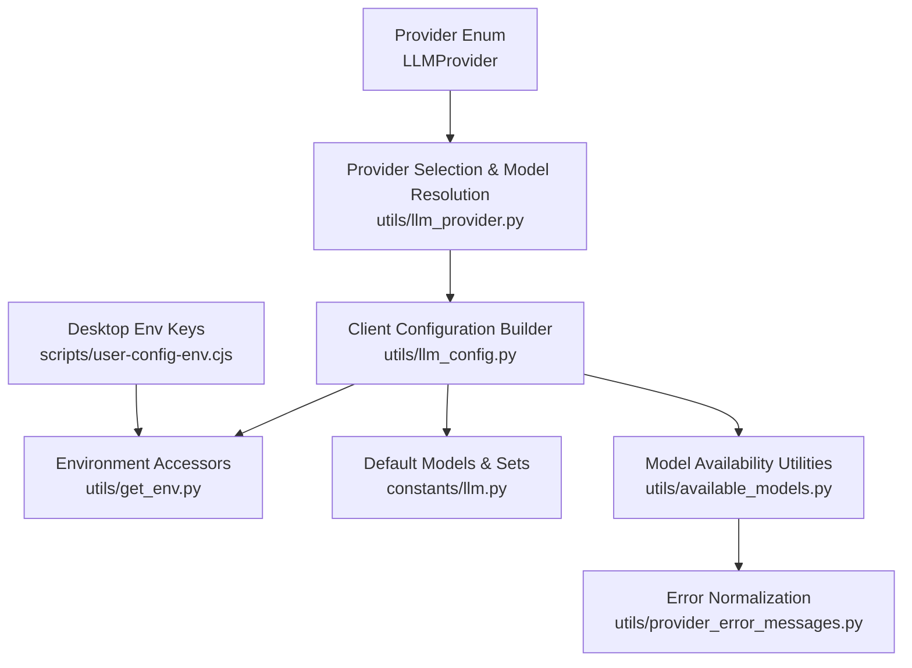
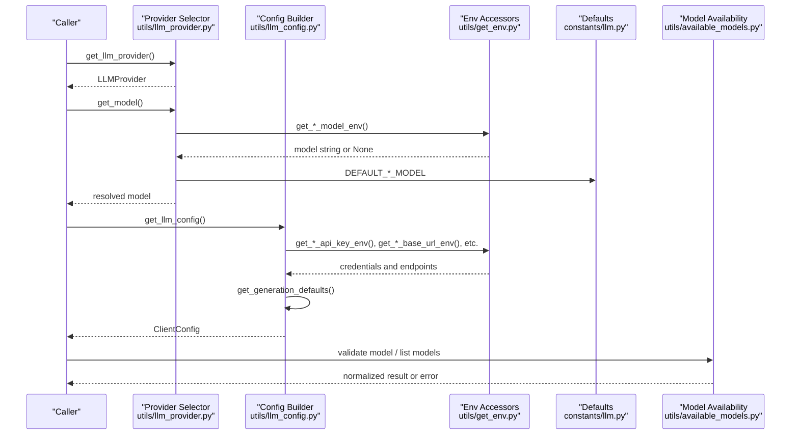
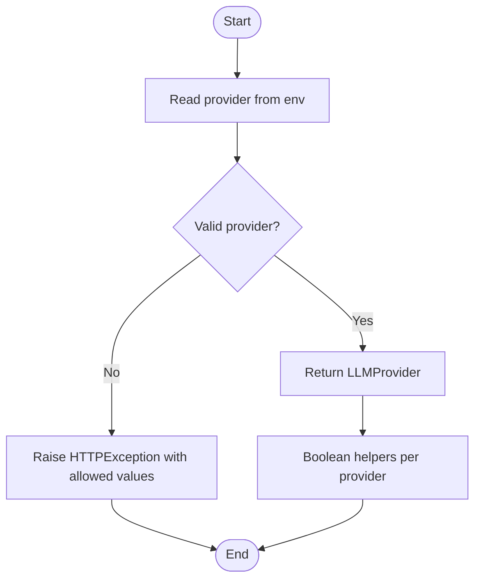
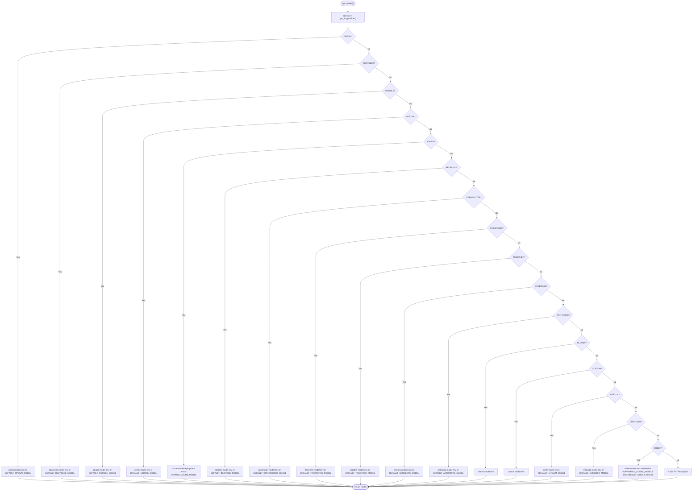
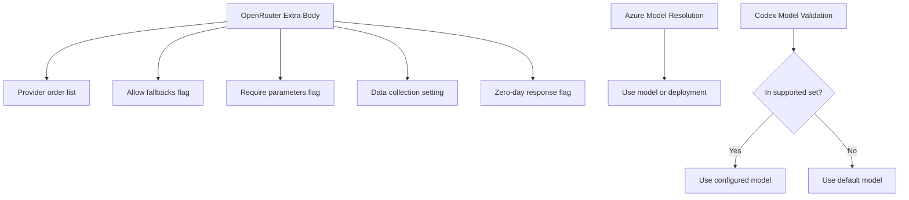
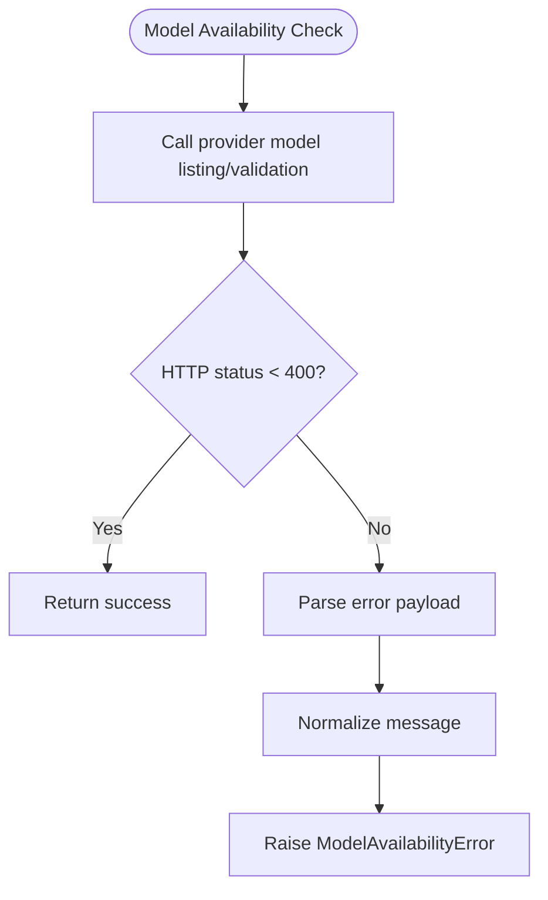
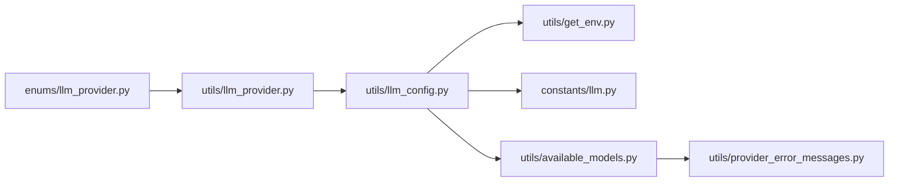

# LLM Provider Abstraction

<cite>
**Referenced Files in This Document**
- [llm_provider.py](file://servers/fastapi/enums/llm_provider.py)
- [llm_provider_utils.py](file://servers/fastapi/utils/llm_provider.py)
- [llm_config.py](file://servers/fastapi/utils/llm_config.py)
- [llm_constants.py](file://servers/fastapi/constants/llm.py)
- [get_env.py](file://servers/fastapi/utils/get_env.py)
- [available_models.py](file://servers/fastapi/utils/available_models.py)
- [model_availability.py](file://servers/fastapi/utils/model_availability.py)
- [provider_error_messages.py](file://servers/fastapi/utils/provider_error_messages.py)
- [user-config-env.cjs](file://scripts/user-config-env.cjs)
</cite>

## Table of Contents
1. [Introduction](#introduction)
2. [Project Structure](#project-structure)
3. [Core Components](#core-components)
4. [Architecture Overview](#architecture-overview)
5. [Detailed Component Analysis](#detailed-component-analysis)
6. [Dependency Analysis](#dependency-analysis)
7. [Performance Considerations](#performance-considerations)
8. [Troubleshooting Guide](#troubleshooting-guide)
9. [Conclusion](#conclusion)

## Introduction
This document explains Presenton’s LLM provider abstraction system. It provides a unified interface for multiple AI providers, including OpenAI, Google Gemini, Anthropic Claude, Azure OpenAI, Amazon Bedrock, DeepSeek, Fireworks, Together, Cerebras, LiteLLM, LM Studio, Ollama, and custom OpenAI-compatible endpoints. The system centralizes provider selection, configuration management, credential handling, model resolution, capability detection, and error handling. It also documents runtime switching mechanisms, fallback strategies (notably for OpenRouter), and environment-driven configuration.

## Project Structure
The LLM abstraction is implemented primarily in the FastAPI backend:
- Provider identity is defined as an enum.
- Provider selection and model resolution are provided by utility functions.
- Full client configuration per provider is built from environment variables.
- Default models and supported sets are centralized.
- Model availability utilities provide validation and error normalization.
- Error messages are sanitized to avoid leaking sensitive data.
- Desktop scripts enumerate supported environment keys for user configuration.

**Diagram sources**
- [llm_provider.py:4-20](file://servers/fastapi/enums/llm_provider.py#L4-L20)
- [llm_provider_utils.py:47-193](file://servers/fastapi/utils/llm_provider.py#L47-L193)
- [llm_config.py:247-486](file://servers/fastapi/utils/llm_config.py#L247-L486)
- [llm_constants.py:1-27](file://servers/fastapi/constants/llm.py#L1-L27)
- [available_models.py:13-31](file://servers/fastapi/utils/available_models.py#L13-L31)
- [provider_error_messages.py:159-187](file://servers/fastapi/utils/provider_error_messages.py#L159-L187)
- [user-config-env.cjs:1-18](file://scripts/user-config-env.cjs#L1-L18)

**Section sources**
- [llm_provider.py:4-20](file://servers/fastapi/enums/llm_provider.py#L4-L20)
- [llm_provider_utils.py:47-193](file://servers/fastapi/utils/llm_provider.py#L47-L193)
- [llm_config.py:247-486](file://servers/fastapi/utils/llm_config.py#L247-L486)
- [llm_constants.py:1-27](file://servers/fastapi/constants/llm.py#L1-L27)
- [available_models.py:13-31](file://servers/fastapi/utils/available_models.py#L13-L31)
- [provider_error_messages.py:159-187](file://servers/fastapi/utils/provider_error_messages.py#L159-L187)
- [user-config-env.cjs:1-18](file://scripts/user-config-env.cjs#L1-L18)

## Core Components
- Provider identity: A single enum enumerates all supported providers.
- Provider selection: Functions read the active provider from environment and expose boolean helpers for each provider.
- Model resolution: A function resolves the effective model name per provider with defaults and special-case logic.
- Client configuration: A builder constructs provider-specific client configurations using environment variables and shared generation defaults.
- Defaults: Centralized default models and supported model sets.
- Environment access: Typed getters for all provider-related environment variables.
- Model availability: Utilities validate model capabilities and normalize errors.
- Error handling: Sanitized error messages protect secrets and standardize provider responses.

Key responsibilities:
- Unified interface: All providers are accessed through consistent configuration objects and generation defaults.
- Credential handling: API keys, tokens, base URLs, regions, projects, and deployments are sourced from environment variables.
- Runtime switching: Changing the provider environment variable switches behavior at runtime without code changes.
- Fallbacks: OpenRouter supports provider ordering and fallback options via extra request body parameters.

**Section sources**
- [llm_provider.py:4-20](file://servers/fastapi/enums/llm_provider.py#L4-L20)
- [llm_provider_utils.py:47-193](file://servers/fastapi/utils/llm_provider.py#L47-L193)
- [llm_config.py:189-244](file://servers/fastapi/utils/llm_config.py#L189-L244)
- [llm_config.py:247-486](file://servers/fastapi/utils/llm_config.py#L247-L486)
- [llm_constants.py:1-27](file://servers/fastapi/constants/llm.py#L1-L27)
- [available_models.py:13-31](file://servers/fastapi/utils/available_models.py#L13-L31)
- [provider_error_messages.py:159-187](file://servers/fastapi/utils/provider_error_messages.py#L159-L187)

## Architecture Overview
The abstraction follows a layered design:
- Layer 1: Provider identity and selection.
- Layer 2: Model name resolution.
- Layer 3: Client configuration construction.
- Layer 4: Shared generation defaults and reasoning settings.
- Layer 5: Model availability checks and error normalization.

**Diagram sources**
- [llm_provider_utils.py:47-193](file://servers/fastapi/utils/llm_provider.py#L47-L193)
- [llm_config.py:189-244](file://servers/fastapi/utils/llm_config.py#L189-L244)
- [llm_config.py:247-486](file://servers/fastapi/utils/llm_config.py#L247-L486)
- [llm_constants.py:1-27](file://servers/fastapi/constants/llm.py#L1-L27)
- [available_models.py:13-31](file://servers/fastapi/utils/available_models.py#L13-L31)

## Detailed Component Analysis

### Provider Identity and Selection
- The provider enum defines all supported providers.
- Provider selection reads the active provider from environment and raises a clear error if invalid.
- Boolean helpers exist for each provider to simplify conditional logic elsewhere.

**Diagram sources**
- [llm_provider.py:4-20](file://servers/fastapi/enums/llm_provider.py#L4-L20)
- [llm_provider_utils.py:47-116](file://servers/fastapi/utils/llm_provider.py#L47-L116)

**Section sources**
- [llm_provider.py:4-20](file://servers/fastapi/enums/llm_provider.py#L4-L20)
- [llm_provider_utils.py:47-116](file://servers/fastapi/utils/llm_provider.py#L47-L116)

### Model Resolution
- Resolves the effective model name based on the selected provider.
- Falls back to provider-specific defaults when environment variables are missing.
- Special cases include Azure (supports deployment fallback) and Codex (validates against supported set).

**Diagram sources**
- [llm_provider_utils.py:126-174](file://servers/fastapi/utils/llm_provider.py#L126-L174)
- [llm_constants.py:1-27](file://servers/fastapi/constants/llm.py#L1-L27)

**Section sources**
- [llm_provider_utils.py:126-174](file://servers/fastapi/utils/llm_provider.py#L126-L174)
- [llm_constants.py:1-27](file://servers/fastapi/constants/llm.py#L1-L27)

### Client Configuration Builder
- Builds provider-specific client configurations from environment variables.
- Validates required credentials and endpoints per provider.
- Applies shared generation defaults and reasoning settings.
- Adds provider-specific extra request body parameters (e.g., OpenRouter routing options).

```mermaid
classDiagram
class ClientConfig {
+generation GenerationDefaults
}
class OpenAIClientConfig
class DeepSeekClientConfig
class GoogleClientConfig
class VertexAIClientConfig
class AzureOpenAIClientConfig
class BedrockClientConfig
class AnthropicClientConfig
class OpenRouterClientConfig
class FireworksClientConfig
class TogetherAIClientConfig
class CerebrasClientConfig
class LiteLLMClientConfig
class LMStudioClientConfig
class ChatGPTClientConfig
ClientConfig <|-- OpenAIClientConfig
ClientConfig <|-- DeepSeekClientConfig
ClientConfig <|-- GoogleClientConfig
ClientConfig <|-- VertexAIClientConfig
ClientConfig <|-- AzureOpenAIClientConfig
ClientConfig <|-- BedrockClientConfig
ClientConfig <|-- AnthropicClientConfig
ClientConfig <|-- OpenRouterClientConfig
ClientConfig <|-- FireworksClientConfig
ClientConfig <|-- TogetherAIClientConfig
ClientConfig <|-- CerebrasClientConfig
ClientConfig <|-- LiteLLMClientConfig
ClientConfig <|-- LMStudioClientConfig
ClientConfig <|-- ChatGPTClientConfig
```

**Diagram sources**
- [llm_config.py:5-28](file://servers/fastapi/utils/llm_config.py#L5-L28)
- [llm_config.py:247-486](file://servers/fastapi/utils/llm_config.py#L247-L486)

**Section sources**
- [llm_config.py:189-244](file://servers/fastapi/utils/llm_config.py#L189-L244)
- [llm_config.py:247-486](file://servers/fastapi/utils/llm_config.py#L247-L486)
- [llm_config.py:489-524](file://servers/fastapi/utils/llm_config.py#L489-L524)

### Environment Variables and Credentials
- Each provider has dedicated environment variables for API keys, base URLs, regions, projects, deployments, and model names.
- The desktop script enumerates supported environment keys for user configuration.
- Some providers support alternative authentication flows (e.g., AWS profiles, session tokens; Vertex project/location vs API key).

Examples of environment variables by provider type:
- OpenAI: OPENAI_API_KEY, OPENAI_MODEL
- DeepSeek: DEEPSEEK_API_KEY, DEEPSEEK_BASE_URL, DEEPSEEK_MODEL
- Google: GOOGLE_API_KEY, GOOGLE_MODEL
- Vertex: VERTEX_API_KEY or VERTEX_PROJECT/VERTEX_LOCATION, VERTEX_BASE_URL, VERTEX_MODEL
- Azure OpenAI: AZURE_OPENAI_API_KEY, AZURE_OPENAI_API_VERSION, AZURE_OPENAI_ENDPOINT or AZURE_OPENAI_BASE_URL, AZURE_OPENAI_DEPLOYMENT, AZURE_OPENAI_MODEL
- Bedrock: BEDROCK_REGION, BEDROCK_API_KEY or AWS credentials, BEDROCK_PROFILE_NAME, BEDROCK_MODEL
- OpenRouter: OPENROUTER_API_KEY, OPENROUTER_BASE_URL, OPENROUTER_MODEL, plus routing options like OPENROUTER_PROVIDER_ORDER, OPENROUTER_ALLOW_FALLBACKS, OPENROUTER_REQUIRE_PARAMETERS, OPENROUTER_DATA_COLLECTION, OPENROUTER_ZDR
- Fireworks: FIREWORKS_API_KEY, FIREWORKS_BASE_URL, FIREWORKS_MODEL
- Together: TOGETHER_API_KEY, TOGETHER_BASE_URL, TOGETHER_MODEL
- Cerebras: CEREBRAS_API_KEY, CEREBRAS_BASE_URL, CEREBRAS_MODEL
- Anthropic: ANTHROPIC_API_KEY, ANTHROPIC_MODEL
- LiteLLM: LITELLM_BASE_URL, LITELLM_API_KEY, LITELLM_MODEL
- LM Studio: LMSTUDIO_BASE_URL, LMSTUDIO_API_KEY, LMSTUDIO_MODEL
- Ollama: OLLAMA_URL, OLLAMA_MODEL
- Custom: CUSTOM_LLM_URL, CUSTOM_LLM_API_KEY, CUSTOM_MODEL
- Codex: CHATGPT access token flow and account ID fields

Credential handling patterns:
- Required keys are validated before constructing client configs.
- Optional fields (base URL, region, project, deployment) are applied when present.
- For Codex, token refresh and expiration handling are integrated into configuration retrieval.

**Section sources**
- [llm_config.py:247-486](file://servers/fastapi/utils/llm_config.py#L247-L486)
- [user-config-env.cjs:1-18](file://scripts/user-config-env.cjs#L1-L18)

### Runtime Switching Mechanisms
- Changing the provider environment variable switches behavior at runtime.
- Provider selection and model resolution functions re-evaluate on each call, enabling dynamic switching without restarts.
- Boolean helpers allow conditional logic throughout the application based on the active provider.

**Section sources**
- [llm_provider_utils.py:47-116](file://servers/fastapi/utils/llm_provider.py#L47-L116)
- [llm_provider_utils.py:126-174](file://servers/fastapi/utils/llm_provider.py#L126-L174)

### Fallback Strategies
- OpenRouter supports provider ordering and fallbacks via extra request body parameters.
- Azure model resolution falls back from model to deployment when needed.
- Codex validates requested models against a supported set and falls back to a default if unsupported.

**Diagram sources**
- [llm_config.py:489-524](file://servers/fastapi/utils/llm_config.py#L489-L524)
- [llm_provider_utils.py:136-141](file://servers/fastapi/utils/llm_provider.py#L136-L141)
- [llm_provider_utils.py:162-164](file://servers/fastapi/utils/llm_provider.py#L162-L164)

**Section sources**
- [llm_config.py:489-524](file://servers/fastapi/utils/llm_config.py#L489-L524)
- [llm_provider_utils.py:136-141](file://servers/fastapi/utils/llm_provider.py#L136-L141)
- [llm_provider_utils.py:162-164](file://servers/fastapi/utils/llm_provider.py#L162-L164)

### Capability Detection and Model Availability
- Model availability utilities define a standardized exception for provider validation failures.
- They parse provider error payloads and normalize messages.
- Endpoints that list available models raise normalized errors for invalid credentials or unsupported models.

**Diagram sources**
- [available_models.py:13-31](file://servers/fastapi/utils/available_models.py#L13-L31)
- [available_models.py:68-78](file://servers/fastapi/utils/available_models.py#L68-L78)

**Section sources**
- [available_models.py:13-31](file://servers/fastapi/utils/available_models.py#L13-L31)
- [available_models.py:68-78](file://servers/fastapi/utils/available_models.py#L68-L78)

### Rate Limiting
- No explicit rate limiting implementation is present in the analyzed files.
- Rate limiting should be handled at the provider level or via external proxies/load balancers.

[No sources needed since this section provides general guidance]

## Dependency Analysis
The abstraction depends on:
- Provider enum for identity.
- Environment accessors for credentials and configuration.
- Default constants for model names.
- llmai client configuration classes for each provider.
- Model availability utilities for validation and error normalization.
- Error message sanitization utilities.

**Diagram sources**
- [llm_provider.py:4-20](file://servers/fastapi/enums/llm_provider.py#L4-L20)
- [llm_provider_utils.py:47-193](file://servers/fastapi/utils/llm_provider.py#L47-L193)
- [llm_config.py:247-486](file://servers/fastapi/utils/llm_config.py#L247-L486)
- [llm_constants.py:1-27](file://servers/fastapi/constants/llm.py#L1-L27)
- [available_models.py:13-31](file://servers/fastapi/utils/available_models.py#L13-L31)
- [provider_error_messages.py:159-187](file://servers/fastapi/utils/provider_error_messages.py#L159-L187)

**Section sources**
- [llm_provider.py:4-20](file://servers/fastapi/enums/llm_provider.py#L4-L20)
- [llm_provider_utils.py:47-193](file://servers/fastapi/utils/llm_provider.py#L47-L193)
- [llm_config.py:247-486](file://servers/fastapi/utils/llm_config.py#L247-L486)
- [llm_constants.py:1-27](file://servers/fastapi/constants/llm.py#L1-L27)
- [available_models.py:13-31](file://servers/fastapi/utils/available_models.py#L13-L31)
- [provider_error_messages.py:159-187](file://servers/fastapi/utils/provider_error_messages.py#L159-L187)

## Performance Considerations
- Prefer using provider-native clients where possible to minimize overhead.
- Reuse client instances where feasible to reduce connection churn.
- Avoid unnecessary model discovery calls; cache results when appropriate.
- Tune generation defaults (max output tokens, reasoning settings) to balance quality and latency.
- For local providers (Ollama, LM Studio), ensure adequate hardware resources to prevent bottlenecks.

[No sources needed since this section provides general guidance]

## Troubleshooting Guide
Common issues and resolutions:
- Invalid provider selection: Ensure the provider environment variable matches one of the supported values.
- Missing API keys: Verify provider-specific API keys are set correctly.
- Endpoint misconfiguration: Confirm base URLs, endpoints, regions, and deployments match provider requirements.
- Authentication failures: Check token validity and refresh flows (especially for Codex).
- Model not available: Validate model names against provider-supported sets; use defaults when necessary.
- Error message leakage: Errors are sanitized; inspect logs server-side for raw details while users see safe messages.

Operational tips:
- Use the boolean helpers to conditionally handle provider-specific behaviors.
- Leverage OpenRouter routing options to distribute load and enable fallbacks.
- Monitor model availability endpoints to detect provider outages early.

**Section sources**
- [llm_provider_utils.py:47-59](file://servers/fastapi/utils/llm_provider.py#L47-L59)
- [llm_config.py:247-486](file://servers/fastapi/utils/llm_config.py#L247-L486)
- [provider_error_messages.py:159-187](file://servers/fastapi/utils/provider_error_messages.py#L159-L187)

## Conclusion
Presenton’s LLM provider abstraction offers a robust, environment-driven mechanism to unify multiple AI providers behind a single interface. It centralizes configuration, credentials, model resolution, capability detection, and error handling, while supporting runtime switching and provider-specific optimizations such as OpenRouter fallbacks. By following the environment variable conventions and leveraging the provided utilities, teams can integrate new providers consistently and maintain reliable, secure, and performant LLM interactions across diverse environments.