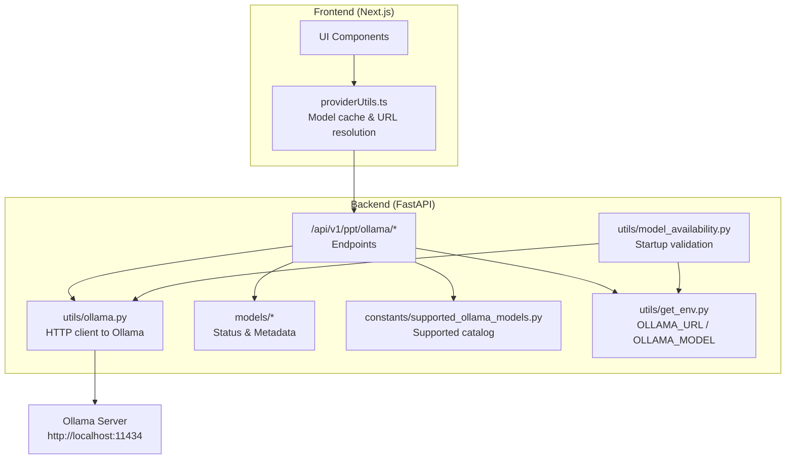
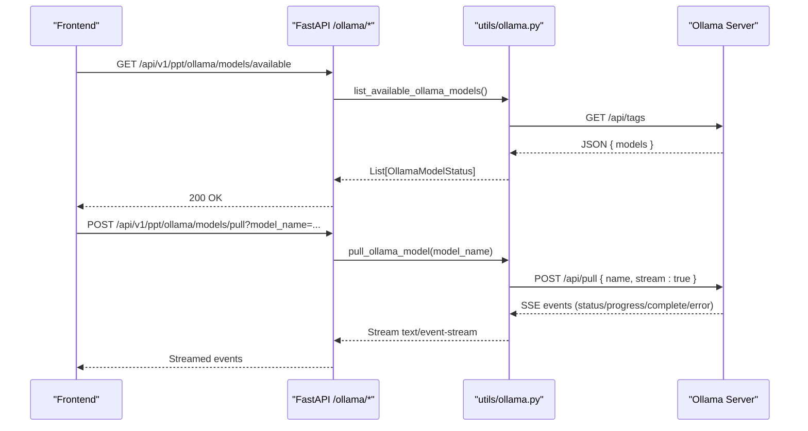
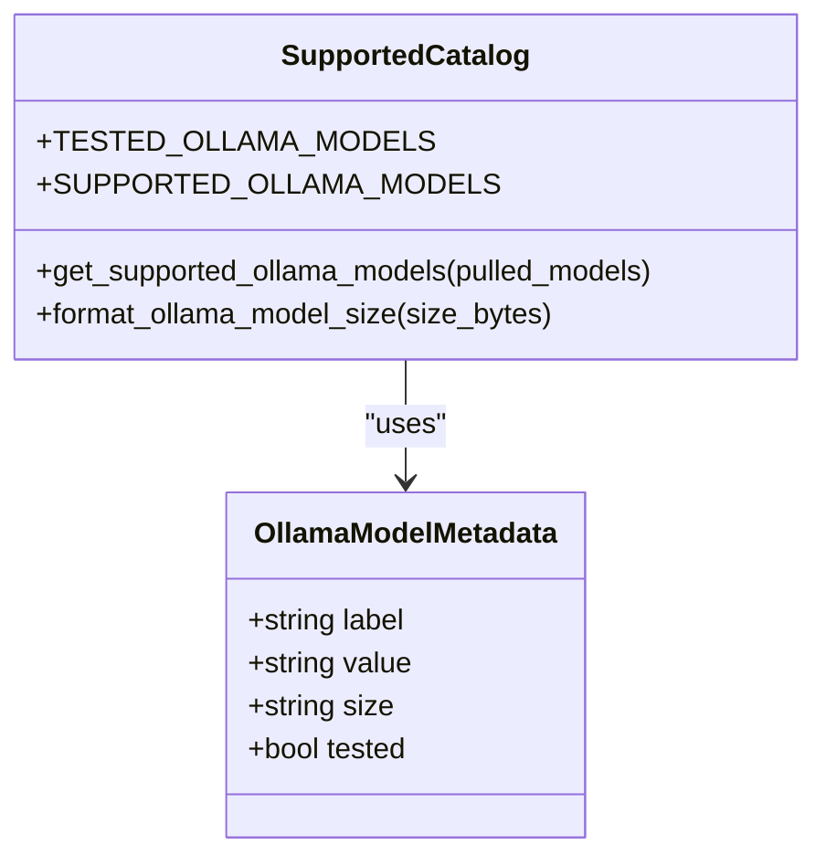
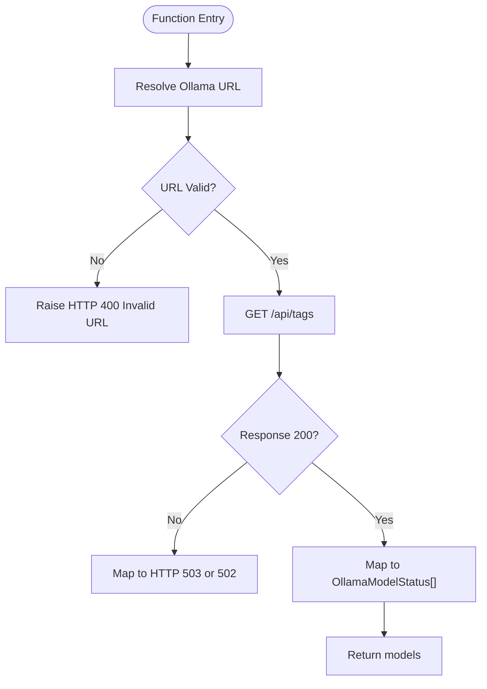
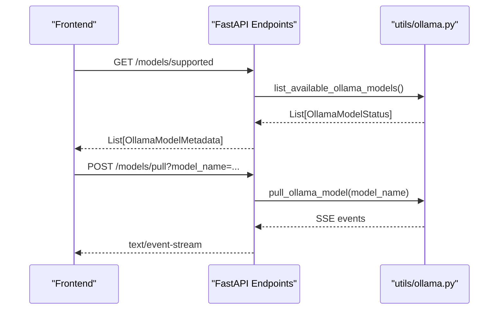
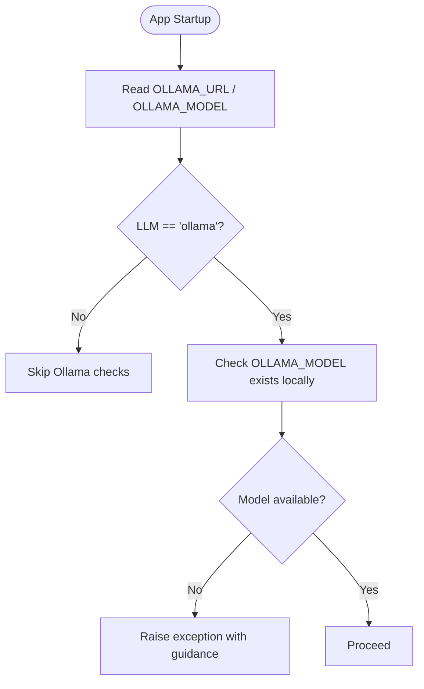
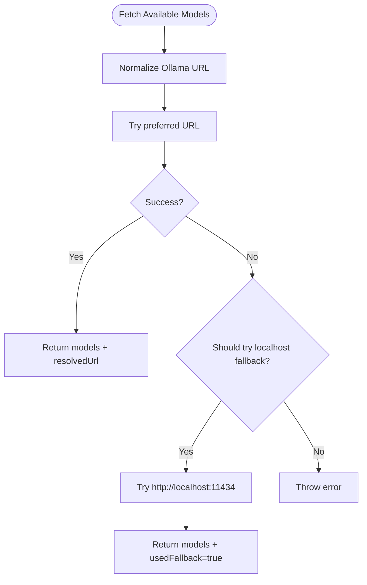
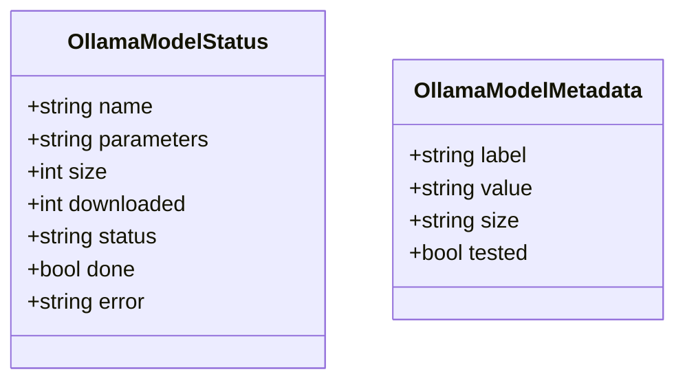
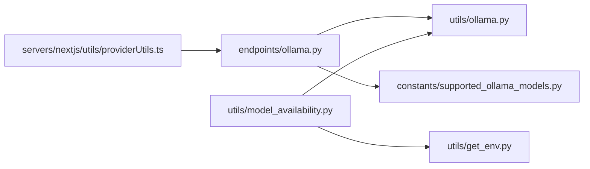

# Local Model Support (Ollama)

<cite>
**Referenced Files in This Document**
- [supported_ollama_models.py](file://servers/fastapi/constants/supported_ollama_models.py)
- [ollama.py](file://servers/fastapi/utils/ollama.py)
- [ollama_model_status.py](file://servers/fastapi/models/ollama_model_status.py)
- [ollama_model_metadata.py](file://servers/fastapi/models/ollama_model_metadata.py)
- [endpoints/ollama.py](file://servers/fastapi/api/v1/ppt/endpoints/ollama.py)
- [get_env.py](file://servers/fastapi/utils/get_env.py)
- [model_availability.py](file://servers/fastapi/utils/model_availability.py)
- [providerUtils.ts](file://servers/nextjs/utils/providerUtils.ts)
- [ConfigurationInitializer.tsx](file://servers/nextjs/app/ConfigurationInitializer.tsx)
</cite>

## Table of Contents
1. [Introduction](#introduction)
2. [Project Structure](#project-structure)
3. [Core Components](#core-components)
4. [Architecture Overview](#architecture-overview)
5. [Detailed Component Analysis](#detailed-component-analysis)
6. [Dependency Analysis](#dependency-analysis)
7. [Performance Considerations](#performance-considerations)
8. [Troubleshooting Guide](#troubleshooting-guide)
9. [Conclusion](#conclusion)

## Introduction
This document explains Presenton’s local model support through Ollama integration. It covers how to set up the Ollama server, pull models, manage runtime behavior, and monitor model availability. It also documents supported models, compatibility requirements, configuration options for local deployment, memory/GPU considerations, fallback strategies when local models fail, and troubleshooting guidance.

## Project Structure
Presenton integrates with Ollama via a FastAPI backend and a Next.js frontend:
- Backend exposes Ollama endpoints for listing available models, pulling models, and returning supported library models.
- The backend validates that the selected Ollama model is already pulled before enabling generation.
- The frontend caches available Ollama models, resolves URLs, and provides fallbacks between Docker host and localhost.

**Diagram sources**
- [endpoints/ollama.py:10-36](file://servers/fastapi/api/v1/ppt/endpoints/ollama.py#L10-L36)
- [ollama.py:45-142](file://servers/fastapi/utils/ollama.py#L45-L142)
- [supported_ollama_models.py:304-354](file://servers/fastapi/constants/supported_ollama_models.py#L304-L354)
- [get_env.py:100-101](file://servers/fastapi/utils/get_env.py#L100-L101)
- [model_availability.py:205-215](file://servers/fastapi/utils/model_availability.py#L205-L215)
- [providerUtils.ts:7-17](file://servers/nextjs/utils/providerUtils.ts#L7-L17)

**Section sources**
- [endpoints/ollama.py:10-36](file://servers/fastapi/api/v1/ppt/endpoints/ollama.py#L10-L36)
- [ollama.py:45-142](file://servers/fastapi/utils/ollama.py#L45-L142)
- [supported_ollama_models.py:304-354](file://servers/fastapi/constants/supported_ollama_models.py#L304-L354)
- [get_env.py:100-101](file://servers/fastapi/utils/get_env.py#L100-L101)
- [model_availability.py:205-215](file://servers/fastapi/utils/model_availability.py#L205-L215)
- [providerUtils.ts:7-17](file://servers/nextjs/utils/providerUtils.ts#L7-L17)

## Core Components
- Supported model catalog: A curated list of tested Ollama models with labels, values, sizes, and a “tested” flag.
- Ollama client utilities: Functions to resolve Ollama URL, list models, and stream model pulls.
- API endpoints: REST routes to get supported/available/library models and to pull models via SSE.
- Environment configuration: OLLAMA_URL and OLLAMA_MODEL environment variables.
- Availability validation: Startup checks ensuring the selected Ollama model exists locally.
- Frontend helpers: Caching, URL normalization, and fallback between Docker host and localhost.

Key responsibilities:
- Catalog management and formatting of model metadata.
- Safe HTTP communication with Ollama and robust error handling.
- Streaming progress updates during model downloads.
- Pre-flight validation to prevent using unpulled models.

**Section sources**
- [supported_ollama_models.py:5-314](file://servers/fastapi/constants/supported_ollama_models.py#L5-L314)
- [ollama.py:16-42](file://servers/fastapi/utils/ollama.py#L16-L42)
- [endpoints/ollama.py:13-36](file://servers/fastapi/api/v1/ppt/endpoints/ollama.py#L13-L36)
- [get_env.py:100-101](file://servers/fastapi/utils/get_env.py#L100-L101)
- [model_availability.py:205-215](file://servers/fastapi/utils/model_availability.py#L205-L215)
- [providerUtils.ts:286-332](file://servers/nextjs/utils/providerUtils.ts#L286-L332)

## Architecture Overview
The following sequence shows how Presenton lists and pulls models from Ollama.

**Diagram sources**
- [endpoints/ollama.py:21-36](file://servers/fastapi/api/v1/ppt/endpoints/ollama.py#L21-L36)
- [ollama.py:90-201](file://servers/fastapi/utils/ollama.py#L90-L201)

## Detailed Component Analysis

### Supported Model Catalog
- Defines families of models (Llama, Gemma, DeepSeek, Qwen, GPT-OSS, Gemma4, Qwen3.5).
- Each entry includes label, value, size, and a tested flag.
- Aggregates into a single supported catalog and supports appending locally pulled experimental models.

**Diagram sources**
- [ollama_model_metadata.py:4-8](file://servers/fastapi/models/ollama_model_metadata.py#L4-L8)
- [supported_ollama_models.py:304-354](file://servers/fastapi/constants/supported_ollama_models.py#L304-L354)

**Section sources**
- [supported_ollama_models.py:5-314](file://servers/fastapi/constants/supported_ollama_models.py#L5-L314)
- [supported_ollama_models.py:317-354](file://servers/fastapi/constants/supported_ollama_models.py#L317-L354)

### Ollama Client Utilities
- URL resolution: Validates and normalizes Ollama URL; defaults to localhost if unset.
- Listing models: Calls /api/tags, maps responses to OllamaModelStatus, and handles errors.
- Pulling models: Streams /api/pull events and emits SSE-compatible messages.

**Diagram sources**
- [ollama.py:45-59](file://servers/fastapi/utils/ollama.py#L45-L59)
- [ollama.py:90-142](file://servers/fastapi/utils/ollama.py#L90-L142)

**Section sources**
- [ollama.py:45-59](file://servers/fastapi/utils/ollama.py#L45-L59)
- [ollama.py:90-142](file://servers/fastapi/utils/ollama.py#L90-L142)
- [ollama.py:149-201](file://servers/fastapi/utils/ollama.py#L149-L201)

### API Endpoints
- GET /models/supported: Returns supported models plus any locally pulled ones.
- GET /models/available: Returns currently available models on the Ollama server.
- GET /models/library: Returns the curated library catalog.
- POST /models/pull: Streams model download progress via SSE.

**Diagram sources**
- [endpoints/ollama.py:13-36](file://servers/fastapi/api/v1/ppt/endpoints/ollama.py#L13-L36)
- [ollama.py:90-201](file://servers/fastapi/utils/ollama.py#L90-L201)

**Section sources**
- [endpoints/ollama.py:13-36](file://servers/fastapi/api/v1/ppt/endpoints/ollama.py#L13-L36)

### Environment Configuration
- OLLAMA_URL: Base URL for the Ollama server.
- OLLAMA_MODEL: Required when LLM provider is set to Ollama; must match an available model.

**Diagram sources**
- [get_env.py:100-101](file://servers/fastapi/utils/get_env.py#L100-L101)
- [model_availability.py:205-215](file://servers/fastapi/utils/model_availability.py#L205-L215)

**Section sources**
- [get_env.py:100-101](file://servers/fastapi/utils/get_env.py#L100-L101)
- [model_availability.py:205-215](file://servers/fastapi/utils/model_availability.py#L205-L215)

### Frontend Integration and Fallback Strategy
- Default URLs: Uses localhost by default; supports Docker host resolution.
- Cache: Caches available models for a short TTL to reduce network calls.
- Fallback: If Docker-host URL fails outside Electron, falls back to localhost.

**Diagram sources**
- [providerUtils.ts:7-17](file://servers/nextjs/utils/providerUtils.ts#L7-L17)
- [providerUtils.ts:286-332](file://servers/nextjs/utils/providerUtils.ts#L286-L332)

**Section sources**
- [providerUtils.ts:7-17](file://servers/nextjs/utils/providerUtils.ts#L7-L17)
- [providerUtils.ts:286-332](file://servers/nextjs/utils/providerUtils.ts#L286-L332)

### Model Status Monitoring and Automatic Management
- Available models endpoint returns current state of pulled models.
- Supported models endpoint merges curated catalog with locally pulled models.
- Pull endpoint streams progress events for real-time monitoring.

**Diagram sources**
- [ollama_model_status.py:5-12](file://servers/fastapi/models/ollama_model_status.py#L5-L12)
- [ollama_model_metadata.py:4-8](file://servers/fastapi/models/ollama_model_metadata.py#L4-L8)

**Section sources**
- [ollama_model_status.py:5-12](file://servers/fastapi/models/ollama_model_status.py#L5-L12)
- [ollama_model_metadata.py:4-8](file://servers/fastapi/models/ollama_model_metadata.py#L4-L8)
- [endpoints/ollama.py:13-36](file://servers/fastapi/api/v1/ppt/endpoints/ollama.py#L13-L36)

## Dependency Analysis
- Endpoints depend on utils.ollama for HTTP operations and on constants.supported_ollama_models for catalog data.
- Availability validation depends on utils.get_env for configuration and utils.ollama for live checks.
- Frontend providerUtils depends on backend endpoints and implements its own caching and fallback logic.

**Diagram sources**
- [endpoints/ollama.py:1-36](file://servers/fastapi/api/v1/ppt/endpoints/ollama.py#L1-L36)
- [model_availability.py:1-46](file://servers/fastapi/utils/model_availability.py#L1-L46)
- [providerUtils.ts:1-17](file://servers/nextjs/utils/providerUtils.ts#L1-L17)

**Section sources**
- [endpoints/ollama.py:1-36](file://servers/fastapi/api/v1/ppt/endpoints/ollama.py#L1-L36)
- [model_availability.py:1-46](file://servers/fastapi/utils/model_availability.py#L1-L46)
- [providerUtils.ts:1-17](file://servers/nextjs/utils/providerUtils.ts#L1-L17)

## Performance Considerations
- Network timeouts: Listing models uses a short timeout to avoid long waits when Ollama is unreachable.
- Streaming pulls: Model pulls use streaming without a global timeout to accommodate large downloads.
- Frontend caching: Available models are cached for a short TTL to reduce repeated requests.
- Resource usage: Larger models require more RAM and potentially GPU acceleration depending on Ollama’s configuration.

Recommendations:
- Use smaller parameter variants (e.g., 1B–8B) for constrained environments.
- Ensure sufficient disk space for model files and adequate RAM for model loading.
- Monitor Ollama logs for out-of-memory or GPU-related issues.

[No sources needed since this section provides general guidance]

## Troubleshooting Guide
Common issues and resolutions:
- Ollama unreachable:
  - Symptom: Errors indicating inability to connect to Ollama.
  - Resolution: Verify Ollama is running and reachable; when running Presenton in Docker, use host.docker.internal instead of localhost.
- Invalid Ollama URL:
  - Symptom: HTTP 400 invalid URL.
  - Resolution: Provide a valid http(s) URL with a hostname.
- Forbidden access:
  - Symptom: HTTP 403 when listing models.
  - Resolution: Check Ollama configuration and authentication settings.
- Selected model not available:
  - Symptom: Startup validation fails because OLLAMA_MODEL is not present locally.
  - Resolution: Pull the model first, then verify it appears in available models.
- Frontend connectivity:
  - Symptom: Cannot reach backend or Ollama from UI.
  - Resolution: Confirm backend is reachable; check URL resolution and fallback behavior.

Operational tips:
- Use /models/available to inspect current models and sizes.
- Use /models/pull to stream progress and diagnose download failures.
- Use /models/supported to see curated models plus any locally pulled ones.

**Section sources**
- [ollama.py:62-71](file://servers/fastapi/utils/ollama.py#L62-L71)
- [ollama.py:90-142](file://servers/fastapi/utils/ollama.py#L90-L142)
- [model_availability.py:205-215](file://servers/fastapi/utils/model_availability.py#L205-L215)
- [providerUtils.ts:286-332](file://servers/nextjs/utils/providerUtils.ts#L286-L332)

## Conclusion
Presenton’s Ollama integration provides a robust path to run local models with clear configuration, strong validation, and helpful tooling for model discovery and downloading. By leveraging the supported model catalog, streaming pull progress, and startup availability checks, users can reliably deploy local LLMs while maintaining resilience through URL fallbacks and informative error handling. For optimal performance, choose model sizes appropriate to your hardware and ensure Ollama is properly configured for your environment.