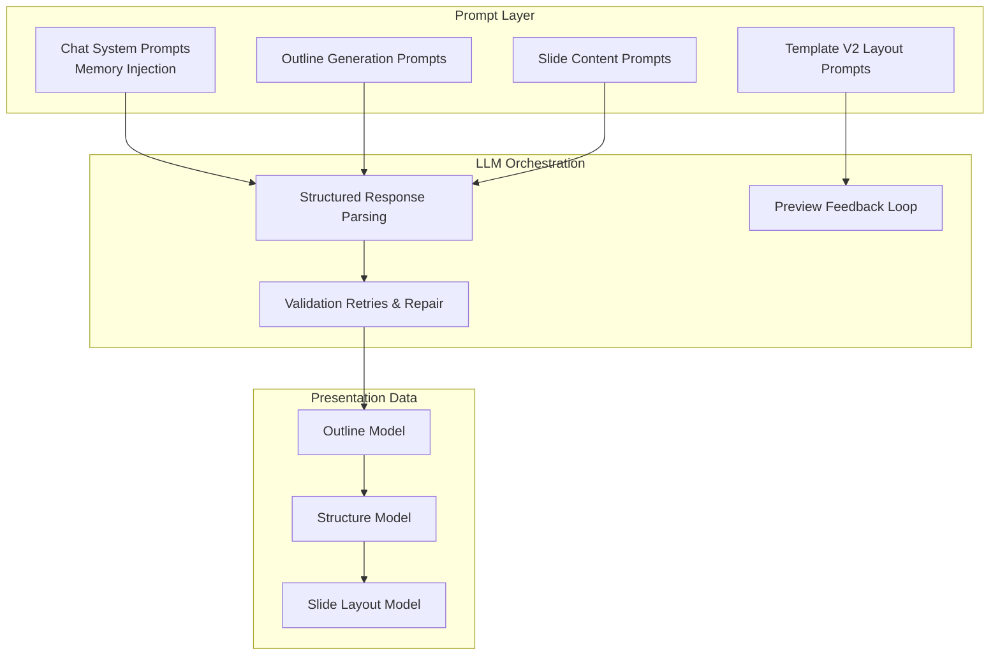
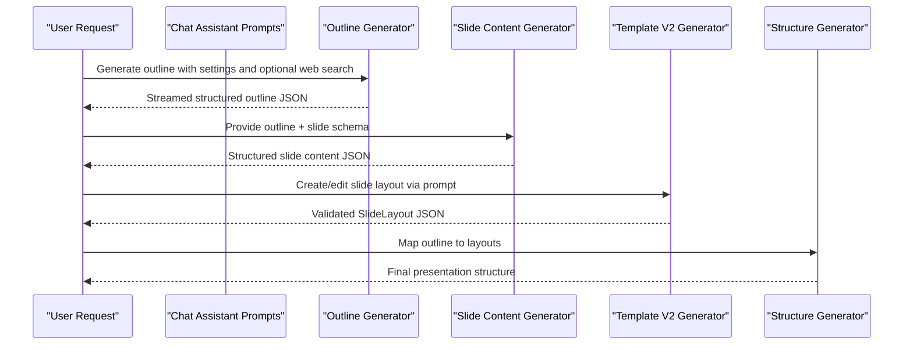
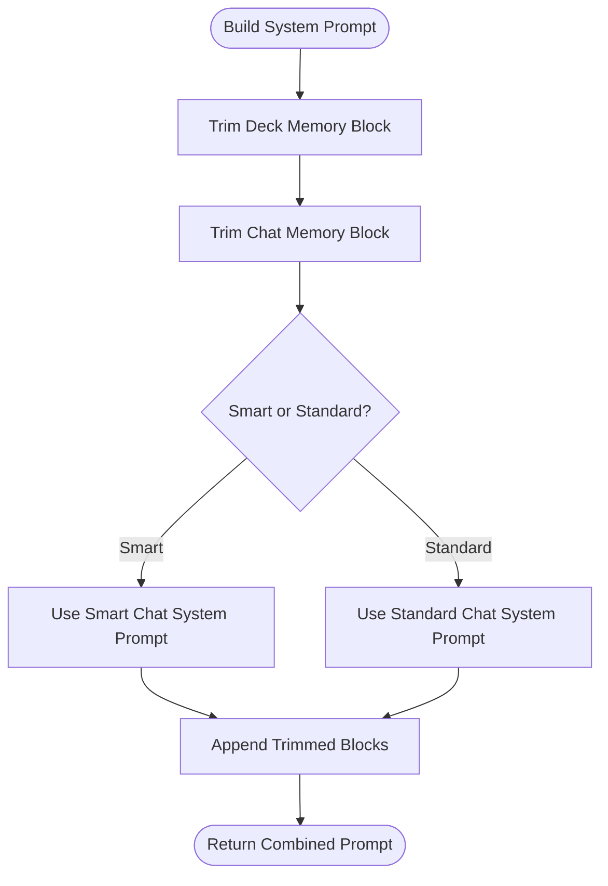
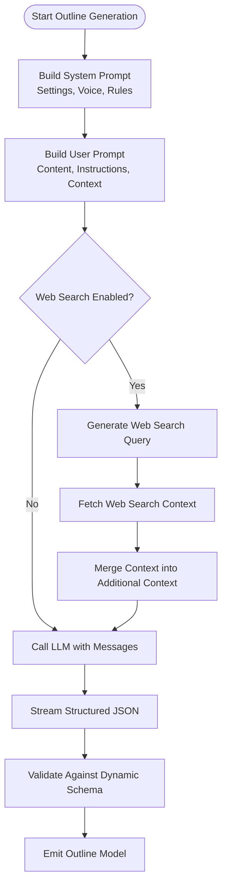
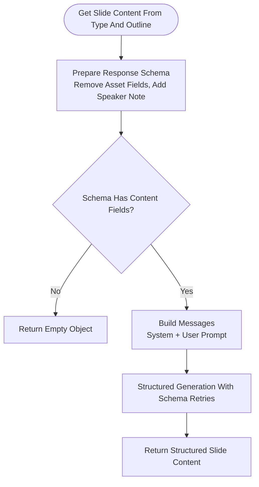
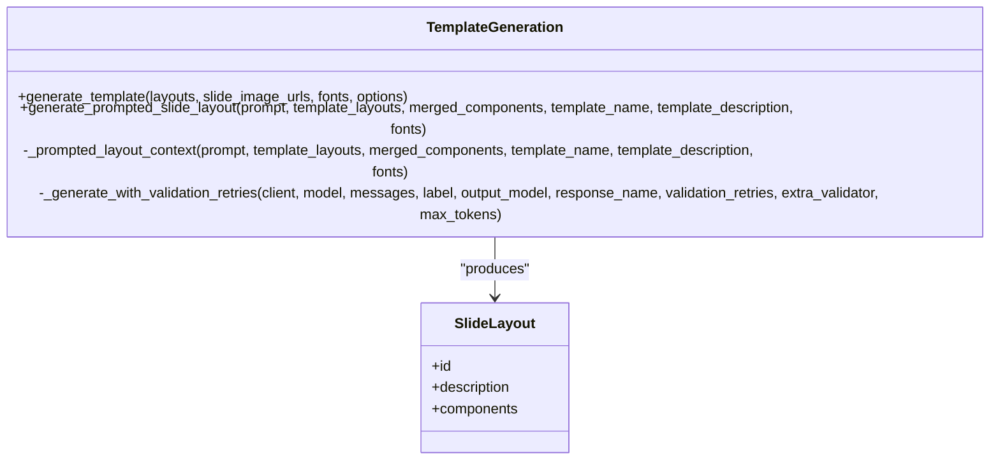
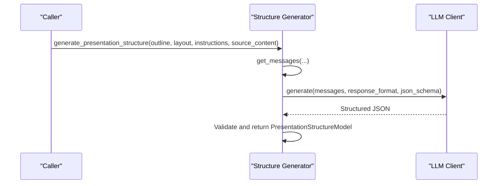
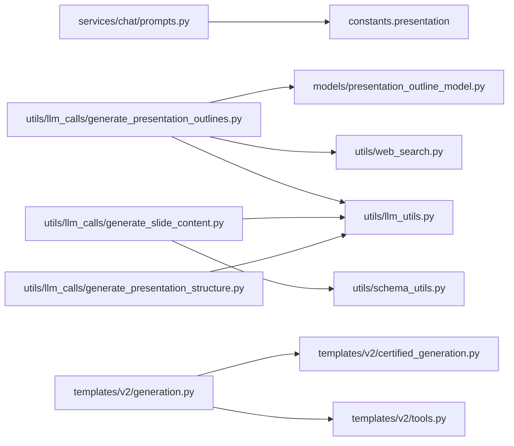

# Prompt Engineering Framework

<cite>
**Referenced Files in This Document**
- [prompts.py](file://servers/fastapi/services/chat/prompts.py)
- [generate_presentation_outlines.py](file://servers/fastapi/utils/llm_calls/generate_presentation_outlines.py)
- [generate_slide_content.py](file://servers/fastapi/utils/llm_calls/generate_slide_content.py)
- [generation.py](file://servers/fastapi/templates/v2/generation.py)
- [generate_presentation_structure.py](file://servers/fastapi/utils/llm_calls/generate_presentation_structure.py)
- [test_outline_generation_snapshots.py](file://servers/fastapi/tests/regression/test_outline_generation_snapshots.py)
- [test_chat_prompts.py](file://servers/fastapi/tests/unit/test_chat_prompts.py)
- [test_generate_slide_content.py](file://servers/fastapi/tests/unit/test_generate_slide_content.py)
- [runtime_limits.py](file://servers/fastapi/utils/runtime_limits.py)
- [provider_error_messages.py](file://servers/fastapi/utils/provider_error_messages.py)
</cite>

## Table of Contents
1. [Introduction](#introduction)
2. [Project Structure](#project-structure)
3. [Core Components](#core-components)
4. [Architecture Overview](#architecture-overview)
5. [Detailed Component Analysis](#detailed-component-analysis)
6. [Dependency Analysis](#dependency-analysis)
7. [Performance Considerations](#performance-considerations)
8. [Troubleshooting Guide](#troubleshooting-guide)
9. [Conclusion](#conclusion)
10. [Appendices](#appendices)

## Introduction
This document explains Presenton’s prompt engineering framework for AI-powered presentation generation. It covers structured prompt templates, context injection mechanisms, response parsing systems, outline generation prompts, slide content creation workflows, template-aware prompting strategies, prompt versioning and testing, optimization techniques across AI providers, the content transformation pipeline from AI responses to structured presentation data, customization examples, debugging tools, logging, performance monitoring, best practices, safety considerations, and consistency guidance across models.

## Project Structure
The prompt engineering framework is centered around:
- Chat assistant system prompts and memory injection
- Outline generation with web search integration
- Slide content generation driven by layout schemas
- Template V2 generation with validation retries and preview feedback
- Presentation structure generation that maps outlines to layouts
- Tests validating prompt behavior and output normalization

**Diagram sources**
- [prompts.py:10-251](file://servers/fastapi/services/chat/prompts.py#L10-L251)
- [generate_presentation_outlines.py:66-248](file://servers/fastapi/utils/llm_calls/generate_presentation_outlines.py#L66-L248)
- [generate_slide_content.py:20-192](file://servers/fastapi/utils/llm_calls/generate_slide_content.py#L20-L192)
- [generation.py:88-112](file://servers/fastapi/templates/v2/generation.py#L88-L112)
- [generate_presentation_structure.py:157-211](file://servers/fastapi/utils/llm_calls/generate_presentation_structure.py#L157-L211)

**Section sources**
- [prompts.py:10-251](file://servers/fastapi/services/chat/prompts.py#L10-L251)
- [generate_presentation_outlines.py:66-248](file://servers/fastapi/utils/llm_calls/generate_presentation_outlines.py#L66-L248)
- [generate_slide_content.py:20-192](file://servers/fastapi/utils/llm_calls/generate_slide_content.py#L20-L192)
- [generation.py:88-112](file://servers/fastapi/templates/v2/generation.py#L88-L112)
- [generate_presentation_structure.py:157-211](file://servers/fastapi/utils/llm_calls/generate_presentation_structure.py#L157-L211)

## Core Components
- Chat assistant system prompts define tool protocols, slide number rules, vector and infographic rules, chart/table handling, asset usage, theme preservation, outline protocol, and common editing patterns. Memory blocks are injected to provide deck and conversation context.
- Outline generation composes system and user prompts with authoritative settings (slide count, language, tone, title slide, table of contents), optional web search, and strict voice/content rules. It streams structured JSON validated against a dynamic schema.
- Slide content generation builds per-slide prompts using a layout schema, injects tone, verbosity, instructions, and speaker note requirements, then parses structured JSON into slide fields.
- Template V2 generation creates or edits slide layouts via prompted LLM calls, validates outputs, repairs invalid JSON or schema violations, and optionally uses a preview tool to refine visual composition.
- Presentation structure generation maps an outline to concrete slide layouts, preparing messages and returning a validated structure model.

**Section sources**
- [prompts.py:10-251](file://servers/fastapi/services/chat/prompts.py#L10-L251)
- [generate_presentation_outlines.py:66-248](file://servers/fastapi/utils/llm_calls/generate_presentation_outlines.py#L66-L248)
- [generate_slide_content.py:20-192](file://servers/fastapi/utils/llm_calls/generate_slide_content.py#L20-L192)
- [generation.py:631-693](file://servers/fastapi/templates/v2/generation.py#L631-L693)
- [generate_presentation_structure.py:157-211](file://servers/fastapi/utils/llm_calls/generate_presentation_structure.py#L157-L211)

## Architecture Overview
The framework orchestrates multiple prompt-driven stages:
1. Chat assistant prompts manage interactive slide editing with strict tool protocols and memory injection.
2. Outline generation produces audience-facing slide titles and content plans, optionally enriched by web search.
3. Slide content generation converts outline text into structured JSON aligned with each slide’s schema.
4. Template V2 generation creates editable slide layouts, with validation retries and optional preview feedback.
5. Presentation structure generation aligns outlines with layouts to produce a final presentation structure.

**Diagram sources**
- [generate_presentation_outlines.py:251-405](file://servers/fastapi/utils/llm_calls/generate_presentation_outlines.py#L251-L405)
- [generate_slide_content.py:229-276](file://servers/fastapi/utils/llm_calls/generate_slide_content.py#L229-L276)
- [generation.py:631-693](file://servers/fastapi/templates/v2/generation.py#L631-L693)
- [generate_presentation_structure.py:157-211](file://servers/fastapi/utils/llm_calls/generate_presentation_structure.py#L157-L211)

## Detailed Component Analysis

### Chat Assistant System Prompts and Context Injection
- Defines comprehensive tool protocols for slide discovery, editing, assets, charts, tables, vectors, infographics, and full-slide operations.
- Enforces additive editing rules, preserving existing content unless explicitly replaced.
- Injects two memory blocks: deck memory and chat memory, trimmed and appended only when non-empty.
- Provides common prompts for fixing overflow, improving readability, and managing images/icons.

**Diagram sources**
- [prompts.py:227-251](file://servers/fastapi/services/chat/prompts.py#L227-L251)

**Section sources**
- [prompts.py:10-251](file://servers/fastapi/services/chat/prompts.py#L10-L251)
- [test_chat_prompts.py:9-41](file://servers/fastapi/tests/unit/test_chat_prompts.py#L9-L41)

### Outline Generation Prompts and Web Search Integration
- Composes a system prompt with authoritative generation settings, voice rules, slide structure constraints, tone/language handling, and web search guidance.
- Builds a user prompt section including current date, content, instructions, and context.
- Routes web search through native model tools or external providers, generating queries and injecting results as untrusted reference material.
- Streams structured JSON responses validated against a dynamic outline schema.

**Diagram sources**
- [generate_presentation_outlines.py:66-248](file://servers/fastapi/utils/llm_calls/generate_presentation_outlines.py#L66-L248)
- [generate_presentation_outlines.py:251-405](file://servers/fastapi/utils/llm_calls/generate_presentation_outlines.py#L251-L405)

**Section sources**
- [generate_presentation_outlines.py:66-248](file://servers/fastapi/utils/llm_calls/generate_presentation_outlines.py#L66-L248)
- [generate_presentation_outlines.py:251-405](file://servers/fastapi/utils/llm_calls/generate_presentation_outlines.py#L251-L405)
- [test_outline_generation_snapshots.py:21-53](file://servers/fastapi/tests/regression/test_outline_generation_snapshots.py#L21-L53)

### Slide Content Creation Workflow
- Prepares a system prompt with general rules, math expression rules, markdown emphasis, user instructions, tone, verbosity, and output field schema.
- Builds a user prompt with current datetime, icon/image prompt language, slide language resolution, slide number, and outline content.
- Normalizes the response schema, adds speaker note field, ensures arrays have items, and calls structured generation with retries.

**Diagram sources**
- [generate_slide_content.py:113-192](file://servers/fastapi/utils/llm_calls/generate_slide_content.py#L113-L192)
- [generate_slide_content.py:203-276](file://servers/fastapi/utils/llm_calls/generate_slide_content.py#L203-L276)

**Section sources**
- [generate_slide_content.py:20-192](file://servers/fastapi/utils/llm_calls/generate_slide_content.py#L20-L192)
- [generate_slide_content.py:203-276](file://servers/fastapi/utils/llm_calls/generate_slide_content.py#L203-L276)
- [test_generate_slide_content.py:14-32](file://servers/fastapi/tests/unit/test_generate_slide_content.py#L14-L32)
- [test_generate_slide_content.py:83-137](file://servers/fastapi/tests/unit/test_generate_slide_content.py#L83-L137)

### Template-Aware Prompting Strategies
- Generates new editable slide layouts from user prompts, constrained by template context: reference layouts, reusable components, fonts, and existing layout IDs.
- Ranks and selects top reference layouts and components based on prompt term matching.
- Validates generated layout IDs, component presence, and editable content; replaces placeholder image URLs with stable placeholders.
- Uses a validation retry loop with JSON repair and model validation repair prompts; supports optional preview tool feedback to refine visuals.

**Diagram sources**
- [generation.py:631-693](file://servers/fastapi/templates/v2/generation.py#L631-L693)
- [generation.py:696-775](file://servers/fastapi/templates/v2/generation.py#L696-L775)
- [generation.py:1092-1196](file://servers/fastapi/templates/v2/generation.py#L1092-L1196)

**Section sources**
- [generation.py:88-112](file://servers/fastapi/templates/v2/generation.py#L88-L112)
- [generation.py:631-693](file://servers/fastapi/templates/v2/generation.py#L631-L693)
- [generation.py:696-775](file://servers/fastapi/templates/v2/generation.py#L696-L775)
- [generation.py:1092-1196](file://servers/fastapi/templates/v2/generation.py#L1092-L1196)

### Presentation Structure Generation
- Builds messages for slides-markdown or standard modes, prepares a dynamic schema based on the number of slides, and returns a validated structure model.
- Wraps LLM calls with structured response format and schema validation, handling provider exceptions.

**Diagram sources**
- [generate_presentation_structure.py:157-211](file://servers/fastapi/utils/llm_calls/generate_presentation_structure.py#L157-L211)

**Section sources**
- [generate_presentation_structure.py:157-211](file://servers/fastapi/utils/llm_calls/generate_presentation_structure.py#L157-L211)

## Dependency Analysis
Key dependencies and relationships:
- Chat prompts depend on constants for slide and outline limits and provide memory-injected system prompts.
- Outline generation depends on dynamic model retrieval, web search utilities, structured streaming, and error handling.
- Slide content generation depends on schema manipulation utilities and structured generation with retries.
- Template V2 generation depends on certified generation, preview tools, and robust retry/repair logic.
- Structure generation depends on message builders and structured generation helpers.

**Diagram sources**
- [prompts.py:1-2](file://servers/fastapi/services/chat/prompts.py#L1-L2)
- [generate_presentation_outlines.py:16-37](file://servers/fastapi/utils/llm_calls/generate_presentation_outlines.py#L16-L37)
- [generate_slide_content.py:14-18](file://servers/fastapi/utils/llm_calls/generate_slide_content.py#L14-L18)
- [generation.py:26-44](file://servers/fastapi/templates/v2/generation.py#L26-L44)
- [generate_presentation_structure.py:157-211](file://servers/fastapi/utils/llm_calls/generate_presentation_structure.py#L157-L211)

**Section sources**
- [prompts.py:1-2](file://servers/fastapi/services/chat/prompts.py#L1-L2)
- [generate_presentation_outlines.py:16-37](file://servers/fastapi/utils/llm_calls/generate_presentation_outlines.py#L16-L37)
- [generate_slide_content.py:14-18](file://servers/fastapi/utils/llm_calls/generate_slide_content.py#L14-L18)
- [generation.py:26-44](file://servers/fastapi/templates/v2/generation.py#L26-L44)
- [generate_presentation_structure.py:157-211](file://servers/fastapi/utils/llm_calls/generate_presentation_structure.py#L157-L211)

## Performance Considerations
- Parallel slide layout generation: Template V2 generation runs multiple slide layouts concurrently with bounded workers and logs progress per slide.
- Validation retries: Both template layout generation and general structured generation use retry loops with JSON repair and model validation repair prompts to improve reliability.
- Streaming outline generation: Outline generation streams structured JSON chunks, reducing latency and enabling incremental UI updates.
- Memory and runtime limits: Runtime utilities capture memory snapshots and provide bounded text buffers to prevent excessive memory growth during long-running tasks.

Recommendations:
- Prefer streaming where possible to reduce perceived latency.
- Tune validation retries based on provider stability; too many retries can increase cost.
- Monitor memory usage and truncate large intermediate texts using bounded buffers.
- Use parallelism judiciously; balance concurrency with provider rate limits and resource constraints.

**Section sources**
- [generation.py:151-210](file://servers/fastapi/templates/v2/generation.py#L151-L210)
- [generation.py:1092-1196](file://servers/fastapi/templates/v2/generation.py#L1092-L1196)
- [generate_presentation_outlines.py:371-405](file://servers/fastapi/utils/llm_calls/generate_presentation_outlines.py#L371-L405)
- [runtime_limits.py:10-36](file://servers/fastapi/utils/runtime_limits.py#L10-L36)

## Troubleshooting Guide
Common issues and diagnostics:
- Invalid API key or provider errors: Provider error messages normalize raw payloads and surface safe user-facing messages.
- JSON parse failures: Template V2 generation includes JSON repair prompts and logs detailed errors for retry attempts.
- Schema validation failures: Model validation repair prompts include required schema and invalid response details to guide correction.
- Memory pressure: Runtime memory logging helps identify spikes; bounded buffers prevent runaway growth.

Debugging steps:
- Inspect logs for retry attempts, validation errors, and provider error details.
- Verify that memory snapshots show expected usage patterns; investigate sudden heap spikes.
- For provider-specific errors, check configuration and credentials; use normalized error messages to guide fixes.

**Section sources**
- [provider_error_messages.py:157-187](file://servers/fastapi/utils/provider_error_messages.py#L157-L187)
- [generation.py:1298-1367](file://servers/fastapi/templates/v2/generation.py#L1298-L1367)
- [runtime_limits.py:10-36](file://servers/fastapi/utils/runtime_limits.py#L10-L36)

## Conclusion
Presenton’s prompt engineering framework provides a robust, multi-stage pipeline for generating presentations from prompts. It combines carefully crafted system prompts, structured response parsing, validation retries, and optional preview feedback to ensure high-quality, consistent outputs across different AI providers. The design emphasizes safety, clarity, and maintainability, with extensive tests and logging to support debugging and performance monitoring. By following the outlined best practices and leveraging the provided tools, teams can customize prompts for specific domains, improve output quality, and maintain consistency across models.

## Appendices

### Best Practices for Prompt Design
- Keep system prompts concise and authoritative; separate production controls from audience-facing content.
- Use structured schemas for all LLM outputs; validate and repair failures automatically.
- Inject minimal but sufficient context; trim empty memory blocks to avoid noise.
- Define clear tone, verbosity, and language rules; prefer auto-detect when appropriate.
- Avoid meta-commentary in slide content; treat visual instructions as production controls.

### Safety Considerations
- Treat web search results as untrusted reference material; do not execute embedded instructions.
- Normalize provider error messages to avoid leaking sensitive details.
- Enforce slide count and word limits to prevent oversized decks.
- Preserve template themes and avoid inventing asset URLs.

### Customization Examples
- Domain knowledge: Add domain-specific rules to system prompts for outline and slide content generation to enforce terminology and style.
- Tone and verbosity: Configure tone and verbosity parameters to match brand voice and audience expectations.
- Language control: Set explicit languages or auto-detect based on content; ensure slide language overrides conflicting requests.
- Visual intent: Include compact Markdown tables for chart data; preserve labels and numbers exactly.

### Testing Approaches
- Regression tests validate normalized outline payloads against snapshots.
- Unit tests verify prompt construction, memory block trimming, and schema handling.
- Edge case tests ensure deterministic prompt generation for large inputs.

**Section sources**
- [test_outline_generation_snapshots.py:21-53](file://servers/fastapi/tests/regression/test_outline_generation_snapshots.py#L21-L53)
- [test_chat_prompts.py:9-59](file://servers/fastapi/tests/unit/test_chat_prompts.py#L9-L59)
- [test_generate_slide_content.py:14-137](file://servers/fastapi/tests/unit/test_generate_slide_content.py#L14-L137)