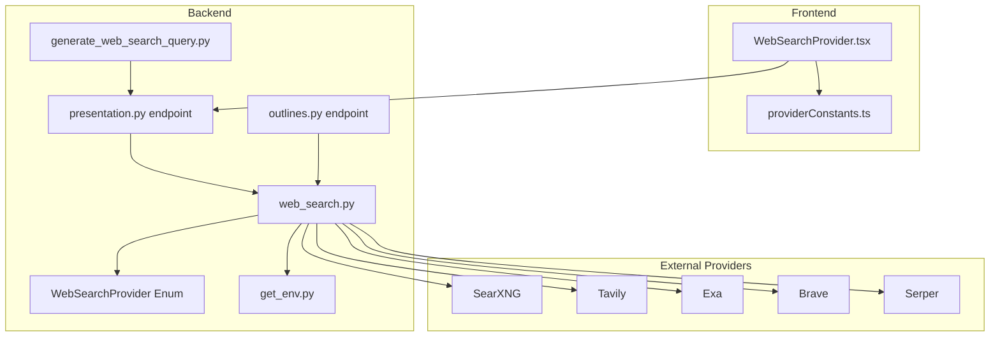
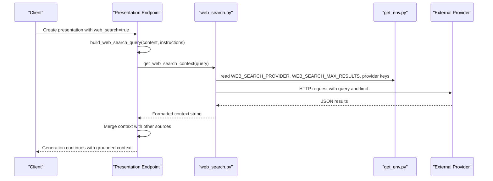
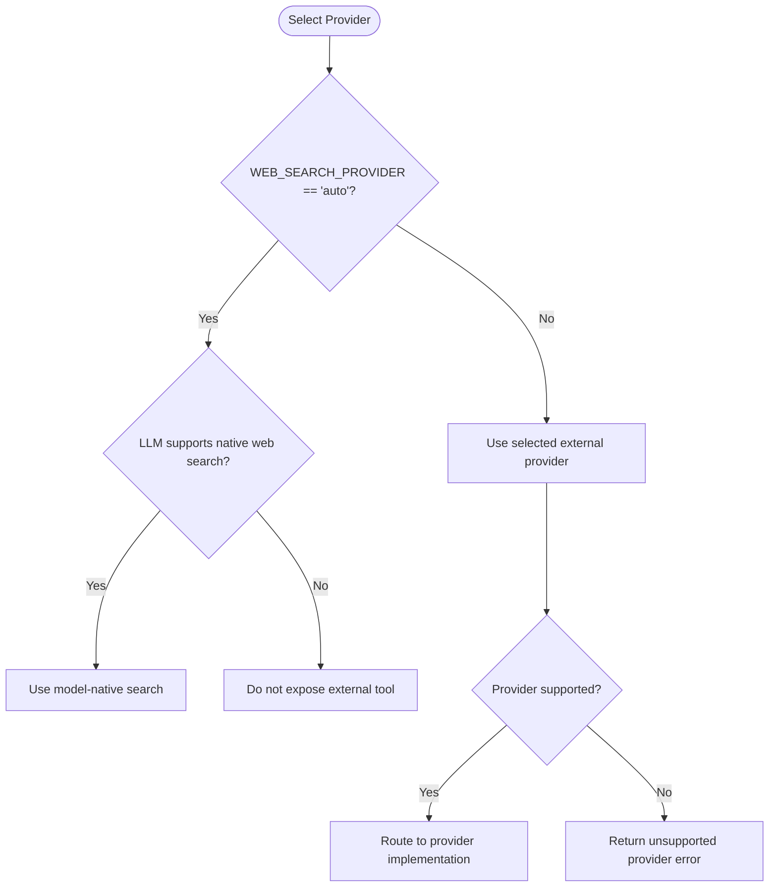
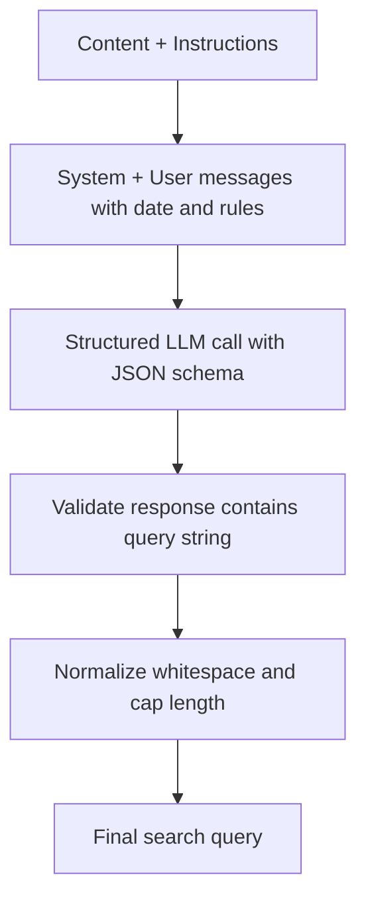
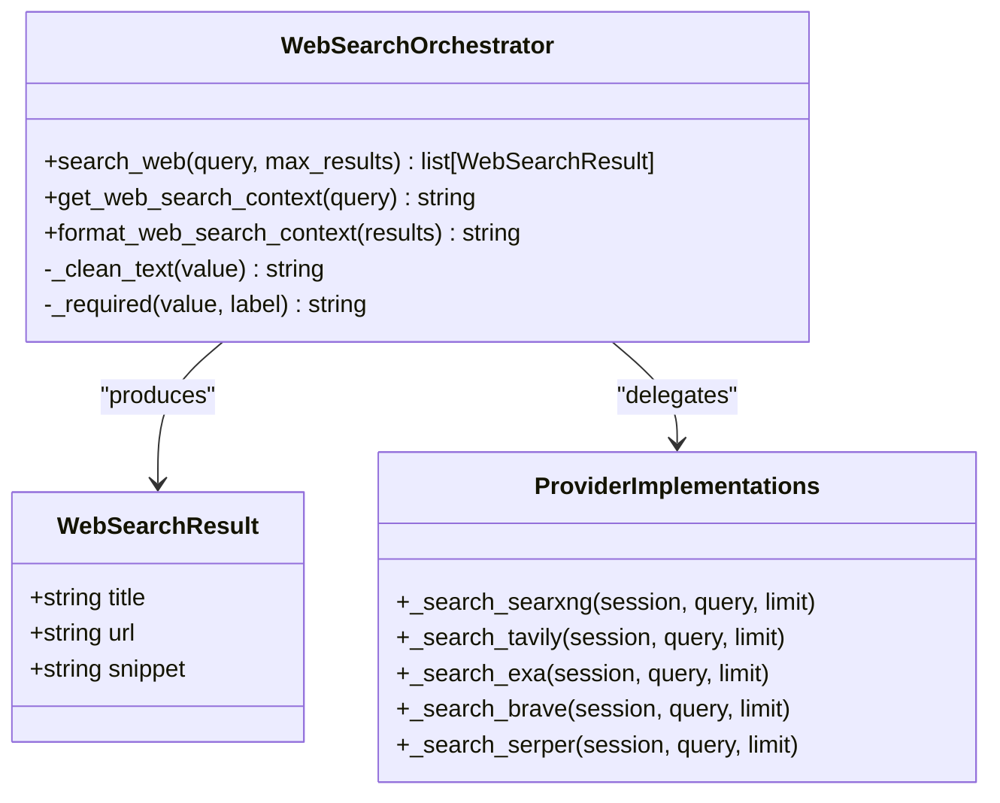
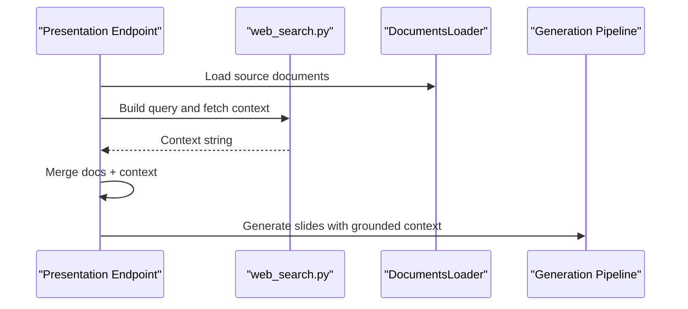
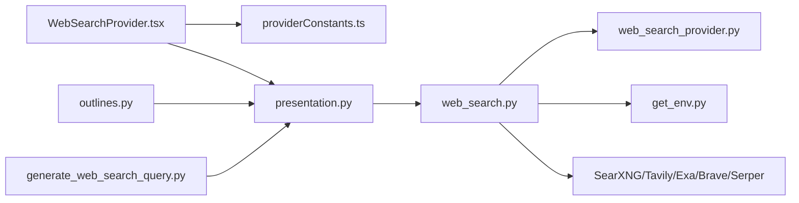

# Web Search & Grounding

<cite>
**Referenced Files in This Document**
- [web_search_provider.py](file://servers/fastapi/enums/web_search_provider.py)
- [web_search.py](file://servers/fastapi/utils/web_search.py)
- [generate_web_search_query.py](file://servers/fastapi/utils/llm_calls/generate_web_search_query.py)
- [get_env.py](file://servers/fastapi/utils/get_env.py)
- [presentation.py](file://servers/fastapi/api/v1/ppt/endpoints/presentation.py)
- [outlines.py](file://servers/fastapi/api/v1/ppt/endpoints/outlines.py)
- [providerConstants.ts](file://servers/nexjs/utils/providerConstants.ts)
- [WebSearchProvider.tsx](file://servers/nexjs/app/(presentation-generator)/(dashboard)/settings/WebSearchProvider.tsx)
- [test_web_search.py](file://servers/fastapi/tests/unit/test_web_search.py)
</cite>

## Table of Contents
1. [Introduction](#introduction)
2. [Project Structure](#project-structure)
3. [Core Components](#core-components)
4. [Architecture Overview](#architecture-overview)
5. [Detailed Component Analysis](#detailed-component-analysis)
6. [Dependency Analysis](#dependency-analysis)
7. [Performance Considerations](#performance-considerations)
8. [Troubleshooting Guide](#troubleshooting-guide)
9. [Conclusion](#conclusion)

## Introduction
This document explains Presenton’s web search grounding feature, which enhances AI-generated presentation content with real-time factual context. It covers:
- The provider abstraction that supports multiple search engines and APIs
- Query generation and result processing
- Context integration into presentation generation
- Configuration, API key management, and rate limiting behavior
- Caching strategies, privacy considerations, and security measures
- Troubleshooting connectivity issues, filtering techniques, and performance optimization for large-scale searches

## Project Structure
The web search and grounding capability spans backend utilities, API endpoints, frontend configuration UI, and unit tests:
- Backend enum defines supported providers
- Backend utility implements provider routing, HTTP calls, and result formatting
- LLM-based query generator produces concise search queries
- API endpoints integrate search results into presentation generation
- Frontend settings UI configures provider selection, API keys, and limits
- Unit tests validate provider resolution, logging, and result formatting

**Diagram sources**
- [WebSearchProvider.tsx:1-262](file://servers/nexjs/app/(presentation-generator)/(dashboard)/settings/WebSearchProvider.tsx#L1-L262)
- [providerConstants.ts:42-89](file://servers/nexjs/utils/providerConstants.ts#L42-L89)
- [web_search_provider.py:1-12](file://servers/fastapi/enums/web_search_provider.py#L1-L12)
- [web_search.py:1-330](file://servers/fastapi/utils/web_search.py#L1-L330)
- [generate_web_search_query.py:1-75](file://servers/fastapi/utils/llm_calls/generate_web_search_query.py#L1-L75)
- [get_env.py:365-394](file://servers/fastapi/utils/get_env.py#L365-L394)
- [presentation.py:1956-1988](file://servers/fastapi/api/v1/ppt/endpoints/presentation.py#L1956-L1988)
- [outlines.py:38-101](file://servers/fastapi/api/v1/ppt/endpoints/outlines.py#L38-L101)

**Section sources**
- [web_search_provider.py:1-12](file://servers/fastapi/enums/web_search_provider.py#L1-L12)
- [web_search.py:1-330](file://servers/fastapi/utils/web_search.py#L1-L330)
- [generate_web_search_query.py:1-75](file://servers/fastapi/utils/llm_calls/generate_web_search_query.py#L1-L75)
- [get_env.py:365-394](file://servers/fastapi/utils/get_env.py#L365-L394)
- [presentation.py:1956-1988](file://servers/fastapi/api/v1/ppt/endpoints/presentation.py#L1956-L1988)
- [outlines.py:38-101](file://servers/fastapi/api/v1/ppt/endpoints/outlines.py#L38-L101)
- [WebSearchProvider.tsx:1-262](file://servers/nexjs/app/(presentation-generator)/(dashboard)/settings/WebSearchProvider.tsx#L1-L262)
- [providerConstants.ts:42-89](file://servers/nexjs/utils/providerConstants.ts#L42-L89)

## Core Components
- Provider enumeration: Defines supported values including auto, native, searxng, tavily, exa, brave, serper.
- Provider resolver: Determines whether to use model-native search or an external provider based on configuration and current LLM provider.
- Search orchestrator: Executes HTTP requests to the selected provider, normalizes results, and formats a safe context string.
- Query generator: Uses an LLM call to produce a concise, focused search query from presentation content and instructions.
- Integration points: Presentation and outline endpoints conditionally enable web search and merge results into generated content.
- Frontend configuration: Allows users to select a provider, enter API keys or base URLs, and set maximum results.

Key responsibilities:
- Provider selection and validation
- Environment variable access for keys and URLs
- Safe text cleaning and URL redaction
- Result normalization and context formatting
- Logging and error handling

**Section sources**
- [web_search_provider.py:1-12](file://servers/fastapi/enums/web_search_provider.py#L1-L12)
- [web_search.py:32-189](file://servers/fastapi/utils/web_search.py#L32-L189)
- [generate_web_search_query.py:8-75](file://servers/fastapi/utils/llm_calls/generate_web_search_query.py#L8-L75)
- [get_env.py:365-394](file://servers/fastapi/utils/get_env.py#L365-L394)
- [WebSearchProvider.tsx:18-89](file://servers/nexjs/app/(presentation-generator)/(dashboard)/settings/WebSearchProvider.tsx#L18-L89)

## Architecture Overview
The grounding workflow integrates search results into presentation generation:
- The presentation endpoint checks if web search is enabled.
- If enabled, it builds a search query from content and instructions.
- It retrieves search results via the configured provider.
- Results are formatted into a neutral context block.
- The context is merged with other source parts (e.g., uploaded documents).
- The combined context is passed to the generation pipeline.

**Diagram sources**
- [presentation.py:1956-1988](file://servers/fastapi/api/v1/ppt/endpoints/presentation.py#L1956-L1988)
- [web_search.py:97-189](file://servers/fastapi/utils/web_search.py#L97-L189)
- [get_env.py:365-394](file://servers/fastapi/utils/get_env.py#L365-L394)

## Detailed Component Analysis

### Provider Abstraction and Selection
- Supported providers include auto, native, searxng, tavily, exa, brave, serper.
- Auto mode prefers model-native web grounding when available; otherwise, it remains off unless an explicit external provider is selected.
- Native mode uses model capabilities when supported by the current LLM provider.
- External modes route requests to specific providers.

**Diagram sources**
- [web_search.py:39-94](file://servers/fastapi/utils/web_search.py#L39-L94)
- [web_search_provider.py:1-12](file://servers/fastapi/enums/web_search_provider.py#L1-L12)

**Section sources**
- [web_search.py:39-94](file://servers/fastapi/utils/web_search.py#L39-L94)
- [web_search_provider.py:1-12](file://servers/fastapi/enums/web_search_provider.py#L1-L12)

### Search Query Generation
- An LLM-based generator creates a concise, focused query from presentation content and optional instructions.
- The prompt instructs the model to consider today’s date and return a single search-engine-style query.
- Output is validated against a schema and normalized to a bounded length.

**Diagram sources**
- [generate_web_search_query.py:8-75](file://servers/fastapi/utils/llm_calls/generate_web_search_query.py#L8-L75)

**Section sources**
- [generate_web_search_query.py:8-75](file://servers/fastapi/utils/llm_calls/generate_web_search_query.py#L8-L75)

### Search Execution and Result Processing
- The search orchestrator cleans the query, determines the provider, and executes an HTTP request with a bounded timeout.
- Each provider has a dedicated function mapping provider-specific responses to a common result structure.
- Results are filtered to ensure required fields exist and are cleaned before formatting.
- A final context string includes titles and summaries without exposing raw URLs or reference markers.

**Diagram sources**
- [web_search.py:32-189](file://servers/fastapi/utils/web_search.py#L32-L189)
- [web_search.py:236-329](file://servers/fastapi/utils/web_search.py#L236-L329)

**Section sources**
- [web_search.py:97-189](file://servers/fastapi/utils/web_search.py#L97-L189)
- [web_search.py:236-329](file://servers/fastapi/utils/web_search.py#L236-L329)

### Context Integration into Presentation Generation
- When web search is enabled, the presentation endpoint builds a query and retrieves context.
- The context is appended to other source parts (e.g., uploaded documents).
- The combined context is truncated to a maximum size before being used by the generation pipeline.

**Diagram sources**
- [presentation.py:1956-1988](file://servers/fastapi/api/v1/ppt/endpoints/presentation.py#L1956-L1988)
- [web_search.py:160-189](file://servers/fastapi/utils/web_search.py#L160-L189)

**Section sources**
- [presentation.py:1956-1988](file://servers/fastapi/api/v1/ppt/endpoints/presentation.py#L1956-L1988)

### Configuration and API Key Management
- Frontend settings allow selecting a provider, entering API keys or base URLs, and setting maximum results.
- Backend reads environment variables for provider selection, maximum results, and provider credentials.
- The UI maps provider options to field names for keys and URLs.

Configuration inputs:
- WEB_GROUNDING: Enable/disable web grounding
- WEB_SEARCH_PROVIDER: Select provider (auto, native, searxng, tavily, exa, brave, serper)
- WEB_SEARCH_MAX_RESULTS: Number of results (bounded by backend)
- Provider-specific keys and URLs: e.g., TAVILY_API_KEY, EXA_API_KEY, BRAVE_SEARCH_API_KEY, SERPER_API_KEY, SEARXNG_BASE_URL

**Section sources**
- [WebSearchProvider.tsx:18-89](file://servers/nexjs/app/(presentation-generator)/(dashboard)/settings/WebSearchProvider.tsx#L18-L89)
- [WebSearchProvider.tsx:183-253](file://servers/nexjs/app/(presentation-generator)/(dashboard)/settings/WebSearchProvider.tsx#L183-L253)
- [providerConstants.ts:42-89](file://servers/nexjs/utils/providerConstants.ts#L42-L89)
- [get_env.py:365-394](file://servers/fastapi/utils/get_env.py#L365-L394)

### Rate Limiting and Limits
- Maximum results are clamped between 1 and 10 regardless of user input.
- HTTP requests use a total timeout to avoid hanging connections.
- There is no built-in per-provider rate limiter; operators should apply rate limiting at the infrastructure level (e.g., reverse proxy or provider-side quotas).

Operational guidance:
- Keep WEB_SEARCH_MAX_RESULTS modest to reduce cost and latency.
- Monitor provider quotas and implement retries/backoff at the deployment layer.

**Section sources**
- [web_search.py:83-88](file://servers/fastapi/utils/web_search.py#L83-L88)
- [web_search.py:118-122](file://servers/fastapi/utils/web_search.py#L118-L122)

### Caching Strategies
- The backend does not implement an in-process cache for search results.
- Operators can add caching at the network layer (e.g., CDN, reverse proxy cache) or application layer (e.g., Redis) keyed by query and provider parameters.
- For repeated presentations or batch generation, deduplicate identical queries to reduce redundant API calls.

Recommendations:
- Cache successful responses for a short TTL (e.g., minutes) depending on data freshness needs.
- Invalidate cache entries when provider configurations change.

[No sources needed since this section provides general guidance]

### Privacy Considerations
- Result formatting removes raw URLs and inline link references from the context to reduce leakage of sensitive links.
- Logs redact credentials embedded in URLs (e.g., basic auth tokens).
- Avoid sending unnecessary PII in search queries; sanitize content and instructions before building queries.

Security measures:
- URL credential redaction for logs
- Strict validation of provider selection
- Bounded query lengths and result counts

**Section sources**
- [web_search.py:172-200](file://servers/fastapi/utils/web_search.py#L172-L200)
- [web_search.py:218-226](file://servers/fastapi/utils/web_search.py#L218-L226)

### Security Measures
- Provider selection is validated against the enum; invalid values raise errors.
- Required provider credentials are enforced; missing keys cause clear errors.
- HTTP responses are checked for non-2xx status codes and converted to structured errors.

**Section sources**
- [web_search.py:43-51](file://servers/fastapi/utils/web_search.py#L43-L51)
- [web_search.py:203-207](file://servers/fastapi/utils/web_search.py#L203-L207)
- [web_search.py:228-233](file://servers/fastapi/utils/web_search.py#L228-L233)

## Dependency Analysis
The following diagram shows how components depend on each other:

**Diagram sources**
- [WebSearchProvider.tsx:1-262](file://servers/nexjs/app/(presentation-generator)/(dashboard)/settings/WebSearchProvider.tsx#L1-L262)
- [providerConstants.ts:42-89](file://servers/nexjs/utils/providerConstants.ts#L42-L89)
- [presentation.py:1956-1988](file://servers/fastapi/api/v1/ppt/endpoints/presentation.py#L1956-L1988)
- [outlines.py:38-101](file://servers/fastapi/api/v1/ppt/endpoints/outlines.py#L38-L101)
- [web_search.py:1-330](file://servers/fastapi/utils/web_search.py#L1-L330)
- [web_search_provider.py:1-12](file://servers/fastapi/enums/web_search_provider.py#L1-L12)
- [get_env.py:365-394](file://servers/fastapi/utils/get_env.py#L365-L394)
- [generate_web_search_query.py:1-75](file://servers/fastapi/utils/llm_calls/generate_web_search_query.py#L1-L75)

**Section sources**
- [web_search.py:1-330](file://servers/fastapi/utils/web_search.py#L1-L330)
- [web_search_provider.py:1-12](file://servers/fastapi/enums/web_search_provider.py#L1-L12)
- [get_env.py:365-394](file://servers/fastapi/utils/get_env.py#L365-L394)
- [presentation.py:1956-1988](file://servers/fastapi/api/v1/ppt/endpoints/presentation.py#L1956-L1988)
- [outlines.py:38-101](file://servers/fastapi/api/v1/ppt/endpoints/outlines.py#L38-L101)
- [WebSearchProvider.tsx:1-262](file://servers/nexjs/app/(presentation-generator)/(dashboard)/settings/WebSearchProvider.tsx#L1-L262)
- [providerConstants.ts:42-89](file://servers/nexjs/utils/providerConstants.ts#L42-L89)
- [generate_web_search_query.py:1-75](file://servers/fastapi/utils/llm_calls/generate_web_search_query.py#L1-L75)

## Performance Considerations
- Query length is capped to reduce token usage and improve clarity.
- Result count is clamped to a small range to control payload size and downstream processing time.
- HTTP timeouts prevent long-running requests from blocking the pipeline.
- For large-scale searches:
  - Deduplicate queries across concurrent requests
  - Use provider-level concurrency controls
  - Apply backoff and retry policies at the infrastructure layer
  - Consider caching repeated queries for short TTLs

[No sources needed since this section provides general guidance]

## Troubleshooting Guide
Common issues and resolutions:
- Provider not configured: Ensure WEB_SEARCH_PROVIDER is set to a supported value and required keys/URLs are present.
- Missing API keys: Set the appropriate provider key environment variables (e.g., TAVILY_API_KEY, EXA_API_KEY, BRAVE_SEARCH_API_KEY, SERPER_API_KEY).
- SearXNG URL misconfiguration: Provide a valid base URL; the system appends /search automatically.
- Empty or malformed queries: Clean and normalize content/instructions before generating queries.
- Connectivity failures: Verify network access to provider endpoints and check timeouts.
- Excessive results: Reduce WEB_SEARCH_MAX_RESULTS to stay within provider quotas.

Validation and diagnostics:
- Inspect logs for provider selection, request details, and result counts.
- Use unit tests as examples for expected behaviors and edge cases.

**Section sources**
- [web_search.py:43-51](file://servers/fastapi/utils/web_search.py#L43-L51)
- [web_search.py:203-207](file://servers/fastapi/utils/web_search.py#L203-L207)
- [web_search.py:236-251](file://servers/fastapi/utils/web_search.py#L236-L251)
- [test_web_search.py:9-87](file://servers/fastapi/tests/unit/test_web_search.py#L9-L87)
- [test_web_search.py:149-164](file://servers/fastapi/tests/unit/test_web_search.py#L149-L164)
- [test_web_search.py:167-200](file://servers/fastapi/tests/unit/test_web_search.py#L167-L200)

## Conclusion
Presenton’s web search grounding feature provides a flexible, secure, and configurable way to enrich presentation generation with real-time information. The provider abstraction supports multiple search engines, while robust query generation, result processing, and context integration ensure high-quality outputs. Operators can tune performance and reliability through configuration, caching, and infrastructure-level controls.

[No sources needed since this section summarizes without analyzing specific files]