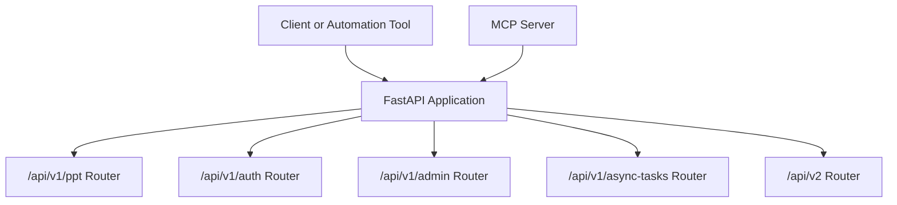
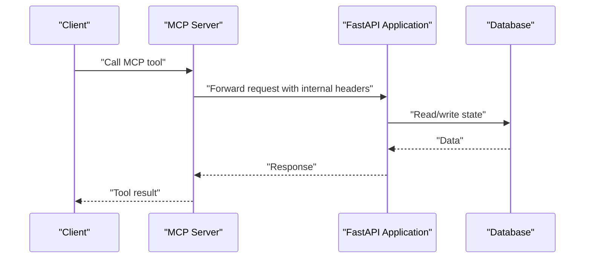
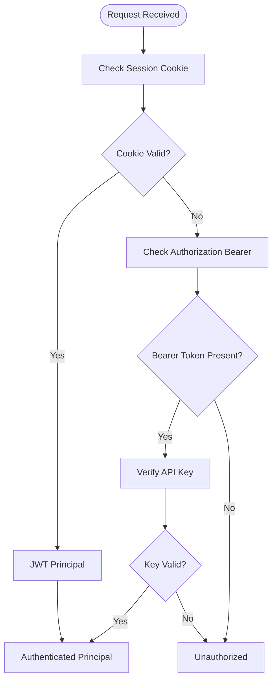
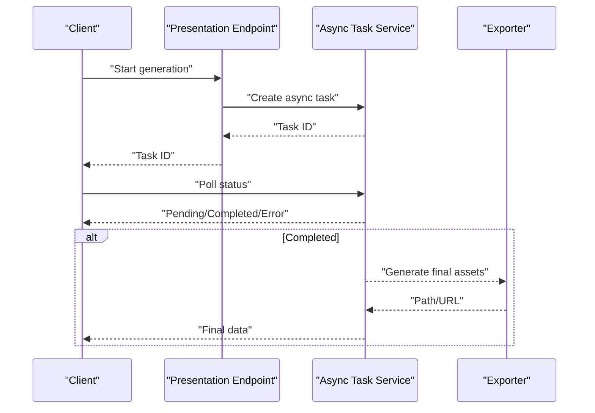
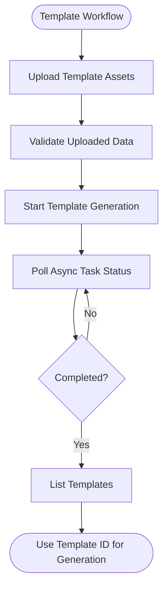
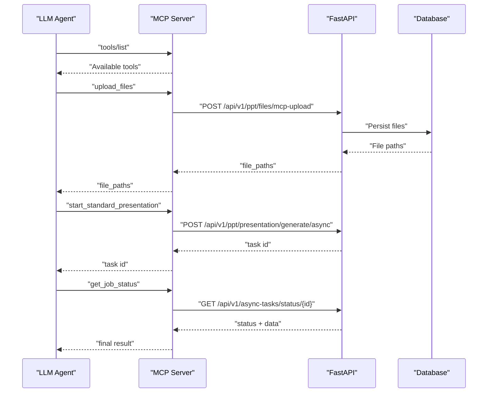
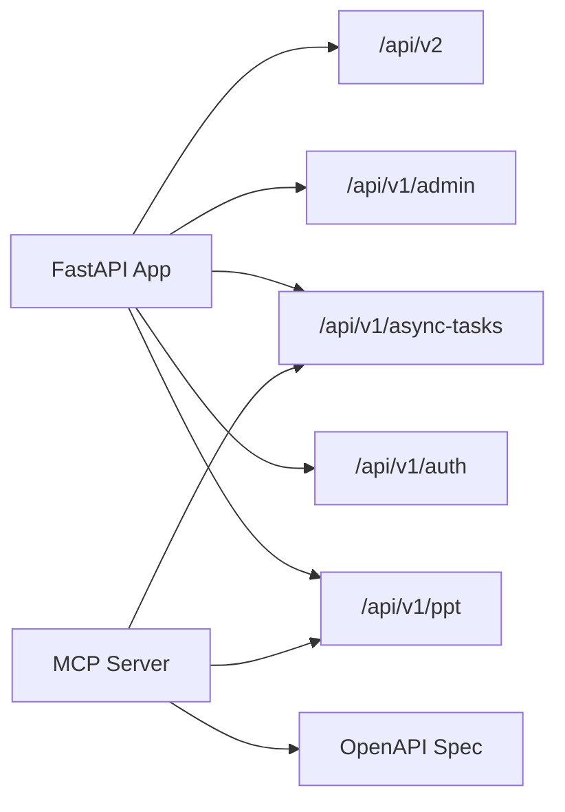

# API Reference

<cite>
**Referenced Files in This Document**
- [main.py](file://servers/fastapi/api/main.py)
- [router.py](file://servers/fastapi/api/v1/ppt/router.py)
- [presentation.py](file://servers/fastapi/api/v1/ppt/endpoints/presentation.py)
- [template.py](file://servers/fastapi/api/v1/ppt/endpoints/template.py)
- [router.py](file://servers/fastapi/api/v1/async_tasks/router.py)
- [router.py](file://servers/fastapi/api/v1/auth/router.py)
- [principal.py](file://servers/fastapi/api/v1/auth/principal.py)
- [internal.py](file://servers/fastapi/api/v1/auth/internal.py)
- [router.py](file://servers/fastapi/api/v1/admin/router.py)
- [router.py](file://servers/fastapi/api/v2/router.py)
- [router.py](file://servers/fastapi/api/v2/ppt/router.py)
- [mcp_server.py](file://servers/fastapi/mcp_server.py)
- [api_keys.py](file://servers/fastapi/services/api_keys.py)
- [test_auth_endpoints.py](file://servers/fastapi/tests/integration/test_auth_endpoints.py)
</cite>

## Table of Contents
1. [Introduction](#introduction)
2. [Project Structure](#project-structure)
3. [Core Components](#core-components)
4. [Architecture Overview](#architecture-overview)
5. [Detailed Component Analysis](#detailed-component-analysis)
6. [Dependency Analysis](#dependency-analysis)
7. [Performance Considerations](#performance-considerations)
8. [Troubleshooting Guide](#troubleshooting-guide)
9. [Conclusion](#conclusion)
10. [Appendices](#appendices)

## Introduction
This document is the comprehensive API reference for Presenton’s REST and Model Context Protocol (MCP) interfaces. It covers:

- REST API v1 and v2 endpoints for presentation generation, template management, file handling, async task polling, authentication, user administration, and provider configuration.
- MCP server capabilities that expose a curated subset of REST endpoints as tools for automated workflows.
- Authentication mechanisms including session-based JWT cookies and user-scoped API keys.
- Error handling patterns, status codes, and client-side error extraction behavior.
- Versioning strategy, deprecation guidance, and migration notes between v1 and v2.
- SDK integration patterns and best practices for reliable automation.

The REST API is implemented with FastAPI and organized under versioned routers. The MCP server is built from an OpenAPI specification and exposes only selected presentation workflow endpoints as tools.

## Project Structure
Presenton’s backend API lives under `servers/fastapi`. The main application mounts multiple routers:

- `/api/v1/ppt` — Presentation, generation, templates, files, images, fonts, icons, outlines, chat, community, and provider integrations.
- `/api/v1/auth` — Authentication, session verification, setup, login, logout, and OAuth flows.
- `/api/v1/admin` — Administrative operations for users, API keys, and provider settings.
- `/api/v1/async-tasks` — Async job listing and status polling.
- `/api/v2` — Newer presentation generation endpoints.
- MCP server — A separate HTTP service exposing a restricted tool surface derived from the OpenAPI spec.

**Diagram sources**
- [main.py:67-74](file://servers/fastapi/api/main.py#L67-L74)
- [router.py:22-40](file://servers/fastapi/api/v1/ppt/router.py#L22-L40)
- [router.py:14-17](file://servers/fastapi/api/v1/async_tasks/router.py#L14-L17)
- [router.py:27-28](file://servers/fastapi/api/v1/auth/router.py#L27-L28)
- [router.py:41](file://servers/fastapi/api/v1/admin/router.py#L41)
- [router.py:6-7](file://servers/fastapi/api/v2/router.py#L6-L7)
- [mcp_server.py:346-362](file://servers/fastapi/mcp_server.py#L346-L362)

**Section sources**
- [main.py:67-103](file://servers/fastapi/api/main.py#L67-L103)
- [router.py:22-40](file://servers/fastapi/api/v1/ppt/router.py#L22-L40)
- [router.py:14-17](file://servers/fastapi/api/v1/async_tasks/router.py#L14-L17)
- [router.py:27-28](file://servers/fastapi/api/v1/auth/router.py#L27-L28)
- [router.py:41](file://servers/fastapi/api/v1/admin/router.py#L41)
- [router.py:6-7](file://servers/fastapi/api/v2/router.py#L6-L7)

## Core Components
This section summarizes the core API surfaces and their responsibilities.

### REST API v1
- Presentation and generation endpoints under `/api/v1/ppt/presentation`.
- Template CRUD and generation under `/api/v1/ppt/template`.
- File uploads and references under `/api/v1/ppt/files`.
- Image, font, icon, outline, chat, and provider-specific endpoints under `/api/v1/ppt`.
- Authentication endpoints under `/api/v1/auth`.
- Admin endpoints under `/api/v1/admin`.
- Async task endpoints under `/api/v1/async-tasks`.

### REST API v2
- Newer presentation generation endpoints under `/api/v2/ppt`.

### MCP Server
- Exposes a curated set of tools based on OpenAPI route maps.
- Supports standard and smart presentation generation, template listing, template asset upload, template generation, file upload, and async task status polling.
- Uses user-scoped API keys for authentication when server auth is enabled.

**Section sources**
- [router.py:22-40](file://servers/fastapi/api/v1/ppt/router.py#L22-L40)
- [router.py:6-7](file://servers/fastapi/api/v2/router.py#L6-L7)
- [mcp_server.py:54-125](file://servers/fastapi/mcp_server.py#L54-L125)

## Architecture Overview
The system architecture separates public-facing REST endpoints from the MCP layer. The MCP server proxies selected requests to the FastAPI application while enforcing strict routing and instructions for LLM-driven automation.

**Diagram sources**
- [mcp_server.py:365-415](file://servers/fastapi/mcp_server.py#L365-L415)
- [mcp_server.py:417-465](file://servers/fastapi/mcp_server.py#L417-L465)

## Detailed Component Analysis

### Authentication API
Authentication supports two primary methods:

- Session-based JWT cookie flow for browser and desktop clients.
- User-scoped API key bearer flow for programmatic access.

Key endpoints:

- `GET /api/v1/auth/status`
  - Returns configured and authenticated state.
  - In disabled-auth mode, returns admin-like status for the electron environment.
- `GET /api/v1/auth/verify`
  - Verifies current session or API key.
  - Returns user identity and authentication method.
- `POST /api/v1/auth/setup`
  - Creates the initial administrator account.
  - Requires username and password; enforces minimum length.
- `POST /api/v1/auth/login`
  - Authenticates username/password and sets an HttpOnly JWT cookie.
- `POST /api/v1/auth/logout`
  - Clears the session cookie.

Authentication resolution:

- Cookie token is validated via JWT strategy.
- Bearer tokens are parsed and verified as user-scoped API keys.
- Principal includes user ID, username, admin flag, and method (`jwt` or `api_key`).

Internal request helpers:

- Internal services can issue short-lived JWTs for trusted internal calls.
- MCP uses an internal session cookie header when forwarding requests to FastAPI.

**Diagram sources**
- [principal.py:22-42](file://servers/fastapi/api/v1/auth/principal.py#L22-L42)
- [api_keys.py:50-61](file://servers/fastapi/services/api_keys.py#L50-L61)

**Section sources**
- [router.py:58-107](file://servers/fastapi/api/v1/auth/router.py#L58-L107)
- [router.py:110-188](file://servers/fastapi/api/v1/auth/router.py#L110-L188)
- [router.py:191-201](file://servers/fastapi/api/v1/auth/router.py#L191-L201)
- [principal.py:14-42](file://servers/fastapi/api/v1/auth/principal.py#L14-L42)
- [internal.py:10-25](file://servers/fastapi/api/v1/auth/internal.py#L10-L25)
- [test_auth_endpoints.py:134-207](file://servers/fastapi/tests/integration/test_auth_endpoints.py#L134-L207)

### Admin API
Administrative endpoints require admin privileges. They manage users, API keys, and provider settings.

Key endpoints:

- `GET /api/v1/admin/api-keys`
  - Lists all API keys.
- `POST /api/v1/admin/api-keys`
  - Creates an API key for a specified active user.
  - Returns created key metadata plus the secret token once.
- `GET /api/v1/admin/api-keys/{api_key_id}/token`
  - Reveals the original token if not revoked and supported.
- `POST /api/v1/admin/api-keys/{api_key_id}/revoke`
  - Marks an API key as revoked.
- `GET /api/v1/admin/provider-settings`
  - Reads provider settings and cloud connection status.
- `PUT /api/v1/admin/provider-settings`
  - Updates provider settings and refreshes runtime configuration.
- `GET /api/v1/admin/users`
  - Lists users.
- `POST /api/v1/admin/users`
  - Creates a non-admin user with a secure password hash.
- `PUT /api/v1/admin/users/{user_id}/password`
  - Resets a user’s password; protects primary admin accounts.
- `DELETE /api/v1/admin/users/{user_id}`
  - Deletes a user and cleans owned directories.

Security notes:

- Primary admin account cannot be deleted or have its password reset through this endpoint.
- API key reveal is guarded by encryption and revocation checks.

**Section sources**
- [router.py:44-128](file://servers/fastapi/api/v1/admin/router.py#L44-L128)
- [router.py:131-166](file://servers/fastapi/api/v1/admin/router.py#L131-L166)
- [router.py:169-265](file://servers/fastapi/api/v1/admin/router.py#L169-L265)

### Presentation Generation API (v1)
Presentation generation is centered around asynchronous jobs. Clients typically:

1. Prepare or create a presentation context.
2. Start a generation job.
3. Poll `/api/v1/async-tasks/status/{id}` until completion.
4. Use returned paths or URLs for exported assets and editor links.

Important behaviors:

- Generation resolves templates by name or ID, falling back to bundled defaults when appropriate.
- Slides may be generated from markdown outlines or structured content.
- Smart generation produces HTML-based decks without requiring a Standard template ID.
- Progress data includes slide counts and presentation IDs where available.

**Diagram sources**
- [presentation.py:170-185](file://servers/fastapi/api/v1/ppt/endpoints/presentation.py#L170-L185)
- [router.py:69-84](file://servers/fastapi/api/v1/async_tasks/router.py#L69-L84)

**Section sources**
- [presentation.py:134-191](file://servers/fastapi/api/v1/ppt/endpoints/presentation.py#L134-L191)
- [presentation.py:260-293](file://servers/fastapi/api/v1/ppt/endpoints/presentation.py#L260-L293)
- [presentation.py:2645-2666](file://servers/fastapi/api/v1/ppt/endpoints/presentation.py#L2645-L2666)
- [router.py:69-84](file://servers/fastapi/api/v1/async_tasks/router.py#L69-L84)

### Template Management API
Template endpoints support browsing, creating, previewing, and deleting templates.

Key endpoints:

- `GET /api/v1/ppt/template/all`
  - Lists templates with pagination and optional filtering for default vs custom templates.
- `POST /api/v1/ppt/template/async`
  - Starts asynchronous template creation.
- `POST /api/v1/ppt/template/mcp-upload`
  - Uploads template assets for MCP workflows.
- `DELETE /api/v1/ppt/template/{template_id}`
  - Deletes a custom template; built-in templates are read-only.

Template lifecycle:

- MCP template upload accepts base64-encoded PPTX and optional font replacements.
- Template generation requires valid uploaded PPTX URL, slide image URLs, and fonts mapping.
- Preview URLs are constructed using public host information.

**Diagram sources**
- [template.py:1112-1174](file://servers/fastapi/api/v1/ppt/endpoints/template.py#L1112-L1174)
- [template.py:127-188](file://servers/fastapi/api/v1/ppt/endpoints/template.py#L127-L188)
- [template.py:2156-2174](file://servers/fastapi/api/v1/ppt/endpoints/template.py#L2156-L2174)

**Section sources**
- [template.py:95-124](file://servers/fastapi/api/v1/ppt/endpoints/template.py#L95-L124)
- [template.py:127-200](file://servers/fastapi/api/v1/ppt/endpoints/template.py#L127-L200)
- [template.py:1112-1174](file://servers/fastapi/api/v1/ppt/endpoints/template.py#L1112-L1174)
- [template.py:2134-2174](file://servers/fastapi/api/v1/ppt/endpoints/template.py#L2134-L2174)

### Async Task API
Async tasks provide job tracking for long-running operations such as presentation and template generation.

Key endpoints:

- `GET /api/v1/async-tasks`
  - Lists tasks with filters for type, status, time range, ordering, pagination.
- `GET /api/v1/async-tasks/status/{id}`
  - Returns task details and transformed data fields into absolute MCP-friendly URLs.

Usage pattern:

- Clients should poll every 10–15 seconds during pending states.
- Completed responses include exported file paths and editor URLs where applicable.
- Error responses are terminal and should not be retried blindly.

**Section sources**
- [router.py:14-84](file://servers/fastapi/api/v1/async_tasks/router.py#L14-L84)

### REST API v2
Version 2 introduces newer presentation generation endpoints under `/api/v2/ppt`. The router mounts the v2 presentation router, indicating a continuation of presentation-focused functionality with updated behavior or schemas.

Consumers should prefer v2 for new integrations unless compatibility with existing clients requires v1.

**Section sources**
- [router.py:6-7](file://servers/fastapi/api/v2/router.py#L6-L7)
- [router.py:1-7](file://servers/fastapi/api/v2/ppt/router.py#L1-L7)

### MCP API
The MCP server exposes a limited set of tools derived from the OpenAPI specification. Enabled tools depend on the presentation generation mode:

- Standard generation tools.
- Smart generation tools.
- Template listing, template asset upload, template generation.
- File upload and async task status polling.

Authentication:

- When server auth is enabled, MCP verifies user-scoped API keys.
- MCP exchanges the API key for an internal session token used to call FastAPI securely.
- The long-lived API key is never forwarded to upstream endpoints.

Tools exposed:

- `start_standard_presentation`
- `start_smart_presentation`
- `list_templates`
- `upload_template_assets`
- `start_template_generation`
- `upload_files`
- `get_job_status`

Instructions:

- MCP provides strict rules for tool selection, file upload format, ID handling, and job polling.
- Clients must use exact values returned by tools and avoid inventing IDs or paths.

**Diagram sources**
- [mcp_server.py:54-125](file://servers/fastapi/mcp_server.py#L54-L125)
- [mcp_server.py:285-316](file://servers/fastapi/mcp_server.py#L285-L316)
- [mcp_server.py:365-415](file://servers/fastapi/mcp_server.py#L365-L415)

**Section sources**
- [mcp_server.py:54-125](file://servers/fastapi/mcp_server.py#L54-L125)
- [mcp_server.py:143-279](file://servers/fastapi/mcp_server.py#L143-L279)
- [mcp_server.py:285-316](file://servers/fastapi/mcp_server.py#L285-L316)
- [mcp_server.py:319-362](file://servers/fastapi/mcp_server.py#L319-L362)
- [mcp_server.py:417-465](file://servers/fastapi/mcp_server.py#L417-L465)

## Dependency Analysis
The following diagram shows how routers compose the API surface and how MCP depends on the OpenAPI specification and FastAPI routes.

**Diagram sources**
- [main.py:67-74](file://servers/fastapi/api/main.py#L67-L74)
- [router.py:22-40](file://servers/fastapi/api/v1/ppt/router.py#L22-L40)
- [router.py:14-17](file://servers/fastapi/api/v1/async_tasks/router.py#L14-L17)
- [router.py:27-28](file://servers/fastapi/api/v1/auth/router.py#L27-L28)
- [router.py:41](file://servers/fastapi/api/v1/admin/router.py#L41)
- [router.py:6-7](file://servers/fastapi/api/v2/router.py#L6-L7)
- [mcp_server.py:346-362](file://servers/fastapi/mcp_server.py#L346-L362)

**Section sources**
- [main.py:67-74](file://servers/fastapi/api/main.py#L67-L74)
- [router.py:22-40](file://servers/fastapi/api/v1/ppt/router.py#L22-L40)
- [router.py:14-17](file://servers/fastapi/api/v1/async_tasks/router.py#L14-L17)
- [router.py:27-28](file://servers/fastapi/api/v1/auth/router.py#L27-L28)
- [router.py:41](file://servers/fastapi/api/v1/admin/router.py#L41)
- [router.py:6-7](file://servers/fastapi/api/v2/router.py#L6-L7)
- [mcp_server.py:346-362](file://servers/fastapi/mcp_server.py#L346-L362)

## Performance Considerations
- Long-running presentation generation jobs may take several minutes, especially on first run due to model downloads.
- MCP upstream timeouts are configured to keep connections open during extended generation.
- Async task polling should use exponential backoff or fixed intervals of 10–15 seconds.
- Template asset uploads enforce size limits to prevent excessive memory usage.
- CORS is configured to allow credentials and specific origins in development and Docker deployments.

[No sources needed since this section provides general guidance]

## Troubleshooting Guide
Common issues and resolutions:

- **401 Unauthorized**
  - Missing or invalid session cookie.
  - Invalid or expired API key.
  - Verify credentials and ensure the correct authentication method is used.
- **403 Forbidden**
  - Attempting to delete built-in templates.
  - Admin-only endpoints accessed by non-admin users.
- **404 Not Found**
  - Template or async task ID does not exist.
  - Check IDs returned by previous tool calls.
- **409 Conflict**
  - Credentials already configured.
  - Duplicate username or revoked API key reveal attempt.
- **410 Gone**
  - API key has been revoked.
- **428 Precondition Required**
  - Login setup required before authentication.
- **429 Too Many Requests**
  - Provider quota or rate limiting; retry after delay.
- **500/502/503/504**
  - Server or provider errors; consider retry logic with backoff.

Error handling patterns:

- Frontend error utilities extract `detail`, `error`, and optional `code` fields.
- Retryable errors are inferred from status codes and metadata.
- Provider secrets are masked in normalized error messages.

**Section sources**
- [router.py:110-188](file://servers/fastapi/api/v1/auth/router.py#L110-L188)
- [router.py:2156-2174](file://servers/fastapi/api/v1/ppt/endpoints/template.py#L2156-L2174)
- [router.py:69-84](file://servers/fastapi/api/v1/async_tasks/router.py#L69-L84)
- [router.py:85-108](file://servers/fastapi/api/v1/admin/router.py#L85-L108)
- [api_error_messages.ts:1-39](file://servers/nxtjs/utils/apiErrorMessages.ts#L1-L39)
- [api-error-handler.ts:48-91](file://servers/nxtjs/app/(presentation-generator)/services/api/api-error-handler.ts#L48-L91)

## Conclusion
Presenton’s APIs provide a robust foundation for presentation generation, template management, and administrative control. The v1 REST API remains stable and widely supported, while v2 offers newer presentation workflows. The MCP server enables safe, guided automation by exposing only necessary tools and enforcing strict operational rules. Consumers should adopt API keys for programmatic access, poll async tasks reliably, and follow MCP instructions for deterministic workflows.

[No sources needed since this section summarizes without analyzing specific files]

## Appendices

### API Versioning Strategy
- v1 is the established REST API surface for presentations, templates, files, auth, admin, and async tasks.
- v2 introduces updated presentation generation endpoints under `/api/v2/ppt`.
- MCP tools are derived from OpenAPI and may map to either v1 or v2 depending on enabled workflows.

Migration guidance:

- Prefer v2 for new integrations focused on presentation generation.
- Continue using v1 for existing clients unless breaking changes are acceptable.
- Monitor MCP tool availability based on `PRESENTATION_GENERATION_MODE`.

**Section sources**
- [router.py:6-7](file://servers/fastapi/api/v2/router.py#L6-L7)
- [mcp_server.py:113-125](file://servers/fastapi/mcp_server.py#L113-L125)

### Authentication Best Practices
- Use session cookies for browser and desktop applications.
- Use user-scoped API keys for automation and server-to-server calls.
- Store API keys securely and rotate them regularly.
- Avoid exposing API keys in logs or client-side code.

**Section sources**
- [principal.py:22-42](file://servers/fastapi/api/v1/auth/principal.py#L22-L42)
- [api_keys.py:50-61](file://servers/fastapi/services/api_keys.py#L50-L61)
- [test_auth_endpoints.py:163-207](file://servers/fastapi/tests/integration/test_auth_endpoints.py#L163-L207)

### SDK Integration Patterns
- Initialize the client with base URL and authentication method.
- For async operations, start the job and poll status until completion.
- Handle errors gracefully using status codes and detail messages.
- For MCP workflows, rely on tool schemas and instructions rather than hardcoding endpoints.

[No sources needed since this section provides general guidance]