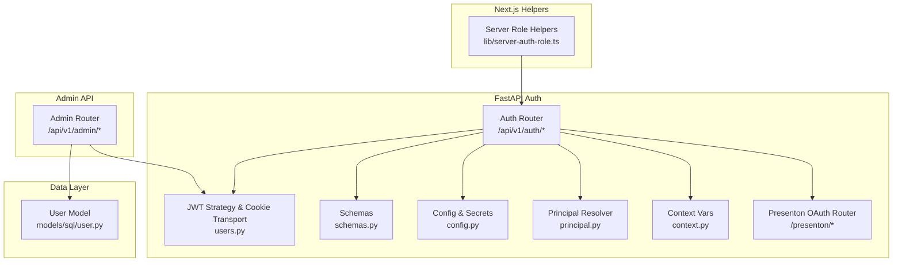
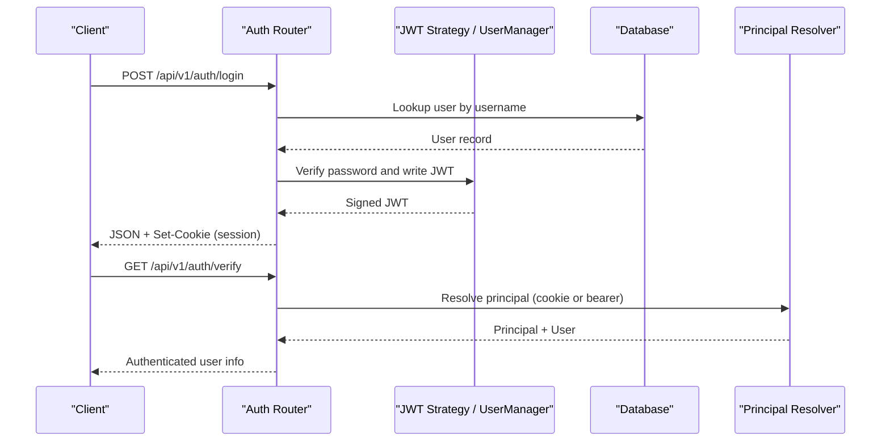
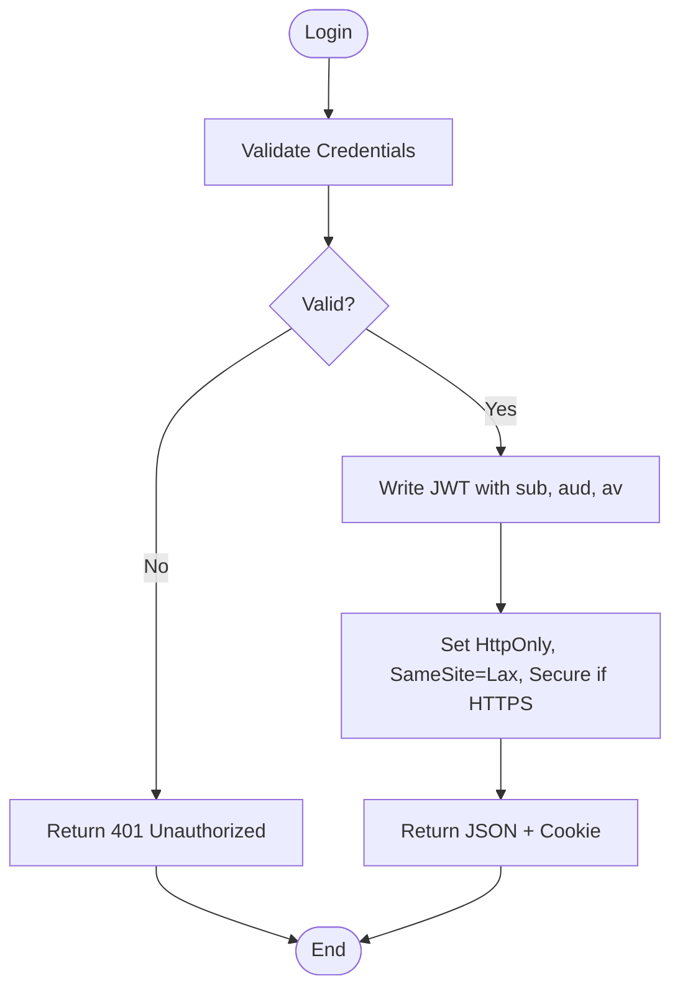
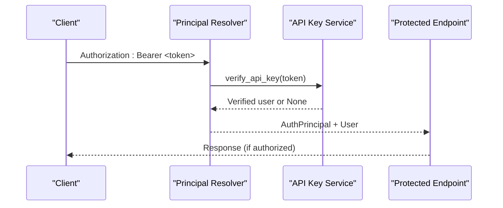
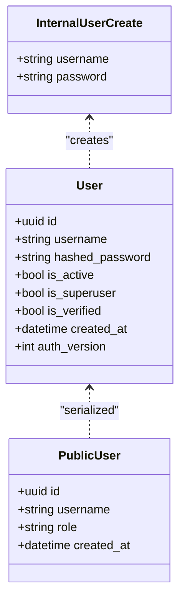
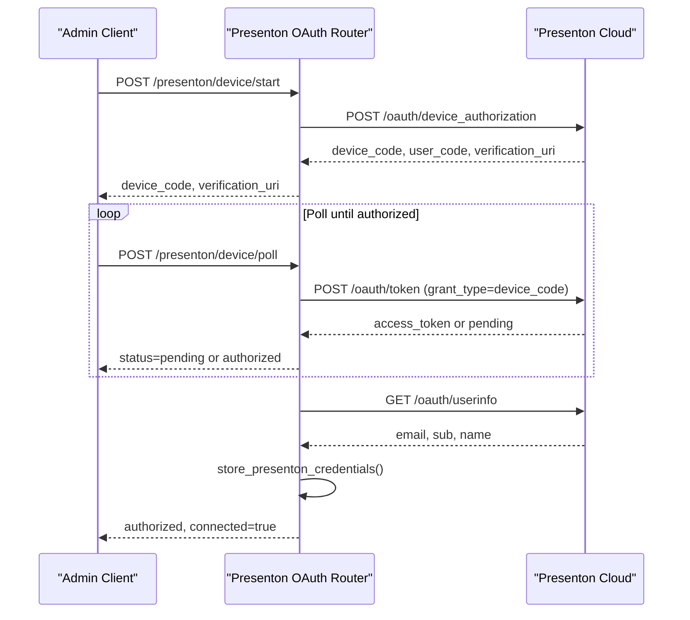
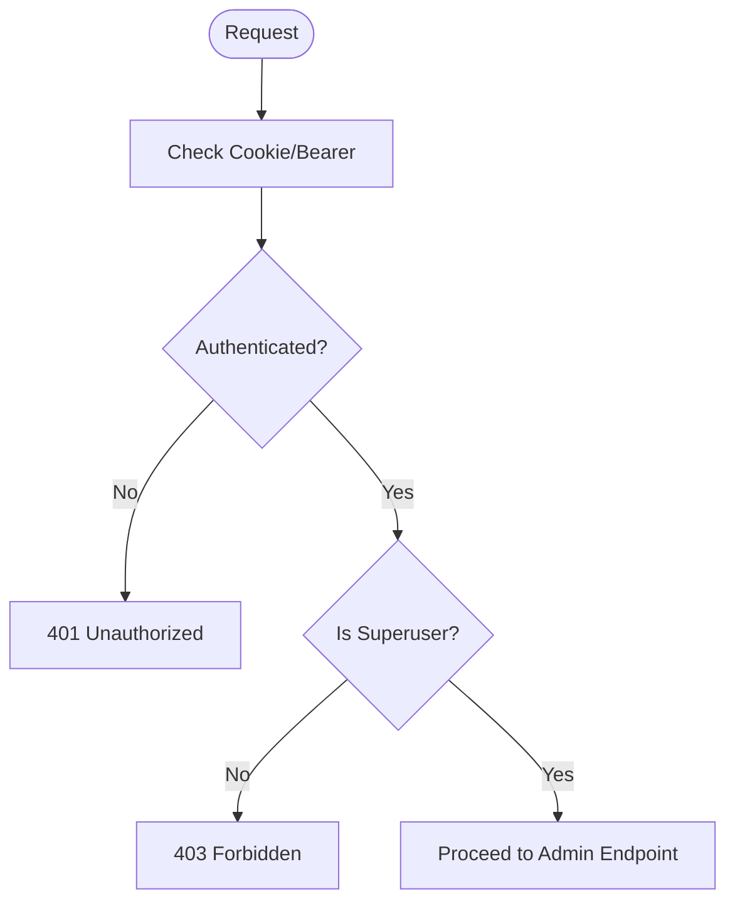
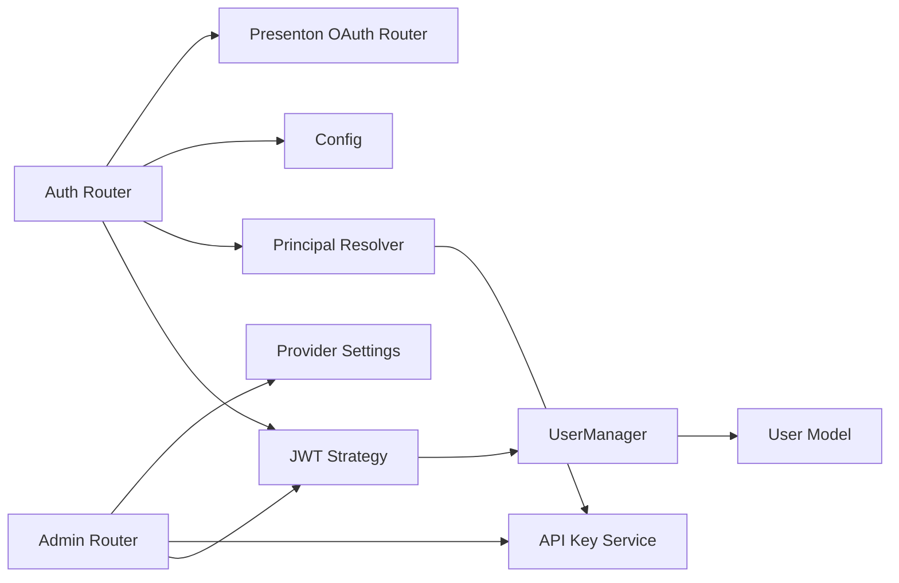

# Authentication & User Management API

<cite>
**Referenced Files in This Document**
- [router.py](file://servers/fastapi/api/v1/auth/router.py)
- [users.py](file://servers/fastapi/api/v1/auth/users.py)
- [schemas.py](file://servers/fastapi/api/v1/auth/schemas.py)
- [config.py](file://servers/fastapi/api/v1/auth/config.py)
- [principal.py](file://servers/fastapi/api/v1/auth/principal.py)
- [context.py](file://servers/fastapi/api/v1/auth/context.py)
- [presenton_oauth.py](file://servers/fastapi/api/v1/auth/presenton_oauth.py)
- [user.py](file://servers/fastapi/models/sql/user.py)
- [admin_router.py](file://servers/fastapi/api/v1/admin/router.py)
- [server-auth-role.ts](file://servers/nextjs/lib/server-auth-role.ts)
</cite>

## Table of Contents
1. [Introduction](#introduction)
2. [Project Structure](#project-structure)
3. [Core Components](#core-components)
4. [Architecture Overview](#architecture-overview)
5. [Detailed Component Analysis](#detailed-component-analysis)
6. [Dependency Analysis](#dependency-analysis)
7. [Performance Considerations](#performance-considerations)
8. [Troubleshooting Guide](#troubleshooting-guide)
9. [Conclusion](#conclusion)
10. [Appendices](#appendices)

## Introduction
This document provides detailed API documentation for Presenton’s authentication and user management endpoints. It covers:
- Login and logout flows
- Session management using secure cookies and JWTs
- Token-based authentication with API keys
- User registration and profile management via admin endpoints
- OAuth integration with the Presenton provider (device authorization flow)
- Role-based access control, permission checks, and admin-only endpoints
- Security considerations including cookie flags, token versioning, and safe error handling
- Client implementation guidance for web and mobile applications

The backend is implemented in FastAPI under servers/fastapi, while the Next.js frontend includes helper utilities for server-side role checks.

## Project Structure
Authentication and user management are primarily implemented under:
- FastAPI v1 auth router and supporting modules
- Admin API for user and API key management
- SQL model for users
- Next.js server helpers for role enforcement

**Diagram sources**
- [router.py:27-28](file://servers/fastapi/api/v1/auth/router.py#L27-L28)
- [users.py:136-199](file://servers/fastapi/api/v1/auth/users.py#L136-L199)
- [schemas.py:10-82](file://servers/fastapi/api/v1/auth/schemas.py#L10-L82)
- [config.py:11-12](file://servers/fastapi/api/v1/auth/config.py#L11-L12)
- [principal.py:14-57](file://servers/fastapi/api/v1/auth/principal.py#L14-L57)
- [context.py:5-34](file://servers/fastapi/api/v1/auth/context.py#L5-L34)
- [presenton_oauth.py:29-34](file://servers/fastapi/api/v1/auth/presenton_oauth.py#L29-L34)
- [admin_router.py:41-41](file://servers/fastapi/api/v1/admin/router.py#L41-L41)
- [user.py:16-46](file://servers/fastapi/models/sql/user.py#L16-L46)
- [server-auth-role.ts:40-70](file://servers/nextjs/lib/server-auth-role.ts#L40-L70)

**Section sources**
- [router.py:27-28](file://servers/fastapi/api/v1/auth/router.py#L27-L28)
- [admin_router.py:41-41](file://servers/fastapi/api/v1/admin/router.py#L41-L41)

## Core Components
- Auth Router: Defines login, logout, setup, status, and verify endpoints; integrates Presenton OAuth router.
- JWT Strategy and Cookie Transport: Implements signed JWT creation and validation with an auth_version field to invalidate tokens after password changes.
- Schemas: Pydantic models for requests and responses, including user and API key schemas.
- Config: Persistent secrets and session configuration, including legacy credential support.
- Principal Resolver: Resolves current user from cookie or bearer API key into a principal object.
- Context Vars: Request-scoped owner identity and admin flag used across services.
- Presenton OAuth Router: Device authorization flow to link a global Presenton provider account.
- Admin Router: Admin-only endpoints for listing/creating users, resetting passwords, managing API keys, and provider settings.
- User Model: Database schema for users with roles and auth version.

**Section sources**
- [router.py:58-201](file://servers/fastapi/api/v1/auth/router.py#L58-L201)
- [users.py:27-46](file://servers/fastapi/api/v1/auth/users.py#L27-L46)
- [users.py:136-199](file://servers/fastapi/api/v1/auth/users.py#L136-L199)
- [schemas.py:10-82](file://servers/fastapi/api/v1/auth/schemas.py#L10-L82)
- [config.py:11-12](file://servers/fastapi/api/v1/auth/config.py#L11-L12)
- [principal.py:14-57](file://servers/fastapi/api/v1/auth/principal.py#L14-L57)
- [context.py:5-34](file://servers/fastapi/api/v1/auth/context.py#L5-L34)
- [presenton_oauth.py:120-313](file://servers/fastapi/api/v1/auth/presenton_oauth.py#L120-L313)
- [admin_router.py:44-265](file://servers/fastapi/api/v1/admin/router.py#L44-L265)
- [user.py:16-46](file://servers/fastapi/models/sql/user.py#L16-L46)

## Architecture Overview
The authentication architecture combines:
- Secure HTTP-only cookies carrying JWTs for browser sessions
- Optional bearer API keys for programmatic access
- Role-based checks (admin vs user)
- Provider-level OAuth linking for cloud features

**Diagram sources**
- [router.py:155-188](file://servers/fastapi/api/v1/auth/router.py#L155-L188)
- [router.py:81-107](file://servers/fastapi/api/v1/auth/router.py#L81-L107)
- [users.py:136-182](file://servers/fastapi/api/v1/auth/users.py#L136-L182)
- [principal.py:22-57](file://servers/fastapi/api/v1/auth/principal.py#L22-L57)

## Detailed Component Analysis

### Authentication Endpoints
- GET /api/v1/auth/status
  - Purpose: Returns configured/authenticated state and user role.
  - Behavior: If auth is disabled, returns a synthetic admin session. Otherwise, reads user from cookie and computes role.
  - Response fields: configured, authenticated, username, user_id, role.

- GET /api/v1/auth/verify
  - Purpose: Validates current session and returns authenticated user details.
  - Behavior: Resolves principal from cookie or bearer API key; enforces asset path authorization when required.
  - Response fields: authenticated, username, user_id, role, method.

- POST /api/v1/auth/setup
  - Purpose: Initialize first admin account.
  - Behavior: Creates superuser with primary admin slot; persists credentials for recovery.
  - Validation: Username length and pattern; prevents duplicate setup.

- POST /api/v1/auth/login
  - Purpose: Authenticate user and issue session cookie.
  - Behavior: Verifies password (supports legacy hash migration), writes JWT, sets secure cookie.
  - Response fields: configured, authenticated, serialized user.

- POST /api/v1/auth/logout
  - Purpose: Invalidate session cookie.
  - Behavior: Deletes session cookie with httponly and secure flags based on request scheme.

Security notes:
- Cookies are httponly and samesite=lax; secure flag set when HTTPS is detected.
- JWT includes auth_version to invalidate tokens after password changes.

**Section sources**
- [router.py:58-78](file://servers/fastapi/api/v1/auth/router.py#L58-L78)
- [router.py:81-107](file://servers/fastapi/api/v1/auth/router.py#L81-L107)
- [router.py:110-152](file://servers/fastapi/api/v1/auth/router.py#L110-L152)
- [router.py:155-188](file://servers/fastapi/api/v1/auth/router.py#L155-L188)
- [router.py:191-201](file://servers/fastapi/api/v1/auth/router.py#L191-L201)
- [users.py:136-182](file://servers/fastapi/api/v1/auth/users.py#L136-L182)
- [config.py:11-12](file://servers/fastapi/api/v1/auth/config.py#L11-L12)

### Session Management and JWT Tokens
- Cookie transport uses a consistent session cookie name and TTL.
- JWTStrategy encodes sub, aud, and av (auth_version).
- read_token validates signature, audience, and auth_version against the current user record.
- Password changes increment auth_version, invalidating existing tokens.

**Diagram sources**
- [router.py:155-188](file://servers/fastapi/api/v1/auth/router.py#L155-L188)
- [users.py:136-182](file://servers/fastapi/api/v1/auth/users.py#L136-L182)
- [config.py:11-12](file://servers/fastapi/api/v1/auth/config.py#L11-L12)

**Section sources**
- [users.py:136-182](file://servers/fastapi/api/v1/auth/users.py#L136-L182)
- [config.py:11-12](file://servers/fastapi/api/v1/auth/config.py#L11-L12)

### Token-Based Authentication (API Keys)
- Bearer tokens can be used where supported by endpoints that resolve principals.
- Principal resolver accepts Authorization: Bearer <token> and verifies via API key service.
- Admin endpoints require explicit admin role checks.

**Diagram sources**
- [principal.py:22-57](file://servers/fastapi/api/v1/auth/principal.py#L22-L57)

**Section sources**
- [principal.py:22-57](file://servers/fastapi/api/v1/auth/principal.py#L22-L57)

### User Registration and Profile Management
- First-time setup creates a superuser with primary admin slot.
- Admin-only endpoints allow creating users, resetting passwords, and deleting users.
- Password hashing supports legacy hashes and upgrades on verification.

**Diagram sources**
- [user.py:16-46](file://servers/fastapi/models/sql/user.py#L16-L46)
- [schemas.py:10-25](file://servers/fastapi/api/v1/auth/schemas.py#L10-L25)
- [schemas.py:28-49](file://servers/fastapi/api/v1/auth/schemas.py#L28-L49)

**Section sources**
- [router.py:110-152](file://servers/fastapi/api/v1/auth/router.py#L110-L152)
- [admin_router.py:182-233](file://servers/fastapi/api/v1/admin/router.py#L182-L233)
- [admin_router.py:236-265](file://servers/fastapi/api/v1/admin/router.py#L236-L265)
- [user.py:16-46](file://servers/fastapi/models/sql/user.py#L16-L46)
- [schemas.py:10-49](file://servers/fastapi/api/v1/auth/schemas.py#L10-L49)

### OAuth Integration (Presenton Provider)
- Device authorization flow: start -> poll until authorized.
- Requires admin or disabled-auth mode to manage provider linkage.
- Stores provider credentials and updates provider settings when connected.

**Diagram sources**
- [presenton_oauth.py:164-214](file://servers/fastapi/api/v1/auth/presenton_oauth.py#L164-L214)
- [presenton_oauth.py:217-313](file://servers/fastapi/api/v1/auth/presenton_oauth.py#L217-L313)

**Section sources**
- [presenton_oauth.py:120-161](file://servers/fastapi/api/v1/auth/presenton_oauth.py#L120-L161)
- [presenton_oauth.py:164-313](file://servers/fastapi/api/v1/auth/presenton_oauth.py#L164-L313)

### Role-Based Access Control and Admin-Only Endpoints
- get_current_user requires a valid cookie session.
- get_current_admin requires is_superuser.
- Admin endpoints include:
  - List/create/revoke API keys
  - Read/reset password/delete users
  - Read/update provider settings
- Next.js helper functions enforce admin role at the server layer.

**Diagram sources**
- [users.py:211-224](file://servers/fastapi/api/v1/auth/users.py#L211-L224)
- [admin_router.py:44-128](file://servers/fastapi/api/v1/admin/router.py#L44-L128)
- [server-auth-role.ts:56-70](file://servers/nextjs/lib/server-auth-role.ts#L56-L70)

**Section sources**
- [users.py:211-224](file://servers/fastapi/api/v1/auth/users.py#L211-L224)
- [admin_router.py:44-265](file://servers/fastapi/api/v1/admin/router.py#L44-L265)
- [server-auth-role.ts:40-70](file://servers/nextjs/lib/server-auth-role.ts#L40-L70)

## Dependency Analysis
- Auth Router depends on:
  - JWT strategy and cookie transport for session handling
  - Principal resolver for unified authentication resolution
  - Config for session constants and secret management
  - Presenton OAuth router for provider linkage
- Admin Router depends on:
  - User manager and password helper
  - API key service for issuance and revocation
  - Provider settings service for LLM configuration
- Data dependencies:
  - User model defines core attributes and roles
  - Context variables propagate ownership and admin flags across services

**Diagram sources**
- [router.py:27-28](file://servers/fastapi/api/v1/auth/router.py#L27-L28)
- [users.py:136-199](file://servers/fastapi/api/v1/auth/users.py#L136-L199)
- [principal.py:22-57](file://servers/fastapi/api/v1/auth/principal.py#L22-L57)
- [admin_router.py:44-128](file://servers/fastapi/api/v1/admin/router.py#L44-L128)
- [user.py:16-46](file://servers/fastapi/models/sql/user.py#L16-L46)

**Section sources**
- [router.py:27-28](file://servers/fastapi/api/v1/auth/router.py#L27-L28)
- [users.py:136-199](file://servers/fastapi/api/v1/auth/users.py#L136-L199)
- [principal.py:22-57](file://servers/fastapi/api/v1/auth/principal.py#L22-L57)
- [admin_router.py:44-128](file://servers/fastapi/api/v1/admin/router.py#L44-L128)
- [user.py:16-46](file://servers/fastapi/models/sql/user.py#L16-L46)

## Performance Considerations
- JWT validation is lightweight and avoids extra network calls.
- Password verification may upgrade legacy hashes once per successful login.
- Session TTL is long-lived (30 days); consider shorter TTLs for high-security deployments.
- API key verification is synchronous within request scope; ensure database performance is optimized.

[No sources needed since this section provides general guidance]

## Troubleshooting Guide
Common issues and resolutions:
- 401 Unauthorized during login:
  - Ensure credentials are configured before attempting login.
  - Verify username normalization and case-insensitive lookup.
- 401 Unauthorized on verify:
  - Confirm cookie presence and validity; check auth_version mismatch after password reset.
- 403 Forbidden on admin endpoints:
  - Ensure the current user is a superuser or auth is disabled for local desktop runtime.
- 409 Conflict on setup:
  - Indicates credentials already configured; use admin endpoints to manage users instead.
- Provider connection failures:
  - Check issuer and client ID configuration; review error messages from the Presenton authorization service.

**Section sources**
- [router.py:110-152](file://servers/fastapi/api/v1/auth/router.py#L110-L152)
- [router.py:155-188](file://servers/fastapi/api/v1/auth/router.py#L155-L188)
- [users.py:136-182](file://servers/fastapi/api/v1/auth/users.py#L136-L182)
- [presenton_oauth.py:164-313](file://servers/fastapi/api/v1/auth/presenton_oauth.py#L164-L313)

## Conclusion
Presenton’s authentication system provides robust session management via secure cookies and JWTs, supports programmatic access through API keys, and offers admin-controlled user and provider management. The design emphasizes security through cookie flags, token versioning, and strict role checks. For integrations, follow the documented flows for login/logout, session verification, and provider linking.

[No sources needed since this section summarizes without analyzing specific files]

## Appendices

### API Reference Summary

- Authentication
  - GET /api/v1/auth/status
    - Returns configured/authenticated state and role.
  - GET /api/v1/auth/verify
    - Returns authenticated user details and method.
  - POST /api/v1/auth/setup
    - Initializes first admin account.
  - POST /api/v1/auth/login
    - Authenticates and sets session cookie.
  - POST /api/v1/auth/logout
    - Invalidates session cookie.

- Admin
  - GET /api/v1/admin/api-keys
  - POST /api/v1/admin/api-keys
  - GET /api/v1/admin/api-keys/{id}/token
  - POST /api/v1/admin/api-keys/{id}/revoke
  - GET /api/v1/admin/provider-settings
  - PUT /api/v1/admin/provider-settings
  - GET /api/v1/admin/users
  - POST /api/v1/admin/users
  - PUT /api/v1/admin/users/{id}/password
  - DELETE /api/v1/admin/users/{id}

- Presenton OAuth
  - GET /presenton/status
  - POST /presenton/logout
  - POST /presenton/device/start
  - POST /presenton/device/poll

**Section sources**
- [router.py:58-201](file://servers/fastapi/api/v1/auth/router.py#L58-L201)
- [admin_router.py:44-265](file://servers/fastapi/api/v1/admin/router.py#L44-L265)
- [presenton_oauth.py:120-313](file://servers/fastapi/api/v1/auth/presenton_oauth.py#L120-L313)