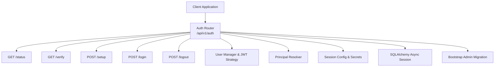
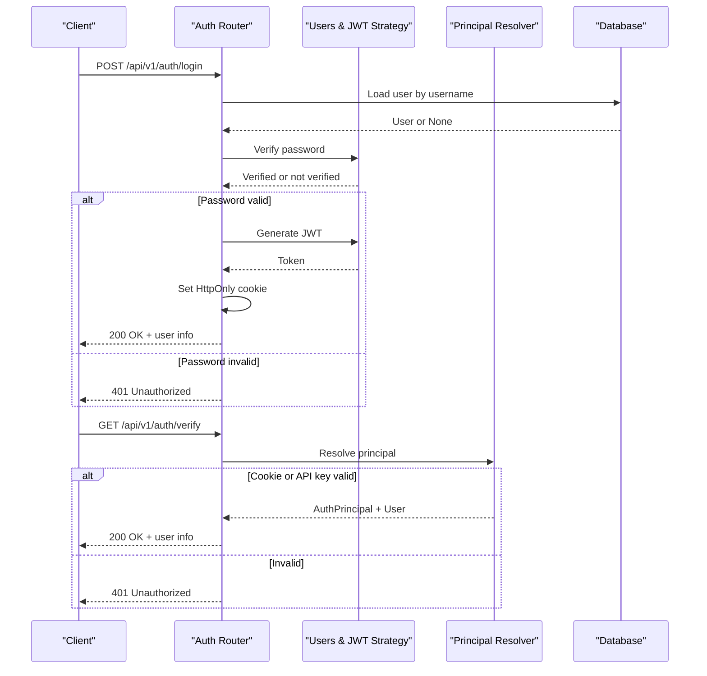
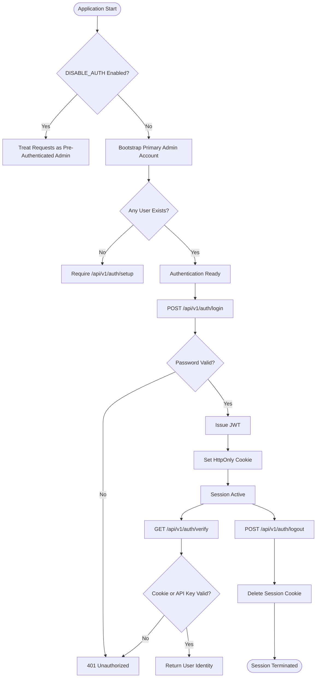
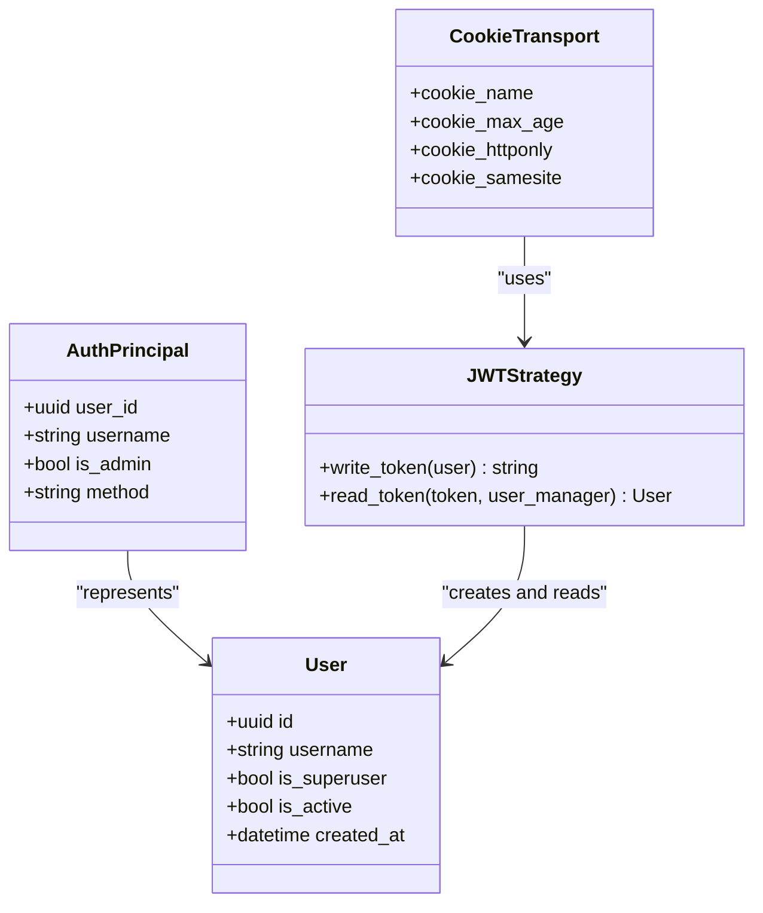
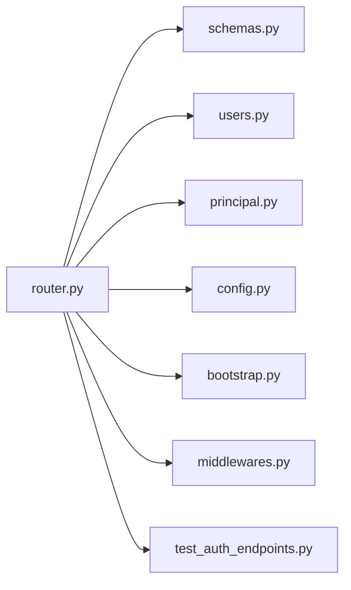

# Authentication Endpoints

<cite>
**Referenced Files in This Document**
- [router.py](file://servers/fastapi/api/v1/auth/router.py)
- [schemas.py](file://servers/fastapi/api/v1/auth/schemas.py)
- [users.py](file://servers/fastapi/api/v1/auth/users.py)
- [config.py](file://servers/fastapi/api/v1/auth/config.py)
- [principal.py](file://servers/fastapi/api/v1/auth/principal.py)
- [context.py](file://servers/fastapi/api/v1/auth/context.py)
- [presenton_oauth.py](file://servers/fastapi/api/v1/auth/presenton_oauth.py)
- [bootstrap.py](file://servers/fastapi/api/v1/auth/bootstrap.py)
- [middlewares.py](file://servers/fastapi/api/middlewares.py)
- [test_auth_endpoints.py](file://servers/fastapi/tests/integration/test_auth_endpoints.py)
</cite>

## Table of Contents
1. [Introduction](#introduction)
2. [Project Structure](#project-structure)
3. [Core Components](#core-components)
4. [Architecture Overview](#architecture-overview)
5. [Detailed Component Analysis](#detailed-component-analysis)
6. [Dependency Analysis](#dependency-analysis)
7. [Performance Considerations](#performance-considerations)
8. [Troubleshooting Guide](#troubleshooting-guide)
9. [Conclusion](#conclusion)

## Introduction
This document provides detailed API documentation for Presenton’s core authentication endpoints under `/api/v1/auth`. It covers:

- `/api/v1/auth/status`: Check whether the application is configured and whether the current request is authenticated.
- `/api/v1/auth/verify`: Validate an active session or API key and return user identity information.
- `/api/v1/auth/setup`: Create the initial administrator account when no accounts exist.
- `/api/v1/auth/login`: Authenticate a user, generate a JWT, and set a secure HTTP-only session cookie.
- `/api/v1/auth/logout`: Terminate the browser session by deleting the session cookie.

The authentication system uses:

- Username-based local authentication with hashed passwords.
- JSON Web Tokens (JWT) stored in an HTTP-only cookie named `presenton_session`.
- Optional API key authentication via the `Authorization: Bearer` header.
- A bootstrap process that can initialize or recover the primary administrator account.
- An optional “disable auth” mode used by the desktop runtime to treat requests as pre-authenticated admin access.

## Project Structure
The authentication implementation lives under the FastAPI backend at `servers/fastapi/api/v1/auth`. The most relevant files are:

| File | Responsibility |
| --- | --- |
| `router.py` | Defines the `/api/v1/auth` endpoints: status, verify, setup, login, logout. |
| `schemas.py` | Pydantic models for request validation and public response shapes. |
| `users.py` | Password hashing, JWT strategy, cookie transport, user database abstraction, and serialization helpers. |
| `config.py` | Session cookie name, TTL, secret management, legacy credential handling, and persistent admin credential storage. |
| `principal.py` | Resolves either a JWT cookie or an API key into a unified principal object. |
| `context.py` | Context variables for current owner identity and admin flag inside request-scoped operations. |
| `presenton_oauth.py` | Presenton Cloud OAuth provider integration; included under the same auth router but scoped to `/api/v1/auth/presenton/*`. |
| `bootstrap.py` | Database bootstrap logic for migrating or initializing the primary administrator account. |
| `middlewares.py` | Lists public authentication routes that bypass middleware requiring authentication. |
| `test_auth_endpoints.py` | Integration tests demonstrating expected endpoint behavior, cookies, error codes, and API key usage. |

**Diagram sources**
- [router.py:27-202](file://servers/fastapi/api/v1/auth/router.py#L27-L202)
- [users.py:107-234](file://servers/fastapi/api/v1/auth/users.py#L107-L234)
- [principal.py:14-57](file://servers/fastapi/api/v1/auth/principal.py#L14-L57)
- [config.py:11-108](file://servers/fastapi/api/v1/auth/config.py#L11-L108)
- [bootstrap.py:43-152](file://servers/fastapi/api/v1/auth/bootstrap.py#L43-L152)

**Section sources**
- [router.py:27-202](file://servers/fastapi/api/v1/auth/router.py#L27-L202)
- [schemas.py:28-45](file://servers/fastapi/api/v1/auth/schemas.py#L28-L45)
- [middlewares.py:31-35](file://servers/fastapi/api/middlewares.py#L31-L35)

## Core Components
The authentication subsystem is built around five main components:

1. **Router**: Exposes the public authentication endpoints and handles request/response lifecycle.
2. **Schema Layer**: Validates incoming request bodies and defines public data shapes.
3. **User & JWT Layer**: Manages password hashing, JWT creation/decoding, and cookie-based sessions.
4. **Principal Resolver**: Normalizes authentication from either a session cookie or an API key.
5. **Configuration & Bootstrap**: Persists secrets, manages legacy credentials, and initializes the first admin account.

### Request Validation Schemas
The setup and login endpoints use Pydantic models to enforce input constraints:

| Schema | Purpose | Key Constraints |
| --- | --- | --- |
| `AuthCredentialsRequest` | Initial admin account creation | Username must be non-whitespace, 3–128 characters; password must be 8–128 characters. |
| `LoginCredentialsRequest` | User login | Username must be non-whitespace, 3–128 characters; password allows 6–128 characters for backward compatibility. |
| `PublicUser` | Public user representation | Includes id, username, role, and created timestamp. |

These schemas ensure that invalid usernames or weak passwords are rejected before database writes.

**Section sources**
- [schemas.py:28-45](file://servers/fastapi/api/v1/auth/schemas.py#L28-L45)
- [schemas.py:19-25](file://servers/fastapi/api/v1/auth/schemas.py#L19-L25)

### Session Configuration
The session configuration defines:

| Setting | Value | Meaning |
| --- | --- | --- |
| `SESSION_COOKIE_NAME` | `presenton_session` | Name of the HTTP-only session cookie. |
| `SESSION_TTL_SECONDS` | 2,592,000 seconds | Cookie lifetime of 30 days. |
| `AUTH_CONFIG_FIELDS` | `AUTH_USERNAME`, `AUTH_PASSWORD_HASH`, `AUTH_SECRET_KEY` | Fields persisted in the user config file for recovery and signing. |

The JWT signing secret is generated if missing and saved to the user configuration file.

**Section sources**
- [config.py:11-13](file://servers/fastapi/api/v1/auth/config.py#L11-L13)
- [config.py:71-81](file://servers/fastapi/api/v1/auth/config.py#L71-L81)
- [config.py:95-108](file://servers/fastapi/api/v1/auth/config.py#L95-L108)

## Architecture Overview
The authentication flow combines browser-based session cookies and optional API keys.

**Diagram sources**
- [router.py:155-201](file://servers/fastapi/api/v1/auth/router.py#L155-L201)
- [users.py:136-182](file://servers/fastapi/api/v1/auth/users.py#L136-L182)
- [principal.py:22-57](file://servers/fastapi/api/v1/auth/principal.py#L22-L57)

### Authentication Modes
| Mode | How It Works | When Used |
| --- | --- | --- |
| Browser session | JWT stored in `presenton_session` cookie. | Frontend applications using cookies. |
| API key | `Authorization: Bearer <token>` header. | Server-to-server or automation clients. |
| Disabled auth | Requests are treated as pre-authenticated admin access. | Desktop Electron runtime when `DISABLE_AUTH` is enabled. |

**Section sources**
- [principal.py:22-57](file://servers/fastapi/api/v1/auth/principal.py#L22-L57)
- [users.py:202-208](file://servers/fastapi/api/v1/auth/users.py#L202-L208)
- [router.py:63-78](file://servers/fastapi/api/v1/auth/router.py#L63-L78)

## Detailed Component Analysis

### GET `/api/v1/auth/status`
Checks whether the application has been initialized and whether the current request is authenticated.

#### Behavior
- If authentication is disabled, returns a pre-authenticated admin-like state.
- Otherwise, checks whether any user exists to determine `configured`.
- Reads the current user from the session cookie and returns authentication state and role.

#### Request
No request body.

#### Response
| Field | Type | Description |
| --- | --- | --- |
| `configured` | boolean | Whether at least one user account exists. |
| `authenticated` | boolean | Whether the current request has a valid session. |
| `username` | string or null | Current username if authenticated. |
| `user_id` | string or null | Current user ID if authenticated. |
| `role` | string or null | `admin`, `user`, or null. |

#### Error Codes
- `200`: Success.
- No explicit error responses are returned by this endpoint.

#### Security Considerations
- Does not expose sensitive data beyond basic identity and role.
- In disabled-auth mode, it intentionally returns admin-like metadata for desktop runtime compatibility.

**Section sources**
- [router.py:58-78](file://servers/fastapi/api/v1/auth/router.py#L58-L78)

### GET `/api/v1/auth/verify`
Validates the current session or API key and returns user identity details.

#### Behavior
- If authentication is disabled, returns a pre-authenticated admin-like state.
- Resolves the principal from either the session cookie or an API key.
- If no principal is found, returns `401 Unauthorized`.
- For asset-related requests, validates access based on the original URI and user ownership.

#### Request
No request body.

#### Response
| Field | Type | Description |
| --- | --- | --- |
| `authenticated` | boolean | Always true on success. |
| `id` | string | User ID. |
| `username` | string | Username. |
| `role` | string | `admin` or `user`. |
| `created_at` | string or null | ISO-formatted creation timestamp. |
| `method` | string | `jwt` for cookie sessions, `api_key` for bearer tokens. |

#### Error Codes
- `200`: Success.
- `401 Unauthorized`: No valid session or API key.
- `403 Asset access denied`: Requested asset path is not authorized for the current user.

#### Security Considerations
- Supports both cookie and bearer token authentication.
- Enforces authorization checks for protected assets through the principal resolver.

**Section sources**
- [router.py:81-107](file://servers/fastapi/api/v1/auth/router.py#L81-L107)
- [principal.py:22-57](file://servers/fastapi/api/v1/auth/principal.py#L22-L57)

### POST `/api/v1/auth/setup`
Creates the initial administrator account when no accounts exist.

#### Behavior
- Rejects setup if any user already exists.
- Normalizes the username by trimming whitespace.
- Enforces minimum username length.
- Hashes the password and creates a superuser with primary admin slot.
- Persists admin credentials for recovery.

#### Request
| Field | Type | Required | Constraints |
| --- | --- | --- | --- |
| `username` | string | Yes | Non-whitespace, 3–128 characters. |
| `password` | string | Yes | 8–128 characters. |

#### Response
| Field | Type | Description |
| --- | --- | --- |
| `configured` | boolean | True after successful setup. |
| `authenticated` | boolean | False; setup does not log in automatically. |
| `username` | string | Created admin username. |
| `role` | string | `admin`. |

#### Error Codes
- `200`: Successful setup.
- `409 Conflict`: Credentials already configured.
- `422 Unprocessable Entity`: Invalid username format or length.

#### Security Considerations
- Only allowed when no users exist, preventing accidental reconfiguration.
- Stores only hashed passwords; plaintext passwords are never persisted.

**Section sources**
- [router.py:110-152](file://servers/fastapi/api/v1/auth/router.py#L110-L152)
- [schemas.py:28-35](file://servers/fastapi/api/v1/auth/schemas.py#L28-L35)

### POST `/api/v1/auth/login`
Authenticates a user and establishes a browser session.

#### Behavior
- Requires that setup has already occurred.
- Looks up the user by case-insensitive username.
- Verifies the password and optionally upgrades the hash if needed.
- Generates a JWT and sets an HTTP-only session cookie.
- Returns user information without exposing the raw token in the JSON payload.

#### Request
| Field | Type | Required | Constraints |
| --- | --- | --- | --- |
| `username` | string | Yes | Non-whitespace, 3–128 characters. |
| `password` | string | Yes | 6–128 characters for backward compatibility. |

#### Response
| Field | Type | Description |
| --- | --- | --- |
| `configured` | boolean | True. |
| `authenticated` | boolean | True. |
| `id` | string | User ID. |
| `username` | string | Username. |
| `role` | string | `admin` or `user`. |
| `created_at` | string or null | Creation timestamp. |

#### Cookies
- `presenton_session`: HTTP-only, secure when HTTPS is detected, SameSite lax, path `/`, 30-day TTL.

#### Error Codes
- `200`: Successful login.
- `428 Precondition Required`: Login setup is required.
- `401 Unauthorized`: Invalid username, inactive user, or wrong password.

#### Security Considerations
- Uses HTTP-only cookies to reduce XSS exposure.
- Sets the `Secure` flag when the request is HTTPS or forwarded over HTTPS.
- Does not return the JWT in the response body.

**Section sources**
- [router.py:155-188](file://servers/fastapi/api/v1/auth/router.py#L155-L188)
- [users.py:136-182](file://servers/fastapi/api/v1/auth/users.py#L136-L182)
- [config.py:11-12](file://servers/fastapi/api/v1/auth/config.py#L11-L12)

### POST `/api/v1/auth/logout`
Terminates the browser session.

#### Behavior
- Deletes the `presenton_session` cookie.
- Returns a simple success response.

#### Request
No request body.

#### Response
| Field | Type | Description |
| --- | --- | --- |
| `success` | boolean | True. |

#### Error Codes
- `200`: Successful logout.

#### Security Considerations
- Removes the session cookie with the same security flags used during login.

**Section sources**
- [router.py:191-201](file://servers/fastapi/api/v1/auth/router.py#L191-L201)

### Authentication Flow and Token Lifecycle
The authentication lifecycle consists of initialization, login, session validation, and logout.

**Diagram sources**
- [router.py:58-201](file://servers/fastapi/api/v1/auth/router.py#L58-L201)
- [bootstrap.py:43-125](file://servers/fastapi/api/v1/auth/bootstrap.py#L43-L125)
- [users.py:136-182](file://servers/fastapi/api/v1/auth/users.py#L136-L182)

### Session Management Patterns
Presenton uses a hybrid approach:

- **Browser clients** rely on the `presenton_session` cookie.
- **Server clients** can use API keys via the `Authorization: Bearer` header.
- Both paths resolve to the same principal model, allowing shared authorization logic.

**Diagram sources**
- [principal.py:14-19](file://servers/fastapi/api/v1/auth/principal.py#L14-L19)
- [users.py:136-198](file://servers/fastapi/api/v1/auth/users.py#L136-L198)

### Implementation Examples for Client Applications

#### Initialize Admin Account
1. Call `POST /api/v1/auth/setup` with a valid username and password.
2. On success, the application is considered configured.
3. Do not call this endpoint again unless you intend to replace the existing admin through bootstrap or administrative migration.

#### Log In
1. Call `POST /api/v1/auth/login` with username and password.
2. Store the `presenton_session` cookie provided by the server.
3. Include the cookie in subsequent requests to maintain the session.

#### Verify Session
1. Call `GET /api/v1/auth/verify`.
2. Use the response to determine whether the client should show a logged-in UI or redirect to login.

#### Log Out
1. Call `POST /api/v1/auth/logout`.
2. Clear local session state after receiving the success response.

#### API Key Usage
1. Obtain an API key through the admin API.
2. Send `Authorization: Bearer <token>` with requests.
3. Use `/api/v1/auth/verify` to confirm the API key resolves to the expected user.

**Section sources**
- [test_auth_endpoints.py:134-159](file://servers/fastapi/tests/integration/test_auth_endpoints.py#L134-L159)
- [test_auth_endpoints.py:163-202](file://servers/fastapi/tests/integration/test_auth_endpoints.py#L163-L202)

## Dependency Analysis
The authentication endpoints depend on several internal modules:

**Diagram sources**
- [router.py:1-28](file://servers/fastapi/api/v1/auth/router.py#L1-L28)
- [middlewares.py:31-35](file://servers/fastapi/api/middlewares.py#L31-L35)

### Coupling and Cohesion
- The router is the central entry point but delegates responsibilities cleanly:
  - Password and JWT logic live in `users.py`.
  - Principal resolution is isolated in `principal.py`.
  - Configuration and secrets are managed in `config.py`.
  - Bootstrap logic is separate from runtime endpoints.
- This separation improves testability and reduces coupling between authentication state and endpoint handlers.

### External Dependencies
- SQLAlchemy async sessions for database access.
- JWT library for token generation and decoding.
- FastAPI Users abstractions for user management patterns.
- HTTP client for Presenton Cloud OAuth flows.

**Section sources**
- [router.py:1-24](file://servers/fastapi/api/v1/auth/router.py#L1-L24)
- [users.py:1-24](file://servers/fastapi/api/v1/auth/users.py#L1-L24)
- [presenton_oauth.py:1-28](file://servers/fastapi/api/v1/auth/presenton_oauth.py#L1-L28)

## Performance Considerations
- **Password hashing**: Each login performs password verification; consider rate limiting at the reverse proxy or gateway layer if brute-force protection is required beyond application-level checks.
- **JWT decoding**: Decoding occurs per request for cookie-based sessions; keep tokens small and avoid embedding unnecessary claims.
- **Database queries**: Authentication endpoints perform minimal queries, typically one user lookup per login or status check.
- **Cookie size**: The session cookie contains a JWT; ensure the deployment environment supports standard cookie size limits.
- **Disabled auth mode**: When authentication is disabled, endpoints skip database lookups and principal resolution, improving performance for local desktop runtime scenarios.

[No sources needed since this section provides general guidance]

## Troubleshooting Guide

### Common Errors
| Symptom | Likely Cause | Resolution |
| --- | --- | --- |
| `401 Unauthorized` on `/api/v1/auth/verify` | Missing or invalid session cookie or API key. | Ensure the client sends the cookie or bearer token. |
| `409 Conflict` on `/api/v1/auth/setup` | An administrator account already exists. | Use login instead of setup. |
| `422 Unprocessable Entity` on setup | Invalid username or password length. | Follow schema constraints. |
| `428 Precondition Required` on login | No administrator account exists. | Run setup first. |
| `403 Asset access denied` on verify | Requested asset path is not authorized for the current user. | Adjust ownership or access controls. |
| Login succeeds but session not retained | Cookie not sent by client or blocked by CORS/security settings. | Configure client to include cookies and respect `SameSite` and `Secure` flags. |

### Debugging Steps
1. Check `/api/v1/auth/status` to determine whether the application is configured and whether the current request appears authenticated.
2. Confirm that `/api/v1/auth/login` returns a `Set-Cookie` header containing `presenton_session`.
3. Use `/api/v1/auth/verify` to inspect the resolved principal, including `method`, `username`, and `role`.
4. For API key flows, verify the `Authorization` header format and ensure the token starts with the expected prefix.
5. Review integration tests for realistic request/response patterns.

**Section sources**
- [router.py:58-201](file://servers/fastapi/api/v1/auth/router.py#L58-L201)
- [test_auth_endpoints.py:134-208](file://servers/fastapi/tests/integration/test_auth_endpoints.py#L134-L208)

## Conclusion
Presenton’s authentication system provides a clear, secure, and extensible foundation for both browser-based and API-based clients. The core endpoints support initialization, login, session validation, and logout, while the underlying architecture separates concerns across routers, schemas, user management, principal resolution, and configuration.

For client applications:

- Initialize the admin account once using `/api/v1/auth/setup`.
- Authenticate using `/api/v1/auth/login` and manage the `presenton_session` cookie.
- Validate sessions using `/api/v1/auth/verify`.
- Terminate sessions using `/api/v1/auth/logout`.
- Use API keys for server-to-server authentication where appropriate.

Security best practices include enforcing HTTPS, preserving cookie security flags, avoiding token exposure in logs or URLs, and treating the JWT signing secret as confidential infrastructure configuration.

[No sources needed since this section summarizes without analyzing specific files]