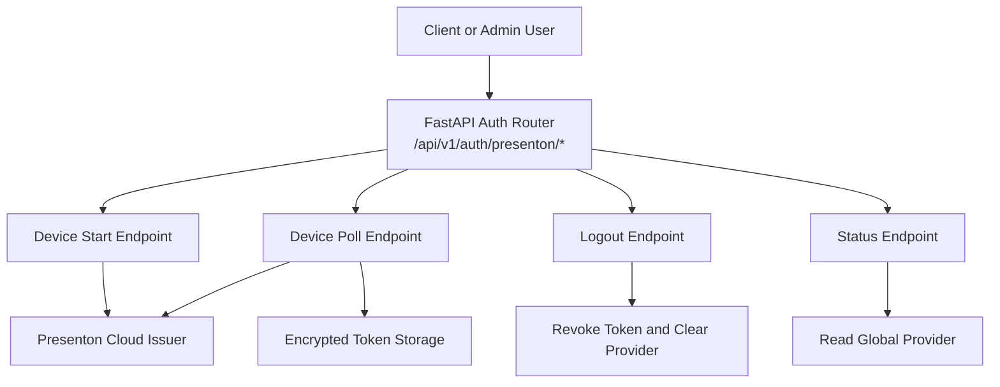
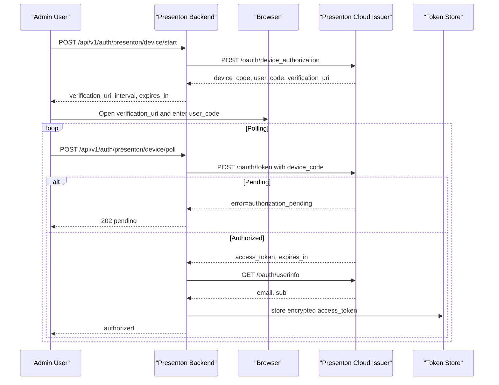
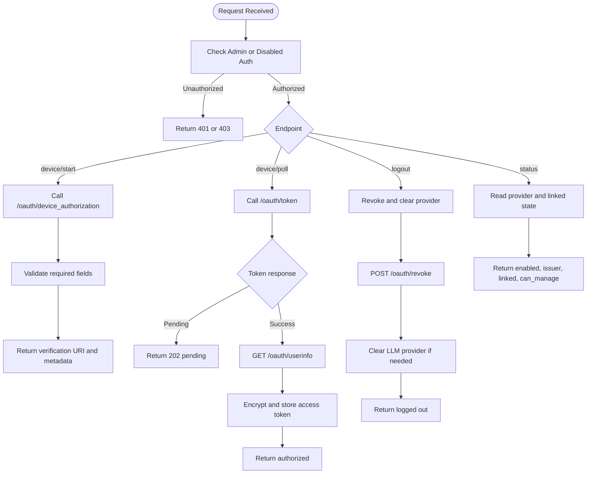
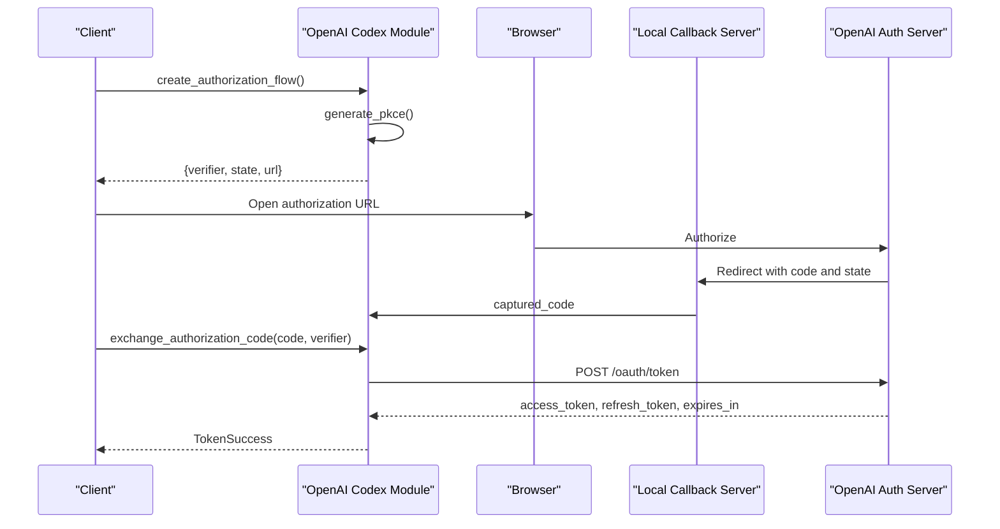
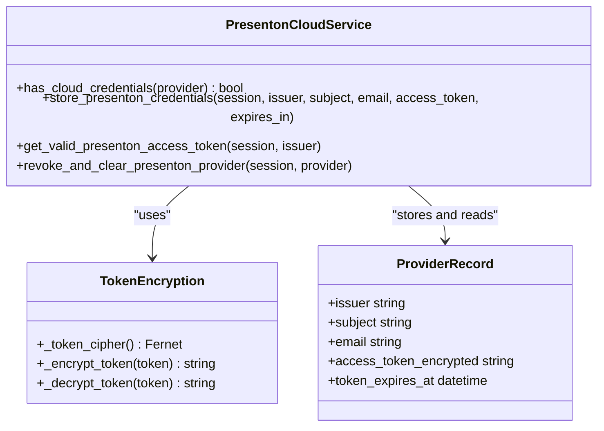
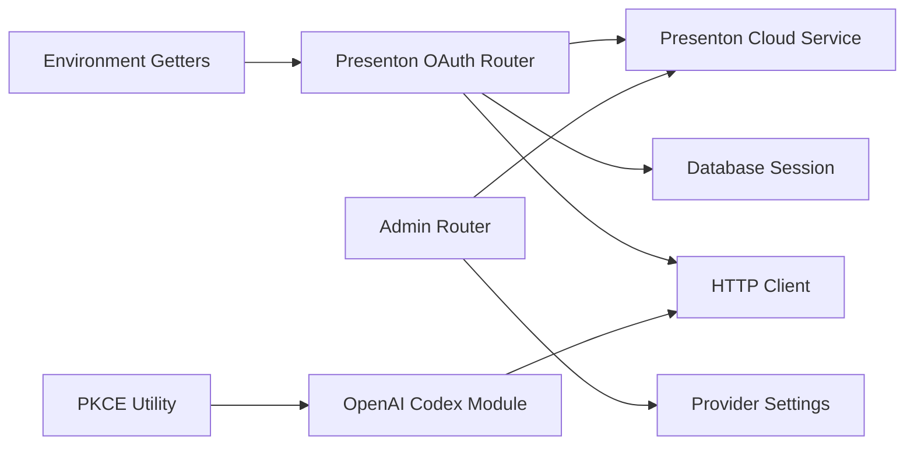

# OAuth Integration

<cite>
**Referenced Files in This Document**
- [presenton_oauth.py](file://servers/fastapi/api/v1/auth/presenton_oauth.py)
- [get_env.py](file://servers/fastapi/utils/get_env.py)
- [openai_codex.py](file://servers/fastapi/utils/oauth/openai_codex.py)
- [pkce.py](file://servers/fastapi/utils/oauth/pkce.py)
- [presenton_cloud.py](file://servers/fastapi/services/presenton_cloud.py)
- [router.py](file://servers/fastapi/api/v1/admin/router.py)
- [test_presenton_oauth_login.py](file://servers/fastapi/tests/integration/test_presenton_oauth_login.py)
</cite>

## Table of Contents
1. [Introduction](#introduction)
2. [Project Structure](#project-structure)
3. [Core Components](#core-components)
4. [Architecture Overview](#architecture-overview)
5. [Detailed Component Analysis](#detailed-component-analysis)
6. [Dependency Analysis](#dependency-analysis)
7. [Performance Considerations](#performance-considerations)
8. [Troubleshooting Guide](#troubleshooting-guide)
9. [Conclusion](#conclusion)

## Introduction
This document explains Presenton’s OAuth integration capabilities, focusing on the built-in Presenton provider flow and the OpenAI Codex (ChatGPT) OAuth implementation. It covers:

- Presenton OAuth provider setup and device authorization flow
- Authorization flows, token exchange, and credential storage
- Configuration parameters for issuer and client identity
- Callback handling and state management
- Security considerations including PKCE, state validation, token encryption, and revocation
- Step-by-step guidance for configuring Presenton and integrating with external OAuth providers such as OpenAI Codex

Presenton currently exposes a global Presenton provider using an OAuth device authorization flow and includes a separate OpenAI Codex OAuth implementation that uses PKCE, a local callback server, and token refresh.

## Project Structure
The OAuth-related code is primarily located under the FastAPI backend:

- `servers/fastapi/api/v1/auth/presenton_oauth.py` — Presenton provider endpoints
- `servers/fastapi/utils/get_env.py` — Default Presenton OAuth issuer and client ID
- `servers/fastapi/utils/oauth/openai_codex.py` — OpenAI Codex OAuth flow
- `servers/fastapi/utils/oauth/pkce.py` — PKCE verifier/challenge generation
- `servers/fastapi/services/presenton_cloud.py` — Encrypted token storage and cloud API usage
- `servers/fastapi/api/v1/admin/router.py` — Provider settings endpoints used by the UI
- `servers/fastapi/tests/integration/test_presenton_oauth_login.py` — Integration tests for the Presenton device flow

**Diagram sources**
- [presenton_oauth.py:120-312](file://servers/fastapi/api/v1/auth/presenton_oauth.py#L120-L312)
- [presenton_cloud.py:69-115](file://servers/fastapi/services/presenton_cloud.py#L69-L115)

**Section sources**
- [presenton_oauth.py:1-313](file://servers/fastapi/api/v1/auth/presenton_oauth.py#L1-L313)
- [get_env.py:7-76](file://servers/fastapi/utils/get_env.py#L7-L76)
- [presenton_cloud.py:1-220](file://servers/fastapi/services/presenton_cloud.py#L1-L220)

## Core Components
- Presenton OAuth router: Provides status, logout, device start, and device poll endpoints for connecting the global Presenton provider.
- Environment configuration: Supplies default issuer and client ID values for the Presenton provider.
- OpenAI Codex OAuth: Implements PKCE-based authorization, a local callback server, token exchange, and refresh.
- PKCE utilities: Generate secure code verifiers and challenges.
- Presenton cloud service: Encrypts and stores access tokens, validates credentials, and calls the Presenton cloud API.
- Admin provider settings: Exposes provider configuration to the Next.js admin UI.

**Section sources**
- [presenton_oauth.py:29-53](file://servers/fastapi/api/v1/auth/presenton_oauth.py#L29-L53)
- [get_env.py:7-76](file://servers/fastapi/utils/get_env.py#L7-L76)
- [openai_codex.py:22-30](file://servers/fastapi/utils/oauth/openai_codex.py#L22-L30)
- [pkce.py:10-23](file://servers/fastapi/utils/oauth/pkce.py#L10-L23)
- [presenton_cloud.py:28-47](file://servers/fastapi/services/presenton_cloud.py#L28-L47)
- [router.py:144-155](file://servers/fastapi/api/v1/admin/router.py#L144-L155)

## Architecture Overview
Presenton supports two OAuth patterns:

1. **Presenton provider**: Uses the OAuth device authorization grant type. The admin initiates connection from the app; the browser approves at a verification URL; the app polls until authorized; then the access token is stored encrypted.
2. **OpenAI Codex provider**: Uses the standard authorization code flow with PKCE. A local HTTP server receives the callback, extracts the authorization code, exchanges it for tokens, and optionally refreshes them.

**Diagram sources**
- [presenton_oauth.py:164-312](file://servers/fastapi/api/v1/auth/presenton_oauth.py#L164-L312)
- [presenton_cloud.py:84-115](file://servers/fastapi/services/presenton_cloud.py#L84-L115)

## Detailed Component Analysis

### Presenton OAuth Provider Endpoints
The Presenton provider router manages the global provider connection through device authorization. Key responsibilities include:

- Reading issuer and client ID from environment defaults
- Starting device authorization and returning verification data
- Polling for token issuance and handling pending states
- Fetching user info and storing encrypted credentials
- Revoking tokens and disconnecting the provider
- Reporting provider status and linking state

**Diagram sources**
- [presenton_oauth.py:120-312](file://servers/fastapi/api/v1/auth/presenton_oauth.py#L120-L312)

Key behaviors:

- Device authorization request:
  - Sends `client_id` and optional `device_name`
  - Validates required fields in the response
  - Normalizes `verification_uri_complete` to avoid leaking codes in URLs
- Device polling:
  - Handles `authorization_pending` and `slow_down` errors with a 202 pending response
  - Requires a valid `access_token` and fetches `/oauth/userinfo`
  - Stores encrypted credentials and returns success
- Logout:
  - Attempts best-effort revocation
  - Clears active LLM provider setting when disconnected
- Status:
  - Reports whether the global provider is linked and whether the current user can manage it

**Section sources**
- [presenton_oauth.py:52-74](file://servers/fastapi/api/v1/auth/presenton_oauth.py#L52-L74)
- [presenton_oauth.py:120-161](file://servers/fastapi/api/v1/auth/presenton_oauth.py#L120-L161)
- [presenton_oauth.py:164-214](file://servers/fastapi/api/v1/auth/presenton_oauth.py#L164-L214)
- [presenton_oauth.py:217-312](file://servers/fastapi/api/v1/auth/presenton_oauth.py#L217-L312)

### Presenton OAuth Configuration Parameters
Presenton’s default OAuth issuer and client ID are defined in the environment utilities:

- Default issuer: `https://api.presenton.ai`
- Default client ID: `ptc_presenton_open_source`

These values are used by the Presenton provider endpoints to construct authorization and token requests.

Configuration notes:

- The issuer is read via a dedicated getter function.
- The client ID is also read via a dedicated getter function.
- Tests assert that the issuer defaults match the built-in constant.

Operational implications:

- If you need a different issuer or client identity, extend the getters or environment layer accordingly.
- The admin UI reads provider settings and Presenton connection status through admin endpoints.

**Section sources**
- [get_env.py:7-76](file://servers/fastapi/utils/get_env.py#L7-L76)
- [router.py:144-155](file://servers/fastapi/api/v1/admin/router.py#L144-L155)
- [test_presenton_oauth_config.py:1-8](file://servers/fastapi/tests/unit/test_presenton_oauth_config.py#L1-L8)

### OpenAI Codex OAuth Flow
The OpenAI Codex implementation provides a complete OAuth flow for ChatGPT:

- PKCE support using S256
- Local callback server listening on port `1455`
- Authorization URL construction with state and scope
- Authorization code exchange for access and refresh tokens
- Token refresh capability
- Profile extraction from JWT claims

**Diagram sources**
- [openai_codex.py:357-375](file://servers/fastapi/utils/oauth/openai_codex.py#L357-L375)
- [openai_codex.py:382-431](file://servers/fastapi/utils/oauth/openai_codex.py#L382-L431)
- [openai_codex.py:508-544](file://servers/fastapi/utils/oauth/openai_codex.py#L508-L544)
- [pkce.py:10-23](file://servers/fastapi/utils/oauth/pkce.py#L10-L23)

Important details:

- PKCE generation:
  - Generates a cryptographically random verifier
  - Computes SHA-256 challenge encoded without padding
- Authorization URL:
  - Includes `response_type`, `client_id`, `redirect_uri`, `scope`, `code_challenge`, `code_challenge_method`, and `state`
- Callback handling:
  - Runs a background thread HTTP server
  - Captures the authorization code
  - Treats state mismatch as a soft warning rather than a hard failure due to known edge cases with overlapping auth attempts
- Token exchange:
  - Exchanges the code plus verifier for access and refresh tokens
  - Calculates expiration timestamp in milliseconds
- Refresh:
  - Uses refresh token to obtain new access and refresh tokens

**Section sources**
- [openai_codex.py:22-30](file://servers/fastapi/utils/oauth/openai_codex.py#L22-L30)
- [openai_codex.py:357-375](file://servers/fastapi/utils/oauth/openai_codex.py#L357-L375)
- [openai_codex.py:382-431](file://servers/fastapi/utils/oauth/openai_codex.py#L382-L431)
- [openai_codex.py:508-574](file://servers/fastapi/utils/oauth/openai_codex.py#L508-L574)
- [pkce.py:10-23](file://servers/fastapi/utils/oauth/pkce.py#L10-L23)

### Token Storage and Security
Presenton securely stores the global provider’s access token:

- Tokens are encrypted using Fernet with a key derived from the application’s auth secret
- Decryption failures raise a specific error indicating reconnection is required
- Credentials include issuer, subject, email, encrypted access token, and expiration time
- Validity checks compare stored expiration against current UTC time
- Revocation attempts are made during logout and cleanup

**Diagram sources**
- [presenton_cloud.py:28-47](file://servers/fastapi/services/presenton_cloud.py#L28-L47)
- [presenton_cloud.py:56-115](file://servers/fastapi/services/presenton_cloud.py#L56-L115)
- [presenton_cloud.py:187-220](file://servers/fastapi/services/presenton_cloud.py#L187-L220)

Security considerations:

- Use HTTPS for all OAuth endpoints and callbacks
- Enforce admin-only access for provider management
- Avoid logging sensitive tokens or codes
- Prefer PKCE for public clients
- Validate state parameters where applicable
- Rotate secrets and revoke tokens on logout or rotation events

**Section sources**
- [presenton_cloud.py:28-47](file://servers/fastapi/services/presenton_cloud.py#L28-L47)
- [presenton_cloud.py:84-115](file://servers/fastapi/services/presenton_cloud.py#L84-L115)
- [presenton_cloud.py:187-220](file://servers/fastapi/services/presenton_cloud.py#L187-L220)

### Authorization Flows Summary

#### Presenton Device Authorization Flow
Steps:

1. Admin calls device start endpoint
2. Backend requests device authorization from the issuer
3. Backend returns verification URI and polling interval
4. User opens verification URI and enters the displayed code
5. Backend polls token endpoint until authorized or expired
6. Backend fetches user info and stores encrypted credentials
7. Admin sees connected status

Error handling:

- Network errors return 502
- Invalid provider responses return 502
- Pending polling returns 202 with pending status

**Section sources**
- [presenton_oauth.py:164-214](file://servers/fastapi/api/v1/auth/presenton_oauth.py#L164-L214)
- [presenton_oauth.py:217-312](file://servers/fastapi/api/v1/auth/presenton_oauth.py#L217-L312)
- [test_presenton_oauth_login.py:165-202](file://servers/fastapi/tests/integration/test_presenton_oauth_login.py#L165-L202)

#### OpenAI Codex Authorization Code Flow with PKCE
Steps:

1. Generate PKCE verifier and challenge
2. Construct authorization URL with state and scope
3. Open authorization URL in browser
4. Receive callback with authorization code
5. Exchange code and verifier for tokens
6. Optionally refresh tokens using refresh token

State validation:

- State is generated and included in the authorization URL
- Callback handler captures the code and logs state mismatches
- Mismatches are treated as warnings to improve resilience in local flows

**Section sources**
- [openai_codex.py:357-375](file://servers/fastapi/utils/oauth/openai_codex.py#L357-L375)
- [openai_codex.py:382-431](file://servers/fastapi/utils/oauth/openai_codex.py#L382-L431)
- [openai_codex.py:508-544](file://servers/fastapi/utils/oauth/openai_codex.py#L508-L544)

## Dependency Analysis
The OAuth components have clear dependencies:

- Presenton OAuth router depends on:
  - Environment getters for issuer and client ID
  - Database session for provider storage
  - Presenton cloud service for credential operations
  - HTTP client for provider communication
- OpenAI Codex module depends on:
  - PKCE utility for verifier/challenge generation
  - HTTP client for token exchange and refresh
  - Local callback server for authorization code capture
- Admin provider settings depend on:
  - Provider settings service
  - Presenton cloud provider lookup

**Diagram sources**
- [presenton_oauth.py:22-27](file://servers/fastapi/api/v1/auth/presenton_oauth.py#L22-L27)
- [presenton_oauth.py:77-86](file://servers/fastapi/api/v1/auth/presenton_oauth.py#L77-L86)
- [openai_codex.py:20-20](file://servers/fastapi/utils/oauth/openai_codex.py#L20-L20)
- [router.py:144-155](file://servers/fastapi/api/v1/admin/router.py#L144-L155)

**Section sources**
- [presenton_oauth.py:22-27](file://servers/fastapi/api/v1/auth/presenton_oauth.py#L22-L27)
- [openai_codex.py:20-20](file://servers/fastapi/utils/oauth/openai_codex.py#L20-L20)
- [router.py:144-155](file://servers/fastapi/api/v1/admin/router.py#L144-L155)

## Performance Considerations
- Device polling should respect the returned interval to avoid excessive requests
- Token refresh should be implemented before expiration to reduce re-authentication overhead
- Encrypted token storage adds minimal overhead but improves security
- Local callback server should be short-lived and closed after successful authentication
- HTTP timeouts are configured to prevent hanging connections

[No sources needed since this section provides general guidance]

## Troubleshooting Guide
Common issues and resolutions:

- **Device authorization fails**:
  - Verify issuer and client ID configuration
  - Check network connectivity to the issuer
  - Inspect error payloads for provider-specific messages
- **Polling returns pending**:
  - Ensure the user completed approval at the verification URI
  - Continue polling according to the returned interval
- **User info retrieval fails**:
  - Confirm the access token is valid and not expired
  - Check issuer `/oauth/userinfo` availability
- **Token decryption fails**:
  - Indicates stored credentials cannot be decrypted; reconnect the account
- **OpenAI Codex callback shows state mismatch**:
  - This is treated as a soft warning; retry authentication if needed
- **Admin cannot manage provider**:
  - Ensure the user is authenticated and has superuser privileges
  - In disabled auth mode, provider management behaves like desktop runtime

**Section sources**
- [presenton_oauth.py:187-214](file://servers/fastapi/api/v1/auth/presenton_oauth.py#L187-L214)
- [presenton_oauth.py:241-252](file://servers/fastapi/api/v1/auth/presenton_oauth.py#L241-L252)
- [presenton_cloud.py:41-47](file://servers/fastapi/services/presenton_cloud.py#L41-L47)
- [openai_codex.py:405-429](file://servers/fastapi/utils/oauth/openai_codex.py#L405-L429)

## Conclusion
Presenton’s OAuth integration provides:

- A secure, admin-managed global Presenton provider using device authorization
- Encrypted token storage with revocation support
- An OpenAI Codex OAuth implementation with PKCE, local callback handling, and token refresh
- Clear configuration boundaries through environment getters and admin provider settings

For production deployments:

- Configure appropriate issuers and client identities
- Enforce HTTPS and admin-only access
- Implement token refresh and rotation strategies
- Monitor device polling and callback behavior
- Follow PKCE best practices and validate state where applicable

[No sources needed since this section summarizes without analyzing specific files]