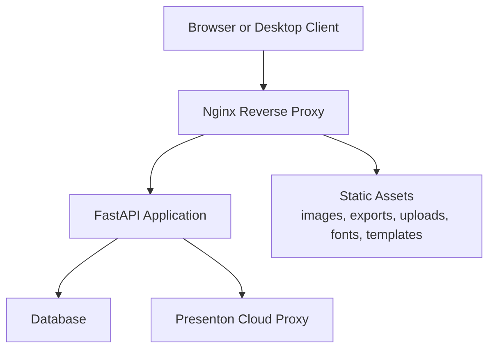
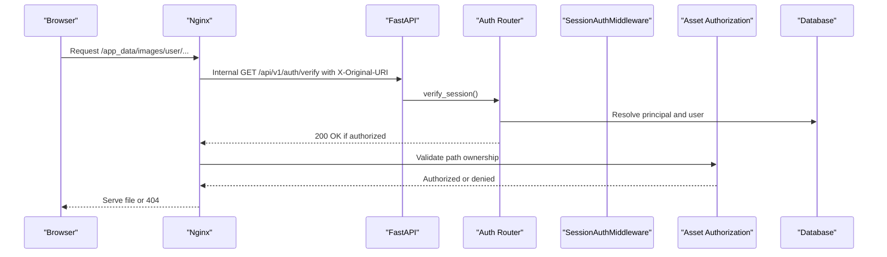
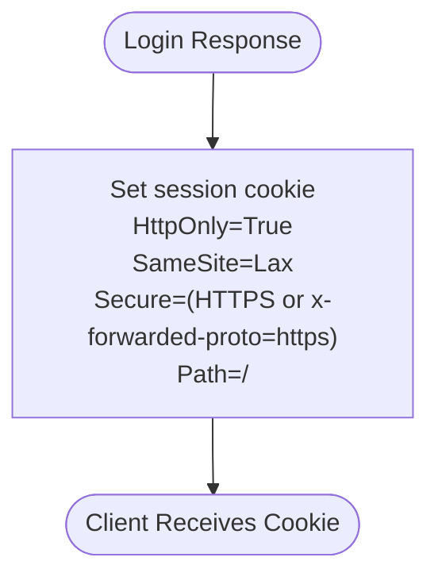
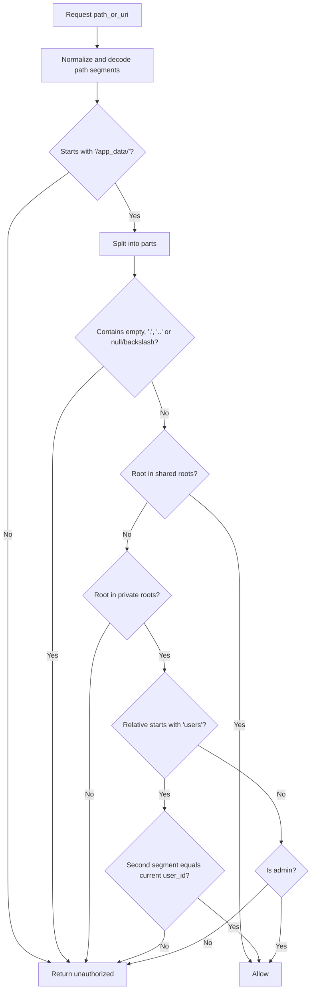
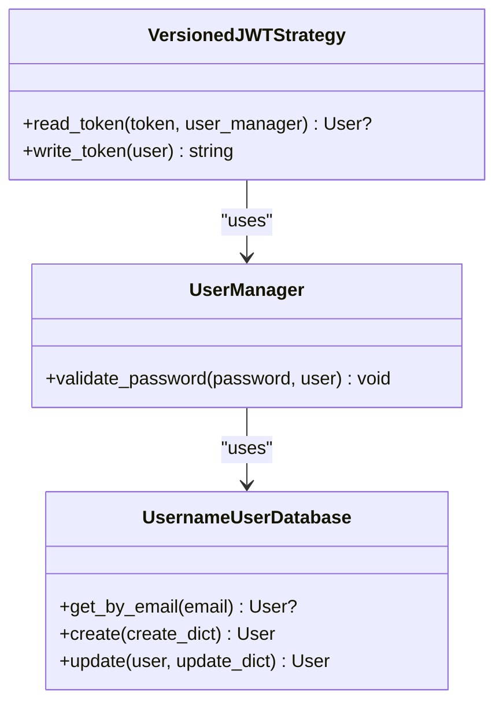
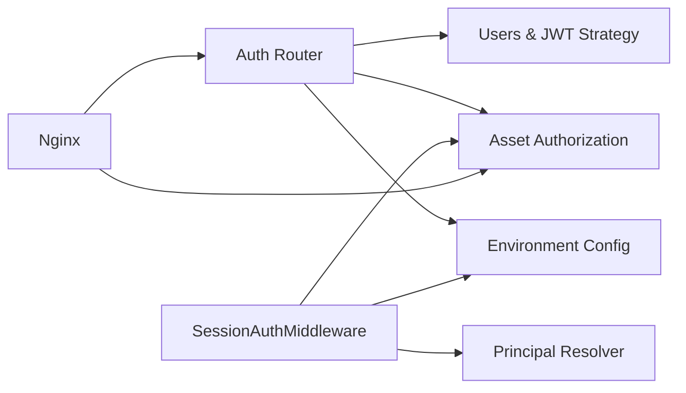

# Security Features

<cite>
**Referenced Files in This Document**
- [router.py](file://servers/fastapi/api/v1/auth/router.py)
- [middlewares.py](file://servers/fastapi/api/middlewares.py)
- [assets.py](file://servers/fastapi/api/v1/auth/assets.py)
- [users.py](file://servers/fastapi/api/v1/auth/users.py)
- [principal.py](file://servers/fastapi/api/v1/auth/principal.py)
- [config.py](file://servers/fastapi/api/v1/auth/config.py)
- [bootstrap.py](file://servers/fastapi/api/v1/auth/bootstrap.py)
- [get_env.py](file://servers/fastapi/utils/get_env.py)
- [auth.ts](file://servers/nextjs/utils/auth.ts)
- [nginx.conf](file://nginx.conf)
- [test_nginx_mcp_config.py](file://servers/fastapi/tests/unit/test_nginx_mcp_config.py)
- [test_auth_endpoints.py](file://servers/fastapi/tests/integration/test_auth_endpoints.py)
</cite>

## Table of Contents
1. [Introduction](#introduction)
2. [Project Structure](#project-structure)
3. [Core Components](#core-components)
4. [Architecture Overview](#architecture-overview)
5. [Detailed Component Analysis](#detailed-component-analysis)
6. [Dependency Analysis](#dependency-analysis)
7. [Performance Considerations](#performance-considerations)
8. [Troubleshooting Guide](#troubleshooting-guide)
9. [Conclusion](#conclusion)

## Introduction
This document explains the security features implemented in Presenton’s authentication and authorization system. It covers session-based authentication, secure cookie configuration, HTTPS-aware behavior, asset path authorization, environment-based authentication disabling for development, rate limiting and brute-force posture, input validation, and deployment-level protections through Nginx. It also provides guidance on monitoring, best practices, and operational hardening.

## Project Structure
The security-relevant implementation spans:
- FastAPI backend authentication routes and middleware
- Asset authorization logic for private user data
- JWT strategy, password handling, and session cookie configuration
- Environment configuration for disabling authentication in development
- Next.js client-side helpers for reading environment flags
- Nginx reverse proxy configuration for request forwarding, static asset protection, and internal auth checks

**Diagram sources**
- [nginx.conf:25-107](file://nginx.conf#L25-L107)
- [middlewares.py:29-149](file://servers/fastapi/api/middlewares.py#L29-L149)
- [assets.py:19-24](file://servers/fastapi/api/v1/auth/assets.py#L19-L24)

**Section sources**
- [nginx.conf:1-214](file://nginx.conf#L1-L214)
- [middlewares.py:1-150](file://servers/fastapi/api/middlewares.py#L1-L150)
- [assets.py:1-85](file://servers/fastapi/api/v1/auth/assets.py#L1-L85)

## Core Components
- Authentication router: login, logout, setup, status, and verify endpoints; secure cookie setting; HTTPS-aware behavior; environment-based bypass.
- Session middleware: enforces authentication, admin-only routes, app-data authorization, and cloud proxy routing.
- Asset authorization: validates normalized paths, prevents traversal, and restricts private directories to the correct owner.
- JWT and session cookies: versioned JWT strategy, persistent secret management, secure cookie attributes.
- Principal resolution: supports both browser JWT sessions and API key bearer tokens.
- Bootstrap and environment controls: admin initialization, legacy credential migration, and DISABLE_AUTH support.
- Nginx integration: forwards headers safely, protects private assets via an internal auth subrequest, and disables symlink escapes.

**Section sources**
- [router.py:1-202](file://servers/fastapi/api/v1/auth/router.py#L1-L202)
- [middlewares.py:29-149](file://servers/fastapi/api/middlewares.py#L29-L149)
- [assets.py:27-85](file://servers/fastapi/api/v1/auth/assets.py#L27-L85)
- [users.py:136-234](file://servers/fastapi/api/v1/auth/users.py#L136-L234)
- [principal.py:14-57](file://servers/fastapi/api/v1/auth/principal.py#L14-L57)
- [config.py:11-108](file://servers/fastapi/api/v1/auth/config.py#L11-L108)
- [bootstrap.py:43-152](file://servers/fastapi/api/v1/auth/bootstrap.py#L43-L152)
- [get_env.py:67-80](file://servers/fastapi/utils/get_env.py#L67-L80)
- [auth.ts:1-20](file://servers/nextjs/utils/auth.ts#L1-L20)
- [nginx.conf:130-211](file://nginx.conf#L130-L211)

## Architecture Overview
The runtime architecture combines a reverse proxy, FastAPI application, database, and optional cloud proxy. Authentication is enforced at multiple layers:
- Nginx forwards requests with safe headers and protects private static assets using an internal auth check.
- FastAPI middleware authenticates requests, resolves principals (JWT or API key), enforces admin-only routes, and authorizes app_data paths.
- The auth router manages login/logout/setup/status/verify and sets secure cookies.
- Asset authorization ensures users can only access their own private data.

**Diagram sources**
- [nginx.conf:130-142](file://nginx.conf#L130-L142)
- [router.py:81-107](file://servers/fastapi/api/v1/auth/router.py#L81-L107)
- [assets.py:58-85](file://servers/fastapi/api/v1/auth/assets.py#L58-L85)

## Detailed Component Analysis

### CSRF Protection
- CSRF protection is not implemented as a general-purpose token mechanism across all endpoints.
- A specific OAuth flow includes state mismatch detection that indicates possible CSRF concerns.
- The broader web application relies on same-site cookies and server-side authorization rather than explicit CSRF tokens.

Recommendation:
- Add consistent CSRF protection for state-changing browser endpoints where appropriate.
- Use SameSite=Strict or Lax consistently and ensure proper origin checks.

**Section sources**
- [codex_auth.py:236](file://servers/fastapi/api/v1/ppt/endpoints/codex_auth.py#L236)
- [openai_codex.py:406](file://servers/fastapi/utils/oauth/openai_codex.py#L406)

### Secure Cookie Configuration
- Session cookies are set with HttpOnly and SameSite=Lax.
- The secure flag is enabled when the request is HTTPS or proxied over HTTPS.
- Logout deletes the session cookie with matching attributes.
- JWT lifetime and cookie name are centrally configured.

**Diagram sources**
- [router.py:39-55](file://servers/fastapi/api/v1/auth/router.py#L39-L55)
- [router.py:191-201](file://servers/fastapi/api/v1/auth/router.py#L191-L201)
- [config.py:11-12](file://servers/fastapi/api/v1/auth/config.py#L11-L12)

**Section sources**
- [router.py:39-55](file://servers/fastapi/api/v1/auth/router.py#L39-L55)
- [router.py:191-201](file://servers/fastapi/api/v1/auth/router.py#L191-L201)
- [users.py:187-199](file://servers/fastapi/api/v1/auth/users.py#L187-L199)
- [config.py:11-12](file://servers/fastapi/api/v1/auth/config.py#L11-L12)

### HTTPS Enforcement
- The application detects HTTPS via direct scheme or forwarded protocol header.
- Cookies are marked secure only under HTTPS conditions.
- Nginx preserves forwarded protocol/host headers for downstream services.

Best practice:
- Enforce TLS termination at the edge and ensure x-forwarded-proto is trusted.
- Avoid serving sensitive content over HTTP.

**Section sources**
- [router.py:39-43](file://servers/fastapi/api/v1/auth/router.py#L39-L43)
- [nginx.conf:14-23](file://nginx.conf#L14-L23)
- [nginx.conf:29-43](file://nginx.conf#L29-L43)

### Asset Path Authorization
- Private app_data roots include images, exports, uploads, pptx-to-html, and pptx-to-json.
- Shared roots include fonts and templates.
- Paths are normalized and validated against traversal attacks, null bytes, backslashes, and encoded loops.
- Private paths require either a per-user directory under users/<user_id>/... or admin access for legacy locations.
- Nginx gates private static assets with an internal auth subrequest and disables symlinks.

**Diagram sources**
- [assets.py:27-85](file://servers/fastapi/api/v1/auth/assets.py#L27-L85)

**Section sources**
- [assets.py:9-16](file://servers/fastapi/api/v1/auth/assets.py#L9-L16)
- [assets.py:27-85](file://servers/fastapi/api/v1/auth/assets.py#L27-L85)
- [middlewares.py:135-145](file://servers/fastapi/api/middlewares.py#L135-L145)
- [nginx.conf:159-211](file://nginx.conf#L159-L211)

### Rate Limiting and Brute Force Protection
- There is no built-in global rate limiter for login attempts in the referenced code.
- Integration tests assert that repeated failed logins are not rate-limited by default.
- Password hashing uses a helper that supports legacy hashes and upgrades them on successful verification.

Recommendation:
- Implement IP-based or account-based rate limiting on login and setup endpoints.
- Add exponential backoff and lockout policies after repeated failures.
- Monitor failed login attempts and alert on anomalies.

**Section sources**
- [test_auth_endpoints.py:244-258](file://servers/fastapi/tests/integration/test_auth_endpoints.py#L244-L258)
- [users.py:27-46](file://servers/fastapi/api/v1/auth/users.py#L27-L46)

### Session Security Measures
- JWTs are versioned with an auth_version field; invalidation occurs when the user record changes version or becomes inactive.
- The JWT secret is persisted securely in user config and rotated during bootstrap operations.
- Session cookies use HttpOnly and SameSite=Lax; secure flag depends on HTTPS.
- Principal resolution supports both JWT cookies and API keys.

**Diagram sources**
- [users.py:136-182](file://servers/fastapi/api/v1/auth/users.py#L136-L182)
- [users.py:49-104](file://servers/fastapi/api/v1/auth/users.py#L49-L104)

**Section sources**
- [users.py:136-182](file://servers/fastapi/api/v1/auth/users.py#L136-L182)
- [config.py:71-81](file://servers/fastapi/api/v1/auth/config.py#L71-L81)
- [principal.py:22-57](file://servers/fastapi/api/v1/auth/principal.py#L22-L57)

### Environment-Based Authentication Disabling
- When DISABLE_AUTH is truthy, the backend treats the runtime as single-user and returns a synthetic authenticated identity.
- The Next.js client reads the same environment variable to adjust UI behavior.
- This mode is intended for development or desktop environments where external auth is not required.

Operational note:
- Do not enable this in production unless explicitly intended.

**Section sources**
- [get_env.py:67-80](file://servers/fastapi/utils/get_env.py#L67-L80)
- [middlewares.py:59-72](file://servers/fastapi/api/middlewares.py#L59-L72)
- [router.py:58-78](file://servers/fastapi/api/v1/auth/router.py#L58-L78)
- [router.py:81-107](file://servers/fastapi/api/v1/auth/router.py#L81-L107)
- [auth.ts:1-20](file://servers/nextjs/utils/auth.ts#L1-L20)

### Security Headers Configuration
- Nginx forwards essential headers (Host, X-Real-IP, X-Forwarded-For, X-Forwarded-Proto, X-Forwarded-Host).
- Static assets receive cache-control headers appropriate for public or private content.
- No explicit Content-Security-Policy, Strict-Transport-Security, or Referrer-Policy headers are defined in the provided configuration.

Recommendation:
- Add HSTS, CSP, Referrer-Policy, Permissions-Policy, and X-Frame-Options at the reverse proxy layer.
- Ensure CORS is configured strictly for allowed origins.

**Section sources**
- [nginx.conf:29-43](file://nginx.conf#L29-L43)
- [nginx.conf:45-69](file://nginx.conf#L45-L69)
- [nginx.conf:153-157](file://nginx.conf#L153-L157)
- [nginx.conf:159-211](file://nginx.conf#L159-L211)

### Input Validation Strategies
- Setup endpoint normalizes usernames and enforces minimum length.
- Password validation requires a minimum length and maximum length.
- Legacy password hash compatibility is supported with safe comparison.
- Asset path normalization rejects traversal and encoded-loop attacks.

**Section sources**
- [router.py:31-32](file://servers/fastapi/api/v1/auth/router.py#L31-L32)
- [router.py:119-124](file://servers/fastapi/api/v1/auth/router.py#L119-L124)
- [users.py:116-127](file://servers/fastapi/api/v1/auth/users.py#L116-L127)
- [users.py:31-40](file://servers/fastapi/api/v1/auth/users.py#L31-L40)
- [assets.py:27-55](file://servers/fastapi/api/v1/auth/assets.py#L27-L55)

### Audit Logging Capabilities
- The bootstrap process logs recovery and migration events related to administrator credentials.
- No comprehensive audit logging for authentication events is present in the referenced files.

Recommendation:
- Log authentication successes, failures, setup operations, and asset access denials with minimal PII.
- Integrate structured logging and centralized collection.

**Section sources**
- [bootstrap.py:75-77](file://servers/fastapi/api/v1/auth/bootstrap.py#L75-L77)
- [bootstrap.py:125-125](file://servers/fastapi/api/v1/auth/bootstrap.py#L125-L125)

## Dependency Analysis
The following diagram shows how core security components depend on each other:

**Diagram sources**
- [router.py:1-202](file://servers/fastapi/api/v1/auth/router.py#L1-L202)
- [middlewares.py:29-149](file://servers/fastapi/api/middlewares.py#L29-L149)
- [assets.py:1-85](file://servers/fastapi/api/v1/auth/assets.py#L1-L85)
- [principal.py:14-57](file://servers/fastapi/api/v1/auth/principal.py#L14-L57)
- [get_env.py:67-80](file://servers/fastapi/utils/get_env.py#L67-L80)
- [nginx.conf:130-211](file://nginx.conf#L130-L211)

**Section sources**
- [router.py:1-202](file://servers/fastapi/api/v1/auth/router.py#L1-L202)
- [middlewares.py:29-149](file://servers/fastapi/api/middlewares.py#L29-L149)
- [assets.py:1-85](file://servers/fastapi/api/v1/auth/assets.py#L1-L85)
- [principal.py:14-57](file://servers/fastapi/api/v1/auth/principal.py#L14-L57)
- [get_env.py:67-80](file://servers/fastapi/utils/get_env.py#L67-L80)
- [nginx.conf:130-211](file://nginx.conf#L130-L211)

## Performance Considerations
- Nginx serves private static assets directly via alias after passing an internal auth check, reducing FastAPI load.
- Cache-Control headers optimize caching for static assets.
- The middleware performs database queries for configuration checks and principal resolution; consider caching where safe.

[No sources needed since this section provides general guidance]

## Troubleshooting Guide
Common issues and mitigations:
- Login setup required: Indicates no admin account exists; initialize via setup or bootstrap.
- Unauthorized asset access: Verify path normalization and ownership rules; ensure the request originates from an authenticated session.
- MCP routes bypassing app-data auth: Confirmed by tests; MCP delegates authentication to FastMCP and does not use the app-data auth subrequest.
- Development mode confusion: If DISABLE_AUTH is enabled, expect synthetic admin identity and relaxed checks.

**Section sources**
- [middlewares.py:83-93](file://servers/fastapi/api/middlewares.py#L83-L93)
- [assets.py:27-85](file://servers/fastapi/api/v1/auth/assets.py#L27-L85)
- [test_nginx_mcp_config.py:18-36](file://servers/fastapi/tests/unit/test_nginx_mcp_config.py#L18-L36)
- [get_env.py:67-80](file://servers/fastapi/utils/get_env.py#L67-L80)

## Conclusion
Presenton’s security model centers on session-based authentication with secure cookies, strict asset path authorization, and careful environment controls. Nginx adds a strong perimeter by protecting private static assets and preserving trusted headers. While robust, the system lacks general CSRF protection and rate limiting, and it does not define comprehensive security headers or audit logging in the referenced files. For production deployments, add rate limiting, CSRF protection, security headers, and structured audit logging, and avoid enabling DISABLE_AUTH outside controlled environments.