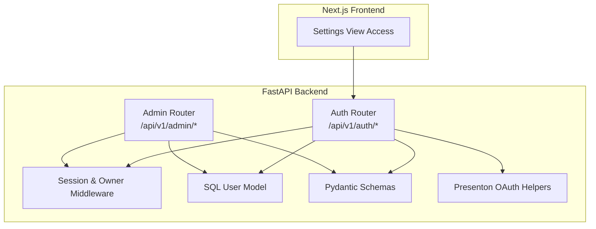
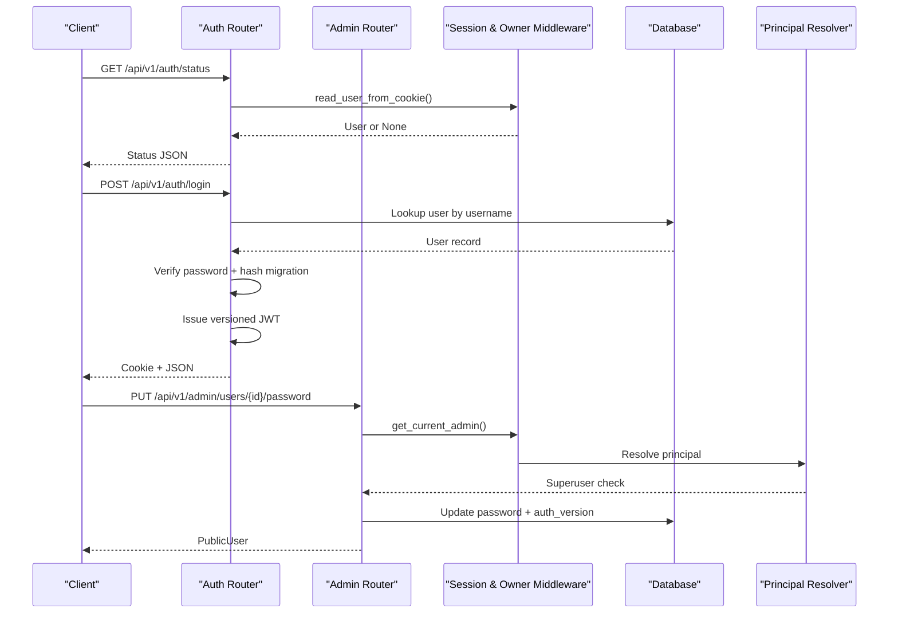
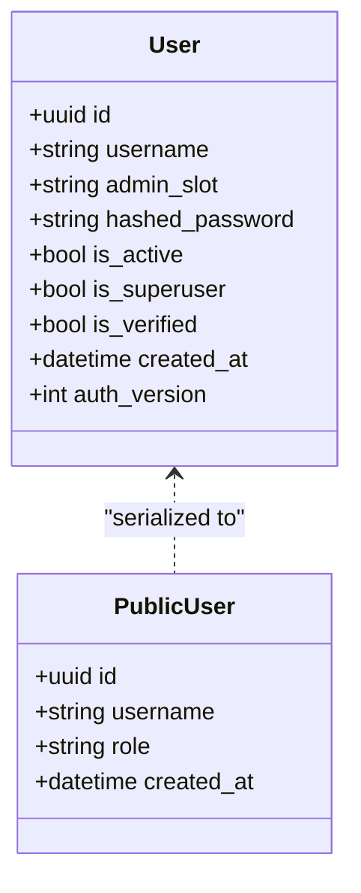
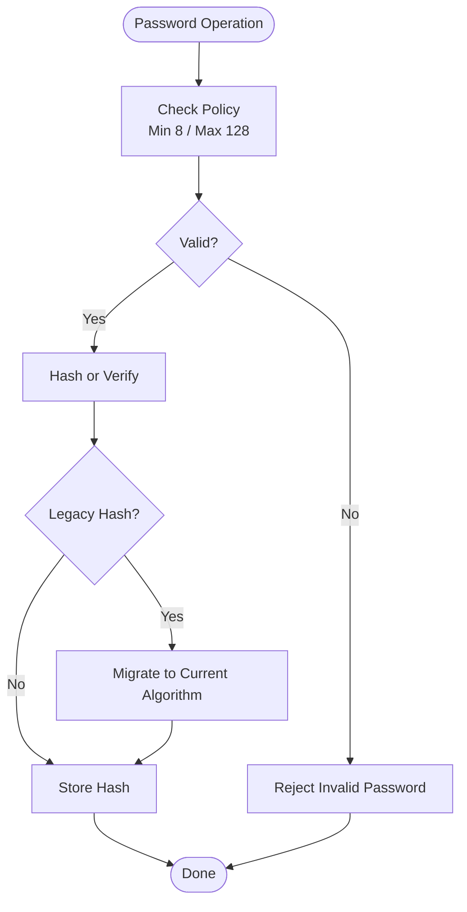
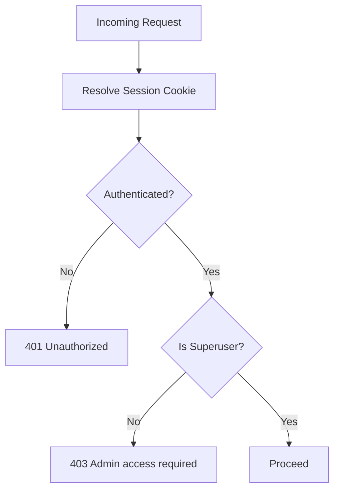
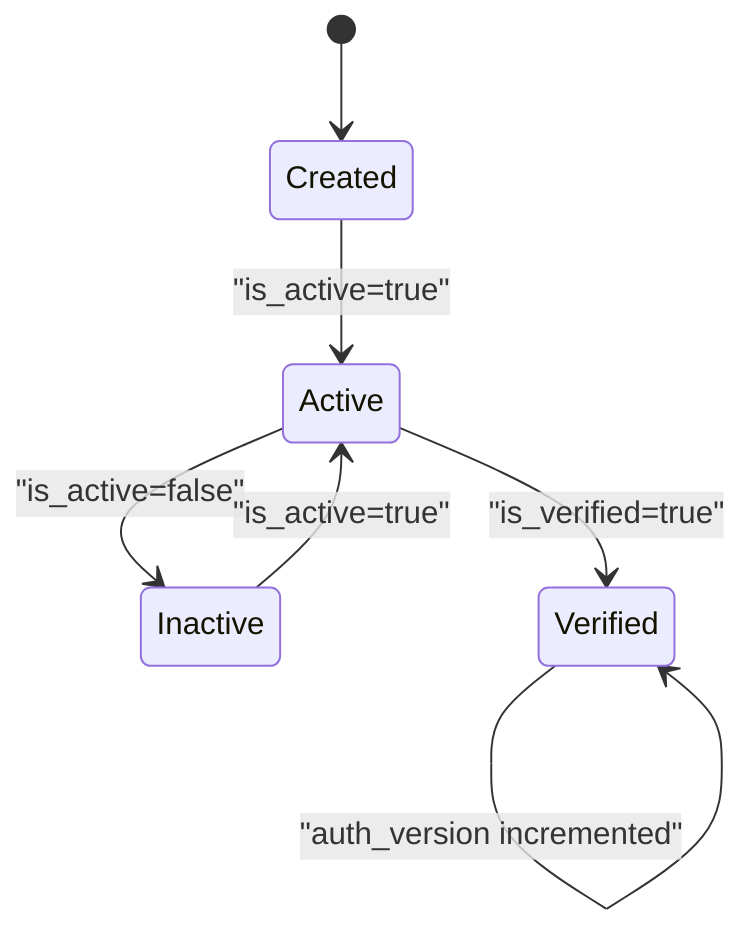
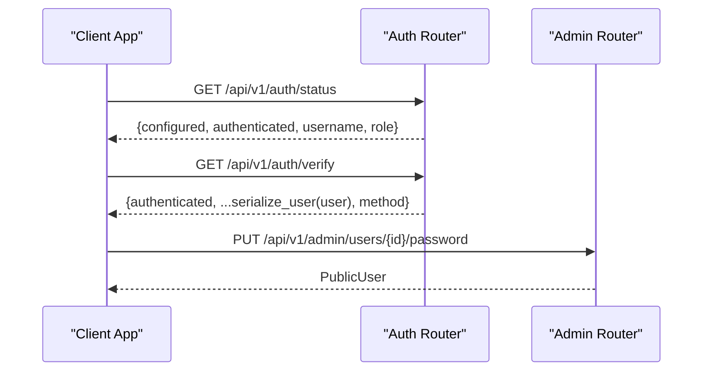
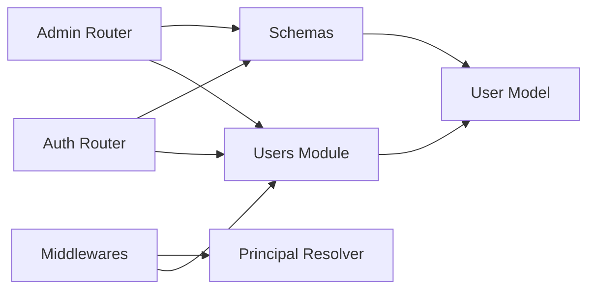

# User Management API

<cite>
**Referenced Files in This Document**
- [router.py](file://servers/fastapi/api/v1/auth/router.py)
- [users.py](file://servers/fastapi/api/v1/auth/users.py)
- [schemas.py](file://servers/fastapi/api/v1/auth/schemas.py)
- [user.py](file://servers/fastapi/models/sql/user.py)
- [router.py](file://servers/fastapi/api/v1/admin/router.py)
- [middlewares.py](file://servers/fastapi/api/middlewares.py)
- [presenton_oauth.py](file://servers/fastapi/api/v1/auth/presenton_oauth.py)
- [settingsAccess.ts](file://servers/nxtjs/utils/settingsAccess.ts)
</cite>

## Table of Contents
1. [Introduction](#introduction)
2. [Project Structure](#project-structure)
3. [Core Components](#core-components)
4. [Architecture Overview](#architecture-overview)
5. [Detailed Component Analysis](#detailed-component-analysis)
6. [Dependency Analysis](#dependency-analysis)
7. [Performance Considerations](#performance-considerations)
8. [Troubleshooting Guide](#troubleshooting-guide)
9. [Conclusion](#conclusion)

## Introduction
This document describes the user management APIs exposed by Presenton’s FastAPI backend. It focuses on:
- Authentication and session handling
- Admin-driven user lifecycle operations
- Password management and security constraints
- Role-based access control and permission checks
- User serialization and data models
- State handling for active, verified, and superuser accounts
- Client integration guidance for profile and account workflows

The system is username-only at the application layer, with admin-managed user creation and password resets. Self-service registration, self-service password reset, and email verification routes are intentionally disabled; authentication relies on secure cookies and versioned JWTs.

## Project Structure
User-related functionality is split across authentication, administration, database models, middleware, and frontend utilities:

**Diagram sources**
- [router.py:27-202](file://servers/fastapi/api/v1/auth/router.py#L27-L202)
- [router.py:41-265](file://servers/fastapi/api/v1/admin/router.py#L41-L265)
- [middlewares.py:29-149](file://servers/fastapi/api/middlewares.py#L29-L149)
- [user.py:16-46](file://servers/fastapi/models/sql/user.py#L16-L46)
- [schemas.py:10-82](file://servers/fastapi/api/v1/auth/schemas.py#L10-L82)
- [presenton_oauth.py:45-74](file://servers/fastapi/api/v1/auth/presenton_oauth.py#L45-L74)
- [settingsAccess.ts:1-7](file://servers/nxtjs/utils/settingsAccess.ts#L1-L7)

**Section sources**
- [router.py:27-202](file://servers/fastapi/api/v1/auth/router.py#L27-L202)
- [router.py:41-265](file://servers/fastapi/api/v1/admin/router.py#L41-L265)
- [middlewares.py:29-149](file://servers/fastapi/api/middlewares.py#L29-L149)
- [user.py:16-46](file://servers/fastapi/models/sql/user.py#L16-L46)
- [schemas.py:10-82](file://servers/fastapi/api/v1/auth/schemas.py#L10-L82)
- [presenton_oauth.py:45-74](file://servers/fastapi/api/v1/auth/presenton_oauth.py#L45-L74)
- [settingsAccess.ts:1-7](file://servers/nxtjs/utils/settingsAccess.ts#L1-L7)

## Core Components
- Authentication router: status, verify, setup, login, logout
- Admin router: list/create/reset/delete users, provider settings, API keys
- User model: username-only account with role and state flags
- Schemas: request/response validation for auth and admin operations
- Session and owner middleware: principal resolution, asset authorization, context propagation
- OAuth helpers: Presenton cloud provider configuration and manager checks
- Frontend settings access: role-based UI routing between admin and account views

Key responsibilities:
- Enforce minimum username length and uniqueness
- Hash passwords using a legacy-aware helper
- Issue and validate versioned JWTs stored in secure cookies
- Restrict sensitive endpoints to authenticated or superuser roles
- Serialize safe user fields for responses

**Section sources**
- [router.py:58-202](file://servers/fastapi/api/v1/auth/router.py#L58-L202)
- [router.py:169-265](file://servers/fastapi/api/v1/admin/router.py#L169-L265)
- [user.py:16-46](file://servers/fastapi/models/sql/user.py#L16-L46)
- [schemas.py:10-82](file://servers/fastapi/api/v1/auth/schemas.py#L10-L82)
- [middlewares.py:29-149](file://servers/fastapi/api/middlewares.py#L29-L149)
- [presenton_oauth.py:56-74](file://servers/fastapi/api/v1/auth/presenton_oauth.py#L56-L74)
- [settingsAccess.ts:1-7](file://servers/nxtjs/utils/settingsAccess.ts#L1-L7)

## Architecture Overview
The user management architecture combines FastAPI routers, SQLAlchemy models, Pydantic schemas, and middleware:

**Diagram sources**
- [router.py:58-202](file://servers/fastapi/api/v1/auth/router.py#L58-L202)
- [router.py:215-233](file://servers/fastapi/api/v1/admin/router.py#L215-L233)
- [users.py:202-224](file://servers/fastapi/api/v1/auth/users.py#L202-L224)
- [middlewares.py:29-149](file://servers/fastapi/api/middlewares.py#L29-L149)

## Detailed Component Analysis

### Authentication Endpoints
- GET /api/v1/auth/status
  - Returns configured/authenticated state and current user metadata when available.
  - When authentication is disabled, returns an internal admin-like identity.
- GET /api/v1/auth/verify
  - Validates the current session and returns serialized user info plus authentication method.
  - Applies app-data path authorization based on principal.
- POST /api/v1/auth/setup
  - Creates the first administrator account if none exists.
  - Requires username and password with validation rules.
- POST /api/v1/auth/login
  - Authenticates a user, migrates legacy hashes if needed, issues a versioned JWT, and sets a secure cookie.
- POST /api/v1/auth/logout
  - Clears the session cookie.

Security notes:
- Username normalization removes whitespace before lookup.
- Login enforces account existence and active status.
- Legacy password hashing is supported during verification and migrated on successful login.
- Versioned JWTs include an auth version that invalidates sessions after password changes.

**Section sources**
- [router.py:58-202](file://servers/fastapi/api/v1/auth/router.py#L58-L202)
- [users.py:27-46](file://servers/fastapi/api/v1/auth/users.py#L27-L46)
- [users.py:136-182](file://servers/fastapi/api/v1/auth/users.py#L136-L182)

### Admin User Management Endpoints
- GET /api/v1/admin/users
  - Lists all users as public user objects.
  - Requires superuser role.
- POST /api/v1/admin/users
  - Creates a new non-admin user with hashed password and default active/verified state.
  - Validates username uniqueness and minimum length.
- PUT /api/v1/admin/users/{user_id}/password
  - Resets another user’s password and increments their auth version to invalidate existing sessions.
  - Prevents resetting the primary administrator’s password via this endpoint.
- DELETE /api/v1/admin/users/{user_id}
  - Deletes a user and cleans associated app data directories.
  - Prevents deleting the primary administrator account.

Response model:
- PublicUser includes id, username, role, and created_at.

**Section sources**
- [router.py:169-265](file://servers/fastapi/api/v1/admin/router.py#L169-L265)
- [schemas.py:19-25](file://servers/fastapi/api/v1/auth/schemas.py#L19-L25)

### User Data Model and Serialization
The SQL User model defines the core user entity:
- Unique username
- Optional admin slot
- Hashed password
- Flags: is_active, is_superuser, is_verified
- Timestamps: created_at
- Security version: auth_version

Serialization:
- serialize_user returns id, username, role, and created_at.
- Role is derived from is_superuser.

**Diagram sources**
- [user.py:16-46](file://servers/fastapi/models/sql/user.py#L16-L46)
- [schemas.py:19-25](file://servers/fastapi/api/v1/auth/schemas.py#L19-L25)
- [users.py:227-233](file://servers/fastapi/api/v1/auth/users.py#L227-L233)

**Section sources**
- [user.py:16-46](file://servers/fastapi/models/sql/user.py#L16-L46)
- [users.py:227-233](file://servers/fastapi/api/v1/auth/users.py#L227-L233)

### Password Management and Validation
Password policies:
- Creation/validation: minimum 8 characters, maximum 128 characters.
- Login compatibility: accepts minimum 6 characters for legacy clients.
- Legacy hash support: verifies older hashes and migrates to current algorithm on successful login.

Admin password reset:
- Updates hashed password and increments auth_version.
- Blocks resetting the primary administrator’s password through this route.

**Diagram sources**
- [schemas.py:10-17](file://servers/fastapi/api/v1/auth/schemas.py#L10-L17)
- [schemas.py:37-45](file://servers/fastapi/api/v1/auth/schemas.py#L37-L45)
- [users.py:27-46](file://servers/fastapi/api/v1/auth/users.py#L27-L46)
- [router.py:215-233](file://servers/fastapi/api/v1/admin/router.py#L215-L233)

**Section sources**
- [schemas.py:10-17](file://servers/fastapi/api/v1/auth/schemas.py#L10-L17)
- [schemas.py:37-45](file://servers/fastapi/api/v1/auth/schemas.py#L37-L45)
- [users.py:27-46](file://servers/fastapi/api/v1/auth/users.py#L27-L46)
- [router.py:215-233](file://servers/fastapi/api/v1/admin/router.py#L215-L233)

### Role-Based Access Control and Permission Checking
Roles:
- admin (is_superuser = true)
- user (is_superuser = false)

Access patterns:
- get_current_user requires a valid session cookie and returns the authenticated user.
- get_current_admin requires the authenticated user to be a superuser.
- require_settings_admin protects provider settings endpoints similarly.
- OAuth helpers treat disabled-auth mode as admin for desktop runtime consistency.

**Diagram sources**
- [users.py:211-224](file://servers/fastapi/api/v1/auth/users.py#L211-L224)
- [router.py:131-142](file://servers/fastapi/api/v1/admin/router.py#L131-L142)
- [presenton_oauth.py:56-74](file://servers/fastapi/api/v1/auth/presenton_oauth.py#L56-L74)

**Section sources**
- [users.py:211-224](file://servers/fastapi/api/v1/auth/users.py#L211-L224)
- [router.py:131-142](file://servers/fastapi/api/v1/admin/router.py#L131-L142)
- [presenton_oauth.py:56-74](file://servers/fastapi/api/v1/auth/presenton_oauth.py#L56-L74)

### User State Management and Verification
State fields:
- is_active: controls login eligibility.
- is_verified: indicates verification status.
- is_superuser: grants admin privileges.
- auth_version: used to invalidate sessions after password changes.

Verification behavior:
- Self-service verification routes are intentionally disabled.
- New admin setup marks the user as verified and active.
- Admin-created users are marked active and verified by default.

**Diagram sources**
- [user.py:31-45](file://servers/fastapi/models/sql/user.py#L31-L45)
- [router.py:125-134](file://servers/fastapi/api/v1/auth/router.py#L125-L134)
- [router.py:201-208](file://servers/fastapi/api/v1/admin/router.py#L201-L208)
- [router.py:230-232](file://servers/fastapi/api/v1/admin/router.py#L230-L232)

**Section sources**
- [user.py:31-45](file://servers/fastapi/models/sql/user.py#L31-L45)
- [router.py:125-134](file://servers/fastapi/api/v1/auth/router.py#L125-L134)
- [router.py:201-208](file://servers/fastapi/api/v1/admin/router.py#L201-L208)
- [router.py:230-232](file://servers/fastapi/api/v1/admin/router.py#L230-L232)

### Client Integration Examples

#### Profile Retrieval Workflow
- Call GET /api/v1/auth/status to determine configuration and current user identity.
- If authenticated, use the returned username and role to render user-specific UI.
- For protected resources, ensure the session cookie is included with requests.

#### Account Settings Workflow
- Use GET /api/v1/auth/verify to confirm session validity and obtain serialized user data.
- Route UI to admin or account settings based on role:
  - Admin view for superusers
  - Account view for regular users

#### Password Reset Workflow (Admin)
- Admin calls PUT /api/v1/admin/users/{user_id}/password with a compliant password.
- The server updates the password and increments auth_version, invalidating existing sessions.
- Frontend should notify the target user that existing sessions were signed out.

**Diagram sources**
- [router.py:58-107](file://servers/fastapi/api/v1/auth/router.py#L58-L107)
- [router.py:215-233](file://servers/fastapi/api/v1/admin/router.py#L215-L233)

**Section sources**
- [router.py:58-107](file://servers/fastapi/api/v1/auth/router.py#L58-L107)
- [router.py:215-233](file://servers/fastapi/api/v1/admin/router.py#L215-L233)
- [settingsAccess.ts:1-7](file://servers/nxtjs/utils/settingsAccess.ts#L1-L7)

## Dependency Analysis
The following diagram shows how authentication, admin, and middleware components depend on each other:

**Diagram sources**
- [router.py:1-27](file://servers/fastapi/api/v1/auth/router.py#L1-L27)
- [router.py:1-41](file://servers/fastapi/api/v1/admin/router.py#L1-L41)
- [middlewares.py:1-21](file://servers/fastapi/api/middlewares.py#L1-L21)
- [users.py:1-25](file://servers/fastapi/api/v1/auth/users.py#L1-L25)
- [user.py:1-15](file://servers/fastapi/models/sql/user.py#L1-L15)

**Section sources**
- [router.py:1-27](file://servers/fastapi/api/v1/auth/router.py#L1-L27)
- [router.py:1-41](file://servers/fastapi/api/v1/admin/router.py#L1-L41)
- [middlewares.py:1-21](file://servers/fastapi/api/middlewares.py#L1-L21)
- [users.py:1-25](file://servers/fastapi/api/v1/auth/users.py#L1-L25)
- [user.py:1-15](file://servers/fastapi/models/sql/user.py#L1-L15)

## Performance Considerations
- Password hashing uses a dedicated helper; consider benchmarking under load and tuning parameters if necessary.
- Database queries for user lookups are simple and indexed by username; ensure indexes remain optimal.
- Session validation decodes JWTs per request; keep token lifetime reasonable to balance security and performance.
- Admin endpoints perform minimal work beyond persistence; avoid unnecessary object conversions.

[No sources needed since this section provides general guidance]

## Troubleshooting Guide
Common issues and resolutions:
- 401 Unauthorized
  - Missing or invalid session cookie
  - Inactive user account
  - Expired or mismatched auth_version
- 403 Admin access required
  - Attempting admin operations without superuser role
  - Trying to reset primary administrator password via admin endpoint
- 404 Not found
  - Referencing a non-existent user ID
  - Revoked API key retrieval attempts
- 409 Conflict
  - Duplicate username during creation
  - Credentials already configured when calling setup
- 410 Gone
  - Attempting to reveal a revoked API key

Operational tips:
- Always include credentials when calling protected endpoints.
- After admin password resets, inform users that existing sessions will be invalidated.
- Validate usernames and passwords according to schema constraints before sending requests.

**Section sources**
- [router.py:116-143](file://servers/fastapi/api/v1/auth/router.py#L116-L143)
- [router.py:155-188](file://servers/fastapi/api/v1/auth/router.py#L155-L188)
- [router.py:215-233](file://servers/fastapi/api/v1/admin/router.py#L215-L233)
- [router.py:236-265](file://servers/fastapi/api/v1/admin/router.py#L236-L265)

## Conclusion
Presenton’s user management API provides secure, admin-controlled user lifecycle operations with robust password policies, role-based access control, and session management. While self-service profile editing and password reset are not exposed, the admin endpoints cover essential operational needs. Clients should integrate by checking authentication status, verifying sessions, and routing UI based on role, while respecting security constraints such as cookie handling and session invalidation after password changes.

[No sources needed since this section summarizes without analyzing specific files]