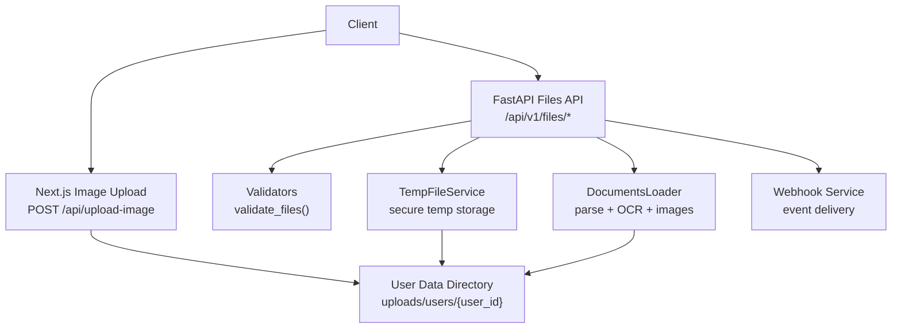
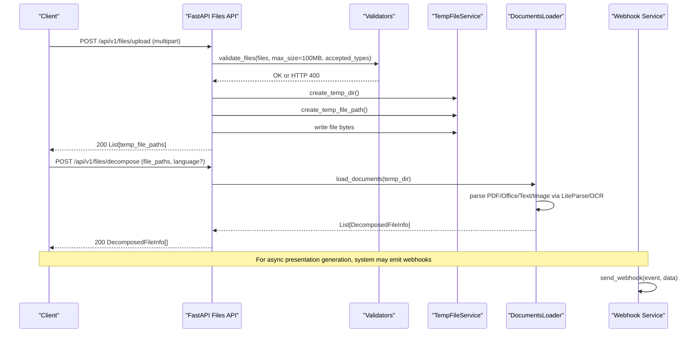
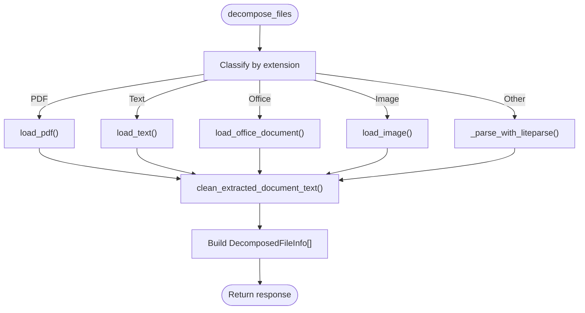
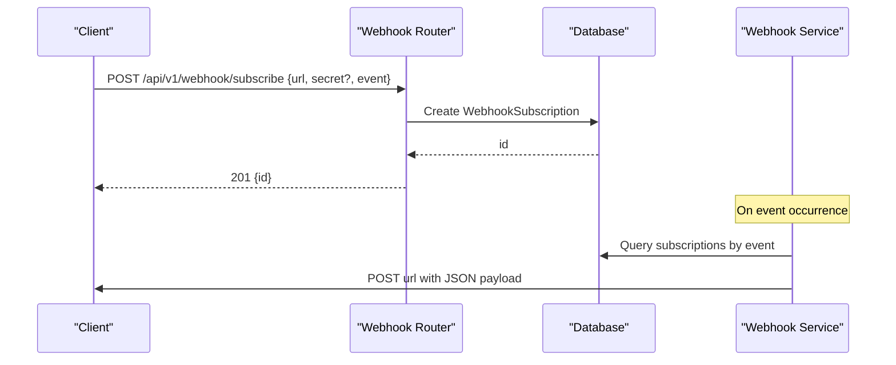
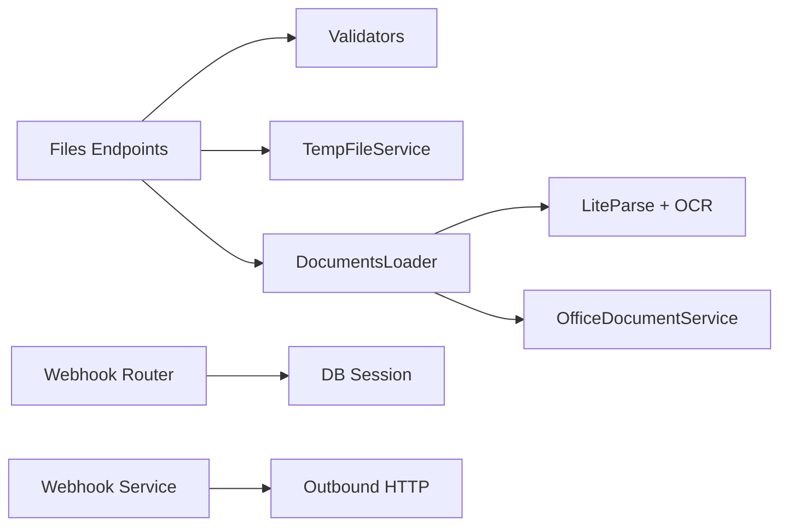

# File Upload & Processing API

<cite>
**Referenced Files in This Document**
- [files.py](file://servers/fastapi/api/v1/ppt/endpoints/files.py)
- [documents.py](file://servers/fastapi/constants/documents.py)
- [validators.py](file://servers/fastapi/utils/validators.py)
- [temp_file_service.py](file://servers/fastapi/services/temp_file_service.py)
- [documents_loader.py](file://servers/fastapi/services/documents_loader.py)
- [route.ts](file://servers/nextjs/app/api/upload-image/route.ts)
- [router.py](file://servers/fastapi/api/v1/webhook/router.py)
- [webhook_service.py](file://servers/fastapi/services/webhook_service.py)
- [webhook_event.py](file://servers/fastapi/enums/webhook_event.py)
</cite>

## Table of Contents
1. [Introduction](#introduction)
2. [Project Structure](#project-structure)
3. [Core Components](#core-components)
4. [Architecture Overview](#architecture-overview)
5. [Detailed Component Analysis](#detailed-component-analysis)
6. [Dependency Analysis](#dependency-analysis)
7. [Performance Considerations](#performance-considerations)
8. [Troubleshooting Guide](#troubleshooting-guide)
9. [Conclusion](#conclusion)

## Introduction
This document describes Presenton’s file upload and processing APIs used to ingest documents and images, validate them, extract content (including OCR), and prepare assets for automatic presentation generation. It covers supported formats, size limits, validation rules, storage management, progress tracking considerations, error handling, and webhook notifications for asynchronous processing completion.

## Project Structure
The relevant implementation spans the FastAPI backend and a Next.js image upload endpoint:
- FastAPI endpoints handle multipart uploads, base64-encoded uploads, file decomposition, and updates.
- Constants define accepted MIME types and extensions.
- Validators enforce per-file size and type checks.
- TempFileService manages secure temporary storage with owner isolation.
- DocumentsLoader orchestrates parsing, OCR, and optional slide/image extraction.
- Next.js provides an authenticated image upload endpoint for UI assets.
- Webhook router and service manage subscriptions and delivery of event notifications.

**Diagram sources**
- [files.py:79-100](file://servers/fastapi/api/v1/ppt/endpoints/files.py#L79-L100)
- [documents.py:65-80](file://servers/fastapi/constants/documents.py#L65-L80)
- [validators.py:23-49](file://servers/fastapi/utils/validators.py#L23-L49)
- [temp_file_service.py:11-48](file://servers/fastapi/services/temp_file_service.py#L11-L48)
- [documents_loader.py:163-244](file://servers/fastapi/services/documents_loader.py#L163-L244)
- [route.ts:12-66](file://servers/nextjs/app/api/upload-image/route.ts#L12-L66)
- [webhook_service.py:9-55](file://servers/fastapi/services/webhook_service.py#L9-L55)

**Section sources**
- [files.py:1-185](file://servers/fastapi/api/v1/ppt/endpoints/files.py#L1-L185)
- [documents.py:1-89](file://servers/fastapi/constants/documents.py#L1-L89)
- [validators.py:1-49](file://servers/fastapi/utils/validators.py#L1-L49)
- [temp_file_service.py:1-192](file://servers/fastapi/services/temp_file_service.py#L1-L192)
- [documents_loader.py:1-358](file://servers/fastapi/services/documents_loader.py#L1-L358)
- [route.ts:1-82](file://servers/nextjs/app/api/upload-image/route.ts#L1-L82)
- [router.py:1-54](file://servers/fastapi/api/v1/webhook/router.py#L1-L54)
- [webhook_service.py:1-56](file://servers/fastapi/services/webhook_service.py#L1-L56)

## Core Components
- Files API (FastAPI): Endpoints for uploading files, base64-encoded uploads, decomposing documents into text, and updating uploaded files.
- Accepted Types: Centralized list of allowed MIME types and file extensions for PDFs, Office documents, spreadsheets, text, and images.
- Validators: Enforce per-file size limits and accept/deny based on MIME type or extension.
- TempFileService: Secure, owner-scoped temporary directory and file operations with path validation and cleanup utilities.
- DocumentsLoader: Parses multiple formats, runs OCR when needed, extracts embedded images from PDFs, and returns normalized text plus image paths.
- Next.js Image Upload: Authenticated endpoint that streams and persists images under user-scoped directories.
- Webhooks: Subscription and delivery mechanisms for asynchronous events like presentation generation completion.

**Section sources**
- [files.py:16-185](file://servers/fastapi/api/v1/ppt/endpoints/files.py#L16-L185)
- [documents.py:1-89](file://servers/fastapi/constants/documents.py#L1-L89)
- [validators.py:1-49](file://servers/fastapi/utils/validators.py#L1-L49)
- [temp_file_service.py:11-192](file://servers/fastapi/services/temp_file_service.py#L11-L192)
- [documents_loader.py:163-358](file://servers/fastapi/services/documents_loader.py#L163-L358)
- [route.ts:10-82](file://servers/nextjs/app/api/upload-image/route.ts#L10-L82)
- [router.py:10-54](file://servers/fastapi/api/v1/webhook/router.py#L10-L54)
- [webhook_service.py:9-55](file://servers/fastapi/services/webhook_service.py#L9-L55)

## Architecture Overview
The end-to-end flow for document ingestion and processing:

**Diagram sources**
- [files.py:79-100](file://servers/fastapi/api/v1/ppt/endpoints/files.py#L79-L100)
- [files.py:133-173](file://servers/fastapi/api/v1/ppt/endpoints/files.py#L133-L173)
- [validators.py:23-49](file://servers/fastapi/utils/validators.py#L23-L49)
- [temp_file_service.py:93-128](file://servers/fastapi/services/temp_file_service.py#L93-L128)
- [documents_loader.py:192-244](file://servers/fastapi/services/documents_loader.py#L192-L244)
- [webhook_service.py:11-29](file://servers/fastapi/services/webhook_service.py#L11-L29)

## Detailed Component Analysis

### Files API Endpoints
- POST /api/v1/files/upload
  - Accepts multipart/form-data with one or more files.
  - Validates each file against accepted types and a 100 MB per-file limit.
  - Stores files in an owner-scoped temporary directory and returns absolute temp paths.
- POST /api/v1/files/mcp-upload
  - Accepts a JSON array of base64-encoded files (up to 32 files, combined base64 length limited).
  - Decodes and validates total payload size (combined decoded bytes up to 100 MiB).
  - Reuses the same upload logic to persist files and return temp paths.
- POST /api/v1/files/decompose
  - Accepts a list of previously uploaded temp file paths and an optional language.
  - Parses non-text files using the document pipeline (PDF, Office, images) and returns normalized text files plus original txt files.
  - Uses OCR where applicable; supports language mapping for OCR.
- POST /api/v1/files/update
  - Updates an existing temp file with a new upload after validation.

Supported formats and limits:
- Accepted types include PDF, text, Word, PowerPoint, spreadsheets, and common image formats.
- Per-file size limit enforced by validators is 100 MB.
- MCP base64 upload combined size limit is 100 MiB decoded.

Security and validation:
- All file paths are resolved within the owner-scoped temp directory.
- Filename sanitization prevents path traversal.
- Type checking accepts both MIME types and extensions.

Storage management:
- Temporary directories are created per request and isolated by owner ID when available.
- Cleanup helpers exist for individual files and directories.

Progress tracking and chunked transfer:
- The provided endpoints do not implement streaming chunked uploads or server-side progress reporting. Clients should use standard HTTP semantics and retry strategies for large files.

Error handling:
- Validation errors return HTTP 400 with descriptive details.
- Size violations return HTTP 400 or 413 depending on the endpoint.
- Missing files or invalid paths return appropriate status codes.

**Section sources**
- [files.py:79-100](file://servers/fastapi/api/v1/ppt/endpoints/files.py#L79-L100)
- [files.py:103-131](file://servers/fastapi/api/v1/ppt/endpoints/files.py#L103-L131)
- [files.py:133-173](file://servers/fastapi/api/v1/ppt/endpoints/files.py#L133-L173)
- [files.py:176-184](file://servers/fastapi/api/v1/ppt/endpoints/files.py#L176-L184)
- [documents.py:65-80](file://servers/fastapi/constants/documents.py#L65-L80)
- [validators.py:23-49](file://servers/fastapi/utils/validators.py#L23-L49)
- [temp_file_service.py:43-72](file://servers/fastapi/services/temp_file_service.py#L43-L72)

### Document Processing Pipeline
The decompose endpoint triggers the following pipeline:
- Input classification by file extension.
- Text extraction:
  - PDFs: Detect scanned vs. text-based PDFs; run OCR when necessary; optionally extract page images.
  - Office documents: Extract text via office document service.
  - Images: Convert to PNG and run OCR.
  - Text files: Read directly.
- Normalization: Clean extracted text, unwrapping internal JSON payloads if present.
- Output: A list of DecomposedFileInfo entries pointing to normalized text files.

OCR capabilities:
- OCR is enabled for PDFs and images.
- OCR language is derived from the requested presentation language.

Automatic slide extraction:
- The current pipeline does not generate slides; it produces normalized text and, optionally, page images from PDFs. Slide generation occurs elsewhere in the presentation workflow.

**Diagram sources**
- [documents_loader.py:192-244](file://servers/fastapi/services/documents_loader.py#L192-L244)
- [documents_loader.py:246-340](file://servers/fastapi/services/documents_loader.py#L246-L340)
- [documents_loader.py:342-358](file://servers/fastapi/services/documents_loader.py#L342-L358)

**Section sources**
- [documents_loader.py:163-358](file://servers/fastapi/services/documents_loader.py#L163-L358)

### Next.js Image Upload Endpoint
- POST /api/upload-image
  - Requires authentication; returns 401 if unauthorized.
  - Accepts a single image file via form data.
  - Enforces a 20 MB maximum file size.
  - Persists the image under a user-scoped directory structure and returns the saved path.
  - Streams the incoming file to disk using Node streams.

Use cases:
- Uploading images for templates, backgrounds, or other UI assets.
- Not intended for document processing; use FastAPI files endpoints for PDF/Office/text ingestion.

**Section sources**
- [route.ts:10-82](file://servers/nextjs/app/api/upload-image/route.ts#L10-L82)

### Webhook Notifications
- Subscribe to webhooks:
  - POST /api/v1/webhook/subscribe
  - Request includes target URL, optional secret, and event type.
  - Returns a subscription ID.
- Unsubscribe:
  - DELETE /api/v1/webhook/unsubscribe
  - Deletes an existing subscription by ID.

Events:
- presentation.generation.completed
- presentation.generation.failed

Delivery:
- WebhookService sends POST requests with JSON payload.
- If a secret is configured, Authorization header is set to Bearer <secret>.
- Errors during delivery are logged and ignored to avoid blocking workflows.

**Diagram sources**
- [router.py:13-37](file://servers/fastapi/api/v1/webhook/router.py#L13-L37)
- [router.py:40-53](file://servers/fastapi/api/v1/webhook/router.py#L40-L53)
- [webhook_service.py:11-55](file://servers/fastapi/services/webhook_service.py#L11-L55)
- [webhook_event.py:4-6](file://servers/fastapi/enums/webhook_event.py#L4-L6)

**Section sources**
- [router.py:1-54](file://servers/fastapi/api/v1/webhook/router.py#L1-L54)
- [webhook_service.py:1-56](file://servers/fastapi/services/webhook_service.py#L1-L56)
- [webhook_event.py:1-6](file://servers/fastapi/enums/webhook_event.py#L1-L6)

## Dependency Analysis
Key dependencies between components:
- Files endpoints depend on validators and TempFileService for safe storage.
- Decompose depends on DocumentsLoader for parsing and OCR.
- DocumentsLoader uses LiteParse, OCR language mapping, and optional fallback parsers.
- Webhook router depends on database session and model; service performs outbound HTTP calls.

**Diagram sources**
- [files.py:79-184](file://servers/fastapi/api/v1/ppt/endpoints/files.py#L79-L184)
- [documents_loader.py:163-358](file://servers/fastapi/services/documents_loader.py#L163-L358)
- [router.py:1-54](file://servers/fastapi/api/v1/webhook/router.py#L1-L54)
- [webhook_service.py:1-56](file://servers/fastapi/services/webhook_service.py#L1-L56)

**Section sources**
- [files.py:1-185](file://servers/fastapi/api/v1/ppt/endpoints/files.py#L1-L185)
- [documents_loader.py:1-358](file://servers/fastapi/services/documents_loader.py#L1-L358)
- [router.py:1-54](file://servers/fastapi/api/v1/webhook/router.py#L1-L54)
- [webhook_service.py:1-56](file://servers/fastapi/services/webhook_service.py#L1-L56)

## Performance Considerations
- Large files:
  - Multipart uploads read entire files into memory before writing to disk in the current implementation. For very large files, consider client-side chunking and server-side resumable upload support.
- OCR and parsing:
  - OCR can be CPU-intensive; PDF scanning detection samples pages to decide DPI settings.
  - Office document parsing runs in a thread to avoid blocking the event loop.
- Concurrency:
  - DocumentsLoader processes files sequentially but offloads heavy tasks to threads.
- Storage:
  - Owner-scoped temp directories reduce contention and improve isolation.
- Webhooks:
  - Delivery is fire-and-forget; failures are logged without retry to avoid impacting main flows.

[No sources needed since this section provides general guidance]

## Troubleshooting Guide
Common issues and resolutions:
- Invalid or unsupported file type:
  - Ensure the file extension or MIME type is included in the accepted types list.
- File too large:
  - Verify per-file size does not exceed 100 MB for FastAPI uploads or 20 MB for Next.js image uploads.
- Unauthorized access:
  - Confirm authentication headers or cookies are valid for protected endpoints.
- Path security errors:
  - Avoid manipulating file paths outside the temp directory; all paths are validated and sanitized.
- OCR failures:
  - Check language mapping and ensure the environment has required OCR resources.
- Webhook delivery failures:
  - Validate the target URL and secret; inspect logs for delivery errors.

**Section sources**
- [validators.py:23-49](file://servers/fastapi/utils/validators.py#L23-L49)
- [route.ts:23-43](file://servers/nextjs/app/api/upload-image/route.ts#L23-L43)
- [temp_file_service.py:43-72](file://servers/fastapi/services/temp_file_service.py#L43-L72)
- [documents_loader.py:312-340](file://servers/fastapi/services/documents_loader.py#L312-L340)
- [webhook_service.py:44-55](file://servers/fastapi/services/webhook_service.py#L44-L55)

## Conclusion
Presenton’s file upload and processing APIs provide robust ingestion of PDFs, Office documents, text, and images with strong validation, secure temporary storage, and comprehensive parsing including OCR. While slide generation is not part of the decompose pipeline, the normalized text and extracted images serve as inputs for downstream presentation generation. Webhooks enable reliable notification of asynchronous processing outcomes. For large-scale deployments, consider implementing client-side chunked uploads and server-side resumable upload endpoints to complement the current synchronous design.