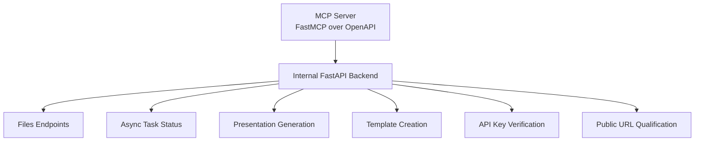
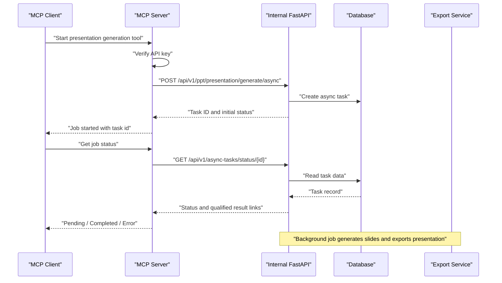
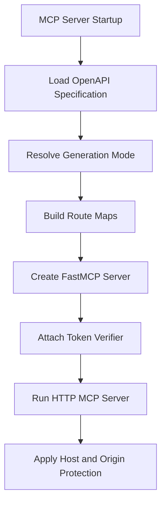
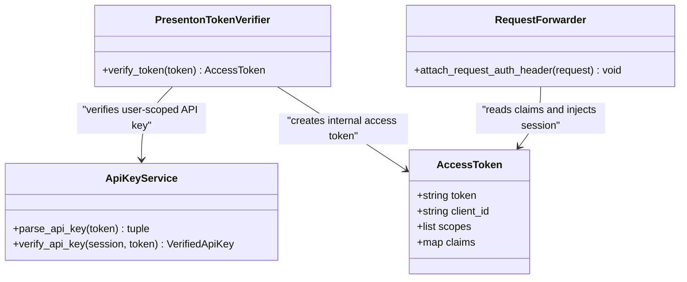
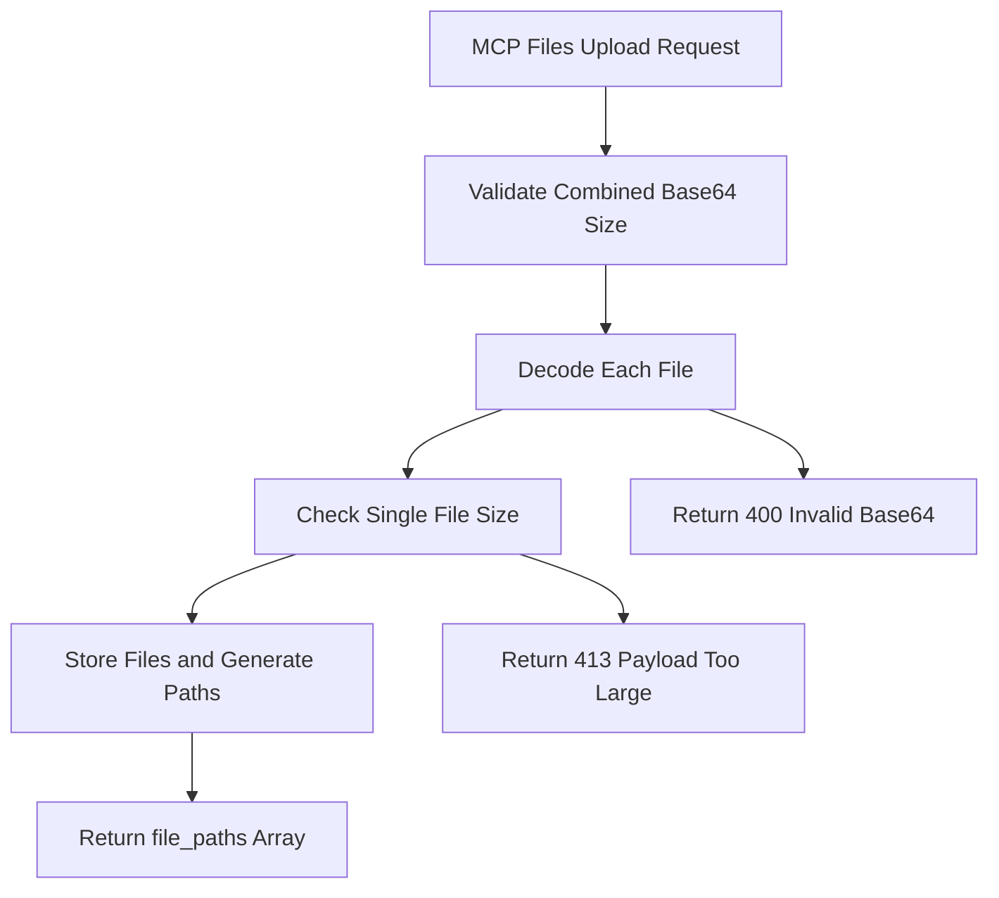
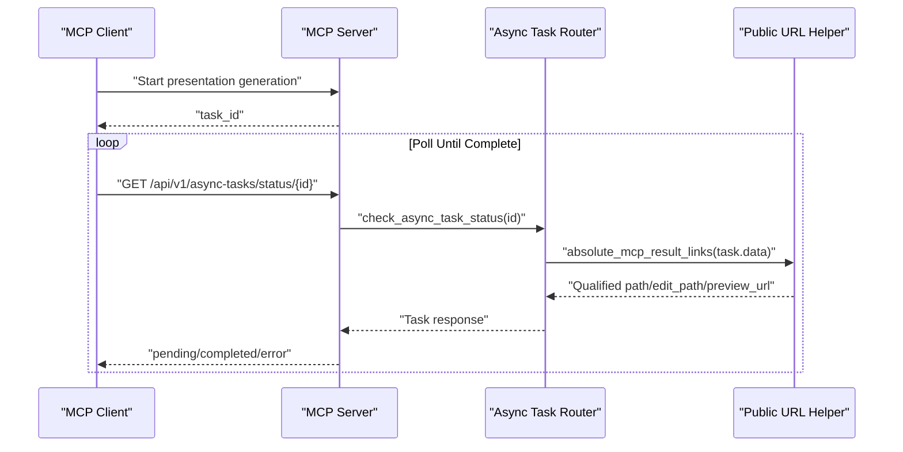
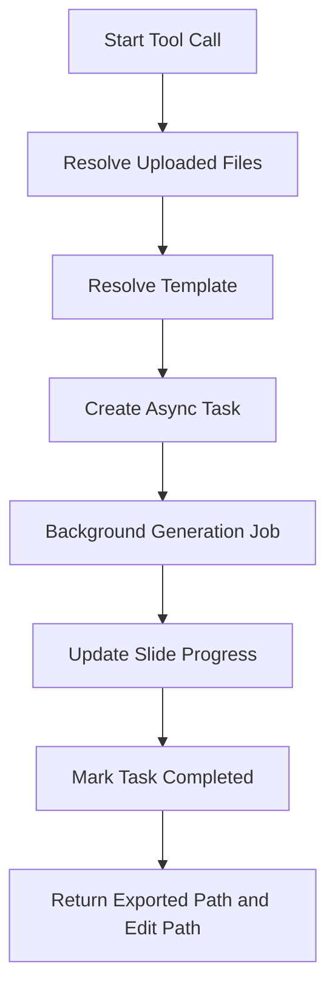
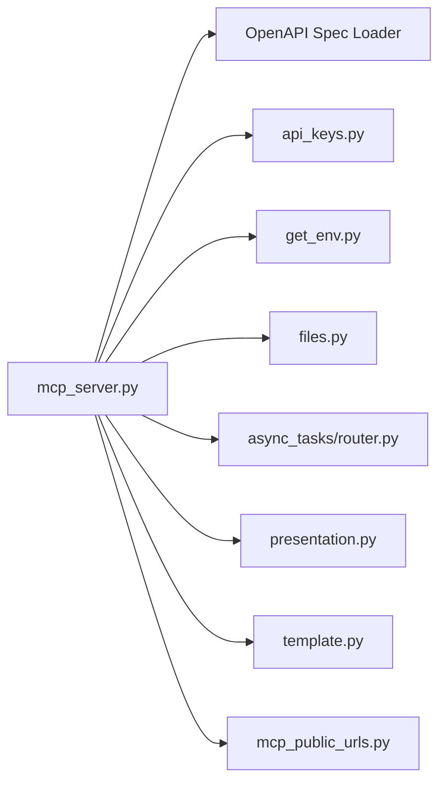

# MCP (Model Context Protocol) API

<cite>
**Referenced Files in This Document**   
- [mcp_server.py](file://servers/fastapi/mcp_server.py)
- [files.py](file://servers/fastapi/api/v1/ppt/endpoints/files.py)
- [router.py](file://servers/fastapi/api/v1/async_tasks/router.py)
- [presentation.py](file://servers/fastapi/api/v1/ppt/endpoints/presentation.py)
- [template.py](file://servers/fastapi/api/v1/ppt/endpoints/template.py)
- [api_keys.py](file://servers/fastapi/services/api_keys.py)
- [mcp_public_urls.py](file://servers/fastapi/utils/mcp_public_urls.py)
- [get_env.py](file://servers/fastapi/utils/get_env.py)
- [test_mcp_server_auth.py](file://servers/fastapi/tests/unit/test_mcp_server_auth.py)
- [test_presentation_generation_flow.py](file://servers/fastapi/tests/integration/test_presentation_generation_flow.py)
</cite>

## Table of Contents
1. [Introduction](#introduction)
2. [Project Structure](#project-structure)
3. [Core Components](#core-components)
4. [Architecture Overview](#architecture-overview)
5. [Detailed Component Analysis](#detailed-component-analysis)
6. [Dependency Analysis](#dependency-analysis)
7. [Performance Considerations](#performance-considerations)
8. [Troubleshooting Guide](#troubleshooting-guide)
9. [Conclusion](#conclusion)
10. [Appendices](#appendices)

## Introduction
This document describes Presenton’s Model Context Protocol (MCP) integration for programmatic presentation generation. The MCP layer is implemented as an HTTP-based server that exposes a small, intentionally limited set of tools derived from the internal FastAPI OpenAPI specification. Clients authenticate with user-scoped API keys, and the MCP server translates tool calls into authenticated internal requests to the backend services that generate presentations, templates, and related assets.

The MCP implementation focuses on:
- A constrained tool surface for standard presentation generation, smart presentation generation, template listing, template asset upload, template generation, file upload, and job status polling.
- Secure authentication using user-scoped API keys and short-lived internal sessions.
- Safe handling of long-running asynchronous jobs with explicit polling semantics.
- Public URL qualification so generated links are usable by browser-facing clients behind reverse proxies.

## Project Structure
The MCP functionality lives primarily in the FastAPI backend:

- `servers/fastapi/mcp_server.py` defines the MCP server lifecycle, authentication provider, route exposure, and request forwarding behavior.
- `servers/fastapi/api/v1/ppt/endpoints/files.py` implements MCP-specific file upload endpoints used as reference content for generation.
- `servers/fastapi/api/v1/async_tasks/router.py` provides task status queries used by MCP clients to poll generation progress.
- `servers/fastapi/api/v1/ppt/endpoints/presentation.py` contains the core presentation generation handlers referenced by MCP tools.
- `servers/fastapi/api/v1/ppt/endpoints/template.py` handles custom template creation workflows exposed through MCP.
- `servers/fastapi/services/api_keys.py` implements API key format, issuance, encryption, and verification.
- `servers/fastapi/utils/mcp_public_urls.py` marks MCP-originated requests and converts relative result URLs into absolute public URLs.
- `servers/fastapi/utils/get_env.py` controls MCP behavior through environment configuration such as generation mode and public URL.

**Diagram sources**
- [mcp_server.py:31-49](file://servers/fastapi/mcp_server.py#L31-L49)
- [files.py:103-130](file://servers/fastapi/api/v1/ppt/endpoints/files.py#L103-L130)
- [router.py:69-84](file://servers/fastapi/api/v1/async_tasks/router.py#L69-L84)
- [presentation.py:3158-3193](file://servers/fastapi/api/v1/ppt/endpoints/presentation.py#L3158-L3193)
- [template.py:1570-1602](file://servers/fastapi/api/v1/ppt/endpoints/template.py#L1570-L1602)
- [api_keys.py:107-133](file://servers/fastapi/services/api_keys.py#L107-L133)
- [mcp_public_urls.py:9-52](file://servers/fastapi/utils/mcp_public_urls.py#L9-L52)

**Section sources**
- [mcp_server.py:1-49](file://servers/fastapi/mcp_server.py#L1-L49)
- [files.py:1-130](file://servers/fastapi/api/v1/ppt/endpoints/files.py#L1-L130)
- [router.py:1-84](file://servers/fastapi/api/v1/async_tasks/router.py#L1-L84)
- [presentation.py:3158-3193](file://servers/fastapi/api/v1/ppt/endpoints/presentation.py#L3158-L3193)
- [template.py:1570-1602](file://servers/fastapi/api/v1/ppt/endpoints/template.py#L1570-L1602)
- [api_keys.py:1-133](file://servers/fastapi/services/api_keys.py#L1-L133)
- [mcp_public_urls.py:1-52](file://servers/fastapi/utils/mcp_public_urls.py#L1-L52)
- [get_env.py:17-29](file://servers/fastapi/utils/get_env.py#L17-L29)

## Core Components
The MCP system is built around these core components:

| Component | Responsibility | Key Behavior |
|---|---|---|
| MCP Server | Exposes tools derived from OpenAPI | Uses FastMCP, applies route maps, instructions, and auth provider |
| Token Verifier | Validates user-scoped API keys | Rejects invalid keys, creates internal session claims |
| Request Forwarder | Translates MCP calls to internal FastAPI requests | Adds MCP marker header, forwards origin headers, injects session cookie or bearer token |
| File Upload Endpoint | Accepts base64-encoded reference files | Enforces size limits and returns Presenton-owned file paths |
| Async Task Router | Returns task state and qualified result links | Converts relative paths to absolute public URLs when requested via MCP |
| Presentation Handler | Starts background presentation generation | Updates async task status and tracks slide progress |
| Template Endpoint | Creates reusable custom templates | Validates uploaded PPTX and image assets before queuing |
| Environment Configuration | Controls enabled workflows and public URL | Selects standard/smart/both modes and MCP allowed origins |

**Section sources**
- [mcp_server.py:101-125](file://servers/fastapi/mcp_server.py#L101-L125)
- [mcp_server.py:285-328](file://servers/fastapi/mcp_server.py#L285-L328)
- [mcp_server.py:365-414](file://servers/fastapi/mcp_server.py#L365-L414)
- [files.py:24-60](file://servers/fastapi/api/v1/ppt/endpoints/files.py#L24-L60)
- [router.py:69-84](file://servers/fastapi/api/v1/async_tasks/router.py#L69-L84)
- [presentation.py:3158-3193](file://servers/fastapi/api/v1/ppt/endpoints/presentation.py#L3158-L3193)
- [template.py:1570-1602](file://servers/fastapi/api/v1/ppt/endpoints/template.py#L1570-L1602)
- [get_env.py:24-29](file://servers/fastapi/utils/get_env.py#L24-L29)

## Architecture Overview
The MCP server does not implement presentation logic directly. Instead, it wraps selected FastAPI endpoints as MCP tools. Authentication happens at the MCP boundary, and internal requests use short-lived sessions rather than forwarding long-lived API keys.

**Diagram sources**
- [mcp_server.py:346-362](file://servers/fastapi/mcp_server.py#L346-L362)
- [mcp_server.py:365-414](file://servers/fastapi/mcp_server.py#L365-L414)
- [router.py:69-84](file://servers/fastapi/api/v1/async_tasks/router.py#L69-L84)
- [presentation.py:3158-3193](file://servers/fastapi/api/v1/ppt/endpoints/presentation.py#L3158-L3193)

## Detailed Component Analysis

### MCP Server Lifecycle and Tool Exposure
The MCP server loads an OpenAPI specification, selects which routes become tools based on the configured presentation generation mode, and attaches human-readable instructions for LLM-driven tool selection. Only a small allowlist of routes is exposed to prevent accidental access to administrative or internal endpoints.

Key behaviors:
- Standard presentation generation is exposed under `/api/v1/ppt/presentation/generate/async`.
- Smart presentation generation is exposed under `/api/v2/ppt/presentation/generate/smart/async`.
- Template listing, template asset upload, and template generation are exposed for standard/template workflows.
- Shared tools include file upload and async task status polling.
- An exclude route ensures only explicitly mapped routes are advertised.

**Diagram sources**
- [mcp_server.py:31-49](file://servers/fastapi/mcp_server.py#L31-L49)
- [mcp_server.py:113-125](file://servers/fastapi/mcp_server.py#L113-L125)
- [mcp_server.py:346-362](file://servers/fastapi/mcp_server.py#L346-L362)
- [mcp_server.py:417-465](file://servers/fastapi/mcp_server.py#L417-L465)

**Section sources**
- [mcp_server.py:30-49](file://servers/fastapi/mcp_server.py#L30-L49)
- [mcp_server.py:101-125](file://servers/fastapi/mcp_server.py#L101-L125)
- [mcp_server.py:143-279](file://servers/fastapi/mcp_server.py#L143-L279)
- [mcp_server.py:346-362](file://servers/fastapi/mcp_server.py#L346-L362)
- [mcp_server.py:417-465](file://servers/fastapi/mcp_server.py#L417-L465)

### Authentication and Security
MCP clients authenticate using user-scoped API keys with the prefix `sk-presenton-`. The token verifier validates the key against the database, resolves the associated user, and produces an internal access token containing user identity and role information. When server authentication is disabled, the MCP server can run without requiring tokens, but this is intended for development environments.

Security considerations:
- Long-lived API keys are never forwarded to internal endpoints.
- Internal requests use either a short-lived session cookie or a fallback bearer token when necessary.
- Incoming authorization and cookie headers already present on the request are preserved.
- Public origin headers are forwarded so responses can expose correct browser-facing URLs.
- MCP-only requests are marked with a dedicated header so backend code can distinguish them.

**Diagram sources**
- [mcp_server.py:285-316](file://servers/fastapi/mcp_server.py#L285-L316)
- [mcp_server.py:365-414](file://servers/fastapi/mcp_server.py#L365-L414)
- [api_keys.py:19-61](file://servers/fastapi/services/api_keys.py#L19-L61)
- [api_keys.py:107-133](file://servers/fastapi/services/api_keys.py#L107-L133)

**Section sources**
- [mcp_server.py:285-328](file://servers/fastapi/mcp_server.py#L285-L328)
- [mcp_server.py:365-414](file://servers/fastapi/mcp_server.py#L365-L414)
- [api_keys.py:19-61](file://servers/fastapi/services/api_keys.py#L19-L61)
- [api_keys.py:107-133](file://servers/fastapi/services/api_keys.py#L107-L133)
- [test_mcp_server_auth.py:127-148](file://servers/fastapi/tests/unit/test_mcp_server_auth.py#L127-L148)

### File Upload for Reference Content
MCP clients upload source documents and images as base64-encoded payloads because some MCP transports cannot send multipart form data. The endpoint enforces combined upload size limits, decodes each file, validates base64 content, and returns Presenton-owned file paths that must be passed unchanged to generation tools.

Important constraints:
- Maximum total decoded size is 100 MiB.
- Combined base64 payload size is validated before decoding.
- Invalid base64 returns a client error.
- Oversized files return a payload-too-large response.
- Returned `file_paths` must be passed exactly as the `files` argument to generation tools.

**Diagram sources**
- [files.py:24-60](file://servers/fastapi/api/v1/ppt/endpoints/files.py#L24-L60)
- [files.py:63-76](file://servers/fastapi/api/v1/ppt/endpoints/files.py#L63-L76)
- [files.py:103-130](file://servers/fastapi/api/v1/ppt/endpoints/files.py#L103-L130)

**Section sources**
- [files.py:18-60](file://servers/fastapi/api/v1/ppt/endpoints/files.py#L18-L60)
- [files.py:63-76](file://servers/fastapi/api/v1/ppt/endpoints/files.py#L63-L76)
- [files.py:103-130](file://servers/fastapi/api/v1/ppt/endpoints/files.py#L103-L130)

### Asynchronous Job Polling and Result Links
Generation jobs are asynchronous. MCP clients start a job and then poll its status until completion or failure. The status endpoint returns the full task model, including structured data fields such as exported file paths and editor URLs. When a request originates from MCP, relative result links are converted to absolute public URLs using the configured public origin or forwarded host/proxy headers.

Polling guidance:
- Read the task ID from the start tool response.
- While the status is pending, poll every 10-15 seconds.
- Treat completed as success and use returned path/edit_path values.
- Treat error as terminal; do not retry blindly.
- Allow several minutes for first-run model downloads and large decks.

**Diagram sources**
- [router.py:69-84](file://servers/fastapi/api/v1/async_tasks/router.py#L69-L84)
- [mcp_public_urls.py:9-52](file://servers/fastapi/utils/mcp_public_urls.py#L9-L52)
- [mcp_server.py:260-278](file://servers/fastapi/mcp_server.py#L260-L278)

**Section sources**
- [router.py:69-84](file://servers/fastapi/api/v1/async_tasks/router.py#L69-L84)
- [mcp_public_urls.py:9-52](file://servers/fastapi/utils/mcp_public_urls.py#L9-L52)
- [mcp_server.py:260-278](file://servers/fastapi/mcp_server.py#L260-L278)

### Presentation Generation Workflows
Two primary generation workflows are exposed through MCP:

| Workflow | MCP Tool Name | Internal Route | Notes |
|---|---|---|---|
| Standard presentation | `start_standard_presentation` | `/api/v1/ppt/presentation/generate/async` | Layout-based editable deck; uses template resolution |
| Smart presentation | `start_smart_presentation` | `/api/v2/ppt/presentation/generate/smart/async` | HTML-based smart deck; does not accept standard template IDs |

Both workflows create an async task, update its status during processing, and eventually store export results in the task data.

**Diagram sources**
- [mcp_server.py:54-68](file://servers/fastapi/mcp_server.py#L54-L68)
- [presentation.py:3158-3193](file://servers/fastapi/api/v1/ppt/endpoints/presentation.py#L3158-L3193)
- [test_presentation_generation_flow.py:262-282](file://servers/fastapi/tests/integration/test_presentation_generation_flow.py#L262-L282)

**Section sources**
- [mcp_server.py:54-68](file://servers/fastapi/mcp_server.py#L54-L68)
- [mcp_server.py:101-111](file://servers/fastapi/mcp_server.py#L101-L111)
- [presentation.py:3158-3193](file://servers/fastapi/api/v1/ppt/endpoints/presentation.py#L3158-L3193)
- [test_presentation_generation_flow.py:262-282](file://servers/fastapi/tests/integration/test_presentation_generation_flow.py#L262-L282)

### Custom Template Generation
Custom templates let users convert a PPTX into a reusable Presenton template. The MCP workflow requires uploading the PPTX and slide image assets, starting template generation, and polling the task until completion. After completion, clients should list templates and verify the new template ID before sharing its preview URL.

Constraints:
- The PPTX must resolve to a valid Presenton-owned filesystem path.
- MCP clients must use the `pptx_url` returned by `upload_template_assets`, not a host attachment ID.
- All required upload outputs must be present before calling template generation.
- Template generation is separate from reference file upload.

**Section sources**
- [template.py:1570-1602](file://servers/fastapi/api/v1/ppt/endpoints/template.py#L1570-L1602)
- [mcp_server.py:194-232](file://servers/fastapi/mcp_server.py#L194-L232)

### WebSocket Connections, Event Streaming, and Real-Time Updates
The MCP protocol itself is HTTP-based and relies on polling for asynchronous results. Real-time streaming endpoints exist in other parts of the backend, such as chat message streaming and outline streaming, but they are not part of the MCP tool surface documented here. If real-time updates are required, clients should use the MCP polling flow for presentation generation tasks and integrate separately with streaming endpoints if needed.

Streaming-related endpoints in the repository include:
- Chat message streaming endpoint.
- Outline streaming endpoint.
- SSE response models used across streaming flows.

These are distinct from the MCP tool interface and should not be assumed to be automatically exposed by MCP.

**Section sources**
- [mcp_server.py:31-39](file://servers/fastapi/mcp_server.py#L31-L39)
- [mcp_server.py:260-278](file://servers/fastapi/mcp_server.py#L260-L278)

### SDK Examples and Client Implementation Patterns
Although no MCP SDK is provided in this repository, the implementation shows clear patterns for building MCP clients:

Recommended client pattern:
1. Connect to the MCP server over HTTP.
2. Authenticate using a user-scoped API key with the `sk-presenton-` prefix.
3. Discover available tools through the MCP tool list.
4. For reference content, call the file upload tool once and reuse the returned `file_paths`.
5. Start one asynchronous generation job per requested result.
6. Poll the job status endpoint until completion or error.
7. Use returned `path` and `edit_path` values for exported files and editor links.
8. Do not invent, shorten, edit, or reconstruct IDs, paths, or URLs returned by tools.

Best practices:
- Respect rate limits and avoid duplicate job starts.
- Handle errors as terminal failures unless the client explicitly supports retries.
- Preserve exact strings returned by the API.
- Avoid exposing API keys in logs or UI.
- Use the public URL configuration to ensure generated links work in browsers.

**Section sources**
- [mcp_server.py:154-278](file://servers/fastapi/mcp_server.py#L154-L278)
- [files.py:24-60](file://servers/fastapi/api/v1/ppt/endpoints/files.py#L24-L60)
- [router.py:69-84](file://servers/fastapi/api/v1/async_tasks/router.py#L69-L84)

## Dependency Analysis
The MCP layer depends on several backend services and utilities:

**Diagram sources**
- [mcp_server.py:10-28](file://servers/fastapi/mcp_server.py#L10-L28)
- [mcp_server.py:30-49](file://servers/fastapi/mcp_server.py#L30-L49)

**Section sources**
- [mcp_server.py:10-28](file://servers/fastapi/mcp_server.py#L10-L28)
- [mcp_server.py:30-49](file://servers/fastapi/mcp_server.py#L30-L49)

## Performance Considerations
- MCP upstream read timeout is set to support long-running presentation generation jobs.
- Internal session TTL is extended to survive multi-minute generation pipelines.
- Connection timeout is shorter than read timeout to fail fast on network issues.
- File uploads enforce both encoded-size and decoded-size limits to protect memory and disk.
- Background generation jobs update async task status incrementally, allowing efficient polling.

Recommendations:
- Poll every 10-15 seconds while a job is pending.
- Avoid parallel duplicate job starts for the same logical request.
- Monitor task status rather than relying solely on client-side timeouts.
- Configure `PRESENTON_PUBLIC_URL` correctly so generated links remain valid.

**Section sources**
- [mcp_server.py:31-39](file://servers/fastapi/mcp_server.py#L31-L39)
- [mcp_server.py:260-278](file://servers/fastapi/mcp_server.py#L260-L278)
- [files.py:18-21](file://servers/fastapi/api/v1/ppt/endpoints/files.py#L18-L21)
- [files.py:45-50](file://servers/fastapi/api/v1/ppt/endpoints/files.py#L45-L50)

## Troubleshooting Guide
Common issues and resolutions:

| Symptom | Likely Cause | Resolution |
|---|---|---|
| MCP server does not start | Running inside Electron desktop app | MCP is disabled in Electron; use server/Docker deployment |
| Authentication fails | Invalid or expired API key | Verify key format, expiration, and user status |
| Internal request has no session | Missing internal session token | Ensure MCP auth provider created a session claim |
| Generated links are relative | Missing public URL or proxy headers | Set `PRESENTON_PUBLIC_URL` or forward `X-Forwarded-Host` and `X-Forwarded-Proto` |
| File upload rejected | Invalid base64 or oversized payload | Validate base64 and keep total decoded size under 100 MiB |
| Template generation fails | Invalid PPTX path or missing assets | Use `upload_template_assets` output and validate all required fields |
| Job never completes | First-run model download or large deck | Continue polling; allow several minutes |

**Section sources**
- [mcp_server.py:319-321](file://servers/fastapi/mcp_server.py#L319-L321)
- [mcp_server.py:396-414](file://servers/fastapi/mcp_server.py#L396-L414)
- [mcp_public_urls.py:17-40](file://servers/fastapi/utils/mcp_public_urls.py#L17-L40)
- [files.py:63-76](file://servers/fastapi/api/v1/ppt/endpoints/files.py#L63-L76)
- [template.py:1578-1589](file://servers/fastapi/api/v1/ppt/endpoints/template.py#L1578-L1589)
- [mcp_server.py:260-278](file://servers/fastapi/mcp_server.py#L260-L278)

## Conclusion
Presenton’s MCP integration provides a secure, minimal tool surface for automating presentation generation. It emphasizes safe authentication, explicit asynchronous job polling, strict input validation, and reliable public URL generation. Clients should treat MCP as a bounded automation layer: discover tools, follow the documented workflows, preserve returned identifiers, and poll job status until completion.

## Appendices

### MCP Tool Surface Summary
| MCP Tool | Purpose | Primary Inputs | Primary Outputs |
|---|---|---|---|
| `start_standard_presentation` | Start layout-based presentation generation | Content, template, optional files | Task ID |
| `start_smart_presentation` | Start HTML-based smart presentation generation | Content, optional files | Task ID |
| `list_templates` | List built-in or custom templates | Default flag | Template list with IDs and preview URLs |
| `upload_template_assets` | Upload PPTX and slide images for custom template | PPTX bytes, slide images, fonts | `pptx_url`, slide image URLs, fonts mapping |
| `start_template_generation` | Create reusable custom template | `pptx_url`, slide image URLs, metadata | Task ID |
| `upload_files` | Upload reference documents/images | Base64-encoded files | `file_paths` array |
| `get_job_status` | Poll async task status | Task ID | Status, message, data with result links |

**Section sources**
- [mcp_server.py:54-111](file://servers/fastapi/mcp_server.py#L54-L111)
- [mcp_server.py:154-278](file://servers/fastapi/mcp_server.py#L154-L278)
- [files.py:103-130](file://servers/fastapi/api/v1/ppt/endpoints/files.py#L103-L130)
- [router.py:69-84](file://servers/fastapi/api/v1/async_tasks/router.py#L69-L84)