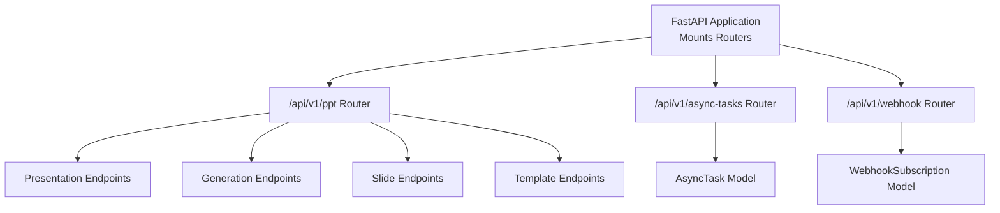
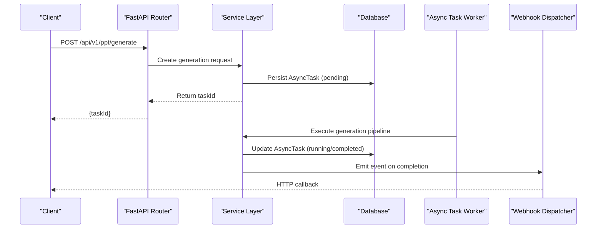
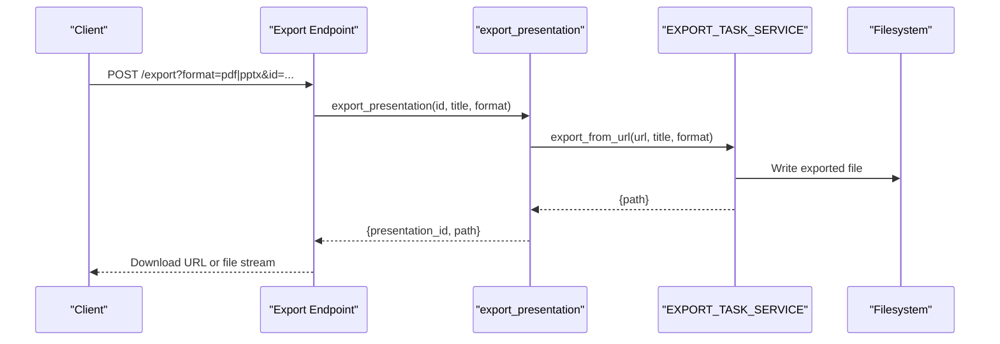
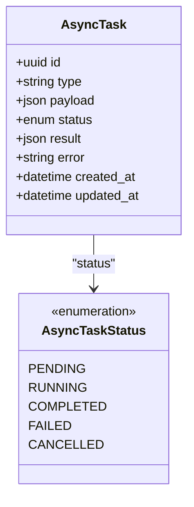
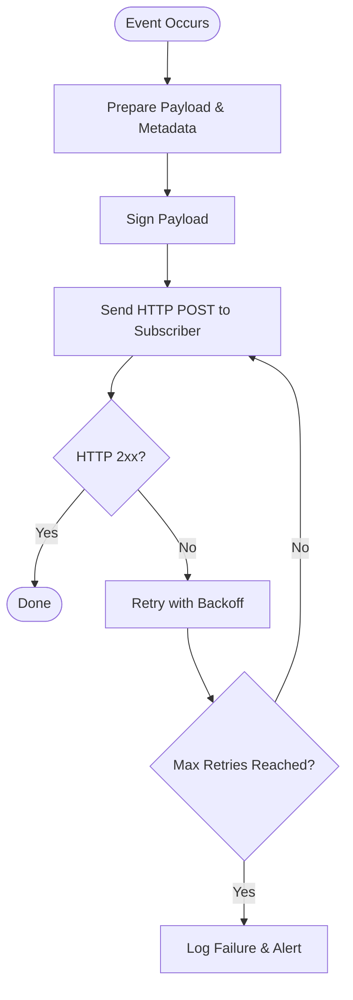
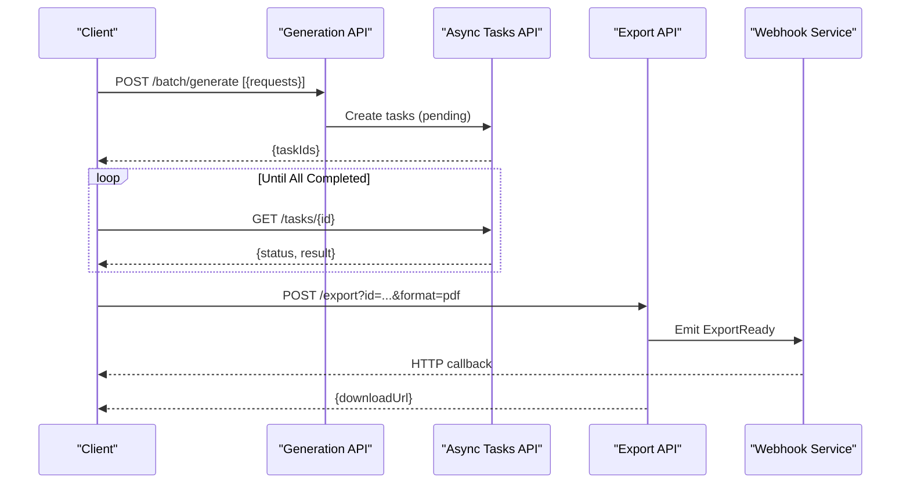
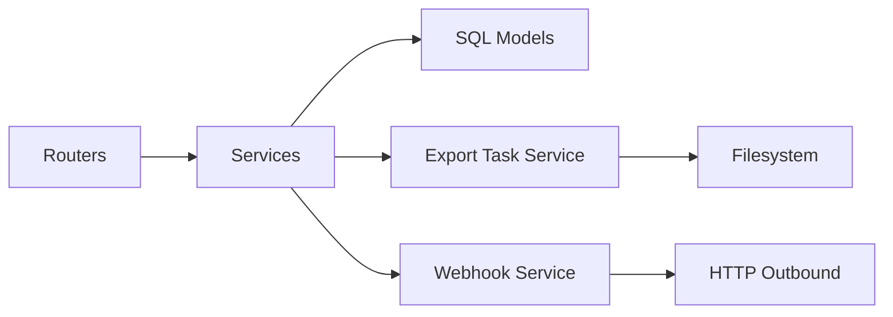

# Advanced Features

<cite>
**Referenced Files in This Document**
- [main.py](file://servers/fastapi/api/main.py)
- [router.py](file://servers/fastapi/api/v1/ppt/router.py)
- [presentation.py](file://servers/fastapi/api/v1/ppt/endpoints/presentation.py)
- [generation.py](file://servers/fastapi/api/v1/ppt/endpoints/generation.py)
- [async_tasks_router.py](file://servers/fastapi/api/v1/async_tasks/router.py)
- [async_task_model.py](file://servers/fastapi/models/sql/async_task.py)
- [async_task_status_enum.py](file://servers/fastapi/enums/async_task_status.py)
- [export_utils.py](file://servers/fastapi/utils/export_utils.py)
- [export_task_service.py](file://servers/fastapi/services/export_task_service.py)
- [webhook_router.py](file://servers/fastapi/api/v1/webhook/router.py)
- [webhook_subscription_model.py](file://servers/fastapi/models/sql/webhook_subscription.py)
- [webhook_service.py](file://servers/fastapi/services/webhook_service.py)
- [route.ts](file://servers/nextjs/app/api/export-presentation/route.ts)
</cite>

## Table of Contents
1. [Introduction](#introduction)
2. [Project Structure](#project-structure)
3. [Core Components](#core-components)
4. [Architecture Overview](#architecture-overview)
5. [Detailed Component Analysis](#detailed-component-analysis)
6. [Dependency Analysis](#dependency-analysis)
7. [Performance Considerations](#performance-considerations)
8. [Troubleshooting Guide](#troubleshooting-guide)
9. [Conclusion](#conclusion)

## Introduction
This document provides comprehensive API documentation for advanced presentation management features, focusing on:
- Bulk operations for managing multiple presentations
- Search and filtering capabilities
- Versioning systems
- Export functionality (PDF and PPTX)
- Asynchronous task system for long-running operations such as generation and export
- Webhook integration for event notifications
- Batch processing endpoints
- Performance optimization techniques for high-volume operations

The goal is to help developers design robust workflows that combine these features safely and efficiently.

## Project Structure
The FastAPI application registers multiple routers under /api/v1 and /api/v2. Presentation-related endpoints are grouped under /api/v1/ppt, with sub-routers for files, fonts, outlines, slides, images, icons, LLM providers, generation, templates, chat, community, and presentation CRUD. The async tasks router handles background job lifecycle, while the webhook router manages subscriptions and delivery.

**Diagram sources**
- [main.py:67-74](file://servers/fastapi/api/main.py#L67-L74)
- [router.py:22-40](file://servers/fastapi/api/v1/ppt/router.py#L22-L40)
- [async_task_model.py](file://servers/fastapi/models/sql/async_task.py)
- [webhook_subscription_model.py](file://servers/fastapi/models/sql/webhook_subscription.py)

**Section sources**
- [main.py:67-74](file://servers/fastapi/api/main.py#L67-L74)
- [router.py:22-40](file://servers/fastapi/api/v1/ppt/router.py#L22-L40)

## Core Components
- Presentation Management Endpoints: Provide CRUD, duplication, and bulk operations over presentations.
- Generation Endpoints: Trigger synchronous or asynchronous presentation generation workflows.
- Async Tasks System: Manage long-running jobs, status polling, and result retrieval.
- Export Utilities and Service: Convert presentations to PDF/PPTX via an internal export service.
- Webhook Integration: Subscribe to events and receive HTTP callbacks on key lifecycle changes.
- Next.js Export Route: Server-side orchestration for bundled exports and file downloads.

Key responsibilities:
- Validate inputs and enforce ownership and permissions.
- Queue long-running work into the async task system.
- Emit webhooks for state transitions and completion events.
- Stream or return results through stable APIs.

**Section sources**
- [presentation.py](file://servers/fastapi/api/v1/ppt/endpoints/presentation.py)
- [generation.py](file://servers/fastapi/api/v1/ppt/endpoints/generation.py)
- [async_tasks_router.py](file://servers/fastapi/api/v1/async_tasks/router.py)
- [export_utils.py:43-75](file://servers/fastapi/utils/export_utils.py#L43-L75)
- [export_task_service.py](file://servers/fastapi/services/export_task_service.py)
- [webhook_router.py](file://servers/fastapi/api/v1/webhook/router.py)
- [route.ts:1-43](file://servers/nextjs/app/api/export-presentation/route.ts#L1-L43)

## Architecture Overview
The advanced features follow a layered architecture:
- API Layer: FastAPI routers expose REST endpoints for clients.
- Service Layer: Business logic orchestrates data access, external services, and background jobs.
- Data Layer: SQL models persist entities like presentations, slides, async tasks, and webhook subscriptions.
- Background Workers: Process async tasks and deliver webhooks asynchronously.

**Diagram sources**
- [generation.py](file://servers/fastapi/api/v1/ppt/endpoints/generation.py)
- [async_task_model.py](file://servers/fastapi/models/sql/async_task.py)
- [async_task_status_enum.py](file://servers/fastapi/enums/async_task_status.py)
- [webhook_service.py](file://servers/fastapi/services/webhook_service.py)

## Detailed Component Analysis

### Presentation Management and Bulk Operations
Responsibilities:
- Create, read, update, delete presentations
- Duplicate presentations
- Bulk operations (e.g., batch delete, batch update metadata)
- Search and filter by owner, tags, title, date ranges, and other attributes

Typical workflow:
- Single presentation operations use standard CRUD endpoints.
- Bulk operations accept arrays of IDs or filters and process them transactionally where possible.
- Search endpoints support pagination, sorting, and field-based filters.

Best practices:
- Enforce ownership checks per item in bulk operations.
- Use server-side pagination for large lists.
- Validate and sanitize filter parameters to prevent injection or excessive queries.

Operational notes:
- For very large batches, consider chunked processing and async task queuing to avoid timeouts.
- Expose progress endpoints for long-running bulk jobs.

**Section sources**
- [presentation.py](file://servers/fastapi/api/v1/ppt/endpoints/presentation.py)

### Search and Filtering Capabilities
Capabilities:
- Filter by text fields (title, description), numeric fields (created_at, updated_at), and enumerations (status, template_id).
- Combine multiple filters with AND/OR logic.
- Sort by one or more fields with ascending/descending order.
- Paginate results with page size and cursor/page number.

Implementation guidance:
- Build dynamic query filters from validated request bodies.
- Index frequently filtered columns at the database layer.
- Limit maximum page size and depth of nested filters.

**Section sources**
- [presentation.py](file://servers/fastapi/api/v1/ppt/endpoints/presentation.py)

### Versioning Systems
Versioning model:
- Each presentation can have multiple versions identified by version numbers or timestamps.
- Version metadata includes creator, change summary, and snapshot references.
- Retrieval supports latest, specific version, and diff between versions.

Workflow:
- On update, create a new version record and link it to the presentation.
- Mark the current active version explicitly.
- Provide endpoints to list versions and fetch version content.

Security:
- Ensure only authorized users can create or modify versions.
- Prevent accidental deletion of historical versions unless explicitly allowed.

**Section sources**
- [presentation.py](file://servers/fastapi/api/v1/ppt/endpoints/presentation.py)

### Export Functionality
Export flow:
- Clients request export for a presentation ID and format (PDF or PPTX).
- The backend builds an internal export URL and delegates to the export service.
- The export service renders the presentation and returns a path to the generated file.
- Clients download the exported file via a secure endpoint.

**Diagram sources**
- [export_utils.py:43-75](file://servers/fastapi/utils/export_utils.py#L43-L75)
- [export_task_service.py](file://servers/fastapi/services/export_task_service.py)

Next.js bundled export route:
- Validates request body and format.
- Orchestrates bundled export execution.
- Serves downloadable files from the app data directory.

**Section sources**
- [export_utils.py:43-75](file://servers/fastapi/utils/export_utils.py#L43-L75)
- [export_task_service.py](file://servers/fastapi/services/export_task_service.py)
- [route.ts:1-43](file://servers/nextjs/app/api/export-presentation/route.ts#L1-L43)

### Asynchronous Task System
Purpose:
- Manage long-running operations such as presentation generation and export.
- Provide reliable status tracking and result retrieval.
- Support retries, cancellation, and error reporting.

Data model:
- AsyncTask stores payload, status, progress, errors, and timestamps.
- Status enum defines states such as pending, running, completed, failed, cancelled.

Lifecycle:
- Client submits a task and receives a taskId.
- Worker processes the task and updates status.
- Client polls status until terminal state.
- On completion, optional webhook notification is sent.

**Diagram sources**
- [async_task_model.py](file://servers/fastapi/models/sql/async_task.py)
- [async_task_status_enum.py](file://servers/fastapi/enums/async_task_status.py)

API interactions:
- Submit task: POST /api/v1/async-tasks
- Get status: GET /api/v1/async-tasks/{task_id}
- Cancel task: POST /api/v1/async-tasks/{task_id}/cancel
- List tasks: GET /api/v1/async-tasks?filter=...

**Section sources**
- [async_tasks_router.py](file://servers/fastapi/api/v1/async_tasks/router.py)
- [async_task_model.py](file://servers/fastapi/models/sql/async_task.py)
- [async_task_status_enum.py](file://servers/fastapi/enums/async_task_status.py)

### Webhook Integration
Purpose:
- Notify external systems about important events such as task completion, export readiness, or presentation updates.

Components:
- WebhookSubscription model stores target URLs, events, and secret tokens.
- WebhookService sends HTTP requests with payloads and signatures.
- Router exposes endpoints to manage subscriptions and test deliveries.

Events:
- TaskCompleted, TaskFailed, ExportReady, PresentationUpdated, etc.

Delivery guarantees:
- Retry policies with exponential backoff.
- Idempotency keys to handle duplicate deliveries.
- Signature verification on the receiver side.

**Diagram sources**
- [webhook_service.py](file://servers/fastapi/services/webhook_service.py)
- [webhook_subscription_model.py](file://servers/fastapi/models/sql/webhook_subscription.py)
- [webhook_router.py](file://servers/fastapi/api/v1/webhook/router.py)

**Section sources**
- [webhook_router.py](file://servers/fastapi/api/v1/webhook/router.py)
- [webhook_service.py](file://servers/fastapi/services/webhook_service.py)
- [webhook_subscription_model.py](file://servers/fastapi/models/sql/webhook_subscription.py)

### Batch Processing Endpoints
Batch operations enable efficient handling of many items:
- Batch delete presentations by IDs or filters
- Batch update metadata across selected presentations
- Batch generate presentations using queued async tasks

Design principles:
- Accept either explicit IDs or filter criteria.
- Validate ownership and permissions for each item.
- Chunk processing to avoid memory spikes and timeouts.
- Return aggregated results with per-item statuses.

Example patterns:
- POST /api/v1/ppt/batch/delete with {ids: [...]} or {filters: {...}}
- POST /api/v1/ppt/batch/update with {updates: {...}, ids: [...] or filters: {...}}
- POST /api/v1/ppt/batch/generate with {requests: [...]}

**Section sources**
- [presentation.py](file://servers/fastapi/api/v1/ppt/endpoints/presentation.py)

### Complex Workflows Combining Multiple Features
End-to-end example: Generate multiple presentations and export them upon completion.

Steps:
1. Submit multiple generation requests via batch endpoint; receive task IDs.
2. Poll async task statuses until all complete.
3. On success, trigger export for each generated presentation.
4. Monitor export tasks and retrieve download links.
5. Emit webhooks for each stage (generation started, completed, export ready).

**Diagram sources**
- [generation.py](file://servers/fastapi/api/v1/ppt/endpoints/generation.py)
- [async_tasks_router.py](file://servers/fastapi/api/v1/async_tasks/router.py)
- [export_utils.py:43-75](file://servers/fastapi/utils/export_utils.py#L43-L75)
- [webhook_service.py](file://servers/fastapi/services/webhook_service.py)

**Section sources**
- [generation.py](file://servers/fastapi/api/v1/ppt/endpoints/generation.py)
- [async_tasks_router.py](file://servers/fastapi/api/v1/async_tasks/router.py)
- [export_utils.py:43-75](file://servers/fastapi/utils/export_utils.py#L43-L75)
- [webhook_service.py](file://servers/fastapi/services/webhook_service.py)

## Dependency Analysis
High-level dependencies among components:
- API routers depend on services and models.
- Services coordinate database operations, external tools, and background workers.
- Async tasks and webhooks decouple heavy workloads from request-response cycles.

**Diagram sources**
- [router.py:22-40](file://servers/fastapi/api/v1/ppt/router.py#L22-L40)
- [export_task_service.py](file://servers/fastapi/services/export_task_service.py)
- [webhook_service.py](file://servers/fastapi/services/webhook_service.py)

**Section sources**
- [router.py:22-40](file://servers/fastapi/api/v1/ppt/router.py#L22-L40)
- [export_task_service.py](file://servers/fastapi/services/export_task_service.py)
- [webhook_service.py](file://servers/fastapi/services/webhook_service.py)

## Performance Considerations
Recommendations for high-volume operations:
- Use async task queues for long-running generation and export jobs.
- Implement pagination and limit result sizes to reduce memory pressure.
- Apply server-side indexing for frequent filters (owner, dates, tags).
- Chunk batch operations to avoid single large transactions.
- Enable rate limiting and concurrency controls at the API gateway or middleware.
- Cache static assets and frequently accessed metadata.
- Monitor memory usage around export operations and adjust worker limits accordingly.
- Use connection pooling and optimize database queries to minimize latency.

[No sources needed since this section provides general guidance]

## Troubleshooting Guide
Common issues and resolutions:
- Export failures: Check export service logs, validate input IDs and formats, ensure filesystem permissions for output directories.
- Async task stuck: Inspect status transitions, verify worker availability, check for unhandled exceptions in task handlers.
- Webhook delivery failures: Validate subscriber URLs, inspect retry logs, confirm signature verification on receiver side.
- Permission errors: Confirm user ownership and role-based access control for bulk operations.
- Rate limiting: Adjust limits or implement client-side backoff when encountering throttling responses.

**Section sources**
- [export_utils.py:43-75](file://servers/fastapi/utils/export_utils.py#L43-L75)
- [async_tasks_router.py](file://servers/fastapi/api/v1/async_tasks/router.py)
- [webhook_service.py](file://servers/fastapi/services/webhook_service.py)

## Conclusion
The advanced presentation management features provide a robust foundation for scalable, reliable workflows. By combining bulk operations, search and filtering, versioning, export utilities, async tasks, and webhooks, teams can build high-performance pipelines for generating and distributing presentations at scale. Following the best practices outlined here will help maintain stability, security, and performance under heavy loads.

[No sources needed since this section summarizes without analyzing specific files]