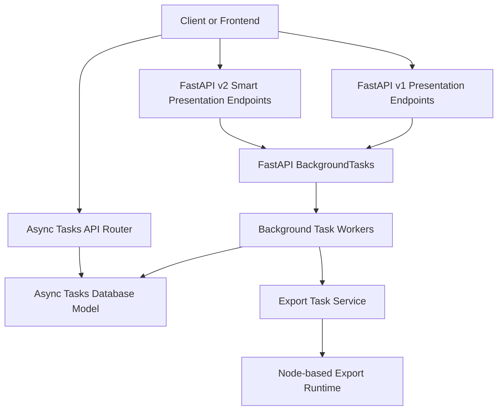
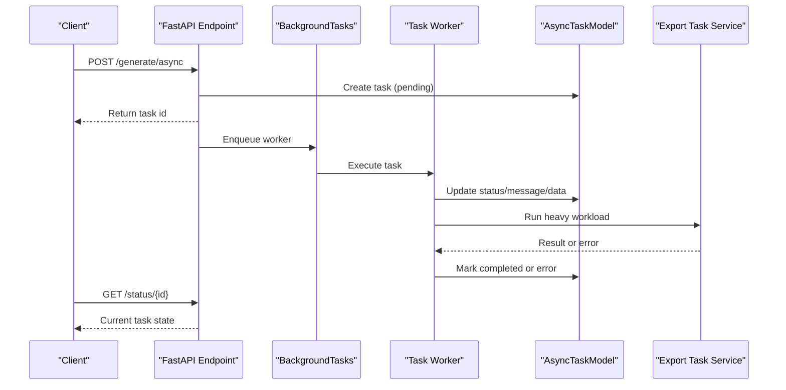
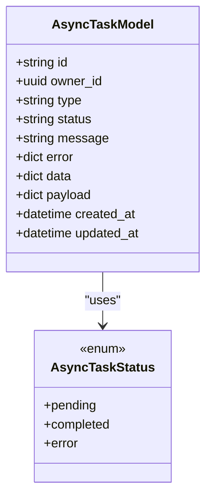
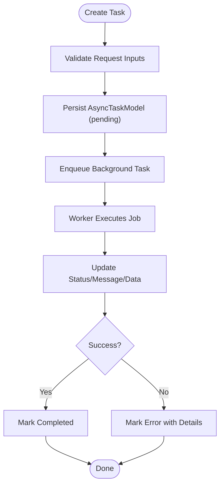
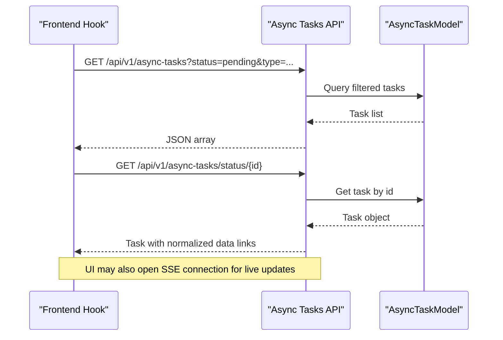
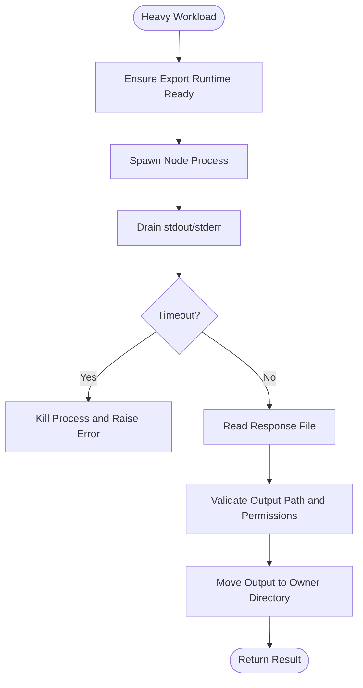
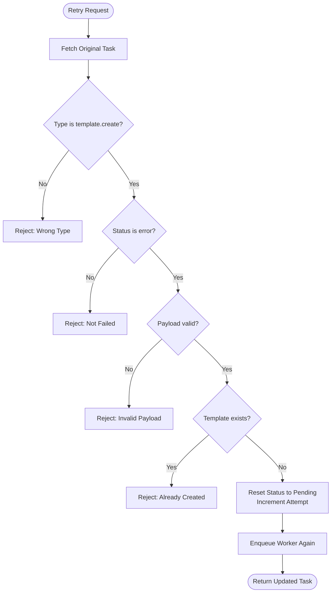
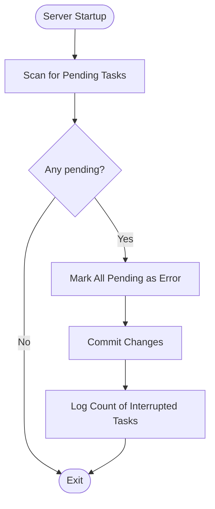
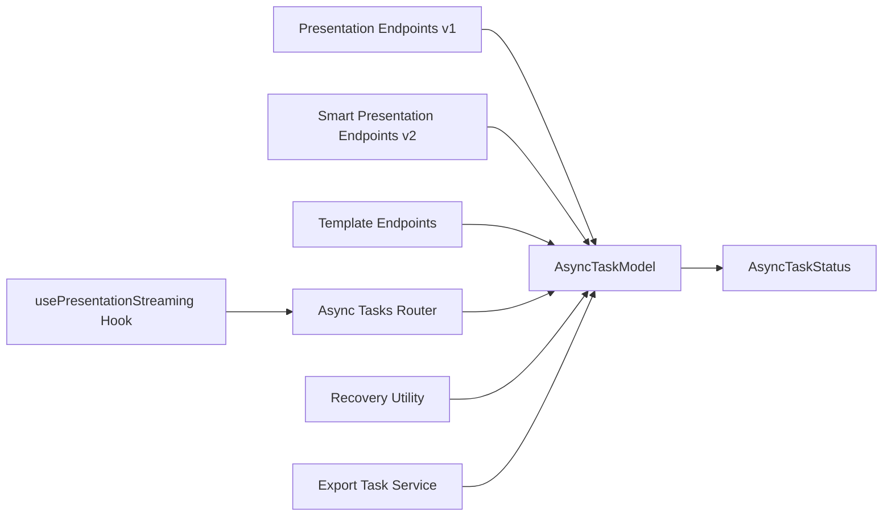

# Async Task System

<cite>
**Referenced Files in This Document**
- [async_task.py](file://servers/fastapi/models/sql/async_task.py)
- [async_task_status.py](file://servers/fastapi/enums/async_task_status.py)
- [router.py](file://servers/fastapi/api/v1/async_tasks/router.py)
- [async_tasks.py](file://servers/fastapi/services/async_tasks.py)
- [presentation.py](file://servers/fastapi/api/v1/ppt/endpoints/presentation.py)
- [template.py](file://servers/fastapi/api/v1/ppt/endpoints/template.py)
- [presentation_v2.py](file://servers/fastapi/api/v2/ppt/endpoints/presentation.py)
- [export_task_service.py](file://servers/fastapi/services/export_task_service.py)
- [concurrent_service.py](file://servers/fastapi/services/concurrent_service.py)
- [usePresentationStreaming.ts](file://servers/nextjs/app/(presentation-generator)/presentation/hooks/usePresentationStreaming.ts)
- [a7d4c9e2f1b3_add_async_tasks.py](file://servers/fastapi/alembic/versions/a7d4c9e2f1b3_add_async_tasks.py)
- [b8e2f4a7c9d1_normalize_async_task_statuses.py](file://servers/fastapi/alembic/versions/b8e2f4a7c9d1_normalize_async_task_statuses.py)
</cite>

## Table of Contents
1. [Introduction](#introduction)
2. [Project Structure](#project-structure)
3. [Core Components](#core-components)
4. [Architecture Overview](#architecture-overview)
5. [Detailed Component Analysis](#detailed-component-analysis)
6. [Dependency Analysis](#dependency-analysis)
7. [Performance Considerations](#performance-considerations)
8. [Troubleshooting Guide](#troubleshooting-guide)
9. [Conclusion](#conclusion)

## Introduction
This document explains the asynchronous task management system used for long-running operations such as presentation generation, template creation, and file processing. It covers how tasks are created, queued, executed, monitored, retried, and recovered after server restarts. It also documents status tracking, progress reporting, failure handling, prioritization options, resource allocation, and monitoring approaches.

The system uses:
- A persistent database model to represent tasks.
- FastAPI background tasks for process-local execution.
- Dedicated services for heavy workloads like export and rendering.
- An API for listing and polling task status.
- Frontend streaming utilities for real-time progress updates.

## Project Structure
The async task system spans several layers:
- Data model and status enum define task identity, lifecycle states, and persistence.
- API routers expose endpoints for creating, querying, and retrying tasks.
- Services encapsulate long-running workloads and external runtime interactions.
- Frontend hooks consume streaming events and poll task status.

**Diagram sources**
- [presentation.py:3201-3233](file://servers/fastapi/api/v1/ppt/endpoints/presentation.py#L3201-L3233)
- [presentation_v2.py:264-299](file://servers/fastapi/api/v2/ppt/endpoints/presentation.py#L264-L299)
- [router.py:14-84](file://servers/fastapi/api/v1/async_tasks/router.py#L14-L84)
- [async_task.py:16-61](file://servers/fastapi/models/sql/async_task.py#L16-L61)
- [export_task_service.py:122-152](file://servers/fastapi/services/export_task_service.py#L122-L152)

**Section sources**
- [async_task.py:16-61](file://servers/fastapi/models/sql/async_task.py#L16-L61)
- [async_task_status.py:4-7](file://servers/fastapi/enums/async_task_status.py#L4-L7)
- [router.py:14-84](file://servers/fastapi/api/v1/async_tasks/router.py#L14-L84)
- [presentation.py:3201-3233](file://servers/fastapi/api/v1/ppt/endpoints/presentation.py#L3201-L3233)
- [presentation_v2.py:264-299](file://servers/fastapi/api/v2/ppt/endpoints/presentation.py#L264-L299)
- [export_task_service.py:122-152](file://servers/fastapi/services/export_task_service.py#L122-L152)

## Core Components
- AsyncTaskModel: Persistent representation of a task with fields for type, status, message, error, data, payload, timestamps, and optional owner association.
- AsyncTaskStatus: Enumerated lifecycle states: pending, completed, error.
- Async Tasks API Router: Endpoints to list tasks with filtering and ordering, and to check individual task status.
- Background Task Execution: FastAPI BackgroundTasks enqueue workers that update task state and perform work.
- Export Task Service: Orchestrates heavy workloads (PPTX conversion, HTML/image rendering) via a Node-based runtime with timeouts and path validation.
- Concurrent Service: Simple in-process background task manager for ad-hoc concurrency.
- Recovery Utility: Marks interrupted tasks as failed on startup to prevent clients from waiting forever.

Key responsibilities:
- Creation: Enqueue a task, persist initial state, return task ID.
- Monitoring: Poll status endpoint; optionally stream progress via SSE.
- Lifecycle: Transition through pending to completed or error.
- Retry: Re-execute failed tasks where supported.
- Recovery: Clean up stale pending tasks after restart.

**Section sources**
- [async_task.py:16-61](file://servers/fastapi/models/sql/async_task.py#L16-L61)
- [async_task_status.py:4-7](file://servers/fastapi/enums/async_task_status.py#L4-L7)
- [router.py:20-84](file://servers/fastapi/api/v1/async_tasks/router.py#L20-L84)
- [async_tasks.py:22-52](file://servers/fastapi/services/async_tasks.py#L22-L52)
- [export_task_service.py:294-418](file://servers/fastapi/services/export_task_service.py#L294-L418)
- [concurrent_service.py:6-40](file://servers/fastapi/services/concurrent_service.py#L6-L40)

## Architecture Overview
The system follows an event-driven pattern:
- Clients call backend endpoints to create long-running jobs.
- The backend persists a task record and enqueues a worker.
- Workers update task status and progress in the database.
- Clients poll the status endpoint or subscribe to streaming events.
- Heavy workloads are delegated to a Node-based export runtime with strict resource controls.

**Diagram sources**
- [presentation.py:3201-3233](file://servers/fastapi/api/v1/ppt/endpoints/presentation.py#L3201-L3233)
- [router.py:69-84](file://servers/fastapi/api/v1/async_tasks/router.py#L69-L84)
- [export_task_service.py:294-418](file://servers/fastapi/services/export_task_service.py#L294-L418)

## Detailed Component Analysis

### Task Model and Status
- Fields:
  - id: Unique task identifier.
  - owner_id: Optional user association for isolation.
  - type: Task category (for example, presentation generation or template creation).
  - status: One of pending, completed, error.
  - message: Human-readable status text.
  - error: Structured error details when failed.
  - data: Progress or result metadata exposed to clients.
  - payload: Serialized input required by workers (excluded from public responses).
  - created_at, updated_at: Timestamps for lifecycle tracking.
- Serialization ensures status is always returned as a string value.

**Diagram sources**
- [async_task.py:16-61](file://servers/fastapi/models/sql/async_task.py#L16-L61)
- [async_task_status.py:4-7](file://servers/fastapi/enums/async_task_status.py#L4-L7)

**Section sources**
- [async_task.py:16-61](file://servers/fastapi/models/sql/async_task.py#L16-L61)
- [async_task_status.py:4-7](file://servers/fastapi/enums/async_task_status.py#L4-L7)

### Task Creation and Queuing
- Presentation generation:
  - Creates a pending task with initial progress data.
  - Enqueues a worker to generate slides and update the task.
- Smart presentation generation:
  - Similar flow with a smart generation worker.
- Template creation:
  - Validates inputs, creates a pending task with payload, and enqueues a worker.
  - Supports explicit retry endpoint for failed template tasks.

**Diagram sources**
- [presentation.py:3201-3233](file://servers/fastapi/api/v1/ppt/endpoints/presentation.py#L3201-L3233)
- [presentation_v2.py:264-299](file://servers/fastapi/api/v2/ppt/endpoints/presentation.py#L264-L299)
- [template.py:1568-1617](file://servers/fastapi/api/v1/ppt/endpoints/template.py#L1568-L1617)

**Section sources**
- [presentation.py:3201-3233](file://servers/fastapi/api/v1/ppt/endpoints/presentation.py#L3201-L3233)
- [presentation_v2.py:264-299](file://servers/fastapi/api/v2/ppt/endpoints/presentation.py#L264-L299)
- [template.py:1568-1617](file://servers/fastapi/api/v1/ppt/endpoints/template.py#L1568-L1617)

### Task Monitoring and Progress Reporting
- List tasks:
  - Filter by type, status, and creation time range.
  - Order by created_at or updated_at.
  - Paginate with limit and offset.
- Check single task:
  - Returns full task model with normalized data links.
- Streaming progress:
  - Frontend hook manages EventSource connections, retries, and finalization logic.

**Diagram sources**
- [router.py:20-84](file://servers/fastapi/api/v1/async_tasks/router.py#L20-L84)
- [usePresentationStreaming.ts:132-167](file://servers/nextjs/app/(presentation-generator)/presentation/hooks/usePresentationStreaming.ts#L132-L167)

**Section sources**
- [router.py:20-84](file://servers/fastapi/api/v1/async_tasks/router.py#L20-L84)
- [usePresentationStreaming.ts:132-167](file://servers/nextjs/app/(presentation-generator)/presentation/hooks/usePresentationStreaming.ts#L132-L167)

### Worker Processes and Long-Running Operations
- Process-local workers:
  - FastAPI BackgroundTasks execute workers within the same process.
  - They cannot survive restarts; recovery utility marks stale pending tasks as failed.
- Heavy workloads:
  - Export Task Service spawns Node processes with bounded memory and timeout controls.
  - Validates output paths and permissions.
  - Provides fallback strategies when certain features are unavailable.

**Diagram sources**
- [export_task_service.py:294-418](file://servers/fastapi/services/export_task_service.py#L294-L418)
- [export_task_service.py:420-453](file://servers/fastapi/services/export_task_service.py#L420-L453)
- [export_task_service.py:519-576](file://servers/fastapi/services/export_task_service.py#L519-L576)
- [export_task_service.py:624-683](file://servers/fastapi/services/export_task_service.py#L624-L683)

**Section sources**
- [export_task_service.py:294-418](file://servers/fastapi/services/export_task_service.py#L294-L418)
- [export_task_service.py:420-453](file://servers/fastapi/services/export_task_service.py#L420-L453)
- [export_task_service.py:519-576](file://servers/fastapi/services/export_task_service.py#L519-L576)
- [export_task_service.py:624-683](file://servers/fastapi/services/export_task_service.py#L624-L683)

### Retry Mechanisms
- Template creation retry:
  - Validates original task type and status.
  - Ensures target template does not already exist.
  - Increments attempt count and re-enqueues the worker.
- General approach:
  - Workers should be idempotent where possible.
  - Errors are captured in task.error for client inspection.

**Diagram sources**
- [template.py:1620-1692](file://servers/fastapi/api/v1/ppt/endpoints/template.py#L1620-L1692)

**Section sources**
- [template.py:1620-1692](file://servers/fastapi/api/v1/ppt/endpoints/template.py#L1620-L1692)

### Failure Handling and Recovery
- Startup recovery:
  - Scans for pending tasks left by previous process and marks them as error with a specific message.
- Worker errors:
  - Workers catch exceptions, set status to error, and store structured error details.
- Export runtime failures:
  - Timeouts kill child processes and raise HTTP exceptions.
  - Invalid outputs or missing files raise descriptive errors.

**Diagram sources**
- [async_tasks.py:22-52](file://servers/fastapi/services/async_tasks.py#L22-L52)

**Section sources**
- [async_tasks.py:22-52](file://servers/fastapi/services/async_tasks.py#L22-L52)
- [template.py:1481-1565](file://servers/fastapi/api/v1/ppt/endpoints/template.py#L1481-L1565)
- [export_task_service.py:354-418](file://servers/fastapi/services/export_task_service.py#L354-L418)

### Task Prioritization and Resource Allocation
- Prioritization:
  - No built-in priority queue; tasks are processed in order of enqueueing per process.
  - Filtering and ordering allow clients to view recent or older tasks.
- Resource allocation:
  - Export Task Service enforces timeouts and validates output paths.
  - Memory usage logging helpers are available for diagnostics.
  - ConcurrentService tracks background tasks but does not implement backpressure.

Recommendations:
- Introduce a priority field in AsyncTaskModel if needed.
- Use a dedicated job queue (for example, Celery or RQ) for multi-worker scaling.
- Implement rate limiting and concurrency limits at the service layer.

**Section sources**
- [router.py:20-66](file://servers/fastapi/api/v1/async_tasks/router.py#L20-L66)
- [export_task_service.py:354-418](file://servers/fastapi/services/export_task_service.py#L354-L418)
- [concurrent_service.py:6-40](file://servers/fastapi/services/concurrent_service.py#L6-L40)

### Monitoring Approaches
- Database queries:
  - Use indexes on type and status columns for efficient filtering.
- Logging:
  - Export runtime logs child process lifecycle and stderr/stdout snippets.
- Observability:
  - Track task counts by status and type.
  - Monitor average completion times and error rates.
  - Alert on high numbers of interrupted tasks after restarts.

**Section sources**
- [a7d4c9e2f1b3_add_async_tasks.py:31-59](file://servers/fastapi/alembic/versions/a7d4c9e2f1b3_add_async_tasks.py#L31-L59)
- [export_task_service.py:373-418](file://servers/fastapi/services/export_task_service.py#L373-L418)

## Dependency Analysis
The following diagram shows key dependencies between components involved in async task management.

**Diagram sources**
- [async_task.py:16-61](file://servers/fastapi/models/sql/async_task.py#L16-L61)
- [async_task_status.py:4-7](file://servers/fastapi/enums/async_task_status.py#L4-L7)
- [presentation.py:3201-3233](file://servers/fastapi/api/v1/ppt/endpoints/presentation.py#L3201-L3233)
- [presentation_v2.py:264-299](file://servers/fastapi/api/v2/ppt/endpoints/presentation.py#L264-L299)
- [template.py:1568-1692](file://servers/fastapi/api/v1/ppt/endpoints/template.py#L1568-L1692)
- [router.py:20-84](file://servers/fastapi/api/v1/async_tasks/router.py#L20-L84)
- [async_tasks.py:22-52](file://servers/fastapi/services/async_tasks.py#L22-L52)
- [usePresentationStreaming.ts:132-167](file://servers/nextjs/app/(presentation-generator)/presentation/hooks/usePresentationStreaming.ts#L132-L167)

**Section sources**
- [async_task.py:16-61](file://servers/fastapi/models/sql/async_task.py#L16-L61)
- [async_task_status.py:4-7](file://servers/fastapi/enums/async_task_status.py#L4-L7)
- [presentation.py:3201-3233](file://servers/fastapi/api/v1/ppt/endpoints/presentation.py#L3201-L3233)
- [presentation_v2.py:264-299](file://servers/fastapi/api/v2/ppt/endpoints/presentation.py#L264-L299)
- [template.py:1568-1692](file://servers/fastapi/api/v1/ppt/endpoints/template.py#L1568-L1692)
- [router.py:20-84](file://servers/fastapi/api/v1/async_tasks/router.py#L20-L84)
- [async_tasks.py:22-52](file://servers/fastapi/services/async_tasks.py#L22-L52)
- [usePresentationStreaming.ts:132-167](file://servers/nextjs/app/(presentation-generator)/presentation/hooks/usePresentationStreaming.ts#L132-L167)

## Performance Considerations
- Avoid blocking the request handler; always enqueue workers for long-running work.
- Keep task payloads minimal; store large artifacts outside the database and reference them via data links.
- Use timeouts for external processes to prevent resource exhaustion.
- Normalize task statuses and clean up stale pending tasks on startup.
- Monitor memory and CPU usage during heavy exports; consider running exporters in isolated containers.

[No sources needed since this section provides general guidance]

## Troubleshooting Guide
Common issues and resolutions:
- Stale pending tasks after restart:
  - The recovery utility marks them as error; clients should treat these as failed and start new jobs.
- Missing task status:
  - Ensure the correct task ID is used; the status endpoint returns 404 for unknown IDs.
- Export runtime failures:
  - Check timeouts, invalid output paths, and missing runtime binaries.
- Template creation errors:
  - Inspect task.error for structured details; use the retry endpoint only for failed template tasks.

Operational checks:
- Verify indexes on type and status columns exist.
- Confirm APP_DATA_DIRECTORY and TEMP_DIRECTORY are configured for export operations.
- Review logs for child process lifecycle and stderr/stdout snippets.

**Section sources**
- [async_tasks.py:22-52](file://servers/fastapi/services/async_tasks.py#L22-L52)
- [router.py:69-84](file://servers/fastapi/api/v1/async_tasks/router.py#L69-L84)
- [export_task_service.py:354-418](file://servers/fastapi/services/export_task_service.py#L354-L418)
- [template.py:1481-1565](file://servers/fastapi/api/v1/ppt/endpoints/template.py#L1481-L1565)

## Conclusion
The async task system provides a robust foundation for managing long-running operations. It combines persistent task records, process-local workers, and a hardened export runtime to handle heavy workloads safely. While current implementation lacks advanced prioritization and multi-worker scaling, it offers clear extension points for adding queues, priorities, and richer observability. Clients can reliably create, monitor, and retry tasks while receiving structured progress and error information.

[No sources needed since this section summarizes without analyzing specific files]