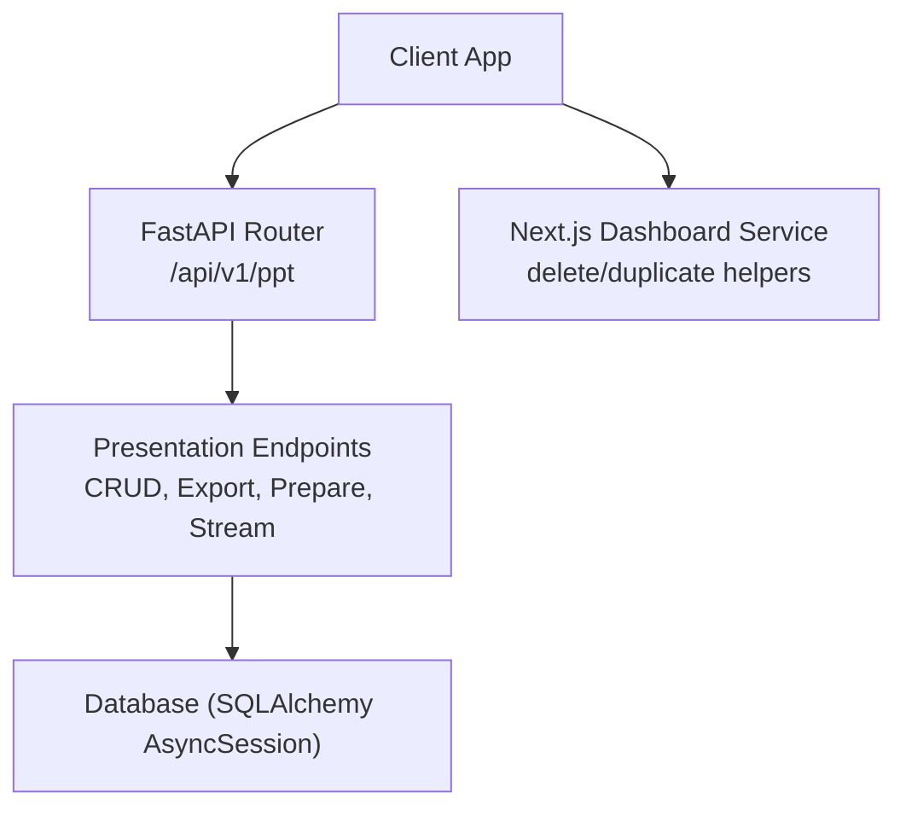
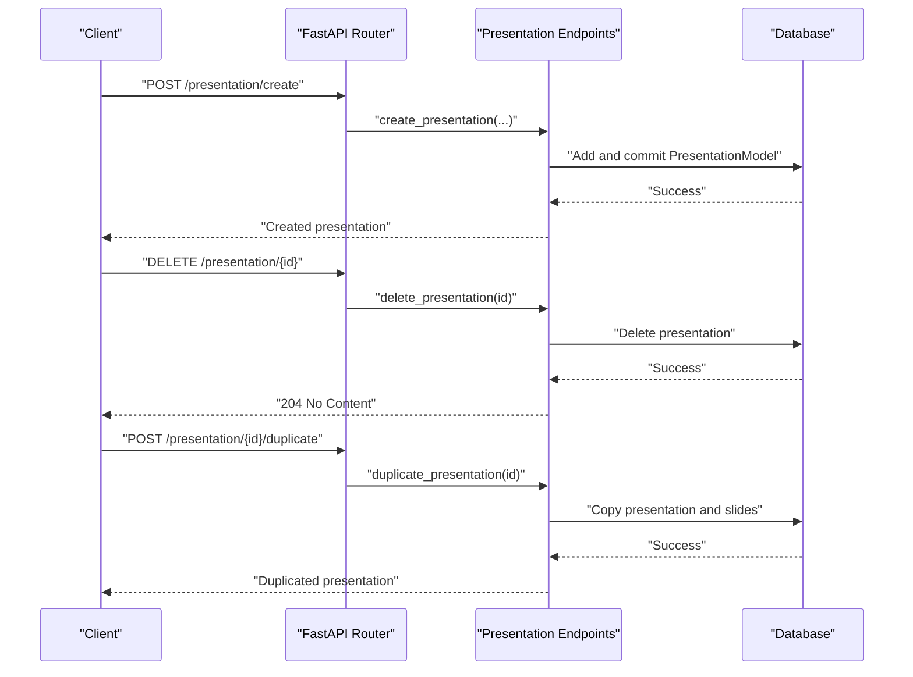
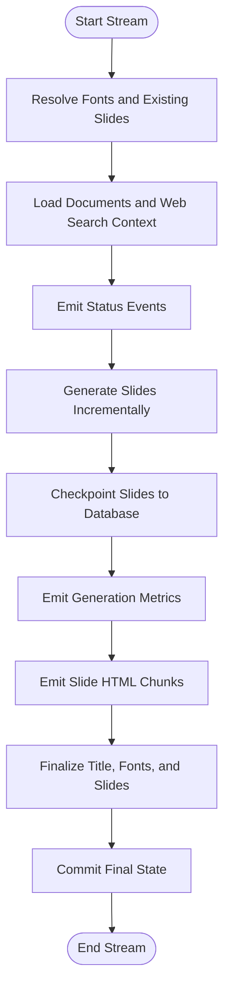
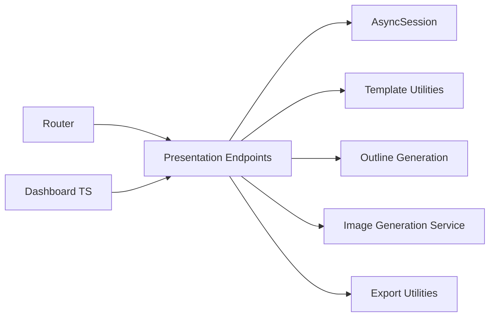

# Bulk Operations

<cite>
**Referenced Files in This Document**
- [router.py](file://servers/fastapi/api/v1/ppt/router.py)
- [presentation.py](file://servers/fastapi/api/v1/ppt/endpoints/presentation.py)
- [dashboard.ts](file://servers/nextjs/app/(presentation-generator)/services/api/dashboard.ts)
- [test_presentation_generation_flow.py](file://servers/fastapi/tests/integration/test_presentation_generation_flow.py)
</cite>

## Table of Contents
1. [Introduction](#introduction)
2. [Project Structure](#project-structure)
3. [Core Components](#core-components)
4. [Architecture Overview](#architecture-overview)
5. [Detailed Component Analysis](#detailed-component-analysis)
6. [Dependency Analysis](#dependency-analysis)
7. [Performance Considerations](#performance-considerations)
8. [Troubleshooting Guide](#troubleshooting-guide)
9. [Conclusion](#conclusion)

## Introduction
This document explains how to perform bulk operations on presentations in the system. It focuses on creating, updating, and deleting multiple presentations within a single request, batch processing patterns, error handling for partial failures, performance optimization techniques, template application at scale, mass updates with filtering criteria, transaction management for data consistency, rate limiting considerations, and best practices for large datasets.

The backend exposes presentation endpoints under a unified router, while the frontend provides client helpers that call these endpoints. The repository does not include dedicated bulk endpoints; instead, bulk behavior is achieved by composing individual endpoints or using streaming generation workflows.

## Project Structure
The relevant parts of the codebase are organized as follows:
- FastAPI API v1 router aggregates presentation-related routes.
- Presentation endpoints define CRUD, export, prepare, and streaming generation logic.
- Next.js dashboard service calls presentation endpoints from the UI layer.
- Integration tests validate transaction rollback behavior for presentation creation.

**Diagram sources**
- [router.py:22-40](file://servers/fastapi/api/v1/ppt/router.py#L22-L40)
- [presentation.py:134-139](file://servers/fastapi/api/v1/ppt/endpoints/presentation.py#L134-L139)
- [dashboard.ts:92-127](file://servers/nextjs/app/(presentation-generator)/services/api/dashboard.ts#L92-L127)

**Section sources**
- [router.py:22-40](file://servers/fastapi/api/v1/ppt/router.py#L22-L40)
- [presentation.py:134-139](file://servers/fastapi/api/v1/ppt/endpoints/presentation.py#L134-L139)
- [dashboard.ts:92-127](file://servers/nextjs/app/(presentation-generator)/services/api/dashboard.ts#L92-L127)

## Core Components
- Presentation Router: Aggregates all presentation endpoints under /api/v1/ppt.
- Presentation Endpoints: Provide create, list, get, delete, duplicate, export, prepare, and streaming generation.
- Next.js Dashboard Service: Provides helper methods to delete and duplicate presentations via HTTP calls.
- Integration Tests: Validate transaction rollback when committing fails during blank presentation creation.

Key responsibilities:
- Create: Single presentation creation and blank presentation creation.
- Read: List all presentations with optional slide preview; get a specific presentation.
- Update: Edit slides for an existing presentation; prepare outlines and structure.
- Delete: Remove a presentation by ID.
- Duplicate: Clone a presentation and its slides.
- Export: Generate PPTX/PDF for an existing presentation.
- Stream: Generate presentations incrementally with checkpoints and SSE events.

**Section sources**
- [router.py:22-40](file://servers/fastapi/api/v1/ppt/router.py#L22-L40)
- [presentation.py:1487-1599](file://servers/fastapi/api/v1/ppt/endpoints/presentation.py#L1487-L1599)
- [presentation.py:1603-1639](file://servers/fastapi/api/v1/ppt/endpoints/presentation.py#L1603-L1639)
- [presentation.py:1642-1798](file://servers/fastapi/api/v1/ppt/endpoints/presentation.py#L1642-L1798)
- [presentation.py:1801-1889](file://servers/fastapi/api/v1/ppt/endpoints/presentation.py#L1801-L1889)
- [presentation.py:2242-2399](file://servers/fastapi/api/v1/ppt/endpoints/presentation.py#L2242-L2399)
- [dashboard.ts:92-127](file://servers/nextjs/app/(presentation-generator)/services/api/dashboard.ts#L92-L127)
- [test_presentation_generation_flow.py:548-572](file://servers/fastapi/tests/integration/test_presentation_generation_flow.py#L548-L572)

## Architecture Overview
Bulk operations are implemented by composing single-item endpoints rather than dedicated bulk endpoints. Clients can:
- Iterate over a list of IDs and call DELETE for each item.
- Call POST /presentation/create or POST /presentation/create/blank multiple times.
- Use POST /presentation/{id}/duplicate to clone items before applying bulk edits.
- Use POST /presentation/{id}/export to generate outputs after bulk changes.
- Use POST /presentation/prepare to stage outlines and layout for streaming generation.
- Use GET /presentation/stream/{id} to receive incremental results with checkpointing.

**Diagram sources**
- [presentation.py:1560-1599](file://servers/fastapi/api/v1/ppt/endpoints/presentation.py#L1560-L1599)
- [presentation.py:1642-1741](file://servers/fastapi/api/v1/ppt/endpoints/presentation.py#L1642-L1741)

**Section sources**
- [presentation.py:1560-1599](file://servers/fastapi/api/v1/ppt/endpoints/presentation.py#L1560-L1599)
- [presentation.py:1642-1741](file://servers/fastapi/api/v1/ppt/endpoints/presentation.py#L1642-L1741)

## Detailed Component Analysis

### Bulk Create Patterns
- Compose multiple POST /presentation/create calls to create several presentations in one request from the client side.
- For blank templates, use POST /presentation/create/blank with optional template_id to initialize empty decks.
- Validation ensures n_slides constraints and community references compatibility.

Best practices:
- Batch client-side requests with concurrency limits to avoid overwhelming the server.
- Track per-request outcomes to handle partial success scenarios.

**Section sources**
- [presentation.py:1642-1741](file://servers/fastapi/api/v1/ppt/endpoints/presentation.py#L1642-L1741)
- [presentation.py:1744-1798](file://servers/fastapi/api/v1/ppt/endpoints/presentation.py#L1744-L1798)

### Bulk Update Patterns
- Use POST /presentation/{id}/edit to update slides for a presentation. The endpoint filters incoming slides by index, creates new slide models, deletes old ones, and commits changes.
- Use POST /presentation/prepare to stage outlines and layout, then stream generation with GET /presentation/stream/{id}.

Patterns:
- Filter criteria: Select presentations by version or other metadata via GET /presentation/all and apply updates selectively.
- Transactional updates: Slide deletion and insertion are performed within a session commit.

**Section sources**
- [presentation.py:3263-3299](file://servers/fastapi/api/v1/ppt/endpoints/presentation.py#L3263-L3299)
- [presentation.py:1801-1889](file://servers/fastapi/api/v1/ppt/endpoints/presentation.py#L1801-L1889)
- [presentation.py:1487-1536](file://servers/fastapi/api/v1/ppt/endpoints/presentation.py#L1487-L1536)

### Bulk Delete Patterns
- Implement client-side loops to call DELETE /presentation/{id} for each target presentation.
- The Next.js dashboard service includes a helper method that performs a DELETE request and handles errors gracefully.

Error handling:
- The client helper catches exceptions and returns structured failure responses.

**Section sources**
- [presentation.py:1560-1569](file://servers/fastapi/api/v1/ppt/endpoints/presentation.py#L1560-L1569)
- [dashboard.ts:92-109](file://servers/nextjs/app/(presentation-generator)/services/api/dashboard.ts#L92-L109)

### Bulk Duplicate Patterns
- Use POST /presentation/{id}/duplicate to clone a presentation and its slides.
- The Next.js dashboard service includes a helper method that performs duplication and propagates errors.

Use cases:
- Mass duplication followed by selective edits or template application.

**Section sources**
- [presentation.py:1572-1599](file://servers/fastapi/api/v1/ppt/endpoints/presentation.py#L1572-L1599)
- [dashboard.ts:111-127](file://servers/nextjs/app/(presentation-generator)/services/api/dashboard.ts#L111-L127)

### Bulk Template Application
- Use POST /presentation/create/blank with template_id to initialize presentations based on a chosen template.
- Use POST /presentation/prepare to set outlines and layout, then stream generation to populate content according to the template schema.

Workflow:
- Resolve template and layout payload.
- Normalize structure and insert TOC if requested.
- Persist prepared presentation and memory store outlines.

**Section sources**
- [presentation.py:1744-1798](file://servers/fastapi/api/v1/ppt/endpoints/presentation.py#L1744-L1798)
- [presentation.py:1801-1889](file://servers/fastapi/api/v1/ppt/endpoints/presentation.py#L1801-L1889)

### Mass Updates with Filtering Criteria
- Retrieve presentations via GET /presentation/all with optional version filter and include_slides flag.
- Apply updates selectively by iterating over filtered results and calling edit endpoints.

Considerations:
- Disable include_slides for metadata-only lists to reduce payload size.
- Order results by created_at descending for consistent processing.

**Section sources**
- [presentation.py:1487-1536](file://servers/fastapi/api/v1/ppt/endpoints/presentation.py#L1487-L1536)

### Transaction Management for Data Consistency
- Blank presentation creation wraps add and commit in a try/except block and rolls back on failure.
- Integration tests verify that failed commits trigger rollbacks and preserve additive behavior.

Recommendations:
- Always wrap multi-step writes in transactions.
- Roll back explicitly on exceptions to maintain database integrity.

**Section sources**
- [presentation.py:1744-1798](file://servers/fastapi/api/v1/ppt/endpoints/presentation.py#L1744-L1798)
- [test_presentation_generation_flow.py:548-572](file://servers/fastapi/tests/integration/test_presentation_generation_flow.py#L548-L572)

### Streaming Generation for Large Datasets
- Use GET /presentation/stream/{id} to stream slide generation with SSE events.
- Checkpointing persists intermediate slides to allow resumption after interruptions.
- Error metadata includes retryability hints and progress counts.

Flow:
- Resolve fonts and existing slides.
- Load source documents and web search context if enabled.
- Emit status, metrics, and slide HTML chunks.
- Finalize title, fonts, and slides; commit final state.

**Diagram sources**
- [presentation.py:2242-2399](file://servers/fastapi/api/v1/ppt/endpoints/presentation.py#L2242-L2399)

**Section sources**
- [presentation.py:2242-2399](file://servers/fastapi/api/v1/ppt/endpoints/presentation.py#L2242-L2399)

## Dependency Analysis
- Router depends on multiple sub-routers including PRESENTATION_ROUTER.
- Presentation endpoints depend on SQLAlchemy async sessions, template resolution utilities, outline generation, image generation services, and export utilities.
- Next.js dashboard service depends on HTTP fetch to call presentation endpoints.

**Diagram sources**
- [router.py:22-40](file://servers/fastapi/api/v1/ppt/router.py#L22-L40)
- [presentation.py:134-139](file://servers/fastapi/api/v1/ppt/endpoints/presentation.py#L134-L139)
- [dashboard.ts:92-127](file://servers/nextjs/app/(presentation-generator)/services/api/dashboard.ts#L92-L127)

**Section sources**
- [router.py:22-40](file://servers/fastapi/api/v1/ppt/router.py#L22-L40)
- [presentation.py:134-139](file://servers/fastapi/api/v1/ppt/endpoints/presentation.py#L134-L139)
- [dashboard.ts:92-127](file://servers/nextjs/app/(presentation-generator)/services/api/dashboard.ts#L92-L127)

## Performance Considerations
- Concurrency control: Limit parallel requests when performing bulk operations to avoid resource exhaustion.
- Payload sizing: Use GET /presentation/all with include_slides=false for metadata-only lists to reduce network overhead.
- Streaming: Prefer streaming generation for large decks to provide incremental feedback and enable checkpointing.
- Asset generation: Parallel asset tasks are used during streaming to overlap I/O and LLM workloads.
- Transaction batching: Group related writes into a single transaction to minimize commit overhead.

[No sources needed since this section provides general guidance]

## Troubleshooting Guide
Common issues and strategies:
- Partial failures in bulk operations: Track per-request status and implement retries with exponential backoff for transient errors.
- Database unavailability: Ensure explicit rollback on commit failures; integration tests demonstrate expected rollback behavior.
- Rate limiting: If encountering throttling, implement client-side queuing and backoff strategies.
- Streaming interruptions: Rely on checkpointed slides and reconnection logic; error metadata indicates retryable conditions.

Operational tips:
- Log and monitor error metadata from streaming endpoints to diagnose failures.
- Validate input constraints (e.g., slide count limits) before initiating bulk operations.

**Section sources**
- [test_presentation_generation_flow.py:548-572](file://servers/fastapi/tests/integration/test_presentation_generation_flow.py#L548-L572)
- [presentation.py:2242-2399](file://servers/fastapi/api/v1/ppt/endpoints/presentation.py#L2242-L2399)

## Conclusion
Bulk operations in this system are achieved by composing single-item endpoints and leveraging streaming generation for large datasets. Clients should implement controlled concurrency, robust error handling, and transaction-aware workflows. Use filtering and metadata-only queries to optimize performance, and rely on checkpointing and SSE events for resilient, scalable presentation generation.

[No sources needed since this section summarizes without analyzing specific files]