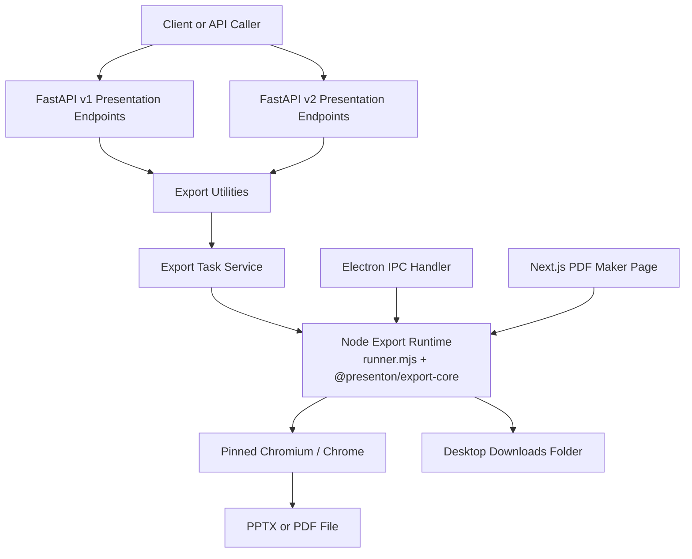
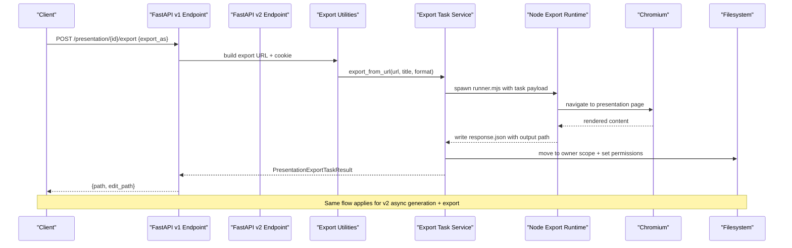
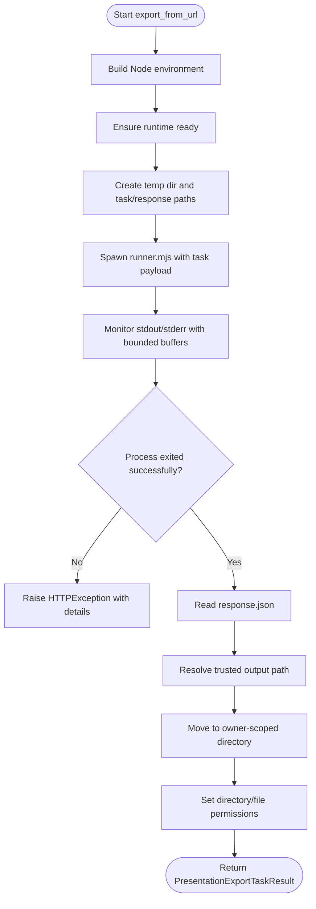
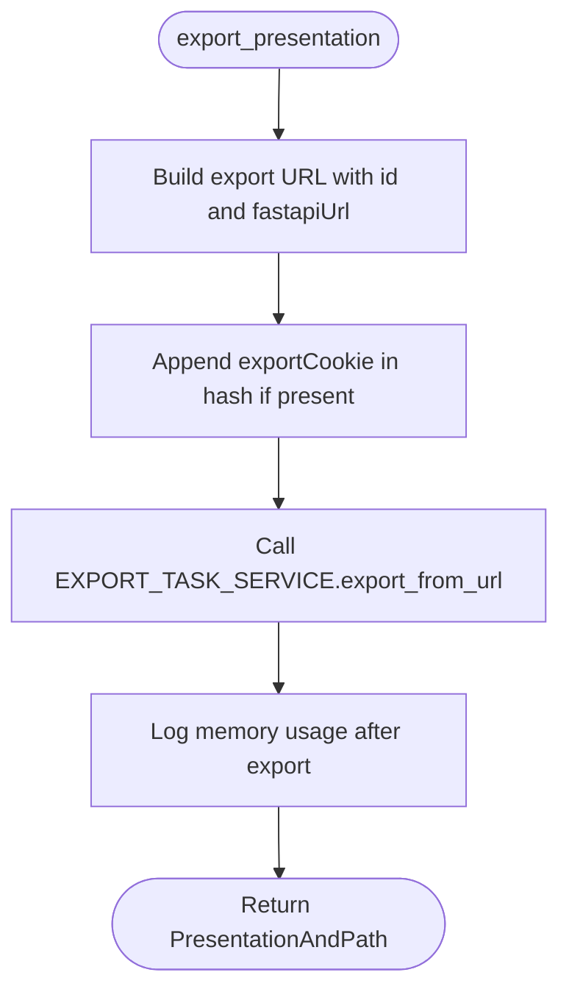
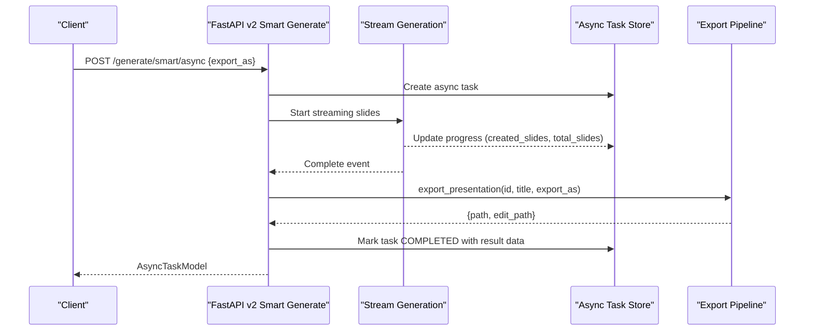
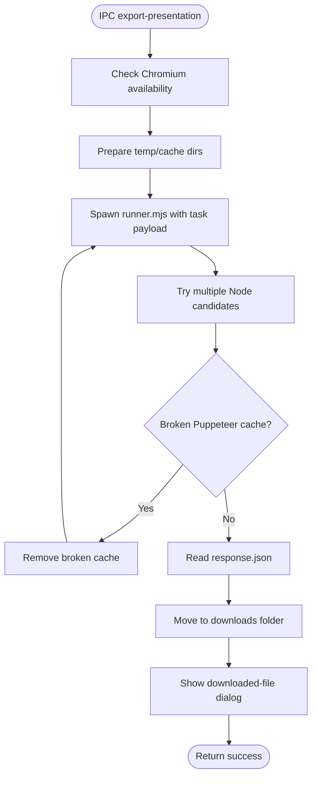
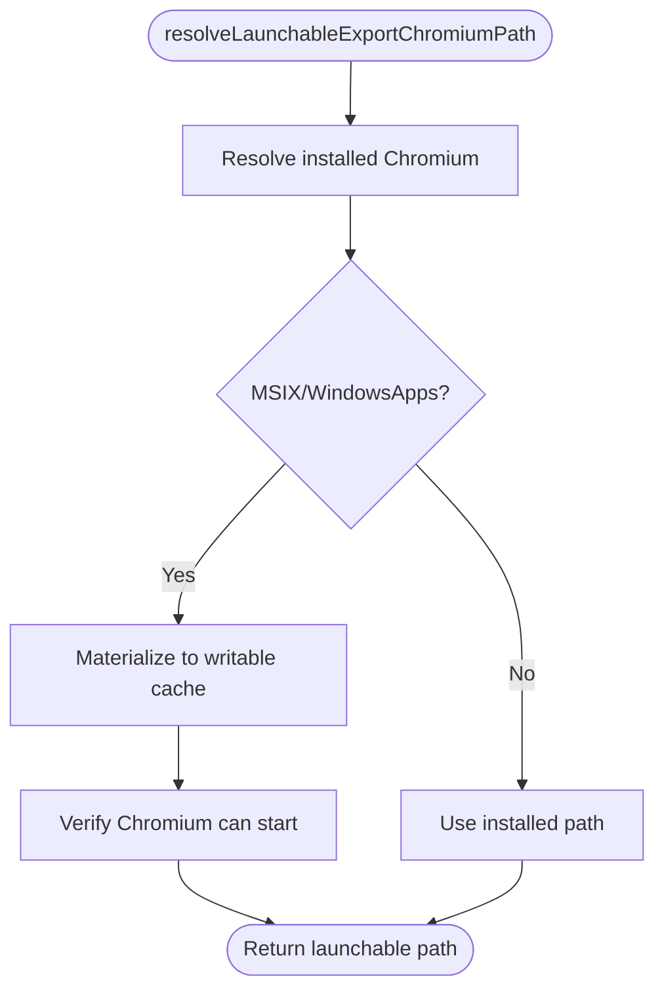
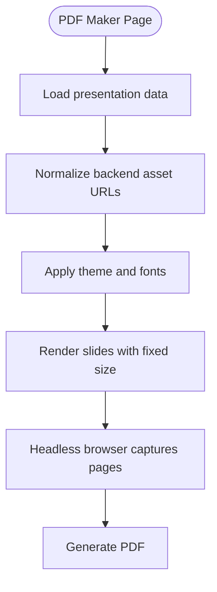
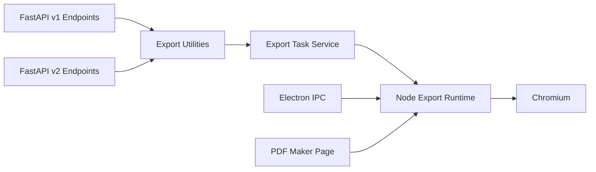

# Export Functionality

<cite>
**Referenced Files in This Document**
- [export_task_service.py](file://servers/fastapi/services/export_task_service.py)
- [export_utils.py](file://servers/fastapi/utils/export_utils.py)
- [presentation endpoints v1](file://servers/fastapi/api/v1/ppt/endpoints/presentation.py)
- [presentation endpoints v2](file://servers/fastapi/api/v2/ppt/endpoints/presentation.py)
- [export_handlers.ts](file://electron/app/ipc/export_handlers.ts)
- [export-chromium.ts](file://electron/app/utils/export-chromium.ts)
- [PdfMakerPage.tsx](file://servers/nxtjs/app/(export)/pdf-maker/PdfMakerPage.tsx)
- [pdf-maker page.tsx](file://servers/nxtjs/app/(export)/pdf-maker/page.tsx)
</cite>

## Table of Contents
1. [Introduction](#introduction)
2. [Project Structure](#project-structure)
3. [Core Components](#core-components)
4. [Architecture Overview](#architecture-overview)
5. [Detailed Component Analysis](#detailed-component-analysis)
6. [Dependency Analysis](#dependency-analysis)
7. [Performance Considerations](#performance-considerations)
8. [Troubleshooting Guide](#troubleshooting-guide)
9. [Conclusion](#conclusion)

## Introduction
This document explains the export system that produces PPTX and PDF presentations. It covers configuration options, quality and format-specific behavior, the asynchronous export pipeline, progress tracking, error recovery, batch workflows, custom template rendering, external storage integration, performance considerations, memory management, and scaling strategies for high-volume operations.

The system supports two primary runtime paths:
- Server-side FastAPI service that orchestrates a Node-based export runtime using a pinned Chromium instance.
- Electron desktop IPC path that spawns the same export runtime with platform-specific Chromium handling.

## Project Structure
Export-related code spans three main areas:
- FastAPI backend services and utilities that orchestrate exports and manage assets.
- Electron IPC handlers that spawn the export runtime on the desktop.
- Next.js PDF maker page that renders presentation slides for headless export.

**Diagram sources**
- [presentation endpoints v1:1603-1639](file://servers/fastapi/api/v1/ppt/endpoints/presentation.py#L1603-L1639)
- [presentation endpoints v2:87-149](file://servers/fastapi/api/v2/ppt/endpoints/presentation.py#L87-L149)
- [export_utils.py:27-75](file://servers/fastapi/utils/export_utils.py#L27-L75)
- [export_task_service.py:122-152](file://servers/fastapi/services/export_task_service.py#L122-L152)
- [export_handlers.ts:57-179](file://electron/app/ipc/export_handlers.ts#L57-L179)
- [PdfMakerPage.tsx:143-222](file://servers/nxtjs/app/(export)/pdf-maker/PdfMakerPage.tsx#L143-L222)

**Section sources**
- [presentation endpoints v1:1603-1639](file://servers/fastapi/api/v1/ppt/endpoints/presentation.py#L1603-L1639)
- [presentation endpoints v2:87-149](file://servers/fastapi/api/v2/ppt/endpoints/presentation.py#L87-L149)
- [export_utils.py:27-75](file://servers/fastapi/utils/export_utils.py#L27-L75)
- [export_task_service.py:122-152](file://servers/fastapi/services/export_task_service.py#L122-L152)
- [export_handlers.ts:57-179](file://electron/app/ipc/export_handlers.ts#L57-L179)
- [PdfMakerPage.tsx:143-222](file://servers/nxtjs/app/(export)/pdf-maker/PdfMakerPage.tsx#L143-L222)

## Core Components
- Export Task Service: Orchestrates spawning the Node export runtime, manages environment variables, temp directories, output scoping, and result validation.
- Export Utilities: Builds the presentation export URL, attaches optional FastAPI base URL and cookie headers, and wraps the service call.
- FastAPI Endpoints: Expose synchronous and asynchronous generation-and-export flows, including Smart presentation generation with progress updates.
- Electron IPC Handlers: Spawn the export runtime on desktop, handle Chromium availability, retry logic, and move outputs to user downloads.
- PDF Maker Page: Renders presentation slides in a fixed-size layout optimized for headless PDF export.

Key responsibilities:
- Format selection via export_as parameter (pptx or pdf).
- Secure resolution of output paths within allowed roots.
- Owner-scoped artifact movement and permission setting.
- Robust child process lifecycle and timeout handling.
- Chromium installation, pinning, and repair for desktop environments.

**Section sources**
- [export_task_service.py:122-152](file://servers/fastapi/services/export_task_service.py#L122-L152)
- [export_utils.py:27-75](file://servers/fastapi/utils/export_utils.py#L27-L75)
- [presentation endpoints v1:1603-1639](file://servers/fastapi/api/v1/ppt/endpoints/presentation.py#L1603-L1639)
- [presentation endpoints v2:87-149](file://servers/fastapi/api/v2/ppt/endpoints/presentation.py#L87-L149)
- [export_handlers.ts:57-179](file://electron/app/ipc/export_handlers.ts#L57-L179)
- [PdfMakerPage.tsx:143-222](file://servers/nxtjs/app/(export)/pdf-maker/PdfMakerPage.tsx#L143-L222)

## Architecture Overview
The export architecture is layered:
- API Layer: Accepts export requests with format selection and optional authentication cookies.
- Orchestration Layer: Prepares URLs, builds task payloads, and invokes the Node export runtime.
- Runtime Layer: Uses Puppeteer/Chromium to render the presentation and produce PPTX or PDF.
- Storage Layer: Moves outputs into owner-scoped directories and sets file permissions.

**Diagram sources**
- [presentation endpoints v1:1603-1639](file://servers/fastapi/api/v1/ppt/endpoints/presentation.py#L1603-L1639)
- [presentation endpoints v2:87-149](file://servers/fastapi/api/v2/ppt/endpoints/presentation.py#L87-L149)
- [export_utils.py:27-75](file://servers/fastapi/utils/export_utils.py#L27-L75)
- [export_task_service.py:294-352](file://servers/fastapi/services/export_task_service.py#L294-L352)
- [export_task_service.py:420-453](file://servers/fastapi/services/export_task_service.py#L420-L453)

## Detailed Component Analysis

### Export Task Service
Responsibilities:
- Resolve export package root and entrypoint.
- Build Node environment with app data, temp directories, and Puppeteer cache/temp locations.
- Validate runtime readiness and ensure required files exist.
- Run tasks asynchronously with bounded stdout/stderr buffers and timeouts.
- Resolve and validate output paths against trusted roots.
- Move exported files to owner-scoped directories and set permissions.
- Provide helpers for converting PPTX to HTML/JSON and rendering HTML/JSON to images.

Configuration and quality settings:
- Timeout control via constructor parameter.
- Environment variables for APP_DATA_DIRECTORY, TEMP_DIRECTORY, PUPPETEER_TMP_DIR, PUPPETEER_CACHE_DIR.
- Optional Electron Chromium executable path when PRESENTON_ELECTRON is enabled.
- Asset base URL configured for headless rendering.

Error handling and recovery:
- Non-zero return codes raise HTTP exceptions with truncated stderr/stdout.
- JSON decode errors are wrapped with clear messages.
- Path traversal protection ensures outputs remain under allowed roots.
- Permission updates are attempted; failures raise HTTP exceptions.

**Diagram sources**
- [export_task_service.py:154-201](file://servers/fastapi/services/export_task_service.py#L154-L201)
- [export_task_service.py:203-241](file://servers/fastapi/services/export_task_service.py#L203-L241)
- [export_task_service.py:269-292](file://servers/fastapi/services/export_task_service.py#L269-L292)
- [export_task_service.py:294-352](file://servers/fastapi/services/export_task_service.py#L294-L352)
- [export_task_service.py:420-453](file://servers/fastapi/services/export_task_service.py#L420-L453)

**Section sources**
- [export_task_service.py:122-152](file://servers/fastapi/services/export_task_service.py#L122-L152)
- [export_task_service.py:154-201](file://servers/fastapi/services/export_task_service.py#L154-L201)
- [export_task_service.py:203-241](file://servers/fastapi/services/export_task_service.py#L203-L241)
- [export_task_service.py:269-292](file://servers/fastapi/services/export_task_service.py#L269-L292)
- [export_task_service.py:294-352](file://servers/fastapi/services/export_task_service.py#L294-L352)
- [export_task_service.py:420-453](file://servers/fastapi/services/export_task_service.py#L420-L453)

### Export Utilities
Responsibilities:
- Construct the presentation export URL with query parameters and optional FastAPI base URL.
- Append export cookie header via URL hash when provided.
- Wrap the service call with memory logging and safe filename normalization.

Quality and format settings:
- export_as parameter controls whether the runtime produces PPTX or PDF.
- Cookie header enables authenticated access to protected presentation data during headless rendering.

**Diagram sources**
- [export_utils.py:27-75](file://servers/fastapi/utils/export_utils.py#L27-L75)

**Section sources**
- [export_utils.py:27-75](file://servers/fastapi/utils/export_utils.py#L27-L75)

### FastAPI Endpoints
- v1 endpoint exposes export for existing presentations, reusing the same helper used by generation endpoints.
- v2 endpoints include Smart presentation generation with streaming progress and final export step.

Progress tracking:
- Smart generation streams slide events and updates async task progress with created_slides and total_slides.
- On completion, the endpoint performs the export and stores the resulting path in the async task data.

Error handling:
- Stream errors propagate as HTTP exceptions.
- Async task status transitions to ERROR with serialized API error details when exceptions occur.

**Diagram sources**
- [presentation endpoints v2:87-149](file://servers/fastapi/api/v2/ppt/endpoints/presentation.py#L87-L149)
- [presentation endpoints v2:152-227](file://servers/fastapi/api/v2/ppt/endpoints/presentation.py#L152-L227)

**Section sources**
- [presentation endpoints v1:1603-1639](file://servers/fastapi/api/v1/ppt/endpoints/presentation.py#L1603-L1639)
- [presentation endpoints v2:87-149](file://servers/fastapi/api/v2/ppt/endpoints/presentation.py#L87-L149)
- [presentation endpoints v2:152-227](file://servers/fastapi/api/v2/ppt/endpoints/presentation.py#L152-L227)

### Electron IPC Handlers
Responsibilities:
- Handle export-presentation IPC from renderer processes.
- Validate Chromium availability and prepare Puppeteer cache/temp directories.
- Spawn the export runtime with environment variables and retry across multiple Node candidates.
- Move exported files to the user’s downloads folder and show a download dialog.

Error recovery:
- Retryable runtime errors trigger fallback to alternative Node binaries.
- Broken Puppeteer caches are detected and repaired automatically.
- Response file read retries guard against race conditions.

**Diagram sources**
- [export_handlers.ts:57-179](file://electron/app/ipc/export_handlers.ts#L57-L179)
- [export_handlers.ts:182-275](file://electron/app/ipc/export_handlers.ts#L182-L275)
- [export_handlers.ts:277-304](file://electron/app/ipc/export_handlers.ts#L277-L304)
- [export_handlers.ts:306-329](file://electron/app/ipc/export_handlers.ts#L306-L329)
- [export_handlers.ts:331-449](file://electron/app/ipc/export_handlers.ts#L331-L449)

**Section sources**
- [export_handlers.ts:57-179](file://electron/app/ipc/export_handlers.ts#L57-L179)
- [export_handlers.ts:182-275](file://electron/app/ipc/export_handlers.ts#L182-L275)
- [export_handlers.ts:277-304](file://electron/app/ipc/export_handlers.ts#L277-L304)
- [export_handlers.ts:306-329](file://electron/app/ipc/export_handlers.ts#L306-L329)
- [export_handlers.ts:331-449](file://electron/app/ipc/export_handlers.ts#L331-L449)

### Chromium Management
Responsibilities:
- Determine pinned browser type and build ID from package metadata or environment overrides.
- Resolve installed Chromium paths, including bundled manifests and legacy layouts.
- Materialize Chromium for MSIX/APPX installs to writable locations.
- Verify Chromium can start with headless flags.
- Install Chromium with progress callbacks and remove broken caches.

Quality and compatibility:
- Pinned build IDs ensure consistent rendering across environments.
- Platform-specific handling for macOS, Windows, and Linux.

**Diagram sources**
- [export-chromium.ts:34-67](file://electron/app/utils/export-chromium.ts#L34-L67)
- [export-chromium.ts:195-242](file://electron/app/utils/export-chromium.ts#L195-L242)
- [export-chromium.ts:303-354](file://electron/app/utils/export-chromium.ts#L303-L354)
- [export-chromium.ts:376-444](file://electron/app/utils/export-chromium.ts#L376-L444)
- [export-chromium.ts:446-505](file://electron/app/utils/export-chromium.ts#L446-L505)
- [export-chromium.ts:511-581](file://electron/app/utils/export-chromium.ts#L511-L581)

**Section sources**
- [export-chromium.ts:34-67](file://electron/app/utils/export-chromium.ts#L34-L67)
- [export-chromium.ts:195-242](file://electron/app/utils/export-chromium.ts#L195-L242)
- [export-chromium.ts:303-354](file://electron/app/utils/export-chromium.ts#L303-L354)
- [export-chromium.ts:376-444](file://electron/app/utils/export-chromium.ts#L376-L444)
- [export-chromium.ts:446-505](file://electron/app/utils/export-chromium.ts#L446-L505)
- [export-chromium.ts:511-581](file://electron/app/utils/export-chromium.ts#L511-L581)

### PDF Maker Page
Responsibilities:
- Render presentation slides in a fixed-size container optimized for headless PDF export.
- Apply theme and fonts, normalize backend asset URLs, and inject smart chart scripts.
- Support both Template V2 HTML preview and standard slide rendering.

Quality and layout:
- Fixed slide dimensions (1280x720) ensure consistent page breaks and clipping.
- Print styles enforce page breaks per slide and prevent overflow issues.

**Diagram sources**
- [PdfMakerPage.tsx:26-100](file://servers/nxtjs/app/(export)/pdf-maker/PdfMakerPage.tsx#L26-L100)
- [PdfMakerPage.tsx:143-222](file://servers/nxtjs/app/(export)/pdf-maker/PdfMakerPage.tsx#L143-L222)
- [pdf-maker page.tsx:1-27](file://servers/nxtjs/app/(export)/pdf-maker/page.tsx#L1-L27)

**Section sources**
- [PdfMakerPage.tsx:26-100](file://servers/nxtjs/app/(export)/pdf-maker/PdfMakerPage.tsx#L26-L100)
- [PdfMakerPage.tsx:143-222](file://servers/nxtjs/app/(export)/pdf-maker/PdfMakerPage.tsx#L143-L222)
- [pdf-maker page.tsx:1-27](file://servers/nxtjs/app/(export)/pdf-maker/page.tsx#L1-L27)

## Dependency Analysis
Key dependencies:
- FastAPI endpoints depend on export utilities and the export task service.
- Export task service depends on Node runtime and Puppeteer/Chromium.
- Electron IPC handlers depend on Chromium management utilities and lifecycle tools.
- PDF maker page depends on presentation data APIs and theme/font loaders.

**Diagram sources**
- [presentation endpoints v1:1603-1639](file://servers/fastapi/api/v1/ppt/endpoints/presentation.py#L1603-L1639)
- [presentation endpoints v2:87-149](file://servers/fastapi/api/v2/ppt/endpoints/presentation.py#L87-L149)
- [export_utils.py:27-75](file://servers/fastapi/utils/export_utils.py#L27-L75)
- [export_task_service.py:122-152](file://servers/fastapi/services/export_task_service.py#L122-L152)
- [export_handlers.ts:57-179](file://electron/app/ipc/export_handlers.ts#L57-L179)
- [PdfMakerPage.tsx:143-222](file://servers/nxtjs/app/(export)/pdf-maker/PdfMakerPage.tsx#L143-L222)

**Section sources**
- [presentation endpoints v1:1603-1639](file://servers/fastapi/api/v1/ppt/endpoints/presentation.py#L1603-L1639)
- [presentation endpoints v2:87-149](file://servers/fastapi/api/v2/ppt/endpoints/presentation.py#L87-L149)
- [export_utils.py:27-75](file://servers/fastapi/utils/export_utils.py#L27-L75)
- [export_task_service.py:122-152](file://servers/fastapi/services/export_task_service.py#L122-L152)
- [export_handlers.ts:57-179](file://electron/app/ipc/export_handlers.ts#L57-L179)
- [PdfMakerPage.tsx:143-222](file://servers/nxtjs/app/(export)/pdf-maker/PdfMakerPage.tsx#L143-L222)

## Performance Considerations
- Child process limits: The export task service uses bounded text buffers for stdout/stderr and enforces a configurable timeout to prevent runaway processes.
- Memory logging: Memory snapshots are logged around export start/finish and child process lifecycle events to aid capacity planning.
- Temp directory isolation: Each export runs in an isolated temp directory scoped by owner, reducing contention and improving cleanup reliability.
- Chromium caching: Puppeteer cache directories are explicitly managed to avoid repeated downloads and improve throughput.
- Batch exports: For high-volume scenarios, consider queuing export tasks and processing them concurrently with controlled concurrency limits to balance CPU and memory usage.
- Rendering optimization: The PDF maker page fixes slide dimensions and uses print styles to minimize reflows and ensure stable page breaks.

Recommendations:
- Tune timeout_seconds based on expected presentation complexity.
- Pre-warm Puppeteer cache and ensure sufficient disk space for cached Chromium instances.
- Monitor memory usage via logs and adjust worker counts accordingly.
- Use asynchronous generation endpoints to decouple heavy work from client connections.

[No sources needed since this section provides general guidance]

## Troubleshooting Guide
Common issues and resolutions:
- Export runtime not found: Ensure the export package entrypoint exists and the required @presenton/export-core module is installed.
- Invalid output path: Outputs must resolve under allowed roots; verify APP_DATA_DIRECTORY and TEMP_DIRECTORY configurations.
- Permission errors: The service attempts to set directory and file permissions; failures raise HTTP exceptions—check filesystem ACLs.
- Chromium unavailable: On desktop, verify Chromium installation and rebuild caches if necessary; the system will attempt automatic repairs.
- Response file missing: The Electron handler retries reading the response file once; persistent failures indicate a runtime crash or I/O race condition.

Diagnostic steps:
- Inspect child process stdout/stderr snippets included in HTTP exception details.
- Review Electron breadcrumbs and memory snapshots for export lifecycle events.
- Validate environment variables NEXT_PUBLIC_URL and NEXT_PUBLIC_FAST_API for correct origins.

**Section sources**
- [export_task_service.py:203-241](file://servers/fastapi/services/export_task_service.py#L203-L241)
- [export_task_service.py:323-352](file://servers/fastapi/services/export_task_service.py#L323-L352)
- [export_handlers.ts:141-179](file://electron/app/ipc/export_handlers.ts#L141-L179)
- [export_handlers.ts:277-304](file://electron/app/ipc/export_handlers.ts#L277-L304)

## Conclusion
The export system provides a robust, secure, and scalable pipeline for producing PPTX and PDF presentations. It integrates tightly with FastAPI endpoints, a Node-based export runtime, and Chromium for reliable rendering. Configuration options allow fine-tuning of timeouts, paths, and authentication context. Error handling and recovery mechanisms ensure resilience across server and desktop environments. For high-volume operations, leverage asynchronous generation, controlled concurrency, and pre-cached Chromium to optimize performance and resource utilization.

[No sources needed since this section summarizes without analyzing specific files]