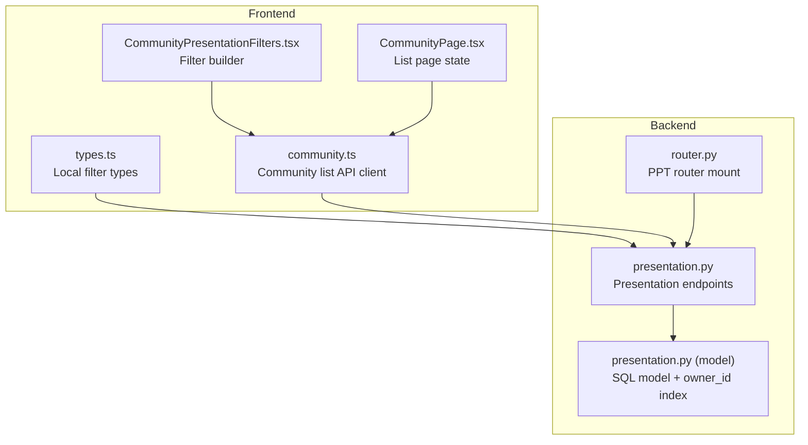
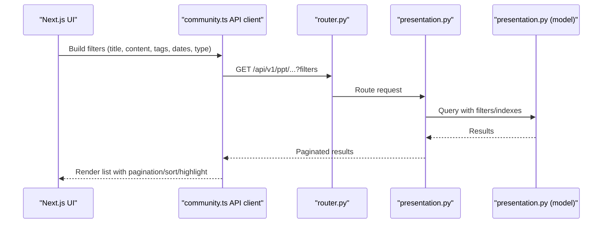
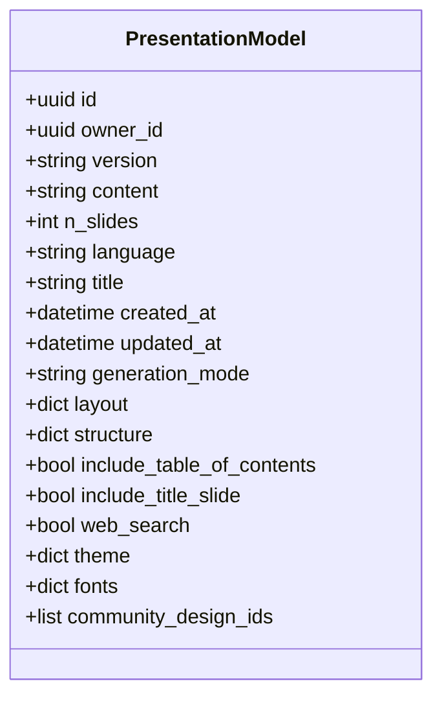
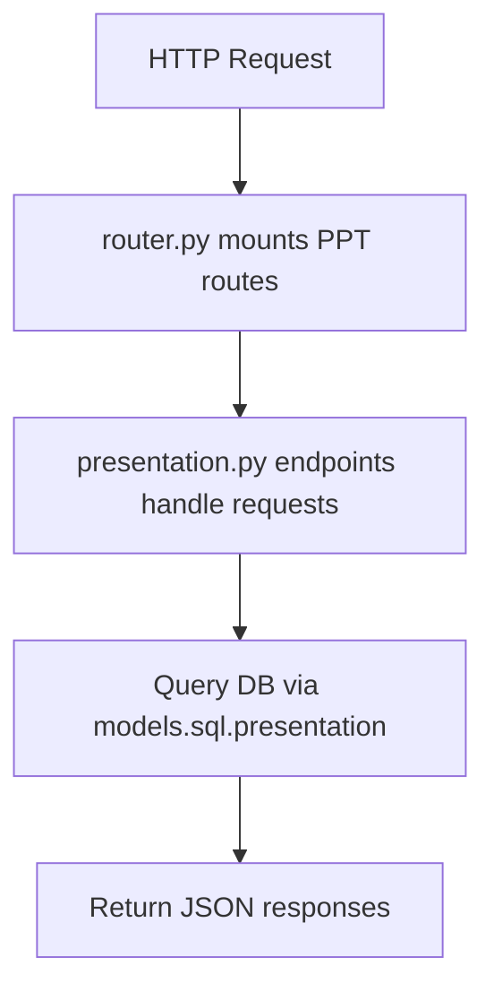
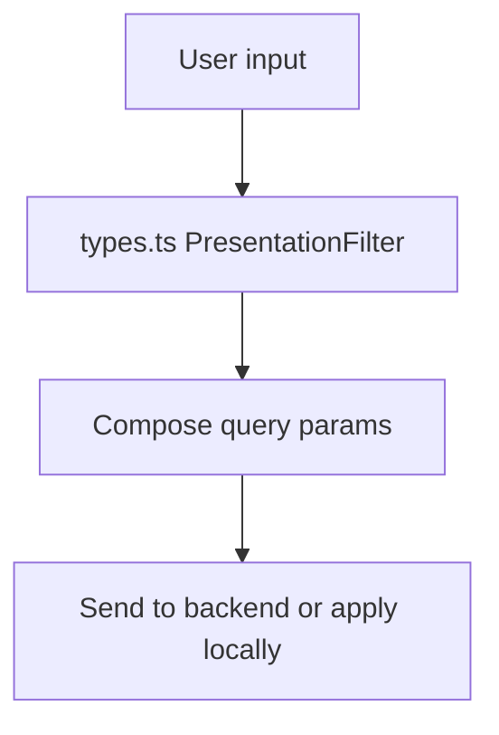
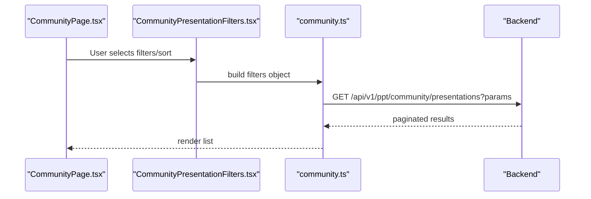
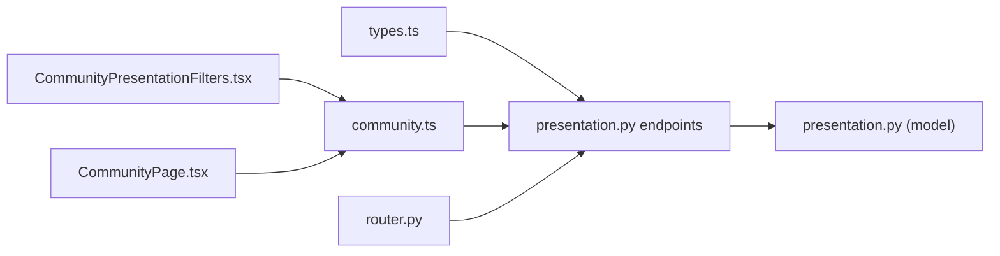

# Search & Filtering

<cite>
**Referenced Files in This Document**
- [presentation.py](file://servers/fastapi/api/v1/ppt/endpoints/presentation.py)
- [router.py](file://servers/fastapi/api/v1/ppt/router.py)
- [presentation.py (model)](file://servers/fastapi/models/sql/presentation.py)
- [types.ts](file://servers/nxtjs/app/(presentation-generator)/(dashboard)/dashboard/types.ts)
- [community.ts](file://servers/nxtjs/app/(presentation-generator)/services/api/community.ts)
- [CommunityPresentationFilters.tsx](file://servers/nxtjs/app/(presentation-generator)/upload/components/CommunityPresentationFilters.tsx)
- [CommunityPage.tsx](file://servers/nxtjs/app/(presentation-generator)/(dashboard)/community/components/CommunityPage.tsx)
</cite>

## Table of Contents
1. [Introduction](#introduction)
2. [Project Structure](#project-structure)
3. [Core Components](#core-components)
4. [Architecture Overview](#architecture-overview)
5. [Detailed Component Analysis](#detailed-component-analysis)
6. [Dependency Analysis](#dependency-analysis)
7. [Performance Considerations](#performance-considerations)
8. [Troubleshooting Guide](#troubleshooting-guide)
9. [Conclusion](#conclusion)

## Introduction
This document explains the search and filtering capabilities for presentations in the project, focusing on:
- Query parameters for searching by title, content, tags, creation date, and template type
- Full-text search implementation and index optimization
- Query performance tuning, sorting, pagination, and result highlighting
- Indexing strategies and real-time update considerations

The system exposes a FastAPI backend with presentation endpoints and a Next.js frontend that composes filters, sorts, and pagination for both personal presentations and community presentations.

## Project Structure
Search and filtering spans two layers:
- Backend (FastAPI): Presentation model, endpoints, and database indexes
- Frontend (Next.js): Filter UI, query composition, and API calls

**Diagram sources**
- [router.py:1-41](file://servers/fastapi/api/v1/ppt/router.py#L1-L41)
- [presentation.py:1-134](file://servers/fastapi/api/v1/ppt/endpoints/presentation.py#L1-L134)
- [presentation.py (model):21-33](file://servers/fastapi/models/sql/presentation.py#L21-L33)
- [types.ts:1-16](file://servers/nxtjs/app/(presentation-generator)/(dashboard)/dashboard/types.ts#L1-L16)
- [community.ts:27-50](file://servers/nxtjs/app/(presentation-generator)/services/api/community.ts#L27-L50)
- [CommunityPresentationFilters.tsx:367-408](file://servers/nxtjs/app/(presentation-generator)/upload/components/CommunityPresentationFilters.tsx#L367-L408)
- [CommunityPage.tsx:42-78](file://servers/nxtjs/app/(presentation-generator)/(dashboard)/community/components/CommunityPage.tsx#L42-L78)

**Section sources**
- [router.py:1-41](file://servers/fastapi/api/v1/ppt/router.py#L1-L41)
- [presentation.py:1-134](file://servers/fastapi/api/v1/ppt/endpoints/presentation.py#L1-L134)
- [presentation.py (model):21-33](file://servers/fastapi/models/sql/presentation.py#L21-L33)
- [types.ts:1-16](file://servers/nxtjs/app/(presentation-generator)/(dashboard)/dashboard/types.ts#L1-L16)
- [community.ts:27-50](file://servers/nxtjs/app/(presentation-generator)/services/api/community.ts#L27-L50)
- [CommunityPresentationFilters.tsx:367-408](file://servers/nxtjs/app/(presentation-generator)/upload/components/CommunityPresentationFilters.tsx#L367-L408)
- [CommunityPage.tsx:42-78](file://servers/nxtjs/app/(presentation-generator)/(dashboard)/community/components/CommunityPage.tsx#L42-L78)

## Core Components
- Presentation SQL model: Defines persistent fields such as title, content, language, created_at, updated_at, generation_mode, and an indexed owner_id for efficient user-scoped queries.
- Presentation endpoints: Provide APIs to create, retrieve, and manage presentations; they also expose metadata used by the UI for filtering and display.
- Community presentation API client: Encodes pagination, ordering, and filter parameters into HTTP requests for community presentations.
- Frontend filter components: Build and serialize filters for both local and community lists, including date ranges, counts, and sort options.

Key responsibilities:
- Backend: Persist searchable attributes and provide endpoints that can be extended to support advanced filters.
- Frontend: Compose user intent into structured filters and pass them to the backend or internal logic.

**Section sources**
- [presentation.py (model):21-82](file://servers/fastapi/models/sql/presentation.py#L21-L82)
- [presentation.py:134-134](file://servers/fastapi/api/v1/ppt/endpoints/presentation.py#L134-L134)
- [community.ts:27-50](file://servers/nxtjs/app/(presentation-generator)/services/api/community.ts#L27-L50)
- [CommunityPresentationFilters.tsx:367-408](file://servers/nxtjs/app/(presentation-generator)/upload/components/CommunityPresentationFilters.tsx#L367-L408)

## Architecture Overview
The search and filtering architecture connects UI filters to backend data through well-defined interfaces.

**Diagram sources**
- [community.ts:98-127](file://servers/nxtjs/app/(presentation-generator)/services/api/community.ts#L98-L127)
- [router.py:22-41](file://servers/fastapi/api/v1/ppt/router.py#L22-L41)
- [presentation.py:134-134](file://servers/fastapi/api/v1/ppt/endpoints/presentation.py#L134-L134)
- [presentation.py (model):21-82](file://servers/fastapi/models/sql/presentation.py#L21-L82)

## Detailed Component Analysis

### Presentation Data Model and Indexing
The presentation model stores core searchable attributes:
- title: string
- content: string
- language: string
- created_at / updated_at: timestamps
- generation_mode: standard or smart
- owner_id: foreign key with an index for fast user-scoped queries

Indexing strategy:
- owner_id is explicitly indexed to accelerate per-user listing and filtering.
- For full-text search across title/content, consider adding database-level full-text indexes or using a dedicated search engine if dataset size grows.

**Diagram sources**
- [presentation.py (model):21-82](file://servers/fastapi/models/sql/presentation.py#L21-L82)

**Section sources**
- [presentation.py (model):21-82](file://servers/fastapi/models/sql/presentation.py#L21-L82)

### Backend Endpoints and Routing
- The PPT router aggregates multiple feature routers, including the presentation router.
- Presentation endpoints define the API surface for presentation operations. While this file is large, it contains the core logic for presentation lifecycle and response shaping.

Routing highlights:
- All PPT routes are mounted under /api/v1/ppt.
- The presentation router is included alongside other feature routers.

**Diagram sources**
- [router.py:22-41](file://servers/fastapi/api/v1/ppt/router.py#L22-L41)
- [presentation.py:134-134](file://servers/fastapi/api/v1/ppt/endpoints/presentation.py#L134-L134)

**Section sources**
- [router.py:22-41](file://servers/fastapi/api/v1/ppt/router.py#L22-L41)
- [presentation.py:134-134](file://servers/fastapi/api/v1/ppt/endpoints/presentation.py#L134-L134)

### Frontend Filter Types and Local Filters
Local presentation filters are typed for:
- type: video or slide
- search: free text
- dateRange: start and end dates

These types guide how the UI constructs filter objects before sending them to the backend or applying client-side logic.

**Diagram sources**
- [types.ts:1-16](file://servers/nxtjs/app/(presentation-generator)/(dashboard)/dashboard/types.ts#L1-L16)

**Section sources**
- [types.ts:1-16](file://servers/nxtjs/app/(presentation-generator)/(dashboard)/dashboard/types.ts#L1-L16)

### Community Presentation List Filters and Sorting
The community presentation API supports:
- Pagination: page, page_size
- Ordering: order_by (created_at, views, likes, priority), order (asc, desc)
- Numeric filters: views, views_gt, views_lt, likes, likes_gt, likes_lt
- Date range filters: created_at_gt, created_at_lt

The API client serializes these filters into URL parameters and sends them to the backend.

**Diagram sources**
- [CommunityPage.tsx:42-78](file://servers/nxtjs/app/(presentation-generator)/(dashboard)/community/components/CommunityPage.tsx#L42-L78)
- [CommunityPresentationFilters.tsx:367-408](file://servers/nxtjs/app/(presentation-generator)/upload/components/CommunityPresentationFilters.tsx#L367-L408)
- [community.ts:98-127](file://servers/nxtjs/app/(presentation-generator)/services/api/community.ts#L98-L127)

**Section sources**
- [community.ts:27-50](file://servers/nxtjs/app/(presentation-generator)/services/api/community.ts#L27-L50)
- [community.ts:98-127](file://servers/nxtjs/app/(presentation-generator)/services/api/community.ts#L98-L127)
- [CommunityPresentationFilters.tsx:367-408](file://servers/nxtjs/app/(presentation-generator)/upload/components/CommunityPresentationFilters.tsx#L367-L408)
- [CommunityPage.tsx:42-78](file://servers/nxtjs/app/(presentation-generator)/(dashboard)/community/components/CommunityPage.tsx#L42-L78)

### Advanced Query Parameters and Full-Text Search
Supported query dimensions:
- Title: Use title field in backend queries when implementing search endpoints.
- Content: Use content field; for full-text search, add database full-text indexes or integrate a search engine.
- Tags: If tags are stored in a separate table or JSON column, implement tag-based filtering at the backend.
- Creation date: Use created_at with gt/lt operators for date ranges.
- Template type: Map to generation_mode (standard vs smart) or template identifiers if present.

Full-text search implementation guidance:
- Database level: Add full-text indexes on title and content columns for PostgreSQL/MySQL.
- Application level: Normalize inputs, tokenize, and construct optimized WHERE clauses.
- Alternative: Integrate a search service (e.g., Elasticsearch/OpenSearch) for complex scoring and highlighting.

Index optimization recommendations:
- Ensure owner_id is indexed (already defined).
- Add composite indexes for frequent filter combinations (e.g., owner_id + created_at).
- Use covering indexes where possible for common SELECT projections.

Query performance tuning:
- Enforce pagination with LIMIT/OFFSET or cursor-based pagination for large datasets.
- Avoid selecting unnecessary columns; project only required fields.
- Cache hot queries (e.g., popular community presentations) with short TTLs.

Sorting options:
- Support order_by fields: created_at, views, likes, priority (for community).
- Support order direction: asc, desc.

Pagination strategies:
- Page-based: page, page_size (used by community API).
- Cursor-based: recommended for very large lists to avoid OFFSET cost.

Result highlighting:
- Highlight matching substrings in title/content on the frontend after receiving raw matches from the backend.
- Optionally return highlight snippets from the backend if using a search engine.

Real-time search updates:
- Use server-sent events or WebSockets to push updates when new presentations match active filters.
- Invalidate caches when content changes to keep search results fresh.

**Section sources**
- [presentation.py (model):21-82](file://servers/fastapi/models/sql/presentation.py#L21-L82)
- [community.ts:27-50](file://servers/nxtjs/app/(presentation-generator)/services/api/community.ts#L27-L50)
- [community.ts:98-127](file://servers/nxtjs/app/(presentation-generator)/services/api/community.ts#L98-L127)

## Dependency Analysis
The following diagram shows how frontend components depend on the API client and how the backend routes connect to the presentation endpoints and model.

**Diagram sources**
- [types.ts:1-16](file://servers/nxtjs/app/(presentation-generator)/(dashboard)/dashboard/types.ts#L1-L16)
- [community.ts:98-127](file://servers/nxtjs/app/(presentation-generator)/services/api/community.ts#L98-L127)
- [CommunityPresentationFilters.tsx:367-408](file://servers/nxtjs/app/(presentation-generator)/upload/components/CommunityPresentationFilters.tsx#L367-L408)
- [CommunityPage.tsx:42-78](file://servers/nxtjs/app/(presentation-generator)/(dashboard)/community/components/CommunityPage.tsx#L42-L78)
- [router.py:22-41](file://servers/fastapi/api/v1/ppt/router.py#L22-L41)
- [presentation.py:134-134](file://servers/fastapi/api/v1/ppt/endpoints/presentation.py#L134-L134)
- [presentation.py (model):21-82](file://servers/fastapi/models/sql/presentation.py#L21-L82)

**Section sources**
- [router.py:22-41](file://servers/fastapi/api/v1/ppt/router.py#L22-L41)
- [presentation.py:134-134](file://servers/fastapi/api/v1/ppt/endpoints/presentation.py#L134-L134)
- [presentation.py (model):21-82](file://servers/fastapi/models/sql/presentation.py#L21-L82)
- [community.ts:98-127](file://servers/nxtjs/app/(presentation-generator)/services/api/community.ts#L98-L127)
- [CommunityPresentationFilters.tsx:367-408](file://servers/nxtjs/app/(presentation-generator)/upload/components/CommunityPresentationFilters.tsx#L367-L408)
- [CommunityPage.tsx:42-78](file://servers/nxtjs/app/(presentation-generator)/(dashboard)/community/components/CommunityPage.tsx#L42-L78)

## Performance Considerations
- Prefer indexed columns in WHERE clauses (owner_id already indexed).
- Use pagination to limit result sets.
- Avoid heavy computations in the main request path; offload expensive tasks to background jobs if needed.
- Cache frequently accessed lists (e.g., top community presentations) with appropriate invalidation rules.
- For full-text search, use database full-text features or a dedicated search engine to reduce CPU load.

[No sources needed since this section provides general guidance]

## Troubleshooting Guide
Common issues and resolutions:
- Empty results when filtering by date: Verify created_at format and timezone handling.
- Slow queries on large datasets: Confirm indexes exist for filtered columns; add composite indexes for common filter combinations.
- Incorrect sorting: Validate order_by and order parameters; ensure backend supports requested fields.
- Missing highlights: Implement frontend highlighting based on matched terms returned by the backend.

**Section sources**
- [community.ts:98-127](file://servers/nxtjs/app/(presentation-generator)/services/api/community.ts#L98-L127)
- [presentation.py (model):21-82](file://servers/fastapi/models/sql/presentation.py#L21-L82)

## Conclusion
The search and filtering system combines a typed frontend filter layer with a backend that persists searchable attributes and exposes endpoints. To deliver robust performance and rich search experiences:
- Extend backend endpoints to accept advanced filters (title, content, tags, dates, template type).
- Add full-text indexes or integrate a search engine for scalable full-text search.
- Optimize queries with proper indexing and pagination.
- Enhance UX with sorting, pagination, and result highlighting.
- Consider real-time updates via SSE/WebSockets for live search results.

[No sources needed since this section summarizes without analyzing specific files]