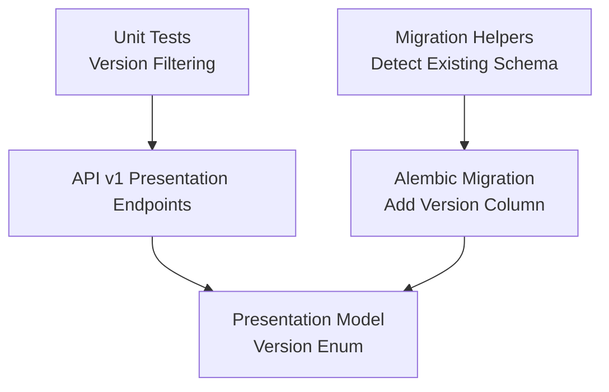
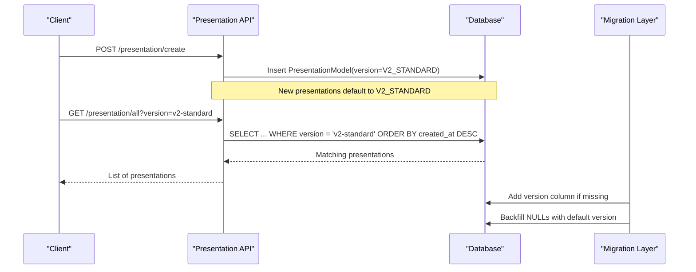
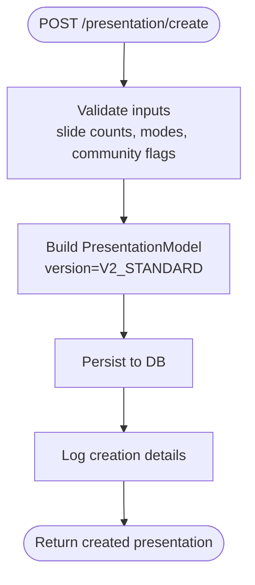
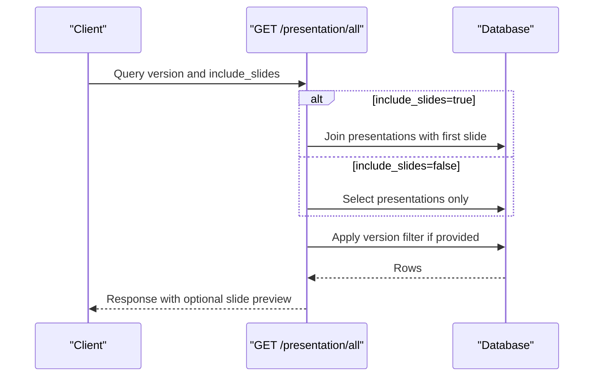
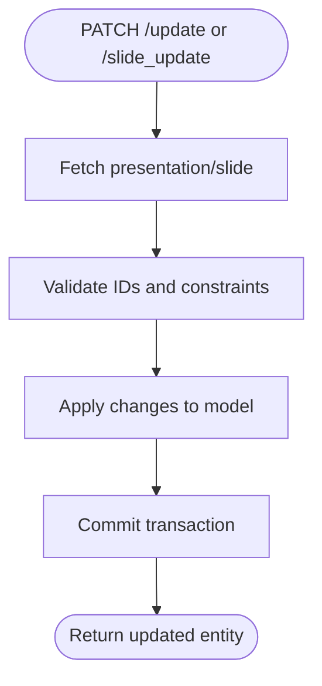
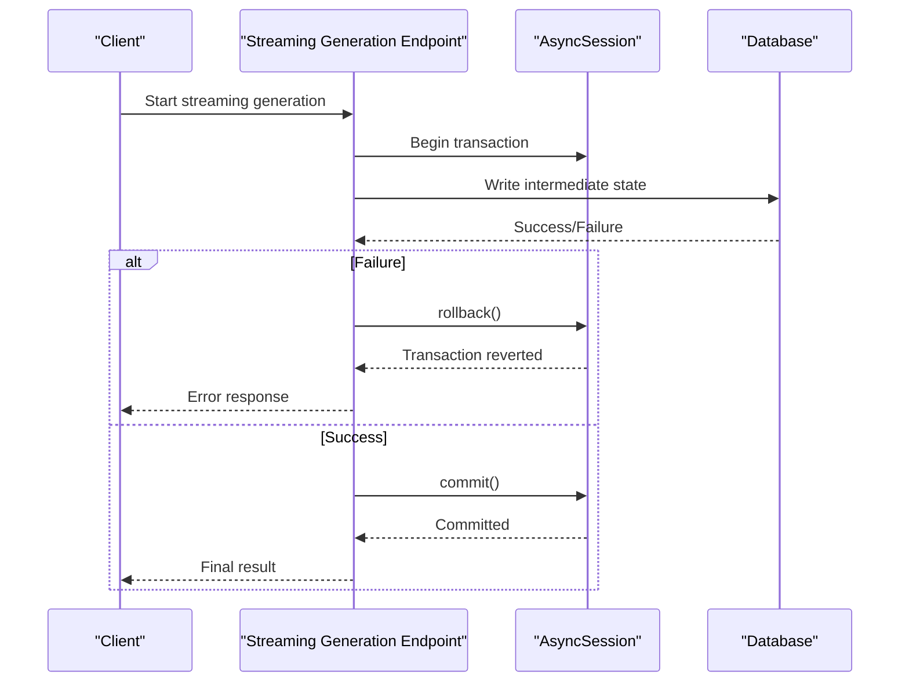
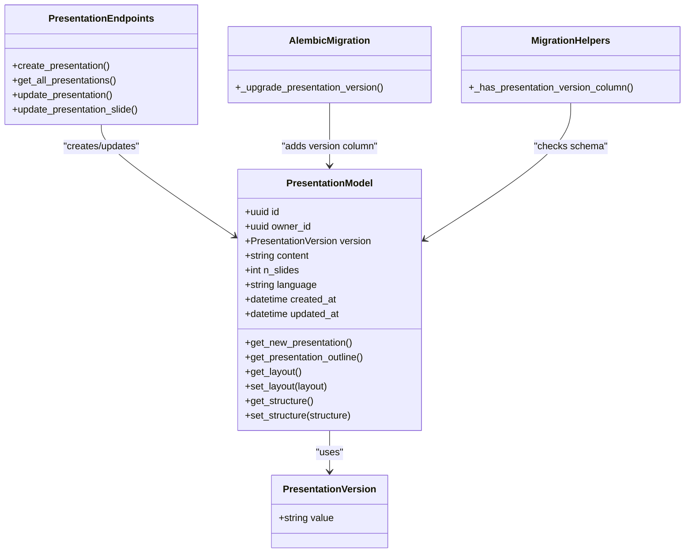

# Versioning System

<cite>
**Referenced Files in This Document**
- [presentation.py](file://servers/fastapi/models/sql/presentation.py)
- [6e4a1b2c3d5f_add_template_v2_and_presentation_version.py](file://servers/fastapi/alembic/versions/6e4a1b2c3d5f_add_template_v2_and_presentation_version.py)
- [migrations.py](file://servers/fastapi/migrations.py)
- [presentation.py](file://servers/fastapi/api/v1/ppt/endpoints/presentation.py)
- [test_presentation_list_api.py](file://servers/fastapi/tests/unit/test_presentation_list_api.py)
</cite>

## Table of Contents
1. [Introduction](#introduction)
2. [Project Structure](#project-structure)
3. [Core Components](#core-components)
4. [Architecture Overview](#architecture-overview)
5. [Detailed Component Analysis](#detailed-component-analysis)
6. [Dependency Analysis](#dependency-analysis)
7. [Performance Considerations](#performance-considerations)
8. [Troubleshooting Guide](#troubleshooting-guide)
9. [Conclusion](#conclusion)

## Introduction
This document explains the presentation versioning system used by the application. It covers how versions are created, stored, and managed; how to query presentations by version; how rollback is implemented at the database session level; and what capabilities exist for change tracking and auditability. It also clarifies which versioning features are present versus not present (for example, branching workflows, tagging, merge conflict resolution, and diff visualization).

The versioning model centers on a per-presentation schema version that distinguishes between legacy and current data formats. The API exposes endpoints to create, list, update, and export presentations, with optional filtering by version. Rollback behavior is provided through transactional sessions rather than explicit “version snapshots.”

## Project Structure
The versioning logic spans three main areas:
- Data model and version enum
- Database migrations that introduce and backfill the version column
- API endpoints that create, list, and update presentations, including version-aware queries

**Diagram sources**
- [presentation.py:16-45](file://servers/fastapi/models/sql/presentation.py#L16-L45)
- [6e4a1b2c3d5f_add_template_v2_and_presentation_version.py:79-105](file://servers/fastapi/alembic/versions/6e4a1b2c3d5f_add_template_v2_and_presentation_version.py#L79-L105)
- [migrations.py:222-227](file://servers/fastapi/migrations.py#L222-L227)
- [presentation.py:1487-1536](file://servers/fastapi/api/v1/ppt/endpoints/presentation.py#L1487-L1536)
- [test_presentation_list_api.py:41-54](file://servers/fastapi/tests/unit/test_presentation_list_api.py#L41-L54)

**Section sources**
- [presentation.py:16-45](file://servers/fastapi/models/sql/presentation.py#L16-L45)
- [6e4a1b2c3d5f_add_template_v2_and_presentation_version.py:79-105](file://servers/fastapi/alembic/versions/6e4a1b2c3d5f_add_template_v2_and_presentation_version.py#L79-L105)
- [migrations.py:222-227](file://servers/fastapi/migrations.py#L222-L227)
- [presentation.py:1487-1536](file://servers/fastapi/api/v1/ppt/endpoints/presentation.py#L1487-L1536)
- [test_presentation_list_api.py:41-54](file://servers/fastapi/tests/unit/test_presentation_list_api.py#L41-L54)

## Core Components
- PresentationModel and PresentationVersion define the persistent representation of a presentation and its schema version.
- Alembic migration adds the version column to the presentations table and backfills it.
- Migration helpers detect whether the version column exists and guide upgrade paths.
- API endpoints support creating presentations with the current version and listing them with optional version filters.

Key responsibilities:
- Version enum values: V1_STANDARD and V2_STANDARD.
- Default creation sets new presentations to V2_STANDARD.
- List endpoint supports filtering by version and ordering by creation time.
- Update endpoints modify content and slides within a transactional session.

**Section sources**
- [presentation.py:16-45](file://servers/fastapi/models/sql/presentation.py#L16-L45)
- [presentation.py:1642-1741](file://servers/fastapi/api/v1/ppt/endpoints/presentation.py#L1642-L1741)
- [presentation.py:1487-1536](file://servers/fastapi/api/v1/ppt/endpoints/presentation.py#L1487-L1536)
- [6e4a1b2c3d5f_add_template_v2_and_presentation_version.py:79-105](file://servers/fastapi/alembic/versions/6e4a1b2c3d5f_add_template_v2_and_presentation_version.py#L79-L105)
- [migrations.py:222-227](file://servers/fastapi/migrations.py#L222-L227)

## Architecture Overview
The versioning architecture integrates data modeling, migrations, and API usage:

**Diagram sources**
- [presentation.py:1642-1741](file://servers/fastapi/api/v1/ppt/endpoints/presentation.py#L1642-L1741)
- [presentation.py:1487-1536](file://servers/fastapi/api/v1/ppt/endpoints/presentation.py#L1487-L1536)
- [6e4a1b2c3d5f_add_template_v2_and_presentation_version.py:79-105](file://servers/fastapi/alembic/versions/6e4a1b2c3d5f_add_template_v2_and_presentation_version.py#L79-L105)

## Detailed Component Analysis

### Data Model and Version Enum
- PresentationVersion enumerates supported schema versions for presentations.
- PresentationModel includes a version field backed by an enum column.
- Helper methods on PresentationModel provide safe copies and conversions for outlines, layouts, and structures.

Complexity considerations:
- Copying nested JSON-like fields uses deep copy to avoid shared references when duplicating or transforming presentations.
- Enum-backed columns ensure consistent storage of version strings.

**Section sources**
- [presentation.py:16-45](file://servers/fastapi/models/sql/presentation.py#L16-L45)
- [presentation.py:83-126](file://servers/fastapi/models/sql/presentation.py#L83-L126)

### Database Migrations and Backfill
- A dedicated migration adds the version column to the presentations table.
- If the column is absent, it is added and then backfilled with a default value.
- The migration ensures the column becomes non-nullable after backfill.

Upgrade path detection:
- Migration helpers check for the presence of the version column and other schema markers to determine the correct starting revision.

**Section sources**
- [6e4a1b2c3d5f_add_template_v2_and_presentation_version.py:79-105](file://servers/fastapi/alembic/versions/6e4a1b2c3d5f_add_template_v2_and_presentation_version.py#L79-L105)
- [migrations.py:222-227](file://servers/fastapi/migrations.py#L222-L227)

### API: Creating Presentations with Versions
- The create endpoint constructs a PresentationModel with version set to V2_STANDARD.
- Input validation enforces slide count limits and feature compatibility rules.
- After insertion, the endpoint logs metadata about web search configuration.

**Diagram sources**
- [presentation.py:1642-1741](file://servers/fastapi/api/v1/ppt/endpoints/presentation.py#L1642-L1741)

**Section sources**
- [presentation.py:1642-1741](file://servers/fastapi/api/v1/ppt/endpoints/presentation.py#L1642-L1741)

### API: Listing Presentations with Version Filters
- The list endpoint supports an optional version filter.
- When include_slides is true, it joins the first slide for preview purposes.
- Results are ordered by creation time descending.

**Diagram sources**
- [presentation.py:1487-1536](file://servers/fastapi/api/v1/ppt/endpoints/presentation.py#L1487-L1536)

**Section sources**
- [presentation.py:1487-1536](file://servers/fastapi/api/v1/ppt/endpoints/presentation.py#L1487-L1536)
- [test_presentation_list_api.py:41-54](file://servers/fastapi/tests/unit/test_presentation_list_api.py#L41-L54)

### API: Updating Presentations and Slides
- Update endpoints accept partial updates to presentation metadata and slide collections.
- Slide updates validate ownership and presentation association.
- Changes are committed within a transactional session.

**Diagram sources**
- [presentation.py:2488-2578](file://servers/fastapi/api/v1/ppt/endpoints/presentation.py#L2488-L2578)

**Section sources**
- [presentation.py:2488-2578](file://servers/fastapi/api/v1/ppt/endpoints/presentation.py#L2488-L2578)

### Rollback Functionality
Rollback is implemented via SQLAlchemy async session rollback hooks in streaming generation flows. On error, the session is rolled back to prevent partial writes.

**Diagram sources**
- [presentation.py:2204-2235](file://servers/fastapi/api/v1/ppt/endpoints/presentation.py#L2204-L2235)
- [presentation.py:2474-2482](file://servers/fastapi/api/v1/ppt/endpoints/presentation.py#L2474-L2482)

**Section sources**
- [presentation.py:2204-2235](file://servers/fastapi/api/v1/ppt/endpoints/presentation.py#L2204-L2235)
- [presentation.py:2474-2482](file://servers/fastapi/api/v1/ppt/endpoints/presentation.py#L2474-L2482)

### Version Comparison APIs
There is no dedicated version comparison API. Version handling is limited to:
- Storing a fixed schema version per presentation.
- Filtering lists by version.
- Defaulting new presentations to V2_STANDARD.

If semantic version comparisons are required in the future, they would need to be implemented at the API layer using a version library.

**Section sources**
- [presentation.py:16-45](file://servers/fastapi/models/sql/presentation.py#L16-L45)
- [presentation.py:1487-1536](file://servers/fastapi/api/v1/ppt/endpoints/presentation.py#L1487-L1536)
- [presentation.py:1642-1741](file://servers/fastapi/api/v1/ppt/endpoints/presentation.py#L1642-L1741)

### Branching Workflows, Tagging, Merge Conflicts, and Diff Visualization
- Branching workflows: Not implemented. Presentations are single entities without branch concepts.
- Tagging versions: Not implemented. There is no tag or label mechanism attached to presentations.
- Merge conflict resolution: Not implemented. No merge operations or conflict resolution logic exists.
- Diff visualization: Not implemented. No diff endpoints or utilities are present for comparing presentation versions.

These features would require additional data models (branches, tags), API endpoints (merge, diff), and UI components.

[No sources needed since this section describes missing capabilities]

### Version History API and Change Tracking
- Version history API: Not implemented. There is no endpoint to retrieve historical versions of a presentation.
- Change tracking mechanisms: Not implemented. The model does not maintain a changelog or snapshot history.
- Audit trail capabilities: Not implemented. There is no audit log tied to presentation mutations.

Current persistence tracks created_at and updated_at timestamps, but these do not constitute a versioned history or audit trail.

**Section sources**
- [presentation.py:52-64](file://servers/fastapi/models/sql/presentation.py#L52-L64)

### Storage Optimization and Retention Policies
- Storage optimization: Not explicitly implemented beyond standard relational storage. No deduplication, compression, or content-addressable storage is evident in the referenced files.
- Retention policies: Not implemented. There is no policy-driven cleanup or archival mechanism for old versions or presentations.

Potential improvements could include:
- Content hashing and deduplication for repeated assets.
- Archival strategies for older presentations.
- TTL-based retention for temporary or generated artifacts.

[No sources needed since this section provides general guidance]

## Dependency Analysis
The following diagram shows relationships among core components involved in versioning:

**Diagram sources**
- [presentation.py:16-45](file://servers/fastapi/models/sql/presentation.py#L16-L45)
- [presentation.py:1642-1741](file://servers/fastapi/api/v1/ppt/endpoints/presentation.py#L1642-L1741)
- [presentation.py:1487-1536](file://servers/fastapi/api/v1/ppt/endpoints/presentation.py#L1487-L1536)
- [presentation.py:2488-2578](file://servers/fastapi/api/v1/ppt/endpoints/presentation.py#L2488-L2578)
- [6e4a1b2c3d5f_add_template_v2_and_presentation_version.py:79-105](file://servers/fastapi/alembic/versions/6e4a1b2c3d5f_add_template_v2_and_presentation_version.py#L79-L105)
- [migrations.py:222-227](file://servers/fastapi/migrations.py#L222-L227)

**Section sources**
- [presentation.py:16-45](file://servers/fastapi/models/sql/presentation.py#L16-L45)
- [presentation.py:1487-1536](file://servers/fastapi/api/v1/ppt/endpoints/presentation.py#L1487-L1536)
- [presentation.py:1642-1741](file://servers/fastapi/api/v1/ppt/endpoints/presentation.py#L1642-L1741)
- [presentation.py:2488-2578](file://servers/fastapi/api/v1/ppt/endpoints/presentation.py#L2488-L2578)
- [6e4a1b2c3d5f_add_template_v2_and_presentation_version.py:79-105](file://servers/fastapi/alembic/versions/6e4a1b2c3d5f_add_template_v2_and_presentation_version.py#L79-L105)
- [migrations.py:222-227](file://servers/fastapi/migrations.py#L222-L227)

## Performance Considerations
- Version filtering: Filtering by version avoids scanning unrelated schemas and can leverage indexes if added later.
- Slide previews: Including the first slide join improves dashboard UX but increases query cost; disable when only metadata is needed.
- Deep copying: Creating new presentations or duplicating slides performs deep copies of nested structures; consider lazy loading or selective field duplication for large payloads.
- Streaming generation: Rollback hooks protect against partial writes during long-running operations, improving consistency at the cost of potential rework on failure.

[No sources needed since this section provides general guidance]

## Troubleshooting Guide
Common issues and resolutions:
- Missing version column: Ensure migrations run successfully; the migration adds and backfills the version column.
- Unexpected version filter behavior: Verify the version parameter matches one of the defined enum values.
- Partial writes during streaming failures: Check rollback hooks and ensure error handlers invoke session.rollback().
- Duplicate or inconsistent slides: Validate slide ownership and presentation association before applying updates.

Operational checks:
- Confirm the database schema includes the version column.
- Validate that new presentations are created with V2_STANDARD.
- Review logs around creation and streaming generation for errors and rollback events.

**Section sources**
- [6e4a1b2c3d5f_add_template_v2_and_presentation_version.py:79-105](file://servers/fastapi/alembic/versions/6e4a1b2c3d5f_add_template_v2_and_presentation_version.py#L79-L105)
- [presentation.py:1642-1741](file://servers/fastapi/api/v1/ppt/endpoints/presentation.py#L1642-L1741)
- [presentation.py:2204-2235](file://servers/fastapi/api/v1/ppt/endpoints/presentation.py#L2204-L2235)
- [presentation.py:2474-2482](file://servers/fastapi/api/v1/ppt/endpoints/presentation.py#L2474-L2482)
- [presentation.py:2546-2578](file://servers/fastapi/api/v1/ppt/endpoints/presentation.py#L2546-L2578)

## Conclusion
The presentation versioning system currently provides:
- A clear schema version marker per presentation.
- Automatic assignment of V2_STANDARD for new presentations.
- Version-aware listing with optional slide previews.
- Transactional rollback during streaming generation to maintain consistency.

It does not yet implement:
- Version comparison APIs.
- Branching workflows.
- Tagging.
- Merge conflict resolution.
- Diff visualization.
- Version history, change tracking, or audit trails.
- Storage optimization or retention policies.

Future enhancements should focus on adding version comparison, history tracking, and optional advanced features like branching and merging, while ensuring backward compatibility with existing V1 and V2 presentations.