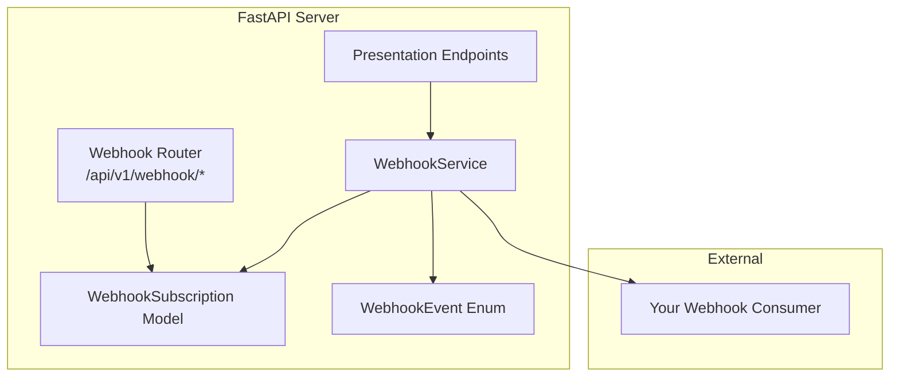
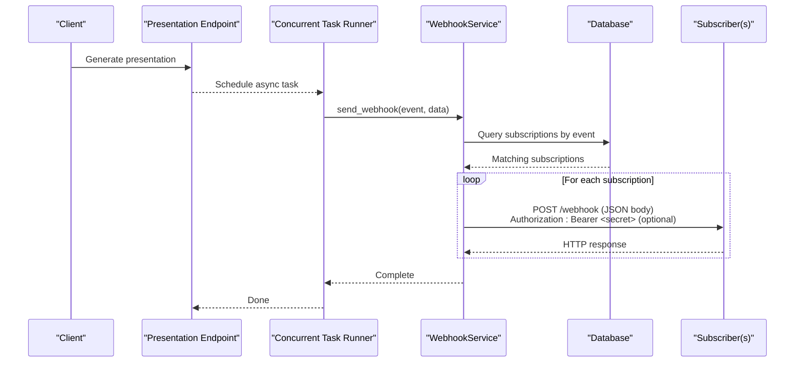
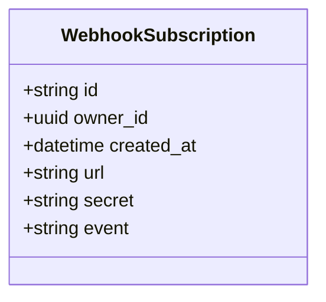
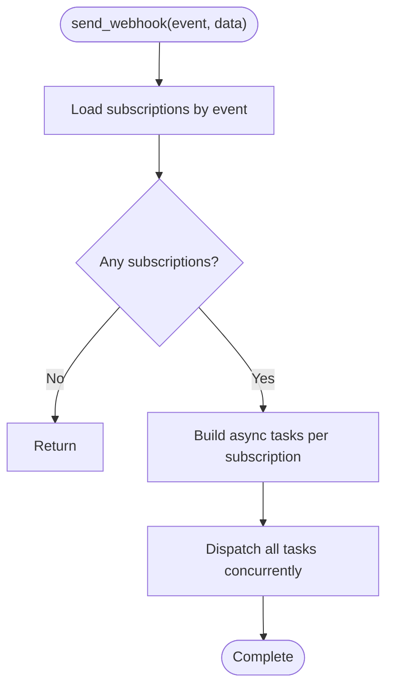
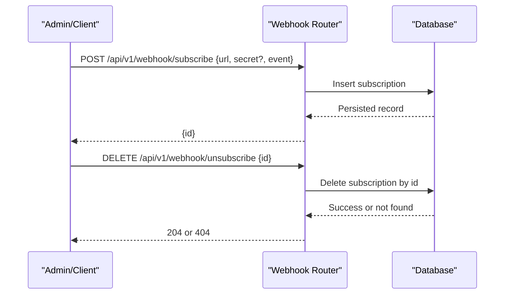
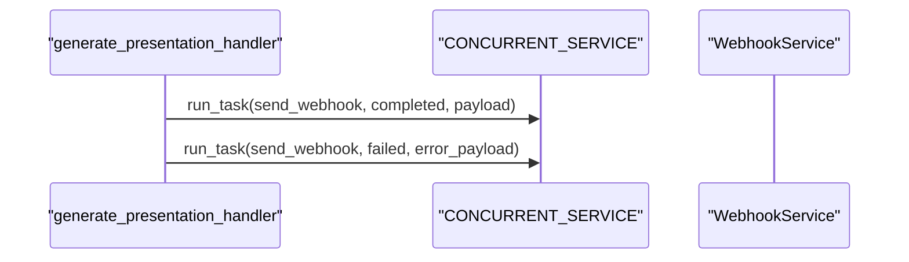
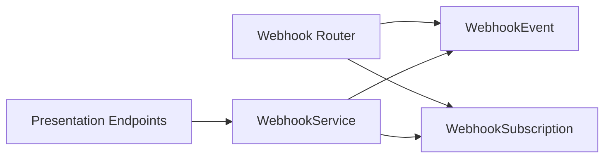

# Webhook Integration

<cite>
**Referenced Files in This Document**
- [router.py](file://servers/fastapi/api/v1/webhook/router.py)
- [webhook_event.py](file://servers/fastapi/enums/webhook_event.py)
- [webhook_subscription.py](file://servers/fastapi/models/sql/webhook_subscription.py)
- [webhook_service.py](file://servers/fastapi/services/webhook_service.py)
- [presentation.py](file://servers/fastapi/api/v1/ppt/endpoints/presentation.py)
</cite>

## Table of Contents
1. [Introduction](#introduction)
2. [Project Structure](#project-structure)
3. [Core Components](#core-components)
4. [Architecture Overview](#architecture-overview)
5. [Detailed Component Analysis](#detailed-component-analysis)
6. [Dependency Analysis](#dependency-analysis)
7. [Performance Considerations](#performance-considerations)
8. [Troubleshooting Guide](#troubleshooting-guide)
9. [Conclusion](#conclusion)

## Introduction
This document explains the webhook integration for event-driven notifications. It covers available event types, payload structures, delivery guarantees, subscription management, retry policies, failure handling, security considerations (signature verification), debugging techniques, event filtering, batching strategies, and monitoring delivery success rates. The implementation is built on FastAPI with asynchronous HTTP calls to consumer endpoints.

## Project Structure
The webhook feature spans a small set of focused modules:
- API router for managing subscriptions
- Enum defining supported event types
- Database model for storing subscriptions
- Service responsible for dispatching webhooks
- Presentation generation endpoint that triggers events

**Diagram sources**
- [router.py:10-54](file://servers/fastapi/api/v1/webhook/router.py#L10-L54)
- [webhook_event.py:4-6](file://servers/fastapi/enums/webhook_event.py#L4-L6)
- [webhook_subscription.py:12-31](file://servers/fastapi/models/sql/webhook_subscription.py#L12-L31)
- [webhook_service.py:9-55](file://servers/fastapi/services/webhook_service.py#L9-L55)
- [presentation.py:3093-3116](file://servers/fastapi/api/v1/ppt/endpoints/presentation.py#L3093-L3116)

**Section sources**
- [router.py:10-54](file://servers/fastapi/api/v1/webhook/router.py#L10-L54)
- [webhook_event.py:4-6](file://servers/fastapi/enums/webhook_event.py#L4-L6)
- [webhook_subscription.py:12-31](file://servers/fastapi/models/sql/webhook_subscription.py#L12-L31)
- [webhook_service.py:9-55](file://servers/fastapi/services/webhook_service.py#L9-L55)
- [presentation.py:3093-3116](file://servers/fastapi/api/v1/ppt/endpoints/presentation.py#L3093-L3116)

## Core Components
- Webhook Event Types: A small enum defines two events for presentation lifecycle outcomes.
- Subscription Model: Stores target URL, optional secret, and subscribed event type.
- Webhook Service: Queries active subscriptions and sends POST requests concurrently.
- Webhook Router: Provides endpoints to subscribe and unsubscribe from events.
- Trigger Points: Presentation generation flow emits success/failure events asynchronously.

Key responsibilities:
- Define events and their string identifiers
- Persist subscription metadata
- Dispatch events to all matching subscribers
- Integrate with presentation generation workflow

**Section sources**
- [webhook_event.py:4-6](file://servers/fastapi/enums/webhook_event.py#L4-L6)
- [webhook_subscription.py:12-31](file://servers/fastapi/models/sql/webhook_subscription.py#L12-L31)
- [webhook_service.py:9-55](file://servers/fastapi/services/webhook_service.py#L9-L55)
- [router.py:10-54](file://servers/fastapi/api/v1/webhook/router.py#L10-L54)
- [presentation.py:3093-3116](file://servers/fastapi/api/v1/ppt/endpoints/presentation.py#L3093-L3116)

## Architecture Overview
The webhook system integrates into the presentation generation pipeline. On success or failure, the server triggers an asynchronous task that:
1. Loads all subscriptions for the relevant event
2. Sends a POST request to each subscriber concurrently
3. Uses an optional secret as a Bearer token in the Authorization header

**Diagram sources**
- [presentation.py:3093-3116](file://servers/fastapi/api/v1/ppt/endpoints/presentation.py#L3093-L3116)
- [webhook_service.py:11-55](file://servers/fastapi/services/webhook_service.py#L11-L55)
- [webhook_subscription.py:12-31](file://servers/fastapi/models/sql/webhook_subscription.py#L12-L31)

## Detailed Component Analysis

### Webhook Event Types
- presentation.generation.completed: Emitted when presentation generation succeeds.
- presentation.generation.failed: Emitted when presentation generation fails.

These are defined as string-valued enums and used throughout the service and trigger points.

**Section sources**
- [webhook_event.py:4-6](file://servers/fastapi/enums/webhook_event.py#L4-L6)

### Webhook Subscription Model
Fields:
- id: Unique identifier for the subscription
- owner_id: Optional user association
- created_at: Timestamp of creation
- url: Target webhook endpoint
- secret: Optional secret used for authentication
- event: Event type string to subscribe to

Indexes:
- event is indexed to speed up lookup during dispatch.

**Diagram sources**
- [webhook_subscription.py:12-31](file://servers/fastapi/models/sql/webhook_subscription.py#L12-L31)

**Section sources**
- [webhook_subscription.py:12-31](file://servers/fastapi/models/sql/webhook_subscription.py#L12-L31)

### Webhook Service
Responsibilities:
- Find all subscriptions matching the event
- Send concurrent POST requests to each subscriber
- Attach optional Authorization header using the stored secret
- Handle exceptions without failing the caller

Delivery characteristics:
- Fire-and-forget: Exceptions are caught and logged; no retries are implemented.
- Concurrency: All matching subscribers are contacted concurrently via gather.

**Diagram sources**
- [webhook_service.py:11-55](file://servers/fastapi/services/webhook_service.py#L11-L55)

**Section sources**
- [webhook_service.py:11-55](file://servers/fastapi/services/webhook_service.py#L11-L55)

### Webhook Router (Subscription Management)
Endpoints:
- POST /api/v1/webhook/subscribe
  - Request fields: url, secret (optional), event
  - Response: subscription id
  - Status: 201 Created
- DELETE /api/v1/webhook/unsubscribe
  - Body field: id
  - Behavior: Deletes the subscription if found; returns 404 if not found
  - Status: 204 No Content

**Diagram sources**
- [router.py:13-54](file://servers/fastapi/api/v1/webhook/router.py#L13-L54)

**Section sources**
- [router.py:13-54](file://servers/fastapi/api/v1/webhook/router.py#L13-L54)

### Trigger Points in Presentation Generation
On successful generation:
- An async task is scheduled to emit presentation.generation.completed with the presentation result payload.

On failure:
- An async task is scheduled to emit presentation.generation.failed with an error model payload.

**Diagram sources**
- [presentation.py:3093-3116](file://servers/fastapi/api/v1/ppt/endpoints/presentation.py#L3093-L3116)

**Section sources**
- [presentation.py:3093-3116](file://servers/fastapi/api/v1/ppt/endpoints/presentation.py#L3093-L3116)

## Dependency Analysis
- Router depends on:
  - WebhookEvent enum
  - WebhookSubscription model
  - Database session dependency
- Service depends on:
  - WebhookEvent enum
  - WebhookSubscription model
  - Database session dependency
  - aiohttp for outbound HTTP
- Presentation endpoints depend on:
  - WebhookService
  - Concurrent task runner

**Diagram sources**
- [router.py:1-54](file://servers/fastapi/api/v1/webhook/router.py#L1-L54)
- [webhook_service.py:1-55](file://servers/fastapi/services/webhook_service.py#L1-L55)
- [presentation.py:3093-3116](file://servers/fastapi/api/v1/ppt/endpoints/presentation.py#L3093-L3116)

**Section sources**
- [router.py:1-54](file://servers/fastapi/api/v1/webhook/router.py#L1-L54)
- [webhook_service.py:1-55](file://servers/fastapi/services/webhook_service.py#L1-L55)
- [presentation.py:3093-3116](file://servers/fastapi/api/v1/ppt/endpoints/presentation.py#L3093-L3116)

## Performance Considerations
- Concurrency: All matching subscribers are dispatched concurrently, minimizing latency but increasing outbound load.
- I/O-bound operations: Outbound HTTP calls are non-blocking due to aiohttp.
- Database queries: Event-based lookups leverage indexing on the event column.
- Error isolation: Exceptions in individual deliveries do not fail others.

Recommendations:
- Monitor outbound connection pool limits and timeouts.
- Ensure consumers can handle concurrent requests.
- Consider rate limiting at the consumer side to avoid overload.

[No sources needed since this section provides general guidance]

## Troubleshooting Guide

Common issues and resolutions:
- No events received:
  - Verify subscription exists and matches the event type.
  - Confirm the consumer endpoint is reachable and accepts POST JSON.
- Authentication failures:
  - If a secret was provided, ensure your consumer validates the Authorization Bearer token.
- Delivery failures:
  - Current implementation does not retry; check logs for exceptions and fix transient issues before re-triggering the source event.
- Debugging:
  - Inspect outbound requests and responses at your consumer.
  - Validate headers and payload structure.
  - Use logging on both sides to correlate events.

Security considerations:
- Signature verification:
  - The current implementation uses a shared secret passed as a Bearer token in the Authorization header. There is no HMAC signature in the request body or headers.
  - Consumers should validate the Authorization header against the configured secret.
  - For stronger integrity guarantees, consider adding a timestamp and HMAC-SHA256 signature over the payload and verifying it on the consumer side.
- Transport security:
  - Always use HTTPS for webhook URLs to protect payloads in transit.
- Secret management:
  - Store secrets securely and rotate periodically.

Monitoring delivery success rates:
- Track HTTP status codes returned by your consumer.
- Maintain counters for delivered, failed, and retried events.
- Alert on sustained failure rates or latency spikes.

[No sources needed since this section provides general guidance]

## Conclusion
The webhook integration provides a simple, asynchronous notification mechanism tied to presentation generation outcomes. Subscriptions are managed via REST endpoints, and events are dispatched concurrently to all matching subscribers. While the current design lacks retries and advanced signature verification, it offers a solid foundation that can be extended with robust reliability, observability, and security features.

[No sources needed since this section summarizes without analyzing specific files]