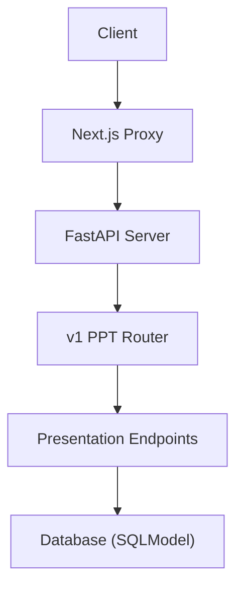
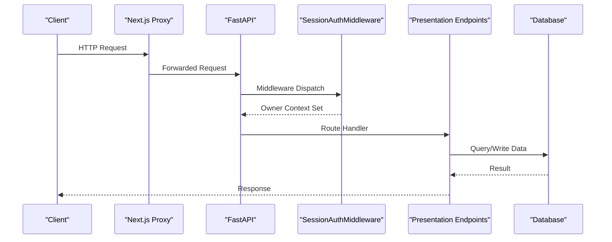
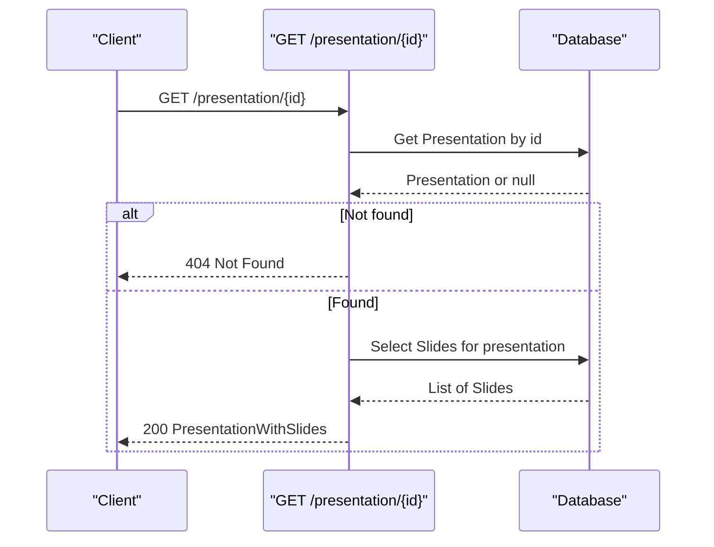
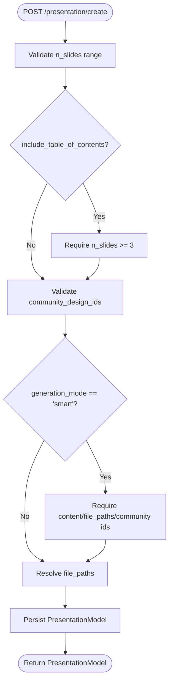
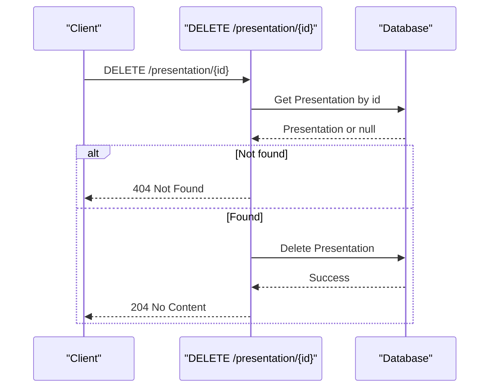
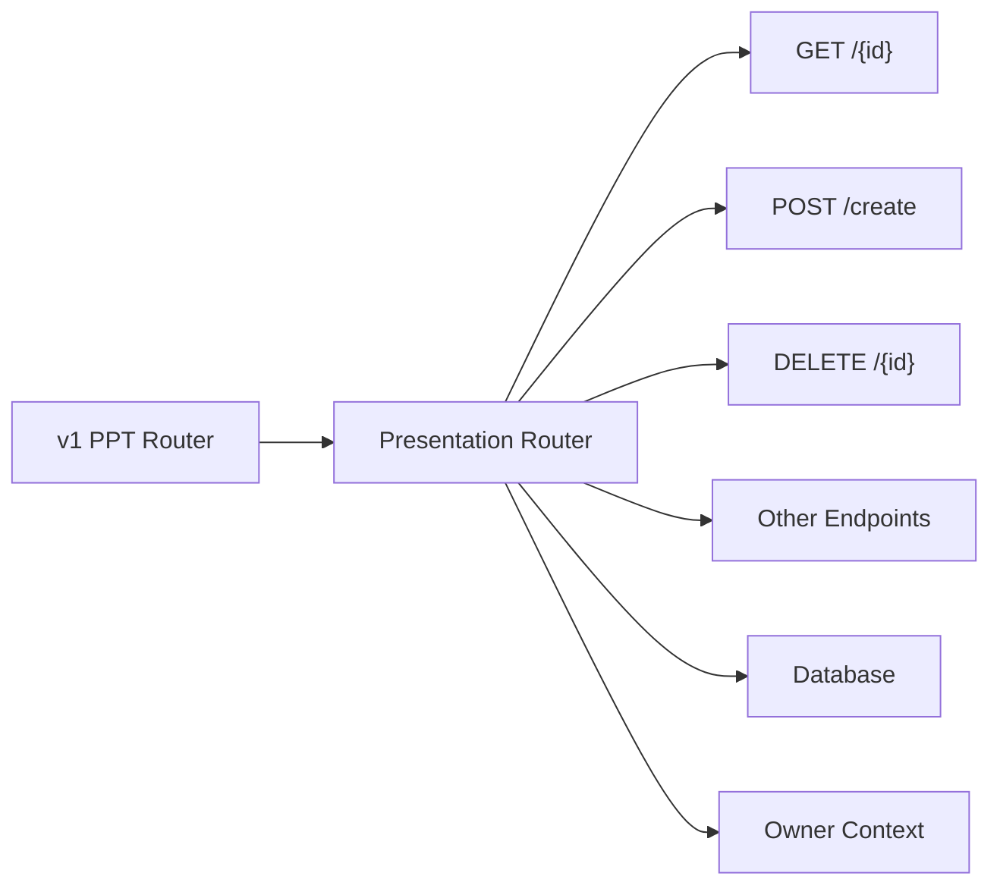

# Basic CRUD Operations

<cite>
**Referenced Files in This Document**
- [router.py](file://servers/fastapi/api/v1/ppt/router.py)
- [presentation.py](file://servers/fastapi/api/v1/ppt/endpoints/presentation.py)
- [presentation_model.py](file://servers/fastapi/models/sql/presentation.py)
- [slide_model.py](file://servers/fastapi/models/sql/slide.py)
- [presentation_with_slides_model.py](file://servers/fastapi/models/presentation_with_slides.py)
- [middlewares.py](file://servers/fastapi/api/middlewares.py)
- [auth_router.py](file://servers/fastapi/api/v1/auth/router.py)
- [proxy.ts](file://servers/nextjs/proxy.ts)
</cite>

## Table of Contents
1. [Introduction](#introduction)
2. [Project Structure](#project-structure)
3. [Core Components](#core-components)
4. [Architecture Overview](#architecture-overview)
5. [Detailed Component Analysis](#detailed-component-analysis)
6. [Dependency Analysis](#dependency-analysis)
7. [Performance Considerations](#performance-considerations)
8. [Troubleshooting Guide](#troubleshooting-guide)
9. [Conclusion](#conclusion)

## Introduction
This document provides API documentation for basic presentation CRUD operations:
- GET /api/v1/ppt/presentation/{id}
- POST /api/v1/ppt/presentation/create
- PUT /api/v1/ppt/presentation/{id}
- DELETE /api/v1/ppt/presentation/{id}

It includes request/response schemas, authentication requirements, error handling, validation rules, and practical examples. Where an operation is not implemented, this is explicitly noted.

## Project Structure
The presentation endpoints are mounted under the v1 PPT router and include a dedicated presentation router with routes such as get, create, delete, duplicate, export, prepare, stream, generate, edit, and derive. The core data model for presentations is defined separately from the endpoint logic.

**Diagram sources**
- [router.py:22-40](file://servers/fastapi/api/v1/ppt/router.py#L22-L40)
- [presentation.py:134-134](file://servers/fastapi/api/v1/ppt/endpoints/presentation.py#L134-L134)

**Section sources**
- [router.py:22-40](file://servers/fastapi/api/v1/ppt/router.py#L22-L40)
- [presentation.py:134-134](file://servers/fastapi/api/v1/ppt/endpoints/presentation.py#L134-L134)

## Core Components
- Presentation Model: Defines persistent fields such as id, owner_id, version, content, n_slides, language, title, file_paths, outlines, layout, structure, instructions, tone, verbosity, include_table_of_contents, include_title_slide, web_search, theme, fonts, generation_mode, community_design_ids, created_at, updated_at.
- Slide Model: Represents individual slides associated with a presentation.
- PresentationWithSlides: Response model that wraps a presentation plus its slides.

Key responsibilities:
- Endpoints handle HTTP routing, input validation, business checks, and persistence.
- Models define schema and relationships.
- Middlewares enforce session-based authentication and ownership context.

**Section sources**
- [presentation_model.py:21-81](file://servers/fastapi/models/sql/presentation.py#L21-L81)
- [presentation_with_slides_model.py](file://servers/fastapi/models/presentation_with_slides.py)
- [slide_model.py](file://servers/fastapi/models/sql/slide.py)

## Architecture Overview
Authentication and authorization flow:
- Next.js proxy forwards requests to FastAPI.
- FastAPI SessionAuthMiddleware resolves the current user/session and sets ownership context.
- Endpoints use the session to read/write resources.

**Diagram sources**
- [proxy.ts:43-54](file://servers/nextjs/proxy.ts#L43-L54)
- [middlewares.py:29-39](file://servers/fastapi/api/middlewares.py#L29-L39)
- [presentation.py:1539-1557](file://servers/fastapi/api/v1/ppt/endpoints/presentation.py#L1539-L1557)

## Detailed Component Analysis

### GET /api/v1/ppt/presentation/{id}
Retrieves a single presentation by ID along with its slides.

- Method: GET
- Path: /api/v1/ppt/presentation/{id}
- Authentication: Required via session or admin API key (see Authentication section).
- Path Parameters:
  - id: UUID of the presentation.
- Success Response: 200 OK
  - Body: PresentationWithSlides object containing presentation fields plus an array of slides.
- Error Responses:
  - 404 Not Found: When the presentation does not exist.

Request example:
- GET /api/v1/ppt/presentation/550e8400-e29b-41d4-a716-446655440000

Response example (simplified):
- {
    "id": "550e8400-e29b-41d4-a716-446655440000",
    "title": "My Presentation",
    "content": "...",
    "n_slides": 5,
    "language": "English",
    "type": "standard",
    "slides": [
      {
        "id": "...",
        "index": 0,
        "content": {},
        "html_content": "
...
"
      }
    ]
  }

Validation and business logic:
- Validates presence of the presentation by primary key.
- Loads slides ordered by index.
- Returns a response model that excludes internal layout/structure details.

**Diagram sources**
- [presentation.py:1539-1557](file://servers/fastapi/api/v1/ppt/endpoints/presentation.py#L1539-L1557)

**Section sources**
- [presentation.py:1539-1557](file://servers/fastapi/api/v1/ppt/endpoints/presentation.py#L1539-L1557)
- [presentation_model.py:21-81](file://servers/fastapi/models/sql/presentation.py#L21-L81)

### POST /api/v1/ppt/presentation/create
Creates a new presentation record with optional generation settings.

- Method: POST
- Path: /api/v1/ppt/presentation/create
- Authentication: Required via session or admin API key.
- Request Body Fields:
  - content: string (required)
  - n_slides: integer (optional; must be > 0 if provided; bounded by server limit)
  - language: string (optional)
  - file_paths: array of strings (optional; validated against temp files)
  - tone: enum (default value applied)
  - verbosity: enum (default value applied)
  - instructions: string (optional)
  - include_table_of_contents: boolean (default false)
  - include_title_slide: boolean (default true)
  - web_search: boolean (default false)
  - generation_mode: "standard" | "smart" (default "standard")
  - community_design_ids: array of integers (optional; requires smart mode and feature enabled)
- Success Response: 201 Created
  - Body: PresentationModel (without slides).
- Error Responses:
  - 400 Bad Request: Invalid slide count, invalid combination of options, template issues.
  - 422 Unprocessable Entity: Community references disabled when requested.

Validation rules and business logic:
- n_slides must be greater than 0 if provided.
- n_slides cannot exceed MAX_NUMBER_OF_SLIDES.
- If include_table_of_contents is true, n_slides must be at least 3.
- community_design_ids require generation_mode == "smart" and community feature enabled.
- Smart mode requires at least one of content, file_paths, or community_design_ids.
- file_paths are resolved against existing temporary files.
- Stored values normalize language, tone, verbosity, and flags.

**Diagram sources**
- [presentation.py:1642-1741](file://servers/fastapi/api/v1/ppt/endpoints/presentation.py#L1642-L1741)

**Section sources**
- [presentation.py:1642-1741](file://servers/fastapi/api/v1/ppt/endpoints/presentation.py#L1642-L1741)
- [presentation_model.py:21-81](file://servers/fastapi/models/sql/presentation.py#L21-L81)

### PUT /api/v1/ppt/presentation/{id}
Not implemented. There is no PUT route for updating an existing presentation in the presentation router.

- Method: PUT
- Path: /api/v1/ppt/presentation/{id}
- Status: Not Implemented
- Behavior: Clients should use alternative update flows if available (for example, slide-level updates or other endpoints), but there is no direct presentation update endpoint documented here.

**Section sources**
- [presentation.py:1539-1741](file://servers/fastapi/api/v1/ppt/endpoints/presentation.py#L1539-L1741)

### DELETE /api/v1/ppt/presentation/{id}
Removes a presentation by ID.

- Method: DELETE
- Path: /api/v1/ppt/presentation/{id}
- Authentication: Required via session or admin API key.
- Path Parameters:
  - id: UUID of the presentation.
- Success Response: 204 No Content
- Error Responses:
  - 404 Not Found: When the presentation does not exist.

Behavior:
- Retrieves the presentation by ID.
- Deletes it from the database and commits the transaction.

**Diagram sources**
- [presentation.py:1560-1570](file://servers/fastapi/api/v1/ppt/endpoints/presentation.py#L1560-L1570)

**Section sources**
- [presentation.py:1560-1570](file://servers/fastapi/api/v1/ppt/endpoints/presentation.py#L1560-L1570)

## Dependency Analysis
- Router Mounting:
  - The v1 PPT router mounts the presentation router, exposing all presentation-related endpoints under /api/v1/ppt/presentation.
- Endpoint Dependencies:
  - Endpoints depend on async database sessions, models, and utility services.
- Authentication Dependencies:
  - SessionAuthMiddleware enforces authentication and sets ownership context used by endpoints and models.

**Diagram sources**
- [router.py:22-40](file://servers/fastapi/api/v1/ppt/router.py#L22-L40)
- [presentation.py:134-134](file://servers/fastapi/api/v1/ppt/endpoints/presentation.py#L134-L134)

**Section sources**
- [router.py:22-40](file://servers/fastapi/api/v1/ppt/router.py#L22-L40)
- [presentation.py:134-134](file://servers/fastapi/api/v1/ppt/endpoints/presentation.py#L134-L134)

## Performance Considerations
- GET returns both presentation metadata and slides; consider pagination or filtering if large decks are expected.
- DELETE performs a single row deletion; ensure referential integrity is handled by the database layer.
- CREATE validates inputs early to avoid unnecessary work; keep payload minimal.

[No sources needed since this section provides general guidance]

## Troubleshooting Guide
Common errors and resolutions:
- 404 Not Found: Occurs when the requested presentation does not exist. Verify the ID and access permissions.
- 400 Bad Request: Occurs for invalid slide counts, insufficient slides when including table of contents, or invalid combinations of generation options. Adjust request parameters accordingly.
- 422 Unprocessable Entity: Occurs when community references are requested but the feature is disabled. Disable community references or enable the feature.

Authentication notes:
- Session-based authentication is enforced by middleware. Ensure a valid session cookie or admin API key is present.
- The Next.js proxy forwards requests and may set cookies for certain flows.

**Section sources**
- [presentation.py:1539-1741](file://servers/fastapi/api/v1/ppt/endpoints/presentation.py#L1539-L1741)
- [middlewares.py:29-39](file://servers/fastapi/api/middlewares.py#L29-L39)
- [proxy.ts:43-54](file://servers/nextjs/proxy.ts#L43-L54)

## Conclusion
- GET /api/v1/ppt/presentation/{id}: Implemented; returns presentation with slides.
- POST /api/v1/ppt/presentation/create: Implemented; creates a presentation with validation and business rules.
- PUT /api/v1/ppt/presentation/{id}: Not implemented; no direct update endpoint exists.
- DELETE /api/v1/ppt/presentation/{id}: Implemented; deletes a presentation.

For updates, use alternative flows such as slide-level updates or other endpoints exposed by the service.

[No sources needed since this section summarizes without analyzing specific files]