# Outline Processing & Structure

<cite>
**Referenced Files in This Document**
- [presentation_outline_model.py](file://servers/fastapi/models/presentation_outline_model.py)
- [presentation_structure_model.py](file://servers/fastapi/models/presentation_structure_model.py)
- [generate_presentation_outlines.py](file://servers/fastapi/utils/llm_calls/generate_presentation_outlines.py)
- [outline_utils.py](file://servers/fastapi/utils/outline_utils.py)
- [outline_limits.py](file://servers/fastapi/utils/outline_limits.py)
- [get_dynamic_models.py](file://servers/fastapi/utils/get_dynamic_models.py)
- [test_generate_presentation_outlines.py](file://servers/fastapi/tests/unit/test_generate_presentation_outlines.py)
- [test_outline_utils.py](file://servers/fastapi/tests/unit/test_outline_utils.py)
</cite>

## Table of Contents
1. [Introduction](#introduction)
2. [Project Structure](#project-structure)
3. [Core Components](#core-components)
4. [Architecture Overview](#architecture-overview)
5. [Detailed Component Analysis](#detailed-component-analysis)
6. [Dependency Analysis](#dependency-analysis)
7. [Performance Considerations](#performance-considerations)
8. [Troubleshooting Guide](#troubleshooting-guide)
9. [Conclusion](#conclusion)

## Introduction
This document explains how raw presentation content is converted into structured slide outlines and how those outlines map to final slide structure. It focuses on:

- The `generate_ppt_outline` function that orchestrates LLM-based outline generation, optional web search enrichment, streaming JSON output, and error handling.
- The `PresentationOutlineModel` and `SlideOutlineModel` schemas that define the expected outline shape, including title-like Markdown headings, audience-facing content, and constraints.
- Outline normalization, word limits, image extraction, and table of contents generation.
- How outline items relate to template layouts through the `PresentationStructureModel`.

The goal is to make the outline processing pipeline clear for both technical and non-technical readers.

## Project Structure
The outline processing logic lives primarily under the FastAPI backend:

- Models define the data contracts for outlines and structure.
- Utilities normalize, validate, enrich, and transform outlines.
- LLM call utilities generate outlines using structured JSON responses.
- Unit tests verify behavior, schema validation, and edge cases.

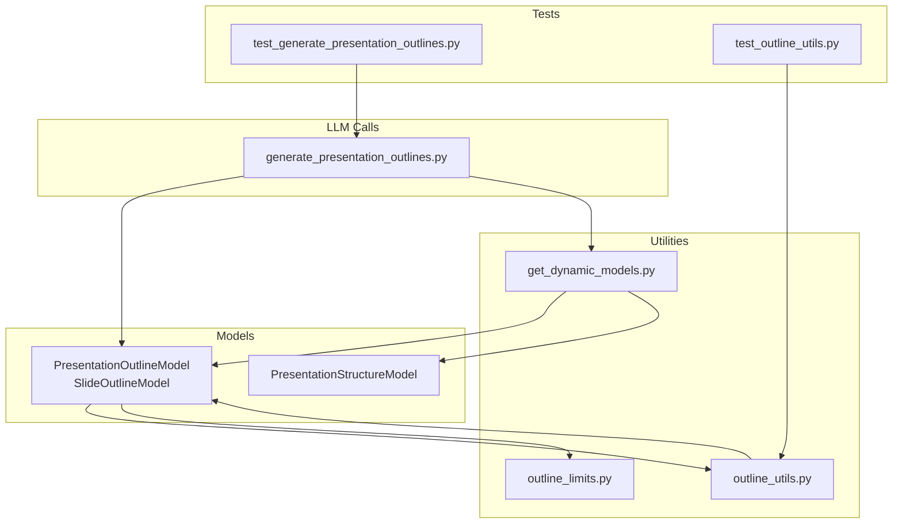

**Diagram sources**
- [presentation_outline_model.py:1-36](file://servers/fastapi/models/presentation_outline_model.py#L1-L36)
- [presentation_structure_model.py:1-7](file://servers/fastapi/models/presentation_structure_model.py#L1-L7)
- [generate_presentation_outlines.py:1-405](file://servers/fastapi/utils/llm_calls/generate_presentation_outlines.py#L1-L405)
- [outline_utils.py:1-206](file://servers/fastapi/utils/outline_utils.py#L1-L206)
- [outline_limits.py:1-69](file://servers/fastapi/utils/outline_limits.py#L1-L69)
- [get_dynamic_models.py:1-41](file://servers/fastapi/utils/get_dynamic_models.py#L1-L41)
- [test_generate_presentation_outlines.py:1-441](file://servers/fastapi/tests/unit/test_generate_presentation_outlines.py#L1-L441)
- [test_outline_utils.py:1-122](file://servers/fastapi/tests/unit/test_outline_utils.py#L1-L122)

**Section sources**
- [presentation_outline_model.py:1-36](file://servers/fastapi/models/presentation_outline_model.py#L1-L36)
- [presentation_structure_model.py:1-7](file://servers/fastapi/models/presentation_structure_model.py#L1-L7)
- [generate_presentation_outlines.py:1-405](file://servers/fastapi/utils/llm_calls/generate_presentation_outlines.py#L1-L405)
- [outline_utils.py:1-206](file://servers/fastapi/utils/outline_utils.py#L1-L206)
- [outline_limits.py:1-69](file://servers/fastapi/utils/outline_limits.py#L1-L69)
- [get_dynamic_models.py:1-41](file://servers/fastapi/utils/get_dynamic_models.py#L1-L41)
- [test_generate_presentation_outlines.py:1-441](file://servers/fastapi/tests/unit/test_generate_presentation_outlines.py#L1-L441)
- [test_outline_utils.py:1-122](file://servers/fastapi/tests/unit/test_outline_utils.py#L1-L122)

## Core Components
This section summarizes the core models and functions involved in outline processing.

- `SlideOutlineModel`: Represents one slide’s audience-facing Markdown content with a strict word limit enforced by a validator.
- `PresentationOutlineModel`: Holds a list of `SlideOutlineModel` slides with an overall maximum number of slides.
- `PresentationStructureModel`: Holds a list of integer layout indexes used to map outline items to template layouts.
- `generate_ppt_outline`: Orchestrates prompt construction, optional web search enrichment, structured JSON streaming, and error handling.
- `outline_utils`: Provides helpers for extracting presentation titles, generating table of contents slides, splitting sections, and extracting image URLs from outline content.
- `outline_limits`: Normalizes and trims outline content to enforce word limits and payload shapes.
- `get_dynamic_models`: Creates Pydantic models with stricter length constraints when a fixed number of slides is requested.

**Section sources**
- [presentation_outline_model.py:8-36](file://servers/fastapi/models/presentation_outline_model.py#L8-L36)
- [presentation_structure_model.py:5-7](file://servers/fastapi/models/presentation_structure_model.py#L5-L7)
- [generate_presentation_outlines.py:66-248](file://servers/fastapi/utils/llm_calls/generate_presentation_outlines.py#L66-L248)
- [generate_presentation_outlines.py:251-405](file://servers/fastapi/utils/llm_calls/generate_presentation_outlines.py#L251-L405)
- [outline_utils.py:19-41](file://servers/fastapi/utils/outline_utils.py#L19-L41)
- [outline_utils.py:84-137](file://servers/fastapi/utils/outline_utils.py#L84-L137)
- [outline_utils.py:184-205](file://servers/fastapi/utils/outline_utils.py#L184-L205)
- [outline_limits.py:11-34](file://servers/fastapi/utils/outline_limits.py#L11-L34)
- [outline_limits.py:37-68](file://servers/fastapi/utils/outline_limits.py#L37-L68)
- [get_dynamic_models.py:11-29](file://servers/fastapi/utils/get_dynamic_models.py#L11-L29)

## Architecture Overview
The outline generation architecture connects user input, configuration, optional web search, LLM streaming, and post-processing utilities.

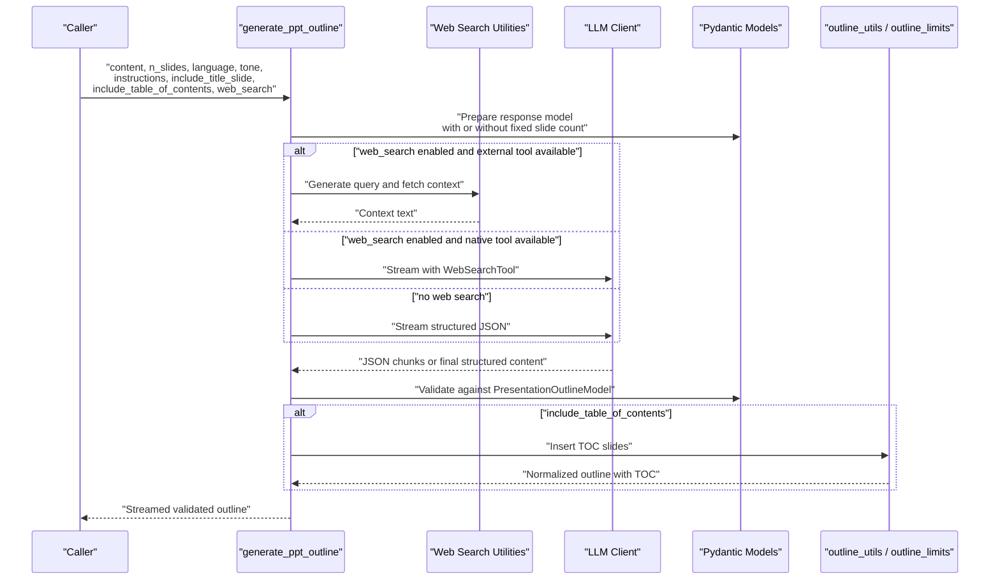

**Diagram sources**
- [generate_presentation_outlines.py:66-248](file://servers/fastapi/utils/llm_calls/generate_presentation_outlines.py#L66-L248)
- [generate_presentation_outlines.py:251-405](file://servers/fastapi/utils/llm_calls/generate_presentation_outlines.py#L251-L405)
- [outline_utils.py:84-137](file://servers/fastapi/utils/outline_utils.py#L84-L137)
- [get_dynamic_models.py:11-29](file://servers/fastapi/utils/get_dynamic_models.py#L11-L29)

## Detailed Component Analysis

### PresentationOutlineModel and SlideOutlineModel
These Pydantic models define the contract for generated outlines.

- `SlideOutlineModel.content`: Audience-facing Markdown content. A validator normalizes and trims it to a maximum word count.
- `PresentationOutlineModel.slides`: List of slide outlines with a maximum total slide count.
- `to_string`: Utility method to serialize the outline for debugging or logging.

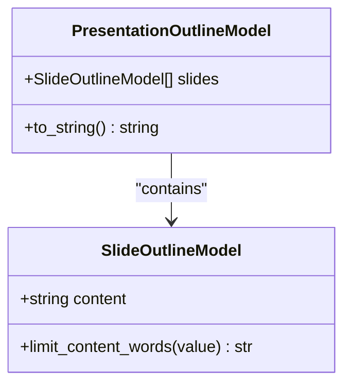

**Diagram sources**
- [presentation_outline_model.py:8-36](file://servers/fastapi/models/presentation_outline_model.py#L8-L36)

**Section sources**
- [presentation_outline_model.py:8-36](file://servers/fastapi/models/presentation_outline_model.py#L8-L36)
- [outline_limits.py:11-34](file://servers/fastapi/utils/outline_limits.py#L11-L34)

### PresentationStructureModel
This model represents the mapping from outline items to template layouts.

- `slides`: A list of integer layout indexes indicating which template layout should be used for each slide.

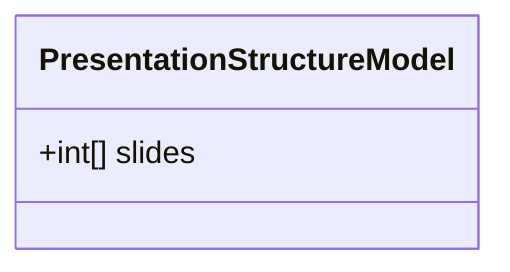

**Diagram sources**
- [presentation_structure_model.py:5-7](file://servers/fastapi/models/presentation_structure_model.py#L5-L7)

**Section sources**
- [presentation_structure_model.py:1-7](file://servers/fastapi/models/presentation_structure_model.py#L1-L7)

### Dynamic Model Generation for Fixed Slide Counts
When a fixed number of slides is requested, dynamic models are created to enforce stricter lengths.

- `get_presentation_outline_model_with_n_slides`: Returns a subclass of `PresentationOutlineModel` where each slide’s content has minimum and maximum length constraints and the slides list must have exactly the requested length.
- `get_presentation_structure_model_with_n_slides`: Returns a subclass of `PresentationStructureModel` where the layout index list must have exactly the requested length.

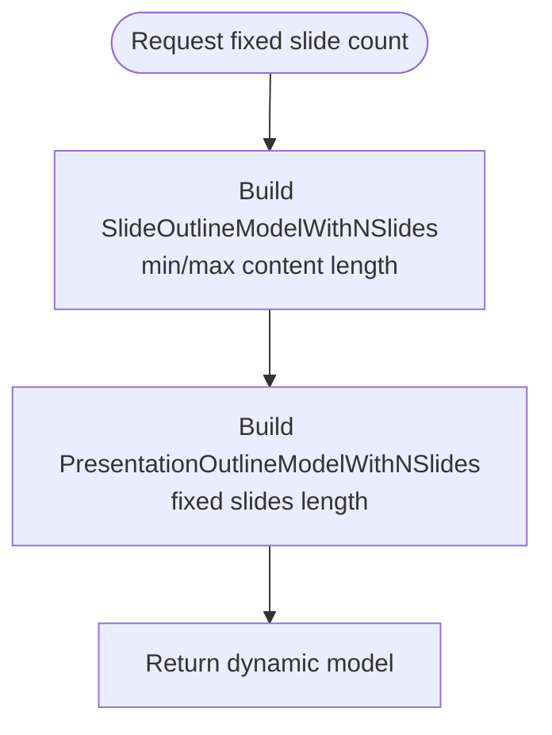

**Diagram sources**
- [get_dynamic_models.py:11-29](file://servers/fastapi/utils/get_dynamic_models.py#L11-L29)
- [get_dynamic_models.py:32-40](file://servers/fastapi/utils/get_dynamic_models.py#L32-L40)

**Section sources**
- [get_dynamic_models.py:11-29](file://servers/fastapi/utils/get_dynamic_models.py#L11-L29)
- [get_dynamic_models.py:32-40](file://servers/fastapi/utils/get_dynamic_models.py#L32-L40)

### generate_ppt_outline Function
This function converts raw content into structured slide outlines.

Key responsibilities:

- Prompt construction: Builds system and user prompts with authoritative settings for language, tone, verbosity, slide count, title slide inclusion, and table of contents inclusion.
- Web search integration: Optionally generates a search query, fetches context, and injects it into additional context. Supports both native model tools and external providers.
- Structured streaming: Streams JSON chunks and final structured content, then validates against the selected Pydantic model.
- Error handling: Wraps exceptions and yields normalized HTTP-style errors.

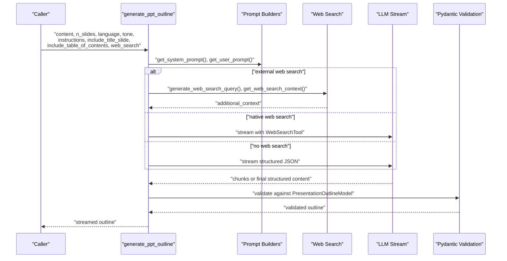

**Diagram sources**
- [generate_presentation_outlines.py:66-248](file://servers/fastapi/utils/llm_calls/generate_presentation_outlines.py#L66-L248)
- [generate_presentation_outlines.py:251-405](file://servers/fastapi/utils/llm_calls/generate_presentation_outlines.py#L251-L405)

**Section sources**
- [generate_presentation_outlines.py:66-248](file://servers/fastapi/utils/llm_calls/generate_presentation_outlines.py#L66-L248)
- [generate_presentation_outlines.py:251-405](file://servers/fastapi/utils/llm_calls/generate_presentation_outlines.py#L251-L405)
- [test_generate_presentation_outlines.py:101-108](file://servers/fastapi/tests/unit/test_generate_presentation_outlines.py#L101-L108)
- [test_generate_presentation_outlines.py:157-184](file://servers/fastapi/tests/unit/test_generate_presentation_outlines.py#L157-L184)
- [test_generate_presentation_outlines.py:186-220](file://servers/fastapi/tests/unit/test_generate_presentation_outlines.py#L186-L220)
- [test_generate_presentation_outlines.py:223-263](file://servers/fastapi/tests/unit/test_generate_presentation_outlines.py#L223-L263)
- [test_generate_presentation_outlines.py:265-343](file://servers/fastapi/tests/unit/test_generate_presentation_outlines.py#L265-L343)
- [test_generate_presentation_outlines.py:346-433](file://servers/fastapi/tests/unit/test_generate_presentation_outlines.py#L346-L433)
- [test_generate_presentation_outlines.py:436-441](file://servers/fastapi/tests/unit/test_generate_presentation_outlines.py#L436-L441)

### Outline Normalization and Word Limits
Normalization ensures outline content is safe, consistent, and within limits.

- `normalize_outline_content`: Converts non-string values to strings and trims content to the maximum word count.
- `normalize_outline_payload`: Recovers recoverable malformed payloads (for example, when some providers return a JSON string inside a tool call), then normalizes each slide’s content and truncates to the maximum slide count.

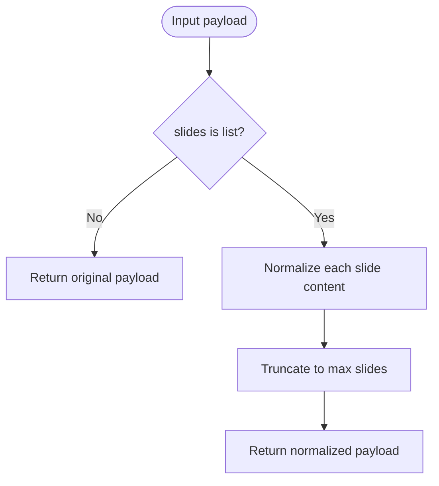

**Diagram sources**
- [outline_limits.py:29-34](file://servers/fastapi/utils/outline_limits.py#L29-L34)
- [outline_limits.py:37-68](file://servers/fastapi/utils/outline_limits.py#L37-L68)

**Section sources**
- [outline_limits.py:11-34](file://servers/fastapi/utils/outline_limits.py#L11-L34)
- [outline_limits.py:37-68](file://servers/fastapi/utils/outline_limits.py#L37-L68)
- [test_outline_utils.py:30-40](file://servers/fastapi/tests/unit/test_outline_utils.py#L30-L40)

### Image Extraction from Outlines
Image URLs can be extracted from outline content to support downstream asset handling.

- `get_images_for_slides_from_outline`: Scans each slide’s content for image URLs matching common extensions and returns a list per slide with duplicates removed while preserving order.

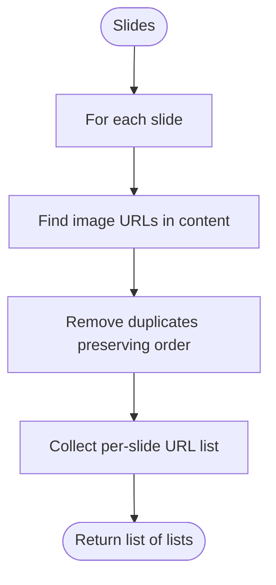

**Diagram sources**
- [outline_utils.py:184-205](file://servers/fastapi/utils/outline_utils.py#L184-L205)

**Section sources**
- [outline_utils.py:184-205](file://servers/fastapi/utils/outline_utils.py#L184-L205)
- [test_outline_utils.py:107-122](file://servers/fastapi/tests/unit/test_outline_utils.py#L107-L122)

### Table of Contents Generation
Table of contents slides can be inserted after the title slide to improve navigation.

- `get_no_of_toc_required_for_n_outlines`: Calculates how many TOC slides are needed based on total outlines and whether a title slide exists.
- `get_presentation_outline_model_with_toc`: Splits existing outlines into even sections, builds TOC entries with page numbers and titles, and inserts them at the correct position.

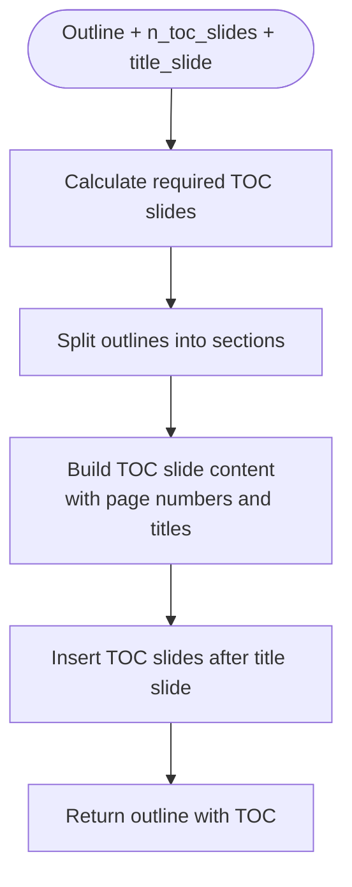

**Diagram sources**
- [outline_utils.py:44-65](file://servers/fastapi/utils/outline_utils.py#L44-L65)
- [outline_utils.py:84-137](file://servers/fastapi/utils/outline_utils.py#L84-L137)
- [outline_utils.py:140-161](file://servers/fastapi/utils/outline_utils.py#L140-L161)
- [outline_utils.py:164-181](file://servers/fastapi/utils/outline_utils.py#L164-L181)

**Section sources**
- [outline_utils.py:44-65](file://servers/fastapi/utils/outline_utils.py#L44-L65)
- [outline_utils.py:84-137](file://servers/fastapi/utils/outline_utils.py#L84-L137)
- [outline_utils.py:140-161](file://servers/fastapi/utils/outline_utils.py#L140-L161)
- [outline_utils.py:164-181](file://servers/fastapi/utils/outline_utils.py#L164-L181)
- [test_outline_utils.py:53-75](file://servers/fastapi/tests/unit/test_outline_utils.py#L53-L75)
- [test_outline_utils.py:78-98](file://servers/fastapi/tests/unit/test_outline_utils.py#L78-L98)
- [test_outline_utils.py:100-105](file://servers/fastapi/tests/unit/test_outline_utils.py#L100-L105)

### Relationship Between Outlines and Final Slide Structure
Outlines describe audience-facing content; structure describes template layout selection.

- `PresentationOutlineModel.slides`: Each item contains Markdown content suitable for rendering.
- `PresentationStructureModel.slides`: Each integer maps to a template layout index.
- In practice, the number of outline items often drives the number of structure entries, but they are separate concerns: content vs layout.

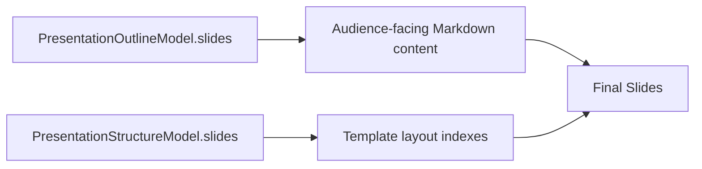

**Diagram sources**
- [presentation_outline_model.py:24-36](file://servers/fastapi/models/presentation_outline_model.py#L24-L36)
- [presentation_structure_model.py:5-7](file://servers/fastapi/models/presentation_structure_model.py#L5-L7)

**Section sources**
- [presentation_outline_model.py:24-36](file://servers/fastapi/models/presentation_outline_model.py#L24-L36)
- [presentation_structure_model.py:5-7](file://servers/fastapi/models/presentation_structure_model.py#L5-L7)

## Dependency Analysis
The following diagram shows key dependencies between modules.

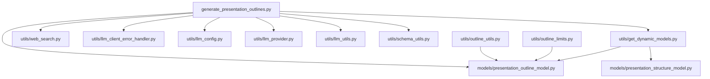

**Diagram sources**
- [generate_presentation_outlines.py:1-405](file://servers/fastapi/utils/llm_calls/generate_presentation_outlines.py#L1-L405)
- [presentation_outline_model.py:1-36](file://servers/fastapi/models/presentation_outline_model.py#L1-L36)
- [outline_utils.py:1-206](file://servers/fastapi/utils/outline_utils.py#L1-L206)
- [outline_limits.py:1-69](file://servers/fastapi/utils/outline_limits.py#L1-L69)
- [get_dynamic_models.py:1-41](file://servers/fastapi/utils/get_dynamic_models.py#L1-L41)
- [presentation_structure_model.py:1-7](file://servers/fastapi/models/presentation_structure_model.py#L1-L7)

**Section sources**
- [generate_presentation_outlines.py:1-405](file://servers/fastapi/utils/llm_calls/generate_presentation_outlines.py#L1-L405)
- [presentation_outline_model.py:1-36](file://servers/fastapi/models/presentation_outline_model.py#L1-L36)
- [outline_utils.py:1-206](file://servers/fastapi/utils/outline_utils.py#L1-L206)
- [outline_limits.py:1-69](file://servers/fastapi/utils/outline_limits.py#L1-L69)
- [get_dynamic_models.py:1-41](file://servers/fastapi/utils/get_dynamic_models.py#L1-L41)
- [presentation_structure_model.py:1-7](file://servers/fastapi/models/presentation_structure_model.py#L1-L7)

## Performance Considerations
- Streaming JSON reduces latency by emitting partial results as soon as they arrive.
- Word-limit normalization prevents oversized slide content from degrading rendering or downstream processing.
- Web search enrichment adds network calls; fallback queries ensure robustness when query generation fails.
- Dynamic models with fixed slide counts constrain LLM output size and reduce rework during validation.

[No sources needed since this section provides general guidance]

## Troubleshooting Guide
Common issues and their handling:

- Malformed provider output: Some providers may return a JSON string inside a tool call argument. `normalize_outline_payload` attempts to decode and recover valid structures before Pydantic validation.
- Invalid payload keys: If the generated JSON lacks expected fields, Pydantic raises a validation error. Tests assert that invalid payloads are rejected.
- Provider timeouts or connection errors: Exceptions are wrapped and yielded as HTTP-style errors so callers can handle them uniformly.
- Excessive slide counts: `PresentationOutlineModel` enforces a maximum number of slides; exceeding it triggers validation errors.
- Excessive content per slide: `SlideOutlineModel` normalizes and trims content to the configured word limit.

Recommended checks:

- Validate the outline payload shape before passing it to Pydantic.
- Inspect streamed chunks to understand partial failures.
- Use unit tests as reference for expected behaviors around schema validation and error propagation.

**Section sources**
- [outline_limits.py:37-68](file://servers/fastapi/utils/outline_limits.py#L37-L68)
- [test_generate_presentation_outlines.py:186-220](file://servers/fastapi/tests/unit/test_generate_presentation_outlines.py#L186-L220)
- [test_generate_presentation_outlines.py:436-441](file://servers/fastapi/tests/unit/test_generate_presentation_outlines.py#L436-L441)
- [test_outline_utils.py:43-50](file://servers/fastapi/tests/unit/test_outline_utils.py#L43-L50)
- [test_outline_utils.py:30-40](file://servers/fastapi/tests/unit/test_outline_utils.py#L30-L40)

## Conclusion
The outline processing pipeline transforms raw content into structured, validated slide outlines using LLM-generated JSON, optional web search enrichment, and robust normalization. The `PresentationOutlineModel` and `SlideOutlineModel` define the content contract, while `PresentationStructureModel` maps outline items to template layouts. Utilities provide essential transformations such as table of contents insertion and image extraction. Together, these components enable reliable, predictable presentation generation workflows with clear separation between content planning and layout selection.

[No sources needed since this section summarizes without analyzing specific files]