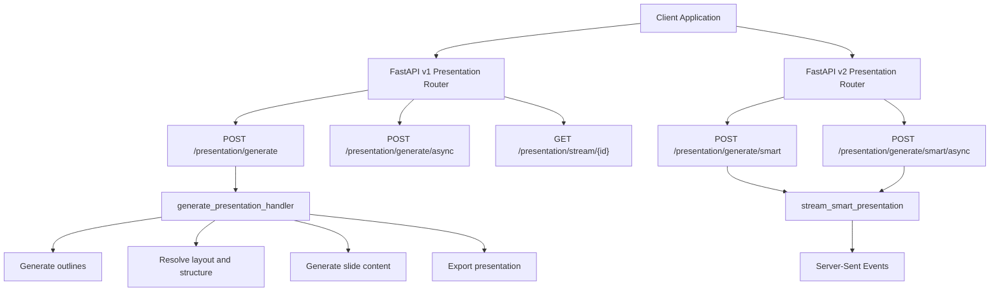
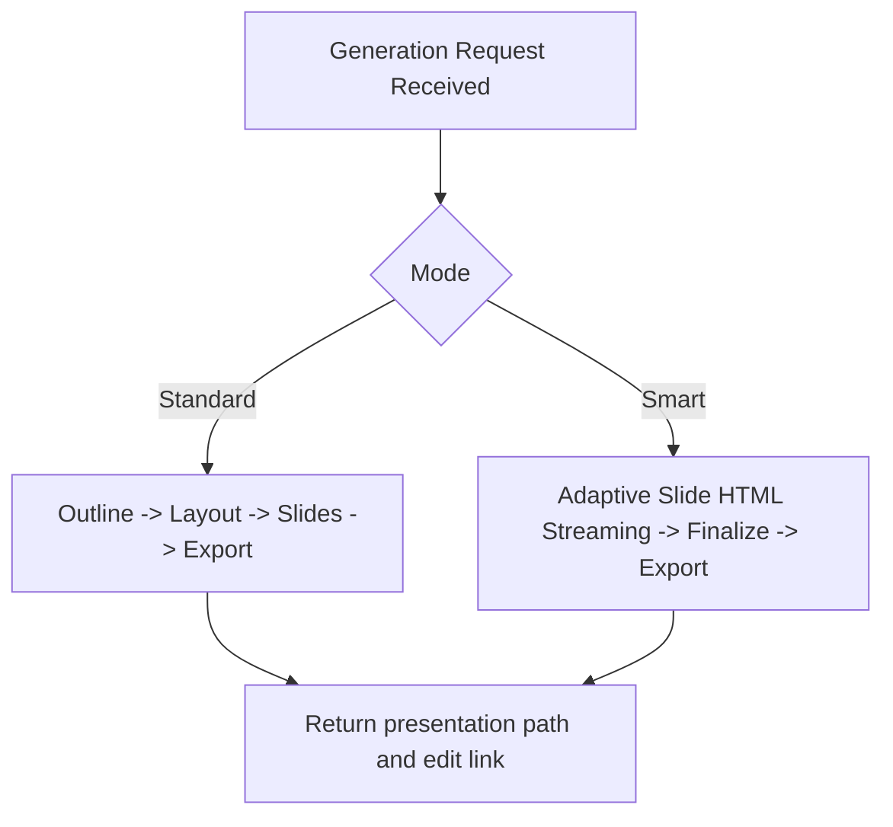
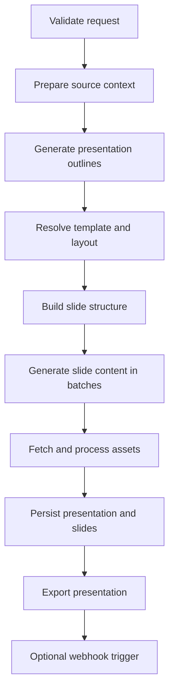
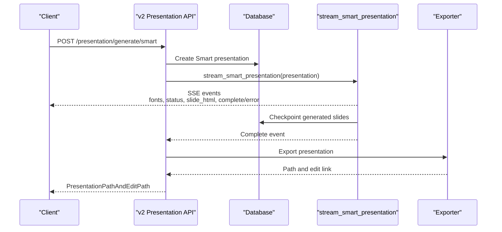
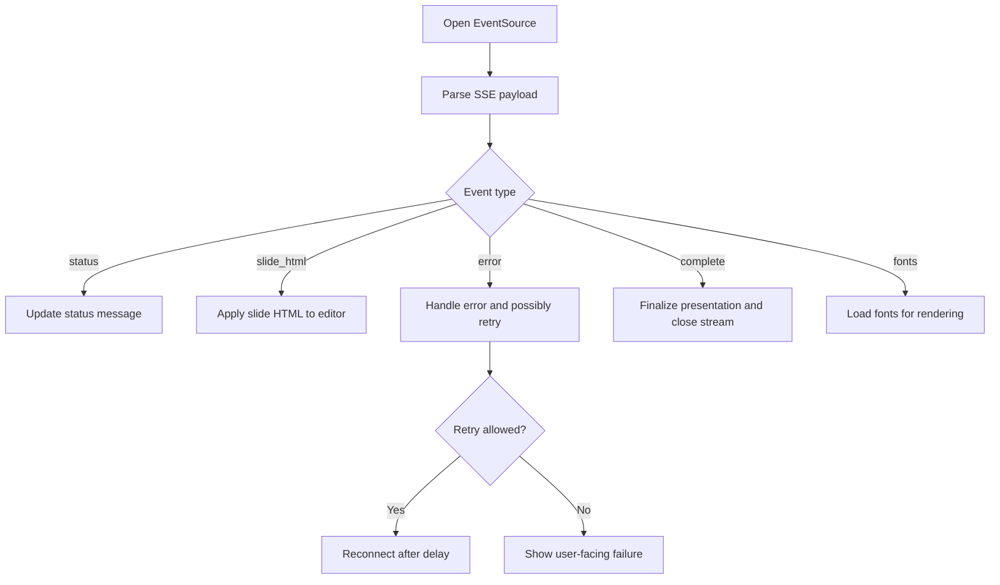
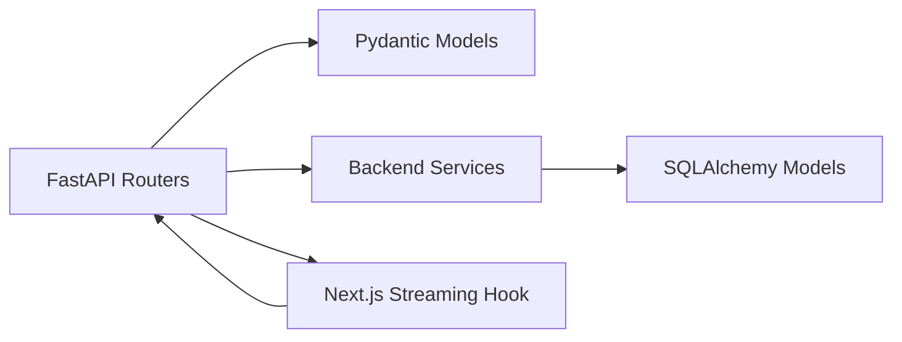

# Presentation Generation Endpoints

<cite>
**Referenced Files in This Document**
- [presentation.py](file://servers/fastapi/api/v1/ppt/endpoints/presentation.py)
- [presentation_v2.py](file://servers/fastapi/api/v2/ppt/endpoints/presentation.py)
- [generate_presentation_request.py](file://servers/fastapi/models/generate_presentation_request.py)
- [sse_response.py](file://servers/fastapi/models/sse_response.py)
- [presentation_generation_modes.md](file://docs/presentation-generation-modes.md)
- [usePresentationStreaming.ts](file://servers/nxtjs/app/(presentation-generator)/presentation/hooks/usePresentationStreaming.ts)
</cite>

## Table of Contents
1. [Introduction](#introduction)
2. [Project Structure](#project-structure)
3. [Core Components](#core-components)
4. [Architecture Overview](#architecture-overview)
5. [Detailed Component Analysis](#detailed-component-analysis)
6. [Dependency Analysis](#dependency-analysis)
7. [Performance Considerations](#performance-considerations)
8. [Troubleshooting Guide](#troubleshooting-guide)
9. [Conclusion](#conclusion)

## Introduction
This document describes the presentation generation endpoints for Presenton, with a focus on:

- The synchronous `POST /api/v1/ppt/presentation/generate` endpoint for standard AI-powered presentation creation.
- The Smart presentation generation workflow exposed by the v2 API.
- The request schema used to control outline generation, slide count, template selection, tone, verbosity, web search, and export format.
- The streaming response model used by Smart generation through Server-Sent Events (SSE).
- The end-to-end generation process from prompt or documents to final slides and exported files.
- Error handling patterns for validation failures, AI service errors, and stream interruptions.

The documentation is intended for API consumers, frontend engineers integrating the Next.js generator, and backend operators configuring generation modes.

## Project Structure
The relevant implementation lives primarily in the FastAPI backend under `servers/fastapi`, with supporting UI logic in the Next.js application under `servers/nextjs`.

**Diagram sources**
- [presentation.py:3130-3156](file://servers/fastapi/api/v1/ppt/endpoints/presentation.py#L3130-L3156)
- [presentation.py:3201-3240](file://servers/fastapi/api/v1/ppt/endpoints/presentation.py#L3201-L3240)
- [presentation_v2.py:229-299](file://servers/fastapi/api/v2/ppt/endpoints/presentation.py#L229-L299)
- [presentation.py:1892-2091](file://servers/fastapi/api/v1/ppt/endpoints/presentation.py#L1892-L2091)

**Section sources**
- [presentation.py:3130-3156](file://servers/fastapi/api/v1/ppt/endpoints/presentation.py#L3130-L3156)
- [presentation_v2.py:229-299](file://servers/fastapi/api/v2/ppt/endpoints/presentation.py#L229-L299)
- [presentation_generation_modes.md:1-28](file://docs/presentation-generation-modes.md#L1-L28)

## Core Components
The core components involved in presentation generation are:

| Component | Responsibility |
|---|---|
| `GeneratePresentationRequest` | Defines the standard generation request body, including content, optional slide markdown, instructions, tone, verbosity, web search, slide count, language, template, table of contents, title slide, files, export format, and webhook trigger. |
| `GenerateSmartPresentationRequest` | Defines the Smart generation request body, optimized for adaptive HTML-based slide generation. |
| Standard generation handler | Validates input, generates outlines, resolves templates/layouts, builds slide structure, generates slide content, fetches assets, persists slides, exports the presentation, and optionally triggers webhooks. |
| Smart generation handlers | Create a Smart presentation, stream generated slide HTML via SSE, checkpoint progress, finalize the presentation, and export it. |
| SSE response models | Provide structured event types for status, trace, error, complete, and generic data events. |
| Next.js streaming hook | Connects to the SSE stream, parses events, updates the editor state, retries failed connections, and tracks generation metrics. |

**Section sources**
- [generate_presentation_request.py:8-65](file://servers/fastapi/models/generate_presentation_request.py#L8-L65)
- [sse_response.py:6-57](file://servers/fastapi/models/sse_response.py#L6-L57)
- [presentation.py:2581-2642](file://servers/fastapi/api/v1/ppt/endpoints/presentation.py#L2581-L2642)
- [presentation.py:2645-3101](file://servers/fastapi/api/v1/ppt/endpoints/presentation.py#L2645-L3101)
- [presentation_v2.py:66-149](file://servers/fastapi/api/v2/ppt/endpoints/presentation.py#L66-L149)
- [usePresentationStreaming.ts:298-303](file://servers/nxtjs/app/(presentation-generator)/presentation/hooks/usePresentationStreaming.ts#L298-L303)

## Architecture Overview
Presenton supports two primary generation workflows:

- **Standard generation**: Uses fixed layouts, an outline-review step, and built-in or custom templates. It can be driven by a text prompt, prewritten slide markdown, or uploaded documents.
- **Smart generation**: Uses adaptive layouts that respond directly to generated content and streams slide HTML to the editor without following the traditional template workflow.

The environment variable `PRESENTATION_GENERATION_MODE` controls which workflows are available in the web UI and MCP tools. Valid values are `both`, `standard`, and `smart`.

**Diagram sources**
- [presentation_generation_modes.md:3-13](file://docs/presentation-generation-modes.md#L3-L13)
- [presentation.py:2645-3101](file://servers/fastapi/api/v1/ppt/endpoints/presentation.py#L2645-L3101)
- [presentation_v2.py:66-149](file://servers/fastapi/api/v2/ppt/endpoints/presentation.py#L66-L149)

**Section sources**
- [presentation_generation_modes.md:1-28](file://docs/presentation-generation-modes.md#L1-L28)

## Detailed Component Analysis

### POST `/api/v1/ppt/presentation/generate`
This endpoint creates a standard presentation synchronously. It accepts a `GeneratePresentationRequest` and returns a response containing the presentation path and edit link.

#### Endpoint Summary
- **Method**: `POST`
- **Path**: `/api/v1/ppt/presentation/generate`
- **Request Body**: `GeneratePresentationRequest`
- **Response Model**: `PresentationPathAndEditPath`
- **Behavior**: Validates the request, runs the full standard generation pipeline, persists the presentation and slides, exports the file, and returns absolute result links suitable for MCP clients.

#### Request Schema: `GeneratePresentationRequest`
| Field | Type | Required | Default | Description |
|---|---|---:|---|---|
| `content` | `str` | Yes | None | Primary content or prompt for generating the presentation. |
| `slides_markdown` | `List[str]` | No | None | Predefined slide markdown content; when provided, overrides outline generation. |
| `instructions` | `str` | No | None | Additional instructions guiding tone, style, or structure. |
| `tone` | `Tone` | No | `DEFAULT` | Controls the textual tone of generated content. |
| `verbosity` | `Verbosity` | No | `STANDARD` | Controls how verbose the generated presentation should be. |
| `web_search` | `bool` | No | `False` | Enables web search context during outline generation. |
| `n_slides` | `int` | No | None | Target number of slides; if omitted, the system auto-detects slide count. |
| `language` | `str` | No | None | Target language; if omitted, the system auto-detects language. |
| `template` | `str` | No | `"general"` | Template identifier or alias used for layout resolution. |
| `include_table_of_contents` | `bool` | No | `False` | Adds a table of contents slide where appropriate. |
| `include_title_slide` | `bool` | No | `True` | Includes a title slide. |
| `files` | `List[str]` | No | None | Paths to previously uploaded files used as source material. |
| `export_as` | `"pptx" \| "pdf"` | No | `"pptx"` | Export format for the final presentation. |
| `trigger_webhook` | `bool` | No | `False` | Whether to trigger subscribed webhooks after completion. |

#### Validation Rules
- At least one of `content`, `slides_markdown`, or `files` must be provided.
- If `n_slides` is provided, it must be greater than zero and not exceed the configured maximum.
- If `slides_markdown` is provided, its length must not exceed the configured maximum.
- If `include_table_of_contents` is true and `n_slides` is provided, the slide count must be at least three.
- The requested template must resolve to a valid TemplateV2 row or bundled template name.

#### Response
The response contains:
- A presentation path.
- An edit path pointing to the presentation editor.
- Absolute URLs for MCP-compatible result links.

#### Example Scenarios
- **Prompt-driven generation**: Provide `content`, optional `n_slides`, `language`, `tone`, `verbosity`, and `template`.
- **Slide-markdown-driven generation**: Provide `slides_markdown` instead of relying on AI-generated outlines.
- **Document-driven generation**: Provide `files` so the backend loads documents and uses their extracted text as additional context.
- **Web-enhanced generation**: Enable `web_search` to enrich outline generation with external information.
- **Table of contents generation**: Set `include_table_of_contents=true` and ensure enough slides are requested.

**Section sources**
- [presentation.py:3130-3156](file://servers/fastapi/api/v1/ppt/endpoints/presentation.py#L3130-L3156)
- [generate_presentation_request.py:8-47](file://servers/fastapi/models/generate_presentation_request.py#L8-L47)
- [presentation.py:2581-2642](file://servers/fastapi/api/v1/ppt/endpoints/presentation.py#L2581-L2642)

### Standard Generation Pipeline
The standard generation pipeline follows a multi-stage process:

1. **Input validation**: Ensures required inputs exist and constraints are satisfied.
2. **Source preparation**: Loads uploaded documents into additional context when present.
3. **Outline generation**: Generates a structured outline using LLM calls, optionally enhanced by web search.
4. **Layout resolution**: Resolves the selected template and layout configuration.
5. **Structure planning**: Builds a slide structure mapping outlines to layout slots.
6. **Slide content generation**: Generates slide content in batches, concurrently where possible.
7. **Asset processing**: Fetches images and icons, applies fallbacks, and records warnings.
8. **Persistence and export**: Saves the presentation and slides, exports the file, and optionally triggers webhooks.

**Diagram sources**
- [presentation.py:2645-3101](file://servers/fastapi/api/v1/ppt/endpoints/presentation.py#L2645-L3101)

**Section sources**
- [presentation.py:2645-3101](file://servers/fastapi/api/v1/ppt/endpoints/presentation.py#L2645-L3101)

### Smart Presentation Generation
Smart generation is exposed through the v2 API and focuses on adaptive, HTML-based slide generation streamed to the client.

#### Endpoints
- `POST /api/v2/ppt/presentation/generate/smart`: Synchronous Smart generation.
- `POST /api/v2/ppt/presentation/generate/smart/async`: Asynchronous Smart generation returning a task ID.

#### Request Schema: `GenerateSmartPresentationRequest`
| Field | Type | Required | Default | Description |
|---|---|---:|---|---|
| `content` | `str` | No | `""` | Prompt describing the desired presentation. |
| `n_slides` | `int` | No | None | Target slide count; validated to be at least one when provided. |
| `language` | `str` | No | None | Target language. |
| `instructions` | `str` | No | None | Additional generation instructions. |
| `tone` | `Tone` | No | `DEFAULT` | Textual tone setting. |
| `verbosity` | `Verbosity` | No | `STANDARD` | Verbosity setting. |
| `web_search` | `bool` | No | `False` | Enables web search context. |
| `include_table_of_contents` | `bool` | No | `False` | Adds table of contents behavior where applicable. |
| `include_title_slide` | `bool` | No | `True` | Includes a title slide. |
| `files` | `List[str]` | No | None | Previously uploaded Presenton file paths. |
| `community_design_ids` | `List[int]` | No | None | Community design references influencing layout and style. |
| `export_as` | `"pptx" \| "pdf"` | No | `"pptx"` | Export format. |

#### Smart Generation Flow

**Diagram sources**
- [presentation_v2.py:66-149](file://servers/fastapi/api/v2/ppt/endpoints/presentation.py#L66-L149)
- [presentation_v2.py:229-299](file://servers/fastapi/api/v2/ppt/endpoints/presentation.py#L229-L299)
- [presentation.py:1892-2091](file://servers/fastapi/api/v1/ppt/endpoints/presentation.py#L1892-L2091)

**Section sources**
- [presentation_v2.py:66-149](file://servers/fastapi/api/v2/ppt/endpoints/presentation.py#L66-L149)
- [presentation_v2.py:229-299](file://servers/fastapi/api/v2/ppt/endpoints/presentation.py#L229-L299)
- [presentation.py:1892-2091](file://servers/fastapi/api/v1/ppt/endpoints/presentation.py#L1892-L2091)

### Streaming Response Format Using SSE
Smart presentation generation uses Server-Sent Events to stream progress and generated slide HTML. The backend emits structured SSE events through `SSEResponse`, `SSEStatusResponse`, `SSETraceResponse`, `SSEErrorResponse`, and `SSECompleteResponse`.

#### Event Types
| Event Type | Purpose | Payload Fields |
|---|---|---|
| `status` | Indicates current phase of generation | `type`, `status` |
| `trace` | Provides diagnostic trace information | `type`, `trace` |
| `slide_html` | Streams a generated slide | `type`, `index`, `slide_id`, `html`, `slide` |
| `error` | Reports a generation error | `type`, `detail`, `source`, `status_code`, `error_type`, `retryable`, `completed_slides`, `total_slides` |
| `complete` | Signals successful completion | `type`, `presentation` |
| `fonts` | Sends resolved fonts for rendering | `type`, `fonts` |

#### Client Behavior
The Next.js streaming hook connects to `/api/v1/ppt/presentation/stream/{presentationId}` using `EventSource`. It:
- Parses JSON payloads from SSE `response` events.
- Updates the editor with slide HTML as they arrive.
- Handles `status`, `trace`, `error`, and `complete` events.
- Implements retry logic with exponential backoff for transient failures.
- Tracks generation metrics such as slide count, retry count, and duration.

**Diagram sources**
- [sse_response.py:6-57](file://servers/fastapi/models/sse_response.py#L6-L57)
- [usePresentationStreaming.ts:298-303](file://servers/nxtjs/app/(presentation-generator)/presentation/hooks/usePresentationStreaming.ts#L298-L303)
- [usePresentationStreaming.ts:304-380](file://servers/nxtjs/app/(presentation-generator)/presentation/hooks/usePresentationStreaming.ts#L304-L380)
- [usePresentationStreaming.ts:600-687](file://servers/nxtjs/app/(presentation-generator)/presentation/hooks/usePresentationStreaming.ts#L600-L687)

**Section sources**
- [sse_response.py:6-57](file://servers/fastapi/models/sse_response.py#L6-L57)
- [usePresentationStreaming.ts:298-303](file://servers/nxtjs/app/(presentation-generator)/presentation/hooks/usePresentationStreaming.ts#L298-L303)
- [usePresentationStreaming.ts:304-380](file://servers/nxtjs/app/(presentation-generator)/presentation/hooks/usePresentationStreaming.ts#L304-L380)
- [usePresentationStreaming.ts:600-687](file://servers/nxtjs/app/(presentation-generator)/presentation/hooks/usePresentationStreaming.ts#L600-L687)

### Async Generation Support
Both standard and Smart generation support asynchronous execution:

- Standard async: `POST /api/v1/ppt/presentation/generate/async` returns an `AsyncTaskModel`.
- Smart async: `POST /api/v2/ppt/presentation/generate/smart/async` returns an `AsyncTaskModel`.
- Status polling: `GET /api/v1/ppt/presentation/status/{id}` retrieves task status and progress.

The async tasks update progress messages, created slide counts, remaining slide counts, and final export paths upon completion.

**Section sources**
- [presentation.py:3201-3240](file://servers/fastapi/api/v1/ppt/endpoints/presentation.py#L3201-L3240)
- [presentation.py:3243-3257](file://servers/fastapi/api/v1/ppt/endpoints/presentation.py#L3243-L3257)
- [presentation_v2.py:264-299](file://servers/fastapi/api/v2/ppt/endpoints/presentation.py#L264-L299)

## Dependency Analysis
The presentation generation system has clear layering:

- **API layer**: FastAPI routers define endpoints and map requests to handlers.
- **Model layer**: Pydantic models define request schemas and SSE response structures.
- **Service layer**: Services handle document loading, image generation, web search, and export.
- **Data layer**: SQLAlchemy models persist presentations, slides, and async tasks.
- **Frontend layer**: Next.js hooks consume SSE streams and render generated slides.

**Diagram sources**
- [presentation.py:3130-3156](file://servers/fastapi/api/v1/ppt/endpoints/presentation.py#L3130-L3156)
- [presentation_v2.py:229-299](file://servers/fastapi/api/v2/ppt/endpoints/presentation.py#L229-L299)
- [generate_presentation_request.py:8-65](file://servers/fastapi/models/generate_presentation_request.py#L8-L65)
- [sse_response.py:6-57](file://servers/fastapi/models/sse_response.py#L6-L57)
- [usePresentationStreaming.ts:298-303](file://servers/nxtjs/app/(presentation-generator)/presentation/hooks/usePresentationStreaming.ts#L298-L303)

**Section sources**
- [presentation.py:3130-3156](file://servers/fastapi/api/v1/ppt/endpoints/presentation.py#L3130-L3156)
- [presentation_v2.py:229-299](file://servers/fastapi/api/v2/ppt/endpoints/presentation.py#L229-L299)
- [generate_presentation_request.py:8-65](file://servers/fastapi/models/generate_presentation_request.py#L8-L65)
- [sse_response.py:6-57](file://servers/fastapi/models/sse_response.py#L6-L57)
- [usePresentationStreaming.ts:298-303](file://servers/nxtjs/app/(presentation-generator)/presentation/hooks/usePresentationStreaming.ts#L298-L303)

## Performance Considerations
- **Batched slide generation**: Standard generation processes slides in batches to balance concurrency and memory usage.
- **Concurrent asset fetching**: Image and icon assets are fetched concurrently while subsequent slide content is generated.
- **Checkpointing in Smart mode**: Generated slides are persisted incrementally so generation can resume after network interruptions or provider failures.
- **Retry logic**: The frontend implements retry with increasing delays for SSE connection failures and parse errors.
- **Maximum slide limits**: Both request validation and internal checks enforce maximum slide counts to prevent excessive resource consumption.

[No sources needed since this section provides general guidance]

## Troubleshooting Guide

### Common Validation Errors
- Missing input: Ensure at least one of `content`, `slides_markdown`, or `files` is provided.
- Invalid slide count: Ensure `n_slides` is positive and within configured limits.
- Too many slide markdown entries: Ensure `slides_markdown` length does not exceed the configured maximum.
- Table of contents constraint: When enabling table of contents, ensure enough slides are requested.
- Invalid template: Use a valid template identifier or bundled template name.

### AI Service Failures
- Standard generation wraps unexpected exceptions in a 500 error with a generic failure message.
- Smart generation captures stream errors and marks async tasks as failed with structured error details.
- Image generation errors are normalized into HTTP exceptions with provider-specific codes and messages.

### SSE Stream Issues
- Connection loss: The frontend reconnects with exponential backoff up to a configured retry limit.
- Invalid SSE payload: The frontend treats malformed JSON as a stream error and may retry or fail gracefully.
- Partial completion: If the stream ends without a `complete` event, Smart generation reports a failure indicating incomplete generation.

### Recommended Diagnostics
- Inspect async task status using the status endpoint.
- Review frontend console logs for SSE retry messages and event parsing errors.
- Check backend logs for outline generation failures, layout resolution issues, and asset processing warnings.

**Section sources**
- [presentation.py:2581-2642](file://servers/fastapi/api/v1/ppt/endpoints/presentation.py#L2581-L2642)
- [presentation.py:3103-3127](file://servers/fastapi/api/v1/ppt/endpoints/presentation.py#L3103-L3127)
- [presentation_v2.py:124-149](file://servers/fastapi/api/v2/ppt/endpoints/presentation.py#L124-L149)
- [presentation_v2.py:202-226](file://servers/fastapi/api/v2/ppt/endpoints/presentation.py#L202-L226)
- [usePresentationStreaming.ts:199-221](file://servers/nxtjs/app/(presentation-generator)/presentation/hooks/usePresentationStreaming.ts#L199-L221)
- [usePresentationStreaming.ts:682-687](file://servers/nxtjs/app/(presentation-generator)/presentation/hooks/usePresentationStreaming.ts#L682-L687)

## Conclusion
The presentation generation endpoints provide two complementary workflows:

- **Standard generation** is ideal for predictable, template-driven decks with outline review, flexible input sources, and controlled slide counts.
- **Smart generation** is designed for adaptive, real-time slide creation streamed through SSE, making it well-suited for interactive editing experiences.

Consumers should choose the appropriate endpoint based on their UX requirements, configure generation parameters carefully, handle async tasks when long-running operations are expected, and implement robust SSE error handling for resilient client-side streaming.

[No sources needed since this section summarizes without analyzing specific files]