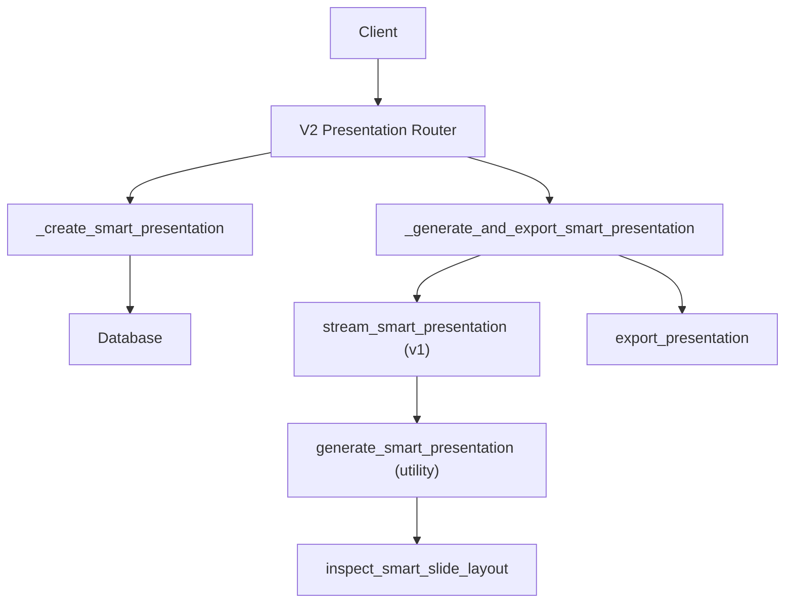
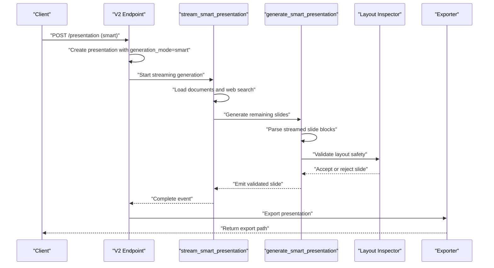
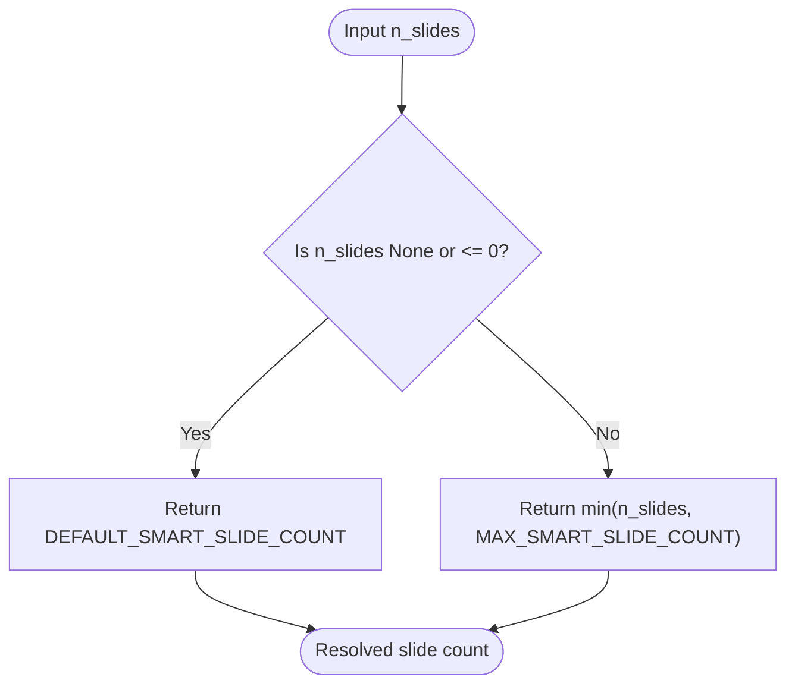
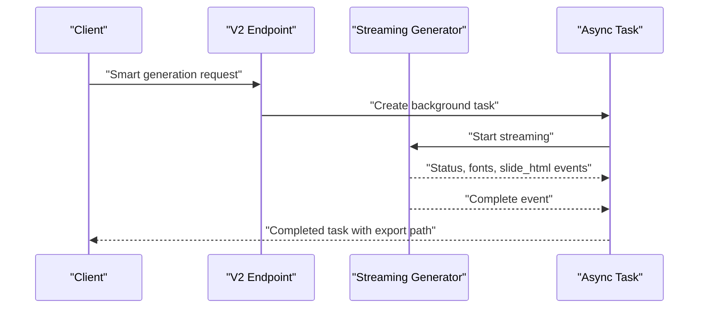
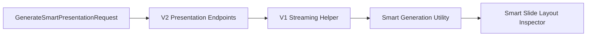

# Smart Presentation Generation

<cite>
**Referenced Files in This Document**
- [generate_presentation_request.py](file://servers/fastapi/models/generate_presentation_request.py)
- [presentation.py (v2 endpoints)](file://servers/fastapi/api/v2/ppt/endpoints/presentation.py)
- [presentation.py (v1 streaming helper)](file://servers/fastapi/api/v1/ppt/endpoints/presentation.py)
- [generate_smart_presentation.py](file://servers/fastapi/utils/llm_calls/generate_smart_presentation.py)
- [smart_slide_layout.py](file://servers/fastapi/utils/smart_slide_layout.py)
</cite>

## Table of Contents
1. [Introduction](#introduction)
2. [Project Structure](#project-structure)
3. [Core Components](#core-components)
4. [Architecture Overview](#architecture-overview)
5. [Detailed Component Analysis](#detailed-component-analysis)
6. [Dependency Analysis](#dependency-analysis)
7. [Performance Considerations](#performance-considerations)
8. [Troubleshooting Guide](#troubleshooting-guide)
9. [Conclusion](#conclusion)

## Introduction
This document explains the smart presentation generation API surface and how it differs from standard presentation generation. Smart mode automatically determines an appropriate slide count when one is not explicitly provided, selects production-ready HTML slide layouts, structures content intelligently, and uses enhanced AI processing with safety, layout validation, retry logic, and progress tracking.

Smart generation is exposed through a dedicated request model and v2 endpoints, while the actual LLM-driven deck construction lives in a shared smart generation utility. The system also includes a layout inspection tool that rejects slides likely to overflow or overlap on the fixed 1280x720 canvas.

## Project Structure
The smart presentation feature spans several layers:

- Request models define both standard and smart generation payloads.
- V2 endpoints accept smart generation requests, create presentations with `generation_mode="smart"`, and stream or asynchronously generate decks.
- V1 helpers provide the underlying streaming generator used by both sync and async flows.
- The smart generation utility contains slide-count resolution, prompt construction, streaming parsing, validation, retry handling, and metrics emission.
- A layout inspector analyzes generated HTML for risky positioning, clipping, scrolling, and overlap.

**Diagram sources**
- [presentation.py (v2 endpoints):66-149](file://servers/fastapi/api/v2/ppt/endpoints/presentation.py#L66-L149)
- [presentation.py (v1 streaming helper):1892-2089](file://servers/fastapi/api/v1/ppt/endpoints/presentation.py#L1892-L2089)
- [generate_smart_presentation.py:733-937](file://servers/fastapi/utils/llm_calls/generate_smart_presentation.py#L733-L937)
- [smart_slide_layout.py:230-289](file://servers/fastapi/utils/smart_slide_layout.py#L230-L289)

**Section sources**
- [generate_presentation_request.py:8-65](file://servers/fastapi/models/generate_presentation_request.py#L8-L65)
- [presentation.py (v2 endpoints):35-84](file://servers/fastapi/api/v2/ppt/endpoints/presentation.py#L35-L84)
- [presentation.py (v1 streaming helper):1892-1999](file://servers/fastapi/api/v1/ppt/endpoints/presentation.py#L1892-L1999)
- [generate_smart_presentation.py:45-61](file://servers/fastapi/utils/llm_calls/generate_smart_presentation.py#L45-L61)

## Core Components
The smart generation workflow is built around these key components:

| Component | Responsibility |
|---|---|
| `GenerateSmartPresentationRequest` | Defines smart-mode parameters such as prompt, optional slide count, language, tone, verbosity, web search, table of contents, title slide, files, community design references, and export format. |
| V2 smart endpoint helpers | Create a presentation with `generation_mode="smart"` and orchestrate streaming or background generation plus export. |
| `resolve_smart_slide_count` | Converts the requested slide count into a safe final count, defaulting to eight when omitted or invalid and capping at the product-wide maximum. |
| `stream_smart_presentation` | Loads source context, resolves fonts, emits status events, checkpoints accepted slides, and streams new slides until completion. |
| `generate_smart_presentation` | Builds messages, streams LLM output, parses slide blocks, validates HTML, retries failed attempts, and returns accepted slides with metrics. |
| `inspect_smart_slide_layout` | Detects risky layout patterns such as negative margins, absolute positioning outside bounds, hidden overflow, and sibling overlap. |

**Section sources**
- [generate_presentation_request.py:49-65](file://servers/fastapi/models/generate_presentation_request.py#L49-L65)
- [presentation.py (v2 endpoints):66-149](file://servers/fastapi/api/v2/ppt/endpoints/presentation.py#L66-L149)
- [presentation.py (v1 streaming helper):1892-2089](file://servers/fastapi/api/v1/ppt/endpoints/presentation.py#L1892-L2089)
- [generate_smart_presentation.py:264-267](file://servers/fastapi/utils/llm_calls/generate_smart_presentation.py#L264-L267)
- [generate_smart_presentation.py:733-937](file://servers/fastapi/utils/llm_calls/generate_smart_presentation.py#L733-L937)
- [smart_slide_layout.py:230-289](file://servers/fastapi/utils/smart_slide_layout.py#L230-L289)

## Architecture Overview
Smart presentation generation follows a layered flow:

1. The client sends a smart generation request using `GenerateSmartPresentationRequest`.
2. The v2 router creates a presentation with `generation_mode="smart"`.
3. The export helper resolves the final slide count and starts streaming generation.
4. The streaming helper loads documents, optionally performs web search, merges community design references, persists fonts, and begins generating slides.
5. The smart generation utility constructs prompts, streams LLM output, parses slide blocks, validates each slide’s HTML and layout, and retries on failure.
6. Accepted slides are checkpointed so interrupted or long-running generation can resume.
7. After completion, the presentation is exported to PPTX or PDF.

**Diagram sources**
- [presentation.py (v2 endpoints):66-149](file://servers/fastapi/api/v2/ppt/endpoints/presentation.py#L66-L149)
- [presentation.py (v1 streaming helper):1892-2089](file://servers/fastapi/api/v1/ppt/endpoints/presentation.py#L1892-L2089)
- [generate_smart_presentation.py:733-937](file://servers/fastapi/utils/llm_calls/generate_smart_presentation.py#L733-L937)
- [smart_slide_layout.py:230-289](file://servers/fastapi/utils/smart_slide_layout.py#L230-L289)

## Detailed Component Analysis

### GenerateSmartPresentationRequest Parameters
`GenerateSmartPresentationRequest` is the primary input for smart generation. It supports:

| Parameter | Type | Default | Meaning |
|---|---|---:|---|
| `content` | string | `""` | Prompt describing the presentation topic and desired outcome. |
| `n_slides` | integer or null | `null` | Optional target slide count. If omitted, smart mode auto-detects length. |
| `language` | string or null | `null` | Target language; if omitted, language is auto-detected. |
| `instructions` | string or null | `null` | Additional instructions for tone, structure, or constraints. |
| `tone` | enum | `Tone.DEFAULT` | Writing tone. |
| `verbosity` | enum | `Verbosity.STANDARD` | How detailed the presentation should be. |
| `web_search` | boolean | `false` | Whether to enrich context with web search results. |
| `include_table_of_contents` | boolean | `false` | Whether to include a visible TOC slide. |
| `include_title_slide` | boolean | `true` | Whether the first slide must be a title slide. |
| `files` | list of strings or null | `null` | Previously uploaded Presenton file paths used as source context. |
| `community_design_ids` | list of integers or null | `null` | Community design references influencing visual style. |
| `export_as` | `"pptx"` or `"pdf"` | `"pptx"` | Export format returned after generation completes. |

Compared with the standard `GeneratePresentationRequest`, the smart request is optimized for AI-driven deck creation rather than manual markdown-to-slide conversion. It emphasizes prompt-based generation, optional web search, community design references, and automatic slide planning.

**Section sources**
- [generate_presentation_request.py:8-65](file://servers/fastapi/models/generate_presentation_request.py#L8-L65)

### resolve_smart_slide_count Function
`resolve_smart_slide_count` is the core decision point for determining how many slides smart generation should produce:

- If `n_slides` is `None`, zero, or negative, it returns the default smart slide count.
- If a positive value is provided, it caps the result at the maximum allowed slide count.
- The default smart slide count is eight.
- The maximum smart slide count shares the product-wide slide limit.

**Diagram sources**
- [generate_smart_presentation.py:45-48](file://servers/fastapi/utils/llm_calls/generate_smart_presentation.py#L45-L48)
- [generate_smart_presentation.py:264-267](file://servers/fastapi/utils/llm_calls/generate_smart_presentation.py#L264-L267)

This function is called whenever smart generation needs a concrete slide count, including:

- V2 export helper before streaming.
- Background task initialization.
- V1 streaming helper before updating the presentation’s resolved slide count.

**Section sources**
- [generate_smart_presentation.py:264-267](file://servers/fastapi/utils/llm_calls/generate_smart_presentation.py#L264-L267)
- [presentation.py (v2 endpoints):95-96](file://servers/fastapi/api/v2/ppt/endpoints/presentation.py#L95-L96)
- [presentation.py (v2 endpoints):168-175](file://servers/fastapi/api/v2/ppt/endpoints/presentation.py#L168-L175)
- [presentation.py (v1 streaming helper):1897-1901](file://servers/fastapi/api/v1/ppt/endpoints/presentation.py#L1897-L1901)

### Smart Mode vs Standard Generation
Smart generation differs from standard generation in several important ways:

| Aspect | Standard Generation | Smart Generation |
|---|---|---|
| Primary input | Content plus optional explicit slide markdown | Prompt-based content with optional slide count |
| Slide count | Usually explicit or derived from markdown | Auto-detected when omitted, capped at maximum |
| Layout selection | Template-driven layout mapping | Production-ready HTML slides selected by AI within strict layout rules |
| Content structuring | Markdown-to-slide transformation | AI plans narrative, titles, slide types, and visual variety |
| AI processing | May use LLMs for outline or content steps | Full AI-driven deck generation with streaming, parsing, validation, and retry |
| Output format | Slides based on template structure | Fixed 1280x720 HTML slides with Tailwind classes and Chart.js charts |
| Safety checks | Template and validation layer | HTML sanitization, chart initializer validation, text density limits, layout risk detection |
| Progress tracking | Standard presentation progress | Smart-specific progress with created/remaining slide counts |

Smart mode is especially useful when you want the system to decide the optimal number of slides and structure the presentation automatically. Standard mode is better when you already have structured slide markdown or need deterministic template-driven generation.

**Section sources**
- [generate_presentation_request.py:8-65](file://servers/fastapi/models/generate_presentation_request.py#L8-L65)
- [presentation.py (v2 endpoints):66-84](file://servers/fastapi/api/v2/ppt/endpoints/presentation.py#L66-L84)
- [generate_smart_presentation.py:63-210](file://servers/fastapi/utils/llm_calls/generate_smart_presentation.py#L63-L210)
- [generate_smart_presentation.py:417-502](file://servers/fastapi/utils/llm_calls/generate_smart_presentation.py#L417-L502)

### Smart Generation Response Format Differences
Smart generation responses differ from standard generation because they involve streaming, checkpointing, and AI-generated HTML slides:

- Streaming events include status updates, font metadata, individual slide HTML, completion, and error events.
- Each accepted slide carries an index, slide ID, HTML content, and slide metadata.
- Background tasks track `created_slides` and `remaining_slides` against the resolved total slide count.
- Final export returns a presentation ID, export path, edit path, and export format.

**Diagram sources**
- [presentation.py (v2 endpoints):43-63](file://servers/fastapi/api/v2/ppt/endpoints/presentation.py#L43-L63)
- [presentation.py (v2 endpoints):87-149](file://servers/fastapi/api/v2/ppt/endpoints/presentation.py#L87-L149)
- [presentation.py (v2 endpoints):152-200](file://servers/fastapi/api/v2/ppt/endpoints/presentation.py#L152-L200)

**Section sources**
- [presentation.py (v2 endpoints):43-63](file://servers/fastapi/api/v2/ppt/endpoints/presentation.py#L43-L63)
- [presentation.py (v2 endpoints):87-149](file://servers/fastapi/api/v2/ppt/endpoints/presentation.py#L87-L149)
- [presentation.py (v1 streaming helper):1917-1945](file://servers/fastapi/api/v1/ppt/endpoints/presentation.py#L1917-L1945)

### When to Use Smart vs Standard Generation
Use smart generation when:

- You have a topic or prompt but no explicit slide structure.
- You want the system to choose an appropriate slide count.
- You want AI-planned narrative flow, slide types, and visual variety.
- You want production-ready HTML slides constrained to a fixed canvas.
- You want automatic layout safety checks and retry behavior.

Use standard generation when:

- You already have slide markdown or a well-defined structure.
- You need deterministic template-driven output.
- You want finer control over slide-by-slide content without AI planning.
- You prefer simpler request semantics focused on content and template selection.

Examples of expected output characteristics:

- Smart generation: AI-selected slide count, title slide, optional TOC, varied slide types, Chart.js charts where quantitative evidence is relevant, and validated 1280x720 HTML slides.
- Standard generation: Template-mapped slides driven by provided content and structure, with less automatic narrative planning.

**Section sources**
- [generate_presentation_request.py:8-65](file://servers/fastapi/models/generate_presentation_request.py#L8-L65)
- [generate_smart_presentation.py:63-210](file://servers/fastapi/utils/llm_calls/generate_smart_presentation.py#L63-L210)
- [generate_smart_presentation.py:417-502](file://servers/fastapi/utils/llm_calls/generate_smart_presentation.py#L417-L502)

## Dependency Analysis
The smart generation pipeline has clear dependencies between API routing, streaming, LLM generation, and layout validation:

**Diagram sources**
- [generate_presentation_request.py:49-65](file://servers/fastapi/models/generate_presentation_request.py#L49-L65)
- [presentation.py (v2 endpoints):66-149](file://servers/fastapi/api/v2/ppt/endpoints/presentation.py#L66-L149)
- [presentation.py (v1 streaming helper):1892-2089](file://servers/fastapi/api/v1/ppt/endpoints/presentation.py#L1892-L2089)
- [generate_smart_presentation.py:733-937](file://servers/fastapi/utils/llm_calls/generate_smart_presentation.py#L733-L937)
- [smart_slide_layout.py:230-289](file://servers/fastapi/utils/smart_slide_layout.py#L230-L289)

Key dependency observations:

- V2 endpoints depend on v1 streaming logic rather than reimplementing the full smart generation flow.
- Smart generation depends on LLM configuration, provider selection, message utilities, and error handling.
- Layout inspection is reused during normalization and validation to prevent saving broken slides.
- Slide count resolution is centralized so all smart generation entry points agree on defaults and limits.

**Section sources**
- [presentation.py (v2 endpoints):17-31](file://servers/fastapi/api/v2/ppt/endpoints/presentation.py#L17-L31)
- [generate_smart_presentation.py:25-43](file://servers/fastapi/utils/llm_calls/generate_smart_presentation.py#L25-L43)
- [smart_slide_layout.py:230-289](file://servers/fastapi/utils/smart_slide_layout.py#L230-L289)

## Performance Considerations
Smart generation is more computationally intensive than standard generation because it involves:

- LLM prompt construction with source context, community design references, and slide-count instructions.
- Streaming response parsing and incremental slide validation.
- Database checkpointing for each accepted slide.
- Optional web search and document loading.
- Layout analysis and safety validation for every generated slide.
- Retry logic for failed or invalid slides.

Important performance characteristics:

- Default slide count is eight, which balances completeness and cost for typical prompts.
- Maximum slide count is capped at the product-wide limit.
- Streaming allows clients to receive slides incrementally instead of waiting for the entire deck.
- Checkpointing reduces wasted work when generation is interrupted or retried.
- Estimated metrics are emitted periodically during generation when callbacks are available.
- Source context is truncated to a large but bounded size to avoid excessive token usage.

Recommendations:

- Provide a reasonable `n_slides` when you know the required deck length.
- Avoid extremely dense prompts or excessively large source contexts.
- Use web search selectively, as it adds network and processing overhead.
- Prefer concise, structured prompts to reduce unnecessary retries.
- Monitor task progress for long-running smart generation jobs.

**Section sources**
- [generate_smart_presentation.py:45-58](file://servers/fastapi/utils/llm_calls/generate_smart_presentation.py#L45-L58)
- [generate_smart_presentation.py:264-267](file://servers/fastapi/utils/llm_calls/generate_smart_presentation.py#L264-L267)
- [presentation.py (v1 streaming helper):1984-1995](file://servers/fastapi/api/v1/ppt/endpoints/presentation.py#L1984-L1995)
- [presentation.py (v1 streaming helper):2036-2076](file://servers/fastapi/api/v1/ppt/endpoints/presentation.py#L2036-L2076)
- [generate_smart_presentation.py:841-866](file://servers/fastapi/utils/llm_calls/generate_smart_presentation.py#L841-L866)

## Troubleshooting Guide
Common smart generation issues and their causes:

| Symptom | Likely Cause | Resolution |
|---|---|---|
| Smart generation fails with too many slides | The model produced more slides than requested | Ensure `n_slides` is set appropriately; smart mode enforces the expected count. |
| First slide is not a title slide | Title slide requirement violated | Set `include_title_slide=true` and ensure the prompt asks for a title slide. |
| Missing table of contents | TOC placement rule violated | Enable `include_table_of_contents=true` and allow the model to place it correctly. |
| Slide rejected for being too text-dense | Too many words or characters for the slide type | Shorten copy, split across slides, or reduce density. |
| Slide rejected for overflow or overlap risks | Negative margins, absolute positioning errors, hidden overflow, or sibling overlap | Reflow content using flex/grid, remove clipping, and keep meaningful content inside the canvas. |
| Chart canvas missing initialization | Generated chart without matching script | Ensure every chart canvas has its inline initialization script. |
| Generation does not complete | Streaming error or incomplete completion event | Inspect task progress and error details; retry or adjust prompt complexity. |

Relevant validation and error paths:

- Slide position validation enforces title and TOC ordering.
- Text density validation enforces slide-type-appropriate word and character limits.
- Layout inspection detects risky positioning and overlap.
- Chart validation ensures canvases and scripts match.
- Streaming completion requires a final complete event.

**Section sources**
- [generate_smart_presentation.py:532-554](file://servers/fastapi/utils/llm_calls/generate_smart_presentation.py#L532-L554)
- [generate_smart_presentation.py:417-502](file://servers/fastapi/utils/llm_calls/generate_smart_presentation.py#L417-L502)
- [smart_slide_layout.py:230-289](file://servers/fastapi/utils/smart_slide_layout.py#L230-L289)
- [presentation.py (v2 endpoints):124-133](file://servers/fastapi/api/v2/ppt/endpoints/presentation.py#L124-L133)

## Conclusion
Smart presentation generation provides an AI-driven alternative to standard template-based generation. It automatically determines slide count when unspecified, plans narrative structure, selects production-ready HTML layouts, and applies strong safety and layout validation. The `resolve_smart_slide_count` function centralizes slide-count resolution, ensuring consistent defaults and limits across all smart generation entry points.

Use smart generation when you want automated planning, adaptive slide count, and intelligent content structuring. Use standard generation when you already control slide structure and prefer deterministic template-driven output. In both cases, the system exports the final presentation as PPTX or PDF, with smart generation adding streaming, checkpointing, progress tracking, and enhanced AI processing along the way.