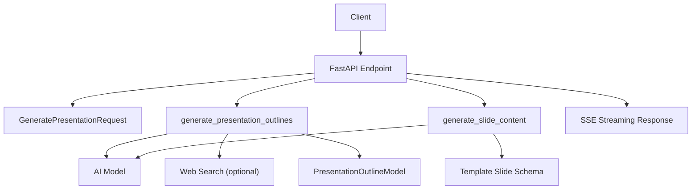
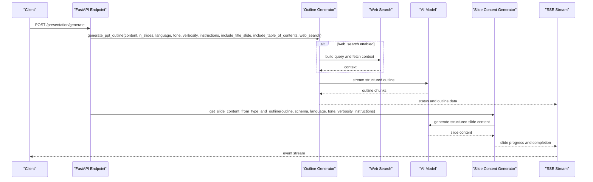
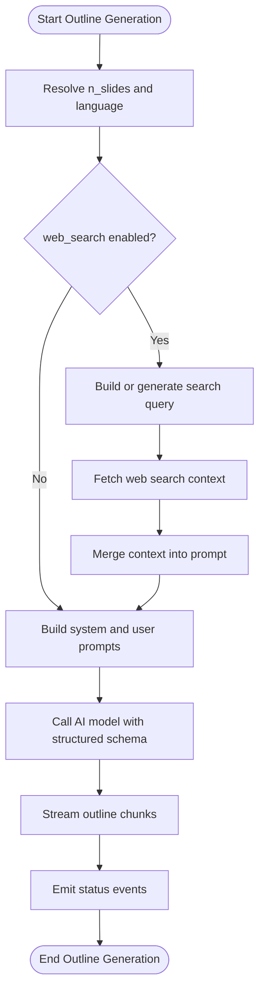
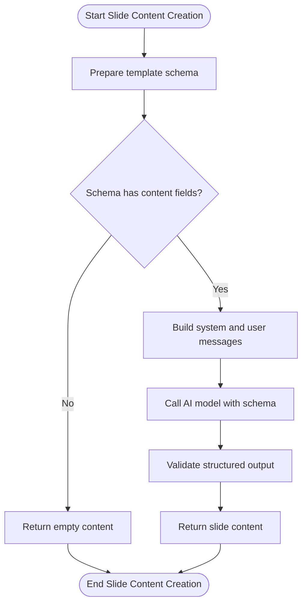
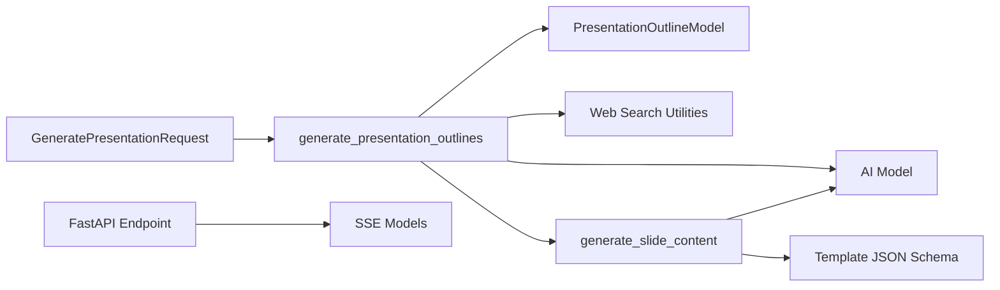

# Standard Presentation Generation

<cite>
**Referenced Files in This Document**
- [presentation-generation-modes.md](file://docs/presentation-generation-modes.md)
- [generate_presentation_request.py](file://servers/fastapi/models/generate_presentation_request.py)
- [presentation_outline_model.py](file://servers/fastapi/models/presentation_outline_model.py)
- [sse_response.py](file://servers/fastapi/models/sse_response.py)
- [tone.py](file://servers/fastapi/enums/tone.py)
- [verbosity.py](file://servers/fastapi/enums/verbosity.py)
- [generate_presentation_outlines.py](file://servers/fastapi/utils/llm_calls/generate_presentation_outlines.py)
- [generate_slide_content.py](file://servers/fastapi/utils/llm_calls/generate_slide_content.py)
</cite>

## Table of Contents
1. [Introduction](#introduction)
2. [Project Structure](#project-structure)
3. [Core Components](#core-components)
4. [Architecture Overview](#architecture-overview)
5. [Detailed Component Analysis](#detailed-component-analysis)
6. [Dependency Analysis](#dependency-analysis)
7. [Performance Considerations](#performance-considerations)
8. [Troubleshooting Guide](#troubleshooting-guide)
9. [Conclusion](#conclusion)

## Introduction
This document describes the standard presentation generation workflow used by Presenton. In standard mode, presentations are generated using predefined templates and an outline-review step. The system converts user-provided content into structured slide outlines through AI services, then produces final slide content based on a template schema.

Standard mode is selected when `PRESENTATION_GENERATION_MODE` is set to `standard` or `both`. When `smart` is selected, the system uses adaptive layouts and streams directly to the editor without the standard template workflow.

The endpoint documented here focuses on the standard generation path that accepts markdown-based slide input, builds a structured outline, and generates slide content using AI services with optional web search and tone control.

**Section sources**
- [presentation-generation-modes.md:1-28](file://docs/presentation-generation-modes.md#L1-L28)

## Project Structure
The standard presentation generation implementation spans request models, outline generation utilities, slide content generation utilities, and streaming response models.

**Diagram sources**
- [generate_presentation_request.py:8-47](file://servers/fastapi/models/generate_presentation_request.py#L8-L47)
- [generate_presentation_outlines.py:251-404](file://servers/fastapi/utils/llm_calls/generate_presentation_outlines.py#L251-L404)
- [generate_slide_content.py:229-275](file://servers/fastapi/utils/llm_calls/generate_slide_content.py#L229-L275)
- [sse_response.py:6-56](file://servers/fastapi/models/sse_response.py#L6-L56)

**Section sources**
- [generate_presentation_request.py:8-47](file://servers/fastapi/models/generate_presentation_request.py#L8-L47)
- [presentation_outline_model.py:8-35](file://servers/fastapi/models/presentation_outline_model.py#L8-L35)
- [sse_response.py:6-56](file://servers/fastapi/models/sse_response.py#L6-L56)

## Core Components
- GeneratePresentationRequest defines the standard generation payload.
- PresentationOutlineModel defines the structured outline returned by the outline generator.
- generate_presentation_outlines implements the outline generation pipeline, including optional web search and streaming.
- generate_slide_content converts each outline into structured slide content using a template schema.
- SSEResponse and related models define the Server-Sent Events format for streaming status, traces, errors, and completion.

Key behaviors:
- slides_markdown is optional; if omitted, the generator derives slide content from the main content field.
- n_slides controls the maximum number of slides when provided.
- tone and verbosity shape the language style and detail level.
- web_search can enable model-native or external web search during outline drafting.
- include_title_slide and include_table_of_contents affect outline structure.
- template selects the presentation template.

**Section sources**
- [generate_presentation_request.py:8-47](file://servers/fastapi/models/generate_presentation_request.py#L8-L47)
- [presentation_outline_model.py:8-35](file://servers/fastapi/models/presentation_outline_model.py#L8-L35)
- [generate_presentation_outlines.py:66-166](file://servers/fastapi/utils/llm_calls/generate_presentation_outlines.py#L66-L166)
- [generate_slide_content.py:20-67](file://servers/fastapi/utils/llm_calls/generate_slide_content.py#L20-L67)
- [sse_response.py:6-56](file://servers/fastapi/models/sse_response.py#L6-L56)

## Architecture Overview
The standard generation flow consists of two major phases:

1. Outline generation
   - Validates and normalizes inputs.
   - Optionally performs web search to enrich context.
   - Calls the AI model to produce a structured list of slide outlines.
   - Streams intermediate events to the client.

2. Slide content creation
   - For each outline, calls the AI model with the template’s JSON schema.
   - Produces structured slide content fields suitable for rendering.
   - Emits streaming events for progress and completion.

**Diagram sources**
- [generate_presentation_outlines.py:251-404](file://servers/fastapi/utils/llm_calls/generate_presentation_outlines.py#L251-L404)
- [generate_slide_content.py:229-275](file://servers/fastapi/utils/llm_calls/generate_slide_content.py#L229-L275)
- [sse_response.py:6-56](file://servers/fastapi/models/sse_response.py#L6-L56)

## Detailed Component Analysis

### GeneratePresentationRequest Schema
The standard generation request supports the following fields:

- content: Required string providing the primary content for generating the presentation.
- slides_markdown: Optional array of strings representing per-slide markdown. If provided, these slides inform the outline process.
- instructions: Optional string providing additional constraints or guidance.
- tone: Enum controlling voice and style.
- verbosity: Enum controlling detail density.
- web_search: Boolean enabling web search during outline generation.
- n_slides: Optional integer limiting the number of slides.
- language: Optional string specifying output language.
- template: String selecting the presentation template.
- include_table_of_contents: Boolean adding a table of contents slide.
- include_title_slide: Boolean adding a title slide.
- files: Optional list of file references.
- export_as: Literal value selecting pptx or pdf export format.
- trigger_webhook: Boolean enabling webhook triggers after generation.

Tone values:
- default
- casual
- professional
- funny
- educational
- sales_pitch

Verbosity values:
- concise
- standard
- text-heavy

Example request shapes:
- Minimal request with content only.
- Request with slides_markdown array.
- Request with n_slides, language, tone, verbosity, and template selection.
- Request enabling web search and table of contents.

Response behavior:
- Standard generation emits SSE events containing status updates, trace information, partial results, errors, and completion payloads.

**Section sources**
- [generate_presentation_request.py:8-47](file://servers/fastapi/models/generate_presentation_request.py#L8-L47)
- [tone.py:4-11](file://servers/fastapi/enums/tone.py#L4-L11)
- [verbosity.py:4-8](file://servers/fastapi/enums/verbosity.py#L4-L8)
- [sse_response.py:6-56](file://servers/fastapi/models/sse_response.py#L6-L56)

### Outline Generation Process
The outline generator transforms content and optional slides_markdown into a structured list of slide outlines. It:

- Builds system and user prompts with authoritative settings for number of slides, language, tone, verbosity, title slide inclusion, and table of contents inclusion.
- Resolves auto-detect language and slide count when not explicitly provided.
- Optionally performs web search:
  - Generates a search query when external search is available.
  - Uses model-native web search when configured.
  - Enriches additional context with search results.
- Requests a structured JSON schema response representing the outline.
- Streams outline chunks to the client via SSE.
- Limits total slides and outline word counts according to constants.

**Diagram sources**
- [generate_presentation_outlines.py:169-214](file://servers/fastapi/utils/llm_calls/generate_presentation_outlines.py#L169-L214)
- [generate_presentation_outlines.py:251-404](file://servers/fastapi/utils/llm_calls/generate_presentation_outlines.py#L251-L404)

**Section sources**
- [generate_presentation_outlines.py:66-166](file://servers/fastapi/utils/llm_calls/generate_presentation_outlines.py#L66-L166)
- [generate_presentation_outlines.py:169-214](file://servers/fastapi/utils/llm_calls/generate_presentation_outlines.py#L169-L214)
- [generate_presentation_outlines.py:251-404](file://servers/fastapi/utils/llm_calls/generate_presentation_outlines.py#L251-L404)

### Slide Content Creation Process
After outlines are produced, each outline is converted into structured slide content using the template’s JSON schema. The slide content generator:

- Prepares the response schema by removing asset-only placeholder fields and ensuring arrays have items.
- Adds speaker note support to the schema.
- Constructs messages with tone, verbosity, instructions, and language.
- Calls the AI model with strict schema validation to produce audience-facing content.
- Handles AI service exceptions and maps them to standardized error responses.

**Diagram sources**
- [generate_slide_content.py:103-149](file://servers/fastapi/utils/llm_calls/generate_slide_content.py#L103-L149)
- [generate_slide_content.py:203-226](file://servers/fastapi/utils/llm_calls/generate_slide_content.py#L203-L226)
- [generate_slide_content.py:229-275](file://servers/fastapi/utils/llm_calls/generate_slide_content.py#L229-L275)

**Section sources**
- [generate_slide_content.py:20-67](file://servers/fastapi/utils/llm_calls/generate_slide_content.py#L20-L67)
- [generate_slide_content.py:158-192](file://servers/fastapi/utils/llm_calls/generate_slide_content.py#L158-L192)
- [generate_slide_content.py:203-275](file://servers/fastapi/utils/llm_calls/generate_slide_content.py#L203-L275)

### SSE Streaming Response Format
The server emits Server-Sent Events with typed payloads:

- Status events: Indicate processing stages such as searching, drafting outlines, or generating slide content.
- Trace events: Provide diagnostic or tracing information.
- Error events: Include error details, source, HTTP status code, error type, retryability, and slide progress counters.
- Complete events: Deliver final keys and values indicating successful completion.

Clients should consume the event stream and handle:
- Partial outline chunks during outline generation.
- Slide-by-slide progress during content creation.
- Errors with retryable flags where applicable.
- Completion payloads containing generated artifacts.

**Section sources**
- [sse_response.py:6-56](file://servers/fastapi/models/sse_response.py#L6-L56)

### Input Formats and Examples
Valid input patterns include:

- Markdown-driven slides:
  - Provide slides_markdown as an array of markdown strings.
  - Each slide should contain audience-facing content suitable for conversion into structured slide fields.

- Content-driven slides:
  - Omit slides_markdown and provide content describing the presentation topic.
  - The outline generator infers slide structure from content and instructions.

- Controlled generation:
  - Set n_slides to limit slide count.
  - Set language to enforce output language.
  - Set tone and verbosity to control style and detail.
  - Enable web_search to enrich outline context.
  - Select template to choose layout and schema.

- Export options:
  - Use export_as to select pptx or pdf.

These examples illustrate how slides_markdown integrates with the outline generator and how template schemas guide slide content creation.

[No sources needed since this section provides conceptual examples]

## Dependency Analysis
The standard presentation generation pipeline depends on:

- Request validation through GeneratePresentationRequest.
- Outline modeling through PresentationOutlineModel.
- AI model invocation through llmai clients and configuration utilities.
- Web search routing and provider selection.
- Template schema enforcement during slide content generation.
- SSE response models for streaming.

**Diagram sources**
- [generate_presentation_request.py:8-47](file://servers/fastapi/models/generate_presentation_request.py#L8-L47)
- [presentation_outline_model.py:8-35](file://servers/fastapi/models/presentation_outline_model.py#L8-L35)
- [generate_presentation_outlines.py:251-404](file://servers/fastapi/utils/llm_calls/generate_presentation_outlines.py#L251-L404)
- [generate_slide_content.py:229-275](file://servers/fastapi/utils/llm_calls/generate_slide_content.py#L229-L275)
- [sse_response.py:6-56](file://servers/fastapi/models/sse_response.py#L6-L56)

**Section sources**
- [generate_presentation_request.py:8-47](file://servers/fastapi/models/generate_presentation_request.py#L8-L47)
- [presentation_outline_model.py:8-35](file://servers/fastapi/models/presentation_outline_model.py#L8-L35)
- [generate_presentation_outlines.py:251-404](file://servers/fastapi/utils/llm_calls/generate_presentation_outlines.py#L251-L404)
- [generate_slide_content.py:229-275](file://servers/fastapi/utils/llm_calls/generate_slide_content.py#L229-L275)
- [sse_response.py:6-56](file://servers/fastapi/models/sse_response.py#L6-L56)

## Performance Considerations
- Limit slide count using n_slides to reduce AI calls and processing time.
- Prefer concise verbosity for faster generation when detailed text is unnecessary.
- Use web_search judiciously; external search adds latency.
- Avoid excessively large slides_markdown arrays; prefer focused content.
- Reuse template schemas to minimize schema preparation overhead.
- Monitor AI provider rate limits and implement retries for transient failures.

[No sources needed since this section provides general guidance]

## Troubleshooting Guide
Common issues and resolutions:

- Invalid or malformed slides_markdown:
  - Ensure each markdown entry contains clear, audience-facing content.
  - Avoid meta-instructions about charts, images, or layout; let the template schema control visuals.

- AI service failures during outline generation:
  - Check network connectivity and provider availability.
  - Inspect SSE error events for error_type, retryable, and status_code.
  - Reduce complexity by lowering verbosity or disabling web_search temporarily.

- AI service failures during slide content creation:
  - Verify that the template schema includes content fields.
  - Confirm language and tone settings are compatible with the selected model.
  - Review error events for detailed diagnostics.

- Unexpected slide count:
  - Explicitly set n_slides to constrain output.
  - Review instructions and content for conflicting slide count requests.

- Mode confusion between standard and smart:
  - Confirm PRESENTATION_GENERATION_MODE is set to standard or both.
  - Remember that smart mode bypasses the standard template workflow.

**Section sources**
- [generate_presentation_outlines.py:403-404](file://servers/fastapi/utils/llm_calls/generate_presentation_outlines.py#L403-L404)
- [generate_slide_content.py:274-275](file://servers/fastapi/utils/llm_calls/generate_slide_content.py#L274-L275)
- [sse_response.py:32-56](file://servers/fastapi/models/sse_response.py#L32-L56)
- [presentation-generation-modes.md:1-28](file://docs/presentation-generation-modes.md#L1-L28)

## Conclusion
The standard presentation generation workflow converts user content and optional slides_markdown into structured slide outlines, then produces template-aware slide content using AI services. Clients interact with the endpoint through SSE streaming, receiving status updates, trace information, partial results, errors, and completion payloads. Proper use of n_slides, language, tone, verbosity, web_search, and template selection enables predictable, high-quality presentations aligned with organizational standards.

[No sources needed since this section summarizes without analyzing specific files]