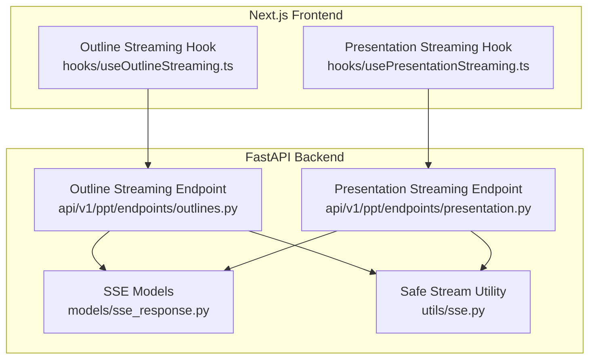
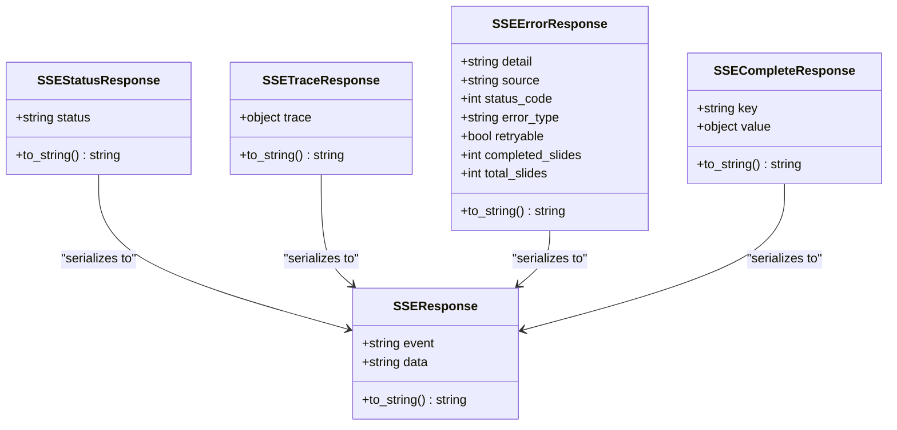
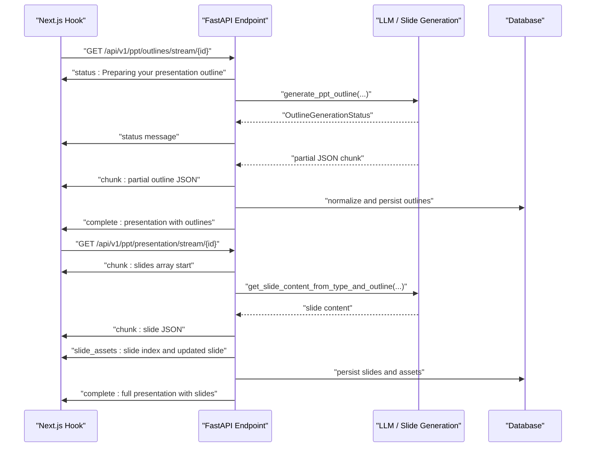
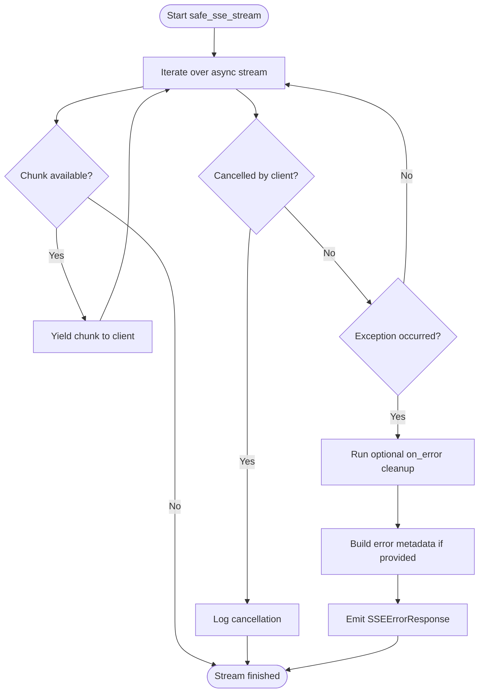
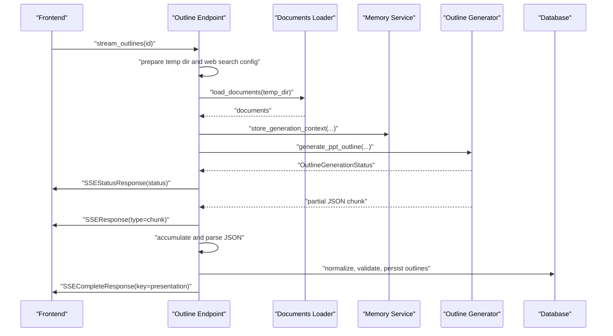
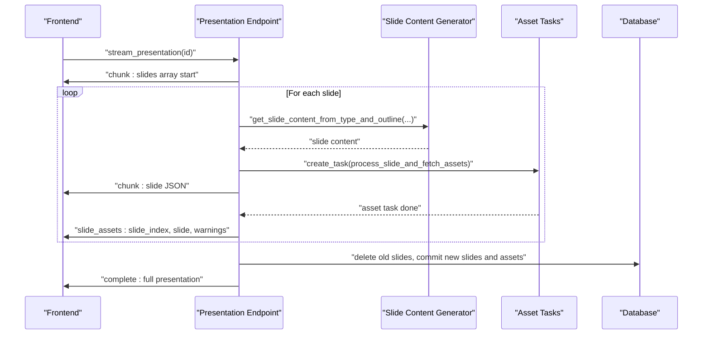
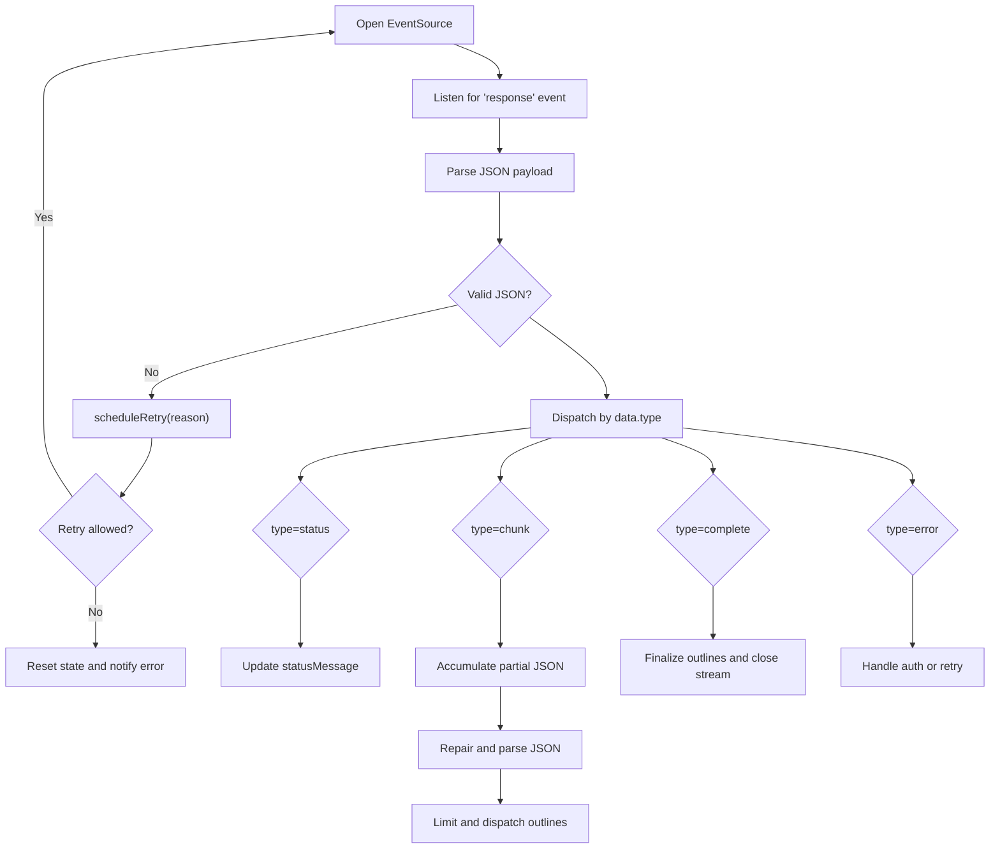
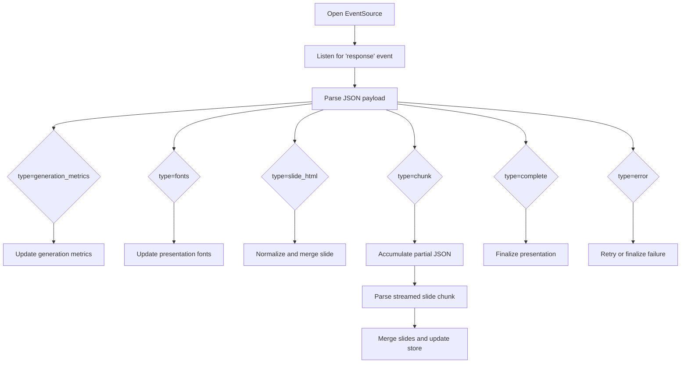
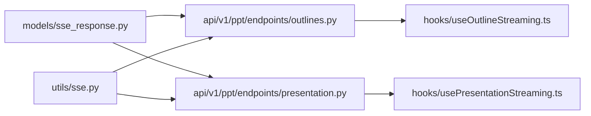

# Streaming Response Handling

<cite>
**Referenced Files in This Document**
- [sse_response.py](file://servers/fastapi/models/sse_response.py)
- [sse.py](file://servers/fastapi/utils/sse.py)
- [outlines.py](file://servers/fastapi/api/v1/ppt/endpoints/outlines.py)
- [presentation.py](file://servers/fastapi/api/v1/ppt/endpoints/presentation.py)
- [useOutlineStreaming.ts](file://servers/nexjs/app/(presentation-generator)/outline/hooks/useOutlineStreaming.ts)
- [usePresentationStreaming.ts](file://servers/nextjs/app/(presentation-generator)/presentation/hooks/usePresentationStreaming.ts)
</cite>

## Table of Contents
1. [Introduction](#introduction)
2. [Project Structure](#project-structure)
3. [Core Components](#core-components)
4. [Architecture Overview](#architecture-overview)
5. [Detailed Component Analysis](#detailed-component-analysis)
6. [Dependency Analysis](#dependency-analysis)
7. [Performance Considerations](#performance-considerations)
8. [Troubleshooting Guide](#troubleshooting-guide)
9. [Conclusion](#conclusion)

## Introduction
This document explains how Server-Sent Events streaming responses are used during presentation generation. It covers the SSE schema models, the server-side streaming endpoints for outline and slide generation, the client-side event handling patterns, error recovery strategies, and the `safe_sse_stream` utility that ensures reliable event delivery.

The goal is to help both backend developers and frontend engineers understand:
- What event types are emitted.
- How payloads evolve from initial status through incremental chunks to a final completion payload.
- How errors are surfaced and recovered from.
- How clients should parse, merge, and finalize streamed data.

## Project Structure
The streaming implementation spans FastAPI backend models, utilities, API endpoints, and Next.js hooks:

**Diagram sources**
- [sse_response.py:6-56](file://servers/fastapi/models/sse_response.py#L6-L56)
- [sse.py:10-38](file://servers/fastapi/utils/sse.py#L10-L38)
- [outlines.py:84-276](file://servers/fastapi/api/v1/ppt/endpoints/outlines.py#L84-L276)
- [presentation.py:2320-2485](file://servers/fastapi/api/v1/ppt/endpoints/presentation.py#L2320-L2485)
- [useOutlineStreaming.ts:105-243](file://servers/nexjs/app/(presentation-generator)/outline/hooks/useOutlineStreaming.ts#L105-L243)
- [usePresentationStreaming.ts:298-489](file://servers/nextjs/app/(presentation-generator)/presentation/hooks/usePresentationStreaming.ts#L298-L489)

**Section sources**
- [sse_response.py:6-56](file://servers/fastapi/models/sse_response.py#L6-L56)
- [sse.py:10-38](file://servers/fastapi/utils/sse.py#L10-L38)
- [outlines.py:84-276](file://servers/fastapi/api/v1/ppt/endpoints/outlines.py#L84-L276)
- [presentation.py:2320-2485](file://servers/fastapi/api/v1/ppt/endpoints/presentation.py#L2320-L2485)
- [useOutlineStreaming.ts:105-243](file://servers/nexjs/app/(presentation-generator)/outline/hooks/useOutlineStreaming.ts#L105-L243)
- [usePresentationStreaming.ts:298-489](file://servers/nextjs/app/(presentation-generator)/presentation/hooks/usePresentationStreaming.ts#L298-L489)

## Core Components
The core SSE components define the wire format and safe delivery guarantees:

- **SSEResponse**: Base model that serializes an SSE frame with `event` and `data`.
- **SSEStatusResponse**: Emits a typed status update.
- **SSETraceResponse**: Emits optional trace information.
- **SSEErrorResponse**: Emits structured error information, including optional metadata such as source, HTTP status code, error type, retryability, and slide progress.
- **SSECompleteResponse**: Emits the final result payload under a dynamic key.

These models all serialize into standard SSE frames using the `to_string()` method.

**Diagram sources**
- [sse_response.py:6-56](file://servers/fastapi/models/sse_response.py#L6-L56)

**Section sources**
- [sse_response.py:6-56](file://servers/fastapi/models/sse_response.py#L6-L56)

## Architecture Overview
The streaming architecture connects FastAPI endpoints to Next.js hooks via SSE:

**Diagram sources**
- [outlines.py:112-263](file://servers/fastapi/api/v1/ppt/endpoints/outlines.py#L112-L263)
- [presentation.py:2320-2472](file://servers/fastapi/api/v1/ppt/endpoints/presentation.py#L2320-L2472)

**Section sources**
- [outlines.py:112-263](file://servers/fastapi/api/v1/ppt/endpoints/outlines.py#L112-L263)
- [presentation.py:2320-2472](file://servers/fastapi/api/v1/ppt/endpoints/presentation.py#L2320-L2472)

## Detailed Component Analysis

### SSE Schema Models
The SSE schema models define the typed events sent over the stream:

| Model | Purpose | Key Fields | Payload Type Field |
|---|---|---|---|
| `SSEResponse` | Base SSE frame serializer | `event`, `data` | N/A |
| `SSEStatusResponse` | Progress/status updates | `status` | `type: "status"` |
| `SSETraceResponse` | Optional tracing/debug info | `trace` | `type: "trace"` |
| `SSEErrorResponse` | Error reporting | `detail`, optional `source`, `status_code`, `error_type`, `retryable`, `completed_slides`, `total_slides` | `type: "error"` |
| `SSECompleteResponse` | Final result | `key`, `value` | `type: "complete"` |

All models serialize to an SSE frame where the `data` field contains a JSON object with a `type` discriminator. The `SSECompleteResponse` uses a dynamic key so callers can attach different final payloads (for example, `presentation`).

**Section sources**
- [sse_response.py:6-56](file://servers/fastapi/models/sse_response.py#L6-L56)

### Safe SSE Stream Utility
The `safe_sse_stream` utility wraps an async generator and provides:

- Graceful handling of client cancellation.
- Logging when the stream fails after response has started.
- Optional cleanup callback execution on error.
- Conversion of exceptions into a structured `SSEErrorResponse`.
- Optional structured metadata injection via `error_metadata`.

**Diagram sources**
- [sse.py:10-38](file://servers/fastapi/utils/sse.py#L10-L38)

**Section sources**
- [sse.py:10-38](file://servers/fastapi/utils/sse.py#L10-L38)

### Outline Streaming Endpoint
The outline streaming endpoint performs these steps:

1. Loads the presentation and prepares web search configuration.
2. Creates a temporary directory and loads additional documents when present.
3. Builds outline messages and stores generation context.
4. Streams outline generation results:
   - Emits `SSEStatusResponse` for status updates.
   - Emits `SSEErrorResponse` for explicit HTTP exceptions.
   - Emits `SSEResponse` with `type: "chunk"` containing partial JSON.
5. Parses accumulated text into JSON, normalizes it, validates slide count, trims overshoot, persists outlines, and emits `SSECompleteResponse` with the updated presentation.

**Diagram sources**
- [outlines.py:112-263](file://servers/fastapi/api/v1/ppt/endpoints/outlines.py#L112-L263)

**Section sources**
- [outlines.py:112-263](file://servers/fastapi/api/v1/ppt/endpoints/outlines.py#L112-L263)

### Presentation Streaming Endpoint
The presentation streaming endpoint generates slides and their assets:

1. Emits a chunk opening the slides array.
2. For each slide:
   - Generates slide content.
   - Creates a slide model.
   - Adds placeholder assets and applies template UI.
   - Starts asset generation tasks concurrently.
   - Emits a chunk with the slide JSON.
   - Emits `slide_assets` events as assets finish.
3. Waits for remaining asset events.
4. Gathers generated assets and persists slides and assets.
5. Emits `SSECompleteResponse` with the full presentation including slides.

**Diagram sources**
- [presentation.py:2320-2472](file://servers/fastapi/api/v1/ppt/endpoints/presentation.py#L2320-L2472)

**Section sources**
- [presentation.py:2320-2472](file://servers/fastapi/api/v1/ppt/endpoints/presentation.py#L2320-L2472)

### Client-Side Handling Patterns

#### Outline Streaming Hook
The outline streaming hook:

- Connects via `EventSource` to `/api/v1/ppt/outlines/stream/{presentationId}`.
- Listens for the `response` event.
- Parses JSON payloads and dispatches state updates.
- Handles:
  - `status`: updates user-facing status message.
  - `chunk`: accumulates partial JSON, repairs it, parses, limits outlines, and updates the store.
  - `complete`: finalizes outlines, stops streaming, and closes the connection.
  - `error`: triggers retry logic or authentication reflow.
- Implements retry with exponential backoff and connection error handling.

**Diagram sources**
- [useOutlineStreaming.ts:105-243](file://servers/nexjs/app/(presentation-generator)/outline/hooks/useOutlineStreaming.ts#L105-L243)

**Section sources**
- [useOutlineStreaming.ts:105-243](file://servers/nexjs/app/(presentation-generator)/outline/hooks/useOutlineStreaming.ts#L105-L243)

#### Presentation Streaming Hook
The presentation streaming hook:

- Connects via `EventSource` to `/api/v1/ppt/presentation/stream/{presentationId}`.
- Parses JSON payloads and handles multiple event types:
  - `generation_metrics`: updates token usage and timing metrics.
  - `fonts`: updates fonts in presentation data.
  - `slide_html`: merges incoming slide HTML and normalized slide data.
  - `chunk`: accumulates partial JSON, parses streamed slide objects, merges slides, and may preload template V2 presentation data.
  - `complete`: finalizes the presentation.
  - `error`: triggers retry logic or failure finalization.
- Uses JSON repair and careful merging to preserve resolved assets while updating slides incrementally.

**Diagram sources**
- [usePresentationStreaming.ts:298-489](file://servers/nextjs/app/(presentation-generator)/presentation/hooks/usePresentationStreaming.ts#L298-L489)

**Section sources**
- [usePresentationStreaming.ts:298-489](file://servers/nextjs/app/(presentation-generator)/presentation/hooks/usePresentationStreaming.ts#L298-L489)

## Dependency Analysis
The streaming pipeline depends on several modules:

**Diagram sources**
- [sse_response.py:6-56](file://servers/fastapi/models/sse_response.py#L6-L56)
- [sse.py:10-38](file://servers/fastapi/utils/sse.py#L10-L38)
- [outlines.py:14-37](file://servers/fastapi/api/v1/ppt/endpoints/outlines.py#L14-L37)
- [presentation.py:60-98](file://servers/fastapi/api/v1/ppt/endpoints/presentation.py#L60-L98)
- [useOutlineStreaming.ts:105-243](file://servers/nexjs/app/(presentation-generator)/outline/hooks/useOutlineStreaming.ts#L105-L243)
- [usePresentationStreaming.ts:298-489](file://servers/nextjs/app/(presentation-generator)/presentation/hooks/usePresentationStreaming.ts#L298-L489)

**Section sources**
- [sse_response.py:6-56](file://servers/fastapi/models/sse_response.py#L6-L56)
- [sse.py:10-38](file://servers/fastapi/utils/sse.py#L10-L38)
- [outlines.py:14-37](file://servers/fastapi/api/v1/ppt/endpoints/outlines.py#L14-L37)
- [presentation.py:60-98](file://servers/fastapi/api/v1/ppt/endpoints/presentation.py#L60-L98)
- [useOutlineStreaming.ts:105-243](file://servers/nexjs/app/(presentation-generator)/outline/hooks/useOutlineStreaming.ts#L105-L243)
- [usePresentationStreaming.ts:298-489](file://servers/nextjs/app/(presentation-generator)/presentation/hooks/usePresentationStreaming.ts#L298-L489)

## Performance Considerations
- **Incremental rendering**: Both outline and presentation streams emit partial data so the UI can render progressively rather than waiting for the entire result.
- **Concurrent asset generation**: Slide asset generation runs in parallel with slide content generation, improving throughput.
- **JSON repair**: The frontend uses JSON repair to tolerate incomplete JSON fragments during streaming.
- **Backpressure awareness**: The outline endpoint yields control to the event loop between chunks to avoid blocking.
- **Metadata tracking**: Generation metrics allow the frontend to track token usage and performance without polling.

[No sources needed since this section provides general guidance]

## Troubleshooting Guide
Common issues and recommended handling:

- **Invalid SSE payload**:
  - Cause: Malformed JSON in the `data` field.
  - Action: Retry with backoff; if retries exhausted, reset state and show an error.
  - Evidence: Both outline and presentation hooks implement retry logic around JSON parsing failures.

- **Connection lost**:
  - Cause: Network interruption or server restart.
  - Action: Use `EventSource.onerror` to schedule retry; reset accumulated state only when necessary.

- **Server error during streaming**:
  - Cause: LLM provider failure, validation error, or unexpected exception.
  - Action: Parse `type: "error"` payload; use `retryable` and `source` fields to decide whether to retry or fail fast.
  - Evidence: `SSEErrorResponse` includes structured fields like `source`, `status_code`, `error_type`, `retryable`, and slide progress.

- **Incomplete outline JSON**:
  - Cause: LLM output arrives incrementally.
  - Action: Accumulate chunks, repair JSON, and parse only when valid; continue accumulating otherwise.
  - Evidence: Outline hook accumulates chunks and uses JSON repair before parsing.

- **Missing or partial slide assets**:
  - Cause: Asset generation fails or takes longer than slide content generation.
  - Action: Track `slide_assets` events per slide index; merge updated slides and warnings; finalize after all assets are received.
  - Evidence: Presentation endpoint emits `slide_assets` events and tracks warnings per slide.

**Section sources**
- [useOutlineStreaming.ts:111-243](file://servers/nexjs/app/(presentation-generator)/outline/hooks/useOutlineStreaming.ts#L111-L243)
- [usePresentationStreaming.ts:304-489](file://servers/nextjs/app/(presentation-generator)/presentation/hooks/usePresentationStreaming.ts#L304-L489)
- [sse_response.py:32-45](file://servers/fastapi/models/sse_response.py#L32-L45)
- [sse.py:24-38](file://servers/fastapi/utils/sse.py#L24-L38)

## Conclusion
The streaming response system combines typed SSE models, robust error handling, and incremental client updates to deliver a responsive presentation generation experience. The `safe_sse_stream` utility ensures that errors are converted into structured events and that cleanup happens reliably. Clients handle status updates, partial chunks, asset updates, and final completion, with retry and recovery strategies for resilience.

[No sources needed since this section summarizes without analyzing specific files]