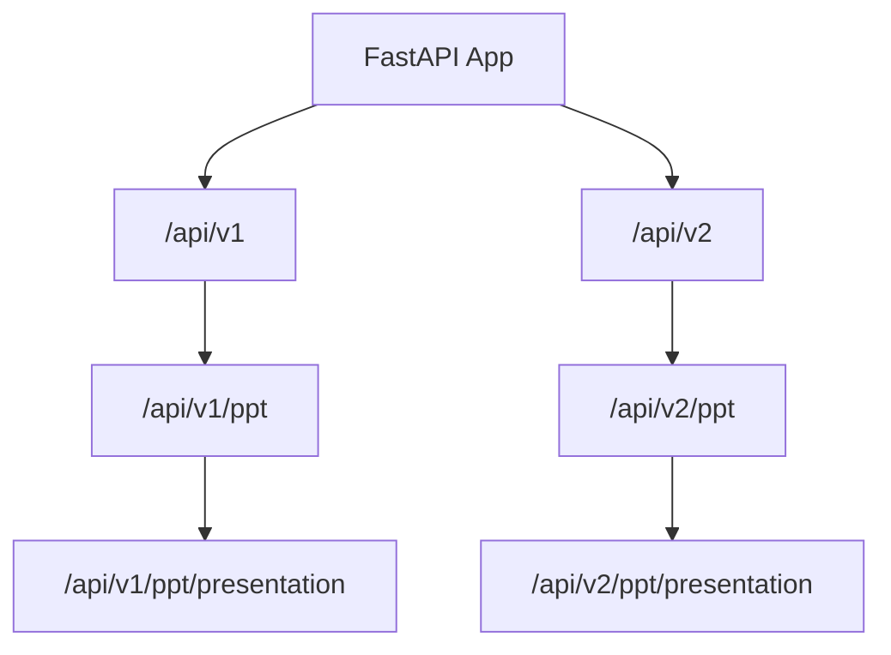
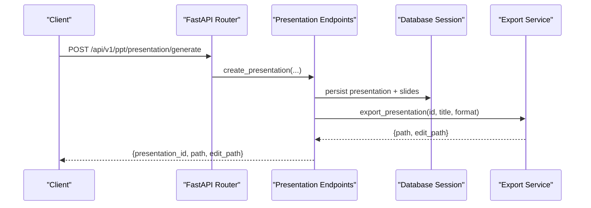
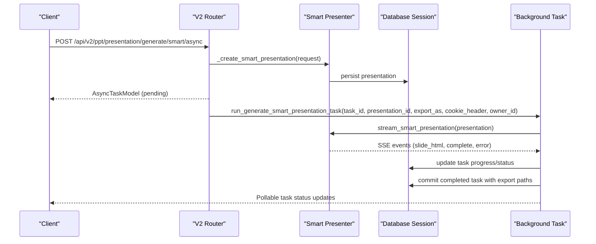
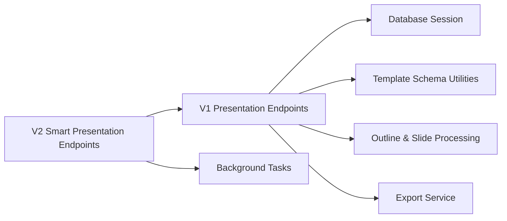

# Presentation Management API

<cite>
**Referenced Files in This Document**
- [main.py](file://servers/fastapi/api/main.py)
- [router.py (v1 ppt)](file://servers/fastapi/api/v1/ppt/router.py)
- [presentation.py (v1)](file://servers/fastapi/api/v1/ppt/endpoints/presentation.py)
- [router.py (v2)](file://servers/fastapi/api/v2/router.py)
- [router.py (v2 ppt)](file://servers/fastapi/api/v2/ppt/router.py)
- [presentation.py (v2)](file://servers/fastapi/api/v2/ppt/endpoints/presentation.py)
</cite>

## Table of Contents
1. [Introduction](#introduction)
2. [Project Structure](#project-structure)
3. [Core Components](#core-components)
4. [Architecture Overview](#architecture-overview)
5. [Detailed Component Analysis](#detailed-component-analysis)
6. [Dependency Analysis](#dependency-analysis)
7. [Performance Considerations](#performance-considerations)
8. [Troubleshooting Guide](#troubleshooting-guide)
9. [Conclusion](#conclusion)

## Introduction
This document provides comprehensive API documentation for Presenton’s presentation management endpoints. It covers the HTTP methods and workflows for creating, retrieving, updating, duplicating, exporting, generating, and deleting presentations. It also documents authentication and authorization mechanisms, request/response schemas, error handling, bulk operations, search/filtering options, and practical end-to-end workflows such as creating a presentation from a template, generating content via AI, and exporting to PPTX or PDF.

## Project Structure
The FastAPI application mounts multiple routers under /api/v1 and /api/v2. The presentation management endpoints are primarily exposed under:
- /api/v1/ppt/presentation — core CRUD, generation, streaming, export, and editing endpoints
- /api/v2/ppt/presentation — Smart presentation generation endpoints (sync and async)

**Diagram sources**
- [main.py:65-74](file://servers/fastapi/api/main.py#L65-L74)
- [router.py (v1 ppt):22-40](file://servers/fastapi/api/v1/ppt/router.py#L22-L40)
- [router.py (v2):6-7](file://servers/fastapi/api/v2/router.py#L6-L7)
- [router.py (v2 ppt):6-7](file://servers/fastapi/api/v2/ppt/router.py#L6-L7)

**Section sources**
- [main.py:65-103](file://servers/fastapi/api/main.py#L65-L103)
- [router.py (v1 ppt):22-40](file://servers/fastapi/api/v1/ppt/router.py#L22-L40)
- [router.py (v2):6-7](file://servers/fastapi/api/v2/router.py#L6-L7)
- [router.py (v2 ppt):6-7](file://servers/fastapi/api/v2/ppt/router.py#L6-L7)

## Core Components
- Presentation Router (v1): Provides full lifecycle management for presentations including creation, listing, retrieval, duplication, export, generation, streaming, editing, and deletion.
- Smart Presentation Router (v2): Adds specialized endpoints for AI-driven “Smart” presentation generation with both synchronous and asynchronous execution modes.

Key responsibilities:
- Request validation and normalization
- Template resolution and layout mapping
- Slide structure and UI hydration
- Streaming generation progress updates
- Export to PPTX/PDF
- Background task orchestration for long-running jobs

**Section sources**
- [presentation.py (v1):134-139](file://servers/fastapi/api/v1/ppt/endpoints/presentation.py#L134-L139)
- [presentation.py (v2):35-40](file://servers/fastapi/api/v2/ppt/endpoints/presentation.py#L35-L40)

## Architecture Overview
The presentation APIs follow a layered architecture:
- API Layer: FastAPI routers define endpoints and route requests.
- Service Layer: Business logic for presentation creation, slide processing, template hydration, and export.
- Data Layer: SQLAlchemy models and async sessions manage persistence.
- External Integrations: LLM providers, image generation services, web search, and community resources.

**Diagram sources**
- [presentation.py (v1):3130-3200](file://servers/fastapi/api/v1/ppt/endpoints/presentation.py#L3130-L3200)
- [presentation.py (v2):229-261](file://servers/fastapi/api/v2/ppt/endpoints/presentation.py#L229-L261)

**Section sources**
- [main.py:65-103](file://servers/fastapi/api/main.py#L65-L103)
- [presentation.py (v1):3130-3200](file://servers/fastapi/api/v1/ppt/endpoints/presentation.py#L3130-L3200)
- [presentation.py (v2):229-261](file://servers/fastapi/api/v2/ppt/endpoints/presentation.py#L229-L261)

## Detailed Component Analysis

### Authentication and Authorization
- Session-based authentication is enforced via middleware.
- Owner context is injected into handlers to enforce per-user isolation.
- Admin flags can be set/reset within background tasks to control elevated access.

Security notes:
- CORS is configured to allow credentials; origins are constrained by environment.
- Static assets and app data directories are mounted securely.

**Section sources**
- [main.py:94-103](file://servers/fastapi/api/main.py#L94-L103)
- [presentation.py (v1):102-108](file://servers/fastapi/api/v1/ppt/endpoints/presentation.py#L102-L108)
- [presentation.py (v2):10-16](file://servers/fastapi/api/v2/ppt/endpoints/presentation.py#L10-L16)

### Presentation Endpoints (v1)
Base path: /api/v1/ppt/presentation

- List all presentations
  - Method: GET
  - Path: /all
  - Response: Array of presentations with slides
  - Notes: Returns full presentation structures suitable for editor rendering

- Get presentation by ID
  - Method: GET
  - Path: /{id}
  - Response: Single presentation with slides

- Delete presentation
  - Method: DELETE
  - Path: /{id}
  - Status: 204 No Content on success

- Duplicate presentation
  - Method: POST
  - Path: /{id}/duplicate
  - Response: Duplicated presentation with slides

- Export presentation
  - Method: POST
  - Path: /{id}/export
  - Query params: format (pptx|pdf), optional cookie header for authenticated export
  - Response: { presentation_id, path, edit_path }

- Create presentation
  - Method: POST
  - Path: /create
  - Request body: Presentation creation payload (template, title, slides, etc.)
  - Response: Created presentation model

- Generate presentation (standard mode)
  - Method: POST
  - Path: /generate
  - Request body: Generation parameters (outline, slides markdown, template, tone, verbosity, web search, etc.)
  - Response: { presentation_id, path, edit_path }

- Generate presentation (async standard mode)
  - Method: POST
  - Path: /generate/async
  - Request body: Same as sync generate
  - Response: Async task model with status and progress data

- Stream presentation generation
  - Method: GET
  - Path: /stream/{id}
  - Response: Server-sent events with slide HTML chunks and completion/error events

- Edit presentation
  - Method: POST
  - Path: /edit
  - Request body: Edits to apply to an existing presentation
  - Response: { presentation_id, path, edit_path }

- Derive presentation
  - Method: POST
  - Path: /derive
  - Request body: Derivation parameters based on an existing presentation
  - Response: { presentation_id, path, edit_path }

Notes:
- Many endpoints accept optional query parameters for filtering and pagination where applicable.
- Export endpoints require proper authentication headers when exporting private presentations.

**Section sources**
- [presentation.py (v1):1487-1487](file://servers/fastapi/api/v1/ppt/endpoints/presentation.py#L1487-L1487)
- [presentation.py (v1):1539-1539](file://servers/fastapi/api/v1/ppt/endpoints/presentation.py#L1539-L1539)
- [presentation.py (v1):1560-1560](file://servers/fastapi/api/v1/ppt/endpoints/presentation.py#L1560-L1560)
- [presentation.py (v1):1572-1572](file://servers/fastapi/api/v1/ppt/endpoints/presentation.py#L1572-L1572)
- [presentation.py (v1):1603-1603](file://servers/fastapi/api/v1/ppt/endpoints/presentation.py#L1603-L1603)
- [presentation.py (v1):1642-1642](file://servers/fastapi/api/v1/ppt/endpoints/presentation.py#L1642-L1642)
- [presentation.py (v1):1744-1744](file://servers/fastapi/api/v1/ppt/endpoints/presentation.py#L1744-L1744)
- [presentation.py (v1):1801-1801](file://servers/fastapi/api/v1/ppt/endpoints/presentation.py#L1801-L1801)
- [presentation.py (v1):2242-2242](file://servers/fastapi/api/v1/ppt/endpoints/presentation.py#L2242-L2242)
- [presentation.py (v1):3130-3130](file://servers/fastapi/api/v1/ppt/endpoints/presentation.py#L3130-L3130)
- [presentation.py (v1):3201-3201](file://servers/fastapi/api/v1/ppt/endpoints/presentation.py#L3201-L3201)
- [presentation.py (v1):3243-3243](file://servers/fastapi/api/v1/ppt/endpoints/presentation.py#L3243-L3243)
- [presentation.py (v1):3260-3260](file://servers/fastapi/api/v1/ppt/endpoints/presentation.py#L3260-L3260)
- [presentation.py (v1):3311-3311](file://servers/fastapi/api/v1/ppt/endpoints/presentation.py#L3311-L3311)

### Smart Presentation Endpoints (v2)
Base path: /api/v2/ppt/presentation

- Generate Smart presentation (synchronous)
  - Method: POST
  - Path: /generate/smart
  - Request body: Smart generation parameters (content, n_slides, language, tone, verbosity, instructions, include_table_of_contents, include_title_slide, web_search, community_design_ids, files, export_as)
  - Response: { presentation_id, path, edit_path }

- Generate Smart presentation (asynchronous)
  - Method: POST
  - Path: /generate/smart/async
  - Request body: Same as sync
  - Response: Async task model with status and progress data

Behavior:
- Creates a presentation record and streams slide generation.
- Updates background task progress with created slide counts and total slide count.
- Exports final presentation to requested format (pptx or pdf).

**Diagram sources**
- [presentation.py (v2):152-227](file://servers/fastapi/api/v2/ppt/endpoints/presentation.py#L152-L227)
- [presentation.py (v2):264-299](file://servers/fastapi/api/v2/ppt/endpoints/presentation.py#L264-L299)

**Section sources**
- [presentation.py (v2):229-261](file://servers/fastapi/api/v2/ppt/endpoints/presentation.py#L229-L261)
- [presentation.py (v2):264-299](file://servers/fastapi/api/v2/ppt/endpoints/presentation.py#L264-L299)

### Data Models and Schemas
- Presentation Model: Represents a presentation with metadata, generation mode, and links to slides.
- Slide Model: Represents individual slides with content and UI definitions.
- PresentationWithSlides: Aggregates presentation and its slides for read operations.
- PresentationPathAndEditPath: Standardized response containing exported file path and editor URL.
- AsyncTaskModel: Tracks background job status, message, and structured data payload.

Common fields:
- presentation_id: UUID identifier
- title: Human-readable title
- type: "smart" or "standard"
- n_slides: Number of slides
- generation_mode: Mode used to generate content
- path: Exported file path
- edit_path: Editor URL for the presentation

Validation rules:
- Template references must resolve to valid templates or default bundled templates.
- Layout JSON must be valid and contain at least one layout.
- Slide counts are normalized against available layouts.

**Section sources**
- [presentation.py (v1):162-168](file://servers/fastapi/api/v1/ppt/endpoints/presentation.py#L162-L168)
- [presentation.py (v1):341-346](file://servers/fastapi/api/v1/ppt/endpoints/presentation.py#L341-L346)
- [presentation.py (v1):398-458](file://servers/fastapi/api/v1/ppt/endpoints/presentation.py#L398-L458)
- [presentation.py (v2):26-28](file://servers/fastapi/api/v2/ppt/endpoints/presentation.py#L26-L28)

### Workflows and Examples

#### Creating a New Presentation from a Template
Steps:
1. Call POST /api/v1/ppt/presentation/create with template reference and initial metadata.
2. System resolves template, validates layout schema, and creates presentation with slide structure.
3. Response includes presentation_id and basic metadata.

Best practices:
- Use template names that match built-in aliases or provide custom template IDs prefixed appropriately.
- Ensure layout JSON conforms to expected schema to avoid validation errors.

**Section sources**
- [presentation.py (v1):1642-1642](file://servers/fastapi/api/v1/ppt/endpoints/presentation.py#L1642-L1642)
- [presentation.py (v1):210-304](file://servers/fastapi/api/v1/ppt/endpoints/presentation.py#L210-L304)
- [presentation.py (v1):398-458](file://servers/fastapi/api/v1/ppt/endpoints/presentation.py#L398-L458)

#### Generating Content via AI (Standard Mode)
Steps:
1. Call POST /api/v1/ppt/presentation/generate with outline, slides markdown, template, tone, verbosity, and optional web search.
2. System generates slide content, hydrates UI, and exports to requested format.
3. Response includes exported path and editor link.

Error handling:
- Invalid templates return 400.
- Missing bundled templates return 503.
- LLM or external service failures propagate as 500 with detailed messages.

**Section sources**
- [presentation.py (v1):3130-3200](file://servers/fastapi/api/v1/ppt/endpoints/presentation.py#L3130-L3200)
- [presentation.py (v1):210-304](file://servers/fastapi/api/v1/ppt/endpoints/presentation.py#L210-L304)

#### Managing Presentation Versions
- Duplicate an existing presentation using POST /{id}/duplicate to create a new version without altering the original.
- Use /edit to apply incremental changes to a specific presentation instance.
- Use /derive to produce a derived presentation based on an existing one.

**Section sources**
- [presentation.py (v1):1572-1572](file://servers/fastapi/api/v1/ppt/endpoints/presentation.py#L1572-L1572)
- [presentation.py (v1):3260-3260](file://servers/fastapi/api/v1/ppt/endpoints/presentation.py#L3260-L3260)
- [presentation.py (v1):3311-3311](file://servers/fastapi/api/v1/ppt/endpoints/presentation.py#L3311-L3311)

#### Adding Slides
- When generating presentations, slide structure is determined by template layouts and generated outlines.
- For manual edits, use /edit to add or modify slides programmatically.

**Section sources**
- [presentation.py (v1):3260-3260](file://servers/fastapi/api/v1/ppt/endpoints/presentation.py#L3260-L3260)

#### Exporting Presentations
- Use POST /{id}/export to export a saved presentation to PPTX or PDF.
- Provide appropriate authentication headers if required by deployment configuration.

**Section sources**
- [presentation.py (v1):1603-1603](file://servers/fastapi/api/v1/ppt/endpoints/presentation.py#L1603-L1603)

### Error Responses and Validation Rules
Common status codes:
- 200 OK: Successful retrieval or operation
- 204 No Content: Successful deletion
- 400 Bad Request: Invalid input, missing or invalid template/layout
- 404 Not Found: Resource not found
- 500 Internal Server Error: Unexpected server-side failure
- 503 Service Unavailable: Bundled template not available

Validation highlights:
- Template layout JSON must be an object and contain at least one layout.
- Slide indexes must be normalized to fit available layouts.
- Smart generation requires valid content and slide count parameters.

**Section sources**
- [presentation.py (v1):224-227](file://servers/fastapi/api/v1/ppt/endpoints/presentation.py#L224-L227)
- [presentation.py (v1):273-285](file://servers/fastapi/api/v1/ppt/endpoints/presentation.py#L273-L285)
- [presentation.py (v1):398-458](file://servers/fastapi/api/v1/ppt/endpoints/presentation.py#L398-L458)
- [presentation.py (v2):129-133](file://servers/fastapi/api/v2/ppt/endpoints/presentation.py#L129-L133)

### Bulk Operations, Search, and Filtering
- Listing endpoint supports returning all presentations with slides.
- Filtering and pagination parameters may be supported by query strings depending on implementation details.
- For large datasets, consider client-side filtering after retrieval.

**Section sources**
- [presentation.py (v1):1487-1487](file://servers/fastapi/api/v1/ppt/endpoints/presentation.py#L1487-L1487)

## Dependency Analysis
The presentation endpoints depend on:
- Database session for persistence
- Template schema utilities for layout validation
- Outline and slide processing utilities for content generation
- Export service for producing downloadable files
- Background task infrastructure for long-running jobs

**Diagram sources**
- [presentation.py (v1):3130-3200](file://servers/fastapi/api/v1/ppt/endpoints/presentation.py#L3130-L3200)
- [presentation.py (v2):152-227](file://servers/fastapi/api/v2/ppt/endpoints/presentation.py#L152-L227)

**Section sources**
- [presentation.py (v1):3130-3200](file://servers/fastapi/api/v1/ppt/endpoints/presentation.py#L3130-L3200)
- [presentation.py (v2):152-227](file://servers/fastapi/api/v2/ppt/endpoints/presentation.py#L152-L227)

## Performance Considerations
- Streaming generation reduces latency by emitting slide HTML progressively.
- Background tasks decouple long-running generation from request-response cycles.
- Normalizing slide indexes prevents runtime errors during streaming.
- Caching template schemas and fonts can improve repeated generation performance.

[No sources needed since this section provides general guidance]

## Troubleshooting Guide
Common issues and resolutions:
- Template not found: Ensure template name matches a valid alias or custom template ID.
- Invalid template layout JSON: Validate layout schema before submission.
- Smart generation did not complete: Check background task status and logs for errors.
- Export failures: Verify authentication headers and file system permissions.

Diagnostic tips:
- Inspect async task status and error payloads for detailed failure reasons.
- Review server logs for exceptions during generation and export.

**Section sources**
- [presentation.py (v1):224-227](file://servers/fastapi/api/v1/ppt/endpoints/presentation.py#L224-L227)
- [presentation.py (v1):273-285](file://servers/fastapi/api/v1/ppt/endpoints/presentation.py#L273-L285)
- [presentation.py (v2):129-133](file://servers/fastapi/api/v2/ppt/endpoints/presentation.py#L129-L133)

## Conclusion
Presenton’s presentation management APIs provide robust capabilities for creating, generating, editing, and exporting presentations. The v1 endpoints cover the full lifecycle, while v2 introduces specialized Smart generation flows with both synchronous and asynchronous modes. Proper authentication, template validation, and background task handling ensure reliable and scalable operations.

[No sources needed since this section summarizes without analyzing specific files]