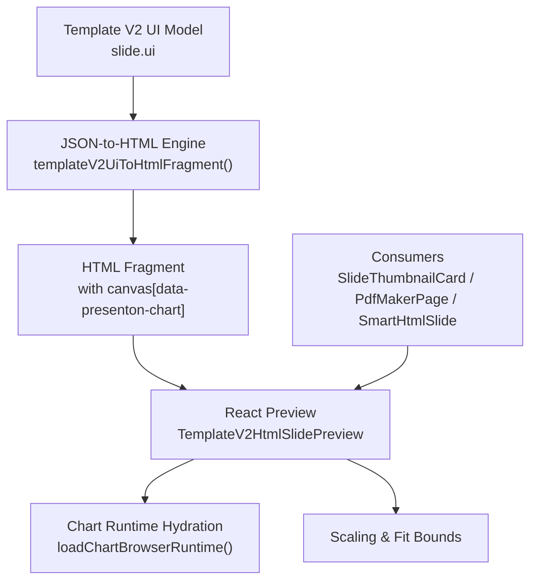
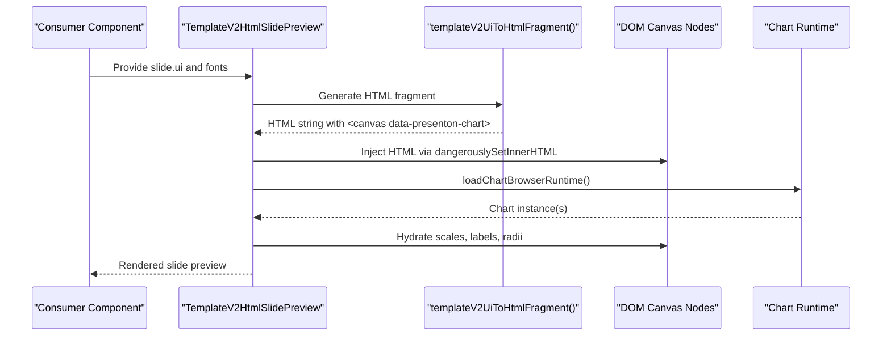
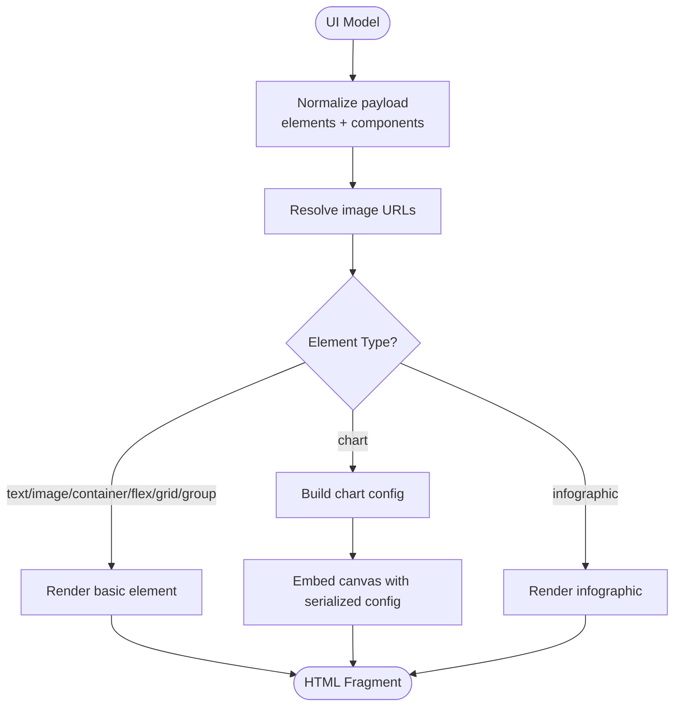
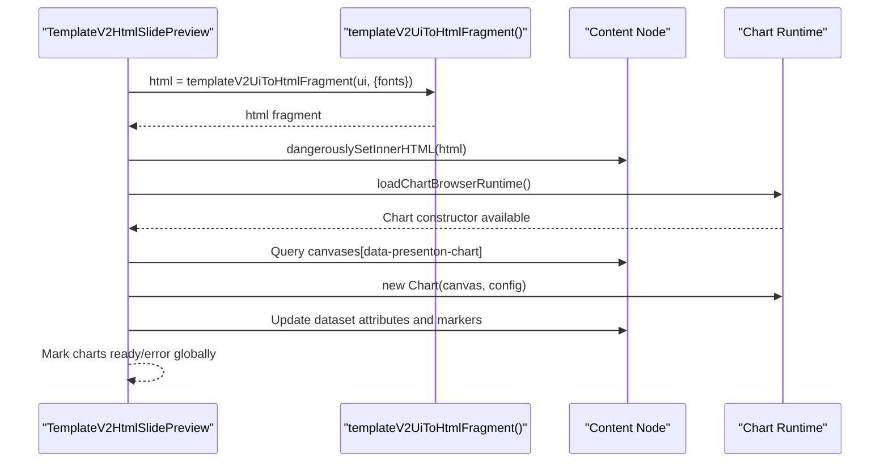
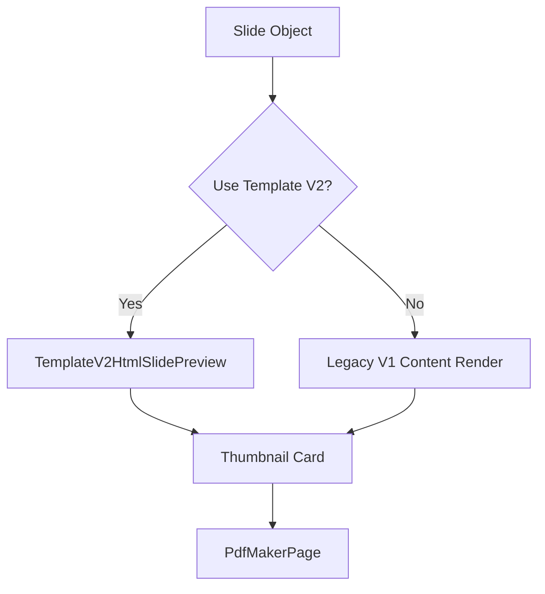
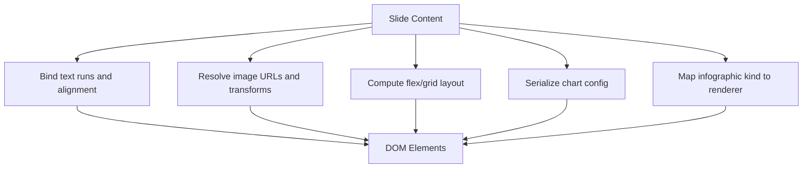
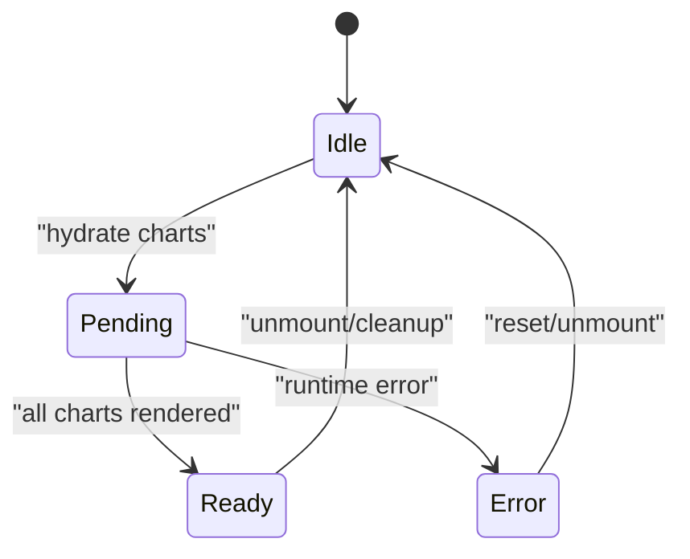
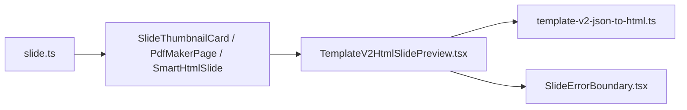

# Component Hydration

<cite>
**Referenced Files in This Document**
- [template-v2-json-to-html.ts](file://servers/nex tjs/lib/template-v2-json-to-html.ts)
- [TemplateV2HtmlSlidePreview.tsx](file://servers/nextjs/app/(presentation-generator)/components/TemplateV2HtmlSlidePreview.tsx)
- [SmartHtmlSlide.tsx](file://servers/nextjs/app/(presentation-generator)/components/SmartHtmlSlide.tsx)
- [SlideThumbnailCard.tsx](file://servers/nextjs/app/(presentation-generator)/presentation/components/SlideThumbnailCard.tsx)
- [PdfMakerPage.tsx](file://servers/nextjs/app/(export)/pdf-maker/PdfMakerPage.tsx)
- [slide.ts](file://servers/nextjs/app/(presentation-generator)/types/slide.ts)
- [SlideErrorBoundary.tsx](file://servers/nextjs/app/(presentation-generator)/components/SlideErrorBoundary.tsx)
</cite>

## Table of Contents
1. [Introduction](#introduction)
2. [Project Structure](#project-structure)
3. [Core Components](#core-components)
4. [Architecture Overview](#architecture-overview)
5. [Detailed Component Analysis](#detailed-component-analysis)
6. [Dependency Analysis](#dependency-analysis)
7. [Performance Considerations](#performance-considerations)
8. [Troubleshooting Guide](#troubleshooting-guide)
9. [Conclusion](#conclusion)

## Introduction
This document explains how template components are hydrated and rendered into final slide content. It covers the end-to-end pipeline from a Template V2 UI model to HTML fragments, including component instantiation, data binding, dynamic content injection (charts and infographics), lifecycle management, error boundaries, and performance strategies. The goal is to make the hydration process clear for both developers and non-technical readers.

## Project Structure
The hydration pipeline spans two main layers:
- Rendering engine that converts Template V2 UI JSON into HTML fragments and chart configurations.
- React components that mount the generated HTML, hydrate charts, and manage presentation contexts (preview, export, thumbnails).

**Diagram sources**
- [template-v2-json-to-html.ts:156-186](file://servers/nextjs/lib/template-v2-json-to-html.ts#L156-L186)
- [TemplateV2HtmlSlidePreview.tsx:205-247](file://servers/nextjs/app/(presentation-generator)/components/TemplateV2HtmlSlidePreview.tsx#L205-L247)
- [TemplateV2HtmlSlidePreview.tsx:265-350](file://servers/nextjs/app/(presentation-generator)/components/TemplateV2HtmlSlidePreview.tsx#L265-L350)
- [SlideThumbnailCard.tsx:119-143](file://servers/nextjs/app/(presentation-generator)/presentation/components/SlideThumbnailCard.tsx#L119-L143)
- [PdfMakerPage.tsx:273-297](file://servers/nextjs/app/(export)/pdf-maker/PdfMakerPage.tsx#L273-L297)

**Section sources**
- [template-v2-json-to-html.ts:156-186](file://servers/nextjs/lib/template-v2-json-to-html.ts#L156-L186)
- [TemplateV2HtmlSlidePreview.tsx:205-247](file://servers/nextjs/app/(presentation-generator)/components/TemplateV2HtmlSlidePreview.tsx#L205-L247)

## Core Components
- Template V2 JSON-to-HTML engine: Converts UI models into HTML fragments and prepares chart configurations.
- TemplateV2HtmlSlidePreview: Mounts HTML, hydrates charts, manages scaling and fit bounds.
- Consumers: SlideThumbnailCard, PdfMakerPage, SmartHtmlSlide render slides using either Template V2 or legacy paths.
- Error boundary: SlideErrorBoundary isolates rendering errors per slide.

Key responsibilities:
- Data normalization and asset URL resolution.
- Element dispatching by type (text, image, container, flex/grid, group, chart, infographic).
- Chart configuration generation and runtime hydration.
- Safe rendering with error boundaries and preview fallbacks.

**Section sources**
- [template-v2-json-to-html.ts:118-133](file://servers/nextjs/lib/template-v2-json-to-html.ts#L118-L133)
- [template-v2-json-to-html.ts:308-349](file://servers/nextjs/lib/template-v2-json-to-html.ts#L308-L349)
- [TemplateV2HtmlSlidePreview.tsx:205-247](file://servers/nextjs/app/(presentation-generator)/components/TemplateV2HtmlSlidePreview.tsx#L205-L247)
- [SlideErrorBoundary.tsx:16-60](file://servers/nextjs/app/(presentation-generator)/components/SlideErrorBoundary.tsx#L16-L60)

## Architecture Overview
The hydration architecture follows a clear separation between data transformation and UI mounting:

**Diagram sources**
- [TemplateV2HtmlSlidePreview.tsx:242-247](file://servers/nextjs/app/(presentation-generator)/components/TemplateV2HtmlSlidePreview.tsx#L242-L247)
- [TemplateV2HtmlSlidePreview.tsx:265-350](file://servers/nextjs/app/(presentation-generator)/components/TemplateV2HtmlSlidePreview.tsx#L265-L350)
- [template-v2-json-to-html.ts:156-186](file://servers/nextjs/lib/template-v2-json-to-html.ts#L156-L186)

## Detailed Component Analysis

### Template V2 JSON-to-HTML Engine
Responsibilities:
- Normalize UI payload and merge root elements and components.
- Resolve backend asset URLs for images.
- Dispatch element rendering by type.
- Generate chart configurations and embed them as serialized JSON on canvas nodes.
- Produce font CSS and math styles.

Key flows:
- Payload preparation: merges elements and components, normalizes background and dimensions.
- Item routing: maps types like text, image, container, flex/grid, group, chart, infographic to specific renderers.
- Chart config: builds Chart.js-compatible options, titles, legends, axes, and data labels.

**Diagram sources**
- [template-v2-json-to-html.ts:188-214](file://servers/nextjs/lib/template-v2-json-to-html.ts#L188-L214)
- [template-v2-json-to-html.ts:221-244](file://servers/nextjs/lib/template-v2-json-to-html.ts#L221-L244)
- [template-v2-json-to-html.ts:308-349](file://servers/nextjs/lib/template-v2-json-to-html.ts#L308-L349)
- [template-v2-json-to-html.ts:1074-1087](file://servers/nextjs/lib/template-v2-json-to-html.ts#L1074-L1087)

**Section sources**
- [template-v2-json-to-html.ts:188-214](file://servers/nextjs/lib/template-v2-json-to-html.ts#L188-L214)
- [template-v2-json-to-html.ts:221-244](file://servers/nextjs/lib/template-v2-json-to-html.ts#L221-L244)
- [template-v2-json-to-html.ts:308-349](file://servers/nextjs/lib/template-v2-json-to-html.ts#L308-L349)
- [template-v2-json-to-html.ts:1074-1087](file://servers/nextjs/lib/template-v2-json-to-html.ts#L1074-L1087)

### TemplateV2HtmlSlidePreview
Responsibilities:
- Decide whether to render Template V2 based on slide and presentation version.
- Generate HTML fragment and inject it into the DOM.
- Load chart runtime, hydrate charts, and manage global chart state.
- Compute natural scale and optional fitted viewport based on bounds and padding.
- Provide accessibility labels and safe pointer events.

Lifecycle highlights:
- useMemo computes HTML once per slide/fonts.
- useEffect observes container width changes.
- useLayoutEffect hydrates charts after DOM insertion.
- Cleanup destroys chart instances and updates global pending counts.

**Diagram sources**
- [TemplateV2HtmlSlidePreview.tsx:205-247](file://servers/nextjs/app/(presentation-generator)/components/TemplateV2HtmlSlidePreview.tsx#L205-L247)
- [TemplateV2HtmlSlidePreview.tsx:265-350](file://servers/nextjs/app/(presentation-generator)/components/TemplateV2HtmlSlidePreview.tsx#L265-L350)

**Section sources**
- [TemplateV2HtmlSlidePreview.tsx:205-247](file://servers/nextjs/app/(presentation-generator)/components/TemplateV2HtmlSlidePreview.tsx#L205-L247)
- [TemplateV2HtmlSlidePreview.tsx:265-350](file://servers/nextjs/app/(presentation-generator)/components/TemplateV2HtmlSlidePreview.tsx#L265-L350)

### Consumers: SlideThumbnailCard, PdfMakerPage, SmartHtmlSlide
- SlideThumbnailCard chooses between Template V2 preview and legacy V1 rendering based on slide metadata.
- PdfMakerPage selects Template V2 preview for export when appropriate.
- SmartHtmlSlide renders pre-sanitized HTML or uses an iframe approach for isolation.

**Diagram sources**
- [SlideThumbnailCard.tsx:119-143](file://servers/nextjs/app/(presentation-generator)/presentation/components/SlideThumbnailCard.tsx#L119-L143)
- [PdfMakerPage.tsx:273-297](file://servers/nextjs/app/(export)/pdf-maker/PdfMakerPage.tsx#L273-L297)

**Section sources**
- [SlideThumbnailCard.tsx:119-143](file://servers/nextjs/app/(presentation-generator)/presentation/components/SlideThumbnailCard.tsx#L119-L143)
- [PdfMakerPage.tsx:273-297](file://servers/nextjs/app/(export)/pdf-maker/PdfMakerPage.tsx#L273-L297)
- [SmartHtmlSlide.tsx:126-173](file://servers/nextjs/app/(presentation-generator)/components/SmartHtmlSlide.tsx#L126-L173)

### Data Binding and Dynamic Content Injection
- Text and lists: normalized runs and markdown-safe text are injected into styled containers.
- Images: source URLs resolved; icon masks and crop transforms applied.
- Layouts: flex/grid compute intrinsic sizes and apply overflow rules.
- Charts: config built from item properties; canvas nodes carry serialized config for runtime hydration.
- Infographics: specialized renderers produce SVG/HTML compositions with consistent color palettes and responsive layouts.

**Diagram sources**
- [template-v2-json-to-html.ts:391-452](file://servers/nextjs/lib/template-v2-json-to-html.ts#L391-L452)
- [template-v2-json-to-html.ts:352-389](file://servers/nextjs/lib/template-v2-json-to-html.ts#L352-L389)
- [template-v2-json-to-html.ts:534-581](file://servers/nextjs/lib/template-v2-json-to-html.ts#L534-L581)
- [template-v2-json-to-html.ts:1074-1087](file://servers/nextjs/lib/template-v2-json-to-html.ts#L1074-L1087)
- [template-v2-json-to-html.ts:1212-1236](file://servers/nextjs/lib/template-v2-json-to-html.ts#L1212-L1236)

**Section sources**
- [template-v2-json-to-html.ts:391-452](file://servers/nextjs/lib/template-v2-json-to-html.ts#L391-L452)
- [template-v2-json-to-html.ts:352-389](file://servers/nextjs/lib/template-v2-json-to-html.ts#L352-L389)
- [template-v2-json-to-html.ts:534-581](file://servers/nextjs/lib/template-v2-json-to-html.ts#L534-L581)
- [template-v2-json-to-html.ts:1074-1087](file://servers/nextjs/lib/template-v2-json-to-html.ts#L1074-L1087)
- [template-v2-json-to-html.ts:1212-1236](file://servers/nextjs/lib/template-v2-json-to-html.ts#L1212-L1236)

### Component Lifecycle and State Management
- SlideErrorBoundary captures render errors, displays a user-friendly message, and supports reset via key changes.
- TemplateV2HtmlSlidePreview tracks chart hydration status globally and marks ready/error states on the DOM node.
- Consumers memoize expensive computations and observe container size changes to adjust scaling.

**Diagram sources**
- [SlideErrorBoundary.tsx:25-44](file://servers/nextjs/app/(presentation-generator)/components/SlideErrorBoundary.tsx#L25-L44)
- [TemplateV2HtmlSlidePreview.tsx:29-73](file://servers/nextjs/app/(presentation-generator)/components/TemplateV2HtmlSlidePreview.tsx#L29-L73)
- [TemplateV2HtmlSlidePreview.tsx:343-350](file://servers/nextjs/app/(presentation-generator)/components/TemplateV2HtmlSlidePreview.tsx#L343-L350)

**Section sources**
- [SlideErrorBoundary.tsx:25-44](file://servers/nextjs/app/(presentation-generator)/components/SlideErrorBoundary.tsx#L25-L44)
- [TemplateV2HtmlSlidePreview.tsx:29-73](file://servers/nextjs/app/(presentation-generator)/components/TemplateV2HtmlSlidePreview.tsx#L29-L73)
- [TemplateV2HtmlSlidePreview.tsx:343-350](file://servers/nextjs/app/(presentation-generator)/components/TemplateV2HtmlSlidePreview.tsx#L343-L350)

## Dependency Analysis
High-level dependencies among core files:

**Diagram sources**
- [slide.ts:25-42](file://servers/nextjs/app/(presentation-generator)/types/slide.ts#L25-L42)
- [SlideThumbnailCard.tsx:1-10](file://servers/nextjs/app/(presentation-generator)/presentation/components/SlideThumbnailCard.tsx#L1-L10)
- [PdfMakerPage.tsx:273-297](file://servers/nextjs/app/(export)/pdf-maker/PdfMakerPage.tsx#L273-L297)
- [TemplateV2HtmlSlidePreview.tsx:1-14](file://servers/nextjs/app/(presentation-generator)/components/TemplateV2HtmlSlidePreview.tsx#L1-L14)
- [template-v2-json-to-html.ts:156-186](file://servers/nextjs/lib/template-v2-json-to-html.ts#L156-L186)
- [SlideErrorBoundary.tsx:1-10](file://servers/nextjs/app/(presentation-generator)/components/SlideErrorBoundary.tsx#L1-L10)

**Section sources**
- [slide.ts:25-42](file://servers/nextjs/app/(presentation-generator)/types/slide.ts#L25-L42)
- [SlideThumbnailCard.tsx:1-10](file://servers/nextjs/app/(presentation-generator)/presentation/components/SlideThumbnailCard.tsx#L1-L10)
- [PdfMakerPage.tsx:273-297](file://servers/nextjs/app/(export)/pdf-maker/PdfMakerPage.tsx#L273-L297)
- [TemplateV2HtmlSlidePreview.tsx:1-14](file://servers/nextjs/app/(presentation-generator)/components/TemplateV2HtmlSlidePreview.tsx#L1-L14)
- [template-v2-json-to-html.ts:156-186](file://servers/nextjs/lib/template-v2-json-to-html.ts#L156-L186)
- [SlideErrorBoundary.tsx:1-10](file://servers/nextjs/app/(presentation-generator)/components/SlideErrorBoundary.tsx#L1-L10)

## Performance Considerations
- Memoization: Use useMemo for HTML generation and sanitized markup to avoid re-computation on every render.
- Resize observation: Observe container width to compute accurate scaling without unnecessary re-renders.
- Chart hydration batching: Track pending vs rendered charts globally to minimize redundant work and provide clear readiness signals.
- Fixed-size previews: In thumbnails and exports, fixedSize avoids dynamic scaling calculations and reduces layout thrashing.
- Minimal animations: Disable chart animations and maintainAspectRatio during hydration for faster initial paint.

[No sources needed since this section provides general guidance]

## Troubleshooting Guide
Common issues and resolutions:
- Charts not rendering:
  - Verify canvas nodes have data-presenton-chart and data-chart-config attributes.
  - Ensure chart runtime loads successfully and no network errors occur.
  - Inspect global chart state for pending/error markers.
- Missing images or assets:
  - Confirm asset URLs are resolved to backend paths before rendering.
- Incorrect layout or overflow:
  - Check container overflow rules and child positioning; ensure clip-path and overflow settings match expectations.
- Render errors:
  - Wrap slide content with SlideErrorBoundary to capture and display errors gracefully.
  - Use resetKey to force re-mount and recover from transient errors.

Actionable checks:
- Validate slide.ui structure and presence of elements/components.
- Inspect generated HTML for expected tags and attributes.
- Review console logs for chart hydration errors.
- Temporarily disable complex infographics or charts to isolate rendering issues.

**Section sources**
- [TemplateV2HtmlSlidePreview.tsx:288-338](file://servers/nextjs/app/(presentation-generator)/components/TemplateV2HtmlSlidePreview.tsx#L288-L338)
- [template-v2-json-to-html.ts:221-244](file://servers/nextjs/lib/template-v2-json-to-html.ts#L221-L244)
- [SlideErrorBoundary.tsx:25-44](file://servers/nextjs/app/(presentation-generator)/components/SlideErrorBoundary.tsx#L25-L44)

## Conclusion
Component hydration in this system is a layered process: the Template V2 engine transforms UI models into HTML fragments and chart configurations; React components mount the HTML, hydrate charts, and manage scaling and state. Robust error boundaries and global chart state tracking improve reliability and observability. By following the patterns described here—memoization, resize observation, minimal animations, and careful asset handling—you can build performant and resilient slide previews and exports.

[No sources needed since this section summarizes without analyzing specific files]