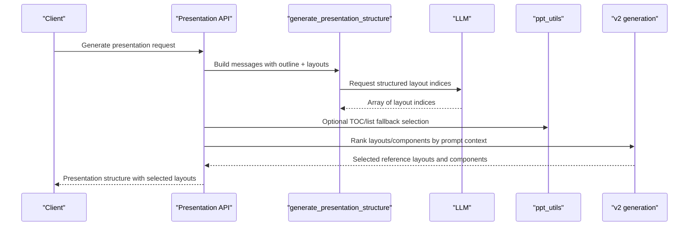
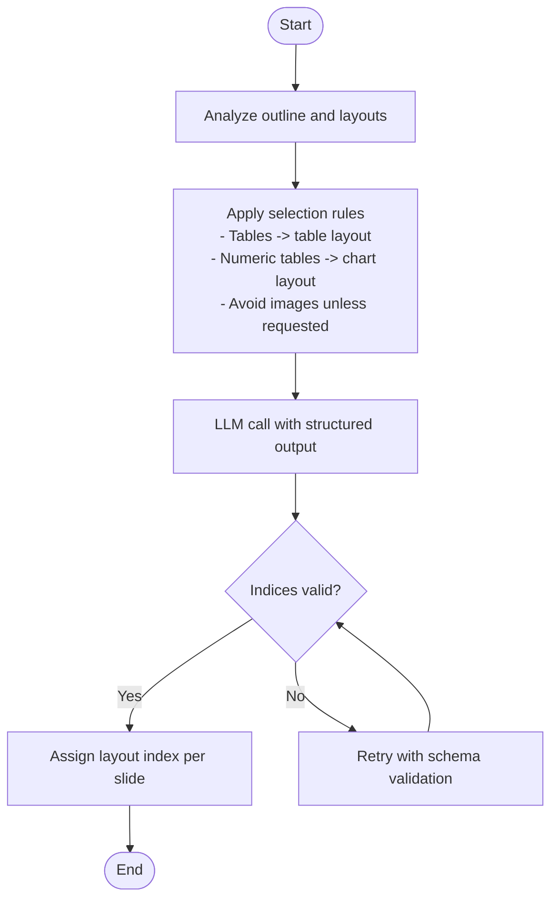
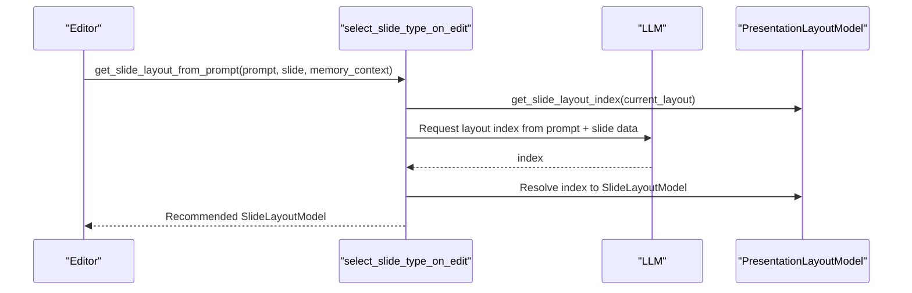
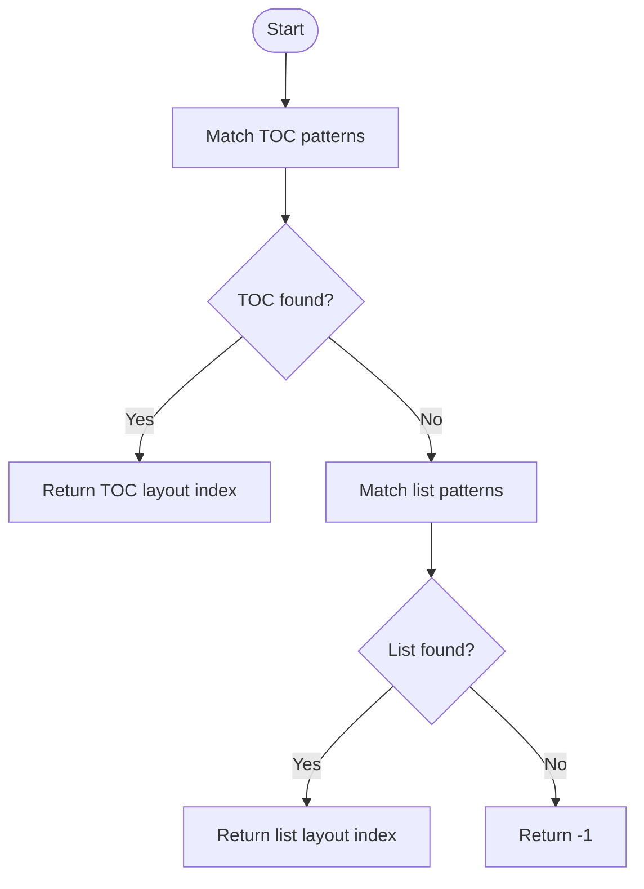
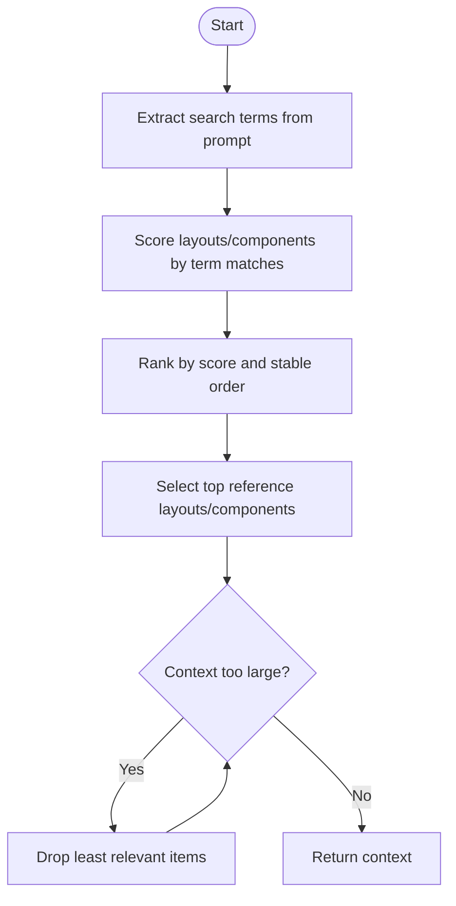
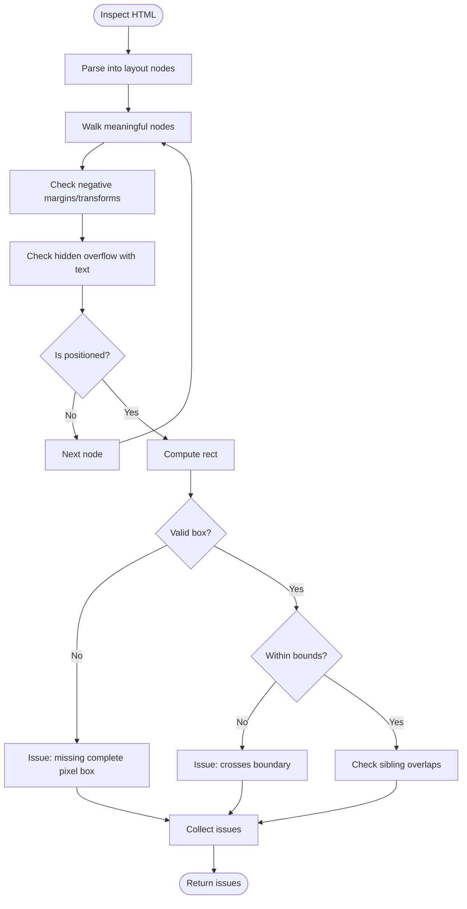
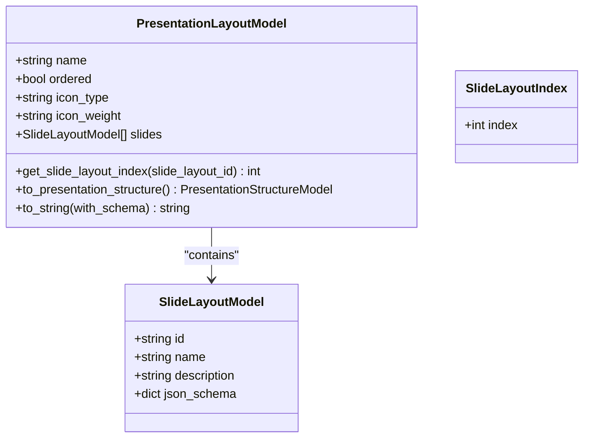
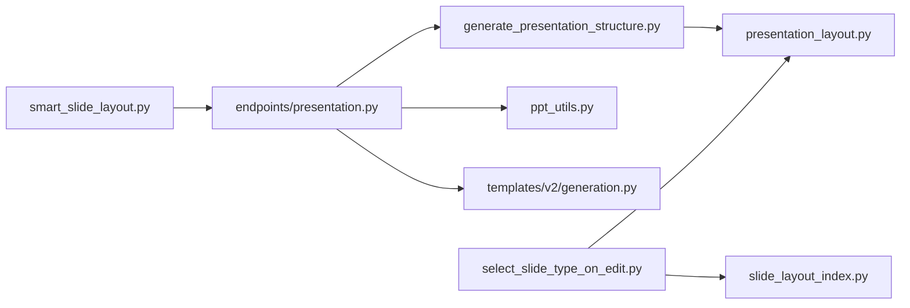

# Layout Selection

<cite>
**Referenced Files in This Document**
- [smart_slide_layout.py](file://servers/fastapi/utils/smart_slide_layout.py)
- [presentation_layout.py](file://servers/fastapi/templates/presentation_layout.py)
- [generate_presentation_structure.py](file://servers/fastapi/utils/llm_calls/generate_presentation_structure.py)
- [select_slide_type_on_edit.py](file://servers/fastapi/utils/llm_calls/select_slide_type_on_edit.py)
- [ppt_utils.py](file://servers/fastapi/utils/ppt_utils.py)
- [generation.py](file://servers/fastapi/templates/v2/generation.py)
- [presentation.py](file://servers/fastapi/api/v1/ppt/endpoints/presentation.py)
- [slide_layout_index.py](file://servers/fastapi/models/slide_layout_index.py)
</cite>

## Table of Contents
1. [Introduction](#introduction)
2. [Project Structure](#project-structure)
3. [Core Components](#core-components)
4. [Architecture Overview](#architecture-overview)
5. [Detailed Component Analysis](#detailed-component-analysis)
6. [Dependency Analysis](#dependency-analysis)
7. [Performance Considerations](#performance-considerations)
8. [Troubleshooting Guide](#troubleshooting-guide)
9. [Conclusion](#conclusion)

## Introduction
This document explains how the system selects slide layouts automatically and how users can override or constrain layout choices. It covers:
- Smart, content-driven automatic layout selection for entire presentations
- Manual layout overrides during editing
- Layout compatibility checks and responsive considerations
- Examples of automatic assignment, custom specifications, and troubleshooting

The goal is to help both developers and non-technical users understand why a particular layout was chosen and how to influence that decision.

## Project Structure
Layout selection spans several modules:
- Presentation-level layout models define available slide layouts and their schemas
- LLM-assisted structure generation chooses one layout index per slide based on content type and rules
- Edit-time helpers select a layout for a single slide based on user prompts and current data
- Utility functions match table-of-contents or list-like slides to appropriate layouts
- V2 template generation ranks layouts by prompt context and reusable components
- Smart layout inspection detects risky HTML that may cause clipping or overlap

```mermaid
graph TB
subgraph "Models"
PLM["PresentationLayoutModel"]
SLM["SlideLayoutModel"]
SLI["SlideLayoutIndex"]
end
subgraph "Generation"
GPS["generate_presentation_structure.py"]
GEN["templates/v2/generation.py"]
end
subgraph "Edit-Time"
SSE["select_slide_type_on_edit.py"]
end
subgraph "Utilities"
PU["ppt_utils.py"]
SSL["smart_slide_layout.py"]
end
subgraph "API"
API["endpoints/presentation.py"]
end
PLM --> GPS
PLM --> SSE
PLM --> PU
PLM --> GEN
SLI --> SSE
API --> PU
API --> GPS
GEN --> PLM
SSL --> API
```

**Diagram sources**
- [presentation_layout.py:11-63](file://servers/fastapi/templates/presentation_layout.py#L11-L63)
- [generate_presentation_structure.py:108-212](file://servers/fastapi/utils/llm_calls/generate_presentation_structure.py#L108-L212)
- [select_slide_type_on_edit.py:13-93](file://servers/fastapi/utils/llm_calls/select_slide_type_on_edit.py#L13-L93)
- [ppt_utils.py:34-83](file://servers/fastapi/utils/ppt_utils.py#L34-L83)
- [generation.py:700-775](file://servers/fastapi/templates/v2/generation.py#L700-L775)
- [smart_slide_layout.py:230-289](file://servers/fastapi/utils/smart_slide_layout.py#L230-L289)
- [presentation.py:73-98](file://servers/fastapi/api/v1/ppt/endpoints/presentation.py#L73-L98)

**Section sources**
- [presentation_layout.py:11-63](file://servers/fastapi/templates/presentation_layout.py#L11-L63)
- [generate_presentation_structure.py:108-212](file://servers/fastapi/utils/llm_calls/generate_presentation_structure.py#L108-L212)
- [select_slide_type_on_edit.py:13-93](file://servers/fastapi/utils/llm_calls/select_slide_type_on_edit.py#L13-L93)
- [ppt_utils.py:34-83](file://servers/fastapi/utils/ppt_utils.py#L34-L83)
- [generation.py:700-775](file://servers/fastapi/templates/v2/generation.py#L700-L775)
- [smart_slide_layout.py:230-289](file://servers/fastapi/utils/smart_slide_layout.py#L230-L289)
- [presentation.py:73-98](file://servers/fastapi/api/v1/ppt/endpoints/presentation.py#L73-L98)

## Core Components
- PresentationLayoutModel and SlideLayoutModel: Define the set of available slide layouts, including identifiers, names, descriptions, and JSON schemas for content validation.
- generate_presentation_structure: Uses an LLM with explicit selection rules to choose one layout index per slide based on content analysis (tables, charts, imagery).
- select_slide_type_on_edit: Selects a layout for a single slide during editing, guided by user prompts and current slide data.
- ppt_utils: Provides regex-based matching for table-of-contents or list-like slides to suitable layouts.
- templates/v2/generation: Ranks and selects reference layouts/components based on prompt context and reuse potential.
- smart_slide_layout: Inspects generated slide HTML to detect risks like negative margins, overflow hiding, off-canvas geometry, and overlapping positioned elements.

**Section sources**
- [presentation_layout.py:11-63](file://servers/fastapi/templates/presentation_layout.py#L11-L63)
- [generate_presentation_structure.py:16-105](file://servers/fastapi/utils/llm_calls/generate_presentation_structure.py#L16-L105)
- [select_slide_type_on_edit.py:13-93](file://servers/fastapi/utils/llm_calls/select_slide_type_on_edit.py#L13-L93)
- [ppt_utils.py:34-83](file://servers/fastapi/utils/ppt_utils.py#L34-L83)
- [generation.py:700-775](file://servers/fastapi/templates/v2/generation.py#L700-L775)
- [smart_slide_layout.py:230-289](file://servers/fastapi/utils/smart_slide_layout.py#L230-L289)

## Architecture Overview
The layout selection pipeline has two primary flows:

1) Automatic presentation-wide selection
- The system analyzes the presentation outline and available layouts.
- An LLM applies selection rules to assign one layout index per slide.
- The resulting structure drives subsequent content generation.

2) Edit-time single-slide selection
- When a user edits a slide, the system proposes a new layout based on the prompt and current slide data.
- It prefers keeping the current layout unless the prompt clearly requires a change.



**Diagram sources**
- [generate_presentation_structure.py:157-212](file://servers/fastapi/utils/llm_calls/generate_presentation_structure.py#L157-L212)
- [ppt_utils.py:59-83](file://servers/fastapi/utils/ppt_utils.py#L59-L83)
- [generation.py:700-775](file://servers/fastapi/templates/v2/generation.py#L700-L775)
- [presentation.py:73-98](file://servers/fastapi/api/v1/ppt/endpoints/presentation.py#L73-L98)

## Detailed Component Analysis

### Automatic Presentation Layout Selection
- Input: Presentation outline and available layouts.
- Process:
  - The system constructs messages describing the available layouts and selection rules.
  - Rules emphasize content-driven choices: tables map to table layouts; numeric tables map to chart layouts; avoid images unless requested.
  - The LLM returns one layout index per slide.
- Output: A presentation structure mapping each slide to a layout index.



**Diagram sources**
- [generate_presentation_structure.py:16-105](file://servers/fastapi/utils/llm_calls/generate_presentation_structure.py#L16-L105)
- [generate_presentation_structure.py:157-212](file://servers/fastapi/utils/llm_calls/generate_presentation_structure.py#L157-L212)

**Section sources**
- [generate_presentation_structure.py:16-105](file://servers/fastapi/utils/llm_calls/generate_presentation_structure.py#L16-L105)
- [generate_presentation_structure.py:157-212](file://servers/fastapi/utils/llm_calls/generate_presentation_structure.py#L157-L212)

### Edit-Time Single-Slide Layout Selection
- Input: User prompt, current slide data, current layout index, and available layouts.
- Process:
  - The system builds a focused prompt emphasizing minimal changes unless necessary.
  - The LLM returns a layout index; the system resolves it to a SlideLayoutModel.
- Output: A recommended SlideLayoutModel for the edited slide.



**Diagram sources**
- [select_slide_type_on_edit.py:13-93](file://servers/fastapi/utils/llm_calls/select_slide_type_on_edit.py#L13-L93)
- [slide_layout_index.py:1-6](file://servers/fastapi/models/slide_layout_index.py#L1-L6)
- [presentation_layout.py:36-42](file://servers/fastapi/templates/presentation_layout.py#L36-L42)

**Section sources**
- [select_slide_type_on_edit.py:13-93](file://servers/fastapi/utils/llm_calls/select_slide_type_on_edit.py#L13-L93)
- [slide_layout_index.py:1-6](file://servers/fastapi/models/slide_layout_index.py#L1-L6)
- [presentation_layout.py:36-42](file://servers/fastapi/templates/presentation_layout.py#L36-L42)

### Table-of-Contents and List Fallback Matching
- Purpose: Ensure slides that are table-of-contents or lists use appropriate layouts even if automatic selection did not pick them.
- Process:
  - Regex patterns match TOC or list semantics against layout metadata (id, name, description, schema title).
  - If a TOC pattern matches, return that layout index; otherwise try list patterns.



**Diagram sources**
- [ppt_utils.py:34-83](file://servers/fastapi/utils/ppt_utils.py#L34-L83)

**Section sources**
- [ppt_utils.py:34-83](file://servers/fastapi/utils/ppt_utils.py#L34-L83)

### V2 Template Context Ranking and Reuse
- Purpose: Improve layout selection quality by providing the LLM with relevant reference layouts and reusable components.
- Process:
  - Compute a match score between prompt terms and layout/component descriptions.
  - Rank layouts and components; select top references within token limits.
  - Trim context to fit maximum size by dropping less relevant items.



**Diagram sources**
- [generation.py:700-775](file://servers/fastapi/templates/v2/generation.py#L700-L775)

**Section sources**
- [generation.py:700-775](file://servers/fastapi/templates/v2/generation.py#L700-L775)

### Smart Layout Inspection for Responsive Safety
- Purpose: Detect HTML patterns that commonly produce clipped or overlapping slides.
- Checks include:
  - Negative margins or transforms that can overlap content
  - Hidden overflow containing visible text
  - Absolutely positioned meaningful content missing complete pixel boxes
  - Off-canvas or invalid geometry
  - Overlapping sibling positioned boxes



**Diagram sources**
- [smart_slide_layout.py:230-289](file://servers/fastapi/utils/smart_slide_layout.py#L230-L289)

**Section sources**
- [smart_slide_layout.py:230-289](file://servers/fastapi/utils/smart_slide_layout.py#L230-L289)

### Layout Models and Compatibility
- SlideLayoutModel: Represents a single slide layout with id, optional name/description, and a JSON schema for content validation.
- PresentationLayoutModel: Holds ordered slide layouts and utilities such as resolving a layout by id and converting to a presentation structure.
- SlideLayoutIndex: Simple model used when LLM outputs a layout index.



**Diagram sources**
- [presentation_layout.py:11-63](file://servers/fastapi/templates/presentation_layout.py#L11-L63)
- [slide_layout_index.py:1-6](file://servers/fastapi/models/slide_layout_index.py#L1-L6)

**Section sources**
- [presentation_layout.py:11-63](file://servers/fastapi/templates/presentation_layout.py#L11-L63)
- [slide_layout_index.py:1-6](file://servers/fastapi/models/slide_layout_index.py#L1-L6)

## Dependency Analysis
- Generation depends on layout models to describe available options and on LLM calls to decide indices.
- Edit-time selection depends on current slide state and layout resolution.
- Utilities provide deterministic fallbacks and safety checks.
- API orchestrates these components during presentation generation.



**Diagram sources**
- [presentation.py:73-98](file://servers/fastapi/api/v1/ppt/endpoints/presentation.py#L73-L98)
- [generate_presentation_structure.py:157-212](file://servers/fastapi/utils/llm_calls/generate_presentation_structure.py#L157-L212)
- [ppt_utils.py:59-83](file://servers/fastapi/utils/ppt_utils.py#L59-L83)
- [generation.py:700-775](file://servers/fastapi/templates/v2/generation.py#L700-L775)
- [select_slide_type_on_edit.py:13-93](file://servers/fastapi/utils/llm_calls/select_slide_type_on_edit.py#L13-L93)
- [smart_slide_layout.py:230-289](file://servers/fastapi/utils/smart_slide_layout.py#L230-L289)

**Section sources**
- [presentation.py:73-98](file://servers/fastapi/api/v1/ppt/endpoints/presentation.py#L73-L98)
- [generate_presentation_structure.py:157-212](file://servers/fastapi/utils/llm_calls/generate_presentation_structure.py#L157-L212)
- [ppt_utils.py:59-83](file://servers/fastapi/utils/ppt_utils.py#L59-L83)
- [generation.py:700-775](file://servers/fastapi/templates/v2/generation.py#L700-L775)
- [select_slide_type_on_edit.py:13-93](file://servers/fastapi/utils/llm_calls/select_slide_type_on_edit.py#L13-L93)
- [smart_slide_layout.py:230-289](file://servers/fastapi/utils/smart_slide_layout.py#L230-L289)

## Performance Considerations
- LLM calls for layout selection should be minimized by providing concise, high-signal context (e.g., reference layouts and reusable components).
- Trimming context to token limits prevents excessive payload sizes and reduces latency.
- Deterministic utilities (regex matching, smart inspection) run quickly and reduce retries.
- Prefer reusing layouts across slides when content justifies repetition to maintain consistency and reduce complexity.

[No sources needed since this section provides general guidance]

## Troubleshooting Guide
Common issues and resolutions:
- Wrong layout for table content:
  - Ensure the outline indicates tabular data; the automatic selector prefers table layouts for text tables and chart layouts for numeric tables.
  - Use manual override during editing to force a specific layout if needed.
- Missing image placeholders:
  - Avoid requesting imagery unless the content includes images or the user explicitly asks for visuals.
- Clipped or overlapping content:
  - Run smart layout inspection to identify negative margins, hidden overflow, off-canvas geometry, or overlapping positioned elements.
  - Reflow using flex/grid and explicit gaps; avoid absolute positioning unless fully constrained.
- TOC or list slides not matched:
  - Verify layout metadata (id, name, description, schema title) contains recognizable keywords for TOC or list patterns.
- Layout index errors:
  - Confirm the returned index corresponds to a valid layout id; resolve via the layout model’s index-to-layout method.

**Section sources**
- [generate_presentation_structure.py:16-105](file://servers/fastapi/utils/llm_calls/generate_presentation_structure.py#L16-L105)
- [select_slide_type_on_edit.py:13-93](file://servers/fastapi/utils/llm_calls/select_slide_type_on_edit.py#L13-L93)
- [ppt_utils.py:59-83](file://servers/fastapi/utils/ppt_utils.py#L59-L83)
- [smart_slide_layout.py:230-289](file://servers/fastapi/utils/smart_slide_layout.py#L230-L289)

## Conclusion
The system combines rule-guided LLM decisions with deterministic utilities to select appropriate slide layouts. Automatic selection aligns layouts with content type and design intent, while edit-time tools allow precise overrides. Compatibility checks and responsive safeguards ensure generated layouts render correctly. By understanding these mechanisms, users can craft better outlines and templates, and developers can extend or tune selection logic confidently.

[No sources needed since this section summarizes without analyzing specific files]