# Template Integration

<cite>
**Referenced Files in This Document**   
- [presentation.py](file://servers/fastapi/api/v1/ppt/endpoints/presentation.py)
- [default_templates.py](file://servers/fastapi/templates/default_templates.py)
- [template_v2.py](file://servers/fastapi/models/sql/template_v2.py)
- [schema.py](file://servers/fastapi/templates/v2/schema.py)
- [layouts.py](file://servers/fastapi/templates/v2/models/layouts.py)
- [presentation_layout.py](file://servers/fastapi/templates/presentation_layout.py)
- [template-v2.md](file://docs/template-v2.md)
</cite>

## Table of Contents
1. [Introduction](#introduction)
2. [Project Structure](#project-structure)
3. [Core Components](#core-components)
4. [Architecture Overview](#architecture-overview)
5. [Detailed Component Analysis](#detailed-component-analysis)
6. [Dependency Analysis](#dependency-analysis)
7. [Performance Considerations](#performance-considerations)
8. [Troubleshooting Guide](#troubleshooting-guide)
9. [Conclusion](#conclusion)

## Introduction
This document explains how presentations integrate with templates through the `template_id` parameter, how template names are resolved, and how layouts are selected and hydrated during generation. It covers:

- Template resolution for built-in bundled templates and custom templates.
- The `custom-` prefix convention.
- Template schema validation and layout mapping.
- Component hydration and content application.
- Built-in template aliases and default template import behavior.
- Template versioning and compatibility considerations.

The goal is to help API consumers and integrators understand which template identifiers are accepted, what happens when a template is missing or invalid, and how generated slide content is applied to template layouts.

## Project Structure
Template integration spans several layers:

- **API endpoint layer**: Presentation generation endpoints parse `template_id`, resolve it, and orchestrate layout selection and content hydration.
- **Default template layer**: Bundled template directories under `templates/` are imported into the database as `TemplateV2` records, with static assets copied and URLs rewritten.
- **Schema layer**: Template V2 layouts are converted into JSON schemas describing editable content.
- **Model layer**: `TemplateV2` persists template metadata, layouts, components, theme, and assets.
- **Layout model layer**: Slide layouts and presentation layout models normalize and validate layout structures.

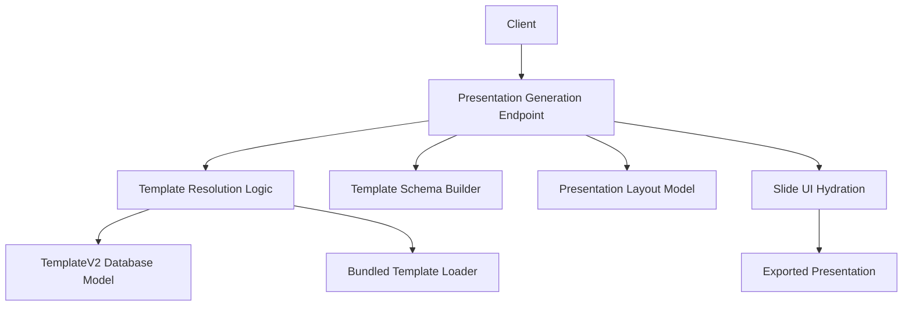

**Diagram sources**
- [presentation.py:198-304](file://servers/fastapi/api/v1/ppt/endpoints/presentation.py#L198-L304)
- [default_templates.py:21-109](file://servers/fastapi/templates/default_templates.py#L21-L109)
- [template_v2.py:16-61](file://servers/fastapi/models/sql/template_v2.py#L16-L61)
- [schema.py:257-279](file://servers/fastapi/templates/v2/schema.py#L257-L279)
- [presentation_layout.py:11-47](file://servers/fastapi/templates/presentation_layout.py#L11-L47)

**Section sources**
- [presentation.py:1-130](file://servers/fastapi/api/v1/ppt/endpoints/presentation.py#L1-L130)
- [default_templates.py:21-109](file://servers/fastapi/templates/default_templates.py#L21-L109)
- [template_v2.py:16-61](file://servers/fastapi/models/sql/template_v2.py#L16-L61)
- [schema.py:257-279](file://servers/fastapi/templates/v2/schema.py#L257-L279)
- [presentation_layout.py:11-47](file://servers/fastapi/templates/presentation_layout.py#L11-L47)

## Core Components
This section summarizes the core template integration components and their responsibilities.

| Component | Responsibility | Key Behavior |
|---|---|---|
| Presentation generation endpoint | Accepts `template_id`, resolves template, builds layout model, hydrates slides | Supports custom prefix, bundled aliases, and error handling |
| Default template loader | Imports bundled templates from disk into the database | Rewrites static asset URLs and copies assets |
| Template V2 model | Persists template identity, layouts, components, theme, and assets | Uses UUID-based string IDs |
| Template schema builder | Converts template layouts into JSON schemas for generated content | Validates layouts and component definitions |
| Presentation layout model | Normalizes icon settings and maps layouts to presentation structure | Provides slide layout index lookup |

**Section sources**
- [presentation.py:198-304](file://servers/fastapi/api/v1/ppt/endpoints/presentation.py#L198-L304)
- [default_templates.py:21-109](file://servers/fastapi/templates/default_templates.py#L21-L109)
- [template_v2.py:16-61](file://servers/fastapi/models/sql/template_v2.py#L16-L61)
- [schema.py:257-279](file://servers/fastapi/templates/v2/schema.py#L257-L279)
- [presentation_layout.py:11-47](file://servers/fastapi/templates/presentation_layout.py#L11-L47)

## Architecture Overview
The template integration architecture follows a clear pipeline:

1. The client sends a presentation generation request with a `template_id`.
2. The endpoint extracts and normalizes the template identifier.
3. If the identifier starts with `custom-`, the prefix is stripped before lookup.
4. The system first tries to find a persisted `TemplateV2` record by ID.
5. If no record is found, it checks whether the name matches a bundled template alias.
6. If a bundled alias is valid, it resolves to a persisted template ID and loads that template.
7. The template’s layouts are copied, normalized, and converted into a presentation layout model.
8. During slide generation, each slide’s UI is hydrated with generated content based on the template schema.

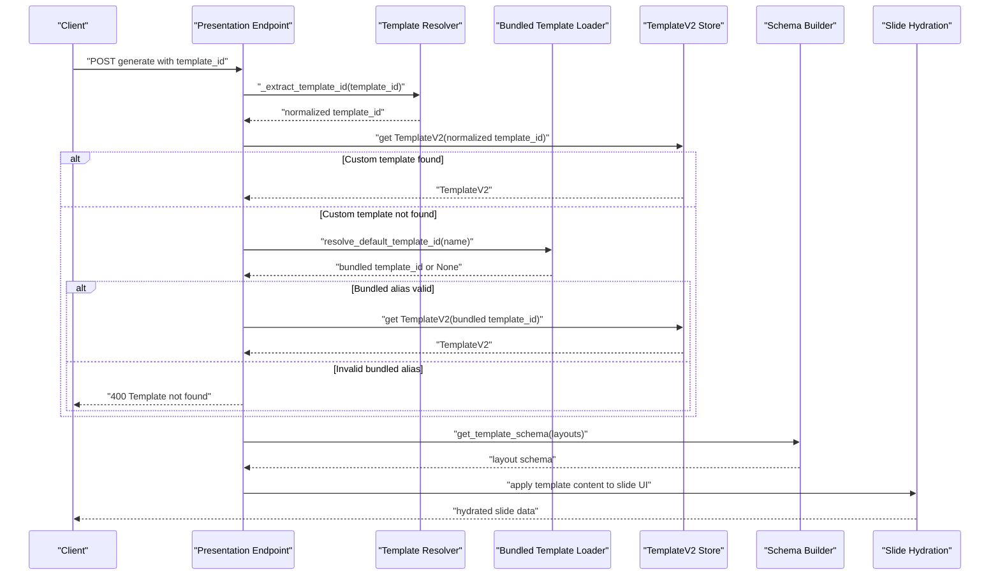

**Diagram sources**
- [presentation.py:198-304](file://servers/fastapi/api/v1/ppt/endpoints/presentation.py#L198-L304)
- [default_templates.py:61-109](file://servers/fastapi/templates/default_templates.py#L61-L109)
- [schema.py:257-279](file://servers/fastapi/templates/v2/schema.py#L257-L279)

**Section sources**
- [presentation.py:198-304](file://servers/fastapi/api/v1/ppt/endpoints/presentation.py#L198-L304)
- [default_templates.py:61-109](file://servers/fastapi/templates/default_templates.py#L61-L109)

## Detailed Component Analysis

### Template ID Extraction and Custom Template Support
The presentation endpoint defines a constant `CUSTOM_TEMPLATE_PREFIX = "custom-"` and uses `_extract_template_id` to normalize incoming template identifiers.

Key behaviors:

- Non-string values return `None`.
- Empty or whitespace-only strings return `None`.
- A leading `custom-` prefix is removed.
- After stripping the prefix, the remaining value is used as the template ID lookup key.

This allows clients to explicitly mark custom templates while still supporting bare template IDs.

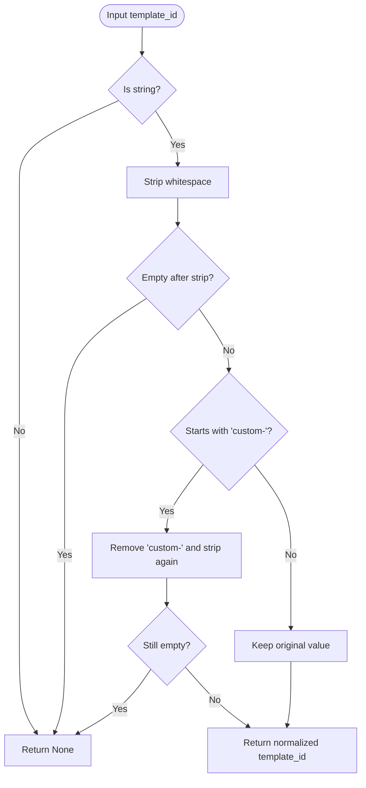

**Diagram sources**
- [presentation.py:136-207](file://servers/fastapi/api/v1/ppt/endpoints/presentation.py#L136-L207)

**Section sources**
- [presentation.py:136-207](file://servers/fastapi/api/v1/ppt/endpoints/presentation.py#L136-L207)

### Template Resolution Mechanism
The endpoint uses `_resolve_requested_template` to resolve a requested template name:

1. Extract the normalized template ID.
2. Look up `TemplateV2` by ID.
3. If found, return the template.
4. If not found, check whether the original name is a valid bundled template alias.
5. If it is a bundled alias but no persisted template exists yet, return `None` so the caller can handle bundled fallback logic.
6. If neither custom nor bundled template applies, raise an HTTP 400 error.

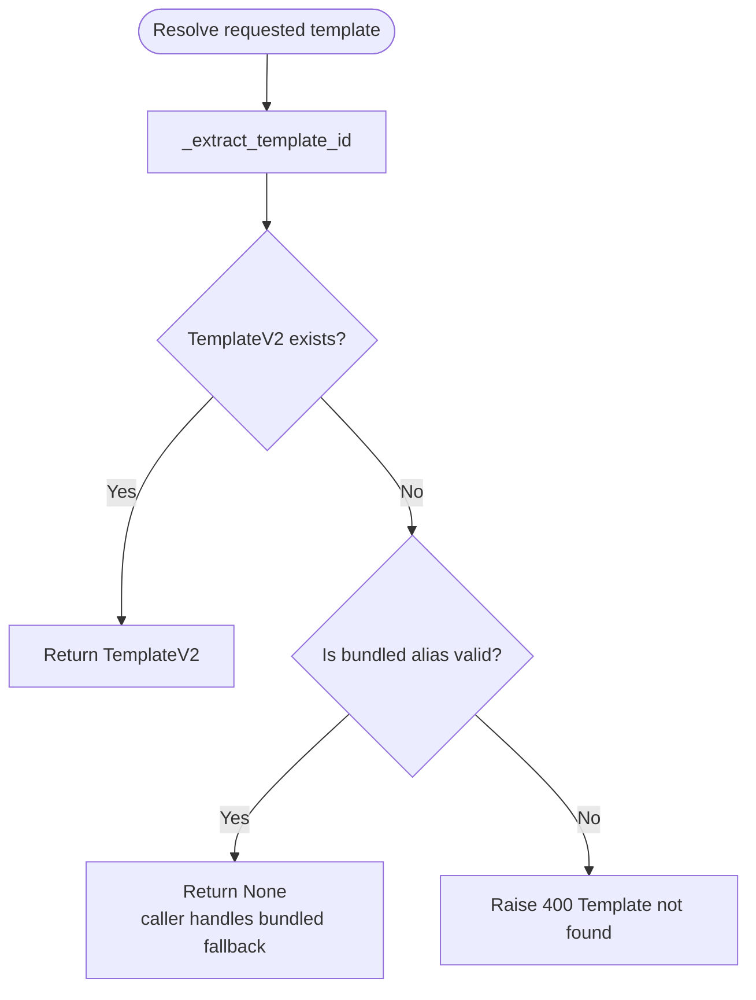

**Diagram sources**
- [presentation.py:210-227](file://servers/fastapi/api/v1/ppt/endpoints/presentation.py#L210-L227)

**Section sources**
- [presentation.py:210-227](file://servers/fastapi/api/v1/ppt/endpoints/presentation.py#L210-L227)

### Bundled Template Aliases and Default Template Import
Bundled templates live under the repository’s `templates/` directory. Each bundled template has a stable public directory name and a `template.json` file containing metadata, including its internal `id`.

The default template loader:

- Scans the templates root for directories containing `template.json`.
- Loads each bundled template into a `TemplateV2` record.
- Copies static assets into the application data directory.
- Rewrites `static/...` asset URLs to `/app_data/templates/{template_id}/static/...`.
- Updates existing default templates on startup.
- Removes stale default templates that are no longer present on disk.

The public alias resolver `resolve_default_template_id`:

- Rejects unsafe names such as `.`, `..`, path separators, or non-string inputs.
- Reads `template.json` from `templates/{alias}/template.json`.
- Returns the internal `id` if present and valid.
- Falls back to the alias itself only when the JSON does not contain a usable ID.

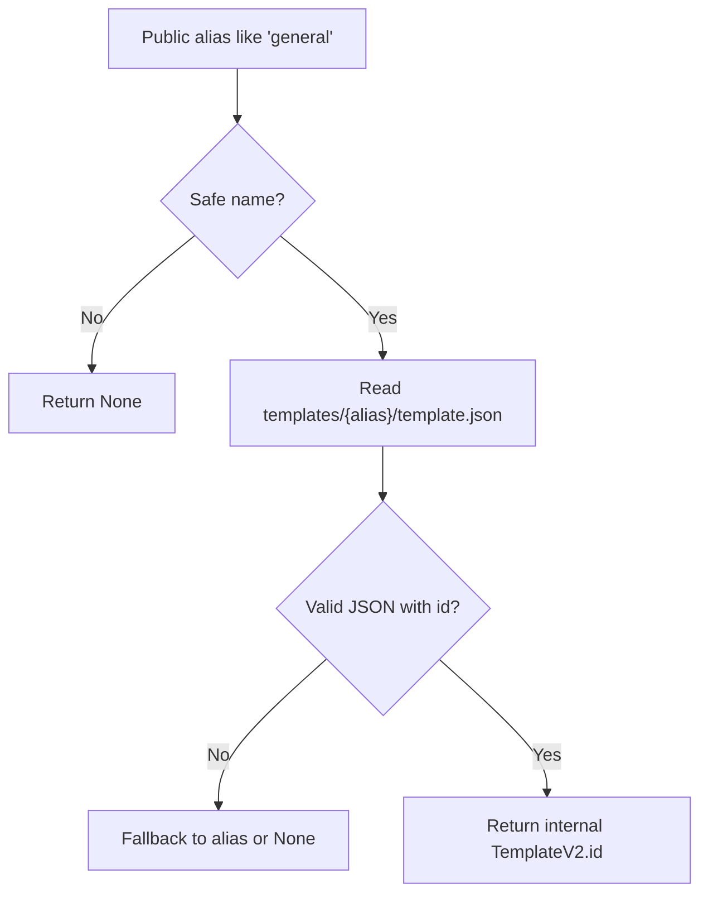

**Diagram sources**
- [default_templates.py:61-109](file://servers/fastapi/templates/default_templates.py#L61-L109)

**Section sources**
- [default_templates.py:21-109](file://servers/fastapi/templates/default_templates.py#L21-L109)

### Layout Selection Process
During presentation generation, `_resolve_generation_layout` performs the following steps:

1. Resolve the requested template using `_resolve_requested_template`.
2. If the template is `None`, treat the original name as a bundled alias.
3. Resolve the bundled alias via `resolve_default_template_id`.
4. If the alias is invalid, raise HTTP 400.
5. If the alias is valid but the persisted template is missing, raise HTTP 503 indicating bundled templates need to be imported.
6. Copy the template’s layout payload.
7. Build a `PresentationLayoutModel` from the layout payload.
8. Extract fonts and theme information for later use.

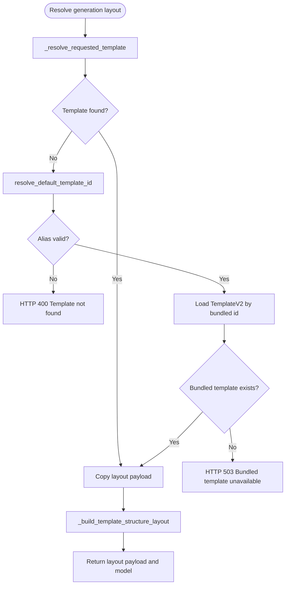

**Diagram sources**
- [presentation.py:260-304](file://servers/fastapi/api/v1/ppt/endpoints/presentation.py#L260-L304)

**Section sources**
- [presentation.py:260-304](file://servers/fastapi/api/v1/ppt/endpoints/presentation.py#L260-L304)

### Template Schema Validation
Template schema validation occurs when building the presentation layout model. The endpoint calls `get_template_schema` with the layout payload.

Validation rules include:

- The template JSON must be an object.
- The template must contain a `layouts` array.
- Each layout must be a dictionary.
- Editable elements are identified by `decorative=false`.
- Supported content types include text, image, text-list, table, chart, and infographic.
- Repeated children in flex/grid/group elements produce array schemas.
- Component schemas are derived from component element trees.
- Conflicting nested definitions raise errors.
- Missing required fields or unsupported element types raise errors.

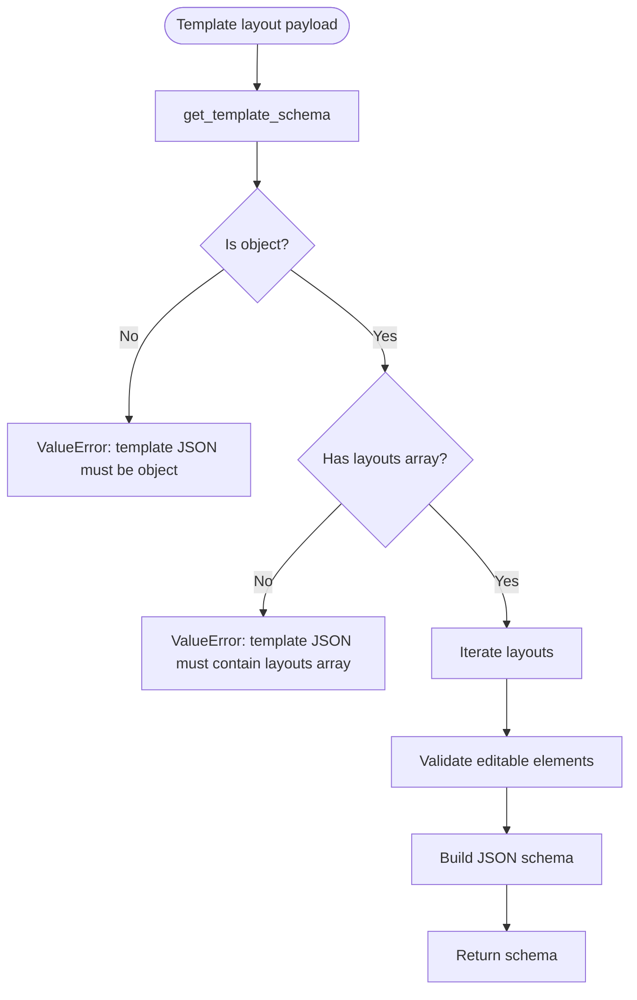

**Diagram sources**
- [schema.py:257-279](file://servers/fastapi/templates/v2/schema.py#L257-L279)
- [schema.py:585-639](file://servers/fastapi/templates/v2/schema.py#L585-L639)

**Section sources**
- [schema.py:257-279](file://servers/fastapi/templates/v2/schema.py#L257-L279)
- [schema.py:585-639](file://servers/fastapi/templates/v2/schema.py#L585-L639)

### Layout Mapping and Presentation Layout Model
The endpoint converts the template layout payload into a `PresentationLayoutModel`. This process:

- Calls `get_template_schema` to validate and normalize the layout.
- Maps each schema layout to a `SlideLayoutModel`.
- Derives layout IDs from `layout_id`, source layout `id`, or a generated fallback.
- Derives layout names and descriptions from source layout metadata or schema title/description.
- Requires at least one layout; otherwise raises HTTP 400.
- Normalizes icon type and weight using template settings.

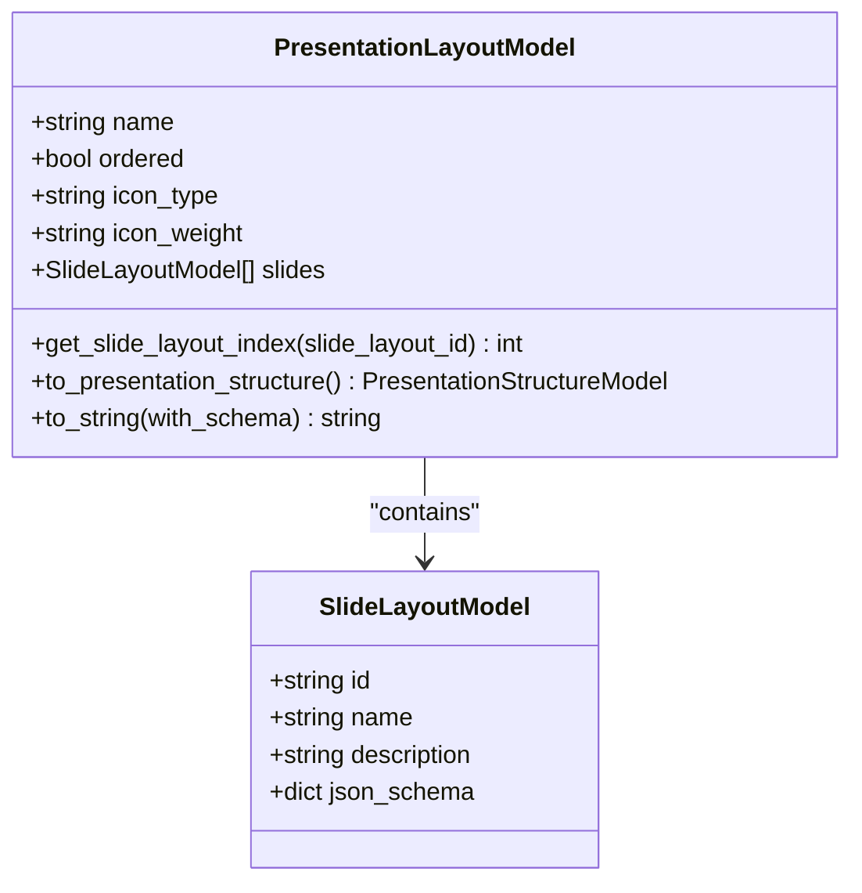

**Diagram sources**
- [presentation_layout.py:11-47](file://servers/fastapi/templates/presentation_layout.py#L11-L47)

**Section sources**
- [presentation.py:398-468](file://servers/fastapi/api/v1/ppt/endpoints/presentation.py#L398-L468)
- [presentation_layout.py:11-47](file://servers/fastapi/templates/presentation_layout.py#L11-L47)

### Component Hydration Process
Component hydration applies generated slide content to the template’s slide UI. The process:

1. Determines whether the layout payload is a template layout payload.
2. Finds the matching slide layout by ID.
3. Deep-copies the slide UI.
4. Computes stable component keys from component IDs and occurrence order.
5. Matches generated content to components by component key or component ID.
6. Applies repeated top-level groups using helper functions.
7. Recursively applies content to elements, containers, flex/grid/group children, and generated value elements.
8. Preserves decorative elements and falls back gracefully when content is missing.

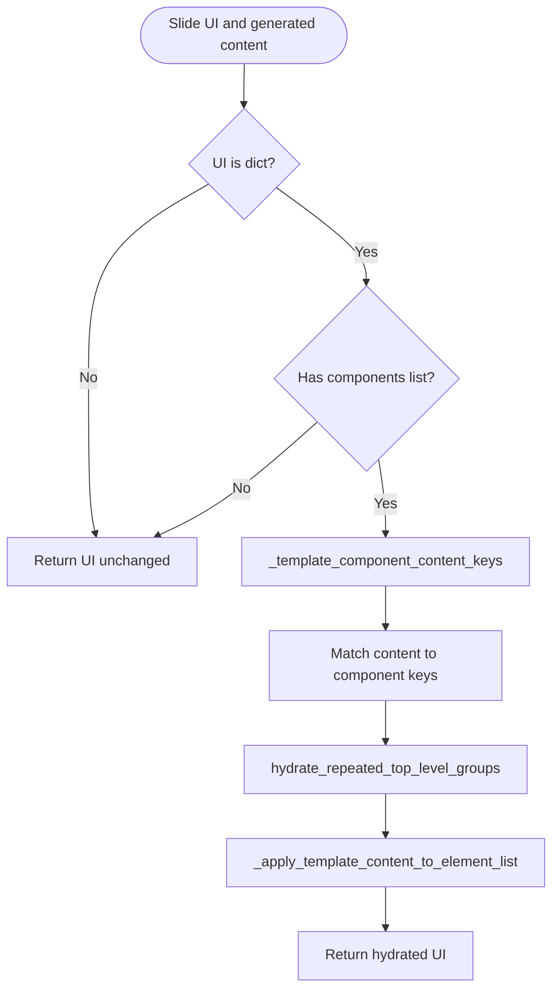

**Diagram sources**
- [presentation.py:307-318](file://servers/fastapi/api/v1/ppt/endpoints/presentation.py#L307-L318)
- [presentation.py:526-611](file://servers/fastapi/api/v1/ppt/endpoints/presentation.py#L526-L611)

**Section sources**
- [presentation.py:307-318](file://servers/fastapi/api/v1/ppt/endpoints/presentation.py#L307-L318)
- [presentation.py:526-611](file://servers/fastapi/api/v1/ppt/endpoints/presentation.py#L526-L611)

### Template Versioning and Compatibility
Template V2 introduces a structured persistence model with migration support. Key compatibility aspects:

- `TemplateV2` uses a UUID-based string primary key.
- Layouts, components, merged components, theme, and assets are stored as JSON columns.
- Migrations add fields such as `theme`, `merged_components`, `is_default`, and make `layouts` nullable.
- The bundled template importer marks imported templates as default and updates them on startup.
- Stale default templates are removed when their source directories disappear.
- The documentation describes two workflows: template creation and presentation generation.

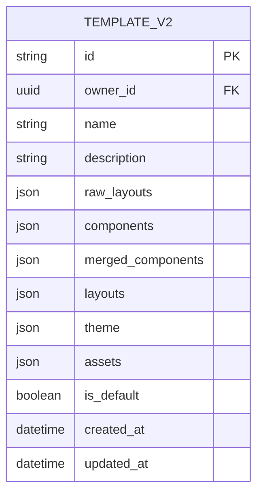

**Diagram sources**
- [template_v2.py:16-61](file://servers/fastapi/models/sql/template_v2.py#L16-L61)

**Section sources**
- [template_v2.py:16-61](file://servers/fastapi/models/sql/template_v2.py#L16-L61)
- [template-v2.md:1-49](file://docs/template-v2.md#L1-L49)
- [template-v2.md:90-127](file://docs/template-v2.md#L90-L127)

## Dependency Analysis
The template integration has clear dependency boundaries:

- The presentation endpoint depends on:
  - Template resolution helpers.
  - Default template alias resolver.
  - Template schema builder.
  - Presentation layout model.
  - Slide hydration utilities.
- The default template loader depends on:
  - Filesystem access to bundled templates.
  - Application data directory configuration.
  - Database session for importing and updating templates.
- The schema builder depends on:
  - Template layout structure.
  - Element and component definitions.
  - Infographic catalog metadata.

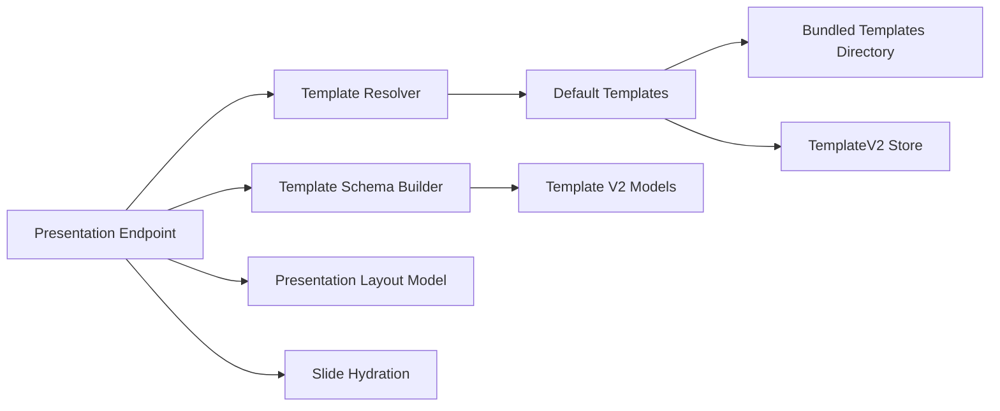

**Diagram sources**
- [presentation.py:198-304](file://servers/fastapi/api/v1/ppt/endpoints/presentation.py#L198-L304)
- [default_templates.py:21-109](file://servers/fastapi/templates/default_templates.py#L21-L109)
- [schema.py:257-279](file://servers/fastapi/templates/v2/schema.py#L257-L279)

**Section sources**
- [presentation.py:198-304](file://servers/fastapi/api/v1/ppt/endpoints/presentation.py#L198-L304)
- [default_templates.py:21-109](file://servers/fastapi/templates/default_templates.py#L21-L109)
- [schema.py:257-279](file://servers/fastapi/templates/v2/schema.py#L257-L279)

## Performance Considerations
- Template resolution avoids unnecessary filesystem reads by first checking the database.
- Bundled template alias resolution is lightweight and fails fast for invalid names.
- Schema generation walks template layouts and components; deeply nested templates may increase processing time.
- Slide hydration performs deep copies and recursive element traversal; large slide UIs with many components can be expensive.
- Default template import copies static assets and removes old assets to keep the app data directory authoritative.

[No sources needed since this section provides general guidance]

## Troubleshooting Guide

### Common Template Resolution Errors
- **400 Template not found**: Occurs when neither a custom template nor a valid bundled alias resolves.
- **503 Bundled template unavailable**: Occurs when a bundled alias is valid but the persisted template row is missing, usually because bundled templates have not been imported.

**Section sources**
- [presentation.py:260-304](file://servers/fastapi/api/v1/ppt/endpoints/presentation.py#L260-L304)

### Invalid Template Layout JSON
- If the template layout JSON is invalid, schema building raises an error and the endpoint returns HTTP 400.
- Ensure the template contains a `layouts` array and at least one layout.
- Ensure editable elements use supported content types and valid structure.

**Section sources**
- [presentation.py:398-458](file://servers/fastapi/api/v1/ppt/endpoints/presentation.py#L398-L458)
- [schema.py:257-279](file://servers/fastapi/templates/v2/schema.py#L257-L279)

### Custom Template Prefix Issues
- Using `custom-` strips the prefix before lookup.
- If the resulting ID does not exist in the database, the request proceeds to bundled alias resolution.
- If both custom and bundled resolution fail, the request returns 400.

**Section sources**
- [presentation.py:198-227](file://servers/fastapi/api/v1/ppt/endpoints/presentation.py#L198-L227)

### Bundled Template Import Problems
- If bundled templates are missing, restart the service to trigger default template import.
- Verify that the templates directory exists and contains `template.json` files.
- Verify that `APP_DATA_DIRECTORY` is configured when importing default templates.

**Section sources**
- [default_templates.py:21-54](file://servers/fastapi/templates/default_templates.py#L21-L54)
- [default_templates.py:294-316](file://servers/fastapi/templates/default_templates.py#L294-L316)

## Conclusion
Template integration in Presenton combines explicit template identifiers, bundled template aliases, and a robust schema-driven layout system. Clients can use:

- Bare template IDs for custom templates.
- `custom-` prefixed IDs to explicitly mark custom templates.
- Public bundled template aliases for built-in templates.

The system validates template layouts, maps them to presentation layouts, and hydrates slide UIs with generated content. Template versioning is backed by the `TemplateV2` model and migrations, while bundled templates are imported and kept in sync with the filesystem. For reliable integration, ensure template IDs are valid, bundled templates are imported, and generated content conforms to the template’s JSON schema.

[No sources needed since this section summarizes without analyzing specific files]