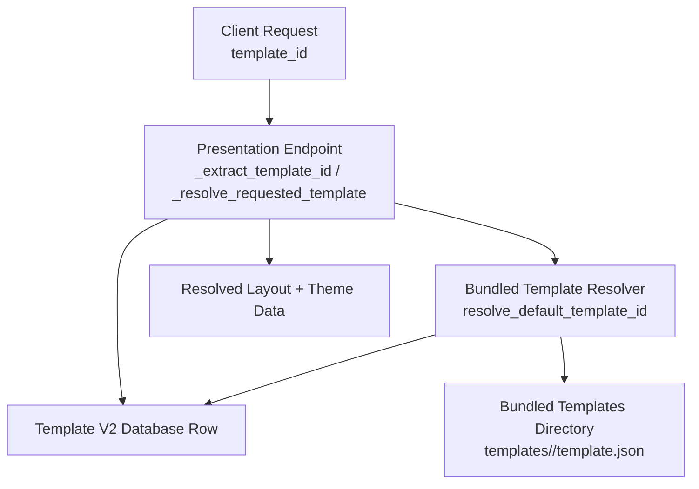
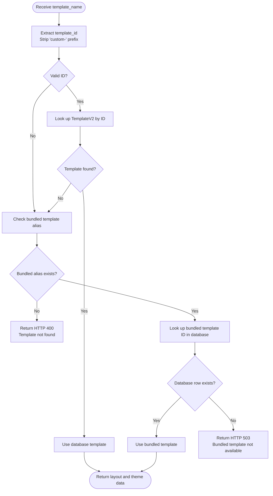
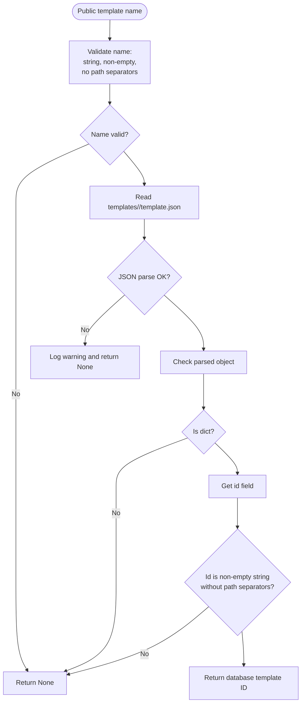
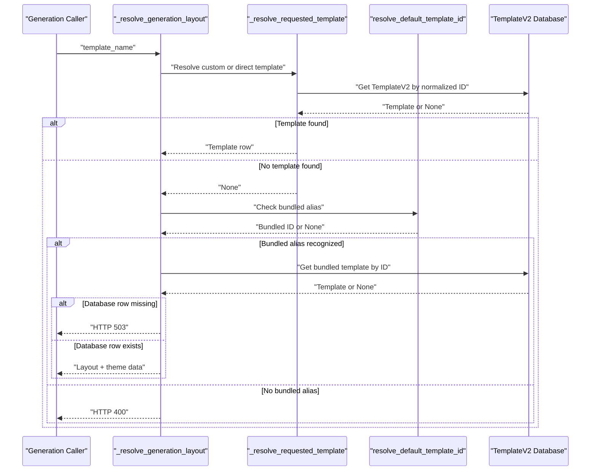
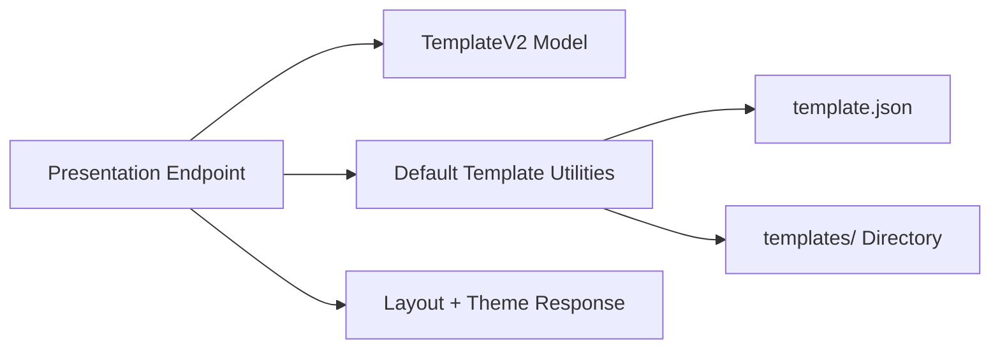

# Template Resolution

<cite>
**Referenced Files in This Document**   
- [presentation.py](file://servers/fastapi/api/v1/ppt/endpoints/presentation.py)
- [default_templates.py](file://servers/fastapi/templates/default_templates.py)
- [template.json](file://templates/executive/template.json)
- [test_default_templates.py](file://servers/fastapi/tests/unit/test_default_templates.py)
- [test_presentation_generation_flow.py](file://servers/fastapi/tests/integration/test_presentation_generation_flow.py)
</cite>

## Table of Contents
1. [Introduction](#introduction)
2. [Project Structure](#project-structure)
3. [Core Components](#core-components)
4. [Architecture Overview](#architecture-overview)
5. [Detailed Component Analysis](#detailed-component-analysis)
6. [Dependency Analysis](#dependency-analysis)
7. [Performance Considerations](#performance-considerations)
8. [Troubleshooting Guide](#troubleshooting-guide)
9. [Conclusion](#conclusion)

## Introduction
This document explains how Presenton resolves a `template_id` parameter into an actual template instance during presentation generation. It covers:

- How the system interprets user-supplied template references.
- Built-in template aliases such as `executive`, `modern`, and `general`.
- Custom templates identified by the `custom-` prefix.
- Bundled template references stored under the repository’s `templates/` directory.
- The lookup priority order, fallback behavior, and error responses for invalid or missing references.

The goal is to make template resolution predictable and safe, while keeping the public API simple: callers can use friendly names like `executive`, optional custom prefixes, or direct database IDs.

## Project Structure
Template resolution spans two main areas:

| Area | Responsibility | Key File |
|---|---|---|
| Presentation generation endpoint | Parses template input, extracts identifiers, resolves templates, and returns layout/theme data | [presentation.py](file://servers/fastapi/api/v1/ppt/endpoints/presentation.py) |
| Bundled template metadata | Maps stable public template names to persisted template IDs and imports bundled templates at startup | [default_templates.py](file://servers/fastapi/templates/default_templates.py) |
| Bundled template definitions | Example bundled template package with a public name and JSON payload | [template.json](file://templates/executive/template.json) |
| Unit tests | Validate bundled-template ID mapping and path safety | [test_default_templates.py](file://servers/fastapi/tests/unit/test_default_templates.py) |
| Integration tests | Validate custom template prefix behavior and “not found” errors | [test_presentation_generation_flow.py](file://servers/fastapi/tests/integration/test_presentation_generation_flow.py) |

**Diagram sources**
- [presentation.py:198-227](file://servers/fastapi/api/v1/ppt/endpoints/presentation.py#L198-L227)
- [presentation.py:260-304](file://servers/fastapi/api/v1/ppt/endpoints/presentation.py#L260-L304)
- [default_templates.py:61-109](file://servers/fastapi/templates/default_templates.py#L61-L109)

**Section sources**
- [presentation.py:198-304](file://servers/fastapi/api/v1/ppt/endpoints/presentation.py#L198-L304)
- [default_templates.py:61-109](file://servers/fastapi/templates/default_templates.py#L61-L109)

## Core Components
The template resolution mechanism has three core responsibilities:

1. **Normalize and extract the template identifier**  
   - Strip whitespace.
   - Remove the `custom-` prefix when present.
   - Treat empty or non-string values as invalid.

2. **Resolve the template from the database**  
   - Look up the normalized identifier directly in the `TemplateV2` table.
   - If found, return the template row.
   - If not found, signal that this may be a bundled alias instead of failing immediately.

3. **Resolve bundled template aliases**  
   - Map a public template name such as `executive` or `modern` to a persisted template ID by reading `templates/<name>/template.json`.
   - Use the resolved ID to fetch the actual template row.
   - Return a service-level error if the bundled alias exists on disk but the corresponding database row is missing.

Key implementation points:

| Function | Purpose | Behavior |
|---|---|---|
| `_extract_template_id` | Normalize input and remove custom prefix | Returns stripped ID or `None` |
| `_resolve_requested_template` | Resolve custom or database template | Raises HTTP 400 if no valid reference is found |
| `_resolve_generation_layout` | Full generation-time resolution | Falls back to bundled templates and raises HTTP 400 or 503 depending on failure mode |
| `resolve_default_template_id` | Map public bundled name to database ID | Validates path safety, reads JSON, returns ID or `None` |

**Section sources**
- [presentation.py:198-227](file://servers/fastapi/api/v1/ppt/endpoints/presentation.py#L198-L227)
- [presentation.py:260-304](file://servers/fastapi/api/v1/ppt/endpoints/presentation.py#L260-L304)
- [default_templates.py:61-109](file://servers/fastapi/templates/default_templates.py#L61-L109)

## Architecture Overview
The resolution process follows a strict priority order:

1. **Custom template reference**  
   A value starting with `custom-` is treated as a custom template. The prefix is removed before lookup.

2. **Direct database template ID**  
   Any other string is treated as a direct template ID and looked up in the database.

3. **Bundled template alias**  
   If the direct lookup fails, the system checks whether the original input matches a bundled template directory and JSON file.

4. **Fallback or error**  
   - If no custom/database template is found and no bundled alias is recognized, the request fails with a client error.
   - If a bundled alias is recognized but its database row is missing, the request fails with a service availability error.

**Diagram sources**
- [presentation.py:198-227](file://servers/fastapi/api/v1/ppt/endpoints/presentation.py#L198-L227)
- [presentation.py:260-304](file://servers/fastapi/api/v1/ppt/endpoints/presentation.py#L260-L304)
- [default_templates.py:61-109](file://servers/fastapi/templates/default_templates.py#L61-L109)

## Detailed Component Analysis

### Custom Template Prefix Handling
The system recognizes custom templates through a fixed prefix. When a template reference starts with `custom-`, the prefix is removed and the remaining value is used as the template ID.

Important behaviors:

- Only the exact configured prefix is stripped.
- Whitespace is trimmed before and after removal.
- If stripping the prefix leaves an empty value, the input is treated as invalid.
- Custom templates are expected to exist in the database; they are not automatically created from filesystem paths.

Example scenarios:

| Input | Normalized ID | Lookup Target | Outcome |
|---|---:|---|---|
| `custom-my-brand-deck` | `my-brand-deck` | Database template ID | Success if row exists |
| `custom-` | `` (empty) | None | Invalid template reference |
| `custom- ` | `` (empty after strip) | None | Invalid template reference |
| `custom-executive` | `executive` | Database template ID | Uses database row, not bundled alias |

**Section sources**
- [presentation.py:136-137](file://servers/fastapi/api/v1/ppt/endpoints/presentation.py#L136-L137)
- [presentation.py:198-207](file://servers/fastapi/api/v1/ppt/endpoints/presentation.py#L198-L207)
- [test_presentation_generation_flow.py:316](file://servers/fastapi/tests/integration/test_presentation_generation_flow.py#L316)
- [test_presentation_generation_flow.py:500](file://servers/fastapi/tests/integration/test_presentation_generation_flow.py#L500)
- [test_presentation_generation_flow.py:628](file://servers/fastapi/tests/integration/test_presentation_generation_flow.py#L628)

### Direct Database Template Lookup
After normalization, the system attempts to load the template directly from the database using the `TemplateV2` model.

Resolution rules:

- If the ID exists, the template row is returned immediately.
- If the ID does not exist, the function signals that this may be a bundled alias rather than raising an error immediately.
- Callers that require a usable template then decide whether to fall back to bundled templates or raise an error.

Error behavior:

- In generation flows, a missing custom or direct database template typically results in HTTP 400.
- This protects clients from silently falling back to bundled templates when a specific custom template was requested.

**Section sources**
- [presentation.py:210-227](file://servers/fastapi/api/v1/ppt/endpoints/presentation.py#L210-L227)
- [presentation.py:260-276](file://servers/fastapi/api/v1/ppt/endpoints/presentation.py#L260-L276)

### Bundled Template Alias Resolution
Bundled templates are shipped with the application under the `templates/` directory. Each bundled template has:

- A stable public directory name, such as `executive`, `modern`, or `general`.
- A `template.json` file containing metadata, including the persisted template ID.
- Optional static assets under a `static/` subdirectory.

The resolver performs these steps:

1. Rejects unsafe inputs:
   - Non-string values.
   - Empty values.
   - Path traversal patterns like `.` or `..`.
   - Values containing `/` or `\`.

2. Looks for `templates/<name>/template.json`.

3. Reads and parses the JSON safely.

4. Extracts the `id` field.

5. Validates that the ID is a non-empty string without path separators.

6. Returns the database template ID if valid, otherwise `None`.

**Diagram sources**
- [default_templates.py:61-109](file://servers/fastapi/templates/default_templates.py#L61-L109)

Example bundled template:

| Public Name | Bundled Directory | JSON ID Field | Database Lookup Result |
|---|---|---|---|
| `executive` | `templates/executive` | `"executive"` | Resolves to database row with ID `executive` |
| `modern` | `templates/modern` | Value from JSON | Resolves to database row if imported |
| `general` | `templates/general` | Value from JSON | Resolves to database row if imported |

Tests confirm that public names map to their JSON IDs and that path-like inputs are rejected.

**Section sources**
- [default_templates.py:61-109](file://servers/fastapi/templates/default_templates.py#L61-L109)
- [template.json:1-5](file://templates/executive/template.json#L1-L5)
- [test_default_templates.py:396-405](file://servers/fastapi/tests/unit/test_default_templates.py#L396-L405)

### Generation-Time Resolution and Fallback
The full generation flow uses `_resolve_generation_layout`, which coordinates both database and bundled template resolution.

Flow summary:

1. Try to resolve the requested template as a custom or direct database template.
2. If that returns `None`, treat the original input as a possible bundled alias.
3. If no bundled alias is recognized, return HTTP 400.
4. If a bundled alias is recognized, look up its database row.
5. If the database row is missing, return HTTP 503 indicating that bundled templates need to be reimported.
6. If successful, copy the template layout payload and build structure, fonts, and theme data.

**Diagram sources**
- [presentation.py:260-304](file://servers/fastapi/api/v1/ppt/endpoints/presentation.py#L260-L304)
- [presentation.py:210-227](file://servers/fastapi/api/v1/ppt/endpoints/presentation.py#L210-L227)
- [default_templates.py:61-109](file://servers/fastapi/templates/default_templates.py#L61-L109)

**Section sources**
- [presentation.py:260-304](file://servers/fastapi/api/v1/ppt/endpoints/presentation.py#L260-L304)

### Template Payload Enrichment
Once a template is resolved, the system copies and enriches the layout payload before using it for generation.

Enrichment includes:

- Deep copying the template layouts.
- Validating that layouts are represented as an object.
- Deriving icon type and weight from template settings.
- Adding a template reference name.
- Recording the resolved template ID in the layout payload.

This ensures downstream components receive a consistent layout structure regardless of whether the template came from the database or a bundled alias.

**Section sources**
- [presentation.py:230-245](file://servers/fastapi/api/v1/ppt/endpoints/presentation.py#L230-L245)
- [presentation.py:248-257](file://servers/fastapi/api/v1/ppt/endpoints/presentation.py#L248-L257)

## Dependency Analysis
The template resolution logic depends on several layers:

| Dependency | Role | Why It Matters |
|---|---|---|
| `TemplateV2` model | Represents persisted templates | All custom and bundled templates must eventually resolve to a database row |
| `templates/` directory | Stores bundled template packages | Provides public aliases like `executive` and `modern` |
| `template.json` | Defines bundled template metadata | Maps public names to stable IDs |
| Presentation endpoint | Orchestrates resolution | Applies priority order and error handling |
| Default template utilities | Implements bundled alias resolution | Encapsulates validation, JSON parsing, and safety checks |

**Diagram sources**
- [presentation.py:210-304](file://servers/fastapi/api/v1/ppt/endpoints/presentation.py#L210-L304)
- [default_templates.py:61-109](file://servers/fastapi/templates/default_templates.py#L61-L109)

**Section sources**
- [presentation.py:210-304](file://servers/fastapi/api/v1/ppt/endpoints/presentation.py#L210-L304)
- [default_templates.py:61-109](file://servers/fastapi/templates/default_templates.py#L61-L109)

## Performance Considerations
- Database lookup is O(1) per resolved ID because it uses primary-key access.
- Bundled template resolution involves filesystem access and JSON parsing only when the direct lookup fails.
- Validation prevents expensive operations on malformed or dangerous inputs early.
- Layout payload copying adds memory overhead proportional to the size of the template layouts, but this is necessary to isolate generated presentations from shared template state.

[No sources needed since this section provides general guidance]

## Troubleshooting Guide

### Common Resolution Outcomes

| Scenario | Expected Behavior | HTTP Status | Notes |
|---|---|---:|---|
| `custom-my-template` exists in database | Uses custom template | 200 | Prefix is stripped before lookup |
| `custom-my-template` does not exist | Fails without falling back to bundled templates | 400 | Custom references are strict |
| `executive` is a valid bundled alias and database row exists | Uses bundled template | 200 | Public name maps to persisted ID |
| `executive` is valid on disk but database row is missing | Fails with service error | 503 | Indicates bundled templates were not imported |
| `unknown-template` is neither custom nor bundled | Fails with client error | 400 | No fallback occurs |
| `custom-` or empty template reference | Treated as invalid | 400 | No usable ID after normalization |
| Path-like bundled name such as `../executive` | Rejected by bundled resolver | 400 | Security validation prevents traversal |

### Debugging Steps

1. **Verify the raw template input**  
   Check whether the caller passed a direct ID, a `custom-` reference, or a bundled alias.

2. **Check custom template existence**  
   Confirm that the ID after removing `custom-` exists in the `TemplateV2` table.

3. **Check bundled template metadata**  
   Verify that `templates/<name>/template.json` exists and contains a valid `id` field.

4. **Check bundled template database import**  
   If the bundled alias exists on disk but the database row is missing, restart or reimport bundled templates.

5. **Inspect error messages**  
   - HTTP 400 usually means the template reference is invalid or not found.
   - HTTP 503 usually means the bundled alias is known but its database row is unavailable.

**Section sources**
- [presentation.py:220-227](file://servers/fastapi/api/v1/ppt/endpoints/presentation.py#L220-L227)
- [presentation.py:271-285](file://servers/fastapi/api/v1/ppt/endpoints/presentation.py#L271-L285)
- [default_templates.py:72-109](file://servers/fastapi/templates/default_templates.py#L72-L109)
- [test_presentation_generation_flow.py:642](file://servers/fastapi/tests/integration/test_presentation_generation_flow.py#L642)
- [test_presentation_generation_flow.py:654](file://servers/fastapi/tests/integration/test_presentation_generation_flow.py#L654)

## Conclusion
Presenton’s template resolution is designed around clarity, safety, and predictability:

- Custom templates use a clear `custom-` prefix and are resolved strictly against the database.
- Direct template IDs allow precise selection of persisted templates.
- Bundled templates provide friendly public aliases such as `executive` and `modern`, mapped through `template.json`.
- The resolver validates inputs, avoids path traversal, and distinguishes between client errors and service-level import failures.
- Errors are explicit: missing references return 400, while missing bundled database rows return 503.

This design lets clients choose between flexible bundled aliases and deterministic custom templates while keeping the backend secure and maintainable.

[No sources needed since this section summarizes without analyzing specific files]