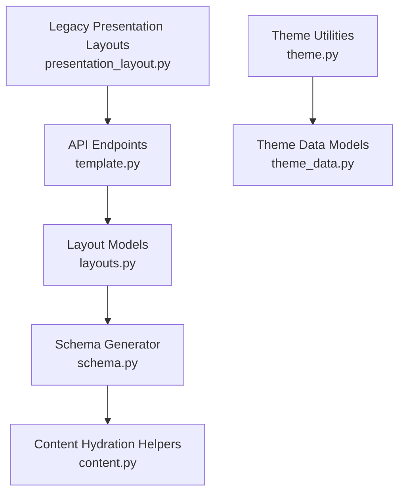
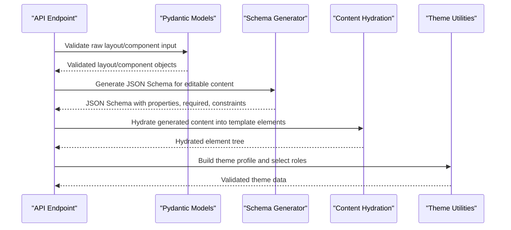
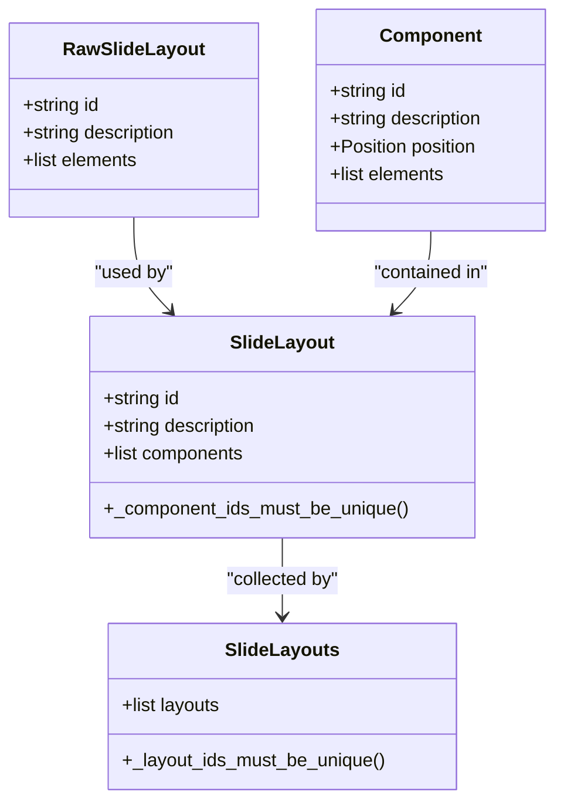
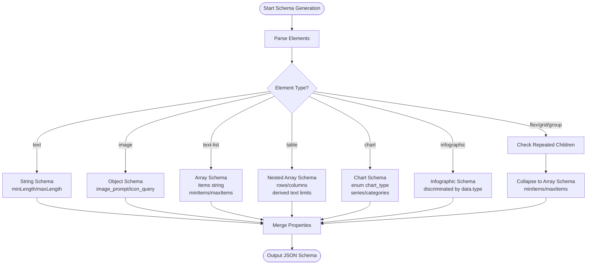
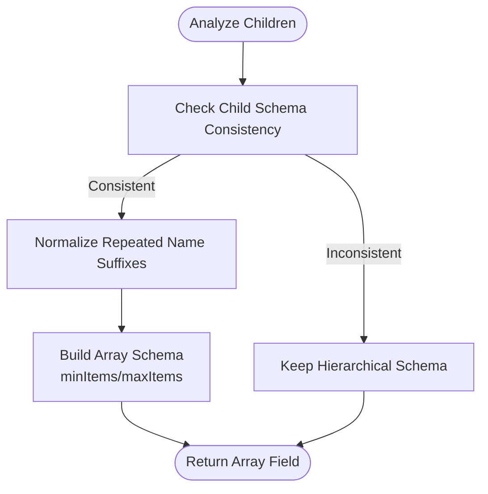
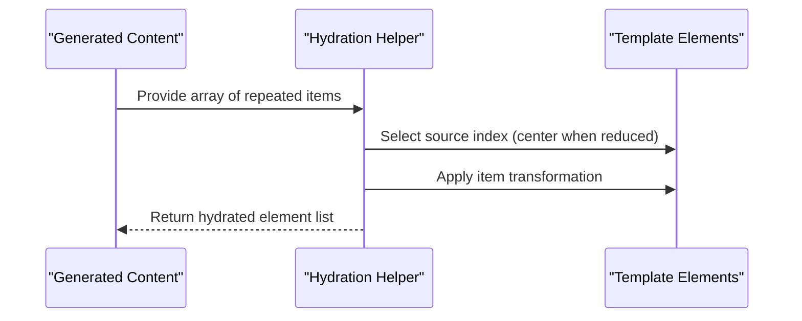
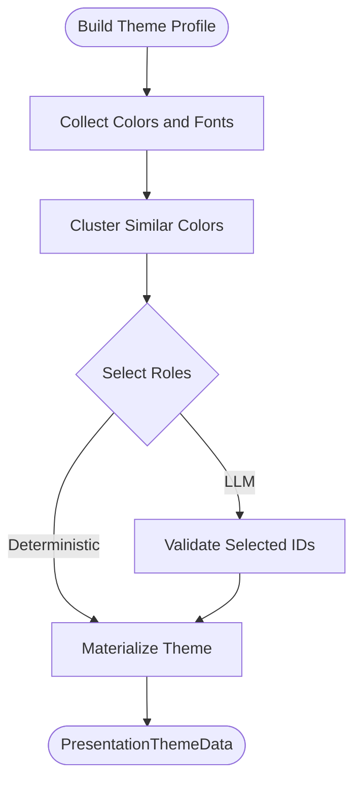
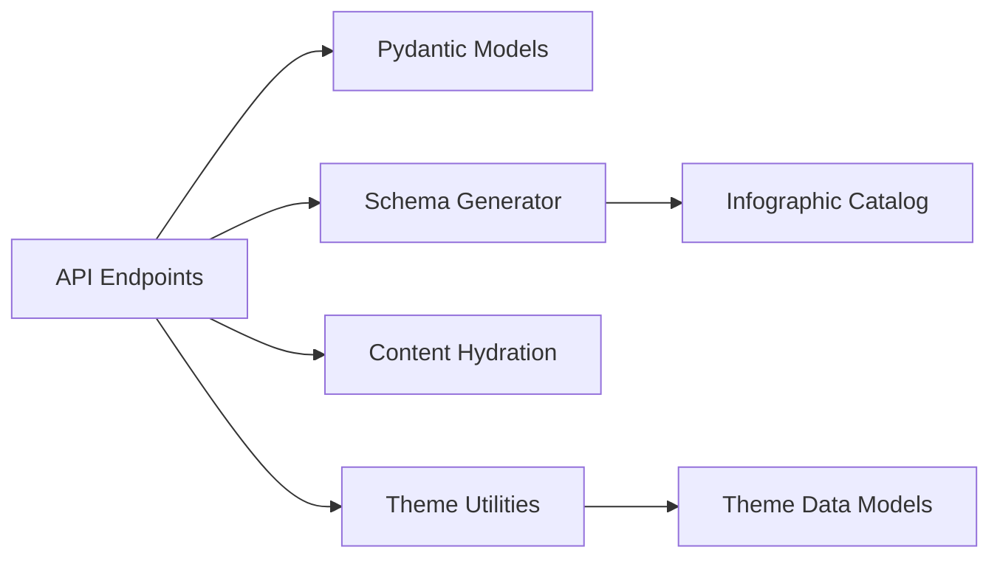

# Template Validation

<cite>
**Referenced Files in This Document**
- [schema.py](file://servers/fastapi/templates/v2/schema.py)
- [layouts.py](file://servers/fastapi/templates/v2/models/layouts.py)
- [content.py](file://servers/fastapi/templates/v2/content.py)
- [theme.py](file://servers/fastapi/templates/v2/theme.py)
- [presentation_layout.py](file://servers/fastapi/templates/presentation_layout.py)
- [template.py](file://servers/fastapi/api/v1/ppt/endpoints/template.py)
- [test_templates_v2_schema.py](file://servers/fastapi/tests/unit/test_templates_v2_schema.py)
</cite>

## Table of Contents
1. [Introduction](#introduction)
2. [Project Structure](#project-structure)
3. [Core Components](#core-components)
4. [Architecture Overview](#architecture-overview)
5. [Detailed Component Analysis](#detailed-component-analysis)
6. [Dependency Analysis](#dependency-analysis)
7. [Performance Considerations](#performance-considerations)
8. [Troubleshooting Guide](#troubleshooting-guide)
9. [Conclusion](#conclusion)

## Introduction
This document explains the template validation system used by the project for Template V2. It covers:
- The schema validation rules that templates must satisfy, including required fields, data types, and structural constraints.
- The validation pipeline for template components, layouts, and theme definitions.
- Common validation errors and their solutions, such as malformed JSON structures, missing required properties, and type mismatches.
- Examples of valid and invalid template schemas with explanations of validation failures.

The validation system is centered around Pydantic models for strict input validation and a JSON Schema generator that derives editable content schemas from slide layouts and component definitions. Theme generation also validates semantic color and font selections against an observed style profile.

## Project Structure
Template validation spans several modules:
- Layout and component models define the expected structure of raw slide layouts and generated components.
- A schema generator converts layout elements into JSON Schemas describing editable content.
- Content helpers apply generated content back to template element structures.
- Theme utilities validate and materialize presentation themes based on observed colors and fonts.
- API endpoints orchestrate validation during template creation and updates.
- Unit tests assert the behavior of schema extraction and repeated-element handling.

**Diagram sources**
- [template.py](file://servers/fastapi/api/v1/ppt/endpoints/template.py)
- [layouts.py](file://servers/fastapi/templates/v2/models/layouts.py)
- [schema.py](file://servers/fastapi/templates/v2/schema.py)
- [content.py](file://servers/fastapi/templates/v2/content.py)
- [theme.py](file://servers/fastapi/templates/v2/theme.py)
- [presentation_layout.py](file://servers/fastapi/templates/presentation_layout.py)

**Section sources**
- [schema.py:183-279](file://servers/fastapi/templates/v2/schema.py#L183-L279)
- [layouts.py:44-119](file://servers/fastapi/templates/v2/models/layouts.py#L44-L119)
- [content.py:27-87](file://servers/fastapi/templates/v2/content.py#L27-L87)
- [theme.py:145-258](file://servers/fastapi/templates/v2/theme.py#L145-L258)
- [presentation_layout.py:11-47](file://servers/fastapi/templates/presentation_layout.py#L11-L47)
- [template.py:885-889](file://servers/fastapi/api/v1/ppt/endpoints/template.py#L885-L889)

## Core Components
- Raw slide layouts and components are validated using Pydantic models. These enforce required fields like `id`, `description`, and `elements`, plus uniqueness constraints across IDs and indices.
- The schema generator produces JSON Schemas for editable content. It supports text, images, lists, tables, charts, and infographics, and it collapses repeated children into arrays when appropriate.
- Content hydration maps generated content back to template elements, supporting repeated top-level groups and markdown normalization for infographic labels.
- Theme utilities build a style profile from layouts, select semantic roles (colors and fonts), and materialize a validated theme object.
- Legacy presentation layouts provide a simpler model for slide layout metadata and schema serialization.

Key responsibilities:
- Validate raw inputs early via Pydantic.
- Derive stable JSON Schemas for UI editors and LLM-driven content generation.
- Ensure repeated visual patterns become repeatable array fields.
- Enforce chart and infographic data contracts.
- Validate theme role selections against observed palette and font sets.

**Section sources**
- [layouts.py:44-119](file://servers/fastapi/templates/v2/models/layouts.py#L44-L119)
- [schema.py:183-279](file://servers/fastapi/templates/v2/schema.py#L183-L279)
- [schema.py:361-423](file://servers/fastapi/templates/v2/schema.py#L361-L423)
- [schema.py:1490-1534](file://servers/fastapi/templates/v2/schema.py#L1490-L1534)
- [content.py:27-87](file://servers/fastapi/templates/v2/content.py#L27-L87)
- [theme.py:145-258](file://servers/fastapi/templates/v2/theme.py#L145-L258)
- [presentation_layout.py:11-47](file://servers/fastapi/templates/presentation_layout.py#L11-L47)

## Architecture Overview
The template validation pipeline proceeds through these stages:
1. Input validation: Raw slide layouts and components are validated against Pydantic models.
2. Schema derivation: Editable content schemas are generated from layout elements or component definitions.
3. Repeated pattern detection: Flex/grid/group patterns are collapsed into arrays with min/max constraints.
4. Content application: Generated content is hydrated back into template elements, respecting repeated group semantics.
5. Theme validation: Colors and fonts are profiled and selected; theme roles are validated against available IDs.

**Diagram sources**
- [template.py:885-889](file://servers/fastapi/api/v1/ppt/endpoints/template.py#L885-L889)
- [layouts.py:44-119](file://servers/fastapi/templates/v2/models/layouts.py#L44-L119)
- [schema.py:183-279](file://servers/fastapi/templates/v2/schema.py#L183-L279)
- [content.py:57-87](file://servers/fastapi/templates/v2/content.py#L57-L87)
- [theme.py:145-258](file://servers/fastapi/templates/v2/theme.py#L145-L258)

## Detailed Component Analysis

### Layout and Component Validation
Raw slide layouts and components are defined by Pydantic models:
- `RawSlideLayout` requires `id`, `description`, and `elements`.
- `Component` requires `id`, `description`, `position`, and at least one `element`.
- `SlideLayout` enforces unique component IDs within a slide.
- `SlideLayouts` enforces unique layout IDs across all slides.

These validators catch malformed inputs early, preventing downstream processing of invalid structures.

**Diagram sources**
- [layouts.py:44-119](file://servers/fastapi/templates/v2/models/layouts.py#L44-L119)

**Section sources**
- [layouts.py:44-119](file://servers/fastapi/templates/v2/models/layouts.py#L44-L119)

### Schema Generation for Editable Content
The schema generator transforms layout elements into JSON Schemas:
- Supported content types include text, image, text-list, table, chart, and infographic.
- Text fields support `minLength` and `maxLength`.
- Images expose either `image_prompt` or `icon_query` depending on whether the element is an icon.
- Lists constrain item count and string length.
- Tables define nested arrays for rows and columns with derived text capacity limits.
- Charts require a `chart_type` enum and structured series/categories.
- Infographics use discriminated unions based on `data.type`, with specific field requirements per infographic variant.

Repeated children under flex/grid/group containers are collapsed into arrays when consistent, preserving min/max child constraints.

**Diagram sources**
- [schema.py:361-423](file://servers/fastapi/templates/v2/schema.py#L361-L423)
- [schema.py:1490-1534](file://servers/fastapi/templates/v2/schema.py#L1490-L1534)
- [schema.py:1284-1475](file://servers/fastapi/templates/v2/schema.py#L1284-L1475)

**Section sources**
- [schema.py:361-423](file://servers/fastapi/templates/v2/schema.py#L361-L423)
- [schema.py:1490-1534](file://servers/fastapi/templates/v2/schema.py#L1490-L1534)
- [schema.py:1284-1475](file://servers/fastapi/templates/v2/schema.py#L1284-L1475)
- [test_templates_v2_schema.py:10-175](file://servers/fastapi/tests/unit/test_templates_v2_schema.py#L10-L175)

### Repeated Pattern Handling and Top-Level Groups
Repeated visual items are detected and normalized:
- Flex/grid/group containers with consistent child schemas are collapsed into arrays.
- Repeated name suffixes (e.g., `_1`, `_2`) are stripped to produce stable property names.
- Top-level repeated groups can be represented as a single array field in component schemas.

This ensures editors see repeatable sections rather than duplicated fields.

**Diagram sources**
- [schema.py:426-452](file://servers/fastapi/templates/v2/schema.py#L426-L452)
- [schema.py:822-852](file://servers/fastapi/templates/v2/schema.py#L822-L852)
- [schema.py:1048-1093](file://servers/fastapi/templates/v2/schema.py#L1048-L1093)

**Section sources**
- [schema.py:426-452](file://servers/fastapi/templates/v2/schema.py#L426-L452)
- [schema.py:822-852](file://servers/fastapi/templates/v2/schema.py#L822-L852)
- [schema.py:1048-1093](file://servers/fastapi/templates/v2/schema.py#L1048-L1093)
- [test_templates_v2_schema.py:760-804](file://servers/fastapi/tests/unit/test_templates_v2_schema.py#L760-L804)

### Content Hydration and Markdown Normalization
Generated content is applied back to template elements:
- Markdown inline syntax is stripped from infographic labels recursively.
- Repeated top-level groups are hydrated by mapping each generated array item to a complete positioned group from the template.
- Index mapping centers reduced content when fewer items are provided than template slots.

**Diagram sources**
- [content.py:27-40](file://servers/fastapi/templates/v2/content.py#L27-L40)
- [content.py:57-87](file://servers/fastapi/templates/v2/content.py#L57-L87)

**Section sources**
- [content.py:27-87](file://servers/fastapi/templates/v2/content.py#L27-L87)

### Theme Validation and Role Selection
Theme utilities analyze layouts to build a style profile:
- Colors are clustered and scored by importance (fill area, usage counts, slide presence).
- Font usage is aggregated and limited to a maximum number of profiles.
- Semantic theme roles (primary, background, card, stroke, text colors, graph colors, text font) are selected either via an LLM call with validation retries or deterministically if LLM selection fails.
- Selected roles are validated against observed color and font IDs; unknown IDs raise validation errors.
- The final theme is materialized into a validated theme data model.

**Diagram sources**
- [theme.py:145-258](file://servers/fastapi/templates/v2/theme.py#L145-L258)
- [theme.py:261-302](file://servers/fastapi/templates/v2/theme.py#L261-L302)
- [theme.py:357-402](file://servers/fastapi/templates/v2/theme.py#L357-L402)

**Section sources**
- [theme.py:145-258](file://servers/fastapi/templates/v2/theme.py#L145-L258)
- [theme.py:261-302](file://servers/fastapi/templates/v2/theme.py#L261-L302)
- [theme.py:357-402](file://servers/fastapi/templates/v2/theme.py#L357-L402)

### Legacy Presentation Layout Model
The legacy presentation layout model provides:
- A simple representation of slide layouts with optional name and description.
- Icon type normalization and helper methods for converting to presentation structure and serializing to strings.
- Integration with older APIs that expect this model shape.

**Section sources**
- [presentation_layout.py:11-47](file://servers/fastapi/templates/presentation_layout.py#L11-L47)

## Dependency Analysis
The validation pipeline has clear dependencies:
- API endpoints depend on Pydantic models for input validation and on the schema generator for JSON Schema output.
- The schema generator depends on layout models and infographic catalog mappings.
- Content hydration depends on schema-derived repeated group names.
- Theme utilities depend on layout models and theme data models.

**Diagram sources**
- [template.py](file://servers/fastapi/api/v1/ppt/endpoints/template.py)
- [layouts.py](file://servers/fastapi/templates/v2/models/layouts.py)
- [schema.py](file://servers/fastapi/templates/v2/schema.py)
- [content.py](file://servers/fastapi/templates/v2/content.py)
- [theme.py](file://servers/fastapi/templates/v2/theme.py)

**Section sources**
- [template.py:885-889](file://servers/fastapi/api/v1/ppt/endpoints/template.py#L885-L889)
- [layouts.py:44-119](file://servers/fastapi/templates/v2/models/layouts.py#L44-L119)
- [schema.py:183-279](file://servers/fastapi/templates/v2/schema.py#L183-L279)
- [content.py:57-87](file://servers/fastapi/templates/v2/content.py#L57-L87)
- [theme.py:145-258](file://servers/fastapi/templates/v2/theme.py#L145-L258)

## Performance Considerations
- Schema generation traverses element trees once and normalizes repeated patterns efficiently.
- Color clustering and font aggregation operate over collected statistics, limiting profile sizes to fixed maxima.
- Repeated child collapsing avoids unnecessary duplication by merging consistent child schemas.
- Theme role selection includes retry logic for LLM calls but falls back deterministically to avoid blocking.

[No sources needed since this section provides general guidance]

## Troubleshooting Guide
Common validation errors and resolutions:
- Malformed JSON structures: Ensure template JSON contains a `layouts` array and each layout contains `components` where applicable. Missing arrays trigger validation errors during schema generation.
  - Resolution: Add the required `layouts` array and ensure each layout is a dictionary with valid `components`.
- Missing required properties: Components must include a string `id`; layouts must include `id` and `description`; elements must have a valid `type` and editable `name`.
  - Resolution: Provide all required fields and ensure names are non-empty strings.
- Type mismatches: Chart `chart_type` must be one of the allowed values; infographic `data.type` must match supported variants; numeric fields must be numbers, not booleans.
  - Resolution: Use correct enums and data types as defined by the schema.
- Duplicate IDs: Component IDs must be unique within a slide layout; layout IDs must be unique across all layouts.
  - Resolution: Rename duplicate IDs to ensure uniqueness.
- Invalid theme role IDs: LLM-selected theme roles must reference existing color and font IDs from the profile.
  - Resolution: Verify selected IDs exist in the profile; fall back to deterministic selection if LLM validation fails.

Validation error examples:
- Missing `layouts` array in template JSON causes schema generation to fail.
- Component without a string `id` raises a validation error during component schema extraction.
- Chart with unsupported `chart_type` fails JSON Schema validation.
- Infographic with incorrect `data.type` fails discriminator validation.
- Theme selection referencing unknown color/font IDs raises a validation error.

**Section sources**
- [schema.py:257-279](file://servers/fastapi/templates/v2/schema.py#L257-L279)
- [schema.py:691-729](file://servers/fastapi/templates/v2/schema.py#L691-L729)
- [schema.py:1490-1534](file://servers/fastapi/templates/v2/schema.py#L1490-L1534)
- [schema.py:1448-1475](file://servers/fastapi/templates/v2/schema.py#L1448-L1475)
- [theme.py:261-302](file://servers/fastapi/templates/v2/theme.py#L261-L302)
- [test_templates_v2_schema.py:807-866](file://servers/fastapi/tests/unit/test_templates_v2_schema.py#L807-L866)

## Conclusion
The template validation system combines strict Pydantic models with a robust JSON Schema generator to ensure templates are structurally sound and semantically consistent. It supports complex layouts with repeated patterns, validates chart and infographic data, and generates reliable themes from observed styles. By following the documented rules and resolving common validation errors, template authors can create predictable, editor-friendly templates that integrate smoothly with both manual editing and automated generation workflows.

[No sources needed since this section summarizes without analyzing specific files]