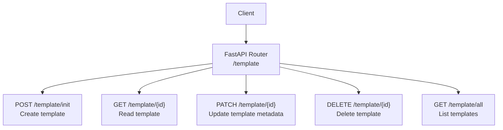
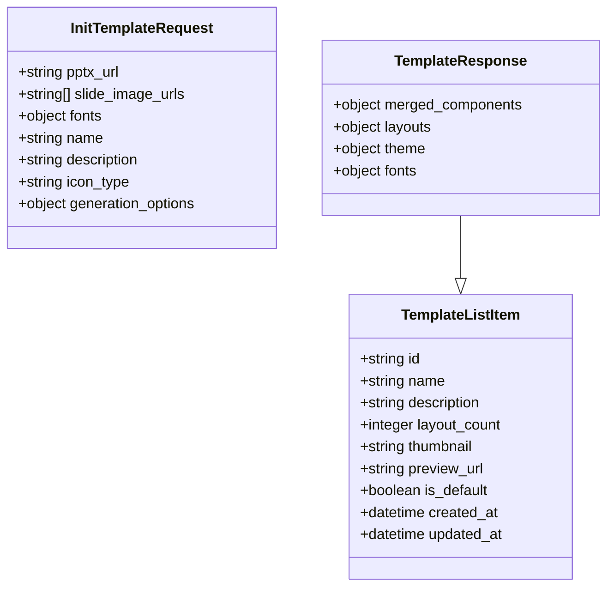
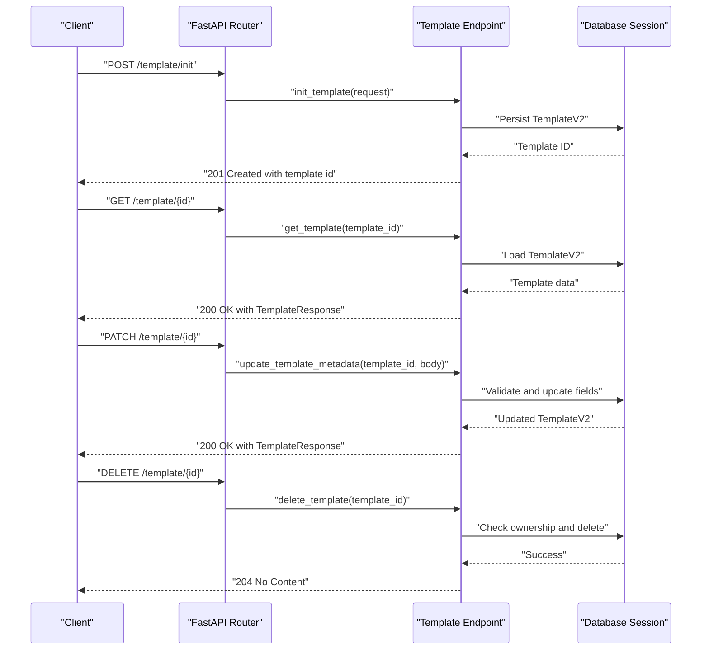
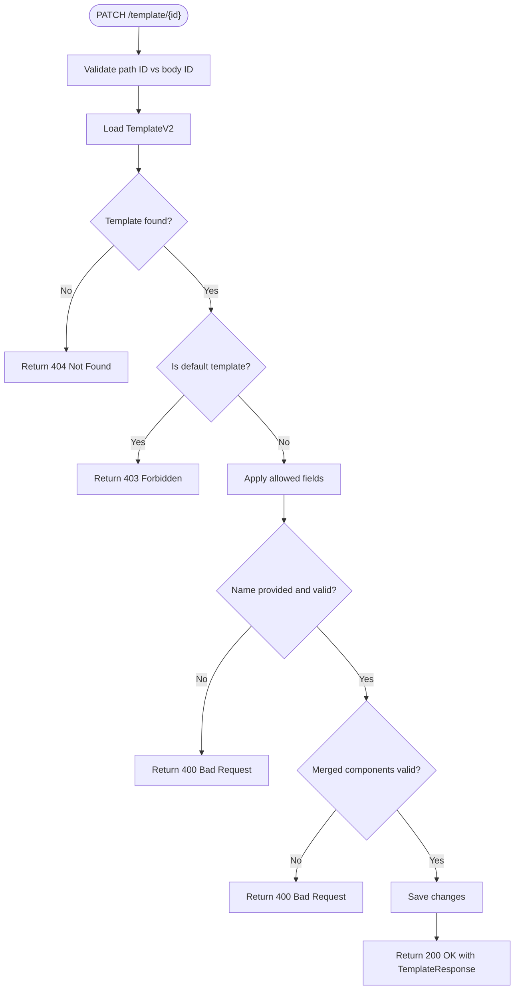
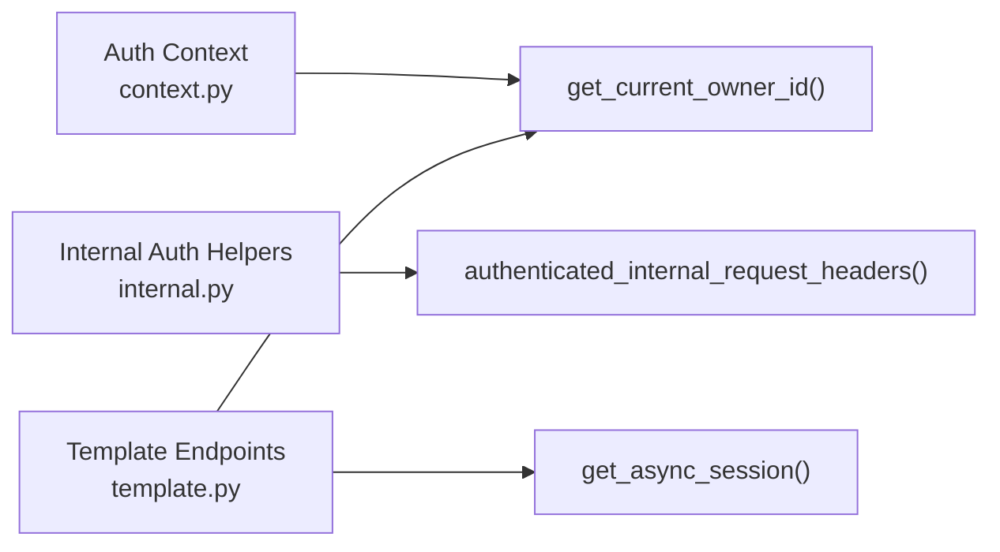

# Template CRUD Operations

<cite>
**Referenced Files in This Document**   
- [template.py](file://servers/fastapi/api/v1/ppt/endpoints/template.py)
- [context.py](file://servers/fastapi/api/v1/auth/context.py)
- [internal.py](file://servers/fastapi/api/v1/auth/internal.py)
- [test_template_api.py](file://servers/fastapi/tests/unit/test_template_api.py)
</cite>

## Table of Contents
1. [Introduction](#introduction)
2. [Project Structure](#project-structure)
3. [Core Components](#core-components)
4. [Architecture Overview](#architecture-overview)
5. [Detailed Component Analysis](#detailed-component-analysis)
6. [Dependency Analysis](#dependency-analysis)
7. [Performance Considerations](#performance-considerations)
8. [Troubleshooting Guide](#troubleshooting-guide)
9. [Conclusion](#conclusion)

## Introduction
This document provides detailed API documentation for template CRUD operations in the Presenton backend. It covers:
- Creating templates from a PPTX file
- Reading template details and lists
- Updating template metadata
- Deleting templates

It also documents request/response schemas, including `InitTemplateRequest`, `TemplateResponse`, and `TemplateListItem`, as well as authentication requirements, authorization rules, validation behavior, and error responses.

## Project Structure
The template endpoints are implemented in the FastAPI application under the `/api/v1` namespace. The main router is mounted at `/template`.

**Diagram sources**
- [template.py:95-95](file://servers/fastapi/api/v1/ppt/endpoints/template.py#L95-L95)
- [template.py:1112-1185](file://servers/fastapi/api/v1/ppt/endpoints/template.py#L1112-L1185)
- [template.py:1271-1316](file://servers/fastapi/api/v1/ppt/endpoints/template.py#L1271-L1316)
- [template.py:1974-2084](file://servers/fastapi/api/v1/ppt/endpoints/template.py#L1974-L2084)
- [template.py:2121-2153](file://servers/fastapi/api/v1/ppt/endpoints/template.py#L2121-L2153)
- [template.py:2156-2168](file://servers/fastapi/api/v1/ppt/endpoints/template.py#L2156-L2168)

**Section sources**
- [template.py:95-95](file://servers/fastapi/api/v1/ppt/endpoints/template.py#L95-L95)

## Core Components
The following Pydantic models define the core request and response shapes used by the template API.

- `InitTemplateRequest`: Base model for initializing or creating a template from a hosted PPTX URL and slide image URLs. It supports optional name, description, icon type, fonts, and generation options.
- `TemplateListItem`: Lightweight list representation of a template with identifier, name, description, layout count, thumbnail, preview URL, default flag, and timestamps.
- `TemplateResponse`: Full template detail response extending `TemplateListItem` with merged components, layouts, theme, and fonts.

**Diagram sources**
- [template.py:127-148](file://servers/fastapi/api/v1/ppt/endpoints/template.py#L127-L148)
- [template.py:359-373](file://servers/fastapi/api/v1/ppt/endpoints/template.py#L359-L373)
- [template.py:383-387](file://servers/fastapi/api/v1/ppt/endpoints/template.py#L383-L387)

**Section sources**
- [template.py:127-148](file://servers/fastapi/api/v1/ppt/endpoints/template.py#L127-L148)
- [template.py:359-387](file://servers/fastapi/api/v1/ppt/endpoints/template.py#L359-L387)

## Architecture Overview
The template API follows a standard RESTful pattern:
- POST to create templates (either async initialization or synchronous creation)
- GET to retrieve a single template or list templates
- PATCH to update template metadata
- DELETE to remove templates

Authentication and ownership context are managed through FastAPI dependencies and internal context variables. Authorization enforces that built-in/default templates cannot be modified or deleted.

**Diagram sources**
- [template.py:1271-1316](file://servers/fastapi/api/v1/ppt/endpoints/template.py#L1271-L1316)
- [template.py:2121-2153](file://servers/fastapi/api/v1/ppt/endpoints/template.py#L2121-L2153)
- [template.py:1974-2084](file://servers/fastapi/api/v1/ppt/endpoints/template.py#L1974-L2084)
- [template.py:2156-2168](file://servers/fastapi/api/v1/ppt/endpoints/template.py#L2156-L2168)

## Detailed Component Analysis

### Create Template
There are two primary creation flows:
- Initialization: Creates a minimal template record and returns its ID.
- Synchronous creation: Generates slide layouts, merges components, generates theme, and persists the full template.

#### POST /template/init
Creates an initial template record from a hosted PPTX URL and slide image URLs.

- Method: `POST`
- Path: `/template/init`
- Request Body: `InitTemplateRequest`
  - `pptx_url`: Required. Must be a Presenton-hosted PPTX URL returned by asset upload endpoints.
  - `slide_image_urls`: Required. Non-empty array of slide image URLs returned by asset upload.
  - `fonts`: Optional mapping of font names to resolved font references.
  - `name`: Optional display name; if omitted, it is derived from the source PPTX path or URL.
  - `description`: Optional description text.
  - `icon_type`: Optional icon style; defaults to a configured default value.
  - `generation_options`: Optional configuration controlling layout generation behavior.
- Response: `201 Created` with the new template ID as a string.
- Validation Rules:
  - `pptx_url` must be non-empty.
  - `slide_image_urls` must be a non-empty array.
  - Name is trimmed; blank names are replaced with a derived name.
- Error Responses:
  - `400 Bad Request`: Invalid base64 content or invalid upload payload when using MCP upload variants.
  - `413 Payload Too Large`: Combined upload exceeds size limits.
  - `500 Internal Server Error`: Slide layout generation produced invalid output during synchronous creation.

#### POST /template (Synchronous Creation)
Generates slide layouts, merges similar components, derives a semantic theme, and persists the complete template.

- Method: `POST`
- Path: `/template`
- Request Body: `CreateTemplateRequest`, which extends `InitTemplateRequest`.
- Response: `201 Created` with the full persisted `TemplateV2` object.
- Processing Steps:
  - Prepare template source from `pptx_url`.
  - Generate slide layouts based on raw layouts and slide images.
  - Merge similar components across layouts.
  - Generate a semantic theme where possible.
  - Persist template with generated layouts, merged components, theme, and assets.
- Error Responses:
  - `400 Bad Request`: Invalid input payload.
  - `413 Payload Too Large`: Upload size exceeded.
  - `500 Internal Server Error`: Layout generation or component merging failed.

**Section sources**
- [template.py:127-148](file://servers/fastapi/api/v1/ppt/endpoints/template.py#L127-L148)
- [template.py:151-152](file://servers/fastapi/api/v1/ppt/endpoints/template.py#L151-L152)
- [template.py:1271-1316](file://servers/fastapi/api/v1/ppt/endpoints/template.py#L1271-L1316)
- [template.py:1358-1399](file://servers/fastapi/api/v1/ppt/endpoints/template.py#L1358-L1399)
- [template.py:1402-1478](file://servers/fastapi/api/v1/ppt/endpoints/template.py#L1402-L1478)

### Read Templates
Two read endpoints are available:
- Retrieve a single template by ID.
- List templates with pagination and filtering.

#### GET /template/{id}
Returns full template details.

- Method: `GET`
- Path: `/template/{template_id}`
- Path Parameter: `template_id` (string)
- Response: `200 OK` with `TemplateResponse`.
- Fields:
  - `id`: Unique template identifier.
  - `name`: Display name.
  - `description`: Optional description.
  - `layout_count`: Number of layouts.
  - `thumbnail`: Optional thumbnail URL.
  - `preview_url`: Absolute URL to view the template in the UI.
  - `is_default`: Whether this is a built-in template.
  - `created_at`: Creation timestamp.
  - `updated_at`: Last update timestamp.
  - `merged_components`: Merged component definitions.
  - `layouts`: Generated layout definitions.
  - `theme`: Semantic theme data if available.
  - `fonts`: Font mappings.
- Error Responses:
  - `404 Not Found`: Template does not exist.

#### GET /template/all
Lists templates with pagination and optional filtering by default/custom status.

- Method: `GET`
- Path: `/template/all`
- Query Parameters:
  - `page`: Integer >= 1, default 1.
  - `page_size`: Integer between 1 and 100, default 20.
  - `default`: Optional boolean filter for default vs custom templates.
- Response: `200 OK` with `TemplateListResponse`.
  - `items`: Array of `TemplateListItem`.
  - `total`: Total number of matching templates.
  - `page`: Current page number.
  - `page_size`: Page size used.
- Sorting: Templates are ordered by creation time descending.

**Section sources**
- [template.py:1112-1185](file://servers/fastapi/api/v1/ppt/endpoints/template.py#L1112-L1185)
- [template.py:2121-2153](file://servers/fastapi/api/v1/ppt/endpoints/template.py#L2121-L2153)

### Update Template Metadata
Updates selected fields of an existing template without regenerating layouts.

- Method: `PATCH`
- Path: `/template/{template_id}`
- Path Parameter: `template_id` (string)
- Request Body: `UpdateTemplateMetadataRequest`
  - `id`: Optional; must match the path parameter if provided.
  - `name`: Optional; required if present after trimming.
  - `description`: Optional; trimmed and set to null if empty.
  - `layout_count`: Optional; must be >= 0.
  - `thumbnail`: Optional; updates stored thumbnail reference.
  - `is_default`: Optional; marks template as default.
  - `created_at` / `updated_at`: Optional timestamps.
  - `merged_components`: Optional; validated against schema.
  - `layouts`: Optional; replaces full layout collection.
  - `theme`: Optional; semantic theme data.
  - `fonts`: Optional; font mappings.
  - `icon_type`: Optional; updates icon style in assets.
- Behavior:
  - Validates that path ID matches body ID if both are provided.
  - Enforces that the template is not a built-in/default template.
  - Trims and validates name if provided.
  - Replaces layout collection when `layouts` is provided.
  - Updates assets such as thumbnail, fonts, and icon type.
- Response: `200 OK` with updated `TemplateResponse`.
- Error Responses:
  - `400 Bad Request`:
    - Path ID and body ID mismatch.
    - Blank name provided.
    - Invalid merged components schema.
  - `404 Not Found`: Template does not exist.
  - `403 Forbidden`: Attempting to modify a built-in template.

**Diagram sources**
- [template.py:1974-2084](file://servers/fastapi/api/v1/ppt/endpoints/template.py#L1974-L2084)

**Section sources**
- [template.py:343-356](file://servers/fastapi/api/v1/ppt/endpoints/template.py#L343-L356)
- [template.py:1974-2084](file://servers/fastapi/api/v1/ppt/endpoints/template.py#L1974-L2084)

### Delete Template
Removes a template from storage.

- Method: `DELETE`
- Path: `/template/{template_id}`
- Path Parameter: `template_id` (string)
- Response: `204 No Content` on success.
- Authorization Rule:
  - Built-in/default templates cannot be deleted; attempting deletion returns `403 Forbidden`.
- Error Responses:
  - `404 Not Found`: Template does not exist.
  - `403 Forbidden`: Attempting to delete a built-in template.

**Section sources**
- [template.py:2156-2174](file://servers/fastapi/api/v1/ppt/endpoints/template.py#L2156-L2174)

## Dependency Analysis
Authentication and ownership context are managed via FastAPI dependencies and internal context variables:
- `get_async_session`: Provides an asynchronous database session.
- `get_current_owner_id`: Retrieves the current owner identity from context.
- Context setters/resetters allow background tasks to impersonate a user safely.

**Diagram sources**
- [context.py:5-34](file://servers/fastapi/api/v1/auth/context.py#L5-L34)
- [internal.py:10-25](file://servers/fastapi/api/v1/auth/internal.py#L10-L25)
- [template.py:47-54](file://servers/fastapi/api/v1/ppt/endpoints/template.py#L47-L54)

**Section sources**
- [context.py:5-34](file://servers/fastapi/api/v1/auth/context.py#L5-L34)
- [internal.py:10-25](file://servers/fastapi/api/v1/auth/internal.py#L10-L25)
- [template.py:47-54](file://servers/fastapi/api/v1/ppt/endpoints/template.py#L47-L54)

## Performance Considerations
- Template creation can involve heavy processing: slide layout generation, component merging, and theme derivation.
- Asynchronous task progress tracking is supported for long-running template creation workflows.
- Parallel generation of slide layouts is limited by a maximum parallelism setting to avoid resource exhaustion.
- Thumbnail and preview URL computation are optimized to avoid unnecessary work.

[No sources needed since this section provides general guidance]

## Troubleshooting Guide
Common issues and their causes:

- **404 Not Found**:
  - Occurs when reading or deleting a template with an invalid or missing ID.
  - Verify the template ID exists before calling read/delete endpoints.

- **400 Bad Request**:
  - Occurs when updating template metadata with invalid inputs:
    - Path ID and body ID mismatch.
    - Blank name provided.
    - Invalid merged components schema.
  - Ensure all required fields are present and correctly formatted.

- **403 Forbidden**:
  - Occurs when attempting to update or delete a built-in/default template.
  - Only custom templates can be modified or removed.

- **413 Payload Too Large**:
  - Occurs when uploading combined template assets exceeding size limits.
  - Reduce file sizes or split uploads appropriately.

- **500 Internal Server Error**:
  - Occurs when slide layout generation produces invalid output.
  - Check source PPTX structure and slide image URLs.

Validation examples from tests confirm:
- Blank names are rejected during metadata updates.
- Path/body ID mismatches are rejected.
- Deletion of templates succeeds and commits changes.

**Section sources**
- [test_template_api.py:1677-1694](file://servers/fastapi/tests/unit/test_template_api.py#L1677-L1694)
- [test_template_api.py:1830-1842](file://servers/fastapi/tests/unit/test_template_api.py#L1830-L1842)
- [test_template_api.py:1863-1874](file://servers/fastapi/tests/unit/test_template_api.py#L1863-L1874)
- [test_template_api.py:1877-1888](file://servers/fastapi/tests/unit/test_template_api.py#L1877-L1888)

## Conclusion
The template CRUD API provides robust endpoints for managing presentation templates:
- Initialize or create templates from PPTX files with optional advanced generation options.
- Read template details and lists with pagination and filtering.
- Update template metadata safely with strict validation and ownership checks.
- Delete templates while protecting built-in templates from modification.

Use the documented request/response schemas and error codes to integrate reliably with the Presenton backend.

[No sources needed since this section summarizes without analyzing specific files]