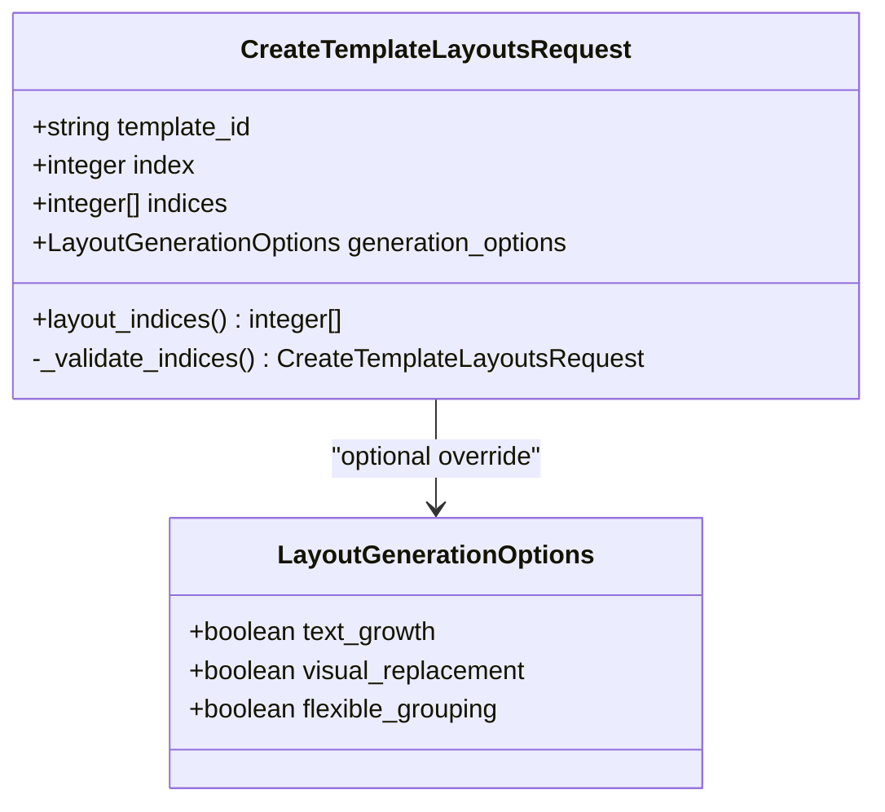
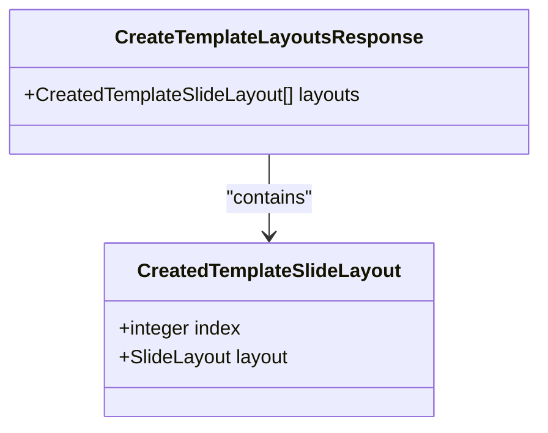
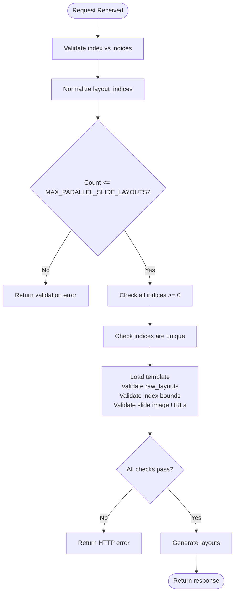
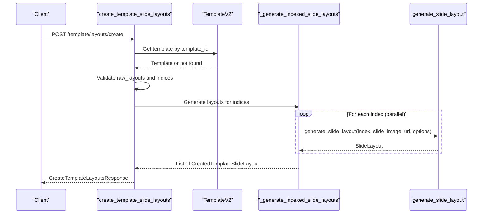
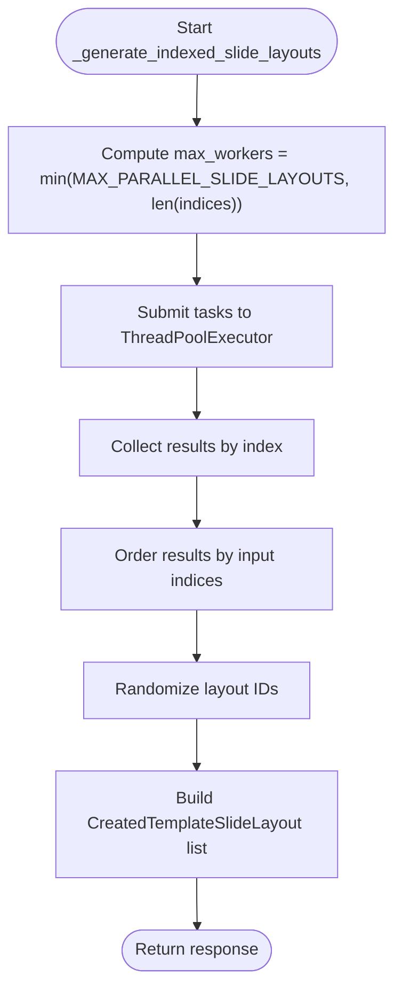
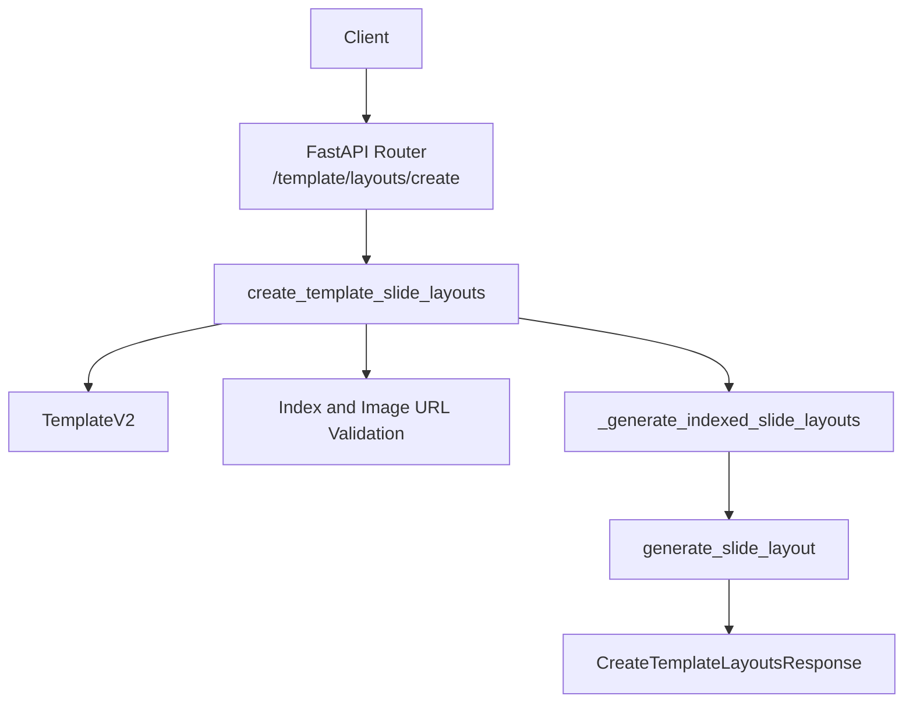

# Create Template Layouts

<cite>
**Referenced Files in This Document**
- [template.py](file://servers/fastapi/api/v1/ppt/endpoints/template.py)
- [generation.py](file://servers/fastapi/templates/v2/generation.py)
- [test_template_api.py](file://servers/fastapi/tests/unit/test_template_api.py)
- [test_template_generation_options.py](file://servers/fastapi/tests/unit/test_template_generation_options.py)
</cite>

## Table of Contents
1. [Introduction](#introduction)
2. [Endpoint Overview](#endpoint-overview)
3. [Request Model: CreateTemplateLayoutsRequest](#request-model-createtemplatelayoutsrequest)
4. [Response Model: CreatedTemplateSlideLayout and CreateTemplateLayoutsResponse](#response-model-createdtemplateslidelayout-and-createtemplatelayoutsresponse)
5. [Validation Rules](#validation-rules)
6. [Processing Flow](#processing-flow)
7. [Parallel Processing and MAX_PARALLEL_SLIDE_LAYOUTS](#parallel-processing-and-max_parallel_slide_layouts)
8. [Error Handling](#error-handling)
9. [Usage Examples](#usage-examples)
10. [Architecture Overview](#architecture-overview)
11. [Performance Considerations](#performance-considerations)
12. [Troubleshooting Guide](#troubleshooting-guide)
13. [Conclusion](#conclusion)

## Introduction
This document explains the CreateTemplateLayouts endpoint, which generates slide layouts from a template using either a single slide index or a batch of slide indices. It covers the request model, validation rules, response structure, parallel processing behavior, error handling, and practical usage examples.

## Endpoint Overview
The endpoint is defined under the templates router and exposes:
- HTTP method: POST
- Path: /template/layouts/create
- Request body: CreateTemplateLayoutsRequest
- Response body: CreateTemplateLayoutsResponse

It loads a template by template_id, validates that raw layout data exists, checks requested slide indices against available slides and slide image URLs, then generates one or more SlideLayout objects for the selected slides.

**Section sources**
- [template.py:1784-1866](file://servers/fastapi/api/v1/ppt/endpoints/template.py#L1784-L1866)

## Request Model: CreateTemplateLayoutsRequest
CreateTemplateLayoutsRequest supports two mutually exclusive ways to select slides:
- index: A single non-negative slide index.
- indices: An array of non-negative, unique slide indices.

Additional fields:
- template_id: The template identifier. It accepts both template_id and id due to an alias configuration.
- generation_options: Optional LayoutGenerationOptions used to override template defaults during layout generation.

Key behaviors:
- Either index or indices must be provided; providing both or neither is invalid.
- layout_indices returns a normalized list of indices derived from index or indices.
- Validation enforces non-negative values, uniqueness, and a maximum batch size.

**Diagram sources**
- [template.py:232-267](file://servers/fastapi/api/v1/ppt/endpoints/template.py#L232-L267)

**Section sources**
- [template.py:232-267](file://servers/fastapi/api/v1/ppt/endpoints/template.py#L232-L267)

## Response Model: CreatedTemplateSlideLayout and CreateTemplateLayoutsResponse
The endpoint returns a list of created layouts, each tied to its original slide index:
- CreatedTemplateSlideLayout:
  - index: Non-negative integer indicating the source slide index.
  - layout: The generated SlideLayout object.
- CreateTemplateLayoutsResponse:
  - layouts: Array of CreatedTemplateSlideLayout entries.

**Diagram sources**
- [template.py:270-276](file://servers/fastapi/api/v1/ppt/endpoints/template.py#L270-L276)

**Section sources**
- [template.py:270-276](file://servers/fastapi/api/v1/ppt/endpoints/template.py#L270-L276)

## Validation Rules
CreateTemplateLayoutsRequest performs these validations:
- Mutually exclusive selection:
  - If both index and indices are missing, validation fails.
  - If both index and indices are present, validation fails.
- At least one slide index is required after normalization.
- Batch size limit:
  - The number of indices cannot exceed MAX_PARALLEL_SLIDE_LAYOUTS.
- Index constraints:
  - All indices must be non-negative.
  - All indices must be unique.

At runtime, the endpoint also validates:
- The template exists.
- The template has usable raw_layouts.
- Each requested index is within bounds of raw_layouts.layouts.
- Each requested index has a valid slide image URL.

**Diagram sources**
- [template.py:240-259](file://servers/fastapi/api/v1/ppt/endpoints/template.py#L240-L259)
- [template.py:1792-1829](file://servers/fastapi/api/v1/ppt/endpoints/template.py#L1792-L1829)

**Section sources**
- [template.py:240-259](file://servers/fastapi/api/v1/ppt/endpoints/template.py#L240-L259)
- [template.py:1792-1829](file://servers/fastapi/api/v1/ppt/endpoints/template.py#L1792-L1829)

## Processing Flow
The endpoint follows this flow:
1. Load the template by template_id.
2. Require ownership and ensure raw_layouts exist.
3. Parse raw_layouts into RawSlideLayouts.
4. Validate requested indices against raw_layouts length.
5. Validate slide image URLs for requested indices.
6. Run layout generation for the selected indices in parallel.
7. Return CreatedTemplateSlideLayout entries with their corresponding SlideLayout objects.

**Diagram sources**
- [template.py:1784-1866](file://servers/fastapi/api/v1/ppt/endpoints/template.py#L1784-L1866)
- [template.py:1070-1109](file://servers/fastapi/api/v1/ppt/endpoints/template.py#L1070-L1109)

**Section sources**
- [template.py:1784-1866](file://servers/fastapi/api/v1/ppt/endpoints/template.py#L1784-L1866)
- [template.py:1070-1109](file://servers/fastapi/api/v1/ppt/endpoints/template.py#L1070-L1109)

## Parallel Processing and MAX_PARALLEL_SLIDE_LAYOUTS
Layout generation uses a thread pool executor to process multiple slide layouts concurrently:
- Worker count is capped by min(MAX_PARALLEL_SLIDE_LAYOUTS, number_of_requested_indices).
- Each worker calls generate_slide_layout for a specific index and slide image URL.
- Results are collected by index and returned in the same order as the input indices.

MAX_PARALLEL_SLIDE_LAYOUTS is defined in the generation module and limits concurrency to protect system resources.

**Diagram sources**
- [template.py:1070-1109](file://servers/fastapi/api/v1/ppt/endpoints/template.py#L1070-L1109)
- [generation.py:47-48](file://servers/fastapi/templates/v2/generation.py#L47-L48)

**Section sources**
- [template.py:1070-1109](file://servers/fastapi/api/v1/ppt/endpoints/template.py#L1070-L1109)
- [generation.py:47-48](file://servers/fastapi/templates/v2/generation.py#L47-L48)

## Error Handling
Common errors include:
- Missing or invalid request payload:
  - Neither index nor indices provided.
  - Both index and indices provided.
  - Indices empty after normalization.
  - Indices exceed MAX_PARALLEL_SLIDE_LAYOUTS.
  - Negative or duplicate indices.
- Template issues:
  - Template not found.
  - Template raw layouts unavailable or invalid.
- Slide index issues:
  - Index out of bounds.
  - Missing or invalid slide image URL for the requested index.
- Generation issues:
  - Generated output fails schema validation.

Status codes:
- 400: Invalid request or invalid slide index/slide image URL.
- 404: Template not found.
- 422: Pydantic validation failure (for example, invalid generation_options types).
- 500: Internal server error when raw layouts are invalid or generated output is invalid.

**Section sources**
- [template.py:240-259](file://servers/fastapi/api/v1/ppt/endpoints/template.py#L240-L259)
- [template.py:1792-1857](file://servers/fastapi/api/v1/ppt/endpoints/template.py#L1792-L1857)
- [test_template_generation_options.py:194-201](file://servers/fastapi/tests/unit/test_template_generation_options.py#L194-L201)

## Usage Examples
Single slide index:
- Use index to generate a layout for one slide.
- Example payload shape:
  - template_id: string
  - index: integer
  - generation_options: optional object

Batch slide indices:
- Use indices to generate layouts for multiple slides at once.
- Example payload shape:
  - template_id: string
  - indices: array of integers
  - generation_options: optional object

Notes:
- Ensure indices are within the range of available slides.
- Ensure each requested index has a valid slide image URL.
- Keep the number of indices at or below MAX_PARALLEL_SLIDE_LAYOUTS.

**Section sources**
- [template.py:232-267](file://servers/fastapi/api/v1/ppt/endpoints/template.py#L232-L267)
- [template.py:1784-1866](file://servers/fastapi/api/v1/ppt/endpoints/template.py#L1784-L1866)

## Architecture Overview
The CreateTemplateLayouts endpoint integrates several components:
- FastAPI router defines the endpoint and request/response models.
- Template service logic loads and validates template data.
- Generation utilities perform parallel slide layout creation.
- Tests validate behavior and error conditions.

**Diagram sources**
- [template.py:1784-1866](file://servers/fastapi/api/v1/ppt/endpoints/template.py#L1784-L1866)
- [template.py:1070-1109](file://servers/fastapi/api/v1/ppt/endpoints/template.py#L1070-L1109)

## Performance Considerations
- Concurrency control:
  - MAX_PARALLEL_SLIDE_LAYOUTS caps parallel work to avoid resource exhaustion.
- Ordering guarantees:
  - Output preserves the input index order even though workers complete asynchronously.
- Idempotency:
  - Layout IDs are randomized to ensure uniqueness across generated layouts.
- Resource usage:
  - Large batches increase memory and CPU usage; prefer smaller batches if needed.

[No sources needed since this section provides general guidance]

## Troubleshooting Guide
Symptoms and resolutions:
- Error: “Either index or indices is required”
  - Cause: Missing selection field.
  - Resolution: Provide exactly one of index or indices.
- Error: “Use either index or indices, not both”
  - Cause: Both fields provided.
  - Resolution: Remove one of them.
- Error: “At most N slide layouts can be created at once”
  - Cause: Too many indices.
  - Resolution: Reduce the number of indices to N or fewer.
- Error: “Slide indices must be non-negative”
  - Cause: Negative index value.
  - Resolution: Use zero-based positive indices.
- Error: “Slide indices must be unique”
  - Cause: Duplicate indices.
  - Resolution: Remove duplicates.
- Error: “Invalid slide index”
  - Cause: Index out of bounds.
  - Resolution: Verify the index is less than the number of slides.
- Error: “Slide image URL is unavailable for requested slide index”
  - Cause: Missing or null slide image URL for the index.
  - Resolution: Ensure slide images are uploaded and indexed correctly.
- Error: “Template not found”
  - Cause: Invalid template_id.
  - Resolution: Confirm the template exists and you have access.
- Error: “Template raw layouts are unavailable” or “invalid”
  - Cause: Template lacks usable raw_layouts or they are malformed.
  - Resolution: Reinitialize or repair the template’s raw layouts.

**Section sources**
- [template.py:240-259](file://servers/fastapi/api/v1/ppt/endpoints/template.py#L240-L259)
- [template.py:1792-1857](file://servers/fastapi/api/v1/ppt/endpoints/template.py#L1792-L1857)

## Conclusion
The CreateTemplateLayouts endpoint provides a robust way to generate slide layouts from templates using either a single index or a batch of indices. It enforces strict validation, supports controlled parallel processing, and returns structured responses tied to original slide indices. Proper use of index versus indices, adherence to MAX_PARALLEL_SLIDE_LAYOUTS, and ensuring valid slide image URLs are essential for successful operations.

[No sources needed since this section summarizes without analyzing specific files]