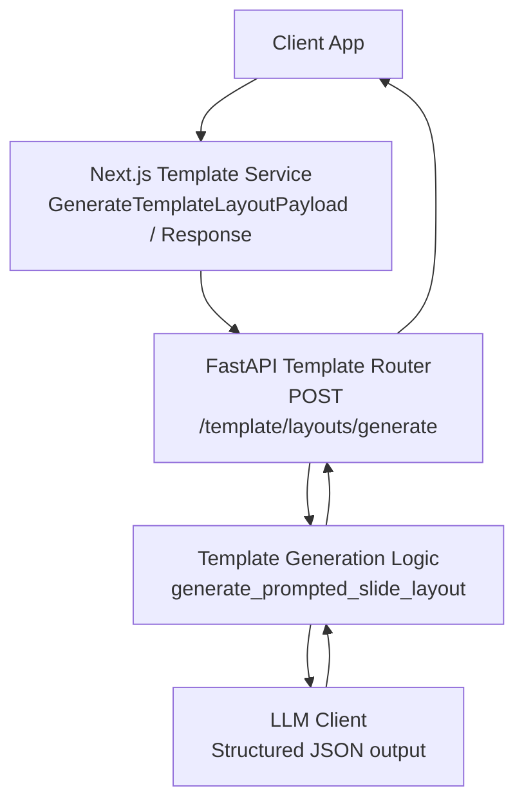
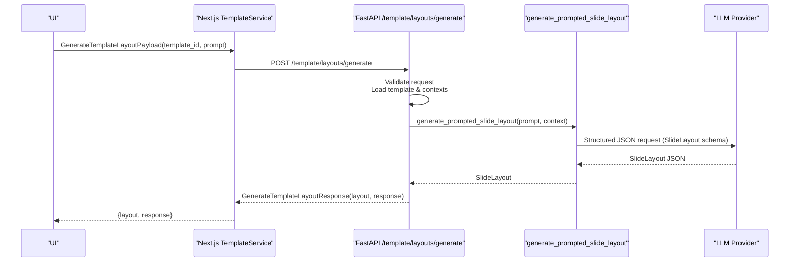
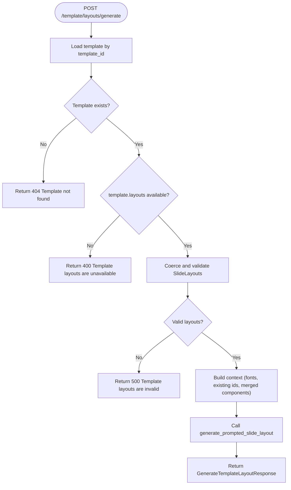
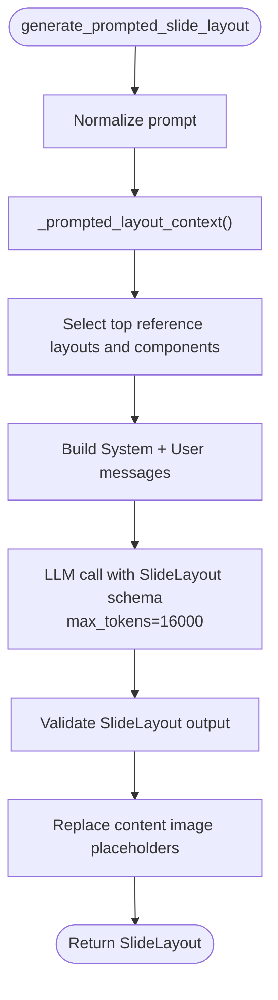
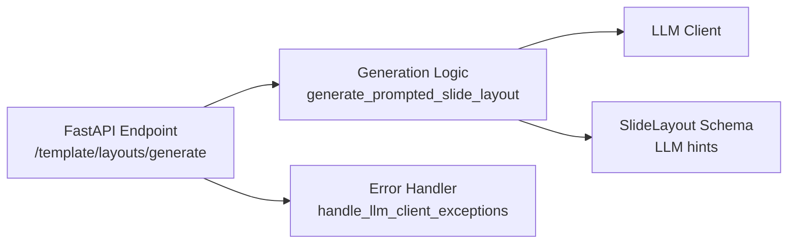

# Generate Template Layout

<cite>
**Referenced Files in This Document**
- [template.py](file://servers/fastapi/api/v1/ppt/endpoints/template.py)
- [generation.py](file://servers/fastapi/templates/v2/generation.py)
- [llm_client_error_handler.py](file://servers/fastapi/utils/llm_client_error_handler.py)
- [layouts.py](file://servers/fastapi/templates/v2/models/layouts.py)
- [test_template_api.py](file://servers/fastapi/tests/unit/test_template_api.py)
- [template.ts](file://servers/nextjs/app/(presentation-generator)/services/api/template.ts)
</cite>

## Table of Contents
1. [Introduction](#introduction)
2. [Project Structure](#project-structure)
3. [Core Components](#core-components)
4. [Architecture Overview](#architecture-overview)
5. [Detailed Component Analysis](#detailed-component-analysis)
6. [Dependency Analysis](#dependency-analysis)
7. [Performance Considerations](#performance-considerations)
8. [Troubleshooting Guide](#troubleshooting-guide)
9. [Conclusion](#conclusion)

## Introduction
This document explains the GenerateTemplateLayout endpoint that creates AI-powered slide layouts from natural language prompts. It covers the request and response models, validation rules, how LLM services are used to generate layout structures, token limits, error handling, and example prompts for different layout types.

## Project Structure
The feature spans FastAPI endpoints, template generation logic, LLM client error handling, and a Next.js service layer:

**Diagram sources**
- [template.ts:90-98](file://servers/nextjs/app/(presentation-generator)/services/api/template.ts#L90-L98)
- [template.py:1695-1781](file://servers/fastapi/api/v1/ppt/endpoints/template.py#L1695-L1781)
- [generation.py:631-693](file://servers/fastapi/templates/v2/generation.py#L631-L693)

**Section sources**
- [template.py:1695-1781](file://servers/fastapi/api/v1/ppt/endpoints/template.py#L1695-L1781)
- [template.ts:90-98](file://servers/nextjs/app/(presentation-generator)/services/api/template.ts#L90-L98)

## Core Components
- Endpoint: POST /template/layouts/generate
- Request model: GenerateTemplateLayoutRequest
- Response model: GenerateTemplateLayoutResponse
- Generation function: generate_prompted_slide_layout
- Token limit constant: SLIDE_LAYOUT_GENERATION_MAX_TOKENS
- Error handler: handle_llm_client_exceptions

Key responsibilities:
- Validate and normalize inputs (template_id, prompt).
- Load template context (existing layouts, merged components, fonts).
- Call LLM with structured schema to produce a SlideLayout.
- Return both the generated layout and a user-facing response text.

**Section sources**
- [template.py:279-298](file://servers/fastapi/api/v1/ppt/endpoints/template.py#L279-L298)
- [template.py:1695-1781](file://servers/fastapi/api/v1/ppt/endpoints/template.py#L1695-L1781)
- [generation.py:631-693](file://servers/fastapi/templates/v2/generation.py#L631-L693)
- [template.py:95-100](file://servers/fastapi/api/v1/ppt/endpoints/template.py#L95-L100)
- [llm_client_error_handler.py:35-76](file://servers/fastapi/utils/llm_client_error_handler.py#L35-L76)

## Architecture Overview
The endpoint orchestrates template retrieval, context preparation, and LLM-based layout generation. The Next.js service layer exposes typed payloads and responses for the UI.

**Diagram sources**
- [template.ts:90-98](file://servers/nextjs/app/(presentation-generator)/services/api/template.ts#L90-L98)
- [template.py:1695-1781](file://servers/fastapi/api/v1/ppt/endpoints/template.py#L1695-L1781)
- [generation.py:631-693](file://servers/fastapi/templates/v2/generation.py#L631-L693)

## Detailed Component Analysis

### GenerateTemplateLayoutRequest
- Fields:
  - template_id: string; accepts alias id; trimmed and validated non-empty.
  - prompt: string; min length 1, max length 8000; trimmed and validated non-empty.
- Validation behavior:
  - Normalizes whitespace on both fields.
  - Rejects empty values after trimming.
  - Enforces prompt length cap at 8000 characters.

Examples of valid requests:
- Minimal: template_id set, short prompt describing a title slide.
- Rich: template_id set, detailed prompt including content structure and style hints.

Validation tests confirm normalization and required-field behavior.

**Section sources**
- [template.py:279-293](file://servers/fastapi/api/v1/ppt/endpoints/template.py#L279-L293)
- [test_template_api.py:1346-1353](file://servers/fastapi/tests/unit/test_template_api.py#L1346-L1353)

### GenerateTemplateLayoutResponse
- Fields:
  - layout: SlideLayout object produced by the LLM pipeline.
  - response: human-readable confirmation text referencing the generated layout id.

The response is constructed after successful generation and includes a friendly message.

**Section sources**
- [template.py:296-298](file://servers/fastapi/api/v1/ppt/endpoints/template.py#L296-L298)
- [template.py:1775-1781](file://servers/fastapi/api/v1/ppt/endpoints/template.py#L1775-L1781)

### Endpoint Flow: POST /template/layouts/generate
Responsibilities:
- Verify template exists.
- Ensure template.layouts is available.
- Coerce stored layouts into SlideLayouts and validate them.
- Optionally load merged_components if present.
- Run generation in a background-safe thread via _run_template_generation_thread.
- Wrap LLM-related errors using handle_llm_client_exceptions.
- Return GenerateTemplateLayoutResponse.

Error handling highlights:
- Missing template: 404.
- Missing layouts: 400 with “Template layouts are unavailable”.
- Invalid stored layouts: 500 with “Template layouts are invalid”.
- LLM failures: normalized HTTPException via handle_llm_client_exceptions.

**Diagram sources**
- [template.py:1695-1781](file://servers/fastapi/api/v1/ppt/endpoints/template.py#L1695-L1781)

**Section sources**
- [template.py:1695-1781](file://servers/fastapi/api/v1/ppt/endpoints/template.py#L1695-L1781)

### LLM Integration and Prompt Context
How the endpoint uses LLM services:
- generate_prompted_slide_layout builds a system prompt and a user message containing:
  - The normalized user prompt.
  - A template context including name, description, font families, existing layout ids, selected reference layouts, and reusable components.
- The LLM call returns structured JSON matching the SlideLayout schema.
- Output is validated against SlideLayout and post-processed (for example, replacing placeholder image URLs).

Token limits:
- The generation function sets max_tokens=16000 when calling the LLM.
- There is also a module-level constant SLIDE_LAYOUT_GENERATION_MAX_TOKENS = 16000 used elsewhere in the template router.

Context sizing:
- The context is pruned to stay under PROMPTED_LAYOUT_MAX_CONTEXT_CHARS by dropping reusable components and then reference layouts.

**Diagram sources**
- [generation.py:631-693](file://servers/fastapi/templates/v2/generation.py#L631-L693)
- [generation.py:696-775](file://servers/fastapi/templates/v2/generation.py#L696-L775)
- [template.py:95-100](file://servers/fastapi/api/v1/ppt/endpoints/template.py#L95-L100)

**Section sources**
- [generation.py:631-693](file://servers/fastapi/templates/v2/generation.py#L631-L693)
- [generation.py:696-775](file://servers/fastapi/templates/v2/generation.py#L696-L775)
- [template.py:95-100](file://servers/fastapi/api/v1/ppt/endpoints/template.py#L95-L100)

### SlideLayout Model and LLM Schema Hints
- SlideLayout is the canonical output type for generated layouts.
- LLM-only length hints are applied to the output schema:
  - id: minLength 1, maxLength 80
  - description: minLength 10, maxLength 300
- These hints guide the LLM but do not alter runtime model validation.

**Section sources**
- [layouts.py:796-806](file://servers/fastapi/templates/v2/models/layouts.py#L796-L806)
- [test_template_layout_length_hints.py:52-66](file://servers/fastapi/tests/unit/test_template_layout_length_hints.py#L52-L66)

### Example Prompts for Different Layout Types
Use clear, descriptive prompts that specify the intended slide purpose and key elements. Examples:
- Title slide: “Create a title slide with a large centered title area and a subtitle below it.”
- Content slide: “Create a two-column content slide with a left heading and right bullet list.”
- Image gallery: “Create an image gallery layout with three equal-width image slots and a caption row beneath each image.”

These examples illustrate how to describe layout intent so the LLM can select or compose appropriate components.

[No sources needed since this section provides general guidance]

### Next.js Service Layer Contract
The Next.js TemplateService defines:
- GenerateTemplateLayoutPayload: template_id, prompt
- GenerateTemplateLayoutResponse: layout, response

This mirrors the FastAPI contract and is used by the UI to call the backend and render results.

**Section sources**
- [template.ts:90-98](file://servers/nextjs/app/(presentation-generator)/services/api/template.ts#L90-L98)

## Dependency Analysis
High-level dependencies:
- FastAPI endpoint depends on:
  - Template generation logic (generate_prompted_slide_layout).
  - LLM client configuration and provider selection.
  - Error normalization (handle_llm_client_exceptions).
- Generation logic depends on:
  - LLM client and model selection.
  - SlideLayout schema and LLM-only hints.
  - Context building utilities for selecting reference layouts and components.

**Diagram sources**
- [template.py:1695-1781](file://servers/fastapi/api/v1/ppt/endpoints/template.py#L1695-L1781)
- [generation.py:631-693](file://servers/fastapi/templates/v2/generation.py#L631-L693)
- [llm_client_error_handler.py:35-76](file://servers/fastapi/utils/llm_client_error_handler.py#L35-L76)
- [layouts.py:796-806](file://servers/fastapi/templates/v2/models/layouts.py#L796-L806)

**Section sources**
- [template.py:1695-1781](file://servers/fastapi/api/v1/ppt/endpoints/template.py#L1695-L1781)
- [generation.py:631-693](file://servers/fastapi/templates/v2/generation.py#L631-L693)
- [llm_client_error_handler.py:35-76](file://servers/fastapi/utils/llm_client_error_handler.py#L35-L76)
- [layouts.py:796-806](file://servers/fastapi/templates/v2/models/layouts.py#L796-L806)

## Performance Considerations
- Token budget:
  - The generation function uses max_tokens=16000 for LLM calls.
  - The constant SLIDE_LAYOUT_GENERATION_MAX_TOKENS equals 16000 and is used elsewhere in the template router.
- Context size control:
  - The context payload is pruned to remain under PROMPTED_LAYOUT_MAX_CONTEXT_CHARS by removing reusable components first, then reference layouts.
- Validation retries:
  - The LLM call uses validation retries to improve robustness against malformed outputs.

Recommendations:
- Keep prompts concise and focused to reduce context pressure.
- Avoid overly long descriptions in prompts; rely on clear structural cues.
- Monitor LLM provider quotas and latency; consider caching repeated template contexts where appropriate.

**Section sources**
- [generation.py:631-693](file://servers/fastapi/templates/v2/generation.py#L631-L693)
- [generation.py:696-775](file://servers/fastapi/templates/v2/generation.py#L696-L775)
- [template.py:95-100](file://servers/fastapi/api/v1/ppt/endpoints/template.py#L95-L100)

## Troubleshooting Guide
Common issues and resolutions:
- Empty or whitespace-only prompt:
  - Cause: Prompt validation rejects empty strings after trimming.
  - Resolution: Provide a non-empty, meaningful prompt.
- Prompt exceeds 8000 characters:
  - Cause: Field validation enforces max_length=8000.
  - Resolution: Shorten the prompt while preserving essential details.
- Template not found:
  - Cause: template_id does not exist.
  - Resolution: Verify the template_id and ensure the template is accessible.
- Template layouts are unavailable:
  - Cause: template.layouts is None.
  - Resolution: Initialize or update the template’s layouts before generating.
- Template layouts are invalid:
  - Cause: Stored layouts fail coercion/validation.
  - Resolution: Repair template data or regenerate layouts.
- LLM service failures:
  - Behavior: Exceptions are normalized via handle_llm_client_exceptions into HTTPException with provider-aware messages.
  - Resolution: Check provider credentials, quotas, and network connectivity; retry after transient errors.

**Section sources**
- [template.py:279-293](file://servers/fastapi/api/v1/ppt/endpoints/template.py#L279-L293)
- [template.py:1695-1781](file://servers/fastapi/api/v1/ppt/endpoints/template.py#L1695-L1781)
- [llm_client_error_handler.py:35-76](file://servers/fastapi/utils/llm_client_error_handler.py#L35-L76)

## Conclusion
The GenerateTemplateLayout endpoint transforms natural language prompts into structured SlideLayout objects by leveraging LLM services with strict schema validation and controlled context sizes. It enforces input constraints (including a maximum prompt length of 8000 characters), returns both the generated layout and a user-friendly response, and normalizes LLM-related errors for consistent client handling. Use clear, concise prompts to achieve reliable layout generation across title slides, content slides, and image galleries.