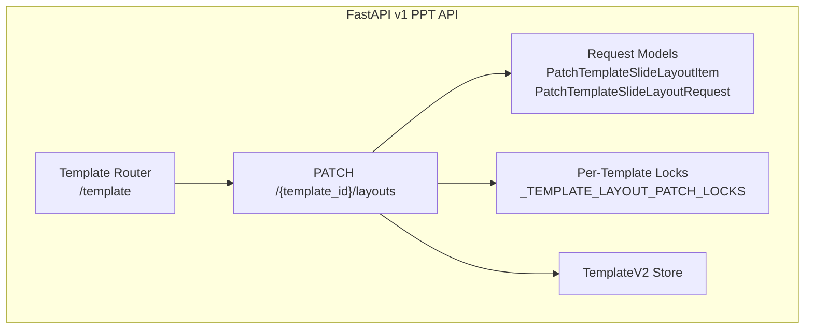
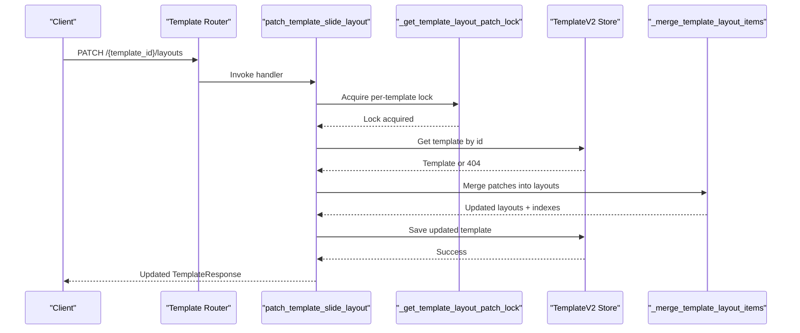
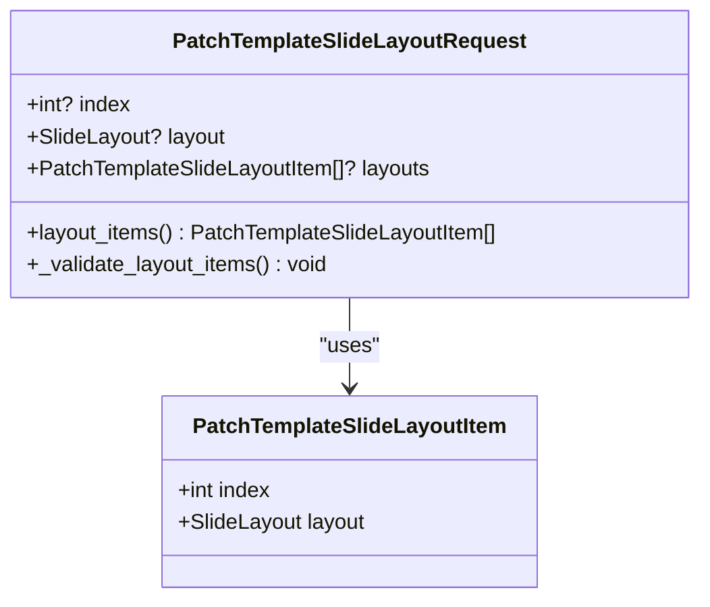
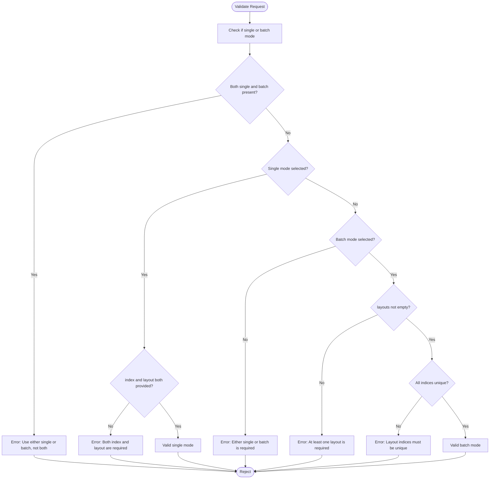
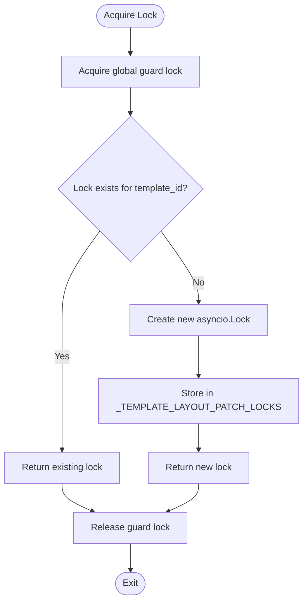
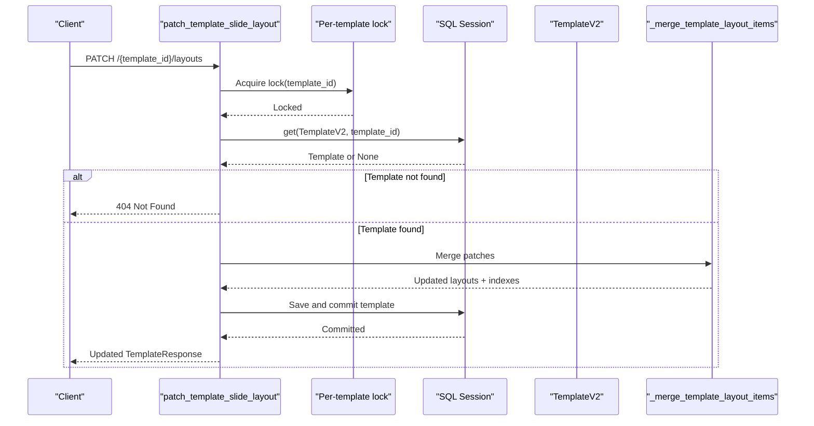
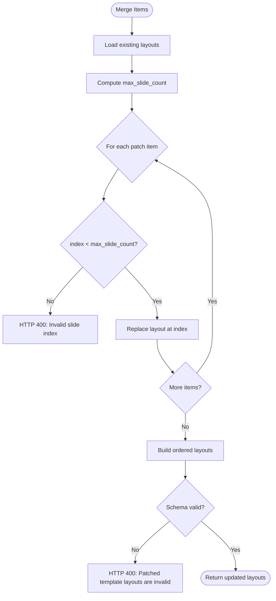
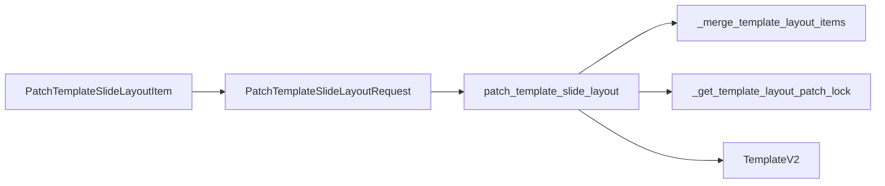

# Patch Template Slide Layout

<cite>
**Referenced Files in This Document**
- [template.py](file://servers/fastapi/api/v1/ppt/endpoints/template.py)
- [test_template_api.py](file://servers/fastapi/tests/unit/test_template_api.py)
</cite>

## Table of Contents
1. [Introduction](#introduction)
2. [Project Structure](#project-structure)
3. [Core Components](#core-components)
4. [Architecture Overview](#architecture-overview)
5. [Detailed Component Analysis](#detailed-component-analysis)
6. [Dependency Analysis](#dependency-analysis)
7. [Performance Considerations](#performance-considerations)
8. [Troubleshooting Guide](#troubleshooting-guide)
9. [Conclusion](#conclusion)

## Introduction
This document explains the `PatchTemplateSlideLayout` endpoint used to update existing slide layouts in a template. It covers:

- The request model supporting both single layout updates and batch updates.
- The item structure for each patch operation.
- Validation rules ensuring mutually exclusive modes and unique indices.
- Thread safety using per-template locks for concurrent access protection.
- Error handling for invalid indices, duplicate indices, and invalid layout structures.
- Practical examples for updating one slide layout and for bulk updating multiple slides.

## Project Structure
The endpoint and its models live in the FastAPI template router under the v1 PPT API. The relevant implementation is in the template endpoints file, with unit tests validating behavior.

**Diagram sources**
- [template.py:95-98](file://servers/fastapi/api/v1/ppt/endpoints/template.py#L95-L98)
- [template.py:1924-1971](file://servers/fastapi/api/v1/ppt/endpoints/template.py#L1924-L1971)

**Section sources**
- [template.py:95-98](file://servers/fastapi/api/v1/ppt/endpoints/template.py#L95-L98)
- [template.py:1924-1971](file://servers/fastapi/api/v1/ppt/endpoints/template.py#L1924-L1971)

## Core Components
- `PatchTemplateSlideLayoutItem`: Represents one patch entry with an index and a new layout.
- `PatchTemplateSlideLayoutRequest`: Supports either:
  - Single mode: provide `index` and `layout`.
  - Batch mode: provide `layouts`, an array of `PatchTemplateSlideLayoutItem`.
- `_merge_template_layout_items`: Merges incoming patches into the template’s stored layouts, validates indices, and reconstructs ordered layouts.
- Per-template concurrency lock: `_get_template_layout_patch_lock` ensures only one patch operation runs concurrently per template.

Key responsibilities:
- Validate that exactly one mode is used (single or batch).
- Enforce non-negative indices and uniqueness within a batch.
- Reject out-of-range indices against the effective slide count.
- Update template layouts and related assets atomically under a lock.

**Section sources**
- [template.py:301-340](file://servers/fastapi/api/v1/ppt/endpoints/template.py#L301-L340)
- [template.py:1030-1067](file://servers/fastapi/api/v1/ppt/endpoints/template.py#L1030-L1067)
- [template.py:915-921](file://servers/fastapi/api/v1/ppt/endpoints/template.py#L915-L921)

## Architecture Overview
The endpoint performs these steps:

1. Resolve a per-template lock to serialize concurrent patch operations.
2. Load the template from the database.
3. Merge and validate the requested layout patches.
4. Update template layouts and asset metadata (including icon type hints).
5. Persist changes and return the updated template.

**Diagram sources**
- [template.py:915-921](file://servers/fastapi/api/v1/ppt/endpoints/template.py#L915-L921)
- [template.py:1924-1971](file://servers/fastapi/api/v1/ppt/endpoints/template.py#L1924-L1971)
- [template.py:1030-1067](file://servers/fastapi/api/v1/ppt/endpoints/template.py#L1030-L1067)

## Detailed Component Analysis

### Request Model: PatchTemplateSlideLayoutRequest
Supports two mutually exclusive input shapes:

- Single layout update:
  - Provide `index` and `layout`.
- Batch layout update:
  - Provide `layouts`, an array of `PatchTemplateSlideLayoutItem`.

Validation rules:
- Exactly one mode must be provided; mixing single fields and batch array is rejected.
- In single mode, both `index` and `layout` are required.
- In batch mode, at least one item is required.
- All indices in a batch must be unique.
- Non-negative indices are enforced at the field level.

Utility:
- `layout_items` normalizes either single or batch input into a list of `PatchTemplateSlideLayoutItem` for downstream processing.

**Diagram sources**
- [template.py:301-340](file://servers/fastapi/api/v1/ppt/endpoints/template.py#L301-L340)

**Section sources**
- [template.py:301-340](file://servers/fastapi/api/v1/ppt/endpoints/template.py#L301-L340)

### Validation Logic Flow
The validation logic enforces mutual exclusivity and completeness:

**Diagram sources**
- [template.py:311-327](file://servers/fastapi/api/v1/ppt/endpoints/template.py#L311-L327)

**Section sources**
- [template.py:311-327](file://servers/fastapi/api/v1/ppt/endpoints/template.py#L311-L327)

### Concurrency Control: _TEMPLATE_LAYOUT_PATCH_LOCKS
To prevent concurrent modifications to the same template’s layouts:

- A global dictionary `_TEMPLATE_LAYOUT_PATCH_LOCKS` maps template IDs to asyncio locks.
- `_get_template_layout_patch_lock` lazily creates a lock per template ID under a guard lock.
- The endpoint acquires the per-template lock before reading or writing template data.

**Diagram sources**
- [template.py:97-98](file://servers/fastapi/api/v1/ppt/endpoints/template.py#L97-L98)
- [template.py:915-921](file://servers/fastapi/api/v1/ppt/endpoints/template.py#L915-L921)

**Section sources**
- [template.py:97-98](file://servers/fastapi/api/v1/ppt/endpoints/template.py#L97-L98)
- [template.py:915-921](file://servers/fastapi/api/v1/ppt/endpoints/template.py#L915-L921)

### Endpoint Implementation: patch_template_slide_layout
The endpoint:

- Resolves and acquires the per-template lock.
- Loads the template by ID and checks existence.
- Merges the requested patches via `_merge_template_layout_items`.
- Updates template layouts and asset metadata (including icon type hints).
- Persists changes and returns the updated template.

**Diagram sources**
- [template.py:1924-1971](file://servers/fastapi/api/v1/ppt/endpoints/template.py#L1924-L1971)
- [template.py:1030-1067](file://servers/fastapi/api/v1/ppt/endpoints/template.py#L1030-L1067)

**Section sources**
- [template.py:1924-1971](file://servers/fastapi/api/v1/ppt/endpoints/template.py#L1924-L1971)

### Layout Merging and Index Validation: _merge_template_layout_items
Responsibilities:

- Coerce existing template layouts.
- Determine effective slide count from raw layouts and stored layouts.
- Validate each patch index against the maximum allowed slide count.
- Replace layouts at specified indices.
- Reconstruct ordered layouts and validate final structure.

Errors:

- Invalid slide index: when an index is equal to or beyond the effective slide count.
- Invalid patched layouts: when the reconstructed layouts fail schema validation.

**Diagram sources**
- [template.py:1030-1067](file://servers/fastapi/api/v1/ppt/endpoints/template.py#L1030-L1067)

**Section sources**
- [template.py:1030-1067](file://servers/fastapi/api/v1/ppt/endpoints/template.py#L1030-L1067)

### Usage Examples

#### Updating a Single Slide Layout
Use single mode by providing `index` and `layout`:

- Request body includes:
  - `index`: zero-based index of the slide to update.
  - `layout`: the new layout object for that slide.

Behavior:
- Validates that both fields are present.
- Normalizes to a single-item list internally.
- Applies the patch under the per-template lock.

Example payload shape:
- `{ "index": 2, "layout": { ... } }`

#### Performing Bulk Updates Across Multiple Slides
Use batch mode by providing `layouts`:

- Request body includes:
  - `layouts`: array of `{ "index": number, "layout": object }`.

Constraints:
- At least one item is required.
- All indices must be unique within the batch.
- Each index must be less than the effective slide count.

Example payload shape:
- `{ "layouts": [ { "index": 0, "layout": { ... } }, { "index": 3, "layout": { ... } } ] }`

**Section sources**
- [template.py:301-340](file://servers/fastapi/api/v1/ppt/endpoints/template.py#L301-L340)
- [template.py:1030-1067](file://servers/fastapi/api/v1/ppt/endpoints/template.py#L1030-L1067)
- [template.py:1924-1971](file://servers/fastapi/api/v1/ppt/endpoints/template.py#L1924-L1971)

## Dependency Analysis
- The endpoint depends on:
  - Pydantic models for request validation.
  - SQLAlchemy async session for template persistence.
  - Template V2 model for storage.
  - Internal helpers for merging layouts and computing icon types.
- Concurrency control uses asyncio locks keyed by template ID.

**Diagram sources**
- [template.py:301-340](file://servers/fastapi/api/v1/ppt/endpoints/template.py#L301-L340)
- [template.py:915-921](file://servers/fastapi/api/v1/ppt/endpoints/template.py#L915-L921)
- [template.py:1030-1067](file://servers/fastapi/api/v1/ppt/endpoints/template.py#L1030-L1067)
- [template.py:1924-1971](file://servers/fastapi/api/v1/ppt/endpoints/template.py#L1924-L1971)

**Section sources**
- [template.py:301-340](file://servers/fastapi/api/v1/ppt/endpoints/template.py#L301-L340)
- [template.py:915-921](file://servers/fastapi/api/v1/ppt/endpoints/template.py#L915-L921)
- [template.py:1030-1067](file://servers/fastapi/api/v1/ppt/endpoints/template.py#L1030-L1067)
- [template.py:1924-1971](file://servers/fastapi/api/v1/ppt/endpoints/template.py#L1924-L1971)

## Performance Considerations
- Per-template locking serializes patch operations for the same template, preventing race conditions but potentially increasing latency under high contention.
- Layout merging is lightweight and operates in memory; it avoids unnecessary recomputation by replacing only the specified indices.
- Icon type hints are derived from the updated layouts and stored in template assets, which can improve downstream UI rendering decisions without extra queries.

[No sources needed since this section provides general guidance]

## Troubleshooting Guide

Common errors and their causes:

- Mixing single and batch inputs:
  - Cause: Providing both `index`/`layout` and `layouts` in the same request.
  - Resolution: Choose either single mode or batch mode.

- Missing required fields in single mode:
  - Cause: Only one of `index` or `layout` is provided.
  - Resolution: Provide both fields together.

- Empty batch:
  - Cause: `layouts` is an empty array.
  - Resolution: Include at least one layout item.

- Duplicate indices in batch:
  - Cause: Two or more items share the same index.
  - Resolution: Ensure all indices are unique.

- Invalid slide index:
  - Cause: An index equals or exceeds the effective slide count.
  - Resolution: Use a zero-based index strictly less than the total number of slides.

- Invalid patched layouts:
  - Cause: The merged layouts fail schema validation.
  - Resolution: Validate the layout structure according to the expected schema.

- Template not found:
  - Cause: The template ID does not exist.
  - Resolution: Verify the template ID and ensure it belongs to the current owner.

Relevant test coverage:
- Tests verify successful updates, icon type derivation from layouts, handling of out-of-order initialization saves, and rejection of invalid indices.

**Section sources**
- [template.py:311-327](file://servers/fastapi/api/v1/ppt/endpoints/template.py#L311-L327)
- [template.py:1030-1067](file://servers/fastapi/api/v1/ppt/endpoints/template.py#L1030-L1067)
- [template.py:1924-1971](file://servers/fastapi/api/v1/ppt/endpoints/template.py#L1924-L1971)
- [test_template_api.py:1437-1566](file://servers/fastapi/tests/unit/test_template_api.py#L1437-L1566)

## Conclusion
The `PatchTemplateSlideLayout` endpoint provides a robust mechanism for updating slide layouts in templates, supporting both single and batch operations with strict validation and thread-safe concurrency control. By enforcing mutual exclusivity between modes, requiring complete inputs, ensuring unique indices, and validating slide ranges, it maintains data integrity while allowing efficient bulk updates. The per-template lock guarantees safe concurrent access, and comprehensive error handling guides clients to correct malformed requests.

[No sources needed since this section summarizes without analyzing specific files]