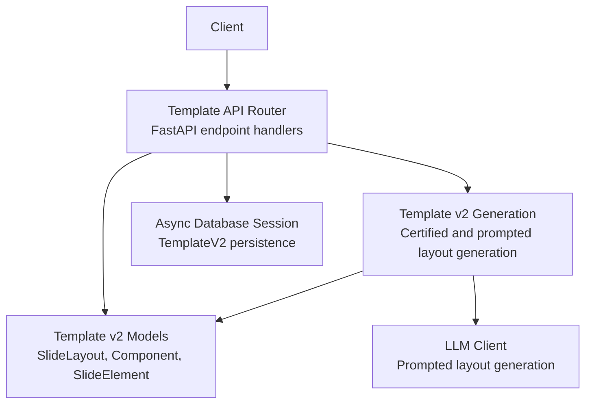
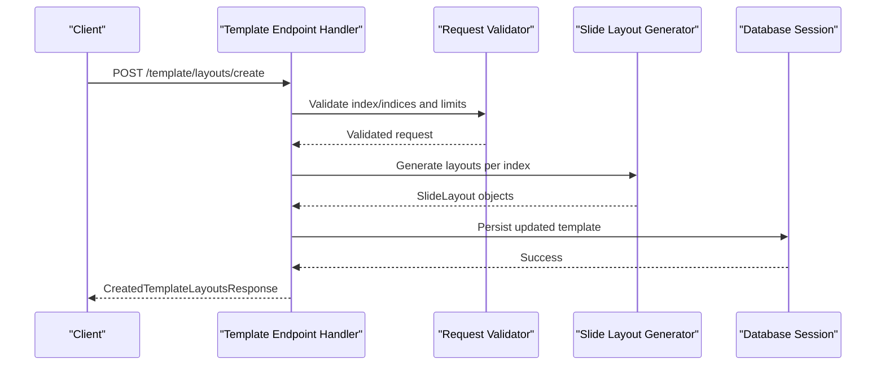
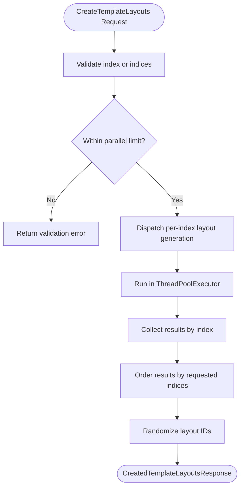
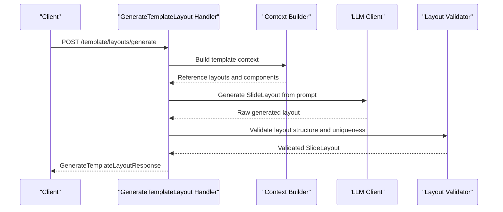
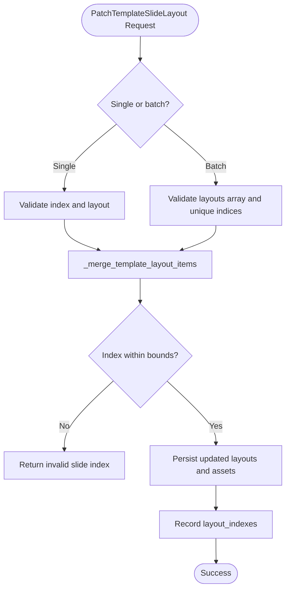
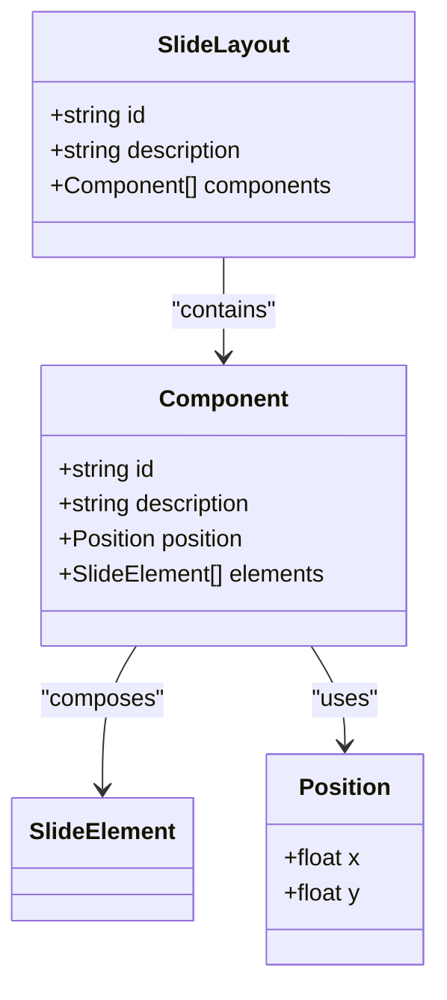
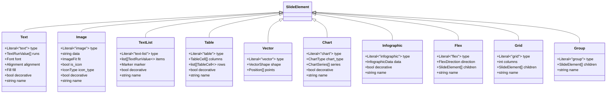
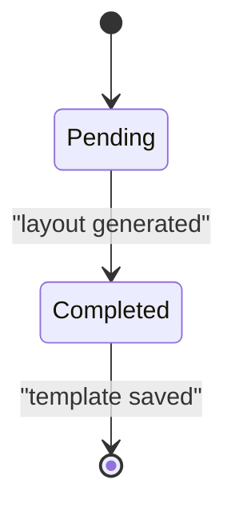
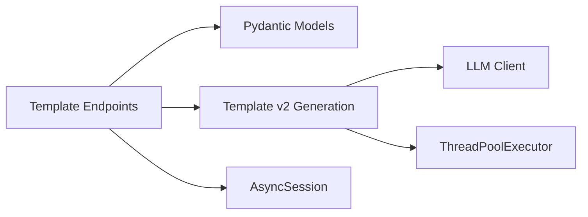

# Template Layout Management

<cite>
**Referenced Files in This Document**   
- [template.py](file://servers/fastapi/api/v1/ppt/endpoints/template.py)
- [generation.py](file://servers/fastapi/templates/v2/generation.py)
- [layouts.py](file://servers/fastapi/templates/v2/models/layouts.py)
- [elements.py](file://servers/fastapi/templates/v2/models/elements.py)
- [schema.py](file://servers/fastapi/templates/v2/schema.py)
- [slide_layout_index.py](file://servers/fastapi/models/slide_layout_index.py)
- [test_template_api.py](file://servers/fastapi/tests/unit/test_template_api.py)
</cite>

## Table of Contents
1. [Introduction](#introduction)
2. [Project Structure](#project-structure)
3. [Core Components](#core-components)
4. [Architecture Overview](#architecture-overview)
5. [Detailed Component Analysis](#detailed-component-analysis)
6. [Dependency Analysis](#dependency-analysis)
7. [Performance Considerations](#performance-considerations)
8. [Troubleshooting Guide](#troubleshooting-guide)
9. [Conclusion](#conclusion)

## Introduction
This document explains the template layout management endpoints used to generate, update, and version slide layouts for presentation templates. It focuses on:

- `CreateTemplateLayouts`: generating slide layouts from raw template slides, including batch operations through an `indices` parameter.
- `GenerateTemplateLayout`: AI-powered layout generation driven by a natural-language prompt.
- `PatchTemplateSlideLayout`: updating existing slide layouts with single or batch operations.
- The `SlideLayout` model, its components, element types, and how layout versioning is tracked.
- Parallel processing behavior and progress tracking for large layout operations.

The implementation lives in the FastAPI backend under the template API router, with shared models and generation logic in the template v2 package.

## Project Structure
The relevant code is organized around three layers:

- **API layer**: request/response schemas, validation, routing, concurrency control, and persistence.
- **Generation layer**: certified and prompted layout generation, parallel execution, and LLM integration.
- **Model layer**: canonical slide layout structures, elements, and schema helpers.

**Diagram sources**
- [template.py:95-101](file://servers/fastapi/api/v1/ppt/endpoints/template.py#L95-L101)
- [generation.py:151-210](file://servers/fastapi/templates/v2/generation.py#L151-L210)
- [layouts.py:98-119](file://servers/fastapi/templates/v2/models/layouts.py#L98-L119)

**Section sources**
- [template.py:95-101](file://servers/fastapi/api/v1/ppt/endpoints/template.py#L95-L101)
- [generation.py:151-210](file://servers/fastapi/templates/v2/generation.py#L151-L210)
- [layouts.py:98-119](file://servers/fastapi/templates/v2/models/layouts.py#L98-L119)

## Core Components
The template layout management system exposes three primary operations:

| Operation | Purpose | Key Parameters | Output |
|---|---|---|---|
| CreateTemplateLayouts | Generate slide layouts from raw template slides | `template_id`, optional `index`, optional `indices`, optional `generation_options` | List of created layouts with their slide indices |
| GenerateTemplateLayout | Create one new layout using an AI prompt | `template_id`, `prompt` | Generated layout plus a human-readable response message |
| PatchTemplateSlideLayout | Update one or more existing layouts | Single `index` + `layout`, or batch `layouts` array | Updated template metadata and persisted layouts |

Key behaviors:

- Batch creation supports either a single `index` or multiple `indices`.
- Batch patching supports either a single item or a list of indexed layout updates.
- Layout IDs are randomized or deduplicated to avoid collisions.
- Large batch operations use thread-pool parallelism bounded by `MAX_PARALLEL_SLIDE_LAYOUTS`.
- Long-running template creation tracks progress through async task data.

**Section sources**
- [template.py:232-276](file://servers/fastapi/api/v1/ppt/endpoints/template.py#L232-L276)
- [template.py:279-298](file://servers/fastapi/api/v1/ppt/endpoints/template.py#L279-L298)
- [template.py:301-340](file://servers/fastapi/api/v1/ppt/endpoints/template.py#L301-L340)
- [generation.py:47-50](file://servers/fastapi/templates/v2/generation.py#L47-L50)

## Architecture Overview
The template layout workflow connects HTTP requests to validated models, generation functions, and database persistence.

**Diagram sources**
- [template.py:232-276](file://servers/fastapi/api/v1/ppt/endpoints/template.py#L232-L276)
- [template.py:1070-1109](file://servers/fastapi/api/v1/ppt/endpoints/template.py#L1070-L1109)
- [generation.py:612-628](file://servers/fastapi/templates/v2/generation.py#L612-L628)

## Detailed Component Analysis

### CreateTemplateLayouts Endpoint
The create endpoint generates slide layouts from raw template slides. It accepts:

- `template_id`: identifies the template.
- `index`: generate a single layout at a specific slide index.
- `indices`: generate multiple layouts in one call.
- `generation_options`: optional overrides for text growth, visual replacement, and flexible grouping.

Validation rules include:

- Exactly one of `index` or `indices` must be provided.
- At least one slide index is required.
- The number of requested layouts cannot exceed `MAX_PARALLEL_SLIDE_LAYOUTS`.
- Indices must be non-negative and unique.

Parallel generation:

- Each selected slide is processed independently.
- A thread pool runs up to `MAX_PARALLEL_SLIDE_LAYOUTS` concurrent layout generations.
- Results are collected into an ordered list matching the requested indices.

Progress tracking:

- For full template creation, the system persists async task progress with completed layout indices.
- Individual layout completion updates the task payload so clients can poll status.

Example usage patterns:

- Generate one layout: send `template_id` and `index`.
- Generate several layouts: send `template_id` and `indices`.
- Override generation behavior: include `generation_options`.

**Diagram sources**
- [template.py:232-276](file://servers/fastapi/api/v1/ppt/endpoints/template.py#L232-L276)
- [template.py:1070-1109](file://servers/fastapi/api/v1/ppt/endpoints/template.py#L1070-L1109)
- [generation.py:151-210](file://servers/fastapi/templates/v2/generation.py#L151-L210)

**Section sources**
- [template.py:232-276](file://servers/fastapi/api/v1/ppt/endpoints/template.py#L232-L276)
- [template.py:1070-1109](file://servers/fastapi/api/v1/ppt/endpoints/template.py#L1070-L1109)
- [generation.py:151-210](file://servers/fastapi/templates/v2/generation.py#L151-L210)
- [test_template_api.py:1162-1205](file://servers/fastapi/tests/unit/test_template_api.py#L1162-L1205)

### GenerateTemplateLayout Endpoint
The generate endpoint creates one new editable slide layout based on a natural-language prompt. It uses:

- `template_id`: context template.
- `prompt`: description of the desired layout.

Processing steps:

1. Normalize and validate the prompt and template ID.
2. Build a context containing reference layouts and reusable components.
3. Call the LLM client with a structured prompt and output model.
4. Validate the generated layout against strict rules:
   - Unique snake_case layout ID.
   - No duplicate layout ID within the template.
   - At least one component.
   - At least one editable semantic element.
5. Replace placeholder content image URLs with stable template placeholders.

Output:

- `layout`: the generated `SlideLayout`.
- `response`: a short human-readable confirmation string.

**Diagram sources**
- [template.py:279-298](file://servers/fastapi/api/v1/ppt/endpoints/template.py#L279-L298)
- [generation.py:631-693](file://servers/fastapi/templates/v2/generation.py#L631-L693)

**Section sources**
- [template.py:279-298](file://servers/fastapi/api/v1/ppt/endpoints/template.py#L279-L298)
- [generation.py:88-117](file://servers/fastapi/templates/v2/generation.py#L88-L117)
- [generation.py:631-693](file://servers/fastapi/templates/v2/generation.py#L631-L693)

### PatchTemplateSlideLayout Endpoint
The patch endpoint updates existing slide layouts. It supports two modes:

- Single update: provide `index` and `layout`.
- Batch update: provide `layouts` as an array of `{index, layout}` items.

Validation rules:

- Single mode requires both `index` and `layout`.
- Batch mode requires at least one item.
- Batch indices must be unique.
- All indices must be valid relative to the template’s raw slide count or existing layout count.

Concurrency safety:

- Per-template locks prevent concurrent patch operations from corrupting state.
- After merging patched layouts, the endpoint stores the updated layouts and asset metadata.

Versioning support:

- The endpoint records `layout_indexes` in template assets when layouts are patched.
- This allows clients to track which slide indices correspond to generated layouts.

**Diagram sources**
- [template.py:301-340](file://servers/fastapi/api/v1/ppt/endpoints/template.py#L301-L340)
- [template.py:1042-1067](file://servers/fastapi/api/v1/ppt/endpoints/template.py#L1042-L1067)
- [template.py:1927-1961](file://servers/fastapi/api/v1/ppt/endpoints/template.py#L1927-L1961)

**Section sources**
- [template.py:301-340](file://servers/fastapi/api/v1/ppt/endpoints/template.py#L301-L340)
- [template.py:1042-1067](file://servers/fastapi/api/v1/ppt/endpoints/template.py#L1042-L1067)
- [template.py:1927-1961](file://servers/fastapi/api/v1/ppt/endpoints/template.py#L1927-L1961)
- [test_template_api.py:1513-1597](file://servers/fastapi/tests/unit/test_template_api.py#L1513-L1597)

### SlideLayout Model Structure
A `SlideLayout` represents one generated or edited slide layout. Its core structure includes:

- `id`: unique layout identifier.
- `description`: human-readable layout description.
- `components`: list of reusable slide components.

Each `Component` contains:

- `id`: unique component identifier.
- `description`: component purpose.
- `position`: canvas-relative position.
- `elements`: list of slide elements forming the component.

**Diagram sources**
- [layouts.py:44-58](file://servers/fastapi/templates/v2/models/layouts.py#L44-L58)
- [layouts.py:98-119](file://servers/fastapi/templates/v2/models/layouts.py#L98-L119)
- [elements.py:104-111](file://servers/fastapi/templates/v2/models/elements.py#L104-L111)

**Section sources**
- [layouts.py:44-58](file://servers/fastapi/templates/v2/models/layouts.py#L44-L58)
- [layouts.py:98-119](file://servers/fastapi/templates/v2/models/layouts.py#L98-L119)

### Element Types
Slide elements define the building blocks inside components. Supported element types include:

| Element Type | Purpose | Key Fields |
|---|---|---|
| `text` | Editable text content | `runs`, `font`, `alignment`, `fill`, `stroke`, `shadow` |
| `image` | Replaceable or decorative images | `data`, `fit`, `is_icon`, `icon_type` |
| `text-list` | Bullet or numbered lists | `items`, `marker`, `gap`, `marker_gap` |
| `table` | Structured tabular data | `columns`, `rows`, cell styling |
| `vector` | Shapes, lines, arrows, connectors | `shape`, `points`, `curve`, `markers` |
| `chart` | Data visualization | `chart_type`, `categories`, `series`, axis and legend options |
| `infographic` | Rich structured visuals | `data` discriminated by infographic type |
| `flex` | Flexible container with children | `direction`, `children`, alignment and gap controls |
| `grid` | Grid-based container | `columns`, `rows`, `children` |
| `group` | Logical grouping of elements | `children` |

Editable vs decorative:

- Elements marked `decorative=false` are treated as replaceable content.
- Decorative elements such as backgrounds, logos, frames, and ornaments remain fixed.

Schema generation:

- The schema helper converts generated layouts into JSON Schema definitions for editable content.
- It recognizes supported content types and maps them to string, array, or object schemas.

**Diagram sources**
- [elements.py:203-222](file://servers/fastapi/templates/v2/models/elements.py#L203-L222)
- [elements.py:240-263](file://servers/fastapi/templates/v2/models/elements.py#L240-L263)
- [elements.py:265-285](file://servers/fastapi/templates/v2/models/elements.py#L265-L285)
- [elements.py:302-319](file://servers/fastapi/templates/v2/models/elements.py#L302-L319)
- [elements.py:342-359](file://servers/fastapi/templates/v2/models/elements.py#L342-L359)
- [elements.py:361-424](file://servers/fastapi/templates/v2/models/elements.py#L361-L424)
- [elements.py:549-639](file://servers/fastapi/templates/v2/models/elements.py#L549-L639)

**Section sources**
- [elements.py:203-222](file://servers/fastapi/templates/v2/models/elements.py#L203-L222)
- [elements.py:240-263](file://servers/fastapi/templates/v2/models/elements.py#L240-L263)
- [elements.py:265-285](file://servers/fastapi/templates/v2/models/elements.py#L265-L285)
- [elements.py:302-319](file://servers/fastapi/templates/v2/models/elements.py#L302-L319)
- [elements.py:342-359](file://servers/fastapi/templates/v2/models/elements.py#L342-L359)
- [elements.py:361-424](file://servers/fastapi/templates/v2/models/elements.py#L361-L424)
- [elements.py:549-639](file://servers/fastapi/templates/v2/models/elements.py#L549-L639)
- [schema.py:15-22](file://servers/fastapi/templates/v2/schema.py#L15-L22)
- [schema.py:361-423](file://servers/fastapi/templates/v2/schema.py#L361-L423)

### Layout Versioning and Index Tracking
Layout versioning is primarily tracked through:

- `layout_indexes` stored in template assets after patch operations.
- Async task progress payloads that record completed layout indices during long-running template creation.
- The `SlideLayoutIndex` model, which represents a simple index reference.

When layouts are patched:

- The endpoint merges the requested layouts into the template’s existing layout set.
- It validates that all indices are within bounds.
- It records the final ordered layout indexes in template assets.

For async template creation:

- Progress data includes `created_layouts`, `remaining_layouts`, and per-slide statuses.
- Clients can poll the async task to see which slide layouts have completed.

**Diagram sources**
- [template.py:395-426](file://servers/fastapi/api/v1/ppt/endpoints/template.py#L395-L426)
- [template.py:663-682](file://servers/fastapi/api/v1/ppt/endpoints/template.py#L663-L682)
- [slide_layout_index.py:1-6](file://servers/fastapi/models/slide_layout_index.py#L1-L6)

**Section sources**
- [template.py:395-426](file://servers/fastapi/api/v1/ppt/endpoints/template.py#L395-L426)
- [template.py:663-682](file://servers/fastapi/api/v1/ppt/endpoints/template.py#L663-L682)
- [slide_layout_index.py:1-6](file://servers/fastapi/models/slide_layout_index.py#L1-L6)

## Dependency Analysis
The template layout endpoints depend on:

- **Pydantic models** for request validation and response serialization.
- **Template v2 generation functions** for certified and prompted layout creation.
- **LLM client utilities** for AI-powered layout generation.
- **Async database session** for reading and writing template data.
- **Thread pool executor** for parallel layout generation.

**Diagram sources**
- [template.py:17-47](file://servers/fastapi/api/v1/ppt/endpoints/template.py#L17-L47)
- [generation.py:13-44](file://servers/fastapi/templates/v2/generation.py#L13-L44)
- [generation.py:175-200](file://servers/fastapi/templates/v2/generation.py#L175-L200)

**Section sources**
- [template.py:17-47](file://servers/fastapi/api/v1/ppt/endpoints/template.py#L17-L47)
- [generation.py:13-44](file://servers/fastapi/templates/v2/generation.py#L13-L44)

## Performance Considerations
Parallel layout generation is bounded by `MAX_PARALLEL_SLIDE_LAYOUTS`, currently set to 10. This prevents overwhelming the LLM provider or local resources while still allowing concurrent processing of multiple slides.

Recommendations:

- Use `indices` to batch related layouts rather than issuing many single-layout requests.
- Keep prompts concise and focused to reduce LLM context size.
- Monitor async task progress for large template creation jobs.
- Avoid requesting more layouts than the parallel limit; the endpoint will reject oversized batches.

[No sources needed since this section provides general guidance]

## Troubleshooting Guide
Common issues and resolutions:

| Issue | Cause | Resolution |
|---|---|---|
| Invalid slide index | Patch or create request references an index outside the template’s raw slide count or existing layout count | Verify the template’s raw layouts and existing layouts before sending the request |
| Duplicate layout indices | Batch patch request contains repeated indices | Ensure each patch item has a unique index |
| Missing index or layout | Single patch request omitted required fields | Provide both `index` and `layout` for single-mode updates |
| Prompt too long or empty | Prompt validation failed | Trim whitespace and keep the prompt under the allowed length |
| Generated layout rejected | LLM output violated layout constraints | Check layout ID format, uniqueness, component presence, and editable content requirements |
| Parallel limit exceeded | More than `MAX_PARALLEL_SLIDE_LAYOUTS` layouts requested | Reduce the number of indices in one request |

**Section sources**
- [template.py:240-259](file://servers/fastapi/api/v1/ppt/endpoints/template.py#L240-L259)
- [template.py:311-327](file://servers/fastapi/api/v1/ppt/endpoints/template.py#L311-L327)
- [template.py:1042-1067](file://servers/fastapi/api/v1/ppt/endpoints/template.py#L1042-L1067)
- [generation.py:631-693](file://servers/fastapi/templates/v2/generation.py#L631-L693)
- [test_template_api.py:1176-1205](file://servers/fastapi/tests/unit/test_template_api.py#L1176-L1205)
- [test_template_api.py:1554-1597](file://servers/fastapi/tests/unit/test_template_api.py#L1554-L1597)

## Conclusion
The template layout management system provides a robust, parallelized pipeline for generating and updating presentation slide layouts. It supports:

- Deterministic certified layout generation from raw template slides.
- AI-driven layout creation guided by natural-language prompts.
- Safe single and batch updates to existing layouts.
- Clear model boundaries between layouts, components, and elements.
- Versioning and progress tracking for long-running operations.

For best results, use batch indices for efficiency, keep prompts focused, and monitor async task progress when working with large templates.

[No sources needed since this section summarizes without analyzing specific files]