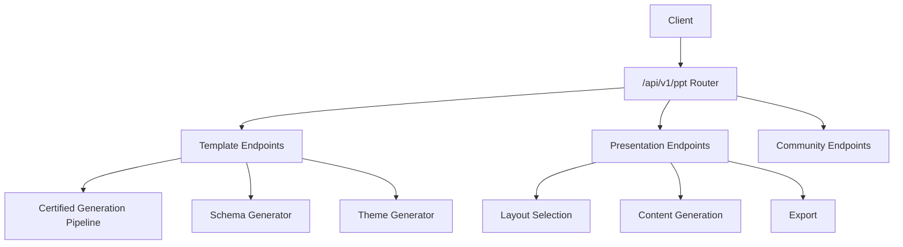
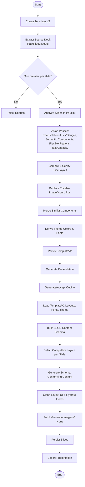
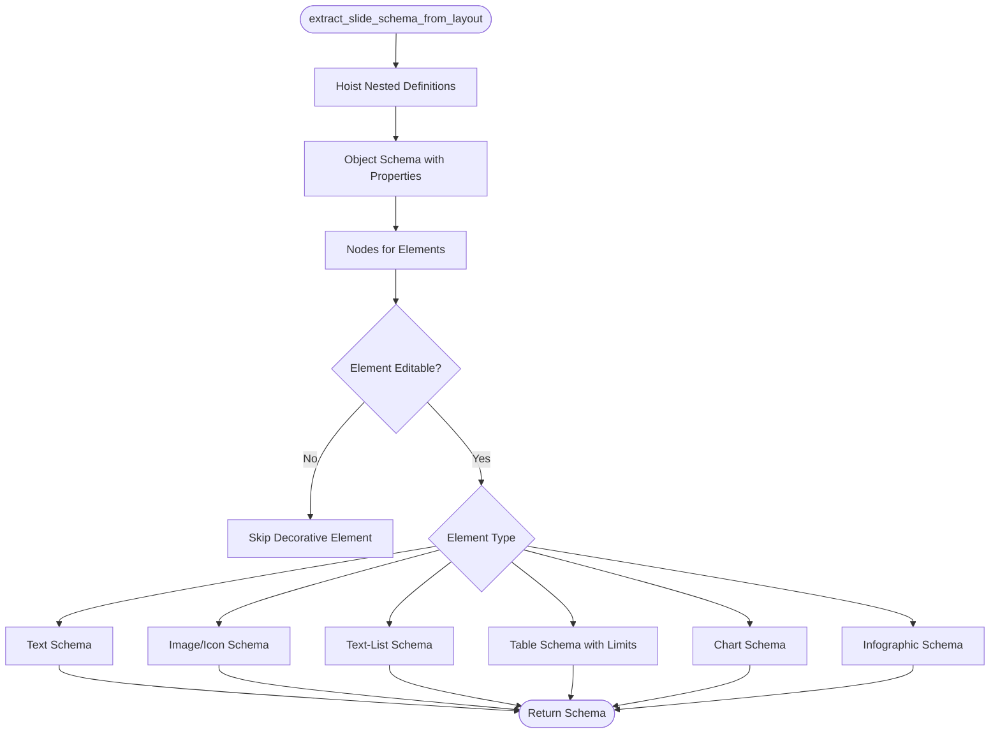
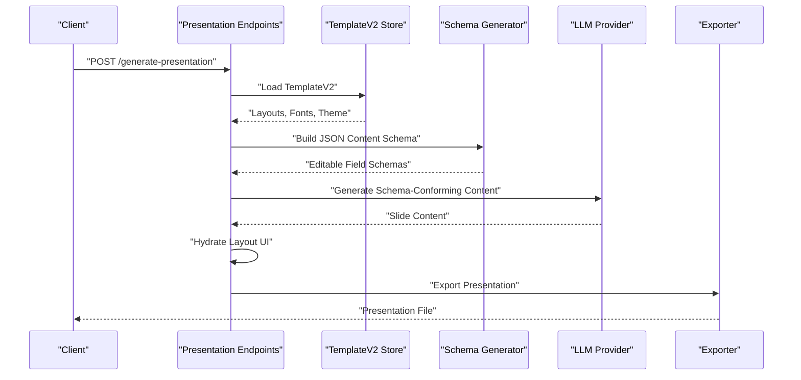
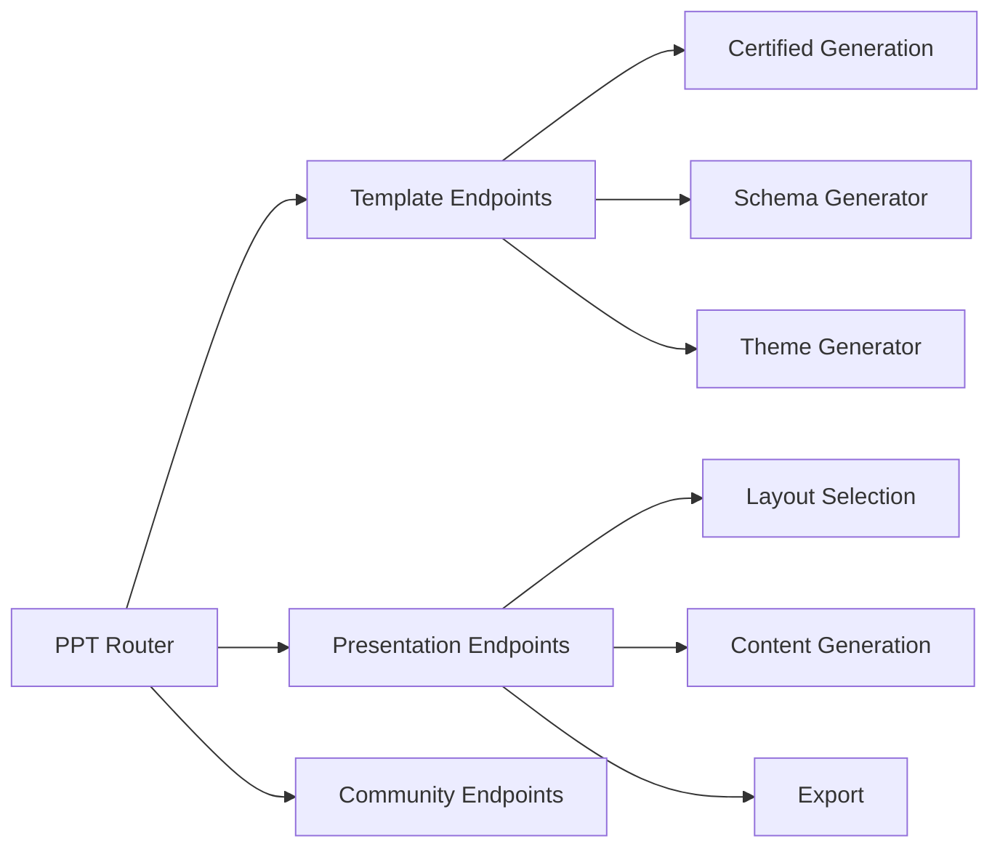

# Template Management API

<cite>
**Referenced Files in This Document**
- [template-v2.md](file://docs/template-v2.md)
- [router.py](file://servers/fastapi/api/v1/ppt/router.py)
- [template.py](file://servers/fastapi/api/v1/ppt/endpoints/template.py)
- [presentation.py](file://servers/fastapi/api/v1/ppt/endpoints/presentation.py)
- [community.py](file://servers/fastapi/api/v1/ppt/endpoints/community.py)
- [template_v2.py](file://servers/fastapi/models/sql/template_v2.py)
- [schema.py](file://servers/fastapi/templates/v2/schema.py)
- [certified_generation.py](file://servers/fastapi/templates/v2/certified_generation.py)
- [theme.py](file://servers/fastapi/templates/v2/theme.py)
- [generation.py](file://servers/fastapi/templates/v2/generation.py)
- [content.py](file://servers/fastapi/templates/v2/content.py)
- [tools.py](file://servers/fastapi/templates/v2/tools.py)
</cite>

## Table of Contents
1. [Introduction](#introduction)
2. [Project Structure](#project-structure)
3. [Core Components](#core-components)
4. [Architecture Overview](#architecture-overview)
5. [Detailed Component Analysis](#detailed-component-analysis)
6. [Dependency Analysis](#dependency-analysis)
7. [Performance Considerations](#performance-considerations)
8. [Troubleshooting Guide](#troubleshooting-guide)
9. [Conclusion](#conclusion)
10. [Appendices](#appendices)

## Introduction
This document provides comprehensive API documentation for Presenton’s template management system, focusing on the V2 template architecture and its endpoints. It explains how templates are created from PowerPoint decks, how their schema is validated, how layouts are selected during presentation generation, and how themes, assets, and community sharing fit into the workflow. It also includes practical guidance for creating custom templates, modifying existing ones, previewing templates, and integrating them with presentation generation.

The V2 template system converts a source deck into reusable slide layouts with certified JSON schemas for editable content. Presentation generation then selects compatible layouts, generates schema-conforming content, hydrates the layout UI, and exports the final presentation.

## Project Structure
Presenton exposes template-related functionality through FastAPI routers under `/api/v1/ppt`. The main router aggregates feature-specific routers, including template, presentation, outline, image, icon, font, file, chat, and community endpoints. Template creation and presentation generation are implemented as asynchronous workflows that coordinate model calls, validation, persistence, and export.

**Diagram sources**
- [router.py:1-41](file://servers/fastapi/api/v1/ppt/router.py#L1-L41)
- [template.py](file://servers/fastapi/api/v1/ppt/endpoints/template.py)
- [presentation.py](file://servers/fastapi/api/v1/ppt/endpoints/presentation.py)
- [community.py](file://servers/fastapi/api/v1/ppt/endpoints/community.py)
- [certified_generation.py:491-547](file://servers/fastapi/templates/v2/certified_generation.py#L491-L547)
- [schema.py:183-189](file://servers/fastapi/templates/v2/schema.py#L183-L189)
- [theme.py](file://servers/fastapi/templates/v2/theme.py)

**Section sources**
- [router.py:1-41](file://servers/fastapi/api/v1/ppt/router.py#L1-L41)
- [template-v2.md:166-177](file://docs/template-v2.md#L166-L177)

## Core Components
This section summarizes the core components involved in template management and presentation generation.

- Template V2 database model: stores raw layouts, certified layouts, merged components, theme, and assets.
- Template creation pipeline: converts PPTX to raw layouts, certifies layouts using vision passes, merges similar components, derives theme metadata, and persists the template.
- Schema generator: builds JSON schemas for editable content based on component elements.
- Presentation generation pipeline: loads template layouts, selects compatible layouts per outline slide, generates schema-compliant content, hydrates layouts, processes assets, persists slides, and exports presentations.
- Community endpoints: support sharing and discovery of templates or related resources.

Key responsibilities:
- Template creation: asynchronous task orchestration, persistence, retry handling.
- Schema validation: strict JSON schema generation for text, lists, tables, charts, infographics, images, and icons.
- Theme customization: semantic color and typography derivation from layouts.
- Asset management: handling fonts, images, icons, and placeholders.

**Section sources**
- [template_v2.py:16-61](file://servers/fastapi/models/sql/template_v2.py#L16-L61)
- [certified_generation.py:491-547](file://servers/fastapi/templates/v2/certified_generation.py#L491-L547)
- [schema.py:183-189](file://servers/fastapi/templates/v2/schema.py#L183-L189)
- [theme.py](file://servers/fastapi/templates/v2/theme.py)
- [template-v2.md:51-108](file://docs/template-v2.md#L51-L108)

## Architecture Overview
The V2 template system has two primary workflows:

1. Template creation:
   - Extract source deck into raw element JSON.
   - Validate one rendered preview image per raw slide.
   - Run parallel vision passes to detect charts, tables, lists, gauges, and flexible regions.
   - Compile and certify SlideLayouts.
   - Replace editable image/icon URLs with placeholders.
   - Merge structurally interchangeable components.
   - Derive theme colors and fonts.
   - Persist TemplateV2 record.

2. Presentation generation:
   - Generate or accept slide outlines.
   - Load TemplateV2 layouts, fonts, and theme.
   - Build JSON content schemas from editable elements.
   - Select compatible layout for each outline slide.
   - Generate schema-conforming slide content.
   - Clone layout UI and hydrate editable fields.
   - Fetch or generate images and icons.
   - Persist slides and export presentation.

**Diagram sources**
- [template-v2.md:16-49](file://docs/template-v2.md#L16-L49)
- [template-v2.md:51-108](file://docs/template-v2.md#L51-L108)
- [template-v2.md:109-127](file://docs/template-v2.md#L109-L127)

**Section sources**
- [template-v2.md:14-49](file://docs/template-v2.md#L14-L49)
- [template-v2.md:51-108](file://docs/template-v2.md#L51-L108)
- [template-v2.md:109-127](file://docs/template-v2.md#L109-L127)

## Detailed Component Analysis

### Template Creation Endpoints
Template creation accepts a PPTX URL, rendered slide image URLs, optional font mappings, and template metadata. It runs asynchronously so progress can be reported per slide. The endpoint orchestrates extraction, certification, merging, theme derivation, and persistence.

Typical request/response behavior:
- POST /api/v1/ppt/templates/create
  - Request body includes:
    - `pptx_url`: URL to the source PowerPoint deck.
    - `slide_image_urls`: Array of rendered slide preview URLs (one per slide).
    - `fonts`: Optional mapping of font names to asset paths.
    - `name`, `description`: Template metadata.
  - Response returns an asynchronous task identifier and status polling information.

Processing steps:
- Validate that exactly one preview image exists per raw slide.
- Convert PPTX to RawSlideLayouts.
- Run parallel vision passes up to ten slides at a time.
- Compile and validate SlideLayouts; replace editable image/icon URLs with placeholders.
- Merge similar components and derive theme metadata.
- Persist TemplateV2 record.

Error handling:
- Missing or mismatched preview images cause rejection.
- Invalid structured responses are retried and validated before use.
- Provider rate limits and token capacity constraints must be respected.

**Section sources**
- [template-v2.md:51-108](file://docs/template-v2.md#L51-L108)
- [template-v2.md:154-164](file://docs/template-v2.md#L154-L164)
- [template-v2.md:166-177](file://docs/template-v2.md#L166-L177)
- [certified_generation.py:491-547](file://servers/fastapi/templates/v2/certified_generation.py#L491-L547)

### Template Reading and Listing Endpoints
Clients read and list templates via template endpoints. The TemplateV2 model defines stored fields such as raw layouts, layouts, merged components, theme, and assets.

Common operations:
- GET /api/v1/ppt/templates/{id}
  - Returns template metadata and persisted data.
- GET /api/v1/ppt/templates
  - Lists available templates with filtering options.

Data model highlights:
- `raw_layouts`: Faithful element JSON extracted from the source PPTX.
- `layouts`: Certified, reusable slide layouts.
- `merged_components`: Groups of structurally interchangeable components.
- `theme`: Semantic colors and typography derived from the layouts.
- `assets`: Source PPTX, preview images, fonts, icons, and image references.

**Section sources**
- [template_v2.py:16-61](file://servers/fastapi/models/sql/template_v2.py#L16-L61)
- [template-v2.md:90-108](file://docs/template-v2.md#L90-L108)

### Template Updating and Versioning
Templates can be updated by modifying metadata, theme, or associated assets. Versioning is managed through template records and updates to persisted fields. When updating:
- PATCH /api/v1/ppt/templates/{id}
  - Update fields like `name`, `description`, `theme`, or `assets`.
- Ensure changes do not break existing generated presentations unless explicitly versioned.

Best practices:
- Maintain backward compatibility when updating layouts.
- Use version identifiers if multiple template versions need coexistence.
- Re-run certification only when structural changes require revalidation.

**Section sources**
- [template_v2.py:16-61](file://servers/fastapi/models/sql/template_v2.py#L16-L61)
- [template-v2.md:90-108](file://docs/template-v2.md#L90-L108)

### Template Deletion
Deleting a template removes its persisted record and associated metadata. Clients should handle cascading effects on presentations referencing the template.

Typical operation:
- DELETE /api/v1/ppt/templates/{id}
  - Removes template record and cleans up references as needed.

**Section sources**
- [template_v2.py:16-61](file://servers/fastapi/models/sql/template_v2.py#L16-L61)

### Template Schema Structure and Validation
The schema generator produces JSON schemas for editable content based on component elements. Supported content types include text, image, text-list, table, chart, and infographic.

Key behaviors:
- Only elements marked `decorative=false` become generated content fields.
- Tables compute safe text limits based on cell geometry and typography.
- Charts and infographics map to typed structures with categories, series, and visual attributes.
- Repeated groups produce array schemas with min/max constraints.

**Diagram sources**
- [schema.py:183-189](file://servers/fastapi/templates/v2/schema.py#L183-L189)
- [schema.py:361-423](file://servers/fastapi/templates/v2/schema.py#L361-L423)
- [schema.py:426-452](file://servers/fastapi/templates/v2/schema.py#L426-L452)

**Section sources**
- [schema.py:15-51](file://servers/fastapi/templates/v2/schema.py#L15-L51)
- [schema.py:183-189](file://servers/fastapi/templates/v2/schema.py#L183-L189)
- [schema.py:361-423](file://servers/fastapi/templates/v2/schema.py#L361-L423)
- [schema.py:426-452](file://servers/fastapi/templates/v2/schema.py#L426-L452)

### Component Definitions and Layout Specifications
Components represent reusable visual regions within a slide layout. They contain elements with positions, sizes, styles, and asset references. Layout specifications define how components are arranged and repeated.

Important aspects:
- Components have unique IDs and descriptions.
- Elements may be containers, flex/grid/group wrappers, or content nodes.
- Repeated children are modeled as arrays with min/max constraints.
- Flexible flow trees define fixed and repeatable regions.

**Section sources**
- [certified_generation.py:550-597](file://servers/fastapi/templates/v2/certified_generation.py#L550-L597)
- [schema.py:585-639](file://servers/fastapi/templates/v2/schema.py#L585-L639)

### Presentation Generation Integration
Presentation generation uses already-certified Template V2 layout data. It does not re-analyze source screenshots. Instead, it:
- Generates or accepts slide outlines.
- Loads TemplateV2 layouts, fonts, and theme.
- Builds JSON content schemas from editable elements.
- Selects compatible layouts per outline slide.
- Generates schema-conforming content.
- Clones layout UI and hydrates editable fields.
- Fetches or generates images and icons.
- Persists slides and exports the presentation.

**Diagram sources**
- [template-v2.md:109-127](file://docs/template-v2.md#L109-L127)
- [presentation.py](file://servers/fastapi/api/v1/ppt/endpoints/presentation.py)
- [schema.py:183-189](file://servers/fastapi/templates/v2/schema.py#L183-L189)

**Section sources**
- [template-v2.md:109-127](file://docs/template-v2.md#L109-L127)
- [presentation.py](file://servers/fastapi/api/v1/ppt/endpoints/presentation.py)

### Template Preview Endpoints
Template previews allow clients to render slide layouts and verify visual fidelity before generation. Preview endpoints typically return HTML or image representations of layouts hydrated with sample or generated content.

Typical operations:
- GET /api/v1/ppt/templates/{id}/preview
  - Returns preview HTML or images for a template’s layouts.
- POST /api/v1/ppt/templates/{id}/preview/hydrate
  - Hydrates layouts with provided content and returns preview output.

Preview considerations:
- Use placeholder URLs for editable images/icons.
- Respect theme roles and font mappings.
- Validate generated content against schema before hydration.

**Section sources**
- [template-v2.md:109-127](file://docs/template-v2.md#L109-L127)
- [schema.py:183-189](file://servers/fastapi/templates/v2/schema.py#L183-L189)

### Asset Management
Assets include fonts, images, icons, and image references. During template creation, editable image and icon values are replaced with standard placeholders. Themes derive semantic colors and typography from layouts.

Operations:
- Upload fonts and images to template assets.
- Map font names to asset paths for rendering and export.
- Manage icon queries and image prompts for generated content.

**Section sources**
- [template-v2.md:90-108](file://docs/template-v2.md#L90-L108)
- [certified_generation.py:63-64](file://servers/fastapi/templates/v2/certified_generation.py#L63-L64)

### Deployment Processes
Deployment involves persisting TemplateV2 records and making templates available for presentation generation. Asynchronous tasks report progress per slide, and retries handle invalid structured responses.

Steps:
- Submit template creation request.
- Poll task status until completion.
- Verify persisted TemplateV2 record.
- Use template in presentation generation workflows.

**Section sources**
- [template-v2.md:51-108](file://docs/template-v2.md#L51-L108)
- [template-v2.md:154-164](file://docs/template-v2.md#L154-L164)

### Community Template Sharing
Community endpoints enable sharing and discovery of templates or related resources. Clients can publish templates for community use and retrieve shared templates for integration.

Typical operations:
- POST /api/v1/ppt/community/templates
  - Publish a template to the community.
- GET /api/v1/ppt/community/templates
  - Browse and download community templates.

Security and ownership:
- Templates may be associated with owner IDs.
- Community sharing respects access controls and ownership.

**Section sources**
- [community.py](file://servers/fastapi/api/v1/ppt/endpoints/community.py)
- [template_v2.py:16-61](file://servers/fastapi/models/sql/template_v2.py#L16-L61)

## Dependency Analysis
The template management system depends on several modules:

- Routers aggregate endpoints for templates, presentations, and community features.
- Certified generation coordinates multi-pass vision analysis and fallbacks.
- Schema generator produces JSON schemas for editable content.
- Theme generator profiles colors and fonts for semantic theme roles.
- Presentation endpoints handle layout selection, content generation, hydration, asset processing, persistence, and export.

**Diagram sources**
- [router.py:1-41](file://servers/fastapi/api/v1/ppt/router.py#L1-L41)
- [template.py](file://servers/fastapi/api/v1/ppt/endpoints/template.py)
- [presentation.py](file://servers/fastapi/api/v1/ppt/endpoints/presentation.py)
- [community.py](file://servers/fastapi/api/v1/ppt/endpoints/community.py)
- [certified_generation.py:491-547](file://servers/fastapi/templates/v2/certified_generation.py#L491-L547)
- [schema.py:183-189](file://servers/fastapi/templates/v2/schema.py#L183-L189)
- [theme.py](file://servers/fastapi/templates/v2/theme.py)

**Section sources**
- [router.py:1-41](file://servers/fastapi/api/v1/ppt/router.py#L1-L41)
- [template-v2.md:166-177](file://docs/template-v2.md#L166-L177)

## Performance Considerations
- Template creation processes up to ten slides concurrently.
- Provider rate limits should accommodate burst usage.
- Invalid structured responses are retried and validated before use.
- Layouts use a fixed 1280 x 720 coordinate system.
- Font mappings should be supplied for non-standard fonts.
- Rendered slide previews are required because appearance and semantic grouping depend on actual pixels.

[No sources needed since this section provides general guidance]

## Troubleshooting Guide
Common issues and resolutions:
- Missing or mismatched preview images:
  - Ensure exactly one rendered preview image per raw slide.
- Invalid structured responses:
  - Retries and validation are applied; check provider response quality.
- Rate limit errors:
  - Adjust provider settings to allow concurrent calls.
- Token capacity errors:
  - Increase output token limits for template creation.
- Font rendering issues:
  - Provide accurate font mappings and ensure fonts are available during rendering and export.

**Section sources**
- [template-v2.md:154-164](file://docs/template-v2.md#L154-L164)
- [certified_generation.py:491-547](file://servers/fastapi/templates/v2/certified_generation.py#L491-L547)

## Conclusion
Presenton’s V2 template system provides a robust framework for converting PowerPoint decks into reusable, schema-validated slide layouts. The system supports asynchronous template creation, parallel vision analysis, theme derivation, asset management, and seamless integration with presentation generation. By following the documented workflows and best practices, developers can create custom templates, modify existing ones, preview outputs, and deploy templates for community sharing.

[No sources needed since this section summarizes without analyzing specific files]

## Appendices

### API Endpoint Summary
- Template Creation:
  - POST /api/v1/ppt/templates/create
- Template Reading:
  - GET /api/v1/ppt/templates/{id}
  - GET /api/v1/ppt/templates
- Template Updating:
  - PATCH /api/v1/ppt/templates/{id}
- Template Deletion:
  - DELETE /api/v1/ppt/templates/{id}
- Template Preview:
  - GET /api/v1/ppt/templates/{id}/preview
  - POST /api/v1/ppt/templates/{id}/preview/hydrate
- Community Sharing:
  - POST /api/v1/ppt/community/templates
  - GET /api/v1/ppt/community/templates

**Section sources**
- [router.py:1-41](file://servers/fastapi/api/v1/ppt/router.py#L1-L41)
- [template.py](file://servers/fastapi/api/v1/ppt/endpoints/template.py)
- [community.py](file://servers/fastapi/api/v1/ppt/endpoints/community.py)

### Template Development Best Practices
- Provide high-quality source decks with clear visual structure.
- Supply accurate font mappings for non-standard fonts.
- Ensure one rendered preview image per slide.
- Design components with consistent editable-field hierarchies.
- Use semantic naming for layouts and components.
- Validate generated content against schemas before hydration.
- Monitor provider rate limits and token capacities.

[No sources needed since this section provides general guidance]