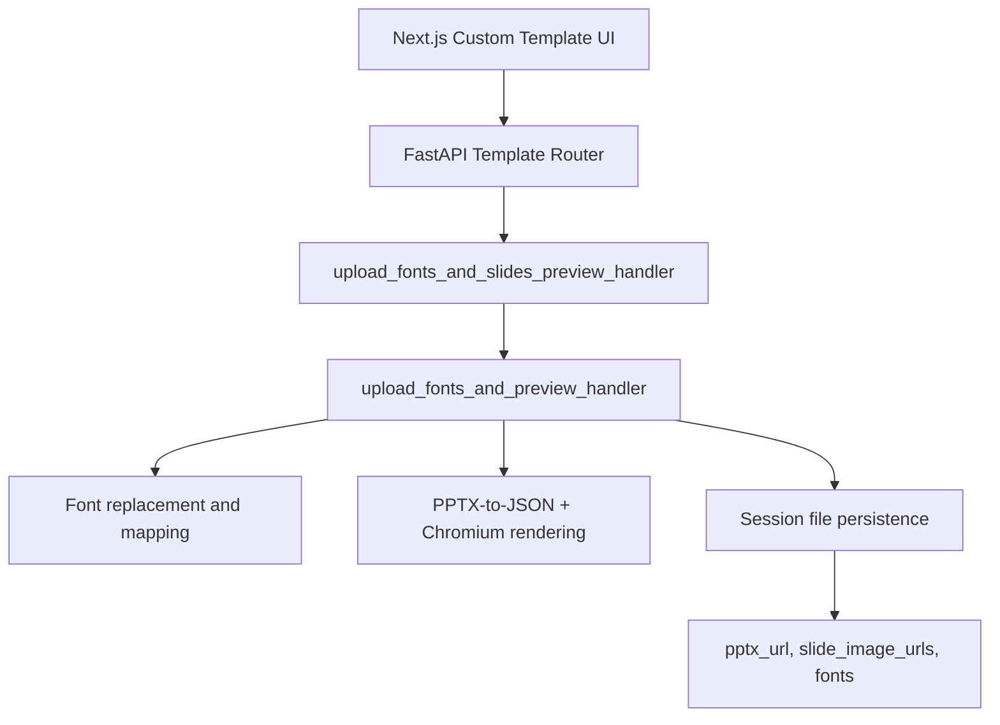
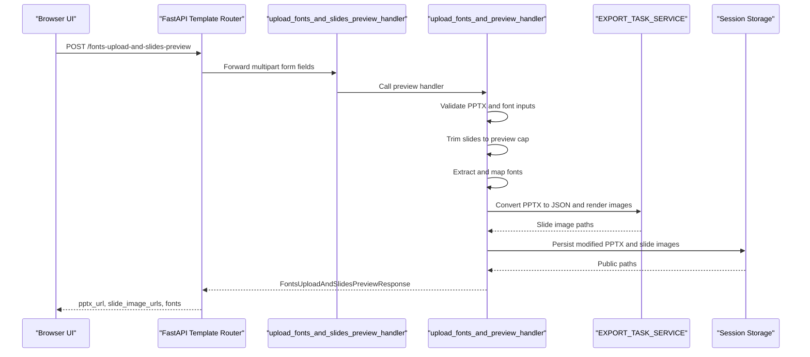
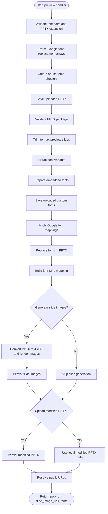
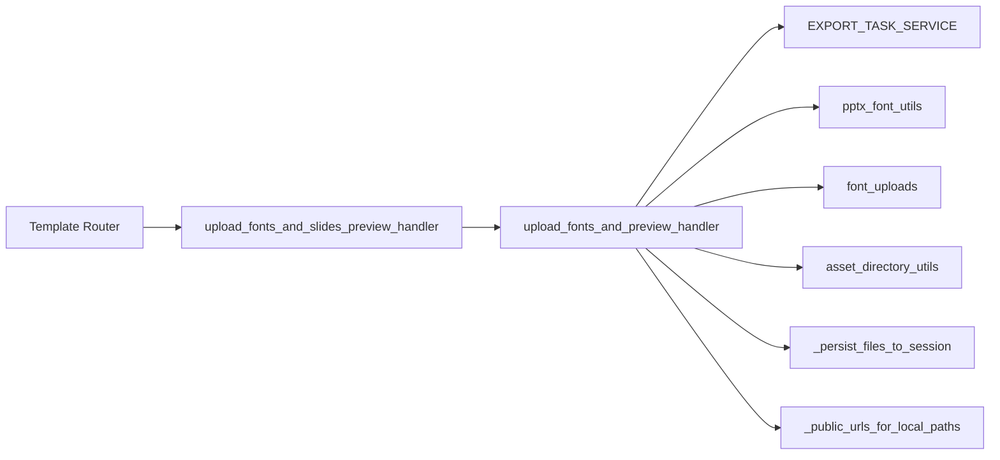

# Template Preview Generation

<cite>
**Referenced Files in This Document**   
- [template.py](file://servers/fastapi/api/v1/ppt/endpoints/template.py)
- [preview.py](file://servers/fastapi/templates/preview.py)
- [fonts_and_slides_preview.py](file://servers/fastapi/templates/fonts_and_slides_preview.py)
- [useTemplateCreation.ts](file://servers/nextjs/app/(presentation-generator)/custom-template/hooks/useTemplateCreation.ts)
- [template.ts](file://servers/nextjs/app/(presentation-generator)/services/api/template.ts)
- [mcp_server.py](file://servers/fastapi/mcp_server.py)
</cite>

## Table of Contents
1. [Introduction](#introduction)
2. [Project Structure](#project-structure)
3. [Core Components](#core-components)
4. [Architecture Overview](#architecture-overview)
5. [Detailed Component Analysis](#detailed-component-analysis)
6. [Dependency Analysis](#dependency-analysis)
7. [Performance Considerations](#performance-considerations)
8. [Troubleshooting Guide](#troubleshooting-guide)
9. [Conclusion](#conclusion)

## Introduction
This document explains the template preview generation functionality used when a user uploads a PowerPoint template and wants to:
- Replace missing or custom fonts.
- Generate slide preview images.
- Obtain URLs for the modified PPTX, slide images, and font mappings.

The main endpoints are:
- `/api/v1/ppt/template/fonts-upload-and-slides-preview`: multipart upload endpoint for browsers and clients that send files directly.
- `/api/v1/ppt/template/mcp-upload`: MCP-style endpoint that accepts base64-encoded PPTX and font payloads.

Both endpoints ultimately call `upload_fonts_and_slides_preview_handler`, which delegates to `upload_fonts_and_preview_handler` in the core preview implementation.

## Project Structure
The template preview feature spans FastAPI backend handlers, a reusable preview service module, and Next.js client code that drives the custom template creation flow.

**Diagram sources**
- [template.py:1188-1268](file://servers/fastapi/api/v1/ppt/endpoints/template.py#L1188-L1268)
- [preview.py:35-62](file://servers/fastapi/templates/preview.py#L35-L62)
- [fonts_and_slides_preview.py:1292-1453](file://servers/fastapi/templates/fonts_and_slides_preview.py#L1292-L1453)

**Section sources**
- [template.py:1188-1268](file://servers/fastapi/api/v1/ppt/endpoints/template.py#L1188-L1268)
- [preview.py:1-62](file://servers/fastapi/templates/preview.py#L1-L62)
- [fonts_and_slides_preview.py:69-73](file://servers/fastapi/templates/fonts_and_slides_preview.py#L69-L73)

## Core Components
- **Multipart template preview endpoint**: Accepts a PPTX file, optional font files, and Google font replacement metadata. It returns slide previews and font information.
- **MCP template upload endpoint**: Accepts encoded PPTX and font data, validates combined size, then calls the same preview handler.
- **Preview handler wrapper**: Exposes a clean async function with parameters for controlling font upload, slide image generation, and presentation upload.
- **Core preview engine**: Performs validation, font extraction, font replacement, slide trimming, preview rendering, and URL resolution.

Key response model:
- `slide_image_urls`: List of public URLs for generated slide images.
- `pptx_url`: Public URL for the modified PPTX.
- `modified_pptx_url`: Public URL for the modified PPTX; currently mirrors `pptx_url`.
- `fonts`: Mapping of font family names to URLs or CSS/font metadata used during preview rendering.

**Section sources**
- [template.py:1188-1268](file://servers/fastapi/api/v1/ppt/endpoints/template.py#L1188-L1268)
- [preview.py:35-62](file://servers/fastapi/templates/preview.py#L35-L62)
- [fonts_and_slides_preview.py:69-73](file://servers/fastapi/templates/fonts_and_slides_preview.py#L69-L73)

## Architecture Overview
The template preview pipeline is a multi-stage process:

**Diagram sources**
- [template.py:1188-1268](file://servers/fastapi/api/v1/ppt/endpoints/template.py#L1188-L1268)
- [preview.py:35-62](file://servers/fastapi/templates/preview.py#L35-L62)
- [fonts_and_slides_preview.py:1292-1453](file://servers/fastapi/templates/fonts_and_slides_preview.py#L1292-L1453)
- [fonts_and_slides_preview.py:763-831](file://servers/fastapi/templates/fonts_and_slides_preview.py#L763-L831)

## Detailed Component Analysis

### Multipart Upload Endpoint
The multipart endpoint exposes:
- `pptx_file`: Required PPTX file.
- `font_files`: Optional list of font files.
- `original_font_names`: Optional list of original font names corresponding to uploaded fonts.
- Google font replacement fields:
  - `google_font_original_names`
  - `google_font_replacement_names`
  - `google_font_names`
  - `google_font_urls`

It forwards these fields to `upload_fonts_and_slides_preview_handler`.

**Section sources**
- [template.py:1188-1211](file://servers/fastapi/api/v1/ppt/endpoints/template.py#L1188-L1211)
- [preview.py:35-62](file://servers/fastapi/templates/preview.py#L35-L62)

### MCP Upload Endpoint
The MCP endpoint:
- Decodes base64 PPTX content.
- Validates that the filename ends with `.pptx`.
- Decodes each font payload.
- Enforces a combined upload limit of 100 MiB.
- Wraps decoded bytes into `UploadFile` objects.
- Calls `upload_fonts_and_slides_preview_handler`.
- Returns `pptx_url`, `slide_image_urls`, and `fonts`.

**Section sources**
- [template.py:1214-1268](file://servers/fastapi/api/v1/ppt/endpoints/template.py#L1214-L1268)

### Preview Handler Wrapper
`upload_fonts_and_slides_preview_handler` is a thin async wrapper that forwards:
- PPTX file.
- Font files and original font names.
- Google font replacement metadata.
- Optional controls:
  - `max_slides`
  - `upload_fonts`
  - `get_slide_images`
  - `upload_presentation`
  - `temp_dir`

It returns `FontsUploadAndSlidesPreviewResponse`.

**Section sources**
- [preview.py:35-62](file://servers/fastapi/templates/preview.py#L35-L62)
- [fonts_and_slides_preview.py:69-73](file://servers/fastapi/templates/fonts_and_slides_preview.py#L69-L73)

### Core Preview Engine
`upload_fonts_and_preview_handler` implements the full preview workflow:

1. **Input validation**
   - Requires both `font_files` and `original_font_names` together, with matching counts.
   - Requires `.pptx` extension.
   - Parses Google font replacement arrays and validates their lengths and pairing.

2. **Slide cap and temporary workspace**
   - Resolves `max_slides` against a maximum preview slide count.
   - Uses a temporary directory unless one is provided.

3. **PPTX processing**
   - Saves uploaded PPTX.
   - Validates the PPTX package structure.
   - Trims the PPTX to the first N slides if needed.
   - Extracts used font variants.

4. **Font handling**
   - Prepares embedded fonts from the PPTX.
   - Saves uploaded custom fonts.
   - Applies Google font replacements.
   - Builds font mappings and variant mappings.
   - Replaces fonts in the PPTX where mappings exist.
   - Persists uploaded fonts for reuse.

5. **Preview rendering**
   - Converts the modified PPTX to JSON via `EXPORT_TASK_SERVICE.convert_pptx_to_json`.
   - Derives normalized canvas dimensions.
   - Renders slide images via `EXPORT_TASK_SERVICE.render_jsons_to_images`.
   - Persists slide images under a session directory.

6. **URL resolution and response**
   - Generates public URLs for slide images and modified PPTX.
   - Builds a `fonts` mapping including embedded, custom, packaged, and Google font entries.
   - Returns `FontsUploadAndSlidesPreviewResponse`.

**Diagram sources**
- [fonts_and_slides_preview.py:1292-1453](file://servers/fastapi/templates/fonts_and_slides_preview.py#L1292-L1453)
- [fonts_and_slides_preview.py:1491-1697](file://servers/fastapi/templates/fonts_and_slides_preview.py#L1491-L1697)
- [fonts_and_slides_preview.py:1700-1754](file://servers/fastapi/templates/fonts_and_slides_preview.py#L1700-L1754)
- [fonts_and_slides_preview.py:763-831](file://servers/fastapi/templates/fonts_and_slides_preview.py#L763-L831)

**Section sources**
- [fonts_and_slides_preview.py:1292-1453](file://servers/fastapi/templates/fonts_and_slides_preview.py#L1292-L1453)
- [fonts_and_slides_preview.py:1491-1697](file://servers/fastapi/templates/fonts_and_slides_preview.py#L1491-L1697)
- [fonts_and_slides_preview.py:1700-1754](file://servers/fastapi/templates/fonts_and_slides_preview.py#L1700-L1754)

### Response Format
The response model is `FontsUploadAndSlidesPreviewResponse`:
- `slide_image_urls`: Array of public URLs for generated slide images.
- `pptx_url`: Public URL for the modified PPTX.
- `modified_pptx_url`: Public URL for the modified PPTX; currently set to the same value as `pptx_url`.
- `fonts`: Dictionary containing font family names mapped to URLs or related preview metadata.

For MCP clients, the MCP upload endpoint returns:
- `pptx_url`
- `slide_image_urls`
- `fonts`

These values come directly from the preview handler response.

**Section sources**
- [fonts_and_slides_preview.py:69-73](file://servers/fastapi/templates/fonts_and_slides_preview.py#L69-L73)
- [template.py:1264-1268](file://servers/fastapi/api/v1/ppt/endpoints/template.py#L1264-L1268)

### File Size Limits and Supported Formats
- **PPTX format**: The endpoint requires filenames ending with `.pptx`.
- **Invalid PPTX**: Corrupted or structurally invalid PPTX files raise an error.
- **Font check upload size limit**: A separate font-check path enforces a 100 MB limit.
- **MCP combined upload limit**: The MCP endpoint rejects combined PPTX and font payloads exceeding 100 MiB.
- **Per-font MCP payload limit**: Each font payload is decoded with a 10 MiB limit before being added to the total.

Supported formats:
- PPTX templates.
- Font files processed through the font upload utilities.
- Google font replacement metadata passed as parallel arrays.

**Section sources**
- [fonts_and_slides_preview.py:150-154](file://servers/fastapi/templates/fonts_and_slides_preview.py#L150-L154)
- [fonts_and_slides_preview.py:1028-1030](file://servers/fastapi/templates/fonts_and_slides_preview.py#L1028-L1030)
- [fonts_and_slides_preview.py:1033-1054](file://servers/fastapi/templates/fonts_and_slides_preview.py#L1033-L1054)
- [template.py:1224-1257](file://servers/fastapi/api/v1/ppt/endpoints/template.py#L1224-L1257)

### Error Handling
Common errors include:
- Missing or mismatched font file and original font name arrays.
- Non-PPTX filenames.
- Invalid or corrupted PPTX packages.
- Excessive slide count requests.
- Empty slide image output.
- Unexpected slide count from the renderer.
- MCP payload size violations.

Error responses typically use HTTP status codes such as:
- `400` for invalid input or malformed PPTX.
- `413` for oversized uploads.
- `500` for internal failures during rendering or preview generation.

**Section sources**
- [fonts_and_slides_preview.py:1317-1344](file://servers/fastapi/templates/fonts_and_slides_preview.py#L1317-L1344)
- [fonts_and_slides_preview.py:1057-1065](file://servers/fastapi/templates/fonts_and_slides_preview.py#L1057-L1065)
- [fonts_and_slides_preview.py:1033-1054](file://servers/fastapi/templates/fonts_and_slides_preview.py#L1033-L1054)
- [fonts_and_slides_preview.py:1725-1726](file://servers/fastapi/templates/fonts_and_slides_preview.py#L1725-L1726)
- [fonts_and_slides_preview.py:820-827](file://servers/fastapi/templates/fonts_and_slides_preview.py#L820-L827)
- [template.py:1228-1246](file://servers/fastapi/api/v1/ppt/endpoints/template.py#L1228-L1246)

### Integration with Template Creation Workflow
The Next.js custom template creation flow:
1. Starts by checking fonts in the uploaded PPTX.
2. Builds a `FormData` object with:
   - `pptx_file`
   - `font_files`
   - `original_font_names`
   - Google font replacement fields when applicable.
3. Calls `/api/v1/ppt/template/fonts-upload-and-slides-preview`.
4. Stores the returned preview data, including `slide_image_urls`.
5. Later uses `pptx_url`, `slide_image_urls`, and `fonts` when creating the final template.

The MCP documentation also specifies that clients should:
- Call `upload_template_assets`.
- Require non-empty `pptx_url`, `slide_image_urls`, and `fonts`.
- Pass those values unchanged into template generation.

**Section sources**
- [useTemplateCreation.ts:267-328](file://servers/nextjs/app/(presentation-generator)/custom-template/hooks/useTemplateCreation.ts#L267-L328)
- [template.ts:12-18](file://servers/nextjs/app/(presentation-generator)/services/api/template.ts#L12-L18)
- [mcp_server.py:219-224](file://servers/fastapi/mcp_server.py#L219-L224)

## Dependency Analysis
The preview system depends on several services and utilities:

**Diagram sources**
- [template.py:1188-1268](file://servers/fastapi/api/v1/ppt/endpoints/template.py#L1188-L1268)
- [preview.py:12-18](file://servers/fastapi/templates/preview.py#L12-L18)
- [fonts_and_slides_preview.py:19-49](file://servers/fastapi/templates/fonts_and_slides_preview.py#L19-L49)
- [fonts_and_slides_preview.py:1912-1922](file://servers/fastapi/templates/fonts_and_slides_preview.py#L1912-L1922)

**Section sources**
- [fonts_and_slides_preview.py:19-49](file://servers/fastapi/templates/fonts_and_slides_preview.py#L19-L49)
- [fonts_and_slides_preview.py:1912-1922](file://servers/fastapi/templates/fonts_and_slides_preview.py#L1912-L1922)

## Performance Considerations
- **Slide preview cap**: The system caps preview slides at a fixed maximum to avoid rendering very large decks.
- **Normalized canvas dimensions**: Preview dimensions are derived from the PPTX aspect ratio to keep consistent rendering behavior.
- **Chromium-based rendering**: Slide images are rendered through a JSON-to-image pipeline, which can be resource-intensive for large decks.
- **Session-scoped storage**: Generated previews and modified PPTX files are stored under per-session directories, reducing cross-request interference.
- **Font catalog fallback**: Packaged fonts are resolved without backend downloads, improving performance for common fonts.

[No sources needed since this section provides general guidance]

## Troubleshooting Guide
Common issues and resolutions:

| Symptom | Likely Cause | Resolution |
|---|---|---|
| Request fails with invalid file type | Uploaded file does not end with `.pptx` | Ensure the template file is a valid PPTX. |
| Request fails with invalid PPTX upload | Corrupted or structurally invalid PPTX | Re-export or repair the PowerPoint file. |
| Font upload fails | `font_files` and `original_font_names` mismatched or missing | Provide both arrays with equal length. |
| Google font replacement fails | Replacement names and URLs mismatched | Provide matching arrays for replacement names and URLs. |
| No slide images returned | Rendering failed or returned zero slides | Check PPTX validity and slide count; inspect renderer logs. |
| MCP upload rejected | Combined payload exceeds 100 MiB | Reduce PPTX size or number of font attachments. |
| Preview looks wrong | Missing fonts or incorrect font mapping | Upload correct font variants or provide accurate original font names. |

**Section sources**
- [fonts_and_slides_preview.py:1317-1344](file://servers/fastapi/templates/fonts_and_slides_preview.py#L1317-L1344)
- [fonts_and_slides_preview.py:1033-1054](file://servers/fastapi/templates/fonts_and_slides_preview.py#L1033-L1054)
- [fonts_and_slides_preview.py:1725-1726](file://servers/fastapi/templates/fonts_and_slides_preview.py#L1725-L1726)
- [template.py:1228-1246](file://servers/fastapi/api/v1/ppt/endpoints/template.py#L1228-L1246)

## Conclusion
The template preview generation feature provides a complete pipeline for uploading PPTX templates, replacing fonts, generating slide previews, and returning stable URLs for downstream template creation. Clients can use either the multipart endpoint or the MCP endpoint depending on their integration model. The response consistently includes `pptx_url`, `slide_image_urls`, and a `fonts` mapping, enabling the frontend to display previews and pass validated assets into the template creation workflow.

[No sources needed since this section summarizes without analyzing specific files]