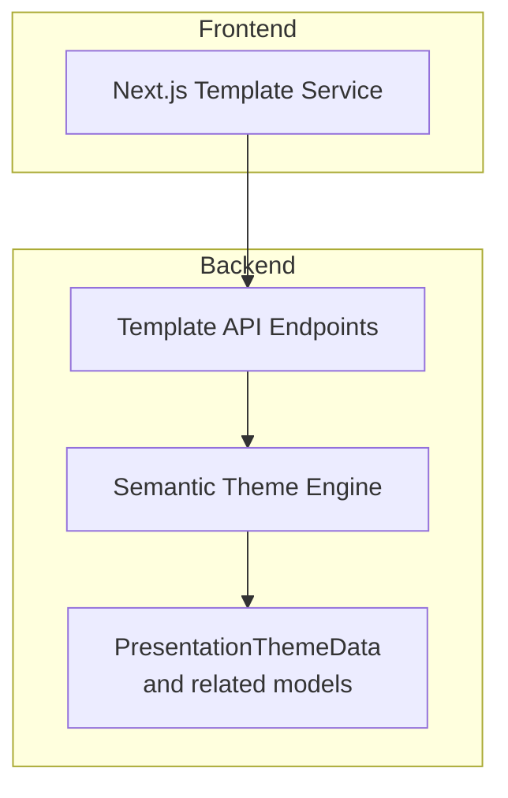
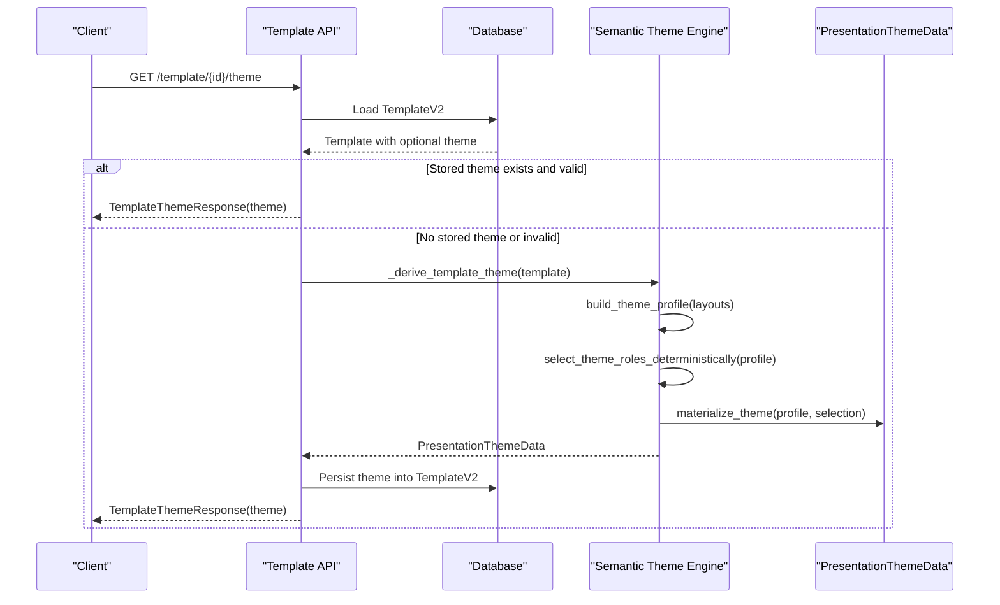
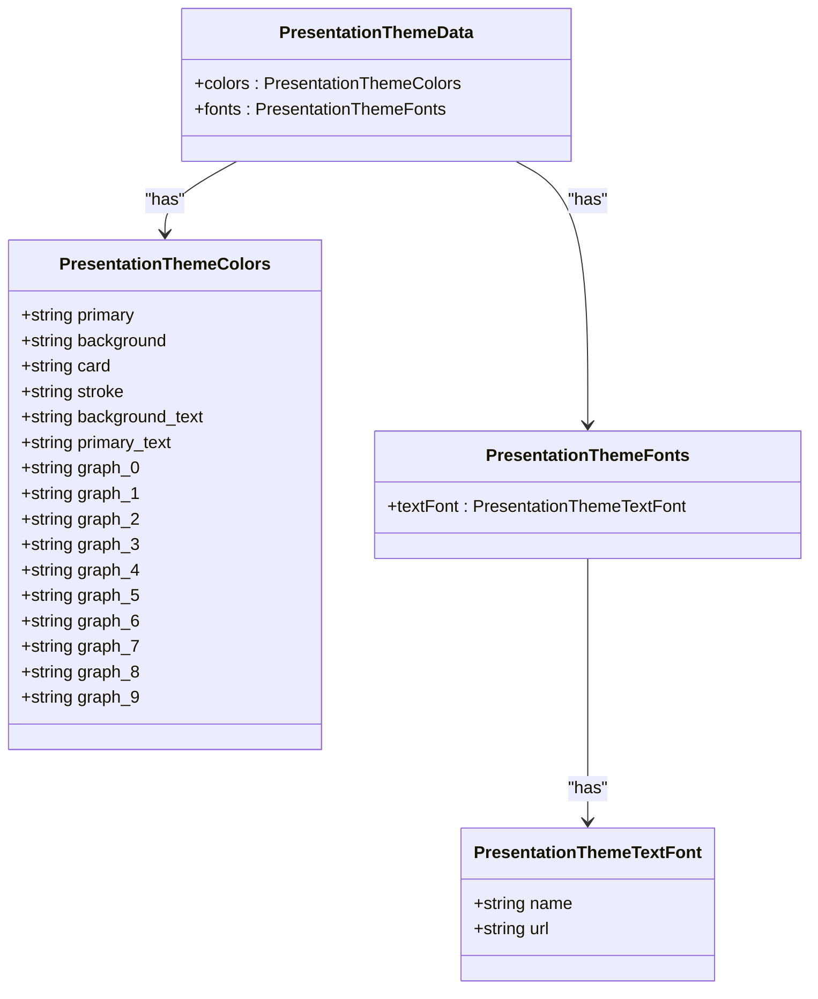
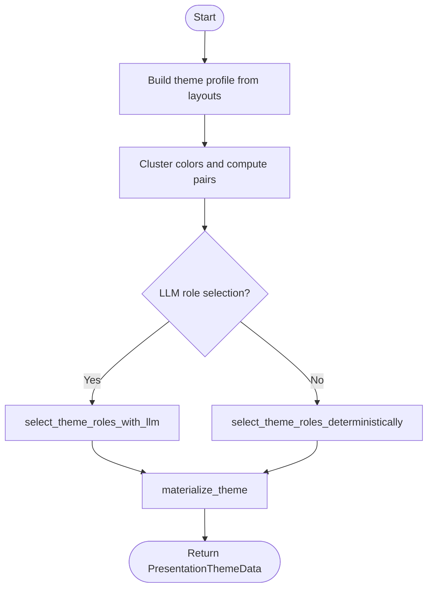
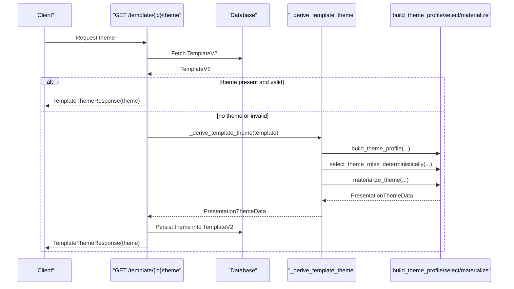
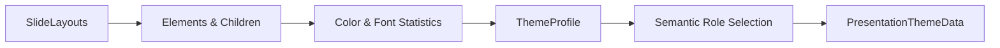
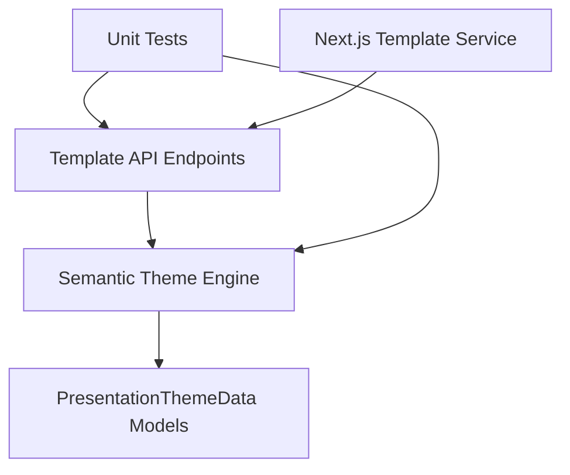

# Template Theme System

<cite>
**Referenced Files in This Document**
- [theme.py](file://servers/fastapi/templates/v2/theme.py)
- [theme_data.py](file://servers/fastapi/models/theme_data.py)
- [template.py](file://servers/fastapi/api/v1/ppt/endpoints/template.py)
- [test_template_theme.py](file://servers/fastapi/tests/unit/test_template_theme.py)
- [test_presentation_template_theme_updates.py](file://servers/fastapi/tests/unit/test_presentation_template_theme_updates.py)
- [template.ts](file://servers/nextjs/app/(presentation-generator)/services/api/template.ts)
</cite>

## Table of Contents
1. [Introduction](#introduction)
2. [Project Structure](#project-structure)
3. [Core Components](#core-components)
4. [Architecture Overview](#architecture-overview)
5. [Detailed Component Analysis](#detailed-component-analysis)
6. [Dependency Analysis](#dependency-analysis)
7. [Performance Considerations](#performance-considerations)
8. [Troubleshooting Guide](#troubleshooting-guide)
9. [Conclusion](#conclusion)

## Introduction
This document explains the template theme system used to apply consistent colors, fonts, and styling to presentation templates. It covers how themes are derived from slide layouts, the PresentationThemeData model structure, API endpoints for retrieving and updating template themes, the semantic theme generation process that analyzes slide content, and how themes relate to template components.

## Project Structure
The template theme system spans backend models, a semantic theme generator, API endpoints, and frontend integration:

- Backend model: defines the canonical theme data shape.
- Semantic theme engine: analyzes slide layout elements to build a color and font profile, then selects semantic roles and materializes a theme.
- API endpoints: expose retrieval and persistence of template themes.
- Frontend service: calls backend APIs and invalidates cached theme data after template updates.

**Diagram sources**
- [theme_data.py:1-35](file://servers/fastapi/models/theme_data.py#L1-L35)
- [theme.py:145-402](file://servers/fastapi/templates/v2/theme.py#L145-L402)
- [template.py:2087-2118](file://servers/fastapi/api/v1/ppt/endpoints/template.py#L2087-L2118)
- [template.ts:328-347](file://servers/nextjs/app/(presentation-generator)/services/api/template.ts#L328-L347)

**Section sources**
- [theme_data.py:1-35](file://servers/fastapi/models/theme_data.py#L1-L35)
- [theme.py:145-402](file://servers/fastapi/templates/v2/theme.py#L145-L402)
- [template.py:2087-2118](file://servers/fastapi/api/v1/ppt/endpoints/template.py#L2087-L2118)
- [template.ts:328-347](file://servers/nextjs/app/(presentation-generator)/services/api/template.ts#L328-L347)

## Core Components
- PresentationThemeData: the canonical theme payload with colors and fonts.
- Semantic Theme Engine: builds a style profile from slide layouts, selects semantic roles (primary, background, card, stroke, text colors, graph palette, and text font), and materializes a theme.
- Template API: exposes GET /template/{template_id}/theme to retrieve or derive and persist a theme; includes helpers to derive themes deterministically when LLM selection is unavailable.
- Frontend Template Service: triggers layout generation and invalidates cached theme data on changes.

Key responsibilities:
- Model validation and serialization of theme payloads.
- Color clustering, contrast checks, and accessibility repair.
- Font usage analysis and selection.
- Deterministic fallback role assignment.
- Persistence of generated themes into templates.

**Section sources**
- [theme_data.py:1-35](file://servers/fastapi/models/theme_data.py#L1-L35)
- [theme.py:145-402](file://servers/fastapi/templates/v2/theme.py#L145-L402)
- [template.py:881-894](file://servers/fastapi/api/v1/ppt/endpoints/template.py#L881-L894)
- [template.py:2087-2118](file://servers/fastapi/api/v1/ppt/endpoints/template.py#L2087-L2118)

## Architecture Overview
The theme pipeline integrates slide layouts into a semantic theme:

**Diagram sources**
- [template.py:2087-2118](file://servers/fastapi/api/v1/ppt/endpoints/template.py#L2087-L2118)
- [template.py:881-894](file://servers/fastapi/api/v1/ppt/endpoints/template.py#L881-L894)
- [theme.py:145-402](file://servers/fastapi/templates/v2/theme.py#L145-L402)
- [theme_data.py:1-35](file://servers/fastapi/models/theme_data.py#L1-L35)

## Detailed Component Analysis

### PresentationThemeData Model
The theme model standardizes colors and fonts across templates and presentations.

- Colors:
  - primary: dominant brand/accent color.
  - background: main surface color.
  - card: secondary surface.
  - stroke: subtle structural/border color.
  - background_text: accessible text color over background.
  - primary_text: accessible text color over primary.
  - graph_0..graph_9: chart palette colors.
- Fonts:
  - textFont.name: selected font family.
  - textFont.url: optional font URL.

**Diagram sources**
- [theme_data.py:1-35](file://servers/fastapi/models/theme_data.py#L1-L35)

**Section sources**
- [theme_data.py:1-35](file://servers/fastapi/models/theme_data.py#L1-L35)

### Semantic Theme Generation Engine
The engine transforms slide layout elements into a compact style profile and then assigns semantic roles to produce a final theme.

High-level flow:
1. Build a theme profile by scanning all slide layout components and elements:
   - Collect fill, stroke, text, chart, and infographic colors.
   - Track font families and sizes.
   - Record foreground/background pairs and their contrast.
2. Cluster similar colors and rank them by importance.
3. Select semantic roles:
   - Prefer LLM-based selection when available.
   - Fall back to deterministic selection based on color statistics and contrast.
4. Materialize the theme:
   - Map selected role IDs to actual hex colors.
   - Repair text colors for accessibility.
   - Ensure a complete graph palette.
   - Resolve the text font family and URL.

**Diagram sources**
- [theme.py:145-402](file://servers/fastapi/templates/v2/theme.py#L145-L402)

Key implementation details:
- Color collection and pairing:
  - Scans element fills, strokes, text colors, embedded fills, and named color fields.
  - Tracks per-slide usage and area normalization.
- Contrast and accessibility:
  - Computes contrast ratios and repairs text colors to meet thresholds.
- Graph palette completion:
  - Ensures at least ten distinct graph colors by deriving additional hues from the primary color.
- Font selection:
  - Aggregates font usage and average sizes, merges with available fonts, and picks the most representative one.

**Section sources**
- [theme.py:145-402](file://servers/fastapi/templates/v2/theme.py#L145-L402)

### Theme Endpoints: Retrieval and Update Flow
- Retrieve theme:
  - Endpoint GET /template/{template_id}/theme returns the stored theme if present and valid.
  - If missing or invalid, derives a theme deterministically and persists it to the template record.
- Template detail endpoint:
  - Returns the theme alongside other template metadata, validating and serializing the theme when present.

**Diagram sources**
- [template.py:2087-2118](file://servers/fastapi/api/v1/ppt/endpoints/template.py#L2087-L2118)
- [template.py:881-894](file://servers/fastapi/api/v1/ppt/endpoints/template.py#L881-L894)
- [theme.py:145-402](file://servers/fastapi/templates/v2/theme.py#L145-L402)

Notes on update behavior:
- The theme is typically derived automatically during template creation or when missing.
- When template layouts change, the frontend invalidates cached theme data so subsequent requests recompute the theme.

**Section sources**
- [template.py:2087-2118](file://servers/fastapi/api/v1/ppt/endpoints/template.py#L2087-L2118)
- [template.py:881-894](file://servers/fastapi/api/v1/ppt/endpoints/template.py#L881-L894)
- [template.ts:328-347](file://servers/nextjs/app/(presentation-generator)/services/api/template.ts#L328-L347)

### Relationship Between Themes and Template Components
Themes are derived from the visual properties of template components and elements:
- Fill and stroke colors define surfaces and borders.
- Text colors define readable foregrounds against backgrounds.
- Chart and infographic palettes inform graph colors.
- Font metadata informs typography selection.

The engine aggregates these signals across all slide layouts to ensure the resulting theme reflects the template’s design language.

**Diagram sources**
- [theme.py:431-513](file://servers/fastapi/templates/v2/theme.py#L431-L513)
- [theme.py:567-635](file://servers/fastapi/templates/v2/theme.py#L567-L635)
- [theme.py:638-720](file://servers/fastapi/templates/v2/theme.py#L638-L720)

**Section sources**
- [theme.py:431-513](file://servers/fastapi/templates/v2/theme.py#L431-L513)
- [theme.py:567-635](file://servers/fastapi/templates/v2/theme.py#L567-L635)
- [theme.py:638-720](file://servers/fastapi/templates/v2/theme.py#L638-L720)

### Customizing Template Themes and Applying Brand Colors
While the default flow derives themes automatically, customization can be achieved by:
- Providing explicit fonts via template assets so the engine considers them during font selection.
- Adjusting slide layouts to emphasize desired brand colors (fills, strokes, text).
- Using the theme retrieval endpoint to obtain the computed theme and applying it consistently in downstream rendering.

The engine ensures:
- Accessible text colors through contrast repair.
- A robust graph palette even when observed chart colors are limited.
- Fallback to a sensible default font when none is detected.

**Section sources**
- [theme.py:357-402](file://servers/fastapi/templates/v2/theme.py#L357-L402)
- [theme.py:664-720](file://servers/fastapi/templates/v2/theme.py#L664-L720)

### Managing Theme Inheritance
There is no explicit inheritance hierarchy among themes in this codebase. Instead:
- Each template may have its own theme.
- If a template lacks a stored theme, the system derives one deterministically from its layouts.
- Derived themes are persisted to avoid recomputation on subsequent requests.

This approach provides stable, per-template themes without complex inheritance rules.

**Section sources**
- [template.py:2087-2118](file://servers/fastapi/api/v1/ppt/endpoints/template.py#L2087-L2118)
- [template.py:881-894](file://servers/fastapi/api/v1/ppt/endpoints/template.py#L881-L894)

## Dependency Analysis
The following diagram shows key dependencies between modules involved in theme handling:

**Diagram sources**
- [template.py:2087-2118](file://servers/fastapi/api/v1/ppt/endpoints/template.py#L2087-L2118)
- [theme.py:145-402](file://servers/fastapi/templates/v2/theme.py#L145-L402)
- [theme_data.py:1-35](file://servers/fastapi/models/theme_data.py#L1-L35)
- [test_template_theme.py](file://servers/fastapi/tests/unit/test_template_theme.py)
- [test_presentation_template_theme_updates.py](file://servers/fastapi/tests/unit/test_presentation_template_theme_updates.py)
- [template.ts:328-347](file://servers/nextjs/app/(presentation-generator)/services/api/template.ts#L328-L347)

**Section sources**
- [template.py:2087-2118](file://servers/fastapi/api/v1/ppt/endpoints/template.py#L2087-L2118)
- [theme.py:145-402](file://servers/fastapi/templates/v2/theme.py#L145-L402)
- [theme_data.py:1-35](file://servers/fastapi/models/theme_data.py#L1-L35)
- [test_template_theme.py](file://servers/fastapi/tests/unit/test_template_theme.py)
- [test_presentation_template_theme_updates.py](file://servers/fastapi/tests/unit/test_presentation_template_theme_updates.py)
- [template.ts:328-347](file://servers/nextjs/app/(presentation-generator)/services/api/template.ts#L328-L347)

## Performance Considerations
- Theme derivation runs in a dedicated thread to avoid blocking the event loop during potentially heavy computations.
- Color clustering and contrast calculations are optimized to limit iterations and reuse intermediate results.
- Graph palette completion generates additional colors algorithmically to avoid repeated external calls.
- Caching: once a theme is derived, it is persisted to the template record, preventing recomputation on subsequent reads.

[No sources needed since this section provides general guidance]

## Troubleshooting Guide
Common issues and resolutions:
- Invalid stored theme:
  - The endpoint validates stored themes; if invalid, it logs a warning and derives a new theme deterministically.
- Missing theme:
  - If no theme exists, the endpoint derives one and persists it automatically.
- LLM role selection failure:
  - The engine falls back to deterministic role selection when LLM calls fail.
- Frontend cache staleness:
  - After generating or updating template layouts, the frontend invalidates cached theme data to ensure fresh retrieval.

Operational tips:
- Inspect logs for warnings about invalid stored themes.
- Verify that template layouts contain recognizable colors and fonts to improve theme quality.
- Use the theme retrieval endpoint to confirm the computed theme after template edits.

**Section sources**
- [template.py:2087-2118](file://servers/fastapi/api/v1/ppt/endpoints/template.py#L2087-L2118)
- [theme.py:246-258](file://servers/fastapi/templates/v2/theme.py#L246-L258)
- [template.ts:328-347](file://servers/nextjs/app/(presentation-generator)/services/api/template.ts#L328-L347)

## Conclusion
The template theme system provides a robust, automated way to generate consistent visual styles for presentation templates. By analyzing slide layouts, it produces accessible color schemes and appropriate typography, while offering deterministic fallbacks and persistence for reliability. The API endpoints simplify theme retrieval and automatic derivation, and the frontend service ensures caches stay in sync with template changes. This design enables scalable, brand-aligned presentation generation with minimal manual configuration.