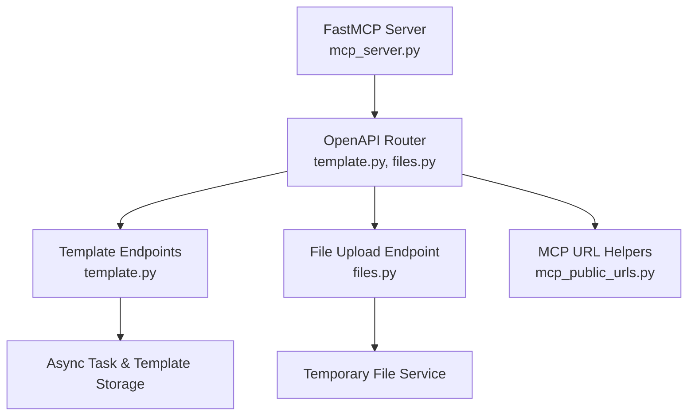
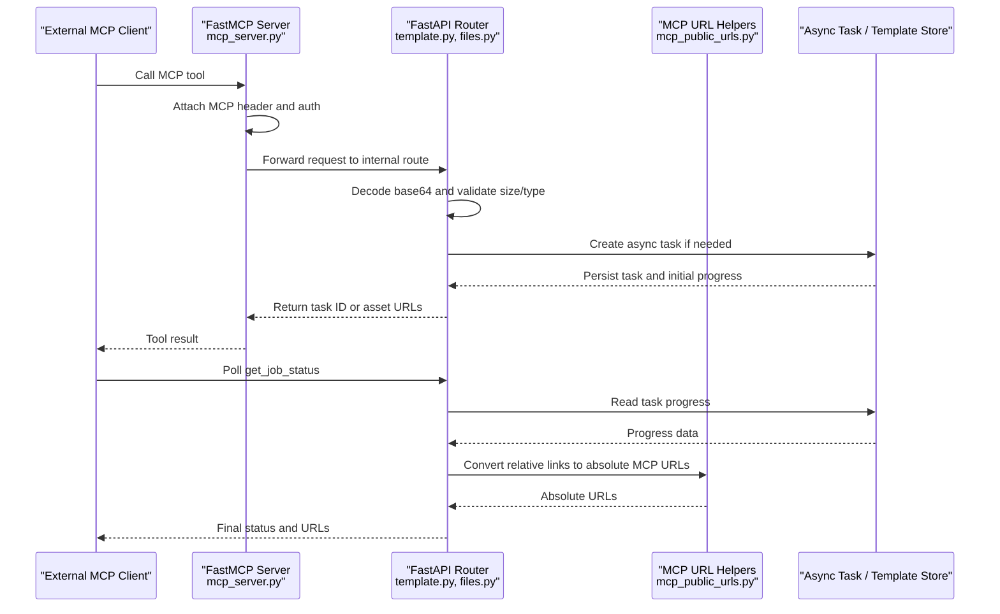
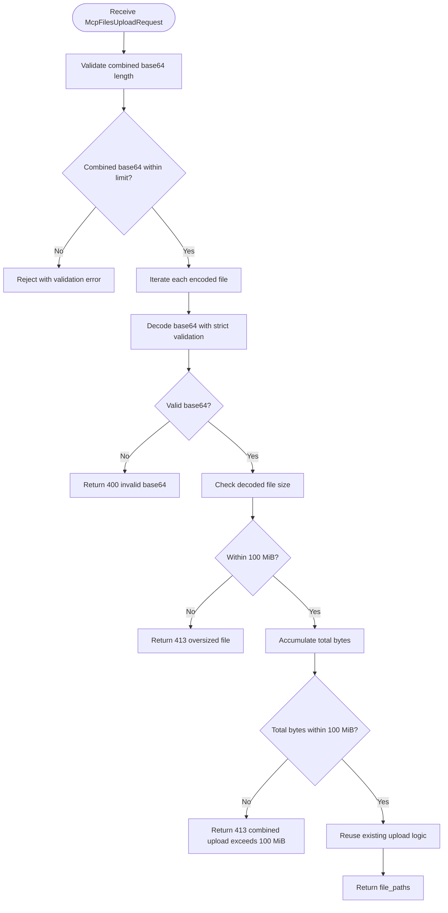
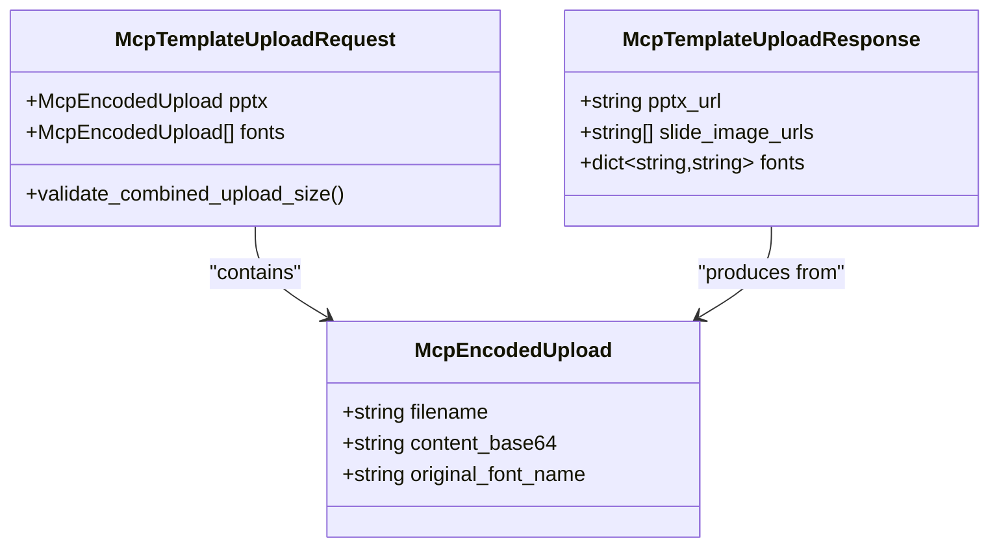
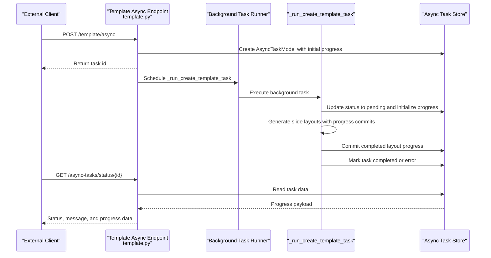
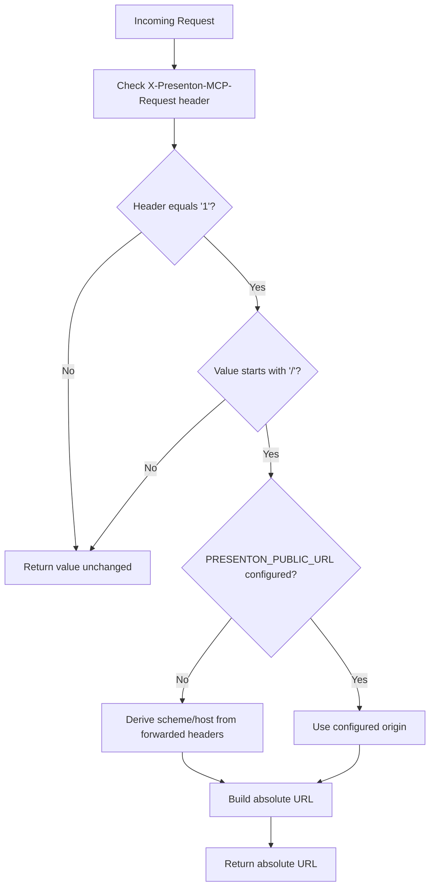
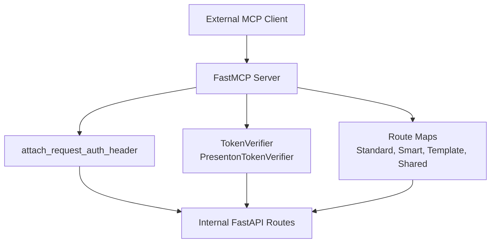
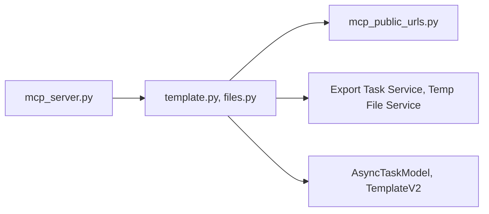

# MCP Integration

<cite>
**Referenced Files in This Document**   
- [template.py](file://servers/fastapi/api/v1/ppt/endpoints/template.py)
- [files.py](file://servers/fastapi/api/v1/ppt/endpoints/files.py)
- [mcp_public_urls.py](file://servers/fastapi/utils/mcp_public_urls.py)
- [mcp_server.py](file://servers/fastapi/mcp_server.py)
- [test_mcp_files_api.py](file://servers/fastapi/tests/unit/test_mcp_files_api.py)
</cite>

## Table of Contents
1. [Introduction](#introduction)
2. [Project Structure](#project-structure)
3. [Core Components](#core-components)
4. [Architecture Overview](#architecture-overview)
5. [Detailed Component Analysis](#detailed-component-analysis)
6. [Dependency Analysis](#dependency-analysis)
7. [Performance Considerations](#performance-considerations)
8. [Troubleshooting Guide](#troubleshooting-guide)
9. [Conclusion](#conclusion)

## Introduction
This document explains the Model Context Protocol (MCP) integration for Presenton, focusing on:
- Encoded file upload endpoints for reference documents and template assets.
- Base64-encoded content handling, size limits, and validation rules.
- The async task system used for long-running template generation with progress tracking.
- MCP request detection and public URL generation for external systems.
- Practical integration examples, security considerations, error handling, and performance guidance.

The MCP layer exposes a small, safe subset of the internal FastAPI presentation workflow to external LLM-driven clients. It is designed so that host applications can upload files and templates without multipart form support, start asynchronous generation jobs, and poll their progress through standardized tool calls.

## Project Structure
The MCP integration spans four main areas:
- MCP server routing and authentication.
- Template upload and async creation endpoints.
- Reference file upload endpoint.
- MCP request detection and public URL helpers.

**Diagram sources**
- [mcp_server.py:51-99](file://servers/fastapi/mcp_server.py#L51-L99)
- [template.py:95-104](file://servers/fastapi/api/v1/ppt/endpoints/template.py#L95-L104)
- [files.py:16-21](file://servers/fastapi/api/v1/ppt/endpoints/files.py#L16-L21)
- [mcp_public_urls.py:9-10](file://servers/fastapi/utils/mcp_public_urls.py#L9-L10)

**Section sources**
- [mcp_server.py:51-99](file://servers/fastapi/mcp_server.py#L51-L99)
- [template.py:95-104](file://servers/fastapi/api/v1/ppt/endpoints/template.py#L95-L104)
- [files.py:16-21](file://servers/fastapi/api/v1/ppt/endpoints/files.py#L16-L21)
- [mcp_public_urls.py:9-10](file://servers/fastapi/utils/mcp_public_urls.py#L9-L10)

## Core Components
This section summarizes the MCP-specific models and endpoints relevant to encoded uploads and template operations.

| Area | Model or Endpoint | Purpose | Key Behavior |
|---|---|---|---|
| Reference file upload | `McpEncodedFileUpload` | Represents one base64-encoded file attachment | Validates filename length and base64 field length |
| Reference file upload | `McpFilesUploadRequest` | Batched reference file upload | Limits number of files and combined base64 size |
| Reference file upload | `/files/mcp-upload` | Accepts base64 files and returns Presenton-owned paths | Decodes base64, validates types and sizes, reuses existing upload logic |
| Template upload | `McpEncodedUpload` | Represents PPTX or font bytes as base64 | Adds optional font replacement metadata |
| Template upload | `McpTemplateUploadRequest` | Uploads PPTX plus optional fonts | Enforces combined base64 size limit and per-font size limit |
| Template upload | `/template/mcp-upload` | Converts uploaded PPTX and fonts into Presenton URLs | Produces `pptx_url`, slide image URLs, and font mapping |
| Async template creation | `create_template` | Starts long-running template generation | Creates an async task and background job |
| Progress tracking | `_template_task_progress_data` | Serializes template generation progress | Tracks layout counts, attempt, and identity fields |
| MCP request detection | `is_mcp_request` | Detects MCP-originated requests | Checks `X-Presenton-MCP-Request` header |
| Public URL generation | `absolute_mcp_url` | Builds absolute browser-facing URLs | Uses configured public origin or forwarded headers |

**Section sources**
- [files.py:24-50](file://servers/fastapi/api/v1/ppt/endpoints/files.py#L24-L50)
- [files.py:103-130](file://servers/fastapi/api/v1/ppt/endpoints/files.py#L103-L130)
- [template.py:155-187](file://servers/fastapi/api/v1/ppt/endpoints/template.py#L155-L187)
- [template.py:1214-1268](file://servers/fastapi/api/v1/ppt/endpoints/template.py#L1214-L1268)
- [template.py:1568-1617](file://servers/fastapi/api/v1/ppt/endpoints/template.py#L1568-L1617)
- [template.py:395-426](file://servers/fastapi/api/v1/ppt/endpoints/template.py#L395-L426)
- [mcp_public_urls.py:13-40](file://servers/fastapi/utils/mcp_public_urls.py#L13-L40)

## Architecture Overview
The MCP integration follows a layered flow:
1. An external client connects to the MCP server.
2. The MCP server maps tools to internal FastAPI routes.
3. The MCP server attaches authentication and MCP request headers before calling FastAPI.
4. FastAPI endpoints decode base64 payloads, validate them, and store user-scoped assets.
5. Long-running template generation runs asynchronously and updates task progress.
6. External clients poll job status and receive absolute URLs suitable for browsers.

**Diagram sources**
- [mcp_server.py:365-414](file://servers/fastapi/mcp_server.py#L365-L414)
- [mcp_server.py:51-99](file://servers/fastapi/mcp_server.py#L51-L99)
- [template.py:1568-1617](file://servers/fastapi/api/v1/ppt/endpoints/template.py#L1568-L1617)
- [mcp_public_urls.py:13-40](file://servers/fastapi/utils/mcp_public_urls.py#L13-L40)

## Detailed Component Analysis

### Encoded File Upload Models and Validation
Reference files are uploaded through a JSON body containing base64-encoded content. This avoids multipart form requirements and makes the endpoint suitable for MCP clients.

Key models:
- `McpEncodedFileUpload`: Holds a filename and base64 content.
- `McpFilesUploadRequest`: Holds up to 32 files and enforces a combined base64 character limit.
- `McpFilesUploadResponse`: Returns Presenton-owned file paths.

Validation rules:
- Each file’s base64 field must be non-empty and within the configured maximum.
- Combined base64 characters across all files must not exceed the configured limit.
- Individual decoded file size must not exceed 100 MiB.
- Invalid base64 produces a 400 error.
- Oversized files produce a 413 error.
- Combined payload overflow raises a validation error during model validation.

**Diagram sources**
- [files.py:24-50](file://servers/fastapi/api/v1/ppt/endpoints/files.py#L24-L50)
- [files.py:63-76](file://servers/fastapi/api/v1/ppt/endpoints/files.py#L63-L76)
- [files.py:108-130](file://servers/fastapi/api/v1/ppt/endpoints/files.py#L108-L130)

**Section sources**
- [files.py:24-50](file://servers/fastapi/api/v1/ppt/endpoints/files.py#L24-L50)
- [files.py:63-76](file://servers/fastapi/api/v1/ppt/endpoints/files.py#L63-L76)
- [files.py:103-130](file://servers/fastapi/api/v1/ppt/endpoints/files.py#L103-L130)
- [test_mcp_files_api.py:47-71](file://servers/fastapi/tests/unit/test_mcp_files_api.py#L47-L71)

### Template Upload Models and Base64 Handling
Template uploads accept a PPTX and optional replacement fonts as base64-encoded content.

Key models:
- `McpEncodedUpload`: Represents either the PPTX or a font file. Supports an optional `original_font_name`.
- `McpTemplateUploadRequest`: Requires one PPTX and allows up to 32 font entries.
- `McpTemplateUploadResponse`: Returns a ready-to-use `pptx_url`, slide image URLs, and a font mapping.

Validation rules:
- PPTX filename must end with `.pptx`.
- PPTX decoded content is limited to 100 MiB.
- Each font decoded content is limited to 10 MiB.
- Combined template upload (PPTX plus fonts) is limited to 100 MiB.
- Combined base64 character length is validated at the Pydantic model level.
- Invalid base64 produces a 400 error.
- Oversized content produces a 413 error.

**Diagram sources**
- [template.py:155-187](file://servers/fastapi/api/v1/ppt/endpoints/template.py#L155-L187)
- [template.py:190-207](file://servers/fastapi/api/v1/ppt/endpoints/template.py#L190-L207)

**Section sources**
- [template.py:155-187](file://servers/fastapi/api/v1/ppt/endpoints/template.py#L155-L187)
- [template.py:210-223](file://servers/fastapi/api/v1/ppt/endpoints/template.py#L210-L223)
- [template.py:1214-1268](file://servers/fastapi/api/v1/ppt/endpoints/template.py#L1214-L1268)

### Async Template Generation and Progress Tracking
Template creation is intentionally asynchronous because it may involve PPTX conversion, slide layout generation, component merging, theme generation, and database persistence.

Core flow:
1. `/template/async` creates an `AsyncTaskModel` with type `template.create`.
2. A background task runs `_run_create_template_task`.
3. The background task initializes progress using `_template_task_progress_data`.
4. Slide layouts are generated concurrently, with progress committed after each completed layout.
5. On success, the task is marked completed; on failure, it is marked error with structured error data.
6. Clients poll `/async-tasks/status/{id}` until completion or error.

Progress data structure:
- `async_task_id`: The async task identifier.
- `template_v2_id`: The generated template identifier.
- `attempt`: Retry attempt counter.
- `created_layouts`: Number of slide layouts already created.
- `remaining_layouts`: Number of layouts still pending.
- `slide_layout_statuses`: Per-layout status array.
- `name` and `thumbnail`: Human-readable template metadata.

**Diagram sources**
- [template.py:1568-1617](file://servers/fastapi/api/v1/ppt/endpoints/template.py#L1568-L1617)
- [template.py:1481-1565](file://servers/fastapi/api/v1/ppt/endpoints/template.py#L1481-L1565)
- [template.py:395-426](file://servers/fastapi/api/v1/ppt/endpoints/template.py#L395-L426)

**Section sources**
- [template.py:1568-1617](file://servers/fastapi/api/v1/ppt/endpoints/template.py#L1568-L1617)
- [template.py:1481-1565](file://servers/fastapi/api/v1/ppt/endpoints/template.py#L1481-L1565)
- [template.py:395-426](file://servers/fastapi/api/v1/ppt/endpoints/template.py#L395-L426)

### MCP Request Detection and Public URL Generation
MCP requests are detected by checking the `X-Presenton-MCP-Request` header. When this header is present and set to `1`, responses can safely expose absolute URLs intended for browser rendering.

Public URL behavior:
- If `PRESENTON_PUBLIC_URL` is configured, absolute URLs use that origin.
- Otherwise, the helper derives scheme and host from forwarded headers or the incoming request.
- Only values starting with `/` are converted to absolute URLs.
- Known link fields such as `path`, `edit_path`, and `preview_url` are transformed when applicable.

**Diagram sources**
- [mcp_public_urls.py:9-40](file://servers/fastapi/utils/mcp_public_urls.py#L9-L40)
- [mcp_server.py:365-391](file://servers/fastapi/mcp_server.py#L365-L391)

**Section sources**
- [mcp_public_urls.py:9-40](file://servers/fastapi/utils/mcp_public_urls.py#L9-L40)
- [mcp_server.py:365-391](file://servers/fastapi/mcp_server.py#L365-L391)

### MCP Server Routing and Authentication
The MCP server exposes only a curated set of tools:
- Standard presentation generation.
- Smart presentation generation.
- Template listing.
- Template asset upload.
- Template async creation.
- Reference file upload.
- Job status polling.

Authentication:
- Optional bearer token verification against Presenton API keys.
- Internal session tokens are exchanged for short-lived cookies or authorization headers.
- The MCP key itself is never forwarded to internal endpoints.
- Public origin headers are preserved so generated URLs match the client’s visible host.

**Diagram sources**
- [mcp_server.py:51-99](file://servers/fastapi/mcp_server.py#L51-L99)
- [mcp_server.py:285-316](file://servers/fastapi/mcp_server.py#L285-L316)
- [mcp_server.py:365-414](file://servers/fastapi/mcp_server.py#L365-L414)

**Section sources**
- [mcp_server.py:51-99](file://servers/fastapi/mcp_server.py#L51-L99)
- [mcp_server.py:285-316](file://servers/fastapi/mcp_server.py#L285-L316)
- [mcp_server.py:365-414](file://servers/fastapi/mcp_server.py#L365-L414)

## Dependency Analysis
The MCP integration has clear boundaries between the MCP server, FastAPI endpoints, and shared utilities.

**Diagram sources**
- [mcp_server.py:51-99](file://servers/fastapi/mcp_server.py#L51-L99)
- [template.py:42-47](file://servers/fastapi/api/v1/ppt/endpoints/template.py#L42-L47)
- [files.py:9-14](file://servers/fastapi/api/v1/ppt/endpoints/files.py#L9-L14)
- [mcp_public_urls.py:1-6](file://servers/fastapi/utils/mcp_public_urls.py#L1-L6)

**Section sources**
- [mcp_server.py:51-99](file://servers/fastapi/mcp_server.py#L51-L99)
- [template.py:42-47](file://servers/fastapi/api/v1/ppt/endpoints/template.py#L42-L47)
- [files.py:9-14](file://servers/fastapi/api/v1/ppt/endpoints/files.py#L9-L14)
- [mcp_public_urls.py:1-6](file://servers/fastapi/utils/mcp_public_urls.py#L1-L6)

## Performance Considerations
- **Large base64 payloads**: Both reference file and template uploads enforce a 100 MiB combined limit. Base64 expansion increases memory usage; clients should avoid unnecessary large attachments.
- **Concurrent slide layout generation**: Template creation uses parallel workers bounded by `MAX_PARALLEL_SLIDE_LAYOUTS`. Large decks benefit from concurrency but increase CPU and memory pressure.
- **Long-running jobs**: Presentation and template generation can take several minutes. MCP upstream timeouts are configured to allow extended processing.
- **Progress polling**: Clients should poll every 10–15 seconds rather than tight loops to reduce load.
- **Asset reuse**: Uploaded files and templates are stored under user-scoped directories. Reusing returned paths and URLs avoids redundant uploads.

[No sources needed since this section provides general guidance]

## Troubleshooting Guide

### Common Upload Errors
| Symptom | Likely Cause | Resolution |
|---|---|---|
| 400 invalid base64 | Malformed base64 string | Ensure the entire payload is standard base64 without prefixes or wrapper text |
| 413 oversized file | Single file exceeds 100 MiB | Split content or reduce file size before encoding |
| 413 combined upload exceeds 100 MiB | Multiple files or PPTX plus fonts exceed limit | Reduce total payload size |
| 400 template file must be a PPTX | Non-PPTX filename | Rename or select a valid `.pptx` file |
| 400 PPTX file not found | Using a host attachment ID instead of Presenton URL | Call `/template/mcp-upload` first and use the returned `pptx_url` |

**Section sources**
- [files.py:63-76](file://servers/fastapi/api/v1/ppt/endpoints/files.py#L63-L76)
- [files.py:108-130](file://servers/fastapi/api/v1/ppt/endpoints/files.py#L108-L130)
- [template.py:1224-1246](file://servers/fastapi/api/v1/ppt/endpoints/template.py#L1224-L1246)
- [template.py:924-1000](file://servers/fastapi/api/v1/ppt/endpoints/template.py#L924-L1000)

### Async Task Issues
| Symptom | Likely Cause | Resolution |
|---|---|---|
| Task remains pending | Generation still running or blocked | Poll again after 10–15 seconds |
| Task status is error | Template creation failed | Inspect `task.error.detail` and retry only after fixing input |
| Retry returns 409 | Template already created or invalid retry state | List templates or correct the task state |
| Missing task | Wrong task ID or expired context | Use the exact task ID returned by the start endpoint |

**Section sources**
- [template.py:1481-1565](file://servers/fastapi/api/v1/ppt/endpoints/template.py#L1481-L1565)
- [template.py:1620-1690](file://servers/fastapi/api/v1/ppt/endpoints/template.py#L1620-L1690)

### MCP URL Problems
| Symptom | Likely Cause | Resolution |
|---|---|---|
| Relative path in response | Not an MCP request or value does not start with `/` | Confirm `X-Presenton-MCP-Request=1` header is set |
| Wrong host in URL | Missing or incorrect `PRESENTON_PUBLIC_URL` | Configure the public URL or ensure forwarded headers are correct |
| Browser cannot open preview URL | Preview URL is not a template ID | Use `preview_url` only for viewing; do not pass it as a template ID |

**Section sources**
- [mcp_public_urls.py:13-40](file://servers/fastapi/utils/mcp_public_urls.py#L13-L40)
- [mcp_server.py:365-391](file://servers/fastapi/mcp_server.py#L365-L391)

## Conclusion
The MCP integration provides a secure, client-neutral interface for uploading files and templates, starting asynchronous generation jobs, and monitoring progress. Its design emphasizes:
- Strict base64 decoding and size validation.
- User-scoped storage and controlled exposure of internal routes.
- Clear separation between reference file uploads and template asset uploads.
- Robust async task tracking with per-layout progress.
- Reliable public URL generation for external systems.

For production integrations, always:
- Send standard base64 binary content only.
- Respect the 100 MiB combined upload limit.
- Use returned IDs, paths, and URLs exactly as provided.
- Poll job status patiently and handle errors explicitly.
- Configure `PRESENTON_PUBLIC_URL` when external clients need absolute browser-accessible links.

[No sources needed since this section summarizes without analyzing specific files]