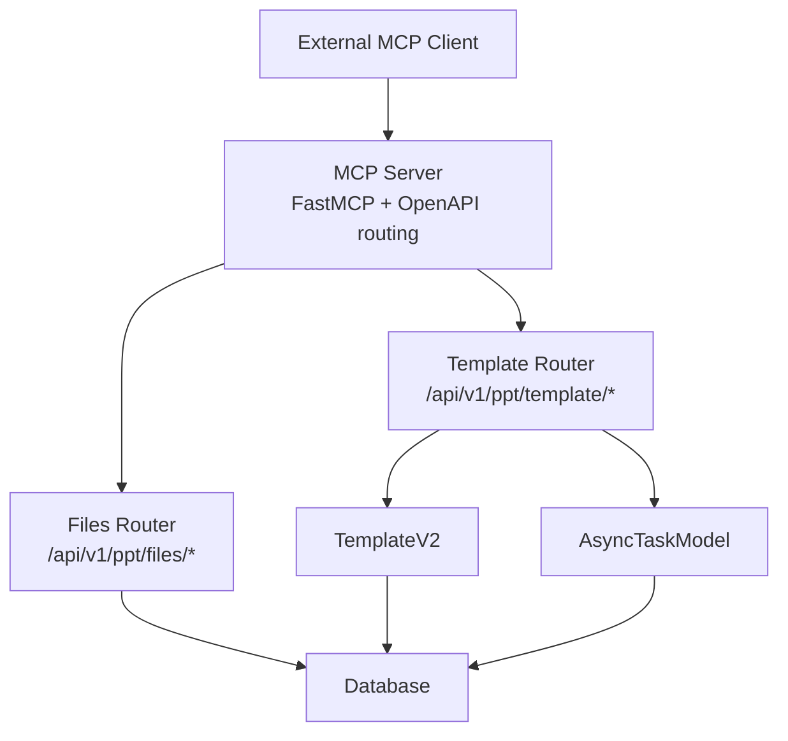
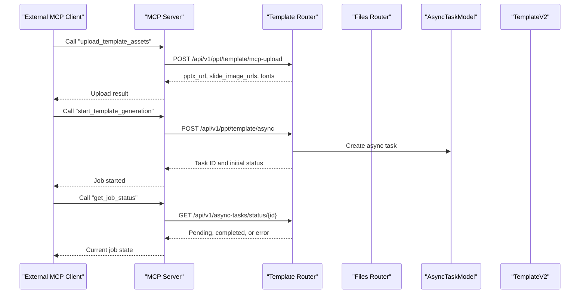
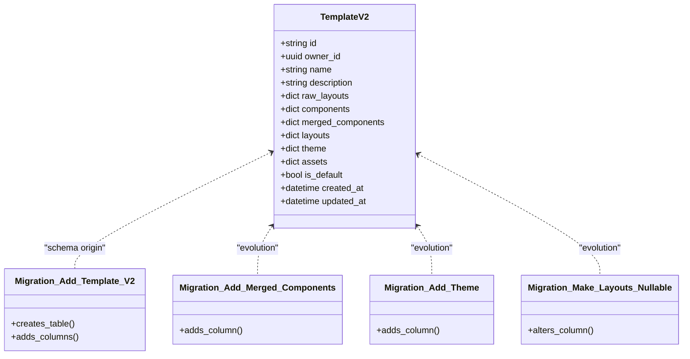
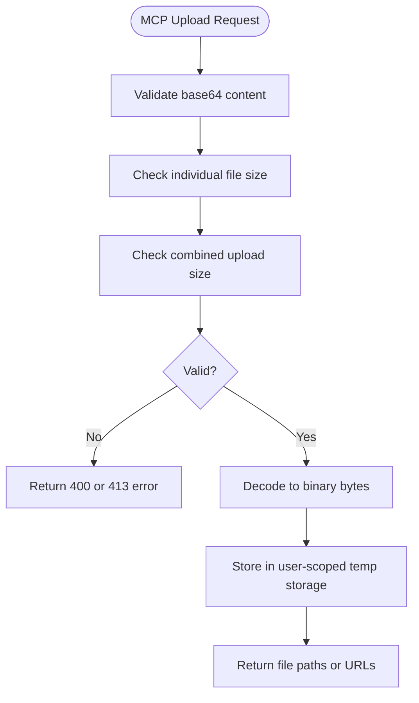
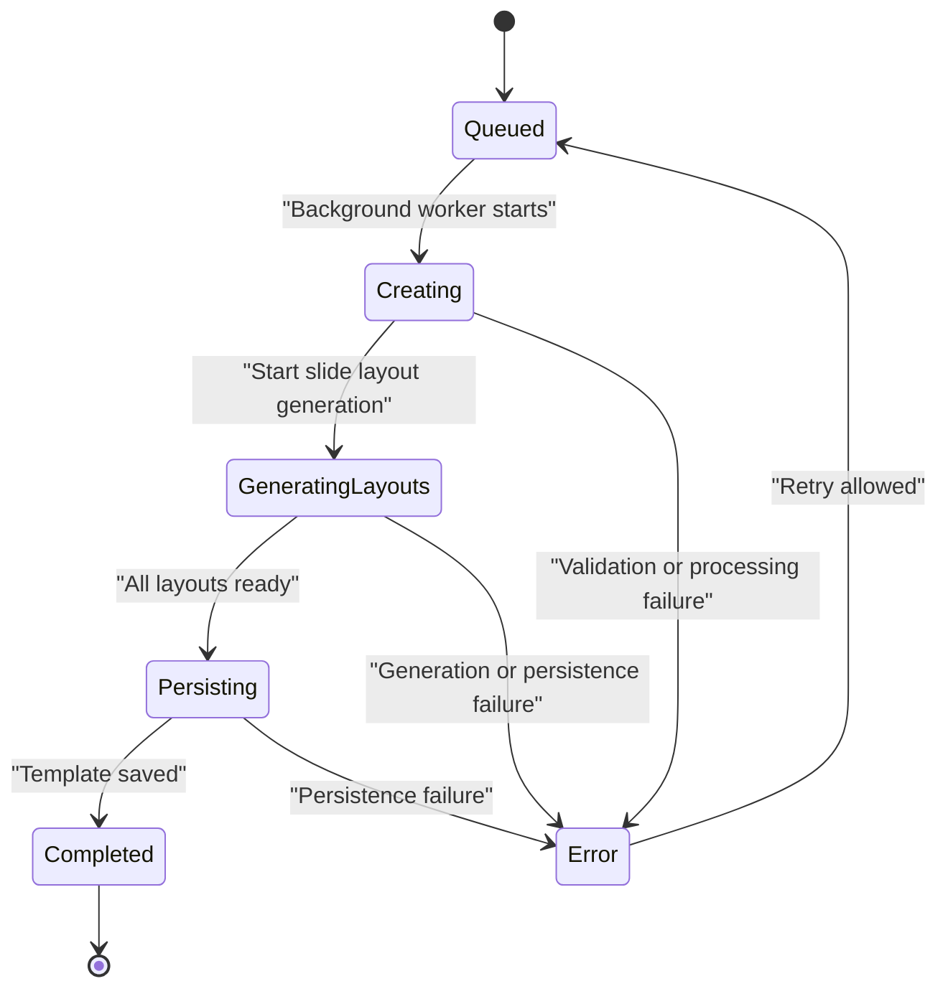
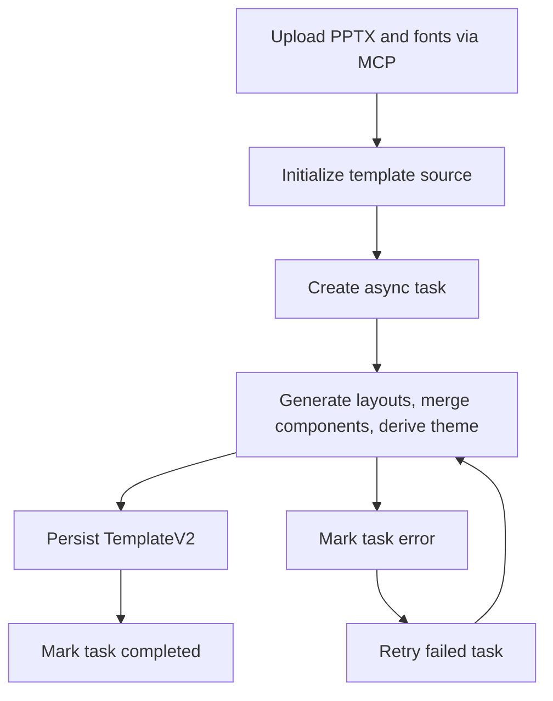
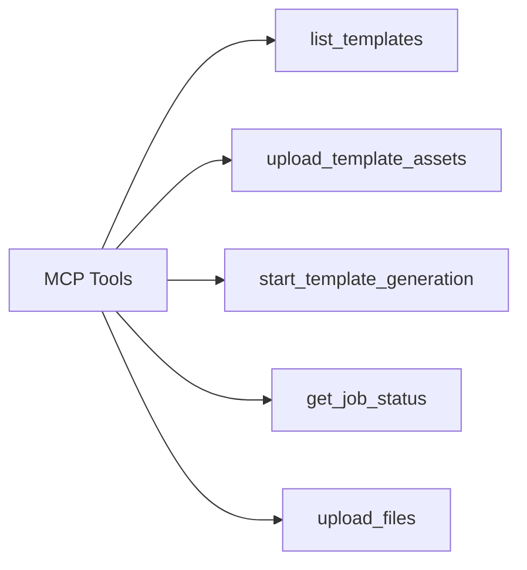
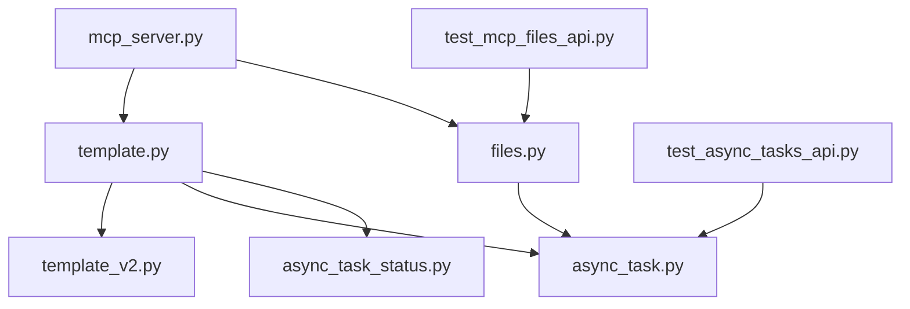
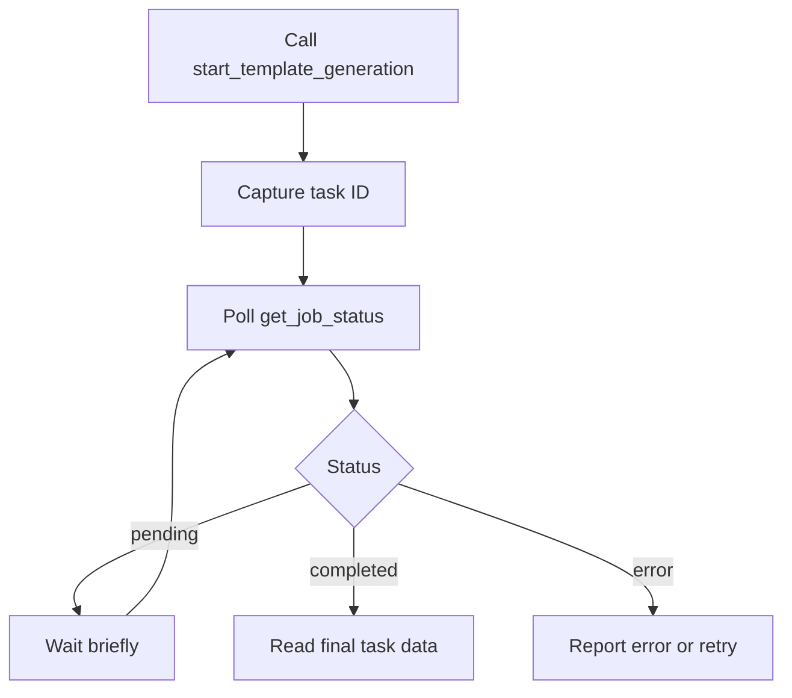

# Template Versioning & MCP Integration

<cite>
**Referenced Files in This Document**
- [template.py](file://servers/fastapi/api/v1/ppt/endpoints/template.py)
- [files.py](file://servers/fastapi/api/v1/ppt/endpoints/files.py)
- [mcp_server.py](file://servers/fastapi/mcp_server.py)
- [template_v2.py](file://servers/fastapi/models/sql/template_v2.py)
- [async_task.py](file://servers/fastapi/models/sql/async_task.py)
- [async_task_status.py](file://servers/fastapi/enums/async_task_status.py)
- [6e4a1b2c3d5f_add_template_v2_and_presentation_version.py](file://servers/fastapi/alembic/versions/6e4a1b2c3d5f_add_template_v2_and_presentation_version.py)
- [8a6c4d2e1f30_add_merged_components_to_template_v2.py](file://servers/fastapi/alembic/versions/8a6c4d2e1f30_add_merged_components_to_template_v2.py)
- [e4c7a9b2d6f1_add_theme_to_template_v2.py](file://servers/fastapi/alembic/versions/e4c7a9b2d6f1_add_theme_to_template_v2.py)
- [2c8f4a1b9d7e_make_template_v2_layouts_nullable.py](file://servers/fastapi/alembic/versions/2c8f4a1b9d7e_make_template_v2_layouts_nullable.py)
- [test_mcp_files_api.py](file://servers/fastapi/tests/unit/test_mcp_files_api.py)
- [test_async_tasks_api.py](file://servers/fastapi/tests/unit/test_async_tasks_api.py)
</cite>

## Table of Contents
1. [Introduction](#introduction)
2. [Project Structure](#project-structure)
3. [Core Components](#core-components)
4. [Architecture Overview](#architecture-overview)
5. [Detailed Component Analysis](#detailed-component-analysis)
6. [Dependency Analysis](#dependency-analysis)
7. [Performance Considerations](#performance-considerations)
8. [Troubleshooting Guide](#troubleshooting-guide)
9. [Conclusion](#conclusion)

## Introduction
This document explains how Presenton implements template versioning and Model Context Protocol (MCP) integration for long-running template generation workflows. It covers:

- The template data model and schema evolution that supports historical versions.
- MCP-specific endpoints for encoded file uploads, including `McpTemplateUploadRequest` and base64-encoded content handling.
- The async task system used to track progress during template creation.
- The complete template lifecycle from asset upload through background processing, status updates, completion, and retry behavior.
- Practical guidance for integrating external systems via MCP, uploading large templates, and monitoring generation progress.

## Project Structure
The relevant implementation is primarily in the FastAPI backend under `servers/fastapi`:

- Template API endpoints and async template creation logic are in the template router.
- MCP reference-file upload endpoints are in the files router.
- MCP server configuration maps OpenAPI routes to MCP tools.
- Database models define the persisted template and async task structures.
- Alembic migrations evolve the template schema over time.
- Unit tests validate MCP upload behavior and async task exposure.

**Diagram sources**
- [mcp_server.py:51-99](file://servers/fastapi/mcp_server.py#L51-L99)
- [template.py:95-104](file://servers/fastapi/api/v1/ppt/endpoints/template.py#L95-L104)
- [files.py:16-21](file://servers/fastapi/api/v1/ppt/endpoints/files.py#L16-L21)
- [template_v2.py:16-61](file://servers/fastapi/models/sql/template_v2.py#L16-L61)
- [async_task.py:16-62](file://servers/fastapi/models/sql/async_task.py#L16-L62)

**Section sources**
- [mcp_server.py:51-99](file://servers/fastapi/mcp_server.py#L51-L99)
- [template.py:95-104](file://servers/fastapi/api/v1/ppt/endpoints/template.py#L95-L104)
- [files.py:16-21](file://servers/fastapi/api/v1/ppt/endpoints/files.py#L16-L21)

## Core Components
This section summarizes the main building blocks used by template versioning and MCP integration.

| Component | Responsibility | Key Implementation Details |
|---|---|---|
| `TemplateV2` | Persists a template record with metadata, layouts, components, theme, assets, timestamps, and ownership. | Uses JSON columns for layouts, components, merged components, theme, and assets. Includes `created_at` and `updated_at`. |
| `AsyncTaskModel` | Tracks long-running operations such as template creation. | Stores type, status, message, error, data, payload, owner, and timestamps. Status values are strings. |
| `AsyncTaskStatus` | Enumerates task states. | Supports pending, completed, and error. |
| Template Router | Exposes template listing, MCP template upload, async template creation, layout generation, and patching. | Validates base64 uploads, converts PPTX to JSON layouts, runs background tasks, and persists generated templates. |
| Files Router | Exposes MCP reference-file upload for documents and images. | Accepts base64-encoded files, validates size and types, and returns user-scoped file paths. |
| MCP Server | Maps selected OpenAPI routes to MCP tools and enforces workflow instructions. | Exposes template listing, MCP template upload, async template creation, reference file upload, and job status polling. |

**Section sources**
- [template_v2.py:16-61](file://servers/fastapi/models/sql/template_v2.py#L16-L61)
- [async_task.py:16-62](file://servers/fastapi/models/sql/async_task.py#L16-L62)
- [async_task_status.py:4-8](file://servers/fastapi/enums/async_task_status.py#L4-L8)
- [template.py:95-104](file://servers/fastapi/api/v1/ppt/endpoints/template.py#L95-L104)
- [files.py:16-60](file://servers/fastapi/api/v1/ppt/endpoints/files.py#L16-L60)
- [mcp_server.py:51-111](file://servers/fastapi/mcp_server.py#L51-L111)

## Architecture Overview
The MCP layer does not implement business logic directly. Instead, it exposes a curated subset of the internal FastAPI endpoints as MCP tools. Clients use MCP tools to:

1. Upload a PPTX and optional replacement fonts as base64.
2. Start an asynchronous template generation job.
3. Poll job status until completion or failure.
4. List available templates.
5. Upload reference files for standard or smart presentation generation.

**Diagram sources**
- [mcp_server.py:70-99](file://servers/fastapi/mcp_server.py#L70-L99)
- [template.py:1214-1228](file://servers/fastapi/api/v1/ppt/endpoints/template.py#L1214-L1228)
- [template.py:1568-1617](file://servers/fastapi/api/v1/ppt/endpoints/template.py#L1568-L1617)
- [async_task.py:16-62](file://servers/fastapi/models/sql/async_task.py#L16-L62)

## Detailed Component Analysis

### Template Versioning and Schema Evolution
Presenton stores templates in the `template_v2` table. Each row represents one template version with:

- A stable primary key `id`.
- Owner isolation through `owner_id`.
- Human-readable metadata such as `name`, `description`, and `is_default`.
- Raw source representation (`raw_layouts`).
- Generated component data (`components`, `merged_components`).
- Finalized slide layouts (`layouts`).
- Theme information (`theme`).
- Asset references (`assets`).
- Creation and update timestamps.

The schema evolves through Alembic migrations rather than replacing rows with new versions. Historical evolution is visible through migration history and the presence of fields added over time.

**Diagram sources**
- [template_v2.py:16-61](file://servers/fastapi/models/sql/template_v2.py#L16-L61)
- [6e4a1b2c3d5f_add_template_v2_and_presentation_version.py:44-58](file://servers/fastapi/alembic/versions/6e4a1b2c3d5f_add_template_v2_and_presentation_version.py#L44-L58)
- [8a6c4d2e1f30_add_merged_components_to_template_v2.py:30-37](file://servers/fastapi/alembic/versions/8a6c4d2e1f30_add_merged_components_to_template_v2.py#L30-L37)
- [e4c7a9b2d6f1_add_theme_to_template_v2.py:30-33](file://servers/fastapi/alembic/versions/e4c7a9b2d6f1_add_theme_to_template_v2.py#L30-L33)
- [2c8f4a1b9d7e_make_template_v2_layouts_nullable.py:30-39](file://servers/fastapi/alembic/versions/2c8f4a1b9d7e_make_template_v2_layouts_nullable.py#L30-L39)

Key observations:

- Template identity is stable per row.
- Layouts, components, theme, and assets are stored as JSON, allowing rich template structure without rigid relational constraints.
- Migrations add columns incrementally, preserving older rows while enabling newer features.
- The list endpoint filters out templates with zero layouts, treating them as incomplete.

**Section sources**
- [template_v2.py:16-61](file://servers/fastapi/models/sql/template_v2.py#L16-L61)
- [6e4a1b2c3d5f_add_template_v2_and_presentation_version.py:44-58](file://servers/fastapi/alembic/versions/6e4a1b2c3d5f_add_template_v2_and_presentation_version.py#L44-L58)
- [8a6c4d2e1f30_add_merged_components_to_template_v2.py:30-37](file://servers/fastapi/alembic/versions/8a6c4d2e1f30_add_merged_components_to_template_v2.py#L30-L37)
- [e4c7a9b2d6f1_add_theme_to_template_v2.py:30-33](file://servers/fastapi/alembic/versions/e4c7a9b2d6f1_add_theme_to_template_v2.py#L30-L33)
- [2c8f4a1b9d7e_make_template_v2_layouts_nullable.py:30-39](file://servers/fastapi/alembic/versions/2c8f4a1b9d7e_make_template_v2_layouts_nullable.py#L30-L39)
- [template.py:1112-1185](file://servers/fastapi/api/v1/ppt/endpoints/template.py#L1112-L1185)

### MCP-Specific Encoded File Uploads
There are two MCP upload entry points:

1. **Reference file upload**: `/api/v1/ppt/files/mcp-upload` accepts multiple base64-encoded documents or images.
2. **Template asset upload**: `/api/v1/ppt/template/mcp-upload` accepts a base64-encoded PPTX and optional replacement fonts.

Both endpoints enforce:

- Base64 validation.
- Per-file size limits.
- Combined upload size limits.
- Reuse of existing file validation and temporary storage logic.

**Diagram sources**
- [files.py:24-50](file://servers/fastapi/api/v1/ppt/endpoints/files.py#L24-L50)
- [files.py:63-76](file://servers/fastapi/api/v1/ppt/endpoints/files.py#L63-L76)
- [files.py:103-130](file://servers/fastapi/api/v1/ppt/endpoints/files.py#L103-L130)
- [template.py:155-187](file://servers/fastapi/api/v1/ppt/endpoints/template.py#L155-L187)
- [template.py:210-223](file://servers/fastapi/api/v1/ppt/endpoints/template.py#L210-L223)

Important details:

- `McpEncodedFileUpload` and `McpFilesUploadRequest` handle reference files.
- `McpEncodedUpload` and `McpTemplateUploadRequest` handle template PPTX and font uploads.
- Invalid base64 returns a 400 error.
- Oversized payloads return a 413 error.
- Tests verify invalid base64 rejection, accepted file-type validation reuse, and combined upload limits.

**Section sources**
- [files.py:24-60](file://servers/fastapi/api/v1/ppt/endpoints/files.py#L24-L60)
- [files.py:63-76](file://servers/fastapi/api/v1/ppt/endpoints/files.py#L63-L76)
- [files.py:103-130](file://servers/fastapi/api/v1/ppt/endpoints/files.py#L103-L130)
- [template.py:155-187](file://servers/fastapi/api/v1/ppt/endpoints/template.py#L155-L187)
- [template.py:210-223](file://servers/fastapi/api/v1/ppt/endpoints/template.py#L210-L223)
- [test_mcp_files_api.py:18-71](file://servers/fastapi/tests/unit/test_mcp_files_api.py#L18-L71)

### Async Task System for Long-Running Template Operations
Template creation is intentionally asynchronous because slide layout generation can be expensive. The flow is:

1. Client calls the async template creation endpoint.
2. Backend creates an `AsyncTaskModel` with type `template.create`.
3. Initial task data includes progress placeholders.
4. Background processing generates slide layouts, merges components, derives theme, and persists the template.
5. Progress updates include completed layout indices, remaining layouts, attempt count, and template identity.
6. Completion sets status to completed; errors set status to error with structured error data.
7. Failed tasks can be retried once the original task is in error state and the template has not already been created.

**Diagram sources**
- [template.py:1481-1565](file://servers/fastapi/api/v1/ppt/endpoints/template.py#L1481-L1565)
- [template.py:1568-1617](file://servers/fastapi/api/v1/ppt/endpoints/template.py#L1568-L1617)
- [template.py:1620-1690](file://servers/fastapi/api/v1/ppt/endpoints/template.py#L1620-L1690)
- [async_task.py:16-62](file://servers/fastapi/models/sql/async_task.py#L16-L62)
- [async_task_status.py:4-8](file://servers/fastapi/enums/async_task_status.py#L4-L8)

Progress tracking uses structured task data:

- `async_task_id`: links progress to the current operation.
- `template_v2_id`: identifies the target template row.
- `attempt`: tracks retries.
- `created_layouts` and `remaining_layouts`: show overall progress.
- `slide_layout_statuses`: shows per-slide completion.
- `name` and `thumbnail`: expose human-friendly template metadata.

**Section sources**
- [template.py:395-426](file://servers/fastapi/api/v1/ppt/endpoints/template.py#L395-L426)
- [template.py:663-683](file://servers/fastapi/api/v1/ppt/endpoints/template.py#L663-L683)
- [template.py:1481-1565](file://servers/fastapi/api/v1/ppt/endpoints/template.py#L1481-L1565)
- [template.py:1568-1617](file://servers/fastapi/api/v1/ppt/endpoints/template.py#L1568-L1617)
- [template.py:1620-1690](file://servers/fastapi/api/v1/ppt/endpoints/template.py#L1620-L1690)
- [test_async_tasks_api.py:88-135](file://servers/fastapi/tests/unit/test_async_tasks_api.py#L88-L135)

### Template Lifecycle: From Creation Through Publishing
The template lifecycle consists of these stages:

| Stage | Input | Behavior | Output |
|---|---|---|---|
| Asset upload | Base64-encoded PPTX and optional fonts | Decodes, validates filename extension, checks sizes, and prepares upload artifacts. | `pptx_url`, `slide_image_urls`, `fonts`. |
| Initialization | `pptx_url`, `slide_image_urls`, optional metadata | Resolves the hosted PPTX path, converts it to JSON layouts, and validates slide-image alignment. | Prepared raw layouts and font mapping. |
| Async job start | Validated initialization request | Creates an async task, persists initial progress, and queues background work. | Task ID and pending status. |
| Background generation | Stored task payload | Generates slide layouts, merges similar components, derives theme, and persists the template. | Completed template row. |
| Completion | Finished background work | Marks task completed and updates final progress data. | Completed status and template identifiers. |
| Retry | Failed task | Resets status to pending and re-runs creation if the template was not already created. | New pending task state. |

**Diagram sources**
- [template.py:1214-1228](file://servers/fastapi/api/v1/ppt/endpoints/template.py#L1214-L1228)
- [template.py:924-1007](file://servers/fastapi/api/v1/ppt/endpoints/template.py#L924-L1007)
- [template.py:1568-1617](file://servers/fastapi/api/v1/ppt/endpoints/template.py#L1568-L1617)
- [template.py:1481-1565](file://servers/fastapi/api/v1/ppt/endpoints/template.py#L1481-L1565)
- [template.py:1620-1690](file://servers/fastapi/api/v1/ppt/endpoints/template.py#L1620-L1690)

**Section sources**
- [template.py:924-1007](file://servers/fastapi/api/v1/ppt/endpoints/template.py#L924-L1007)
- [template.py:1214-1228](file://servers/fastapi/api/v1/ppt/endpoints/template.py#L1214-L1228)
- [template.py:1481-1565](file://servers/fastapi/api/v1/ppt/endpoints/template.py#L1481-L1565)
- [template.py:1568-1617](file://servers/fastapi/api/v1/ppt/endpoints/template.py#L1568-L1617)
- [template.py:1620-1690](file://servers/fastapi/api/v1/ppt/endpoints/template.py#L1620-L1690)

### MCP Integration and Tool Exposure
The MCP server builds its tool surface from the OpenAPI specification and route maps. For template workflows, it exposes:

- `list_templates`
- `upload_template_assets`
- `start_template_generation`
- `get_job_status`

It also exposes shared tools for reference file uploads and job status polling. The MCP server translates client tool calls into internal HTTP requests, attaching authentication context and public URL hints when needed.

**Diagram sources**
- [mcp_server.py:70-111](file://servers/fastapi/mcp_server.py#L70-L111)

**Section sources**
- [mcp_server.py:51-111](file://servers/fastapi/mcp_server.py#L51-L111)
- [mcp_server.py:143-279](file://servers/fastapi/mcp_server.py#L143-L279)

## Dependency Analysis
The following diagram shows how MCP, routers, models, and tests depend on each other.

**Diagram sources**
- [mcp_server.py:51-111](file://servers/fastapi/mcp_server.py#L51-L111)
- [template.py:42-47](file://servers/fastapi/api/v1/ppt/endpoints/template.py#L42-L47)
- [files.py:9-14](file://servers/fastapi/api/v1/ppt/endpoints/files.py#L9-L14)
- [template_v2.py:16-61](file://servers/fastapi/models/sql/template_v2.py#L16-L61)
- [async_task.py:16-62](file://servers/fastapi/models/sql/async_task.py#L16-L62)
- [async_task_status.py:4-8](file://servers/fastapi/enums/async_task_status.py#L4-L8)
- [test_mcp_files_api.py:9-15](file://servers/fastapi/tests/unit/test_mcp_files_api.py#L9-L15)
- [test_async_tasks_api.py:88-135](file://servers/fastapi/tests/unit/test_async_tasks_api.py#L88-L135)

Coupling and cohesion notes:

- The template router depends on both database models and async task enums, keeping template business logic cohesive.
- MCP routing is decoupled from implementation details; it selects routes by pattern and maps them to readable tool names.
- Tests isolate MCP upload validation and async task serialization behavior.

**Section sources**
- [template.py:42-47](file://servers/fastapi/api/v1/ppt/endpoints/template.py#L42-L47)
- [files.py:9-14](file://servers/fastapi/api/v1/ppt/endpoints/files.py#L9-L14)
- [mcp_server.py:51-111](file://servers/fastapi/mcp_server.py#L51-L111)
- [test_mcp_files_api.py:9-15](file://servers/fastapi/tests/unit/test_mcp_files_api.py#L9-L15)
- [test_async_tasks_api.py:88-135](file://servers/fastapi/tests/unit/test_async_tasks_api.py#L88-L135)

## Performance Considerations
- Large base64 payloads increase memory usage during decoding. Both template and reference-file uploads enforce combined size limits around 100 MiB.
- Slide layout generation runs in parallel threads up to a configured maximum, reducing total generation time but increasing CPU usage.
- Background template creation avoids blocking the HTTP response, improving responsiveness for clients.
- Progress updates are committed after each completed slide layout, allowing clients to monitor incremental progress even during long jobs.
- MCP upstream timeouts are set high enough to accommodate first-run model downloads and larger decks.

[No sources needed since this section provides general guidance]

## Troubleshooting Guide

### Common MCP Upload Errors
| Symptom | Likely Cause | Resolution |
|---|---|---|
| Invalid base64 content error | The uploaded field contains non-base64 text, a host attachment ID, or a data-URI prefix. | Send only standard base64-encoded raw file bytes. |
| File exceeds allowed upload size | Individual file is too large. | Split uploads or reduce file size. |
| Combined file upload exceeds limit | Total base64 payload exceeds the configured limit. | Reduce number or size of files. |
| Template file must be a PPTX | Non-PPTX filename passed to template upload. | Upload a valid `.pptx` file. |
| PPTX file not found | `pptx_url` refers to a host attachment ID instead of a Presenton-hosted path. | Use the `pptx_url` returned by `upload_template_assets`. |

**Section sources**
- [files.py:63-76](file://servers/fastapi/api/v1/ppt/endpoints/files.py#L63-L76)
- [files.py:103-130](file://servers/fastapi/api/v1/ppt/endpoints/files.py#L103-L130)
- [template.py:210-223](file://servers/fastapi/api/v1/ppt/endpoints/template.py#L210-L223)
- [template.py:924-1007](file://servers/fastapi/api/v1/ppt/endpoints/template.py#L924-L1007)
- [test_mcp_files_api.py:47-71](file://servers/fastapi/tests/unit/test_mcp_files_api.py#L47-L71)

### Monitoring Template Generation Progress
Use the async task system to monitor template creation:

1. Start template generation and capture the returned task ID.
2. Poll the async task status endpoint using the same task ID.
3. While status is pending, wait briefly and poll again.
4. Treat `completed` as success and inspect the final task data.
5. Treat `error` as terminal failure and report the error detail.
6. If the task is in error state and no template row exists, retry the failed task.

**Diagram sources**
- [template.py:1568-1617](file://servers/fastapi/api/v1/ppt/endpoints/template.py#L1568-L1617)
- [template.py:1481-1565](file://servers/fastapi/api/v1/ppt/endpoints/template.py#L1481-L1565)
- [template.py:1620-1690](file://servers/fastapi/api/v1/ppt/endpoints/template.py#L1620-L1690)
- [test_async_tasks_api.py:101-135](file://servers/fastapi/tests/unit/test_async_tasks_api.py#L101-L135)

**Section sources**
- [template.py:1481-1565](file://servers/fastapi/api/v1/ppt/endpoints/template.py#L1481-L1565)
- [template.py:1568-1617](file://servers/fastapi/api/v1/ppt/endpoints/template.py#L1568-L1617)
- [template.py:1620-1690](file://servers/fastapi/api/v1/ppt/endpoints/template.py#L1620-L1690)
- [test_async_tasks_api.py:101-135](file://servers/fastapi/tests/unit/test_async_tasks_api.py#L101-L135)

## Conclusion
Presenton’s template versioning centers on a single evolving `template_v2` schema, with Alembic migrations adding capabilities such as merged components, theme data, default flags, and nullable layouts. MCP integration provides a safe, remote-friendly interface for base64-encoded uploads and long-running template generation. Clients should:

- Use MCP tools exactly as exposed.
- Pass base64-encoded file contents, not host attachment IDs.
- Start one asynchronous job per requested result.
- Poll job status until completion or error.
- Use retry endpoints only for failed template creation tasks.
- Treat template listing and preview URLs as read-only metadata.

This design separates short-lived HTTP requests from expensive template generation, while preserving a clear audit trail through async tasks and a persistent template schema that grows over time.