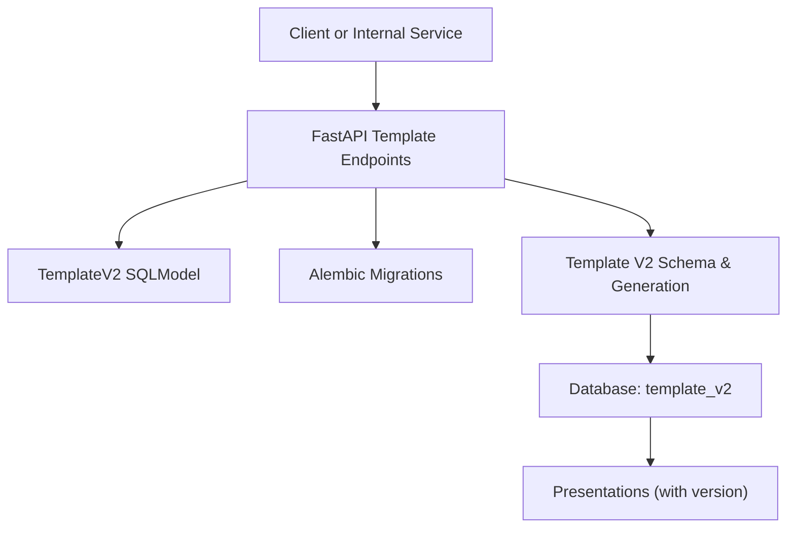
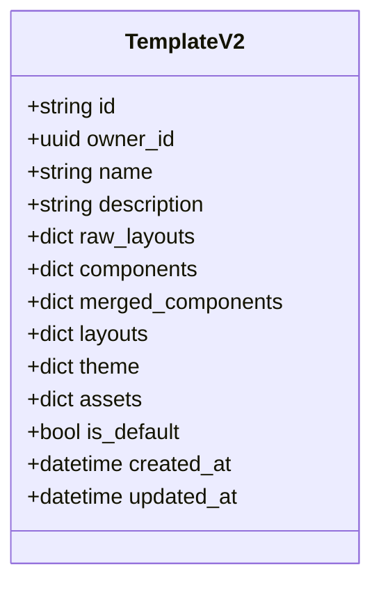
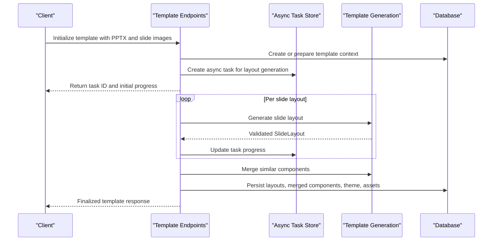
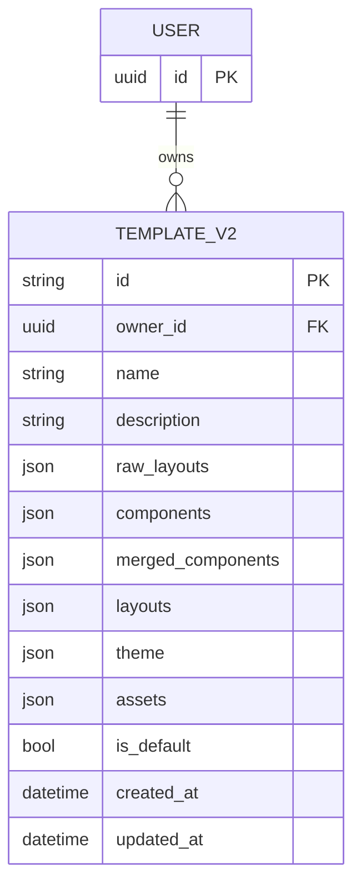
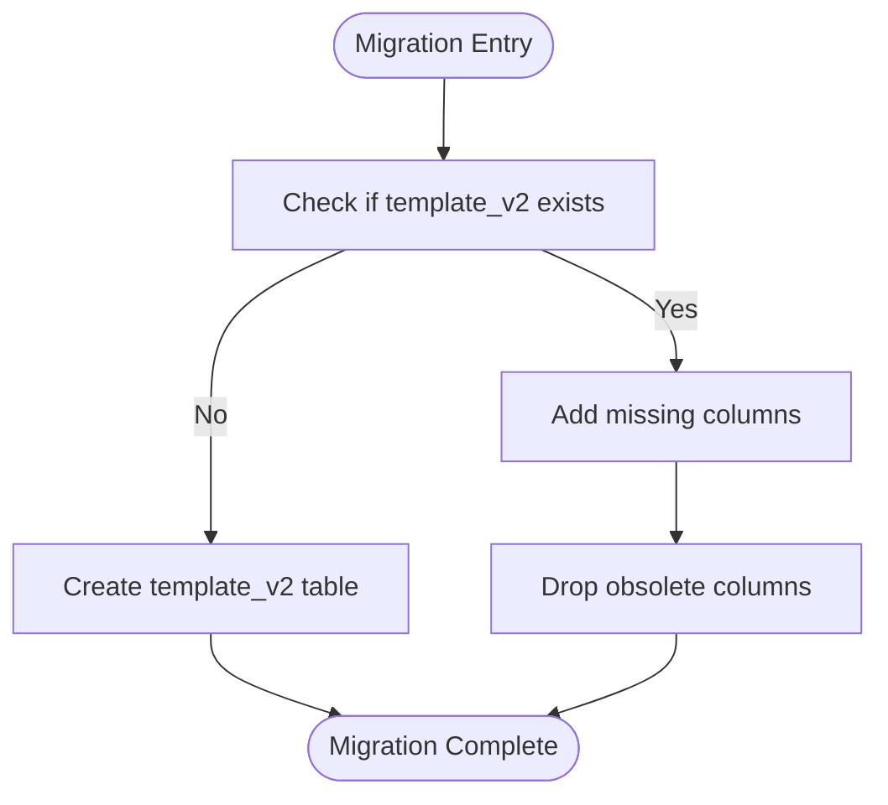
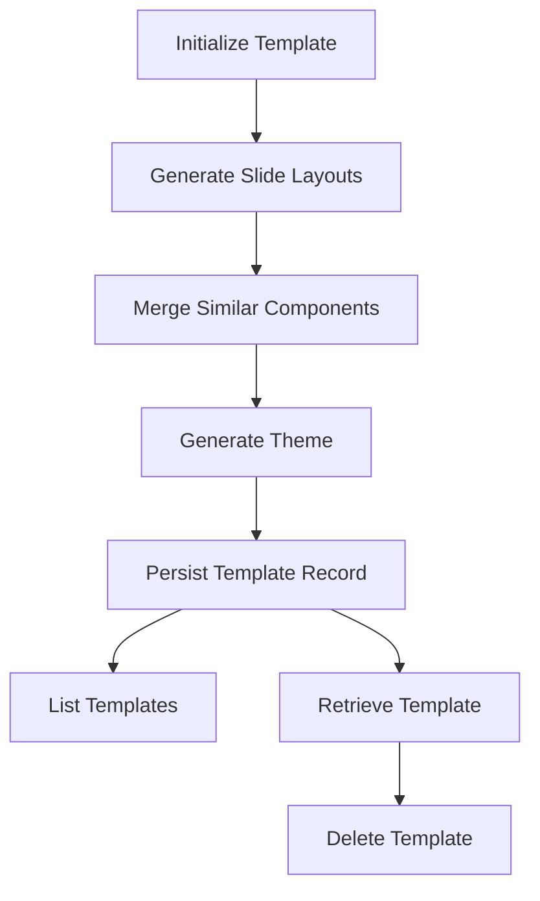
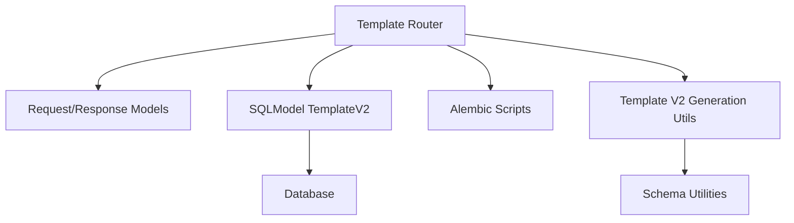

# Template Versioning System

<cite>
**Referenced Files in This Document**   
- [template_v2.py](file://servers/fastapi/models/sql/template_v2.py)
- [6e4a1b2c3d5f_add_template_v2_and_presentation_version.py](file://servers/fastapi/alembic/versions/6e4a1b2c3d5f_add_template_v2_and_presentation_version.py)
- [2c8f4a1b9d7e_make_template_v2_layouts_nullable.py](file://servers/fastapi/alembic/versions/2c8f4a1b9d7e_make_template_v2_layouts_nullable.py)
- [4b7c9d0e1f2a_add_is_default_to_template_v2.py](file://servers/fastapi/alembic/versions/4b7c9d0e1f2a_add_is_default_to_template_v2.py)
- [8a6c4d2e1f30_add_merged_components_to_template_v2.py](file://servers/fastapi/alembic/versions/8a6c4d2e1f30_add_merged_components_to_template_v2.py)
- [e4c7a9b2d6f1_add_theme_to_template_v2.py](file://servers/fastapi/alembic/versions/e4c7a9b2d6f1_add_theme_to_template_v2.py)
- [template.py](file://servers/fastapi/api/v1/ppt/endpoints/template.py)
- [schema.py](file://servers/fastapi/templates/v2/schema.py)
- [generation.py](file://servers/fastapi/templates/v2/generation.py)
- [test_template_api.py](file://servers/fastapi/tests/unit/test_template_api.py)
</cite>

## Table of Contents
1. [Introduction](#introduction)
2. [Project Structure](#project-structure)
3. [Core Components](#core-components)
4. [Architecture Overview](#architecture-overview)
5. [Detailed Component Analysis](#detailed-component-analysis)
6. [Dependency Analysis](#dependency-analysis)
7. [Performance Considerations](#performance-considerations)
8. [Troubleshooting Guide](#troubleshooting-guide)
9. [Conclusion](#conclusion)

## Introduction
This document explains the template versioning system used by the application. It focuses on how template versions are tracked, stored, and managed through their lifecycle, with emphasis on the `TemplateV2` model, database schema evolution, API-driven creation and updates, and the relationship between templates and generated presentations.

The current implementation does not use a traditional “version number” field on each template row. Instead, it stores one canonical template record per template identity and evolves its structure over time through migrations. Presentation records carry a presentation format version to distinguish generation formats. Template history is preserved through immutable layout and component data stored inside JSON fields rather than separate historical rows.

## Project Structure
The template versioning system spans several layers:

- Data model: `TemplateV2` SQLModel defines the persistent template schema.
- Database migrations: Alembic scripts evolve the `template_v2` table and related columns.
- API layer: FastAPI endpoints handle template initialization, slide layout generation, metadata updates, listing, retrieval, and deletion.
- Template processing: V2 template schema and generation utilities transform raw layouts into structured layouts, merged components, and themes.
- Tests: Unit tests validate API behavior and migration compatibility.

**Diagram sources**
- [template.py:95-105](file://servers/fastapi/api/v1/ppt/endpoints/template.py#L95-L105)
- [template_v2.py:16-61](file://servers/fastapi/models/sql/template_v2.py#L16-L61)
- [6e4a1b2c3d5f_add_template_v2_and_presentation_version.py:44-113](file://servers/fastapi/alembic/versions/6e4a1b2c3d5f_add_template_v2_and_presentation_version.py#L44-L113)
- [schema.py:257-279](file://servers/fastapi/templates/v2/schema.py#L257-L279)
- [generation.py:62-68](file://servers/fastapi/templates/v2/generation.py#L62-L68)

**Section sources**
- [template_v2.py:16-61](file://servers/fastapi/models/sql/template_v2.py#L16-L61)
- [6e4a1b2c3d5f_add_template_v2_and_presentation_version.py:44-113](file://servers/fastapi/alembic/versions/6e4a1b2c3d5f_add_template_v2_and_presentation_version.py#L44-L113)
- [template.py:95-105](file://servers/fastapi/api/v1/ppt/endpoints/template.py#L95-L105)

## Core Components
The core of the template versioning system is the `TemplateV2` model and the API endpoints that create, update, list, retrieve, and delete templates. The model captures template identity, ownership, descriptive metadata, raw and processed layout data, merged components, theme information, assets, default status, and timestamps.

Key responsibilities:
- Identity and ownership: UUID primary key and optional owner reference.
- Metadata: name, description, default flag, and timestamps.
- Layout storage: raw layouts, normalized layouts, and merged components as JSON.
- Theme and assets: optional theme profile and asset map.
- Indexing: owner lookup index for multi-user isolation.

**Diagram sources**
- [template_v2.py:16-61](file://servers/fastapi/models/sql/template_v2.py#L16-L61)

**Section sources**
- [template_v2.py:16-61](file://servers/fastapi/models/sql/template_v2.py#L16-L61)

## Architecture Overview
The template lifecycle flows through API endpoints into template processing logic and finally into persistent storage. There is no explicit “draft → published” state machine on the template itself; instead, the workflow uses asynchronous tasks and progress tracking during layout generation and component merging.

**Diagram sources**
- [template.py:586-622](file://servers/fastapi/api/v1/ppt/endpoints/template.py#L586-L622)
- [template.py:708-800](file://servers/fastapi/api/v1/ppt/endpoints/template.py#L708-L800)
- [generation.py:62-68](file://servers/fastapi/templates/v2/generation.py#L62-L68)

**Section sources**
- [template.py:586-622](file://servers/fastapi/api/v1/ppt/endpoints/template.py#L586-L622)
- [template.py:708-800](file://servers/fastapi/api/v1/ppt/endpoints/template.py#L708-L800)

## Detailed Component Analysis

### TemplateV2 Model Structure
The `TemplateV2` model defines the canonical template record. Important aspects include:

- Primary key: string UUID generated at creation.
- Owner: optional foreign key to user with cascade delete and an index for efficient lookups.
- Descriptive fields: name required; description optional.
- Layout data:
  - `raw_layouts`: original layout representation.
  - `layouts`: normalized layout structure used by generation and rendering.
  - `components`: component definitions extracted from layouts.
  - `merged_components`: deduplicated and merged components for reuse.
- Theme and assets: optional theme profile and asset mapping.
- Default flag: indicates whether the template is a default system template.
- Timestamps: `created_at` and `updated_at`, automatically maintained.

**Diagram sources**
- [template_v2.py:16-61](file://servers/fastapi/models/sql/template_v2.py#L16-L61)

**Section sources**
- [template_v2.py:16-61](file://servers/fastapi/models/sql/template_v2.py#L16-L61)

### Database Schema Evolution
The `template_v2` table has evolved through multiple Alembic migrations:

- Initial creation adds core columns including `id`, `name`, `description`, `raw_layouts`, `components`, `layouts`, `assets`, and timestamps.
- Later migrations add nullable constraints adjustments, default flags, merged components, and theme support.
- Obsolete columns such as clustering-related fields are removed.

Relevant migration highlights:
- Add `template_v2` table and presentation version column.
- Make `layouts` nullable where needed and backfill existing rows.
- Add `is_default` boolean.
- Add `merged_components`.
- Add `theme`.

**Diagram sources**
- [6e4a1b2c3d5f_add_template_v2_and_presentation_version.py:44-77](file://servers/fastapi/alembic/versions/6e4a1b2c3d5f_add_template_v2_and_presentation_version.py#L44-L77)
- [2c8f4a1b9d7e_make_template_v2_layouts_nullable.py:31-51](file://servers/fastapi/alembic/versions/2c8f4a1b9d7e_make_template_v2_layouts_nullable.py#L31-L51)
- [4b7c9d0e1f2a_add_is_default_to_template_v2.py:31-47](file://servers/fastapi/alembic/versions/4b7c9d0e1f2a_add_is_default_to_template_v2.py#L31-L47)
- [8a6c4d2e1f30_add_merged_components_to_template_v2.py:31-44](file://servers/fastapi/alembic/versions/8a6c4d2e1f30_add_merged_components_to_template_v2.py#L31-L44)
- [e4c7a9b2d6f1_add_theme_to_template_v2.py:31-47](file://servers/fastapi/alembic/versions/e4c7a9b2d6f1_add_theme_to_template_v2.py#L31-L47)

**Section sources**
- [6e4a1b2c3d5f_add_template_v2_and_presentation_version.py:44-113](file://servers/fastapi/alembic/versions/6e4a1b2c3d5f_add_template_v2_and_presentation_version.py#L44-L113)
- [2c8f4a1b9d7e_make_template_v2_layouts_nullable.py:31-51](file://servers/fastapi/alembic/versions/2c8f4a1b9d7e_make_template_v2_layouts_nullable.py#L31-L51)
- [4b7c9d0e1f2a_add_is_default_to_template_v2.py:31-47](file://servers/fastapi/alembic/versions/4b7c9d0e1f2a_add_is_default_to_template_v2.py#L31-L47)
- [8a6c4d2e1f30_add_merged_components_to_template_v2.py:31-44](file://servers/fastapi/alembic/versions/8a6c4d2e1f30_add_merged_components_to_template_v2.py#L31-L44)
- [e4c7a9b2d6f1_add_theme_to_template_v2.py:31-47](file://servers/fastapi/alembic/versions/e4c7a9b2d6f1_add_theme_to_template_v2.py#L31-L47)

### Template Lifecycle and State Management
The template lifecycle is driven by API operations rather than explicit state transitions:

- Initialization: clients upload or reference PPTX assets and slide previews.
- Layout generation: slide layouts are generated asynchronously with progress updates.
- Component merging: similar components are merged to reduce duplication.
- Theme generation: optional semantic theme is derived from layouts.
- Persistence: final layouts, merged components, theme, and assets are saved to the template record.
- Listing and retrieval: templates can be listed with pagination and filtered by default status; individual templates return full metadata and content structures.

There is no dedicated “status” field on `TemplateV2`. Progress is tracked via async task data and persisted progress commits during generation.

**Diagram sources**
- [template.py:127-152](file://servers/fastapi/api/v1/ppt/endpoints/template.py#L127-L152)
- [template.py:586-622](file://servers/fastapi/api/v1/ppt/endpoints/template.py#L586-L622)
- [template.py:625-645](file://servers/fastapi/api/v1/ppt/endpoints/template.py#L625-L645)
- [template.py:648-660](file://servers/fastapi/api/v1/ppt/endpoints/template.py#L648-L660)
- [template.py:1112-1158](file://servers/fastapi/api/v1/ppt/endpoints/template.py#L1112-L1158)

**Section sources**
- [template.py:127-152](file://servers/fastapi/api/v1/ppt/endpoints/template.py#L127-L152)
- [template.py:586-622](file://servers/fastapi/api/v1/ppt/endpoints/template.py#L586-L622)
- [template.py:625-645](file://servers/fastapi/api/v1/ppt/endpoints/template.py#L625-L645)
- [template.py:648-660](file://servers/fastapi/api/v1/ppt/endpoints/template.py#L648-L660)
- [template.py:1112-1158](file://servers/fastapi/api/v1/ppt/endpoints/template.py#L1112-L1158)

### Template Versioning Strategy
The system does not maintain multiple historical rows per template. Instead:

- Each template identity (`id`) maps to one canonical row.
- Historical data is preserved within JSON fields like `raw_layouts`, `layouts`, `components`, and `merged_components`.
- Schema changes are applied via migrations, ensuring backward compatibility for older template records.
- Presentation records carry a presentation format version to distinguish generation outputs across different template formats.

Best practices:
- Treat template updates as in-place edits to the canonical row.
- Use JSON fields to preserve prior layout/component snapshots when needed.
- Rely on migrations to evolve schema safely without breaking existing data.
- Use presentation versioning to manage differences in generated output formats.

**Section sources**
- [template_v2.py:16-61](file://servers/fastapi/models/sql/template_v2.py#L16-L61)
- [6e4a1b2c3d5f_add_template_v2_and_presentation_version.py:79-100](file://servers/fastapi/alembic/versions/6e4a1b2c3d5f_add_template_v2_and_presentation_version.py#L79-L100)

### Creating New Template Versions
To create a new template:

1. Upload or reference PPTX assets and slide image URLs.
2. Optionally provide fonts, name, description, icon type, and generation options.
3. Initialize the template through the API.
4. Generate slide layouts asynchronously; progress is reported via async tasks.
5. Merge similar components and optionally generate a theme.
6. Persist the finalized template record.

Example references:
- Request models for initialization and layout generation.
- Async task progress commit helpers.
- Template generation and component merging functions.

**Section sources**
- [template.py:127-152](file://servers/fastapi/api/v1/ppt/endpoints/template.py#L127-L152)
- [template.py:226-298](file://servers/fastapi/api/v1/ppt/endpoints/template.py#L226-L298)
- [template.py:663-683](file://servers/fastapi/api/v1/ppt/endpoints/template.py#L663-L683)
- [generation.py:62-68](file://servers/fastapi/templates/v2/generation.py#L62-L68)

### Retrieving Historical Versions
Historical versions are not represented as separate rows. To access historical data:

- Read the canonical template record.
- Inspect JSON fields such as `raw_layouts`, `layouts`, `components`, and `merged_components`.
- Use the template preview URL to visualize the template in the UI.

If you need explicit historical snapshots, store them in additional JSON fields or external storage and link them to the template identity.

**Section sources**
- [template_v2.py:29-46](file://servers/fastapi/models/sql/template_v2.py#L29-L46)
- [template.py:107-124](file://servers/fastapi/api/v1/ppt/endpoints/template.py#L107-L124)

### Managing Version-Specific Data
Version-specific data is typically embedded in the template’s JSON structures:

- `raw_layouts`: original layout definition.
- `layouts`: normalized layout structure used by generation and rendering.
- `components`: reusable component definitions.
- `merged_components`: deduplicated components for efficiency.
- `theme`: generated or configured theme profile.
- `assets`: asset mappings and generation options.

When updating a template, modify these fields thoughtfully to preserve compatibility with existing presentations and downstream consumers.

**Section sources**
- [template_v2.py:29-46](file://servers/fastapi/models/sql/template_v2.py#L29-L46)
- [schema.py:257-279](file://servers/fastapi/templates/v2/schema.py#L257-L279)

### Version Compatibility and Rollback Capabilities
Compatibility is ensured through:

- Nullable and optional JSON fields allowing partial data.
- Migrations adding columns conditionally and dropping obsolete ones.
- Backfills to normalize existing data after schema changes.

Rollback capabilities:

- Database-level rollback via Alembic downgrades for migrations.
- Application-level rollback is not built-in for template rows; revert by restoring previous JSON snapshots or re-running generation with prior options.

For safe rollbacks:
- Keep backups of critical template JSON fields before major updates.
- Test migrations thoroughly using unit tests that simulate legacy schemas.

**Section sources**
- [6e4a1b2c3d5f_add_template_v2_and_presentation_version.py:108-113](file://servers/fastapi/alembic/versions/6e4a1b2c3d5f_add_template_v2_and_presentation_version.py#L108-L113)
- [2c8f4a1b9d7e_make_template_v2_layouts_nullable.py:31-51](file://servers/fastapi/alembic/versions/2c8f4a1b9d7e_make_template_v2_layouts_nullable.py#L31-L51)

### Best Practices for Template Version Management
- Prefer immutable snapshots: store prior layouts/components in JSON fields when evolving templates.
- Use presentation versioning to differentiate generation outputs across template formats.
- Validate generated layouts and components before persisting.
- Leverage async task progress for long-running generation workflows.
- Keep template metadata minimal and stable; put volatile data in JSON fields.
- Run migrations incrementally and test against legacy schemas.

[No sources needed since this section provides general guidance]

## Dependency Analysis
The template system depends on:

- FastAPI router and request/response models.
- SQLModel for ORM mapping.
- Alembic for schema migrations.
- Template V2 schema and generation utilities for transforming raw layouts into structured data.
- Async task store for progress tracking.

**Diagram sources**
- [template.py:95-105](file://servers/fastapi/api/v1/ppt/endpoints/template.py#L95-L105)
- [template_v2.py:16-61](file://servers/fastapi/models/sql/template_v2.py#L16-L61)
- [schema.py:257-279](file://servers/fastapi/templates/v2/schema.py#L257-L279)
- [generation.py:62-68](file://servers/fastapi/templates/v2/generation.py#L62-L68)

**Section sources**
- [template.py:95-105](file://servers/fastapi/api/v1/ppt/endpoints/template.py#L95-L105)
- [template_v2.py:16-61](file://servers/fastapi/models/sql/template_v2.py#L16-L61)
- [schema.py:257-279](file://servers/fastapi/templates/v2/schema.py#L257-L279)
- [generation.py:62-68](file://servers/fastapi/templates/v2/generation.py#L62-L68)

## Performance Considerations
- Asynchronous slide layout generation improves throughput by parallelizing work across slides.
- Component merging reduces redundancy and speeds up rendering.
- JSON fields allow flexible schema evolution but may increase payload size; consider indexing frequently queried scalar fields like `owner_id` and `is_default`.
- Pagination on template lists prevents large result sets.

[No sources needed since this section provides general guidance]

## Troubleshooting Guide
Common issues and resolutions:

- Invalid base64 uploads: ensure encoded content is valid and within size limits.
- Slide layout generation failures: check input slide counts and image URL alignment; review validation errors.
- Missing template records: verify template ID and ownership context.
- Migration inconsistencies: run Alembic upgrades and verify table schema matches expected columns.

Operational checks:
- Confirm async task progress updates are committed.
- Validate that generated layouts conform to expected schemas.
- Ensure template preview URLs resolve correctly.

**Section sources**
- [template.py:210-223](file://servers/fastapi/api/v1/ppt/endpoints/template.py#L210-L223)
- [template.py:586-622](file://servers/fastapi/api/v1/ppt/endpoints/template.py#L586-L622)
- [test_template_api.py:1863-1888](file://servers/fastapi/tests/unit/test_template_api.py#L1863-L1888)

## Conclusion
The template versioning system centers on a single canonical `TemplateV2` record per template identity, with rich JSON fields preserving layout, component, and theme data. Lifecycle management is driven by API operations and asynchronous generation tasks rather than explicit state transitions. Database migrations ensure schema compatibility over time, while presentation versioning distinguishes generation formats. For robust version control, treat template updates as in-place edits backed by JSON snapshots, rely on migrations for schema evolution, and use async task progress for long-running operations.

[No sources needed since this section summarizes without analyzing specific files]