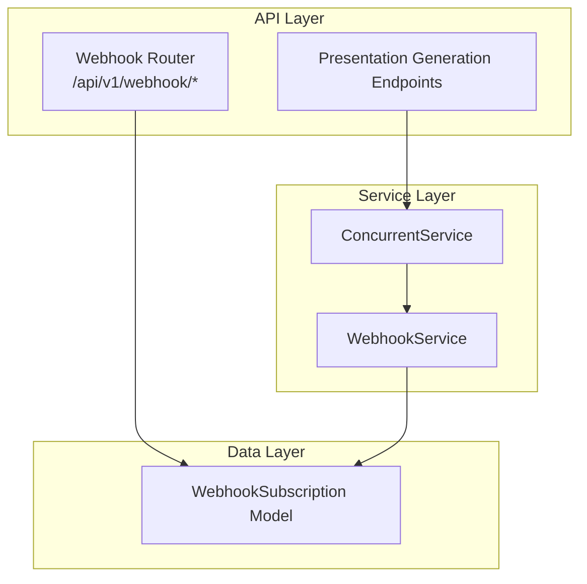
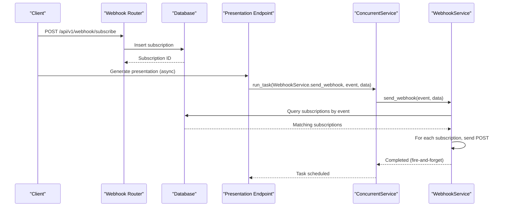
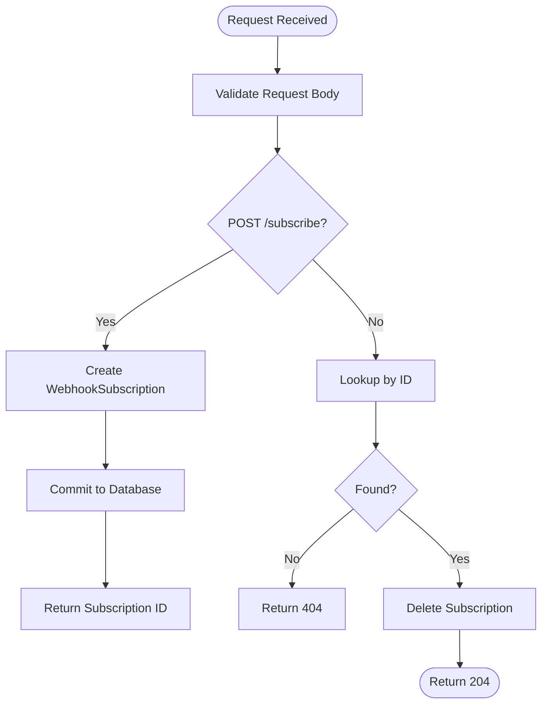
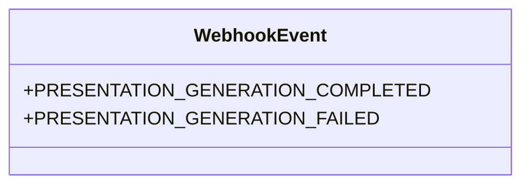
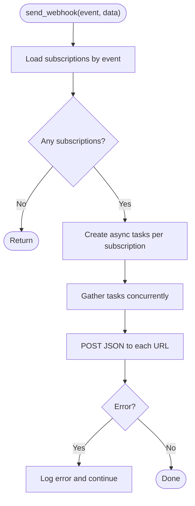
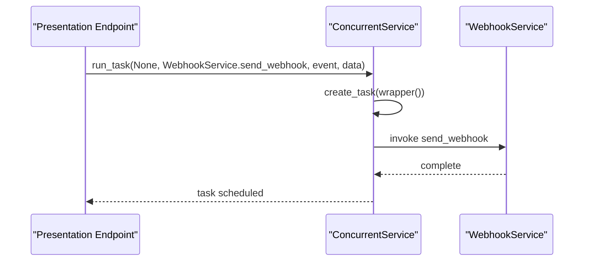
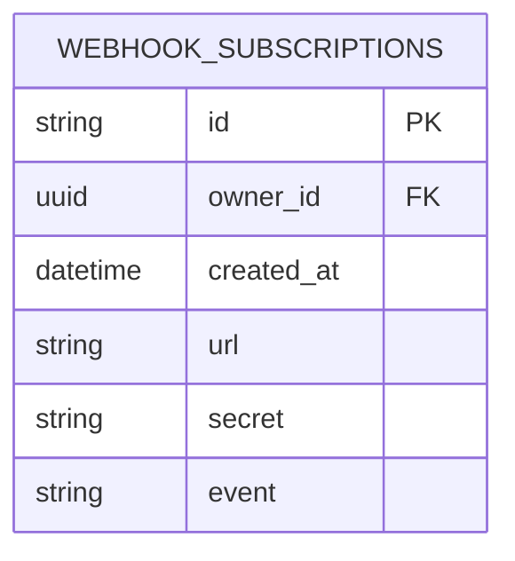
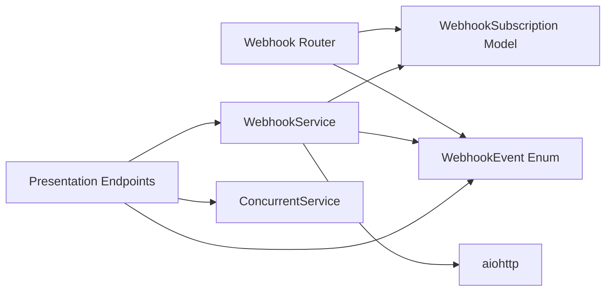

# Webhook & Event API

<cite>
**Referenced Files in This Document**   
- [router.py](file://servers/fastapi/api/v1/webhook/router.py)
- [webhook_service.py](file://servers/fastapi/services/webhook_service.py)
- [webhook_event.py](file://servers/fastapi/enums/webhook_event.py)
- [webhook_subscription.py](file://servers/fastapi/models/sql/webhook_subscription.py)
- [presentation.py](file://servers/fastapi/api/v1/ppt/endpoints/presentation.py)
- [concurrent_service.py](file://servers/fastapi/services/concurrent_service.py)
</cite>

## Table of Contents
1. [Introduction](#introduction)
2. [Project Structure](#project-structure)
3. [Core Components](#core-components)
4. [Architecture Overview](#architecture-overview)
5. [Detailed Component Analysis](#detailed-component-analysis)
6. [Dependency Analysis](#dependency-analysis)
7. [Performance Considerations](#performance-considerations)
8. [Troubleshooting Guide](#troubleshooting-guide)
9. [Conclusion](#conclusion)

## Introduction
This document describes Presenton’s webhook and event-driven endpoints for integrating external systems with presentation lifecycle events. It covers:
- Webhook registration, configuration, and management
- Supported event types and payload structures
- Delivery guarantees, retry behavior, and failure handling
- Security measures including secret-based authentication
- Monitoring and debugging guidance
- Practical examples for common integration scenarios

The webhook system is designed to notify subscribers when a presentation generation task completes or fails. Subscribers are stored in the database and invoked asynchronously using an internal concurrent task runner.

## Project Structure
The webhook feature spans several focused modules:
- API router for subscription management
- Service layer for dispatching webhooks
- Enumerations defining supported event types
- Database model for storing subscriptions
- Integration points in presentation generation endpoints
- Background task execution service

**Diagram sources**
- [router.py:10-54](file://servers/fastapi/api/v1/webhook/router.py#L10-L54)
- [webhook_service.py:9-55](file://servers/fastapi/services/webhook_service.py#L9-L55)
- [webhook_subscription.py:12-31](file://servers/fastapi/models/sql/webhook_subscription.py#L12-L31)
- [presentation.py:3093-3116](file://servers/fastapi/api/v1/ppt/endpoints/presentation.py#L3093-L3116)
- [concurrent_service.py:6-37](file://servers/fastapi/services/concurrent_service.py#L6-L37)

**Section sources**
- [router.py:10-54](file://servers/fastapi/api/v1/webhook/router.py#L10-L54)
- [webhook_service.py:9-55](file://servers/fastapi/services/webhook_service.py#L9-L55)
- [webhook_event.py:4-6](file://servers/fastapi/enums/webhook_event.py#L4-L6)
- [webhook_subscription.py:12-31](file://servers/fastapi/models/sql/webhook_subscription.py#L12-L31)
- [presentation.py:3093-3116](file://servers/fastapi/api/v1/ppt/endpoints/presentation.py#L3093-L3116)
- [concurrent_service.py:6-37](file://servers/fastapi/services/concurrent_service.py#L6-L37)

## Core Components
- Webhook Router: Provides endpoints to subscribe and unsubscribe from webhook events.
- Webhook Service: Loads matching subscriptions and sends HTTP POST requests to subscriber URLs.
- Webhook Event Enum: Defines supported event names used by the system.
- Webhook Subscription Model: Persists subscription records including URL, optional secret, and event type.
- Presentation Generation Integration: Triggers completion and failure webhooks after async presentation generation.
- Concurrent Service: Executes background tasks without blocking request processing.

Key responsibilities:
- Subscription CRUD via REST endpoints
- Asynchronous delivery of webhook payloads
- Optional secret-based authentication header injection
- Non-blocking invocation through background tasks

**Section sources**
- [router.py:10-54](file://servers/fastapi/api/v1/webhook/router.py#L10-L54)
- [webhook_service.py:9-55](file://servers/fastapi/services/webhook_service.py#L9-L55)
- [webhook_event.py:4-6](file://servers/fastapi/enums/webhook_event.py#L4-L6)
- [webhook_subscription.py:12-31](file://servers/fastapi/models/sql/webhook_subscription.py#L12-L31)
- [presentation.py:3093-3116](file://servers/fastapi/api/v1/ppt/endpoints/presentation.py#L3093-L3116)
- [concurrent_service.py:6-37](file://servers/fastapi/services/concurrent_service.py#L6-L37)

## Architecture Overview
The webhook architecture follows a simple event-driven flow:
- Clients register subscriptions via the webhook API.
- When a presentation generation task completes or fails, the presentation endpoint triggers a background task.
- The background task invokes the webhook service, which queries matching subscriptions and posts JSON payloads to subscriber URLs.
- If a secret is configured, it is sent as a Bearer token in the Authorization header.

**Diagram sources**
- [router.py:23-37](file://servers/fastapi/api/v1/webhook/router.py#L23-L37)
- [webhook_service.py:11-31](file://servers/fastapi/services/webhook_service.py#L11-L31)
- [presentation.py:3093-3116](file://servers/fastapi/api/v1/ppt/endpoints/presentation.py#L3093-L3116)
- [concurrent_service.py:10-28](file://servers/fastapi/services/concurrent_service.py#L10-L28)

## Detailed Component Analysis

### Webhook Registration and Management API
Endpoints:
- POST /api/v1/webhook/subscribe
  - Request body fields:
    - url: string — Subscriber endpoint URL
    - secret: optional string — Secret used for authentication
    - event: enum — One of the supported event types
  - Response:
    - id: string — Subscription identifier
  - Status code: 201 on success
- DELETE /api/v1/webhook/unsubscribe
  - Request body field:
    - id: string — Subscription identifier to remove
  - Status code: 204 on success; 404 if not found

Notes:
- Subscriptions are persisted with generated IDs and timestamps.
- Owner isolation is modeled but not enforced at the router level in this snippet.

**Diagram sources**
- [router.py:13-53](file://servers/fastapi/api/v1/webhook/router.py#L13-L53)

**Section sources**
- [router.py:10-54](file://servers/fastapi/api/v1/webhook/router.py#L10-L54)

### Webhook Events and Payloads
Supported events:
- presentation.generation.completed
- presentation.generation.failed

Payloads:
- On success: The response object from presentation generation, serialized to JSON.
- On failure: An error model derived from the raised exception, serialized to JSON.

Event definitions:
- Defined in an enumeration that maps Python enums to stable string values.

**Diagram sources**
- [webhook_event.py:4-6](file://servers/fastapi/enums/webhook_event.py#L4-L6)

**Section sources**
- [webhook_event.py:4-6](file://servers/fastapi/enums/webhook_event.py#L4-L6)
- [presentation.py:3093-3116](file://servers/fastapi/api/v1/ppt/endpoints/presentation.py#L3093-L3116)

### Webhook Delivery Mechanism
Behavior:
- The webhook service queries all subscriptions matching the event type.
- For each subscription, it performs an asynchronous HTTP POST with JSON payload.
- If a secret is present, it adds an Authorization header with a Bearer token.
- Errors during delivery are logged to standard output and swallowed; there is no retry logic.

**Diagram sources**
- [webhook_service.py:11-55](file://servers/fastapi/services/webhook_service.py#L11-L55)

**Section sources**
- [webhook_service.py:9-55](file://servers/fastapi/services/webhook_service.py#L9-L55)

### Background Execution and Concurrency
Background tasks:
- Presentation generation endpoints schedule webhook delivery via the concurrent service.
- The concurrent service creates asyncio tasks and tracks them, printing status messages.
- There is no built-in retry or dead-letter queue in the current implementation.

**Diagram sources**
- [presentation.py:3093-3116](file://servers/fastapi/api/v1/ppt/endpoints/presentation.py#L3093-L3116)
- [concurrent_service.py:10-37](file://servers/fastapi/services/concurrent_service.py#L10-L37)

**Section sources**
- [concurrent_service.py:6-37](file://servers/fastapi/services/concurrent_service.py#L6-L37)
- [presentation.py:3093-3116](file://servers/fastapi/api/v1/ppt/endpoints/presentation.py#L3093-L3116)

### Data Model: Webhook Subscription
Fields:
- id: string primary key, auto-generated
- owner_id: optional foreign key to user
- created_at: timestamp with timezone
- url: string subscriber URL
- secret: optional string
- event: string event name, indexed

**Diagram sources**
- [webhook_subscription.py:12-31](file://servers/fastapi/models/sql/webhook_subscription.py#L12-L31)

**Section sources**
- [webhook_subscription.py:12-31](file://servers/fastapi/models/sql/webhook_subscription.py#L12-L31)

## Dependency Analysis
High-level dependencies:
- Webhook Router depends on:
  - WebhookSubscription model
  - AsyncSession dependency
  - WebhookEvent enum
- WebhookService depends on:
  - WebhookSubscription model
  - WebhookEvent enum
  - aiohttp for outbound HTTP
  - AsyncSession dependency
- Presentation endpoints depend on:
  - WebhookService
  - WebhookEvent enum
  - ConcurrentService

**Diagram sources**
- [router.py:1-8](file://servers/fastapi/api/v1/webhook/router.py#L1-L8)
- [webhook_service.py:1-6](file://servers/fastapi/services/webhook_service.py#L1-L6)
- [presentation.py:46](file://servers/fastapi/api/v1/ppt/endpoints/presentation.py#L46)
- [concurrent_service.py:6-37](file://servers/fastapi/services/concurrent_service.py#L6-L37)

**Section sources**
- [router.py:1-8](file://servers/fastapi/api/v1/webhook/router.py#L1-L8)
- [webhook_service.py:1-6](file://servers/fastapi/services/webhook_service.py#L1-L6)
- [presentation.py:46](file://servers/fastapi/api/v1/ppt/endpoints/presentation.py#L46)
- [concurrent_service.py:6-37](file://servers/fastapi/services/concurrent_service.py#L6-L37)

## Performance Considerations
- Asynchronous delivery: Webhook delivery is non-blocking and runs in background tasks.
- Concurrent dispatch: Multiple webhook deliveries are executed concurrently per event.
- No retries: Failures are logged but not retried; consider adding exponential backoff and dead-letter queues for production resilience.
- Database load: Each webhook dispatch queries subscriptions by event; ensure indexing remains effective as subscriptions grow.
- Network I/O: Outbound HTTP calls can be slow; monitor timeouts and connection pooling.

[No sources needed since this section provides general guidance]

## Troubleshooting Guide
Common issues and diagnostics:
- Missing subscriptions:
  - Ensure POST /api/v1/webhook/subscribe was called before expecting webhooks.
- Incorrect event names:
  - Use exact event strings defined in the enum.
- Authentication failures:
  - If secret is set, verify your endpoint accepts Authorization: Bearer <secret>.
- Delivery failures:
  - Check server logs for printed errors from webhook delivery.
  - Verify subscriber URL is reachable and returns successful responses.
- Background task visibility:
  - Background task start and completion messages are printed by the concurrent service.

Operational tips:
- Monitor stdout for background task logs.
- Inspect database entries in webhook_subscriptions to validate configuration.
- Test with a local HTTP echo server to capture payloads and headers.

**Section sources**
- [webhook_service.py:44-55](file://servers/fastapi/services/webhook_service.py#L44-L55)
- [concurrent_service.py:24-35](file://servers/fastapi/services/concurrent_service.py#L24-L35)

## Conclusion
Presenton’s webhook system provides a straightforward mechanism to integrate external systems with presentation lifecycle events. Subscriptions are managed via REST endpoints, and delivery is performed asynchronously with optional secret-based authentication. While the current implementation lacks retries and advanced monitoring, it offers a solid foundation that can be extended with robust error handling, observability, and security enhancements.

[No sources needed since this section summarizes without analyzing specific files]