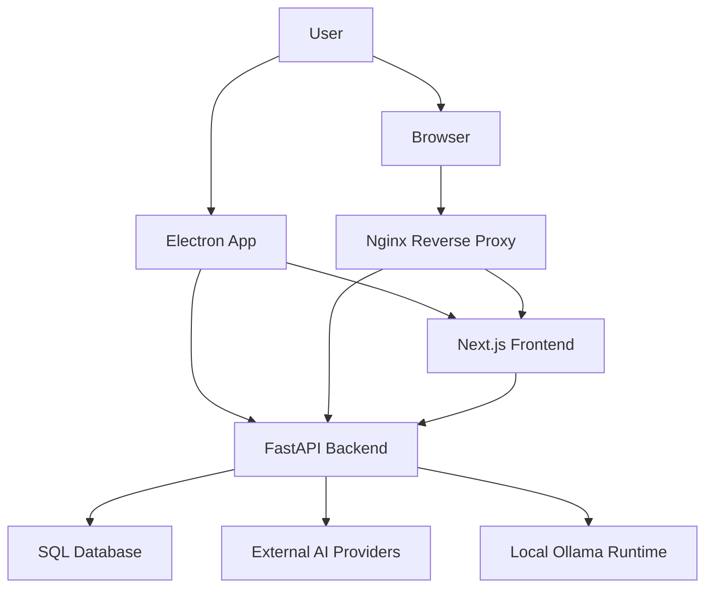
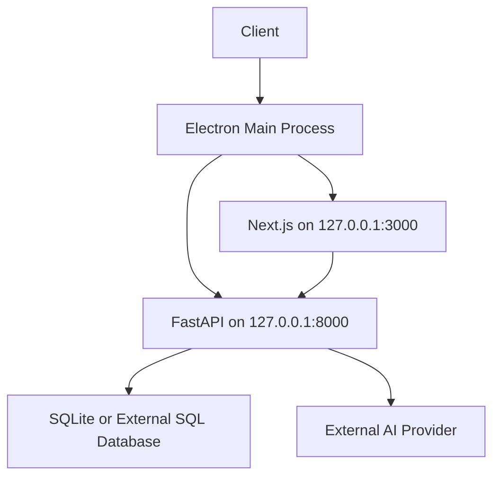
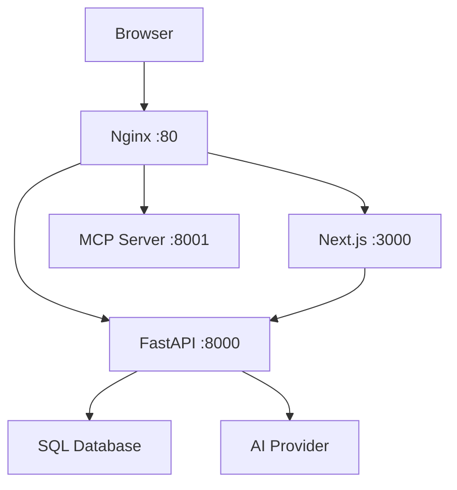
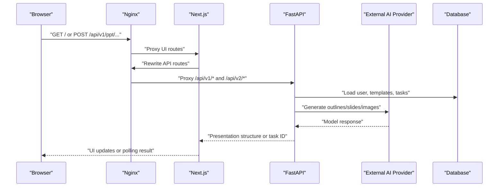
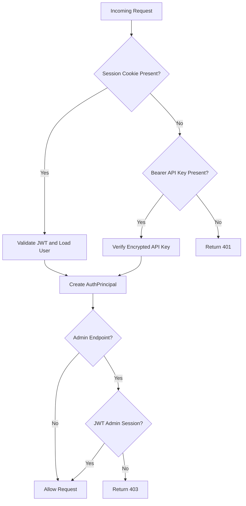
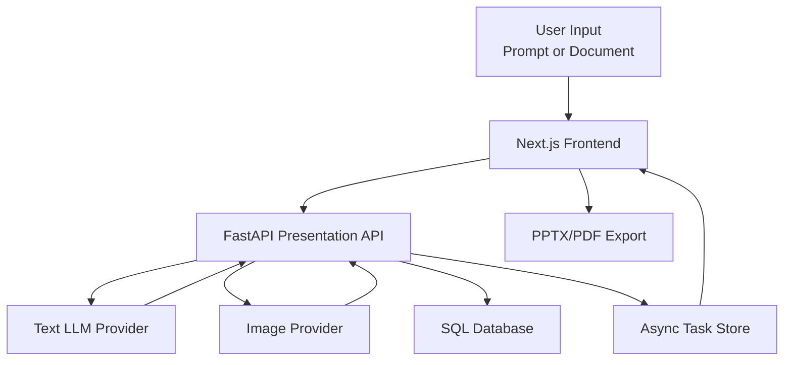
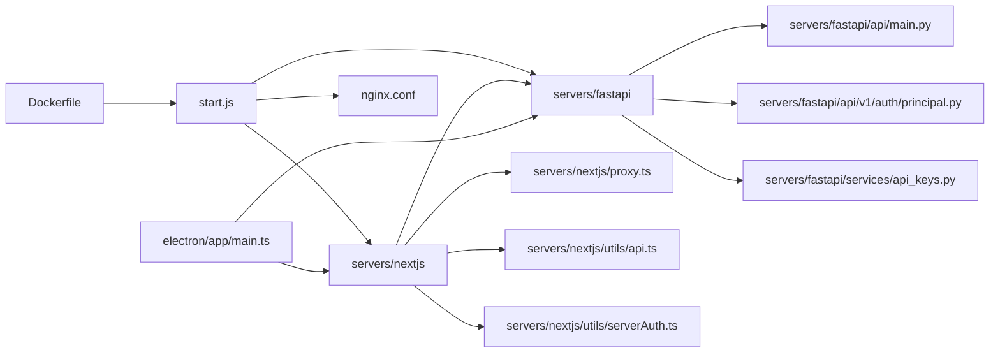

# Architecture Overview

<cite>
**Referenced Files in This Document**
- [README.md](file://README.md)
- [electron/app/main.ts](file://electron/app/main.ts)
- [servers/fastapi/server.py](file://servers/fastapi/server.py)
- [servers/fastapi/api/main.py](file://servers/fastapi/api/main.py)
- [servers/fastapi/api/v1/auth/principal.py](file://servers/fastapi/api/v1/auth/principal.py)
- [servers/fastapi/services/api_keys.py](file://servers/fastapi/services/api_keys.py)
- [servers/nextjs/proxy.ts](file://servers/nextjs/proxy.ts)
- [servers/nextjs/utils/api.ts](file://servers/nextjs/utils/api.ts)
- [servers/nextjs/lib/fastapi-internal.ts](file://servers/nextjs/lib/fastapi-internal.ts)
- [servers/nextjs/utils/serverAuth.ts](file://servers/nextjs/utils/serverAuth.ts)
- [start.js](file://start.js)
- [nginx.conf](file://nginx.conf)
- [docker-compose.yml](file://docker-compose.yml)
- [Dockerfile](file://Dockerfile)
</cite>

## Table of Contents
1. [Introduction](#introduction)
2. [Project Structure](#project-structure)
3. [Core Components](#core-components)
4. [Architecture Overview](#architecture-overview)
5. [Detailed Component Analysis](#detailed-component-analysis)
6. [Dependency Analysis](#dependency-analysis)
7. [Performance Considerations](#performance-considerations)
8. [Troubleshooting Guide](#troubleshooting-guide)
9. [Conclusion](#conclusion)

## Introduction
Presenton is an open-source AI presentation generator that can run as a native desktop application, as a self-hosted web service, or through cloud deployment. The system combines:

- An Electron-based desktop wrapper for local development and offline-style usage.
- A Next.js frontend serving the slide editor, template preview, dashboard, and export flows.
- A FastAPI backend providing REST APIs, authentication, async task management, document processing, image generation, and presentation generation logic.
- Optional external AI providers for text generation (OpenAI, Google, Azure, Bedrock, Anthropic, Ollama, LM Studio, OpenRouter, Together, Fireworks, Cerebras, LiteLLM, custom endpoints) and image generation (Pexels, Pixabay, Gemini Flash, GPT Image, ComfyUI, Open WebUI, OpenAI-compatible image endpoints).
- A Dockerized runtime with Nginx as the browser-facing reverse proxy, bundling Node.js, Python, Chromium, fonts, and presentation export tooling.

The repository supports both single-machine deployments (Electron or Docker on one host) and distributed deployments where the frontend, API server, database, and external AI services are separated.

**Section sources**
- [README.md:23-239](file://README.md#L23-L239)
- [README.md:267-349](file://README.md#L267-L349)

## Project Structure
At a high level, the repository is organized into:

| Area | Responsibility |
|---|---|
| `electron/` | Desktop application entry point, process lifecycle, local port discovery, IPC handlers, bundled backend/UI startup, update checker, Sentry integration, and desktop-specific security. |
| `servers/fastapi/` | Python FastAPI application, routers, models, services, templates, utilities, migrations, tests, and MCP server. |
| `servers/nextjs/` | Next.js application, UI components, slide editor, API client helpers, proxy middleware, server-side auth checks, and build configuration. |
| `templates/` | Built-in presentation templates with static assets and JSON layout definitions. |
| `scripts/` | Build, sync, conversion, testing, and runtime helper scripts. |
| Root deployment files | `Dockerfile`, `docker-compose.yml`, `start.js`, `nginx.conf`, and documentation. |

**Diagram sources**
- [electron/app/main.ts:330-423](file://electron/app/main.ts#L330-L423)
- [start.js:527-720](file://start.js#L527-L720)
- [nginx.conf:25-107](file://nginx.conf#L25-L107)
- [servers/fastapi/api/main.py:65-103](file://servers/fastapi/api/main.py#L65-L103)

**Section sources**
- [electron/app/main.ts:1-58](file://electron/app/main.ts#L1-L58)
- [servers/fastapi/server.py:1-30](file://servers/fastapi/server.py#L1-L30)
- [servers/nextjs/proxy.ts:1-32](file://servers/nextjs/proxy.ts#L1-L32)
- [Dockerfile:69-145](file://Dockerfile#L69-L145)

## Core Components
This section summarizes the main architectural layers and their responsibilities.

### Electron Desktop Wrapper
The Electron main process:

- Initializes app paths, cache directories, user config, and telemetry.
- Resolves unused loopback ports for FastAPI and Next.js.
- Starts the FastAPI backend and Next.js frontend as child processes.
- Creates a secure `BrowserWindow` with context isolation and preload scripts.
- Restricts navigation to the application origin and opens unsupported links externally.
- Configures desktop-only environment variables such as `PRESENTON_ELECTRON=true`.
- Manages graceful shutdown, update checking, and error reporting via Sentry.

Key behaviors:

- In Electron mode, authentication can be disabled by default so the desktop app can operate without account login.
- The desktop app uses private internal servers; anonymous local clients cannot access those services from outside the app.
- Export and document parsing rely on bundled Chromium, ImageMagick, and LiteParse runners.

**Section sources**
- [electron/app/main.ts:93-104](file://electron/app/main.ts#L93-L104)
- [electron/app/main.ts:145-181](file://electron/app/main.ts#L145-L181)
- [electron/app/main.ts:247-310](file://electron/app/main.ts#L247-L310)
- [electron/app/main.ts:330-423](file://electron/app/main.ts#L330-L423)
- [electron/app/main.ts:454-530](file://electron/app/main.ts#L454-L530)

### Next.js Frontend
The Next.js layer provides:

- Server-rendered pages and layouts for the dashboard, outline editor, slide editor, template preview, upload flow, and PDF maker.
- Client-side state management, slide editing tools, chart rendering, and UI component libraries.
- API routing helpers that resolve whether requests should go directly to FastAPI or through the same-origin Nginx proxy.
- A proxy middleware that forwards `/api/v1/*` and `/api/v2/*` requests to FastAPI while enforcing session or API key rules.
- Server-side authentication status checks used by protected routes.

Key behaviors:

- In Docker/web mode, browser requests use the same origin and are routed by Nginx.
- In Electron mode, the frontend may call FastAPI directly over loopback.
- API keys starting with the Presenton prefix are rejected by Next.js page routes and forwarded only to FastAPI endpoints.

**Section sources**
- [servers/nextjs/proxy.ts:10-32](file://servers/nextjs/proxy.ts#L10-L32)
- [servers/nextjs/proxy.ts:43-55](file://servers/nextjs/proxy.ts#L43-L55)
- [servers/nextjs/proxy.ts:97-172](file://servers/nextjs/proxy.ts#L97-L172)
- [servers/nextjs/utils/api.ts:44-134](file://servers/nextjs/utils/api.ts#L44-L134)
- [servers/nextjs/utils/serverAuth.ts:17-47](file://servers/nextjs/utils/serverAuth.ts#L17-L47)

### FastAPI Backend
The FastAPI backend exposes:

- Presentation generation and editing APIs under `/api/v1/ppt`.
- Authentication and admin APIs under `/api/v1/auth` and `/api/v1/admin`.
- Async task polling under `/api/v1/async_tasks`.
- Webhook handling under `/api/v1/webhook`.
- Versioned API router under `/api/v2`.
- Static assets and mounted app data for browser-accessible resources.
- Optional MCP endpoint served by a separate Python process.

Key behaviors:

- Routers are registered centrally in the FastAPI application.
- CORS is configured to allow the Next.js origin in Electron mode and wildcard behavior in standalone development.
- Session authentication and user configuration update middlewares are applied globally.
- App data directories are created and mounted safely.

**Section sources**
- [servers/fastapi/server.py:1-30](file://servers/fastapi/server.py#L1-L30)
- [servers/fastapi/api/main.py:65-103](file://servers/fastapi/api/main.py#L65-L103)
- [servers/fastapi/api/main.py:106-119](file://servers/fastapi/api/main.py#L106-L119)

### Docker and Deployment Runtime
The Docker runtime builds:

- A FastAPI Python environment with dependencies and cached model/embedding assets.
- A standalone Next.js production build.
- Bundled presentation export tooling, LiteParse runner, fonts, and Chromium.
- A runtime container that starts Nginx, FastAPI, Next.js, and optionally Ollama.

Key behaviors:

- `start.js` spawns FastAPI on port 8000, Next.js on port 3000, and an MCP server on port 8001.
- Nginx listens on port 80 and proxies browser traffic to Next.js and API traffic to FastAPI.
- Environment variables control LLM providers, image providers, database URL, community features, memory, document parsing, and authentication.
- GPU-enabled compose profiles expose NVIDIA devices for local model acceleration.

**Section sources**
- [Dockerfile:3-30](file://Dockerfile#L3-L30)
- [Dockerfile:32-45](file://Dockerfile#L32-L45)
- [Dockerfile:47-67](file://Dockerfile#L47-L67)
- [Dockerfile:69-145](file://Dockerfile#L69-L145)
- [start.js:44-47](file://start.js#L44-L47)
- [start.js:527-720](file://start.js#L527-L720)
- [docker-compose.yml:1-129](file://docker-compose.yml#L1-L129)
- [docker-compose.yml:130-263](file://docker-compose.yml#L130-L263)

## Architecture Overview
The system has two primary runtime topologies.

### Single-Machine Topology
In the most common single-machine setup, either:

- The Electron app runs locally and starts FastAPI and Next.js internally.
- Or Docker runs all services on one host behind Nginx.

**Diagram sources**
- [electron/app/main.ts:330-423](file://electron/app/main.ts#L330-L423)
- [servers/fastapi/server.py:23-29](file://servers/fastapi/server.py#L23-L29)

### Distributed Topology
In a distributed deployment:

- A browser accesses the public URL served by Nginx.
- Nginx proxies UI routes to Next.js and API routes to FastAPI.
- FastAPI connects to a managed database and external AI services.
- Optional MCP traffic is proxied to the MCP server.

**Diagram sources**
- [nginx.conf:25-107](file://nginx.conf#L25-L107)
- [start.js:549-655](file://start.js#L549-L655)

### Request Flow: Browser to Presentation Generation

**Diagram sources**
- [nginx.conf:29-69](file://nginx.conf#L29-L69)
- [servers/nextjs/proxy.ts:43-55](file://servers/nextjs/proxy.ts#L43-L55)
- [servers/fastapi/api/main.py:67-74](file://servers/fastapi/api/main.py#L67-L74)

## Detailed Component Analysis

### Authentication and Authorization Model
Presenton supports multiple authentication contexts:

| Context | Mechanism | Scope |
|---|---|---|
| Browser session | JWT cookie issued by FastAPI | Web UI and authenticated API calls |
| API key | Bearer token with `sk-presenton-` prefix | REST API and MCP clients |
| Desktop internal mode | Optional disabled authentication | Local Electron-only services |
| Admin-only operations | Requires JWT browser session with admin role | User management, provider settings, API key administration |

Authentication resolution in FastAPI:

1. Check for a session cookie.
2. If present, validate the JWT and load the user.
3. Otherwise, check the `Authorization` header for a valid API key.
4. Return an `AuthPrincipal` containing user identity and admin status.
5. Require browser admin principal for admin-only endpoints.

**Diagram sources**
- [servers/fastapi/api/v1/auth/principal.py:22-57](file://servers/fastapi/api/v1/auth/principal.py#L22-L57)
- [servers/fastapi/api/v1/auth/principal.py:60-71](file://servers/fastapi/api/v1/auth/principal.py#L60-L71)
- [servers/fastapi/services/api_keys.py:107-133](file://servers/fastapi/services/api_keys.py#L107-L133)

**Section sources**
- [servers/fastapi/api/v1/auth/principal.py:1-71](file://servers/fastapi/api/v1/auth/principal.py#L1-L71)
- [servers/fastapi/services/api_keys.py:19-61](file://servers/fastapi/services/api_keys.py#L19-L61)
- [servers/fastapi/services/api_keys.py:79-104](file://servers/fastapi/services/api_keys.py#L79-L104)
- [servers/fastapi/services/api_keys.py:107-133](file://servers/fastapi/services/api_keys.py#L107-L133)
- [servers/nextjs/proxy.ts:138-171](file://servers/nextjs/proxy.ts#L138-L171)

### API Routing and Proxy Behavior
The request path depends on the runtime:

| Runtime | Entry Point | API Route Handling |
|---|---|---|
| Docker/Web | Nginx → Next.js/FastAPI | Same-origin proxy; Nginx forwards `/api/v1/*` and `/api/v2/*` to FastAPI |
| Electron | Electron → Next.js + FastAPI | Next.js rewrites API paths to FastAPI; direct loopback calls are allowed |
| MCP | Nginx → MCP server | Separate process on port 8001 with bearer key validation |

Next.js proxy behavior:

- Rewrites `/api/v1/*` and `/api/v2/*` to FastAPI.
- Forwards `/static/*` and `/app_data/*` asset paths to FastAPI when needed.
- Skips authentication for exempt paths like `/api/v1/auth/*`, telemetry, SVG updates, and export data endpoints.
- Rejects API keys on non-API Next.js routes.

**Section sources**
- [servers/nextjs/proxy.ts:10-32](file://servers/nextjs/proxy.ts#L10-L32)
- [servers/nextjs/proxy.ts:34-55](file://servers/nextjs/proxy.ts#L34-L55)
- [servers/nextjs/proxy.ts:87-95](file://servers/nextjs/proxy.ts#L87-L95)
- [servers/nextjs/proxy.ts:146-171](file://servers/nextjs/proxy.ts#L146-L171)
- [nginx.conf:45-69](file://nginx.conf#L45-L69)
- [nginx.conf:76-107](file://nginx.conf#L76-L107)

### Data Flow Patterns
Presenton’s data flow follows these patterns:

1. **Prompt or document input**: The frontend collects user content or uploads documents.
2. **Outline and structure generation**: FastAPI calls the configured LLM provider to generate presentation outlines and slide structures.
3. **Slide content generation**: FastAPI generates slide content, layouts, and optional images.
4. **Async task tracking**: Long-running generation jobs return task IDs for polling.
5. **Export**: The system exports presentations to PPTX or PDF using Puppeteer/Chromium and bundled export tooling.
6. **Persistence**: Presentations, users, templates, async tasks, chat history, and provider settings are stored in SQL.

**Diagram sources**
- [servers/fastapi/api/main.py:67-74](file://servers/fastapi/api/main.py#L67-L74)
- [Dockerfile:117-137](file://Dockerfile#L117-L137)
- [start.js:549-655](file://start.js#L549-L655)

**Section sources**
- [README.md:720-800](file://README.md#L720-L800)
- [servers/fastapi/api/main.py:67-74](file://servers/fastapi/api/main.py#L67-L74)

### Integration Points with Third-Party Services
Presenton integrates with many external services:

| Category | Examples | Purpose |
|---|---|---|
| Text LLM providers | OpenAI, DeepSeek, Google, Vertex AI, Azure OpenAI, Bedrock, OpenRouter, Fireworks, Together, Cerebras, Anthropic, LiteLLM, LM Studio, Ollama, custom OpenAI-compatible endpoints | Generate outlines, slide content, and smart presentation logic |
| Image providers | Pexels, Pixabay, Gemini Flash, GPT Image 2/1.5, ComfyUI, Open WebUI, OpenAI-compatible image endpoints | Generate or fetch slide images |
| Search providers | Native search, SearXNG, Tavily, Exa | Web grounding for presentation generation |
| Cloud gallery | Presenton Community service | Optional community presentation designs |
| Authentication | ChatGPT OAuth flow for desktop convenience | Sign-in experience without separate API keys |

Configuration is primarily driven by environment variables passed through Docker Compose or set in the desktop runtime.

**Section sources**
- [README.md:366-513](file://README.md#L366-L513)
- [README.md:557-660](file://README.md#L557-L660)
- [docker-compose.yml:16-129](file://docker-compose.yml#L16-L129)

### System Boundaries
| Boundary | Description |
|---|---|
| Browser boundary | Public HTTP(S) interface exposed by Nginx or Electron window |
| Application boundary | Next.js and FastAPI running inside Docker or Electron-managed processes |
| Data boundary | `/app_data` directory containing exports, images, uploads, fonts, templates, and generated artifacts |
| External boundary | Outbound connections to AI providers, image providers, and optional community services |
| Internal boundary | Loopback-only communication between Electron, Next.js, FastAPI, and MCP server |

Security considerations include:

- Nginx restricts direct access to sensitive `/app_data` subdirectories using an internal auth subrequest.
- Only browser assets under `/static` are safe to serve unauthenticated.
- API keys authenticate programmatic clients but do not grant browser admin privileges.
- Electron disables MCP and external access to local internal servers by default.

**Section sources**
- [nginx.conf:130-211](file://nginx.conf#L130-L211)
- [README.md:657-662](file://README.md#L657-L662)
- [electron/app/main.ts:364-390](file://electron/app/main.ts#L364-L390)

## Dependency Analysis
The following diagram shows how the main runtime components depend on each other.

**Diagram sources**
- [electron/app/main.ts:330-423](file://electron/app/main.ts#L330-L423)
- [servers/nextjs/proxy.ts:1-32](file://servers/nextjs/proxy.ts#L1-L32)
- [servers/nextjs/utils/api.ts:44-134](file://servers/nextjs/utils/api.ts#L44-L134)
- [servers/nextjs/utils/serverAuth.ts:17-47](file://servers/nextjs/utils/serverAuth.ts#L17-L47)
- [servers/fastapi/api/main.py:65-103](file://servers/fastapi/api/main.py#L65-L103)
- [servers/fastapi/api/v1/auth/principal.py:22-57](file://servers/fastapi/api/v1/auth/principal.py#L22-L57)
- [servers/fastapi/services/api_keys.py:107-133](file://servers/fastapi/services/api_keys.py#L107-L133)
- [Dockerfile:69-145](file://Dockerfile#L69-L145)
- [start.js:527-720](file://start.js#L527-L720)
- [nginx.conf:25-107](file://nginx.conf#L25-L107)

**Section sources**
- [electron/app/main.ts:330-423](file://electron/app/main.ts#L330-L423)
- [servers/nextjs/proxy.ts:1-32](file://servers/nextjs/proxy.ts#L1-L32)
- [servers/fastapi/api/main.py:65-103](file://servers/fastapi/api/main.py#L65-L103)
- [start.js:527-720](file://start.js#L527-L720)
- [nginx.conf:25-107](file://nginx.conf#L25-L107)

## Performance Considerations
- **Reverse proxy buffering**: Nginx increases body size limits for API routes and sets read/send/connect timeouts suitable for long-running presentation generation.
- **Parallel image generation**: An environment variable controls concurrent image-provider requests to balance speed and rate-limit safety.
- **Standalone Next.js build**: Production builds use Next.js standalone output to reduce runtime overhead.
- **Cached assets**: The Docker image prebuilds FastAPI dependencies, Next.js output, LiteParse, presentation export tooling, and caches embedding/icon data.
- **GPU support**: The GPU compose profile reserves NVIDIA devices for local model inference.
- **Memory and process monitoring**: Electron tracks memory snapshots and logs process-gone events for diagnostics.

Recommendations:

- Use external databases instead of SQLite for multi-user or high-throughput deployments.
- Tune `WEB_SEARCH_MAX_RESULTS`, `MAX_OUTLINE_WORDS`, and LLM generation profiles based on workload.
- Disable community features in air-gapped environments to avoid outbound requests.
- Monitor FastAPI logs, Nginx error logs, and Electron Sentry breadcrumbs for failure diagnosis.

[No sources needed since this section provides general guidance]

## Troubleshooting Guide
Common operational issues and their likely causes:

| Symptom | Likely Cause | Resolution |
|---|---|---|
| Browser cannot reach API | Nginx misconfiguration or wrong `NEXT_PUBLIC_FAST_API` | Verify Nginx proxy rules and environment variables |
| Electron fails to start servers | Missing ImageMagick, Chromium, or LiteParse runner | Ensure bundled runtime is available and environment variables are set |
| API returns unauthorized | Missing or invalid session cookie or API key | Log in via UI or provide valid `sk-presenton-...` bearer token |
| Admin endpoints fail with forbidden | Non-admin browser session or API key used | Use admin JWT session for admin-only routes |
| Large file upload fails | Nginx body size limit exceeded | Adjust `client_max_body_size` and ensure API route allows larger payloads |
| Presentation export fails | Missing Chromium or export runtime | Rebuild image or install bundled export dependencies |
| Ollama not available | `START_OLLAMA=false` or binary missing | Set `START_OLLAMA=true` or configure `OLLAMA_URL` |

**Section sources**
- [nginx.conf:45-74](file://nginx.conf#L45-L74)
- [electron/app/main.ts:355-363](file://electron/app/main.ts#L355-L363)
- [servers/fastapi/api/v1/auth/principal.py:60-71](file://servers/fastapi/api/v1/auth/principal.py#L60-L71)
- [servers/fastapi/services/api_keys.py:107-133](file://servers/fastapi/services/api_keys.py#L107-L133)
- [start.js:456-470](file://start.js#L456-L470)

## Conclusion
Presenton’s architecture separates concerns across four clear layers:

- The Electron desktop wrapper manages local runtime lifecycle and security.
- The Next.js frontend delivers the interactive presentation editor and orchestrates user workflows.
- The FastAPI backend implements business logic, persistence, authentication, async tasks, and integrations with AI providers.
- The Docker/Nginx runtime provides a production-ready deployment surface supporting both single-machine and distributed setups.

Communication between layers is primarily REST-based, with Next.js acting as a proxy-aware frontend and FastAPI as the authoritative API server. Security is enforced at multiple boundaries: Nginx gates sensitive assets, Next.js validates sessions and API keys, and FastAPI resolves principals and enforces role-based access. External AI providers are integrated through configurable providers rather than hard-coded coupling, making the system adaptable to different deployment models and privacy requirements.

[No sources needed since this section summarizes without analyzing specific files]