# Authentication & Security

<cite>
**Referenced Files in This Document**
- [router.py](file://servers/fastapi/api/v1/auth/router.py)
- [users.py](file://servers/fastapi/api/v1/auth/users.py)
- [config.py](file://servers/fastapi/api/v1/auth/config.py)
- [principal.py](file://servers/fastapi/api/v1/auth/principal.py)
- [context.py](file://servers/fastapi/api/v1/auth/context.py)
- [internal.py](file://servers/fastapi/api/v1/auth/internal.py)
- [presenton_oauth.py](file://servers/fastapi/api/v1/auth/presenton_oauth.py)
- [desktop.py](file://servers/fastapi/api/v1/auth/desktop.py)
- [user.py](file://servers/fastapi/models/sql/user.py)
- [api_key.py](file://servers/fastapi/models/sql/api_key.py)
- [api_keys.py](file://servers/fastapi/services/api_keys.py)
- [provider_settings.py](file://servers/fastapi/services/provider_settings.py)
- [proxy.ts](file://servers/nextjs/proxy.ts)
- [route.ts](file://servers/nextjs/app/api/user-config/route.ts)
- [openai_codex.py](file://servers/fastapi/utils/oauth/openai_codex.py)
- [test_session_auth_middleware.py](file://servers/fastapi/tests/unit/test_session_auth_middleware.py)
- [test_presenton_oauth_login.py](file://servers/fastapi/tests/integration/test_presenton_oauth_login.py)
- [test_auth_endpoints.py](file://servers/fastapi/tests/integration/test_auth_endpoints.py)
</cite>

## Table of Contents
1. [Introduction](#introduction)
2. [Project Structure](#project-structure)
3. [Core Components](#core-components)
4. [Architecture Overview](#architecture-overview)
5. [Detailed Component Analysis](#detailed-component-analysis)
6. [Dependency Analysis](#dependency-analysis)
7. [Performance Considerations](#performance-considerations)
8. [Troubleshooting Guide](#troubleshooting-guide)
9. [Conclusion](#conclusion)

## Introduction
This document explains Presenton’s authentication and security system. It covers multi-user authentication, session management, JWT handling, secure cookies, API key authorization, OAuth integration with the Presenton provider, admin panel controls, user provisioning, data privacy, encryption strategies, and operational security practices. The goal is to help developers, operators, and auditors understand how identity, access control, secrets, and sensitive flows are implemented across the FastAPI backend and Next.js frontend.

## Project Structure
The authentication surface spans:
- FastAPI auth routes for login, setup, status, verification, logout, and Presenton OAuth device flow.
- A versioned JWT strategy backed by a database user model.
- An API key issuance and verification service.
- Admin endpoints for user lifecycle and provider settings.
- Next.js proxying and role-aware configuration exposure.

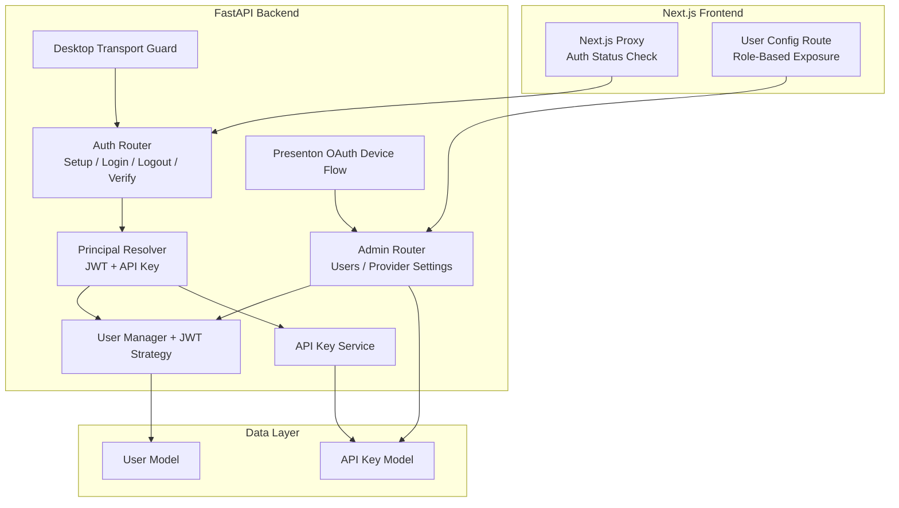

**Diagram sources**
- [router.py:27-202](file://servers/fastapi/api/v1/auth/router.py#L27-L202)
- [users.py:136-234](file://servers/fastapi/api/v1/auth/users.py#L136-L234)
- [api_keys.py:25-134](file://servers/fastapi/services/api_keys.py#L25-L134)
- [api_key.py:12-56](file://servers/fastapi/models/sql/api_key.py#L12-L56)
- [user.py:16-46](file://servers/fastapi/models/sql/user.py#L16-L46)
- [presenton_oauth.py:29-313](file://servers/fastapi/api/v1/auth/presenton_oauth.py#L29-L313)
- [proxy.ts:62-86](file://servers/nextjs/proxy.ts#L62-L86)
- [route.ts:41-83](file://servers/nextjs/app/api/user-config/route.ts#L41-L83)

**Section sources**
- [router.py:27-202](file://servers/fastapi/api/v1/auth/router.py#L27-L202)
- [users.py:136-234](file://servers/fastapi/api/v1/auth/users.py#L136-L234)
- [api_keys.py:25-134](file://servers/fastapi/services/api_keys.py#L25-L134)
- [api_key.py:12-56](file://servers/fastapi/models/sql/api_key.py#L12-L56)
- [user.py:16-46](file://servers/fastapi/models/sql/user.py#L16-L46)
- [presenton_oauth.py:29-313](file://servers/fastapi/api/v1/auth/presenton_oauth.py#L29-L313)
- [proxy.ts:62-86](file://servers/nextjs/proxy.ts#L62-L86)
- [route.ts:41-83](file://servers/nextjs/app/api/user-config/route.ts#L41-L83)

## Core Components
- Multi-user authentication via username/password with FastAPI Users abstractions and a custom database adapter.
- Versioned JWTs stored in an HTTP-only cookie with secure flags and SameSite policy.
- API key-based authorization for programmatic access, with encrypted storage and revocation support.
- Principal resolution supporting both browser sessions and API keys.
- Admin panel for user provisioning and provider settings.
- Presenton OAuth device authorization flow for linking a global cloud provider.
- Desktop transport guard for local Electron runtime isolation.

**Section sources**
- [users.py:27-134](file://servers/fastapi/api/v1/auth/users.py#L27-L134)
- [users.py:136-234](file://servers/fastapi/api/v1/auth/users.py#L136-L234)
- [router.py:39-55](file://servers/fastapi/api/v1/auth/router.py#L39-L55)
- [api_keys.py:35-134](file://servers/fastapi/services/api_keys.py#L35-L134)
- [principal.py:14-72](file://servers/fastapi/api/v1/auth/principal.py#L14-L72)
- [presenton_oauth.py:52-313](file://servers/fastapi/api/v1/auth/presenton_oauth.py#L52-L313)
- [desktop.py:37-48](file://servers/fastapi/api/v1/auth/desktop.py#L37-L48)

## Architecture Overview
The system supports two primary authentication methods:
- Browser session: Username/password login returns a signed JWT stored in a secure, HTTP-only cookie.
- Programmatic access: Bearer API keys are validated against the database and scoped to a user.

A principal resolver unifies these into a single identity object used by downstream routes. Admin-only routes enforce that only browser sessions with superuser status can manage users or provider settings.

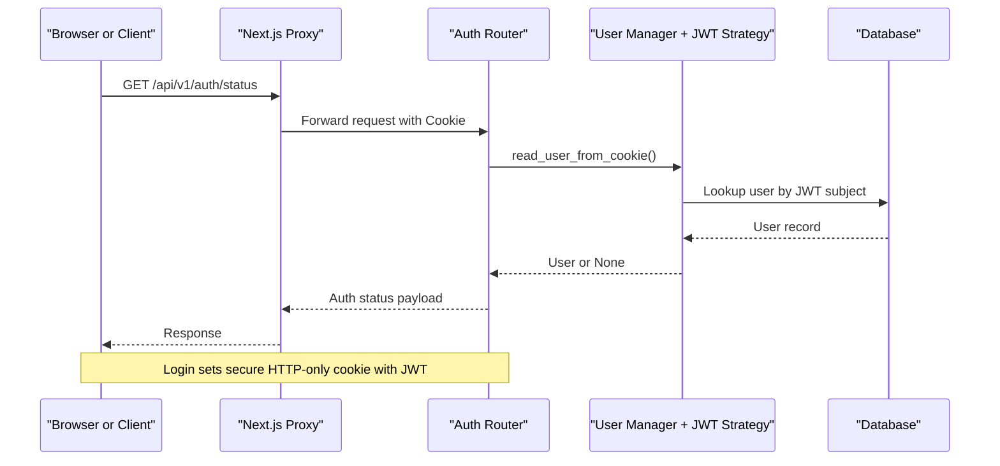

**Diagram sources**
- [router.py:58-78](file://servers/fastapi/api/v1/auth/router.py#L58-L78)
- [users.py:202-208](file://servers/fastapi/api/v1/auth/users.py#L202-L208)
- [users.py:136-182](file://servers/fastapi/api/v1/auth/users.py#L136-L182)

**Section sources**
- [router.py:58-78](file://servers/fastapi/api/v1/auth/router.py#L58-L78)
- [users.py:202-208](file://servers/fastapi/api/v1/auth/users.py#L202-L208)
- [users.py:136-182](file://servers/fastapi/api/v1/auth/users.py#L136-L182)

## Detailed Component Analysis

### Multi-User Authentication and Session Management
- Setup endpoint creates the first administrator account and persists recovery credentials.
- Login validates credentials, rotates password hashes when needed, issues a versioned JWT, and sets a secure cookie.
- Logout deletes the session cookie.
- Session verification resolves the principal and enforces asset access rules.

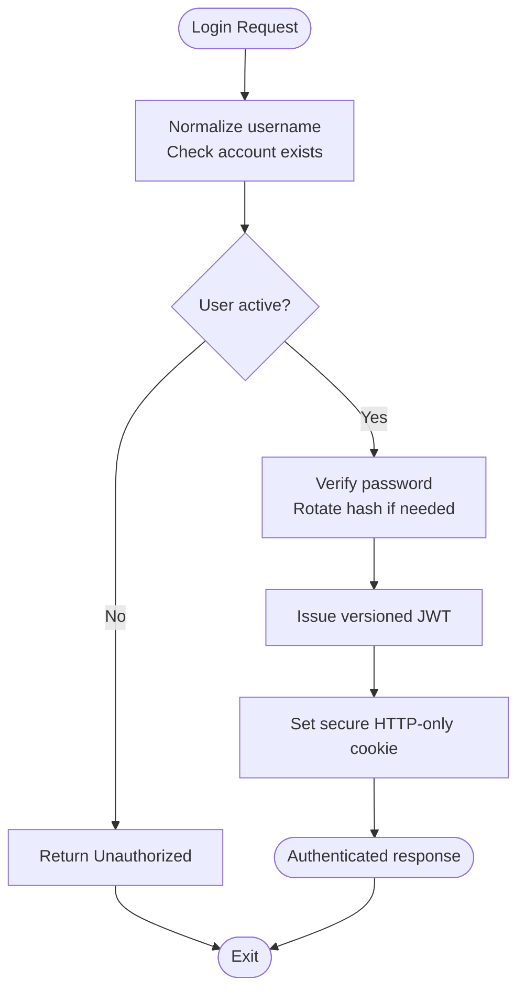

**Diagram sources**
- [router.py:155-188](file://servers/fastapi/api/v1/auth/router.py#L155-L188)
- [users.py:27-46](file://servers/fastapi/api/v1/auth/users.py#L27-L46)
- [users.py:136-182](file://servers/fastapi/api/v1/auth/users.py#L136-L182)

**Section sources**
- [router.py:110-188](file://servers/fastapi/api/v1/auth/router.py#L110-L188)
- [router.py:191-201](file://servers/fastapi/api/v1/auth/router.py#L191-L201)
- [users.py:27-46](file://servers/fastapi/api/v1/auth/users.py#L27-L46)
- [users.py:136-182](file://servers/fastapi/api/v1/auth/users.py#L136-L182)

### JWT Token Handling and Secure Cookies
- JWTs include user ID, an auth version, and audience.
- Tokens are verified against the current user record and rejected if the user is inactive or the auth version changed.
- Cookies are set with:
  - Name: presenton_session
  - TTL: 30 days
  - HttpOnly: true
  - Secure: true when HTTPS is detected (including forwarded headers)
  - SameSite: lax
  - Path: /

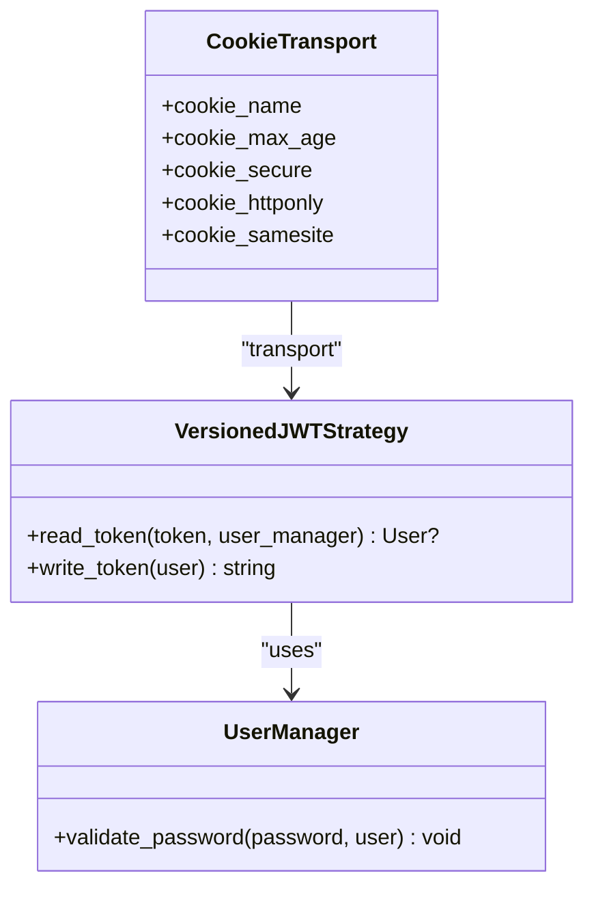

**Diagram sources**
- [users.py:136-182](file://servers/fastapi/api/v1/auth/users.py#L136-L182)
- [users.py:187-199](file://servers/fastapi/api/v1/auth/users.py#L187-L199)
- [router.py:46-55](file://servers/fastapi/api/v1/auth/router.py#L46-L55)

**Section sources**
- [users.py:136-182](file://servers/fastapi/api/v1/auth/users.py#L136-L182)
- [users.py:187-199](file://servers/fastapi/api/v1/auth/users.py#L187-L199)
- [router.py:39-55](file://servers/fastapi/api/v1/auth/router.py#L39-L55)
- [config.py:11-12](file://servers/fastapi/api/v1/auth/config.py#L11-L12)

### API Key Management and Authorization Patterns
- API keys have a public prefix and a secret part; only the secret hash is stored.
- Full tokens are optionally encrypted at rest using Fernet derived from the deployment secret.
- Verification checks format, expiration, revocation, user activity, and performs password helper rotation.
- Principal resolution accepts Bearer API keys and maps them to a user context.

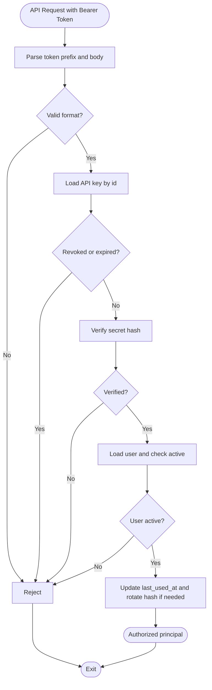

**Diagram sources**
- [api_keys.py:35-134](file://servers/fastapi/services/api_keys.py#L35-L134)
- [api_key.py:12-56](file://servers/fastapi/models/sql/api_key.py#L12-L56)
- [principal.py:40-55](file://servers/fastapi/api/v1/auth/principal.py#L40-L55)

**Section sources**
- [api_keys.py:35-134](file://servers/fastapi/services/api_keys.py#L35-L134)
- [api_key.py:12-56](file://servers/fastapi/models/sql/api_key.py#L12-L56)
- [principal.py:40-55](file://servers/fastapi/api/v1/auth/principal.py#L40-L55)

### Principal Resolution and Role-Based Access Control
- Principal resolution supports:
  - JWT cookie-based browser sessions
  - Bearer API keys
- Admin-only routes require a browser session with superuser status.
- Context variables allow internal services to carry owner identity without exposing it externally.

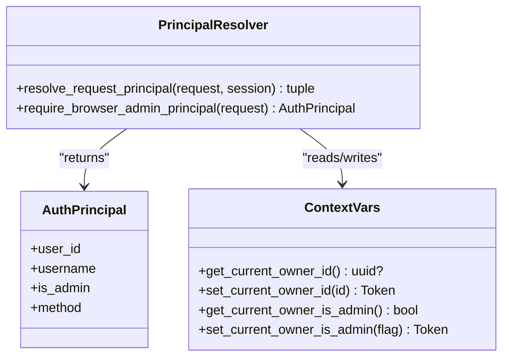

**Diagram sources**
- [principal.py:14-72](file://servers/fastapi/api/v1/auth/principal.py#L14-L72)
- [context.py:5-35](file://servers/fastapi/api/v1/auth/context.py#L5-L35)

**Section sources**
- [principal.py:14-72](file://servers/fastapi/api/v1/auth/principal.py#L14-L72)
- [context.py:5-35](file://servers/fastapi/api/v1/auth/context.py#L5-L35)

### OAuth Integration: Presenton Provider Device Flow
- Uses OAuth 2.0 Device Authorization Grant.
- Admin-only endpoints start and poll the device flow, store provider credentials, and update provider settings.
- Errors are normalized and best-effort revocation is attempted on failure paths.

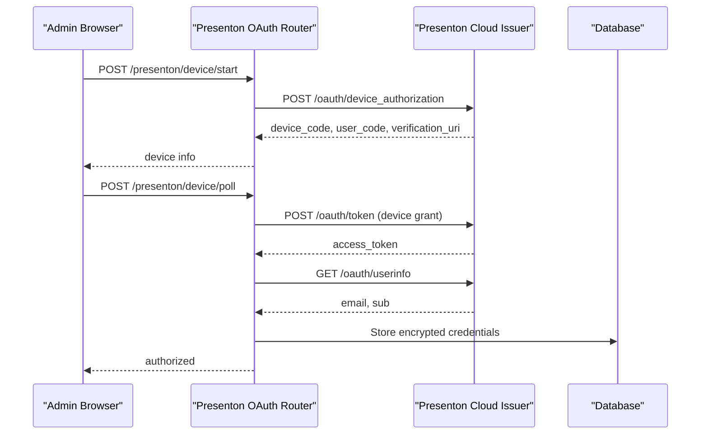

**Diagram sources**
- [presenton_oauth.py:164-313](file://servers/fastapi/api/v1/auth/presenton_oauth.py#L164-L313)

**Section sources**
- [presenton_oauth.py:52-313](file://servers/fastapi/api/v1/auth/presenton_oauth.py#L52-L313)

### Desktop Transport and Local Runtime Security
- Desktop requests are guarded by host and origin validation plus HMAC token comparison.
- When authentication is disabled for desktop mode, internal requests may forward a cookie header derived from the desktop token.

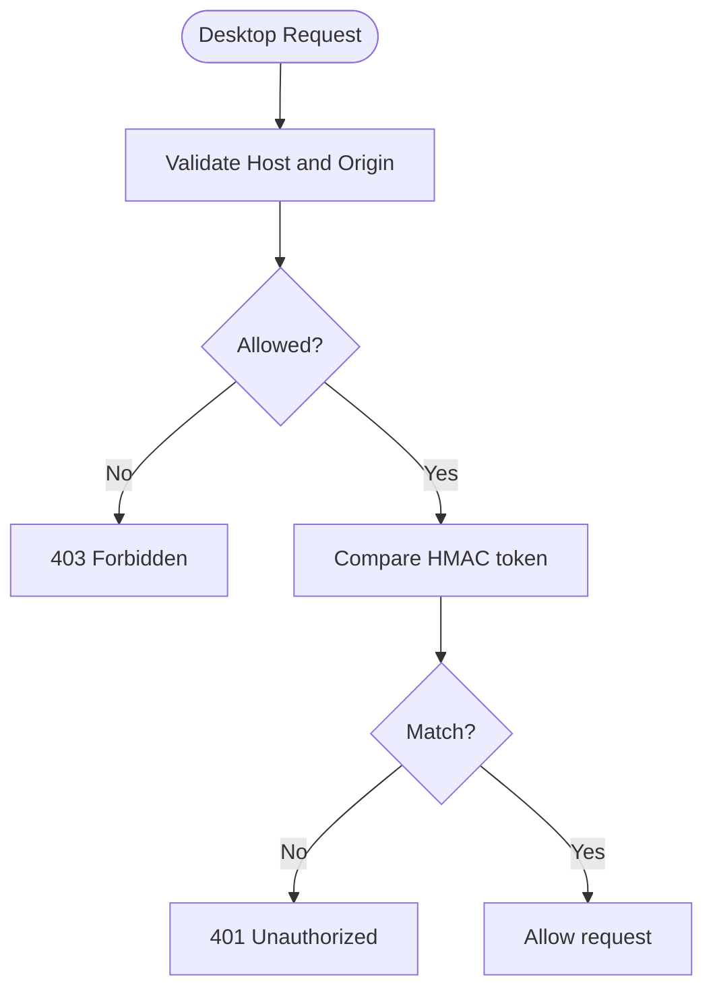

**Diagram sources**
- [desktop.py:37-48](file://servers/fastapi/api/v1/auth/desktop.py#L37-L48)
- [internal.py:10-25](file://servers/fastapi/api/v1/auth/internal.py#L10-L25)

**Section sources**
- [desktop.py:37-48](file://servers/fastapi/api/v1/auth/desktop.py#L37-L48)
- [internal.py:10-25](file://servers/fastapi/api/v1/auth/internal.py#L10-L25)

### Admin Panel Functionality and User Provisioning
- Admin endpoints list, create, reset passwords, and delete users.
- Password resets increment the user’s auth version to invalidate existing sessions.
- Provider settings endpoints sanitize and merge configuration, excluding legacy auth fields.

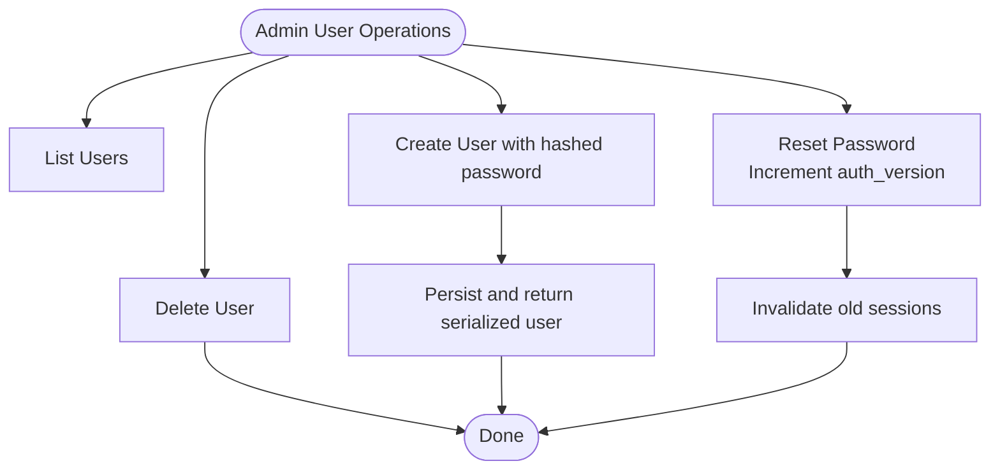

**Diagram sources**
- [router.py:169-239](file://servers/fastapi/api/v1/admin/router.py#L169-L239)
- [provider_settings.py:52-86](file://servers/fastapi/services/provider_settings.py#L52-L86)

**Section sources**
- [router.py:169-239](file://servers/fastapi/api/v1/admin/router.py#L169-L239)
- [provider_settings.py:52-86](file://servers/fastapi/services/provider_settings.py#L52-L86)

### Data Privacy, Encryption, and Compliance Considerations
- Secrets management:
  - Deployment signing secret is generated and persisted in user config if missing.
  - Legacy single-user password hashes are supported during migration.
- API key protection:
  - Secret parts are hashed; full tokens are optionally encrypted at rest.
  - Rotation occurs on successful verification.
- Sensitive data exposure:
  - Non-admin users receive effective provider/model selections only; real secrets are not sent to the browser.
  - Provider settings responses exclude legacy auth fields.

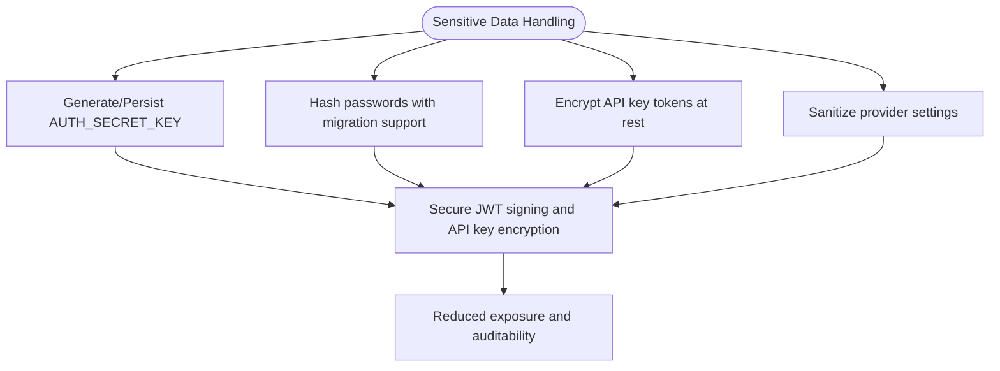

**Diagram sources**
- [config.py:50-108](file://servers/fastapi/api/v1/auth/config.py#L50-L108)
- [api_keys.py:39-76](file://servers/fastapi/services/api_keys.py#L39-L76)
- [route.ts:41-83](file://servers/nextjs/app/api/user-config/route.ts#L41-L83)
- [provider_settings.py:52-86](file://servers/fastapi/services/provider_settings.py#L52-L86)

**Section sources**
- [config.py:50-108](file://servers/fastapi/api/v1/auth/config.py#L50-L108)
- [api_keys.py:39-76](file://servers/fastapi/services/api_keys.py#L39-L76)
- [route.ts:41-83](file://servers/nextjs/app/api/user-config/route.ts#L41-L83)
- [provider_settings.py:52-86](file://servers/fastapi/services/provider_settings.py#L52-L86)

### Input Validation, XSS Protection, and CSRF Prevention
- Input validation:
  - Username length constraints on setup and creation.
  - Password strength enforced by user manager.
  - OAuth device code lengths and required fields validated.
- XSS protection:
  - No direct rendering of untrusted input in auth flows; JSON responses are structured.
- CSRF prevention:
  - Cookies use SameSite lax and are HTTP-only.
  - Admin browser-only routes reject API-key principals.

**Section sources**
- [router.py:110-152](file://servers/fastapi/api/v1/auth/router.py#L110-L152)
- [users.py:116-128](file://servers/fastapi/api/v1/auth/users.py#L116-L128)
- [presenton_oauth.py:37-48](file://servers/fastapi/api/v1/auth/presenton_oauth.py#L37-L48)
- [router.py:46-55](file://servers/fastapi/api/v1/auth/router.py#L46-L55)
- [test_session_auth_middleware.py:162-209](file://servers/fastapi/tests/unit/test_session_auth_middleware.py#L162-L209)

### OpenAI Codex OAuth Code Parsing Utility
- Utility parses various forms of returned OAuth codes and states, including URL-encoded query strings, fragment shorthands, and bare values.

**Section sources**
- [openai_codex.py:585-614](file://servers/fastapi/utils/oauth/openai_codex.py#L585-L614)

## Dependency Analysis
The following diagram shows core dependencies among authentication components.

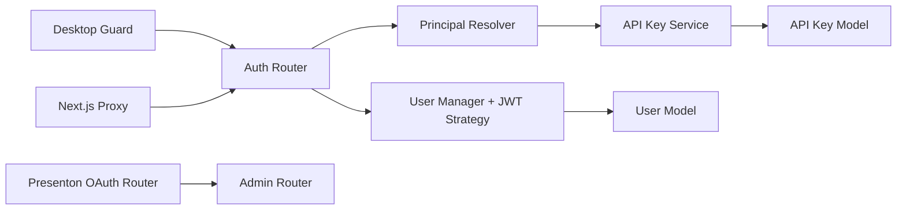

**Diagram sources**
- [router.py:27-202](file://servers/fastapi/api/v1/auth/router.py#L27-L202)
- [users.py:136-234](file://servers/fastapi/api/v1/auth/users.py#L136-L234)
- [principal.py:14-72](file://servers/fastapi/api/v1/auth/principal.py#L14-L72)
- [api_keys.py:25-134](file://servers/fastapi/services/api_keys.py#L25-L134)
- [api_key.py:12-56](file://servers/fastapi/models/sql/api_key.py#L12-L56)
- [user.py:16-46](file://servers/fastapi/models/sql/user.py#L16-L46)
- [presenton_oauth.py:29-313](file://servers/fastapi/api/v1/auth/presenton_oauth.py#L29-L313)
- [proxy.ts:62-86](file://servers/nextjs/proxy.ts#L62-L86)

**Section sources**
- [router.py:27-202](file://servers/fastapi/api/v1/auth/router.py#L27-L202)
- [users.py:136-234](file://servers/fastapi/api/v1/auth/users.py#L136-L234)
- [principal.py:14-72](file://servers/fastapi/api/v1/auth/principal.py#L14-L72)
- [api_keys.py:25-134](file://servers/fastapi/services/api_keys.py#L25-L134)
- [api_key.py:12-56](file://servers/fastapi/models/sql/api_key.py#L12-L56)
- [user.py:16-46](file://servers/fastapi/models/sql/user.py#L16-L46)
- [presenton_oauth.py:29-313](file://servers/fastapi/api/v1/auth/presenton_oauth.py#L29-L313)
- [proxy.ts:62-86](file://servers/nextjs/proxy.ts#L62-L86)

## Performance Considerations
- JWT verification avoids unnecessary DB calls by validating token structure and audience before loading the user.
- API key verification updates usage timestamps and rotates password hashes lazily to reduce write amplification.
- Provider settings merging sanitizes inputs early to avoid expensive operations on invalid payloads.
- Next.js proxy caches no-store for auth status to ensure fresh results while minimizing overhead.

[No sources needed since this section provides general guidance]

## Troubleshooting Guide
Common issues and diagnostics:
- Login requires initial setup:
  - If no accounts exist, login returns a specific error indicating setup is required.
- Credentials already configured:
  - Setup endpoint rejects duplicate initialization attempts.
- Admin-only route access denied:
  - API-key principals cannot access admin browser routes; expect 403.
- Pending OAuth authorization:
  - Device polling returns pending status until the user completes approval.
- Provider settings exposure:
  - Non-admin users receive sanitized configuration; secrets are excluded.

**Section sources**
- [router.py:155-168](file://servers/fastapi/api/v1/auth/router.py#L155-L168)
- [router.py:116-143](file://servers/fastapi/api/v1/auth/router.py#L116-L143)
- [test_session_auth_middleware.py:162-209](file://servers/fastapi/tests/unit/test_session_auth_middleware.py#L162-L209)
- [test_presenton_oauth_login.py:225-245](file://servers/fastapi/tests/integration/test_presenton_oauth_login.py#L225-L245)
- [test_auth_endpoints.py:293-328](file://servers/fastapi/tests/integration/test_auth_endpoints.py#L293-L328)

## Conclusion
Presenton implements a robust, layered security model:
- Strong session management with versioned JWTs and secure cookies.
- Programmatic access through encrypted, revocable API keys.
- Clear separation between browser sessions and API clients, with admin-only protections.
- Secure OAuth device flow for global provider linkage.
- Careful handling of secrets, sensitive configuration, and user data.
For ongoing security, maintain least privilege, monitor API key usage, rotate secrets, and validate all external integrations against updated threat models.

[No sources needed since this section summarizes without analyzing specific files]