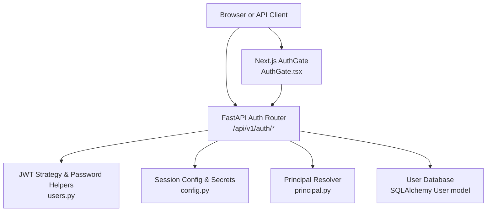
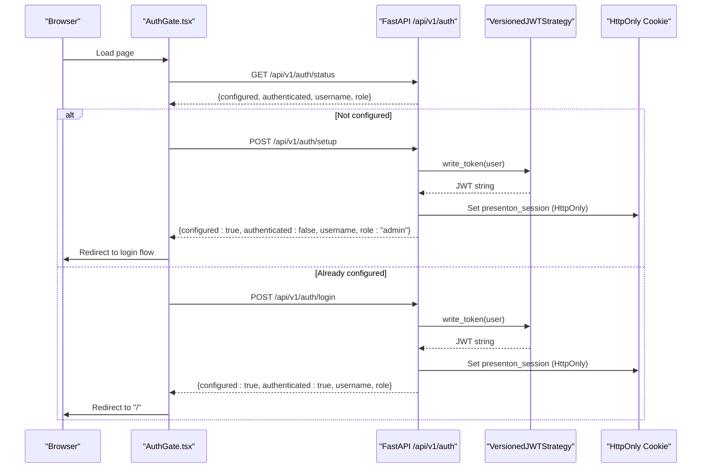
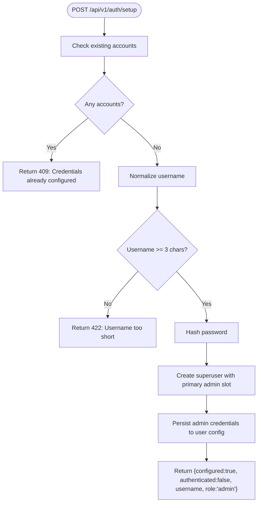
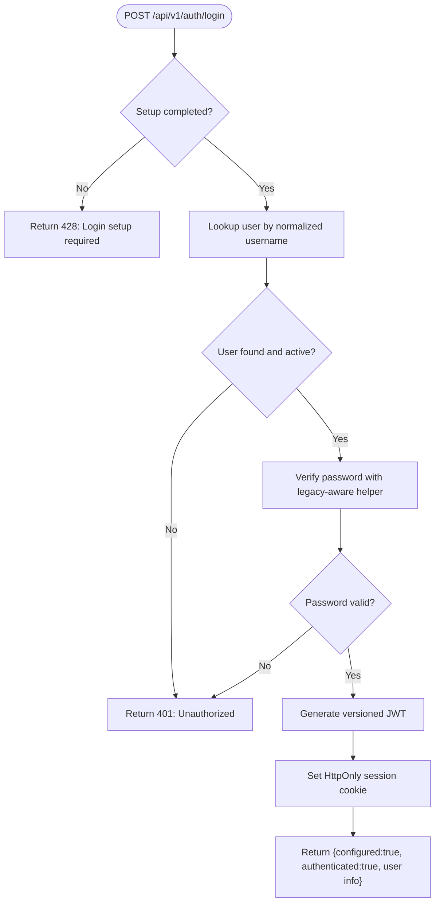
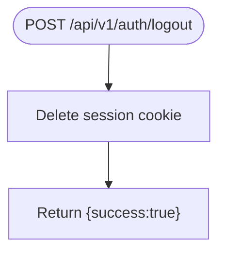
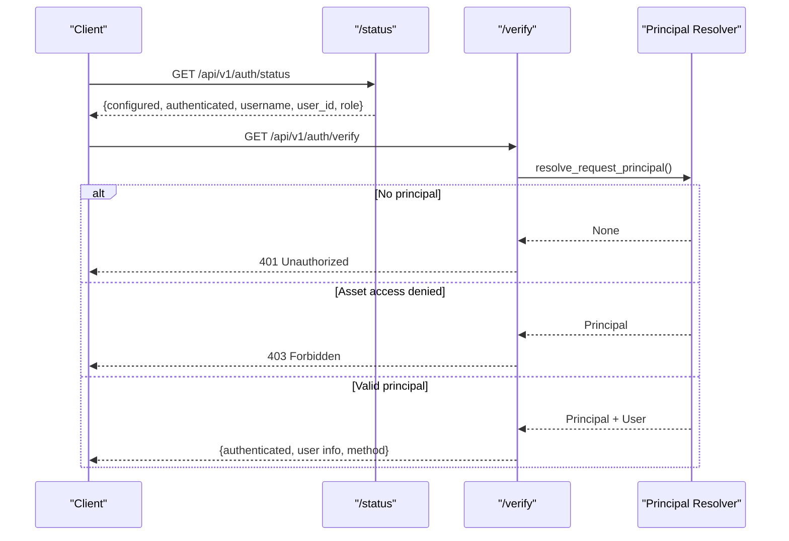
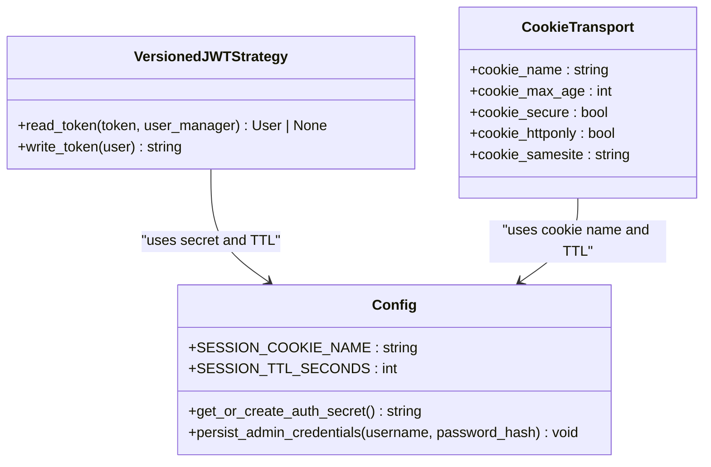
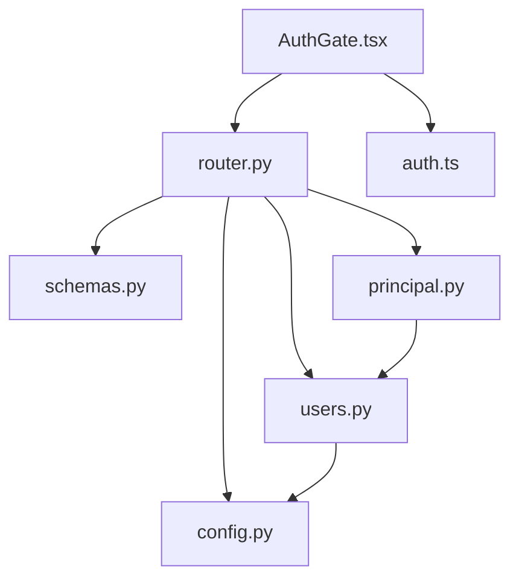

# Authentication Flows

<cite>
**Referenced Files in This Document**   
- [router.py](file://servers/fastapi/api/v1/auth/router.py)
- [users.py](file://servers/fastapi/api/v1/auth/users.py)
- [config.py](file://servers/fastapi/api/v1/auth/config.py)
- [schemas.py](file://servers/fastapi/api/v1/auth/schemas.py)
- [principal.py](file://servers/fastapi/api/v1/auth/principal.py)
- [AuthGate.tsx](file://servers/nextjs/components/Auth/AuthGate.tsx)
- [auth.ts](file://servers/nextjs/utils/auth.ts)
- [test_auth_endpoints.py](file://servers/fastapi/tests/integration/test_auth_endpoints.py)
</cite>

## Table of Contents
1. [Introduction](#introduction)
2. [Project Structure](#project-structure)
3. [Core Components](#core-components)
4. [Architecture Overview](#architecture-overview)
5. [Detailed Component Analysis](#detailed-component-analysis)
6. [Dependency Analysis](#dependency-analysis)
7. [Performance Considerations](#performance-considerations)
8. [Troubleshooting Guide](#troubleshooting-guide)
9. [Conclusion](#conclusion)

## Introduction
This document explains Presenton’s authentication flows and login mechanisms. It covers the complete lifecycle from initial admin setup through session management, including:

- Initial admin credential configuration via `/setup`
- User authentication via `/login`
- Session termination via `/logout`
- JWT token generation and secure cookie handling
- Session TTL configuration
- Authentication status checking via `/status` and `/verify`
- Disable-auth mode for development environments
- Frontend integration with the `AuthGate` component
- Error handling patterns, status codes, and response formats

The backend is implemented in FastAPI under `servers/fastapi`, while the frontend Next.js application integrates authentication state through `servers/nextjs`.

## Project Structure
Authentication-related code is split between backend API routes, user/session utilities, and frontend components:

- Backend authentication router and endpoints: `servers/fastapi/api/v1/auth/router.py`
- JWT strategy, password helpers, and user serialization: `servers/fastapi/api/v1/auth/users.py`
- Session cookie name, TTL, secrets, and admin credential persistence: `servers/fastapi/api/v1/auth/config.py`
- Request/response schemas: `servers/fastapi/api/v1/auth/schemas.py`
- Principal resolution for cookies and API keys: `servers/fastapi/api/v1/auth/principal.py`
- Frontend authentication gate and redirect logic: `servers/nextjs/components/Auth/AuthGate.tsx`
- Frontend disable-auth detection: `servers/nextjs/utils/auth.ts`
- Integration tests validating cookie behavior: `servers/fastapi/tests/integration/test_auth_endpoints.py`

**Diagram sources**
- [router.py:1-202](file://servers/fastapi/api/v1/auth/router.py#L1-L202)
- [users.py:136-234](file://servers/fastapi/api/v1/auth/users.py#L136-L234)
- [config.py:11-108](file://servers/fastapi/api/v1/auth/config.py#L11-L108)
- [principal.py:14-72](file://servers/fastapi/api/v1/auth/principal.py#L14-L72)
- [AuthGate.tsx:30-323](file://servers/nextjs/components/Auth/AuthGate.tsx#L30-L323)

**Section sources**
- [router.py:1-202](file://servers/fastapi/api/v1/auth/router.py#L1-L202)
- [users.py:1-234](file://servers/fastapi/api/v1/auth/users.py#L1-L234)
- [config.py:1-108](file://servers/fastapi/api/v1/auth/config.py#L1-L108)
- [schemas.py:1-82](file://servers/fastapi/api/v1/auth/schemas.py#L1-L82)
- [principal.py:1-72](file://servers/fastapi/api/v1/auth/principal.py#L1-L72)
- [AuthGate.tsx:1-455](file://servers/nextjs/components/Auth/AuthGate.tsx#L1-L455)
- [auth.ts:1-21](file://servers/nextjs/utils/auth.ts#L1-L21)
- [test_auth_endpoints.py:130-168](file://servers/fastapi/tests/integration/test_auth_endpoints.py#L130-L168)

## Core Components
- **Auth Router**: Defines `/status`, `/verify`, `/setup`, `/login`, and `/logout` endpoints.
- **JWT Strategy**: Generates and decodes versioned JWTs tied to user auth versions.
- **Password Helper**: Supports legacy hash migration and enforces password rules.
- **Config**: Manages session cookie name, TTL, secret rotation, and admin credential persistence.
- **Principal Resolver**: Resolves authenticated users from cookies or API keys.
- **Frontend AuthGate**: Handles setup/login UI, redirects, and error notifications.
- **Disable-Auth Detection**: Allows local development without real authentication.

Key responsibilities:
- Validate credentials and create admin accounts during setup.
- Authenticate users and issue secure HttpOnly cookies containing JWTs.
- Provide status and verification endpoints for frontend routing.
- Support logout by clearing session cookies.
- Allow disable-auth mode for development.

**Section sources**
- [router.py:58-201](file://servers/fastapi/api/v1/auth/router.py#L58-L201)
- [users.py:27-46](file://servers/fastapi/api/v1/auth/users.py#L27-L46)
- [users.py:136-182](file://servers/fastapi/api/v1/auth/users.py#L136-L182)
- [config.py:11-12](file://servers/fastapi/api/v1/auth/config.py#L11-L12)
- [config.py:71-108](file://servers/fastapi/api/v1/auth/config.py#L71-L108)
- [principal.py:22-57](file://servers/fastapi/api/v1/auth/principal.py#L22-L57)
- [AuthGate.tsx:102-323](file://servers/nextjs/components/Auth/AuthGate.tsx#L102-L323)
- [auth.ts:6-20](file://servers/nextjs/utils/auth.ts#L6-L20)

## Architecture Overview
The authentication architecture follows a clear separation between browser-based sessions and API-key access:

- Browser clients authenticate via `/login`, receive an HttpOnly cookie named `presenton_session`, and use it for subsequent requests.
- The `/status` endpoint returns whether the instance is configured and whether the current request is authenticated.
- The `/verify` endpoint validates the current principal and can enforce asset authorization based on user role.
- The `/setup` endpoint creates the first admin account and persists credentials for recovery.
- The `/logout` endpoint clears the session cookie.
- Disable-auth mode bypasses authentication checks and treats all requests as authenticated admin sessions.

**Diagram sources**
- [AuthGate.tsx:102-323](file://servers/nextjs/components/Auth/AuthGate.tsx#L102-L323)
- [router.py:58-188](file://servers/fastapi/api/v1/auth/router.py#L58-L188)
- [users.py:136-182](file://servers/fastapi/api/v1/auth/users.py#L136-L182)
- [config.py:11-12](file://servers/fastapi/api/v1/auth/config.py#L11-L12)

## Detailed Component Analysis

### Setup Flow: `/setup`
The `/setup` endpoint initializes the first admin account:

- Validates that no existing accounts are present.
- Normalizes and validates the username length and pattern.
- Hashes the password using the legacy-aware password helper.
- Creates a superuser with primary admin slot and auth version 1.
- Persists admin credentials to the user config file for recovery.
- Returns a response indicating configuration success but not yet authenticated.

Response format:
- `configured`: boolean
- `authenticated`: boolean
- `username`: string
- `role`: "admin"

Error responses:
- `409 Conflict`: Credentials already configured
- `422 Unprocessable Entity`: Username validation failure

**Diagram sources**
- [router.py:110-152](file://servers/fastapi/api/v1/auth/router.py#L110-L152)
- [schemas.py:28-35](file://servers/fastapi/api/v1/auth/schemas.py#L28-L35)
- [config.py:95-108](file://servers/fastapi/api/v1/auth/config.py#L95-L108)

**Section sources**
- [router.py:110-152](file://servers/fastapi/api/v1/auth/router.py#L110-L152)
- [schemas.py:28-35](file://servers/fastapi/api/v1/auth/schemas.py#L28-L35)
- [config.py:95-108](file://servers/fastapi/api/v1/auth/config.py#L95-L108)

### Login Flow: `/login`
The `/login` endpoint authenticates users and issues a secure session cookie:

- Ensures setup has been completed; otherwise returns `428 Precondition Required`.
- Normalizes the username and looks up the user case-insensitively.
- Rejects inactive users and invalid passwords.
- Uses the legacy-aware password helper to verify and optionally upgrade hashes.
- Generates a versioned JWT using the JWT strategy.
- Sets an HttpOnly, SameSite=Lax, path="/", secure-aware session cookie.
- Returns a response indicating successful authentication.

Response format:
- `configured`: boolean
- `authenticated`: boolean
- `id`: string UUID
- `username`: string
- `role`: "admin" or "user"
- `created_at`: ISO timestamp or null

Error responses:
- `428 Precondition Required`: Login setup is required
- `401 Unauthorized`: Invalid credentials or inactive user

**Diagram sources**
- [router.py:155-188](file://servers/fastapi/api/v1/auth/router.py#L155-L188)
- [users.py:27-46](file://servers/fastapi/api/v1/auth/users.py#L27-L46)
- [users.py:136-182](file://servers/fastapi/api/v1/auth/users.py#L136-L182)
- [schemas.py:37-45](file://servers/fastapi/api/v1/auth/schemas.py#L37-L45)

**Section sources**
- [router.py:155-188](file://servers/fastapi/api/v1/auth/router.py#L155-L188)
- [users.py:27-46](file://servers/fastapi/api/v1/auth/users.py#L27-L46)
- [users.py:136-182](file://servers/fastapi/api/v1/auth/users.py#L136-L182)
- [schemas.py:37-45](file://servers/fastapi/api/v1/auth/schemas.py#L37-L45)

### Logout Flow: `/logout`
The `/logout` endpoint terminates the session by deleting the session cookie:

- Returns a simple success response.
- Deletes the session cookie with HttpOnly, secure-aware, SameSite=Lax, and path="/".

Response format:
- `success`: boolean

**Diagram sources**
- [router.py:191-201](file://servers/fastapi/api/v1/auth/router.py#L191-L201)

**Section sources**
- [router.py:191-201](file://servers/fastapi/api/v1/auth/router.py#L191-L201)

### Status Checking: `/status` and `/verify`
- `/status` returns whether the instance is configured and whether the current request is authenticated. In disable-auth mode, it always returns configured and authenticated as admin.
- `/verify` resolves the current principal and can enforce asset authorization. It also supports disable-auth mode.

Response formats:
- `/status`: `{configured, authenticated, username, user_id, role}`
- `/verify`: `{authenticated, id, username, role, created_at, method}`

Error responses:
- `/verify`: `401 Unauthorized` if no principal is resolved
- `/verify`: `403 Forbidden` if asset access is denied

**Diagram sources**
- [router.py:58-107](file://servers/fastapi/api/v1/auth/router.py#L58-L107)
- [principal.py:22-57](file://servers/fastapi/api/v1/auth/principal.py#L22-L57)

**Section sources**
- [router.py:58-107](file://servers/fastapi/api/v1/auth/router.py#L58-L107)
- [principal.py:22-57](file://servers/fastapi/api/v1/auth/principal.py#L22-L57)

### JWT Token Generation and Secure Cookie Handling
- JWT tokens are generated using a versioned strategy that includes the user ID and auth version.
- Tokens are signed with a deployment-specific secret managed in the user config.
- Cookies are set with:
  - Name: `presenton_session`
  - HttpOnly: true
  - Secure: true when the request is HTTPS or forwarded via HTTPS
  - SameSite: lax
  - Path: "/"
  - Max age: 30 days (SESSION_TTL_SECONDS)

**Diagram sources**
- [users.py:136-182](file://servers/fastapi/api/v1/auth/users.py#L136-L182)
- [users.py:187-199](file://servers/fastapi/api/v1/auth/users.py#L187-L199)
- [config.py:11-12](file://servers/fastapi/api/v1/auth/config.py#L11-L12)
- [config.py:71-108](file://servers/fastapi/api/v1/auth/config.py#L71-L108)

**Section sources**
- [users.py:136-182](file://servers/fastapi/api/v1/auth/users.py#L136-L182)
- [users.py:187-199](file://servers/fastapi/api/v1/auth/users.py#L187-L199)
- [config.py:11-12](file://servers/fastapi/api/v1/auth/config.py#L11-L12)
- [config.py:71-108](file://servers/fastapi/api/v1/auth/config.py#L71-L108)

### Disable-Auth Mode
Disable-auth mode allows development environments to bypass authentication:

- Frontend detects `DISABLE_AUTH` via `isAuthDisabled()` and treats the user as authenticated admin.
- Backend `/status` and `/verify` return authenticated admin responses when disable-auth is enabled.
- Security implication: All endpoints become effectively open to local development; this should never be used in production.

Frontend behavior:
- `AuthGate` sets configured and authenticated to true with username "electron" and role "admin".
- Redirects directly to the app without requiring login.

Backend behavior:
- `/status` returns configured=true, authenticated=true, username="electron", role="admin".
- `/verify` returns authenticated=true, username="electron", role="admin", method="local".

**Section sources**
- [auth.ts:6-20](file://servers/nextjs/utils/auth.ts#L6-L20)
- [AuthGate.tsx:49-67](file://servers/nextjs/components/Auth/AuthGate.tsx#L49-L67)
- [router.py:58-78](file://servers/fastapi/api/v1/auth/router.py#L58-L78)
- [router.py:81-107](file://servers/fastapi/api/v1/auth/router.py#L81-L107)

### Frontend Integration: `AuthGate` Component
The `AuthGate` component manages the authentication UI and state:

- Checks disable-auth mode and bypasses authentication if enabled.
- Calls `/api/v1/auth/status` to determine setup and authentication state.
- Shows setup form if not configured, or login form if configured.
- Submits to `/api/v1/auth/setup` or `/api/v1/auth/login` depending on state.
- Handles errors with user-friendly notifications and analytics tracking.
- Redirects to "/" upon successful authentication.

Key behaviors:
- Minimum username length: 3 characters
- Minimum password length: 8 characters for setup, 6 for login
- Setup requires password confirmation
- Tracks events for setup/sign-in start, completion, and failures
- Displays unauthorized redirect messages when redirected with reason=unauthorized

**Section sources**
- [AuthGate.tsx:30-323](file://servers/nextjs/components/Auth/AuthGate.tsx#L30-L323)

## Dependency Analysis
Authentication components have clear dependencies:

- Router depends on schemas, principal resolver, user utilities, database session, environment flags, and config.
- Users module provides JWT strategy, password helper, and user serialization.
- Config manages session settings and secrets.
- Principal resolver handles both cookie-based JWT and API key authentication.
- Frontend AuthGate depends on utility functions for disable-auth detection and API URL resolution.

**Diagram sources**
- [router.py:1-24](file://servers/fastapi/api/v1/auth/router.py#L1-L24)
- [users.py:16-24](file://servers/fastapi/api/v1/auth/users.py#L16-L24)
- [principal.py:8-11](file://servers/fastapi/api/v1/auth/principal.py#L8-L11)
- [AuthGate.tsx:5-7](file://servers/nextjs/components/Auth/AuthGate.tsx#L5-L7)

**Section sources**
- [router.py:1-24](file://servers/fastapi/api/v1/auth/router.py#L1-L24)
- [users.py:16-24](file://servers/fastapi/api/v1/auth/users.py#L16-L24)
- [principal.py:8-11](file://servers/fastapi/api/v1/auth/principal.py#L8-L11)
- [AuthGate.tsx:5-7](file://servers/nextjs/components/Auth/AuthGate.tsx#L5-L7)

## Performance Considerations
- JWT decoding and user lookup occur on each protected request; ensure efficient database queries.
- Password hashing uses a legacy-aware helper that may perform additional work for older hashes; consider migrating to modern hashing where possible.
- Session TTL is set to 30 days; balance security vs convenience based on deployment needs.
- Disable-auth mode removes authentication overhead entirely, suitable only for local development.

[No sources needed since this section provides general guidance]

## Troubleshooting Guide
Common issues and resolutions:

- **Setup fails with 409 Conflict**: An admin account already exists. Use existing credentials or reset the database if necessary.
- **Login fails with 428 Precondition Required**: Admin setup has not been completed. Call `/setup` first.
- **Login fails with 401 Unauthorized**: Incorrect username/password or inactive user. Verify credentials and user status.
- **Logout does not clear session**: Ensure cookies are being sent with requests (`credentials: include` in frontend fetch).
- **Disable-auth not working**: Verify `DISABLE_AUTH` is set to a truthy value in the frontend environment.
- **Asset access denied on `/verify`**: The requested resource is not authorized for the current user role.

Validation patterns:
- Username must match non-whitespace pattern and be 3-128 characters.
- Setup password must be 8-128 characters.
- Login password accepts 6-128 characters for backward compatibility.

**Section sources**
- [router.py:110-188](file://servers/fastapi/api/v1/auth/router.py#L110-L188)
- [schemas.py:28-45](file://servers/fastapi/api/v1/auth/schemas.py#L28-L45)
- [test_auth_endpoints.py:130-168](file://servers/fastapi/tests/integration/test_auth_endpoints.py#L130-L168)

## Conclusion
Presenton’s authentication system provides a robust, secure, and flexible approach to user management:

- Clear separation between setup, login, and logout flows
- Secure HttpOnly cookie handling with configurable TTL
- Versioned JWT tokens for enhanced security
- Comprehensive status and verification endpoints
- Development-friendly disable-auth mode
- Well-integrated frontend with `AuthGate` for seamless user experience

For production deployments, ensure HTTPS is enabled, disable-auth mode is turned off, and session secrets are properly managed. For development, disable-auth mode simplifies testing while maintaining consistent API contracts.

[No sources needed since this section summarizes without analyzing specific files]