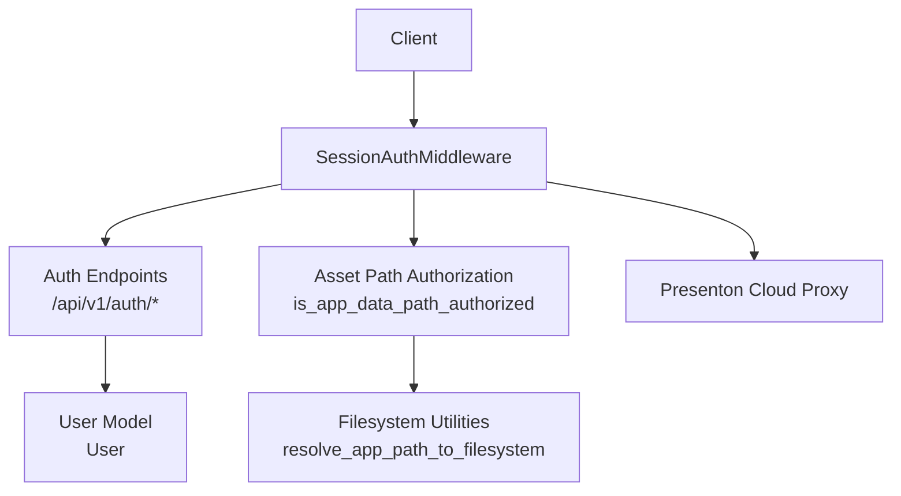
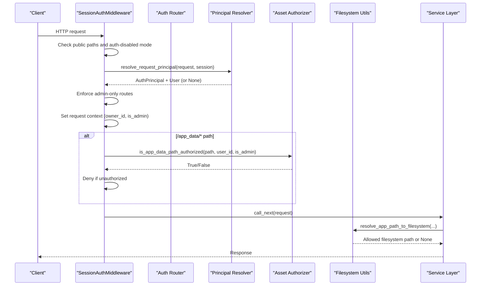
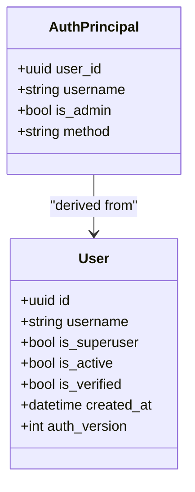
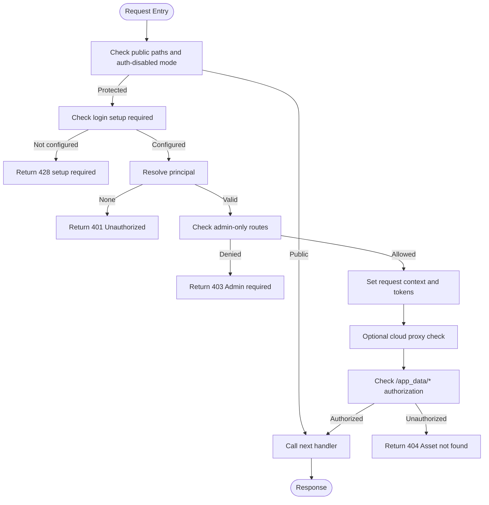
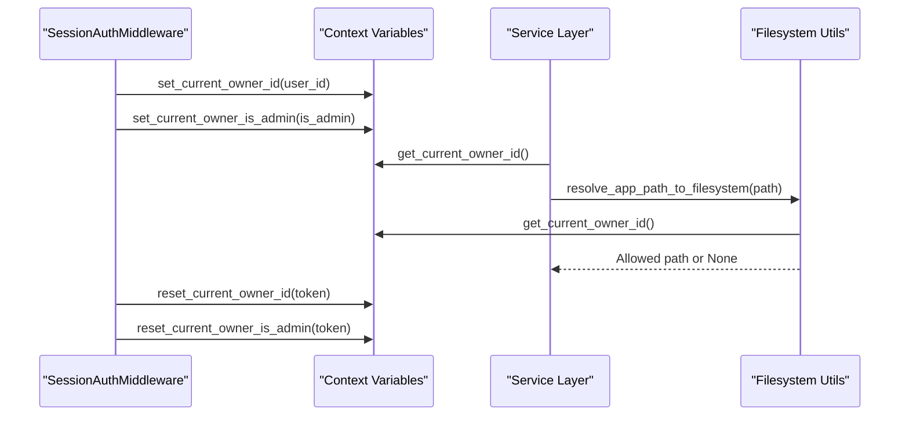
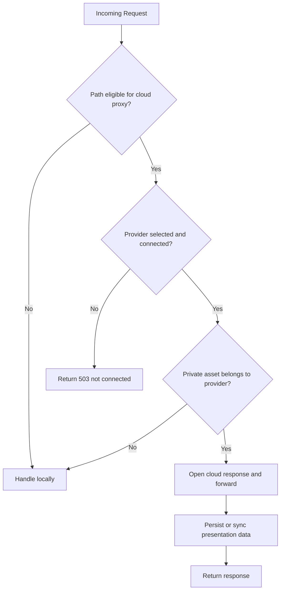
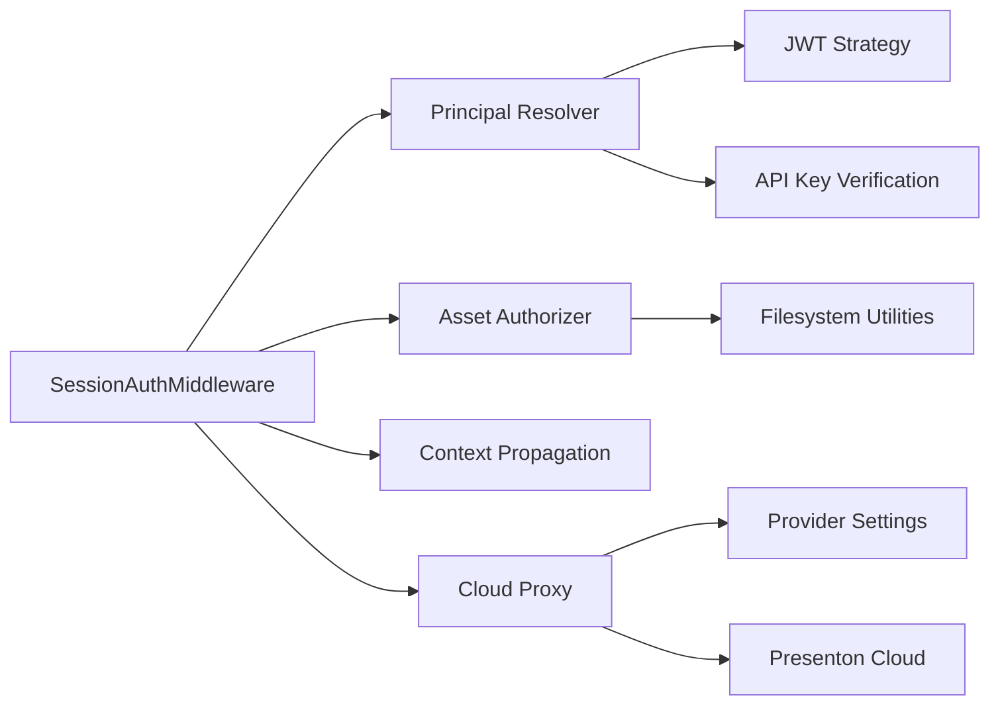

# Authorization & Permissions

<cite>
**Referenced Files in This Document**
- [middlewares.py](file://servers/fastapi/api/middlewares.py)
- [principal.py](file://servers/fastapi/api/v1/auth/principal.py)
- [router.py](file://servers/fastapi/api/v1/auth/router.py)
- [assets.py](file://servers/fastapi/api/v1/auth/assets.py)
- [context.py](file://servers/fastapi/api/v1/auth/context.py)
- [user.py](file://servers/fastapi/models/sql/user.py)
- [asset_directory_utils.py](file://servers/fastapi/utils/asset_directory_utils.py)
- [presenton_cloud_proxy.py](file://servers/fastapi/services/presenton_cloud_proxy.py)
- [test_session_auth_middleware.py](file://servers/fastapi/tests/unit/test_session_auth_middleware.py)
- [test_asset_ownership_security.py](file://servers/fastapi/tests/unit/test_asset_ownership_security.py)
</cite>

## Table of Contents
1. [Introduction](#introduction)
2. [Project Structure](#project-structure)
3. [Core Components](#core-components)
4. [Architecture Overview](#architecture-overview)
5. [Detailed Component Analysis](#detailed-component-analysis)
6. [Dependency Analysis](#dependency-analysis)
7. [Performance Considerations](#performance-considerations)
8. [Troubleshooting Guide](#troubleshooting-guide)
9. [Conclusion](#conclusion)
10. [Appendices](#appendices)

## Introduction
This document explains Presenton’s authorization and permission system with a focus on:
- Principal resolution for browser sessions and API keys
- Role-based access control using an admin versus user hierarchy
- Permission scoping through request context and asset path rules
- Asset directory security, file access controls, and data ownership enforcement
- Middleware behavior, request context propagation, and permission evaluation logic
- Extensibility patterns for custom authorization policies

The implementation is centered around FastAPI middleware that authenticates requests, resolves the current principal, enforces admin-only routes, scopes app-data assets per user, and optionally proxies selected requests to the Presenton Cloud service.

## Project Structure
Authorization-related code is primarily located under the FastAPI server:
- Authentication endpoints and session handling live under `api/v1/auth`.
- Request-level authentication and authorization are implemented as middleware.
- Asset path authorization and filesystem isolation utilities live under `utils` and `api/v1/auth`.
- The Presenton Cloud proxy integrates authorization decisions into cloud-bound operations.



**Diagram sources**
- [middlewares.py:29-149](file://servers/fastapi/api/middlewares.py#L29-L149)
- [router.py:58-201](file://servers/fastapi/api/v1/auth/router.py#L58-L201)
- [assets.py:19-84](file://servers/fastapi/api/v1/auth/assets.py#L19-L84)
- [asset_directory_utils.py:101-211](file://servers/fastapi/utils/asset_directory_utils.py#L101-L211)
- [presenton_cloud_proxy.py:105-113](file://servers/fastapi/services/presenton_cloud_proxy.py#L105-L113)

**Section sources**
- [middlewares.py:29-149](file://servers/fastapi/api/middlewares.py#L29-L149)
- [router.py:58-201](file://servers/fastapi/api/v1/auth/router.py#L58-L201)

## Core Components
- Principal object: A frozen dataclass representing the authenticated identity, including user ID, username, admin flag, and authentication method.
- Principal resolver: Extracts either a JWT cookie or a Bearer API key and returns the principal plus the database user when available.
- Session auth middleware: Enforces login setup, authenticates requests, restricts admin-only paths, injects request context, and validates asset paths.
- Asset path authorization: Defines shared and private asset roots and enforces per-user scoping for private directories.
- Filesystem utilities: Resolve URLs and paths safely while preventing traversal and cross-user access.
- Context propagation: Uses context variables to propagate current owner ID and admin status across async boundaries.
- Cloud proxy integration: Applies authorization checks before proxying to Presenton Cloud and ensures asset ownership alignment.

**Section sources**
- [principal.py:14-71](file://servers/fastapi/api/v1/auth/principal.py#L14-L71)
- [middlewares.py:29-149](file://servers/fastapi/api/middlewares.py#L29-L149)
- [assets.py:9-84](file://servers/fastapi/api/v1/auth/assets.py#L9-L84)
- [asset_directory_utils.py:101-211](file://servers/fastapi/utils/asset_directory_utils.py#L101-L211)
- [context.py:5-34](file://servers/fastapi/api/v1/auth/context.py#L5-L34)
- [presenton_cloud_proxy.py:105-113](file://servers/fastapi/services/presenton_cloud_proxy.py#L105-L113)

## Architecture Overview
The authorization architecture combines middleware-driven authentication, role checks, and scoped resource access.



**Diagram sources**
- [middlewares.py:55-149](file://servers/fastapi/api/middlewares.py#L55-L149)
- [principal.py:22-57](file://servers/fastapi/api/v1/auth/principal.py#L22-L57)
- [assets.py:58-84](file://servers/fastapi/api/v1/auth/assets.py#L58-L84)
- [asset_directory_utils.py:101-211](file://servers/fastapi/utils/asset_directory_utils.py#L101-L211)

## Detailed Component Analysis

### Principal Resolution and Role Model
- Principal object fields:
  - user_id: UUID identifying the user.
  - username: String identifier.
  - is_admin: Boolean derived from the user’s superuser flag.
  - method: Either "jwt" for browser sessions or "api_key" for token-based access.
- Principal resolver supports:
  - Cookie-based JWT validation via the configured JWT strategy.
  - Bearer token validation via API key verification.
- Admin helper:
  - Requires a browser session JWT and admin status; otherwise returns a 403 error.



**Diagram sources**
- [principal.py:14-20](file://servers/fastapi/api/v1/auth/principal.py#L14-L20)
- [user.py:16-46](file://servers/fastapi/models/sql/user.py#L16-L46)

**Section sources**
- [principal.py:14-71](file://servers/fastapi/api/v1/auth/principal.py#L14-L71)
- [user.py:16-46](file://servers/fastapi/models/sql/user.py#L16-L46)

### Session Authentication Middleware
Responsibilities:
- Public path exemptions for auth endpoints and shared asset prefixes.
- Login setup enforcement when no users exist yet.
- Principal resolution and injection into request state.
- Admin-only route protection for configuration-sensitive endpoints.
- Optional Presenton Cloud proxy interception for supported paths.
- Asset path authorization for `/app_data/*`.
- Context variable propagation for owner ID and admin status.

Key behaviors:
- If authentication is disabled, desktop runtime still allows cloud proxying for selected providers.
- Requests without a valid principal receive a 401 response.
- Non-admin attempts to admin-only routes receive a 403 response.
- Unauthorized `/app_data/*` requests receive a 404 response.



**Diagram sources**
- [middlewares.py:29-149](file://servers/fastapi/api/middlewares.py#L29-L149)

**Section sources**
- [middlewares.py:29-149](file://servers/fastapi/api/middlewares.py#L29-L149)
- [test_session_auth_middleware.py:120-209](file://servers/fastapi/tests/unit/test_session_auth_middleware.py#L120-L209)

### Asset Directory Security and Path-Based Access Control
Path classification:
- Shared roots: fonts, templates.
- Private roots: images, exports, uploads, pptx-to-html, pptx-to-json.

Authorization rules:
- Shared roots are accessible by any authenticated user.
- Private roots require a second segment indicating ownership:
  - For multi-user assets under `users/{user_id}`, access is allowed only if the path contains the requesting user’s ID.
  - Legacy assets at the root of private roots are restricted to administrators.

Path normalization:
- Repeated URL decoding with a hard cap prevents encoded traversal attacks.
- Null bytes, backslashes, empty segments, dot segments, and parent traversal are rejected.

Filesystem resolution:
- Resolves URLs and absolute paths to real filesystem locations.
- Ensures resolved paths remain within allowed roots (app_data, static, vendor/fonts, temp directories).
- Applies owner-scoped temp directories when a user context exists.

```mermaid
flowchart TD
In(["Normalized path parts"]) --> RootCheck{"Root in shared roots?"}
RootCheck --> |Yes| AllowShared["Allow"]
RootCheck --> |No| PrivateCheck{"Root in private roots?"}
PrivateCheck --> |No| Deny["Deny"]
PrivateCheck --> |Yes| OwnershipCheck{"Ownership matches?"}
OwnershipCheck --> |users/{user_id}| MatchUser["Allow if user_id matches"]
OwnershipCheck --> |Legacy root| AdminOnly["Allow only if admin"]
MatchUser --> AllowPrivate["Allow"]
AdminOnly --> AllowAdmin["Allow"]
AllowShared --> Out(["Authorized"])
AllowPrivate --> Out
AllowAdmin --> Out
Deny --> Out
```

**Diagram sources**
- [assets.py:9-84](file://servers/fastapi/api/v1/auth/assets.py#L9-L84)

**Section sources**
- [assets.py:19-84](file://servers/fastapi/api/v1/auth/assets.py#L19-L84)
- [asset_directory_utils.py:101-211](file://servers/fastapi/utils/asset_directory_utils.py#L101-L211)
- [test_asset_ownership_security.py:42-83](file://servers/fastapi/tests/unit/test_asset_ownership_security.py#L42-L83)

### Request Context Propagation and Data Ownership Enforcement
Context variables:
- Current owner ID: Identifies the active user for data scoping.
- Current owner admin flag: Indicates whether the current context has administrative privileges.

Propagation lifecycle:
- Middleware sets context variables after principal resolution.
- Handlers and services read context to scope queries and file operations.
- Middleware resets context variables after request processing.

Data ownership enforcement:
- Owned directories under private roots are automatically scoped to the current owner.
- Absolute path resolution is constrained to allowed roots and respects owner scoping.



**Diagram sources**
- [context.py:5-34](file://servers/fastapi/api/v1/auth/context.py#L5-L34)
- [middlewares.py:117-149](file://servers/fastapi/api/middlewares.py#L117-L149)
- [asset_directory_utils.py:174-211](file://servers/fastapi/utils/asset_directory_utils.py#L174-L211)

**Section sources**
- [context.py:5-34](file://servers/fastapi/api/v1/auth/context.py#L5-L34)
- [asset_directory_utils.py:174-211](file://servers/fastapi/utils/asset_directory_utils.py#L174-L211)

### Presenton Cloud Proxy Authorization
Cloud proxying applies additional authorization constraints:
- Only specific paths are eligible for proxying.
- Community features can be disabled at deployment level.
- Provider settings must select Presenton and have credentials configured.
- Private asset paths must belong to the provider’s subject (user ID), ensuring cross-user isolation.



**Diagram sources**
- [presenton_cloud_proxy.py:105-113](file://servers/fastapi/services/presenton_cloud_proxy.py#L105-L113)
- [presenton_cloud_proxy.py:407-463](file://servers/fastapi/services/presenton_cloud_proxy.py#L407-L463)
- [presenton_cloud_proxy.py:482-548](file://servers/fastapi/services/presenton_cloud_proxy.py#L482-L548)

**Section sources**
- [presenton_cloud_proxy.py:105-113](file://servers/fastapi/services/presenton_cloud_proxy.py#L105-L113)
- [presenton_cloud_proxy.py:407-463](file://servers/fastapi/services/presenton_cloud_proxy.py#L407-L463)
- [presenton_cloud_proxy.py:482-548](file://servers/fastapi/services/presenton_cloud_proxy.py#L482-L548)

### Authorization Endpoints and Session Lifecycle
Endpoints:
- Status: Returns configuration and authentication state, including role and method.
- Verify: Validates session and optionally re-checks asset authorization for original URIs.
- Setup: Creates the first administrator account with primary admin slot.
- Login: Authenticates user, issues JWT, and sets secure cookie.
- Logout: Clears session cookie.

Security notes:
- Setup endpoint enforces minimum username length and prevents duplicate primary administrators.
- Login endpoint normalizes usernames and uses password hashing utilities.
- Cookie flags include httponly, secure (when HTTPS), and samesite lax.

**Section sources**
- [router.py:58-201](file://servers/fastapi/api/v1/auth/router.py#L58-L201)

## Dependency Analysis
The authorization subsystem depends on:
- FastAPI request/response infrastructure.
- SQLAlchemy async sessions for user lookups.
- JWT strategy for token reading/writing.
- API key verification service.
- Environment configuration for auth disablement and base URLs.
- Presenton Cloud provider settings and persistence.



**Diagram sources**
- [middlewares.py:1-20](file://servers/fastapi/api/middlewares.py#L1-L20)
- [principal.py:8-11](file://servers/fastapi/api/v1/auth/principal.py#L8-L11)
- [assets.py:1-6](file://servers/fastapi/api/v1/auth/assets.py#L1-L6)
- [asset_directory_utils.py:6-18](file://servers/fastapi/utils/asset_directory_utils.py#L6-L18)
- [presenton_cloud_proxy.py:14-35](file://servers/fastapi/services/presenton_cloud_proxy.py#L14-L35)

**Section sources**
- [middlewares.py:1-20](file://servers/fastapi/api/middlewares.py#L1-L20)
- [principal.py:8-11](file://servers/fastapi/api/v1/auth/principal.py#L8-L11)
- [assets.py:1-6](file://servers/fastapi/api/v1/auth/assets.py#L1-L6)
- [asset_directory_utils.py:6-18](file://servers/fastapi/utils/asset_directory_utils.py#L6-L18)
- [presenton_cloud_proxy.py:14-35](file://servers/fastapi/services/presenton_cloud_proxy.py#L14-L35)

## Performance Considerations
- Principal resolution occurs once per protected request inside the middleware.
- Database queries are minimized by checking user existence once and reusing the session.
- Asset path authorization is lightweight string parsing and set membership checks.
- Cloud proxy buffering is applied selectively to create/update/chat flows to avoid unnecessary memory usage.
- Context variable propagation avoids passing ownership arguments through deep call stacks.

[No sources needed since this section provides general guidance]

## Troubleshooting Guide
Common issues and resolutions:
- 428 Login setup required: No users exist yet; use the setup endpoint to create the primary administrator.
- 401 Unauthorized: Missing or invalid JWT cookie or Bearer token; verify session or API key.
- 403 Admin browser session required: Attempted admin-only route with non-admin or API key; use a browser session with admin privileges.
- 404 Asset not found: `/app_data/*` path failed authorization; ensure path belongs to the current user or is shared.
- Cloud proxy 503: Presenton provider selected but not connected; configure provider credentials.

Relevant tests:
- Session auth middleware verifies admin-only restrictions and principal propagation.
- Asset ownership tests validate per-user isolation and legacy admin-only access.

**Section sources**
- [middlewares.py:82-149](file://servers/fastapi/api/middlewares.py#L82-L149)
- [test_session_auth_middleware.py:120-209](file://servers/fastapi/tests/unit/test_session_auth_middleware.py#L120-L209)
- [test_asset_ownership_security.py:42-83](file://servers/fastapi/tests/unit/test_asset_ownership_security.py#L42-L83)

## Conclusion
Presenton’s authorization system enforces strong multi-user isolation through:
- Principal resolution supporting both browser sessions and API keys.
- Role-based access control with admin-only routes.
- Strict asset path authorization separating shared and private resources.
- Context-driven data ownership propagation across async handlers.
- Careful filesystem path resolution to prevent traversal and cross-user leaks.
- Controlled Presenton Cloud proxying aligned with provider and user ownership.

These mechanisms collectively protect sensitive resources and prevent unauthorized access while allowing extensible policy customization.

[No sources needed since this section summarizes without analyzing specific files]

## Appendices

### Implementing Custom Authorization Policies
Patterns you can follow:
- Add new admin-only path prefixes in the middleware’s admin-only check.
- Extend asset path authorization by adding new roots to shared or private sets and defining ownership rules.
- Introduce new context variables for additional attributes like tenant or organization, propagating them in middleware and reading them in services.
- Create custom dependency functions that wrap `require_browser_admin_principal` or implement similar checks for specialized routes.

Reference points:
- Admin-only route enforcement and context setting.
- Asset root classification and ownership checks.
- Context variable setters and getters.

**Section sources**
- [middlewares.py:100-125](file://servers/fastapi/api/middlewares.py#L100-L125)
- [assets.py:9-84](file://servers/fastapi/api/v1/auth/assets.py#L9-L84)
- [context.py:13-34](file://servers/fastapi/api/v1/auth/context.py#L13-L34)

### Security Best Practices
- Always validate and normalize incoming paths before filesystem access.
- Restrict private asset roots to per-user directories and legacy admin-only access.
- Use httponly, secure, and samesite cookies for session tokens.
- Avoid exposing internal headers and cookies to upstream services.
- Limit cloud proxying to explicitly whitelisted paths and methods.
- Enforce login setup before enabling protected routes.
- Validate provider selection and credentials before proxying to external services.

**Section sources**
- [router.py:46-55](file://servers/fastapi/api/v1/auth/router.py#L46-L55)
- [presenton_cloud_proxy.py:82-99](file://servers/fastapi/services/presenton_cloud_proxy.py#L82-L99)
- [asset_directory_utils.py:163-171](file://servers/fastapi/utils/asset_directory_utils.py#L163-L171)