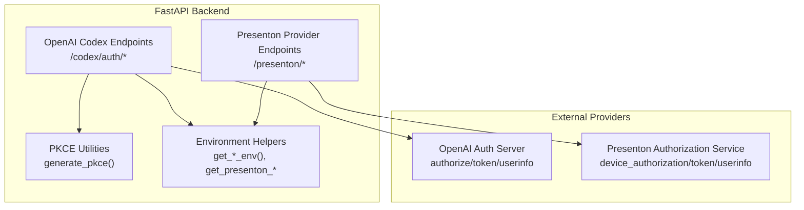
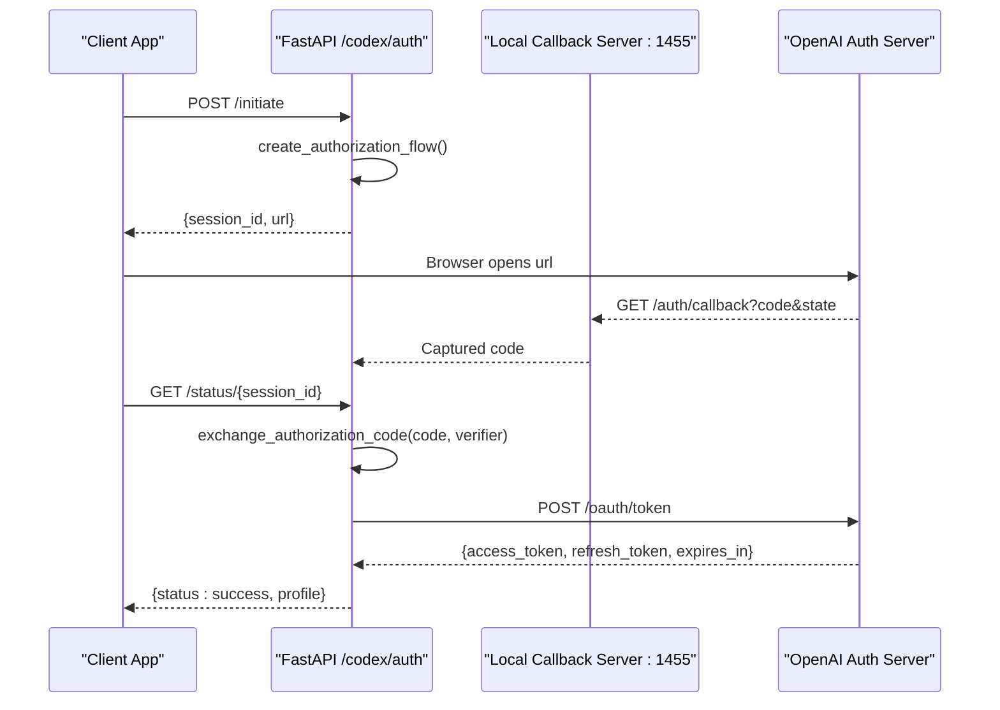
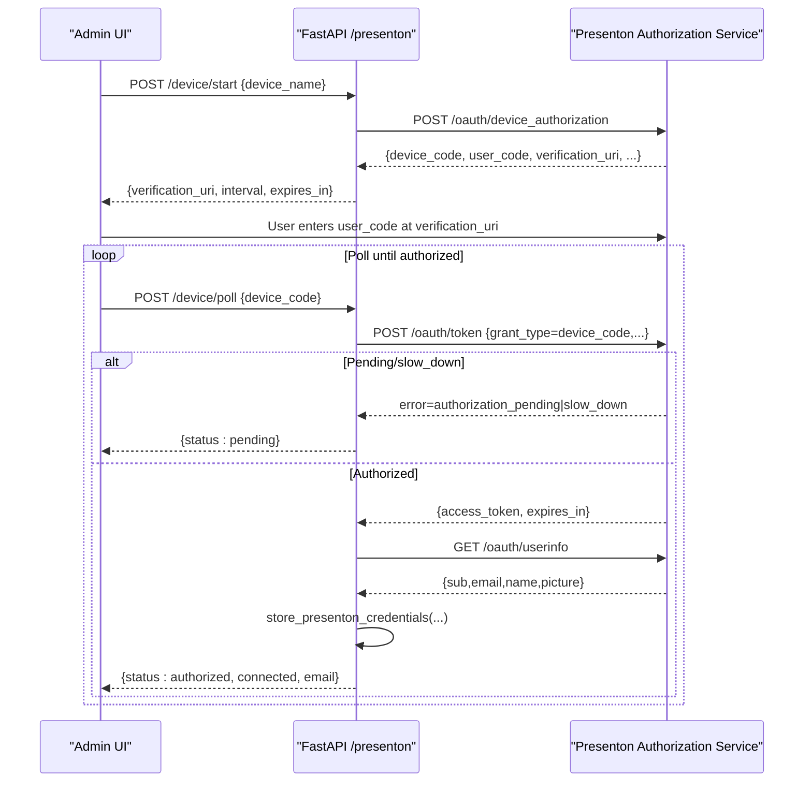
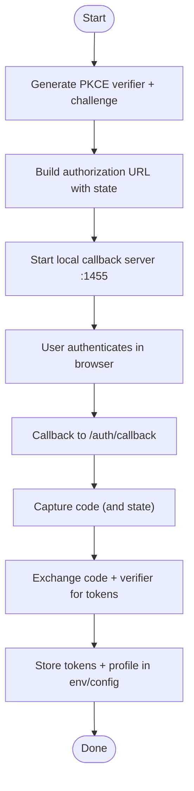
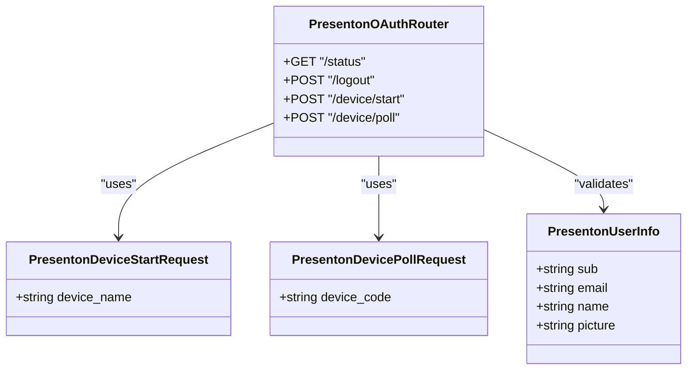
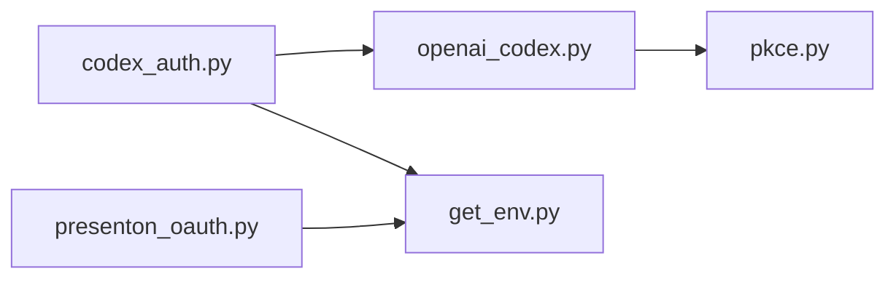

# OAuth Integration

<cite>
**Referenced Files in This Document**
- [codex_auth.py](file://servers/fastapi/api/v1/ppt/endpoints/codex_auth.py)
- [openai_codex.py](file://servers/fastapi/utils/oauth/openai_codex.py)
- [pkce.py](file://servers/fastapi/utils/oauth/pkce.py)
- [presenton_oauth.py](file://servers/fastapi/api/v1/auth/presenton_oauth.py)
- [get_env.py](file://servers/fastapi/utils/get_env.py)
</cite>

## Table of Contents
1. [Introduction](#introduction)
2. [Project Structure](#project-structure)
3. [Core Components](#core-components)
4. [Architecture Overview](#architecture-overview)
5. [Detailed Component Analysis](#detailed-component-analysis)
6. [Dependency Analysis](#dependency-analysis)
7. [Performance Considerations](#performance-considerations)
8. [Troubleshooting Guide](#troubleshooting-guide)
9. [Conclusion](#conclusion)
10. [Appendices](#appendices)

## Introduction
This document explains Presenton’s OAuth integration capabilities with a focus on:
- The OpenAI Codex (ChatGPT) OAuth flow using PKCE and a local callback server
- The Presenton provider OAuth flow using the device authorization grant
- Token exchange, refresh token management, and profile extraction
- Security measures including PKCE, state handling, and CSRF considerations
- Configuration for providers and environment-based client setup
- Best practices for secure token storage and session management

## Project Structure
The OAuth functionality is implemented primarily in the FastAPI backend under servers/fastapi:
- OpenAI Codex OAuth endpoints and utilities
- Presenton provider OAuth endpoints
- PKCE helper utilities
- Environment configuration helpers for issuer, client ID, and stored tokens

**Diagram sources**
- [codex_auth.py:1-350](file://servers/fastapi/api/v1/ppt/endpoints/codex_auth.py#L1-L350)
- [openai_codex.py:1-615](file://servers/fastapi/utils/oauth/openai_codex.py#L1-L615)
- [pkce.py:1-24](file://servers/fastapi/utils/oauth/pkce.py#L1-L24)
- [presenton_oauth.py:1-313](file://servers/fastapi/api/v1/auth/presenton_oauth.py#L1-L313)
- [get_env.py:71-76](file://servers/fastapi/utils/get_env.py#L71-L76)

**Section sources**
- [codex_auth.py:1-350](file://servers/fastapi/api/v1/ppt/endpoints/codex_auth.py#L1-L350)
- [openai_codex.py:1-615](file://servers/fastapi/utils/oauth/openai_codex.py#L1-L615)
- [pkce.py:1-24](file://servers/fastapi/utils/oauth/pkce.py#L1-L24)
- [presenton_oauth.py:1-313](file://servers/fastapi/api/v1/auth/presenton_oauth.py#L1-L313)
- [get_env.py:71-76](file://servers/fastapi/utils/get_env.py#L71-L76)

## Core Components
- OpenAI Codex OAuth endpoints: initiate, poll status, manual code exchange, refresh, logout, and status checks
- OpenAI Codex utility module: PKCE generation, authorization URL creation, local callback server, token exchange, refresh, and profile parsing
- PKCE utility: generates verifier and S256 challenge
- Presenton provider OAuth endpoints: device authorization start/poll, status, logout, and credential storage
- Environment helpers: default issuer/client ID and Codex token fields

Key responsibilities:
- Securely generate PKCE parameters and state
- Manage short-lived sessions for browser-based flows
- Exchange authorization codes for access and refresh tokens
- Persist tokens to environment variables and user config
- Extract user profile information from tokens or userinfo endpoints

**Section sources**
- [codex_auth.py:1-350](file://servers/fastapi/api/v1/ppt/endpoints/codex_auth.py#L1-L350)
- [openai_codex.py:1-615](file://servers/fastapi/utils/oauth/openai_codex.py#L1-L615)
- [pkce.py:1-24](file://servers/fastapi/utils/oauth/pkce.py#L1-L24)
- [presenton_oauth.py:1-313](file://servers/fastapi/api/v1/auth/presenton_oauth.py#L1-L313)
- [get_env.py:420-450](file://servers/fastapi/utils/get_env.py#L420-L450)

## Architecture Overview
Two distinct OAuth flows are supported:

- OpenAI Codex (ChatGPT): Authorization Code Flow with PKCE and a local callback server
- Presenton Provider: Device Authorization Grant Flow

**Diagram sources**
- [codex_auth.py:133-209](file://servers/fastapi/api/v1/ppt/endpoints/codex_auth.py#L133-L209)
- [openai_codex.py:357-375](file://servers/fastapi/utils/oauth/openai_codex.py#L357-L375)
- [openai_codex.py:508-544](file://servers/fastapi/utils/oauth/openai_codex.py#L508-L544)

**Diagram sources**
- [presenton_oauth.py:164-214](file://servers/fastapi/api/v1/auth/presenton_oauth.py#L164-L214)
- [presenton_oauth.py:217-313](file://servers/fastapi/api/v1/auth/presenton_oauth.py#L217-L313)

## Detailed Component Analysis

### OpenAI Codex OAuth Flow
Responsibilities:
- Generate PKCE verifier/challenge and state
- Build authorization URL
- Start a local HTTP server to capture the callback
- Exchange authorization code for tokens
- Refresh tokens when needed
- Parse account profile from JWT claims

Security highlights:
- Uses PKCE (S256) to protect authorization code exchange
- Generates cryptographically random state and verifier
- Validates incoming state during manual code exchange
- Treats local callback state mismatch as a soft warning due to known edge cases

**Diagram sources**
- [openai_codex.py:357-375](file://servers/fastapi/utils/oauth/openai_codex.py#L357-L375)
- [openai_codex.py:382-434](file://servers/fastapi/utils/oauth/openai_codex.py#L382-L434)
- [openai_codex.py:508-544](file://servers/fastapi/utils/oauth/openai_codex.py#L508-L544)

Endpoints:
- POST /codex/auth/initiate: starts flow, returns session_id and authorization URL
- GET /codex/auth/status/{session_id}: polls until code captured; exchanges and stores tokens
- POST /codex/auth/exchange: manual fallback accepting full redirect URL, code#state, or bare code
- POST /codex/auth/refresh: refreshes stored access token using refresh token
- GET /codex/auth/status: reports current authentication status and expiration
- POST /codex/auth/logout: clears stored credentials

Token storage:
- Access token, refresh token, expiry timestamp, account ID, username, email, and plan flags are persisted via environment variables and user config

Profile extraction:
- Parses account ID, username, email, and plan type from JWT claims in access/id tokens

Error handling:
- Returns structured failures for invalid inputs, missing fields, network errors, and expired sessions
- Provides guidance headers to prompt re-authentication when required

**Section sources**
- [codex_auth.py:1-350](file://servers/fastapi/api/v1/ppt/endpoints/codex_auth.py#L1-L350)
- [openai_codex.py:1-615](file://servers/fastapi/utils/oauth/openai_codex.py#L1-L615)
- [pkce.py:1-24](file://servers/fastapi/utils/oauth/pkce.py#L1-L24)
- [get_env.py:420-450](file://servers/fastapi/utils/get_env.py#L420-L450)

### Presenton Provider OAuth Flow
Responsibilities:
- Implement device authorization grant flow
- Poll for authorization completion
- Retrieve user info and store credentials securely
- Provide status and logout endpoints

Security highlights:
- Uses device_code and user_code to avoid exposing secrets in URLs
- Sends no-store cache headers to prevent sensitive data leakage
- Revokes tokens best-effort on failure paths

**Diagram sources**
- [presenton_oauth.py:37-50](file://servers/fastapi/api/v1/auth/presenton_oauth.py#L37-L50)
- [presenton_oauth.py:120-161](file://servers/fastapi/api/v1/auth/presenton_oauth.py#L120-L161)
- [presenton_oauth.py:164-313](file://servers/fastapi/api/v1/auth/presenton_oauth.py#L164-L313)

Endpoints:
- GET /presenton/status: shows provider status, issuer, linkage, and admin controls
- POST /presenton/logout: revokes and clears provider credentials
- POST /presenton/device/start: initiates device authorization
- POST /presenton/device/poll: polls for token issuance and stores credentials after successful userinfo validation

Configuration:
- Issuer and client ID are provided by environment helpers with built-in defaults

**Section sources**
- [presenton_oauth.py:1-313](file://servers/fastapi/api/v1/auth/presenton_oauth.py#L1-L313)
- [get_env.py:71-76](file://servers/fastapi/utils/get_env.py#L71-L76)

### PKCE Implementation
- Generates a 32-byte random verifier
- Encodes it as base64url without padding
- Computes SHA-256 digest and encodes as base64url without padding for the challenge
- Used by OpenAI Codex flow to mitigate authorization code interception

Complexity:
- Time: O(1)
- Space: O(1)

**Section sources**
- [pkce.py:1-24](file://servers/fastapi/utils/oauth/pkce.py#L1-L24)

## Dependency Analysis
- OpenAI Codex endpoints depend on:
  - openai_codex utilities for PKCE, callback server, token exchange, refresh, and profile parsing
  - environment helpers for reading/writing Codex tokens and metadata
- Presenton provider endpoints depend on:
  - environment helpers for issuer/client ID
  - cloud services for storing and revoking credentials (via service layer not shown here)

**Diagram sources**
- [codex_auth.py:18-46](file://servers/fastapi/api/v1/ppt/endpoints/codex_auth.py#L18-L46)
- [openai_codex.py:20-27](file://servers/fastapi/utils/oauth/openai_codex.py#L20-L27)
- [presenton_oauth.py:22-27](file://servers/fastapi/api/v1/auth/presenton_oauth.py#L22-L27)
- [pkce.py:1-24](file://servers/fastapi/utils/oauth/pkce.py#L1-L24)

**Section sources**
- [codex_auth.py:18-46](file://servers/fastapi/api/v1/ppt/endpoints/codex_auth.py#L18-L46)
- [openai_codex.py:20-27](file://servers/fastapi/utils/oauth/openai_codex.py#L20-L27)
- [presenton_oauth.py:22-27](file://servers/fastapi/api/v1/auth/presenton_oauth.py#L22-L27)
- [pkce.py:1-24](file://servers/fastapi/utils/oauth/pkce.py#L1-L24)

## Performance Considerations
- Local callback server uses a non-blocking thread and short polling intervals to minimize latency while capturing the authorization code
- Token exchange and refresh use synchronous httpx calls with timeouts to avoid blocking indefinitely
- In-memory session store for Codex flows is short-lived and cleaned up after successful exchange
- Avoid unnecessary retries on transient provider errors; rely on explicit retry logic at higher layers if needed

[No sources needed since this section provides general guidance]

## Troubleshooting Guide
Common issues and resolutions:
- Port binding failure for local callback server:
  - If port 1455 cannot be bound, use the manual code exchange endpoint with the redirect URL or code
- State mismatch in callback:
  - The local callback handler treats state mismatch as a soft warning and continues; ensure you restart the flow if multiple overlapping attempts occur
- Missing authorization code:
  - Ensure the callback URL includes the code parameter; otherwise, the handler returns an error
- Token exchange failures:
  - Check that the code_verifier matches the challenge used in the authorization request
  - Validate that the response contains access_token, refresh_token, and expires_in
- Expired or missing refresh token:
  - Use the refresh endpoint; if unavailable, re-initiate the authorization flow
- Presenton provider connection errors:
  - On device poll, handle authorization_pending and slow_down by continuing to poll
  - Verify that the userinfo endpoint returns expected fields before storing credentials

**Section sources**
- [codex_auth.py:133-209](file://servers/fastapi/api/v1/ppt/endpoints/codex_auth.py#L133-L209)
- [codex_auth.py:212-258](file://servers/fastapi/api/v1/ppt/endpoints/codex_auth.py#L212-L258)
- [codex_auth.py:261-332](file://servers/fastapi/api/v1/ppt/endpoints/codex_auth.py#L261-L332)
- [openai_codex.py:382-434](file://servers/fastapi/utils/oauth/openai_codex.py#L382-L434)
- [openai_codex.py:508-574](file://servers/fastapi/utils/oauth/openai_codex.py#L508-L574)
- [presenton_oauth.py:217-313](file://servers/fastapi/api/v1/auth/presenton_oauth.py#L217-L313)

## Conclusion
Presenton implements robust OAuth integrations for both OpenAI Codex and its own provider:
- OpenAI Codex uses PKCE, a local callback server, and secure token storage with profile extraction
- Presenton provider leverages the device authorization grant for secure, admin-managed connections
- Both flows include clear error handling, status reporting, and logout mechanisms
- Configuration is centralized through environment helpers, enabling straightforward customization

[No sources needed since this section summarizes without analyzing specific files]

## Appendices

### Security Best Practices
- Always use PKCE for public clients; never omit the code_challenge_method
- Validate state parameters where feasible; treat mismatches as warnings only when appropriate for local flows
- Store tokens securely; prefer environment variables or encrypted storage; avoid logging sensitive values
- Set cache-control and pragma headers to prevent caching of sensitive responses
- Revoke tokens on logout or when credentials become invalid

[No sources needed since this section provides general guidance]

### Extending OAuth Infrastructure
To add a new OAuth provider:
- Create a new router with endpoints for initiation, callback handling, and token exchange
- Implement PKCE generation and state handling similar to the Codex flow
- Use environment helpers to manage provider-specific configuration and tokens
- Add profile parsing and synchronization logic as needed
- Integrate with existing session and storage mechanisms

[No sources needed since this section provides general guidance]